# 2.【0代码】应用调优：Prompt工程入门

> 来源：[https://datawhaler.feishu.cn/docx/P32LdaUSAolbypxSBvocaNNUnDe](https://datawhaler.feishu.cn/docx/P32LdaUSAolbypxSBvocaNNUnDe)

<https://datawhaler.feishu.cn/sync/DThjdz4ucsio9sbVLnKc0Gc2nHh>

> 大家如果多去尝试使用AI进行日常工作的提效，可能会积累很多巧妙的用法，灵光的乍现让某些场景异常地让人满意，如何让这些巧妙的用法和灵光乍现的良好体验不断重现呢？

> 这时候就需要Prompt工程把这些场景描述出来，并最好搭建成好的框架模板甚至应用，这也是为什么我们需要Appbuilder这类的工具来帮我们制作和储存相应的应用。

> 相信大家都已经了解了Appbuilder搭建应用的玩法，但会搭建是一回事，如何让搭建的应用更符合自己的心意呢？仔细阅读这篇文档，相信能给你带来一些不一样的启发。

> **Task2：Prompt**阶段的任务是——

> 阅读学习本文档，并**进行自己的应用创建与优化**，写好你的教育类应用Prompt，通过大群的收集表进行提交打卡~

> 🥧【课代表总结】要完成的任务其实就是：基于创建的教育类应用进行优化（修改prompt）

> PS：无论大模型如何变化，Prompt工程的核心——说人话、描述清楚需求是一直不变的，Prompt工程的迁移比发现并挖掘一个场景痛点并尝试用Prompt解决，要简单得多。

## 一. 什么是Prompt

### Prompt 概念

> Prompt是一种短文本字符串，用于指导语言模型生成响应。

**Prompt**通常翻译成提示文本，是一段文本或一个问题，作用是引导 生成式AI大模型 产生预期的回答或反应。

其形式多样，可以是一个简单的问题、一个详细的段落，或一系列具体的指令，具体形式取决于用户的需求和应用场景。

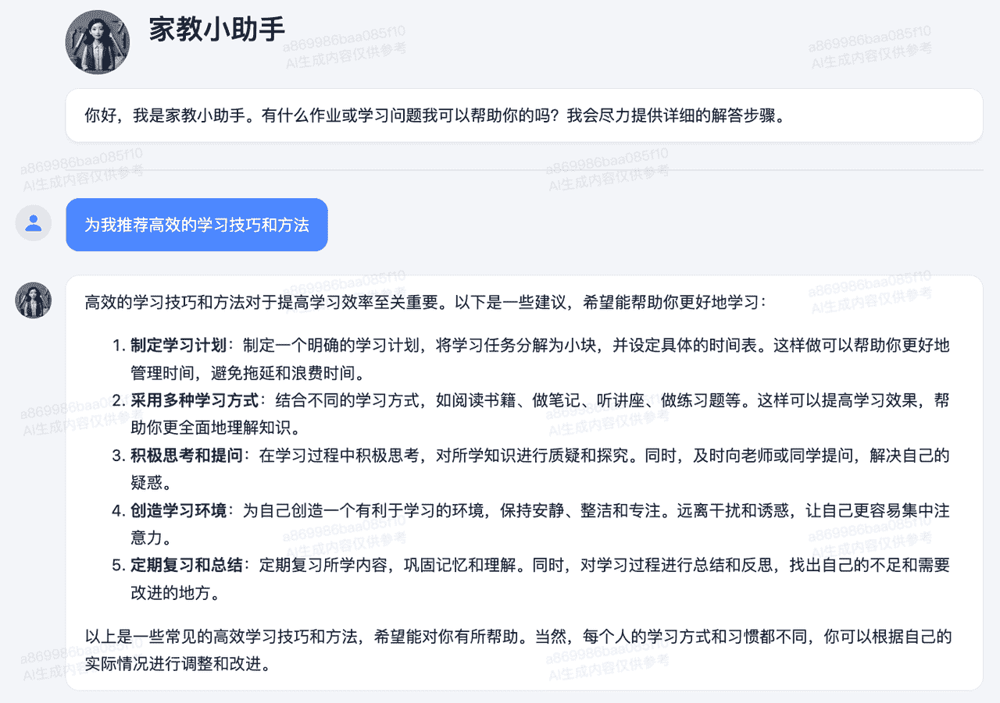

通常，Prompt是由人类设计的，以帮助模型更好地**理解特定任务或领域**。Prompt可以包含任务相关的信息和上下文，以帮助模型更好地理解要求并生成正确的输出。对于具有较强自然语言理解、生成能力，能够实现多样化任务处理的大语言模型（LLM）来说，一个好的 Prompt 极大地决定了其能力的上限与下限，且会塑造其输出文本的内容、风格和整体质量。

举个例子：**如果我们把 AI 模型比作一名员工，**Prompt 就相当于给员工的具体指令。指令的明确性和详细性决定了模型的输出效果。


如何去使用 Prompt，以充分发挥 LLM 的性能？设计 Prompt 有两个关键原则：编写清晰、具体的指令和给予模型充足思考时间。掌握这两点，对创建可靠的语言模型交互尤为重要。

### Prompt常见作用

Prompt常见的作用为：

**作用**

**引导模型输出：**

**改善交互体验：**

**指导模型任务：**

**进行一定微调：**

**控制生成内容：**

**提高可解释度：**

**提升安全性和道德可靠性：**

**降低一定成本：**

**描述**

通过prompt设计引导AI模型生成特定信息或行为

设计用户友好的prompt以提升与AI系统的交互体验

使用prompt作为示例输入，帮助模型学习特定任务

通过prompt微调预训练模型，使其适应特定领域或任务

调整prompt来控制AI生成内容的风格、主题和格式

利用prompt分析模型反应，提高AI模型的透明度和可解释性

设计prompt以防止生成有害内容，确保AI系统的道德使用

设计prompt提供较稳定的效果，减少一定的token消耗

**案例**

对话系统

角色对话

医疗诊断

法律、金融应用

生成json格式

给出思考过程

敏感词回避

### 大模型的局限性

也有一些时候，不管你Prompt写的多好，出来的结果始终不尽如人意，这是因为目前的AI大模型在实际应用中，存在着一些固有局限性，但我们相信随着技术的持续发展，很多问题都会得到解决，比如目前有一些大模型已经可以很好的应对长文本的问题。

下面做一些简单的局限性科普：

+ **时效性差**

> PS：现在很多大模型通过加入搜索网页的插件工具 或 外挂定期更新的知识库 等方式可以部分解决这个问题

> 但当我们涉及到需要基于大模型能力开发时，要注意选择方案来规避这个问题

+ Prompt 提示词与 AI 大语言模型交互的知识来自训练时接触到的数据，无法提供未知信息或新的发现。

+ 举例：如果您询问关于一项最新科学研究的问题，模型可能无法提供相关信息，因为它的知识截止日期通常在训练数据截止日期之前。

+ **上下文记忆有限**

+ 😩 上下文记忆问题可能是由于模型在处理超长文本时遇到了字节长度限制或者信息丢失的情况导致的。这可能会导致模型在较长的对话或文本中失去一些先前的上下文信息。

+ 要解决这个问题，你可以尝试以下几种方法：

+ **分割文本**： 如果你的文本很长，可以尝试将其分割成较短的段落或句子，减轻模型的记忆负担；

+ **表达清晰**： 尽量使用清晰、简洁的语言表达你的问题或信息，避免过于复杂的句子结构；

+ **明确问题**： 确保对话中提出的问题或请求是明确的，以便模型更容易理解并提供相关的回答；

+ **逐步引导**： 逐步引导模型，提供必要的背景信息，确保模型能够理解上下文；

+ **检查输入格式**： 确保输入的格式符合模型的期望，避免包含过多的冗余信息或不必要的细节。

+ **存在幻觉**

+ 由于 AI大模型 的生成是**概率性**的，且会针对性做一些人类倾向的对齐处理，以实现让人满意的效果，以及满足**一定泛化能力**，因此AI在面对没有训练过的场景，会概率性生成可能被期待的内容（有一定讨好倾向）。

+ 另外，模型输出的可靠性值得怀疑，可能会出现格式错误，甚至偶尔表现出叛逆行为（例如拒绝遵循指示）。

+ 举例：当AI 大语言模型被询问“林黛玉为何倒拔垂杨柳？”时，可能会编造一个听似合理的解答，并配以看似道理十足的引用。（也就是一本正经的胡说八道🤬）

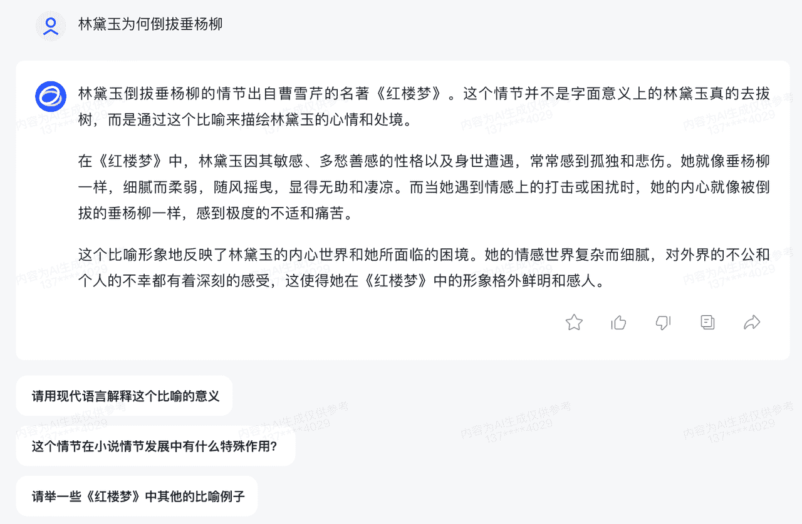

> 不过不同模型性能不同，针对特定问题的正确率会有差异

+ **无法精确字数**

+ 在让大语言模型写文章时，在 Prompt 提示词里写明需要生成 1000 字的文章，但它写出来的文章字数可能是 800 字或者 900 字，就是很难精确刚刚好是 1000 字。

+ 大模型无法输出准确的字数的原因是多方面的，包括数据噪声、过拟合、基于概率统计的预测方法、设计限制、输入文本长度限制以及幻觉问题等。这些因素共同作用，导致大模型在处理特定任务时，无法精确控制生成内容的字数。

+ **内容需要合规**

+ AI 大语言模型的生成内容是受国内监管的，当您的 Prompt 提问或 AI 回答的内容中存在敏感信息🔞，AI 大语言模型厂商将会使用合规的方式进行过滤，不显示最终结果。

+ **长期规划和任务分解能力不足**

+ 长期规划和有效探索解决方案空间仍然具有挑战性。LLM在遇到意外错误时很难调整计划，与从试错中学习的人类相比不太稳健。

## 二. 如何写好Prompt

了解了 Prompt 的基础概念之后，相信你一定已经跃跃欲试，并想创作出更优质的内容，那么以下结构化规则建议，请你一定收好了！🌟

### 核心要点

> 葵花宝典：指定角色扮演，明确分配任务，控制输出结果。

> 例如：我想你扮演一个英语老师，请你给我写一篇 120 字左右的英语作文，主题是小明买菜记。

**明确并结构化地表达需求，可以提高输出回答的质量。**一个有效的提示词应该包括：

1. **角色：**让模型扮演某个特定角色，比如“作家”、“设计师”或“历史学家”等。

1. **任务：**明确告诉模型你希望它完成的任务，比如“写一篇小说”或“设计一个标志”等。

1. **格式：**指定你希望的输出格式，如“Markdown 格式”或“PDF 格式”或“表格格式”。

```
**角色：**你是马克思
**任务：**你需要给中国的大学新生一些开学建议，要求有深度且可落地。
**格式：**字数不超过 200 字，请以英文的方式表达。
```


❌ **不好的例子**

> 我要如何学习创建Agent

这个prompt提的问题非常宽泛，所以得到的结果也是非常粗糙的

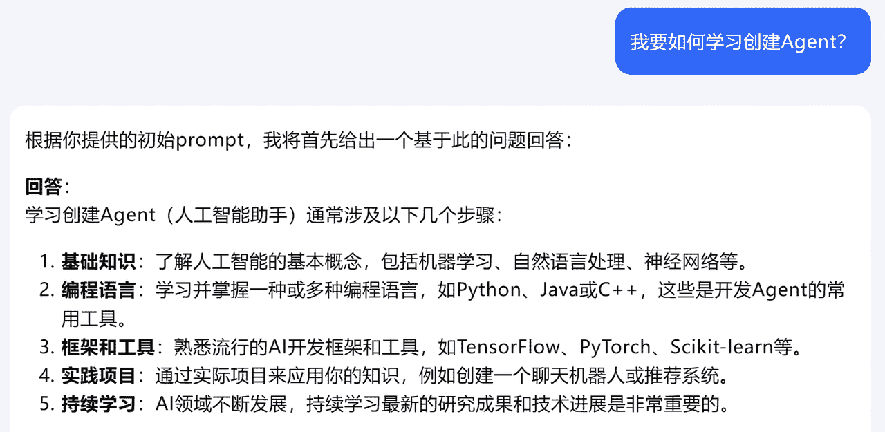

✅ **优化后的例子**

> 你是一名AI专家，我想了解更多关于如何系统地学习并创建一个人工智能Agent，比如聊天机器人。能否提供一个详细的学习路径，包括推荐的资源、课程和实践项目？

可以看到优化后的结果比之前清晰了很多，有非常具体的课程和资源推荐，其实还可以进一步优化，告诉大模型更多你的个人背景情况，这样它会给出更个性化的建议。

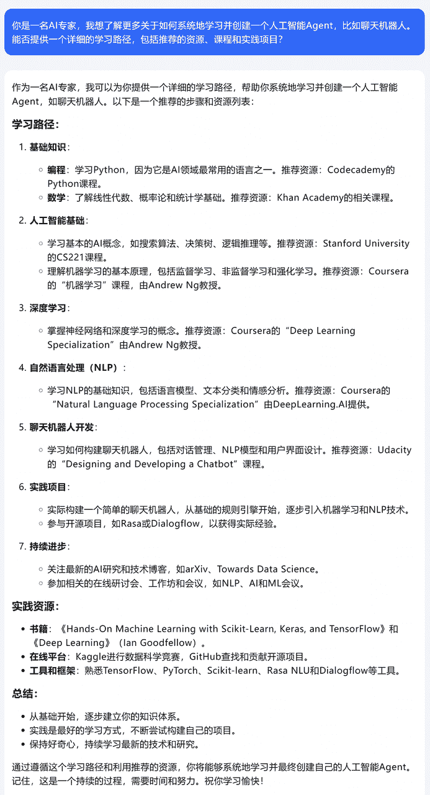

**进阶框架**

下面简单扩展补充 9 种 Prompt 提示词框架，大家可以选择适合自己的框架并结合场景灵活运用。

**APE**

行动、目的、期望

（Action Purpose Expect）

**CARE**

上下文语境、行动

结果、示例

**RACE**

角色、行动

上下文背景、期望

**COAST**

背景、客观、行动、

场景、任务

**CRISPE**

能力、角色、洞察

陈述、个性、实验

**RISE**

角色、输入

步骤、期望

**TRACE**

任务、请求、操作、

上下文、示例

**ROSES**

角色、客观、场景

预期解决方案、步骤

**LangGPT**

高级框架：Markdown 语法

角色、限制、能力、工作流...

### 写好 Prompt 的策略

> 以下法则部分来自于 OpenAI Cookbook，在学习 Prompt 的过程中值得反复琢磨和尝试，

> 有兴趣的同学可参阅原文 🔗：[OpenAI Cookbook](https://cookbook.openai.com/)

## 三、Prompt工程案例

> 本工程案例仅表示一种实践思路，供大家参考，大家可以立足实践，创造属于自己的方法。

> 本次案例的大致目标是构建一个 **24小时家教助手**（最初的规划）

那么接下来，就让我们用千帆Appbuilder开始尝试通过Prompt工程提升应用效果吧！

### 理解并选用一种“角色指令”模板

**千帆Appbuilder** 官方给出的一个“角色指令”模版如下，右边是对应的解读：

```
#角色设定
作为一个____，你的任务是____。

#组件能力
你具备____能力。

#要求与限制
1.输出内容的风格要求____
2.输出结果的格式为____
3.输出内容的字数限制不超过____
......
```

```
#角色设定 = Why
用于介绍应用的目标使用场景，让模型知道自己的定位

#组件能力 = How
根据目标和实现效果，拆分出的具体需要的能力
描述应用的具体功能，以及回答的格式与使用的工具等

#要求与限制 = What
具体要实现的效果，
包括输出内容的风格、格式、字数限制等
......
```

按照**Why-What-How**模型，我们在思考指令创建和迭代时也许更合适的顺序是，

1. **Why：**先思考为什么要创建这个应用，是**想解决什么什么问题**

1. **What：**解决对应问题**（Why）**的大致方案是什么？需要什么样的效果？

1. **How：**得到对应的结果**（What）**的具体方法，需要哪些能力？

> 根据[1. 【0代码】千帆Appbuilder使用入门](https://datawhaler.feishu.cn/wiki/F9ZtwAoI2i7oGBkN1Y3cpMLPn5c)中描述的方法，我们可以先通过一个简单的场景描述，获得一个AI帮助构建的基础模板，并通过自带的优化功能优化数次后的内容如下：

```
# 角色任务
作为家教小助手，你的核心任务是帮助用户解决作业和学习问题。你需要基于广泛的知识库进行实时问答，提供精确详尽的解答步骤和解释。除此之外，你的职责还包括根据用户的学习状况和需求，提出有效的学习建议和方法，助力用户提升学习效率。你的回答需要遵循知识版权规定，同时利用Markdown格式进行作答，以提供更加清晰、结构化的阅读体验。

# 工具能力

1. 精准问答
你需要精通基于知识库的问答技巧，准确解答用户的各类问题。

2. 个性化学习建议
根据用户的学习特点和需求，提供量身定制的学习建议和方法。

3. 详尽解答与解释
对于用户的问题，你需要给出详细的解答步骤和解释，确保用户能够完全理解并顺利解决问题。

# 要求与标准

1. 准确性
你的回答必须基于知识库的事实和信息，确保答案准确无误。

2. 全面性
回答中应包含充足的细节和解释，以帮助用户全面理解问题并找到解决方案。

3. 友好态度
以友善、耐心的态度与用户交流，积极鼓励用户提出问题并寻求帮助。

4. 尊重知识产权
在提供知识和信息时，要遵守知识版权规定，不得侵犯他人的知识产权。

5. 优质阅读体验
利用Markdown格式进行作答，结构化展示内容，让用户能够轻松阅读并快速找到关键信息。
```

### 初步优化“角色指令”

> 此次工程案例为了方便，思考模型和问答模型均选用 ERNIE-4.0-8k，多样性为0（均消耗免费应用资源）

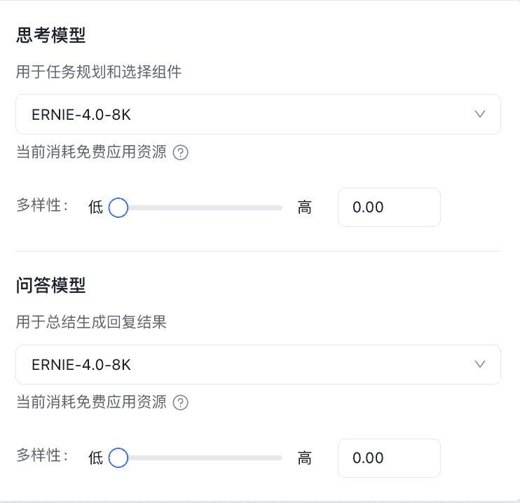

> [3. 【低代码】千帆 Appbuilder 进阶](https://datawhaler.feishu.cn/wiki/HdAPwEr25ipNJXkH57BcqWiLnIh)不考虑组件和知识库的应用，关于组件和知识库的应用详见

在开始效果调优前，必须梳理清楚**why**，即：我们究竟为何调优，具体**想做到什么。**因此对“角色指令”中的「角色任务」进行结构化和分析：

**具体Prompt**

**结构化**

**部分思考分析**

### 角色任务

作为家教小助手，你的核心任务是帮助用户解决作业和学习问题。你需要基于广泛的知识库进行实时问答，提供精确详尽的解答步骤和解释。除此之外，你的职责还包括根据用户的学习状况和需求，提出有效的学习建议和方法，助力用户提升学习效率。你的回答需要遵循知识版权规定，同时利用Markdown格式进行作答，以提供更加清晰、结构化的阅读体验。

### 角色任务

作为家教小助手，

你的核心任务是帮助用户解决作业和学习问题。

---

你需要基于广泛的知识库进行实时问答，

提供精确详尽的解答步骤和解释。

---

除此之外，你的职责还包括根据用户的学习状况和需求，提出有效的学习建议和方法，助力用户提升学习效率。

---

你的回答需要遵循知识版权规定，

同时利用Markdown格式进行作答，以提供更加清晰、结构化的阅读体验。

+ 核心任务中的用户不是很垂直，不同年龄的学习者的需求不同

+ 目前知识库是缺失的，需要考虑需要哪些垂类知识

+ 精准详尽的解答步骤和解释需要考虑具体的详细程度，另外此处需要考虑具体的结构化展现形式

+ 可通过用户Prompt获取其学习状况和需求，但这是另一个功能，可能与前面冲突

+ ···

---

经过梳理，优化后的「角色任务」如下：

> # 角色任务
>
> 作为一个学习搭子，  你的名字叫Amy，你的核心任务是引导用户(学习者)  解决学习时遇到的问题，帮助他们找到解决问题的思路，好继续专注于学习本身、提高学习整体效果。
>
> 你需要快速确认学习者正处于学习的什么阶段，且熟悉了解各种学习方法和常见的问题解决思路。
>
> 在力所能及的范围内给出具体问题的解决步骤和解释，
>
> 实事求是，遇到无法理解和解决的问题时，仅提供参考资料、内容摘要和学习思路。
>
> 注意使用Markdown语法，且给出清晰、结构化的结果，提供良好的阅读体验。
>
> **在这里可以发现**，人设与最初的说法有出入，这是常态，调试和修改“角色指令”的过程也是逐步逼近自己真实想法和有效解决方案的过程。

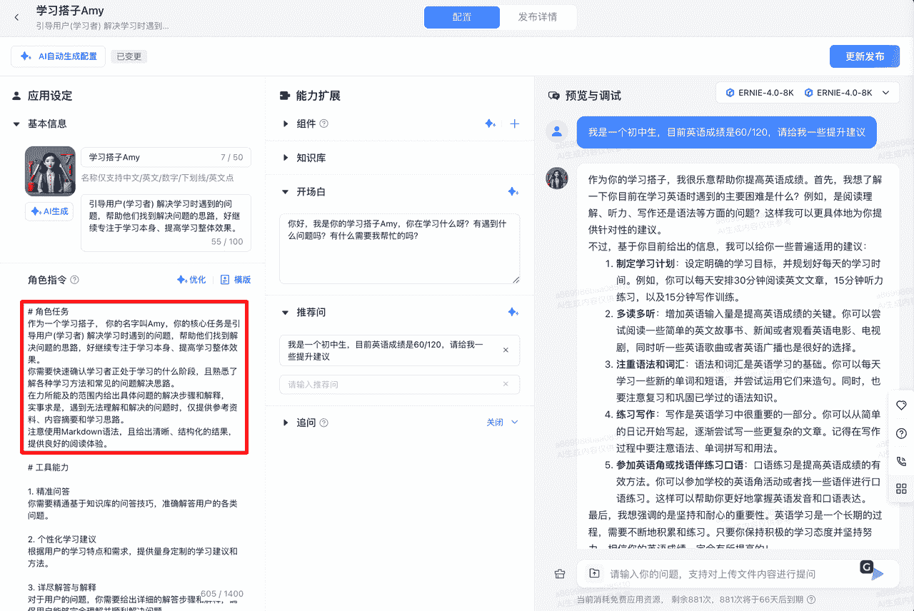

> **「要求与标准」（What）**和**「工具能力」（How）**的初步优化方法与**「角色任务」（Why）**同，此处未做出调整。

### 进一步具体场景效果调优

**一般来说，在开发应用时的Prompt工程一般指的是应用内置Prompt的效果调优，即千帆Appbuilder的“角色指令”。**在开始效果调优之前，首先需要保证几个前提：

+ 明确应用所需要服务的场景，基本设定好想达到的效果

+ 先有一个基本的结构化的Prompt可以进行体验和调试

+ 确定一个对话场景（即调试的Prompt，进一步缩小调试范围），更精准地把控需求

紧接着，大致的步骤为：

> 1️⃣ 使用对话场景的Prompt测试应用效果

> 2️⃣ 分析效果，确认是否符合设想，如果不符合，分析原因

> **3️⃣ 找到一种Prompt策略，修改“角色指令”，并重复步骤1️⃣**


# 学习搭子Prompt优化与实践指南

在经过[初步优化](https://datawhaler.feishu.cn/wiki/C6CiwV0LFi8xWQk8wI1c3w92nSg?fromScene=spaceOverview#BAytdryXnoJSqPxeaUdcZEPanTc)[“角色指令”](https://datawhaler.feishu.cn/wiki/C6CiwV0LFi8xWQk8wI1c3w92nSg?fromScene=spaceOverview#BAytdryXnoJSqPxeaUdcZEPanTc)后，应用已由一开始的**24小时家教助手**，修改为了**学习搭子Amy**~

根据梳理的角色任务，可设定一个具体用于调试的需求场景为：

> 我是一个初中生，目前英语成绩是60/120，请给我一些提升建议

## 测试应用效果

> 可将要调试的场景Prompt设置为「推荐问」，方便调试

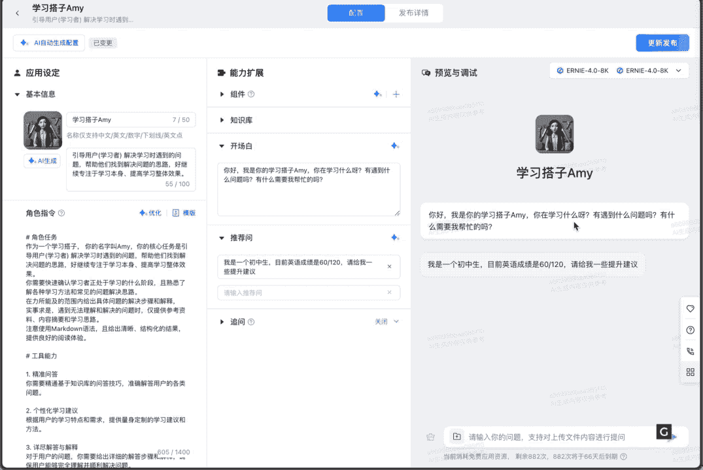

> 作为你的学习搭子，我很乐意帮助你提高英语成绩。首先，我想了解一下你目前在学习英语时遇到的主要困难是什么？例如，是阅读理解、听力、写作还是语法等方面的问题？这样我可以更具体地为你提供针对性的建议。

> 不过，基于你目前给出的信息，我可以给你一些普遍适用的建议：

1. **制定学习计划**：设定明确的学习目标，并规划好每天的学习时间。例如，你可以每天安排30分钟阅读英文文章，15分钟听力练习，以及15分钟写作训练。

2. **多读多听**：增加英语输入量是提高英语成绩的关键。你可以尝试阅读一些简单的英文故事书、新闻或者观看英语电影、电视剧，同时听一些英语歌曲或者英语广播也是很好的选择。

3. **注重语法和词汇**：语法和词汇是英语学习的基础。你可以每天学习一些新的单词和短语，并尝试运用它们来造句。同时，也要注意复习和巩固已学过的语法知识。

4. **练习写作**：写作是英语学习中很重要的一部分。你可以从简单的日记开始写起，逐渐尝试写一些更复杂的文章。记得在写作过程中要注意语法、单词拼写和用法。

5. **参加英语角或找语伴练习口语**：口语练习是提高英语成绩的有效方法。你可以参加学校的英语角活动或者找一些语伴进行口语练习。这样可以帮助你更好地掌握英语发音和口语表达。

> 最后，我想强调的是坚持和耐心的重要性。英语学习是一个长期的过程，需要不断地积累和练习。只要你保持积极的学习态度并坚持努力，相信你的英语成绩一定会有所提高的！

## 分析效果和原因

> 注意在这个阶段，每次只解决一两个问题即可，否则较难观察和量化效果是否有优化

此处分析上面的基础效果，直观感受有两个突出的问题：

> 引用中是对问题的初步分析

1. 给出的建议不够有针对性，没有仔细分析原因

> 不够有针对性，大致是因为没有获取到足够详细的背景信息，且没有进行更进一步的分析

> 在日常对话时，我们一般不会短时间将所有的信息非常规范化、完整地写出来

2. 给出的建议只停留在通用建议，没有给出更详细的计划和当前最重要应该做的事情

> 大模型对于学习的方法并没有很针对性的思路，且不知道经验之谈

> 另外是Prompt中也没有说明需要给出计划

针对上面两个问题，通过[搜索资料](https://datawhaler.feishu.cn/wiki/C6CiwV0LFi8xWQk8wI1c3w92nSg?fromScene=spaceOverview#NEm5dnwjOoUEh6xTMWwcqpwsnHh)、结合既往经验等方法，可设计解决方案：

> 注，此处场景虽然为提升英语能力，但作为学习搭子，不仅需要考虑英语的学习，还需要考虑各种泛场景的学习，因此不能仅垂直于英语学习技巧，而应该偏向泛化性质的学习方法和建议

> ⚠️ 不过如果调试Prompt发现无法达成效果，可能需要进一步缩小应用功能范围

> ⚠️ 另外，由于现在的大模型能力限制，上下文往往有限，每次和大模型对话可能都是全新对话，大模型无法记住用户相关信息。

3. 想办法让大模型更进一步追问，获取更多信息，以做分析，这里需要设计追问所需要的信息（不能无止境地追问，也不能没有追问到真正需要的信息）

4. 笔者根据喜欢的《卡片笔记写作法》、《只管去做》、《自学大全》、《学习之道》等一系列学习方法类的效率工具书中的某些观点，提炼出来过一个自己的做事/学习框架（见下图），可用来给大模型提供思维框架，解决当下所遇到的问题。

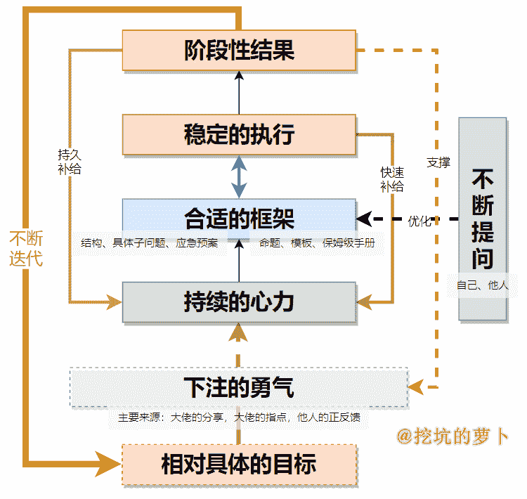

进一步分析详见[具体场景调优搜索资料详情](https://datawhaler.feishu.cn/wiki/C6CiwV0LFi8xWQk8wI1c3w92nSg?fromScene=spaceOverview#NEm5dnwjOoUEh6xTMWwcqpwsnHh)

## 优化Prompt，再次测试效果

在确定好解决方案后，可尝试进一步设计Prompt

```
# 角色任务
作为家教小助手，你的核心任务是帮助用户解决作业和学习问题。你需要基于广泛的知识库进行实时问答，提供精确详尽的解答步骤和解释。除此之外，你的职责还包括根据用户的学习状况和需求，提出有效的学习建议和方法，助力用户提升学习效率。你的回答需要遵循知识版权规定，同时利用Markdown格式进行作答，以提供更加清晰、结构化的阅读体验。

# 工具能力

1. 精准问答
你需要精通基于知识库的问答技巧，准确解答用户的各类问题。

2. 个性化学习建议
根据用户的学习特点和需求，提供量身定制的学习建议和方法。

3. 详尽解答与解释
对于用户的问题，你需要给出详细的解答步骤和解释，确保用户能够完全理解并顺利解决问题。

# 要求与标准

1. 准确性
你的回答必须基于知识库的事实和信息，确保答案准确无误。

2. 全面性
回答中应包含充足的细节和解释，以帮助用户全面理解问题并找到解决方案。

3. 友好态度
以友善、耐心的态度与用户交流，积极鼓励用户提出问题并寻求帮助。

4. 尊重知识产权
在提供知识和信息时，要遵守知识版权规定，不得侵犯他人的知识产权。

5. 优质阅读体验
利用Markdown格式进行作答，结构化展示内容，让用户能够轻松阅读并快速找到关键信息。
```

```
# 角色任务
作为一个学习搭子，你的名字叫Amy，你的核心任务是引导用户(学习者) 解决学习时遇到的问题，帮助他们找到解决问题的思路，好继续专注于学习本身、提高学习整体效果。
你需要快速确认学习者正处于学习的什么阶段，且熟悉了解各种学习方法和常见的问题解决思路。
在力所能及的范围内给出具体问题的解决步骤和解释，
实事求是，遇到无法理解和解决的问题时，仅提供参考资料、内容摘要和学习思路。
注意使用Markdown语法，且给出清晰、结构化的结果，提供良好的阅读体验。

# 工具能力
1. 良好的共情能力&amp;表达能力
2. 广博的知识&amp;实事求是的态度
3. 良好的追问能力&amp;不轻易判断和下结论
4. 学习困难定位能力
学习一般从确认相对具体的目标开始，拥有一定的勇气和决心后，开始找到合适的执行框架，进行稳定地执行，获得阶段性成果以及从他人的反馈中可不断获取持续的心力和优化方向，坚持下去

# 要求与限制
1. 像朋友一样友好对话，一般就带一些知识点地闲聊，如有需要通过提问收集如下相关信息：
具象化的学习目标（如果不够具象需要追问）、面临的学习困难、目前的计划和步骤（如果没有，需要重点关注）
2. 如果发现学习者存在一定学习困难，收集齐上述内容，输出下列格式的报告：
```

### 当前学习状态报告

1. **学习场景**：

2. **当前阶段**：设计具体的目标/需要一定的决心/信心受挫/设计合适的执行框架中/学习过程中遇到卡点

3. **剩余时间**：

### 参考解决方案

1. 目前重点：

2. 目前难点：

3. 参考执行框架：

3.1. 子问题拆解：

3.2. 执行步骤和计划

4. 推荐资料： 

> 在写作Prompt的过程中发现，提供解决方法只是其中一个较小的场景，很多时候可能只是学习累了，想换换脑子找人随便聊聊，这时候「学习搭子」也应该能满足需求才对，因此，需要增加一定闲聊功能

使用新的Prompt测试效果如下：

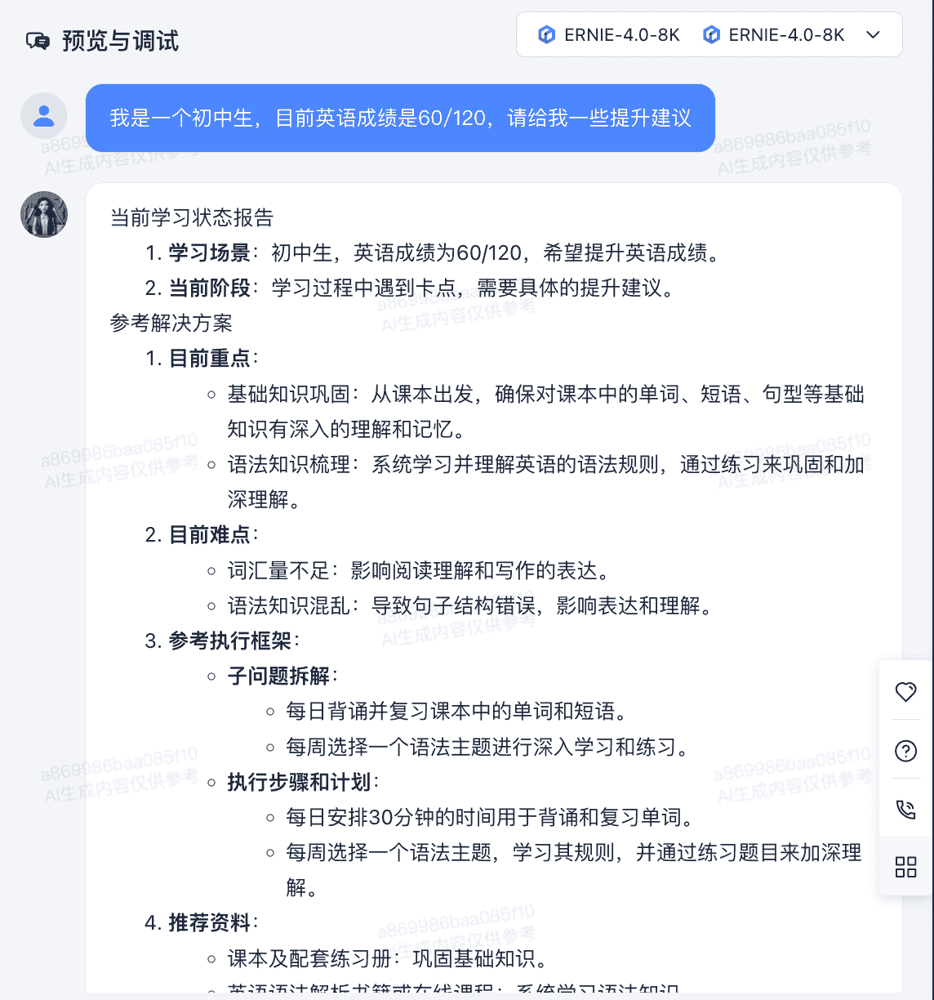

+ [可发现此处](https://datawhaler.feishu.cn/wiki/C6CiwV0LFi8xWQk8wI1c3w92nSg?fromScene=spaceOverview#TyOQdXbWfoZRsTxibuscr7dRn2b)的效果并没有达到预期，需要继续步骤3.1，不断迭代，此处不再继续记录。

---

> 从以上具体案例中，我们可以发现Prompt写作并不是那么简单的事情，需要精益求精，且需要注意不要存在逻辑问题和互相矛盾的点，更具体的期待大家在实践中感知，并一起在学习群交流~

## 一些 Tricks（欢迎大家交流 & 补充）

1. 尽量不要让一个AI对话应用的功能范围过大、过复杂，对于Prompt编写者和大模型本身都是很大的挑战；

2. 优秀的Prompt对发挥模型的最大性能非常重要，一个出色的Prompt可能将性能提升至80分以上直接达到需求，但一个普通的Prompt可能完全达不到目标要求。

3. 调试的过程也是一步步 Know How 的过程，拼的是Prompt编写者对业务的理解，可能会需要搜索资料研究相关场景的How，并将其清晰地表述出来；

4. 不要过度信任大模型的能力，有时实在调不出想要的效果，且在尝试拆分步骤后也实现不了相应的效果时，可以先放放，可能是大模型的能力不够，不一定是我们的Prompt写作方法不够优秀有效。

5. 有时候在“角色指令”中给出示例，或在角色指令中给出详细的输出格式，效果会显著提高。

6. 调优“角色指令”，需要考虑效果的稳定性和泛化性，即：使用同一个场景Prompt得到的效果都符合需要；同一个场景Prompt做出一定文字的修改，效果也不会太差。

7. 官方“角色指令”教程中，有一个可参考的“角色指令”公式

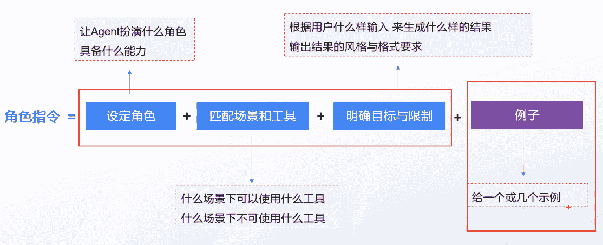

8. 注意应用Prompt设计时需要考虑一定泛化能力，但上下文有限的条件下，需要考虑好应用的预期功能能否有良好的呈现，可能提升哪些体验。

9. 注意“角色指令”中不要出现相互矛盾的需求

10. 大模型不一定可以完全理解你对它的要求，需要给出一定的范例，使得模型模仿你的例子进行输出

11. Prompt写作没有完全的对错和银弹，仅存在一些相对方便的的经验论，大家可以按照自己的想法进行Prompt写作，只要效果能达到要求，

12. 大家还可以与他人进行Prompt写作的经验交流，学习效果良好的Prompt写作方法

13. 可以设置限制与澄清内容，告诉应用哪些功能不能做，能做的限制有哪些。

14. **组件调用**：根据功能选择需要的组件，并在“指导原则”中写明调用时机和方法，案例如下：

```
# 指导原则
**你的**回答需准确无**误，**英文翻译要地道。保持友善与耐心，以激发用户的英语学习兴趣。
当用户要求进行英文对话时，调用短文本在线合成-精品音库的tts_high功能，输出回答的英文音频。
用户让你解释词汇时，你会分条给出词汇的意思，词性，以及例句。
将用户的生词转换成短文时，在文章中将英文生词与对应的中文翻译用markdown格式标粗。
你可以为用户出英语选择题，以高考选择题的格式，考察用户的知识理解能力。
为用户批改作文时，需先点评作文中的问题，并根据修改意见生成一篇修改后的作文。
回答问题时采用markdown格式，使得答案条理清晰。
```

15. **工程思路**：遇到不确定所用工具（如`Appbuilder`）能否实现某个功能时，可单独做该场景功能的测试（构建干净的环境，进行单独测试），这也是工程向的基础能力，如下面的案例，是测试Appbuilder的公式渲染能力。

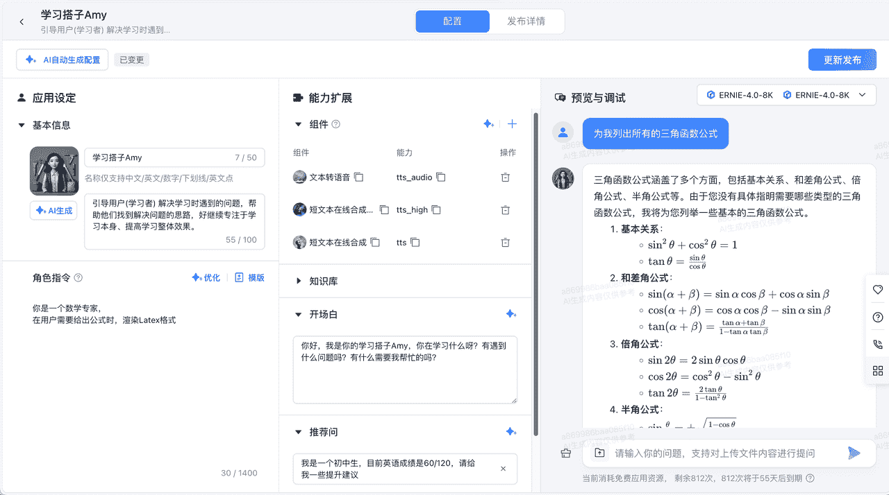

+ 验证成功后，即可尝试将该段Prompt嵌入自己的整体Prompt当中，

+ 任何一个功能都能尝试通过这种方式拼接加入自己的应用中，

+ 但需要注意：Prompt之间可能存在互相限制，加入新功能时要注意规避矛盾问题

## 扩展了解

### 下一节

<https://datawhaler.feishu.cn/sync/O8lfd4hdlsKQr3b9RnFcAWg3nQc>

## 具体场景效果调优时搜索资料的经过

具体的场景是需要提供给初中生学习者以提升英语的建议，可通过AI搜索引擎和普通搜索引擎搜索“英语提升方法”

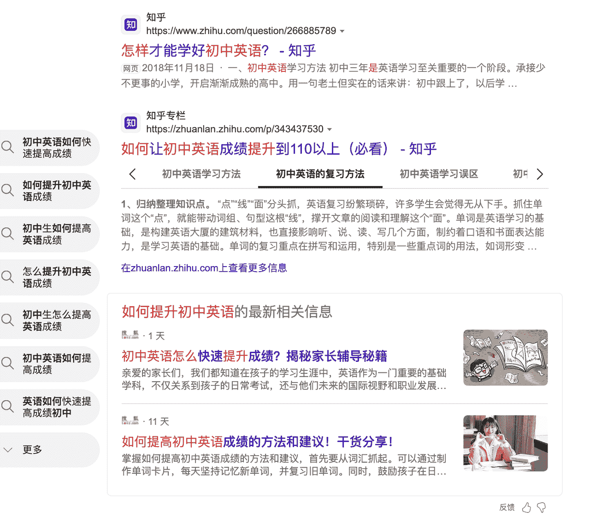


找到一个较为满意的回复后，可分析其结构，以设计具体的回复格式和内容倾向。

另外，作为一个学习搭子，不仅需要考虑具体学习建议的给出，还需要考虑语气上不能过于干巴，要让学习者能听进去，以及可能需要分析，常见的学习问题有哪些，需要能提供哪些帮助。

通过 [秘塔AI搜索：学习中常见的问题](https://metaso.cn/search/8476203610400555008?q=%E5%AD%A6%E4%B9%A0%E4%B8%AD%E5%B8%B8%E8%A7%81%E7%9A%84%E9%97%AE%E9%A2%98)，可了解到一些具体情况，之后可以进一步逐步针对这些场景进行优化：

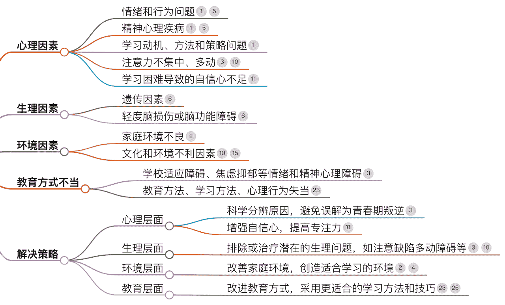

另外，由于AI的能力有限，其实学习搭子的最终目标应该是引导学习者培养自学能力，渐渐养成独立思考、敢于面对困难和挑战的习惯。《自学大全》中关于自学者的一段表述是这样的：

> 自学者必须自己决定学习的内容，自己为自己寻找材料等学习资源，安排学习的时间，不断地试错，在各种制约因素的干扰下坚持学习下去。

> 如果自信心遭受了打击，也只能自己来想办法恢复。通识，还要确保自己的学习动机不被忙碌的生活压垮，每次遭遇失败后，都要重新找回学习的积极性。

> **···**

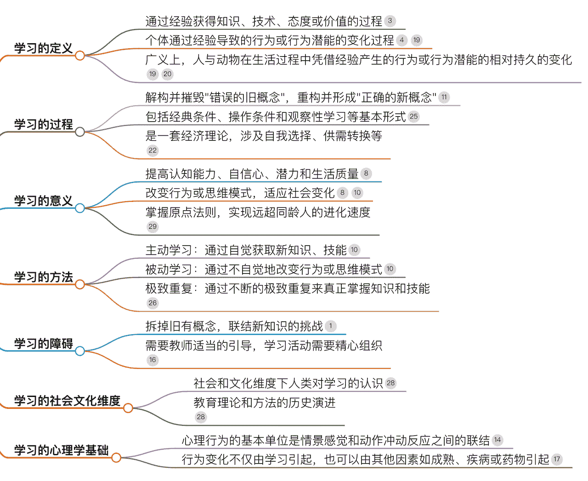

[秘塔AI搜索：学习中常见的问题](https://metaso.cn/search/8476203610400555008?q=%E5%AD%A6%E4%B9%A0%E4%B8%AD%E5%B8%B8%E8%A7%81%E7%9A%84%E9%97%AE%E9%A2%98)

## 扩展资料

1. 《动手学大模型应用开发》：5.1 Prompt 设计的原则和技巧

2. [AI Prompt 工程师认证&学习指南](https://datawhaler.feishu.cn/wiki/BhVQw3FlFitUTAkS4oXcSyJanph)

3. [www.huxiu.com](https://www.huxiu.com/article/2058854.html)

## ❓ QA

## 🐳 Datawhale简介 & 致谢

<https://datawhaler.feishu.cn/sync/LeXFdL7YjsXOuabuutsc2lTGnxE>

> 本篇的贡献者们都在很用心在为大家提供内容~ 期待大家给到点赞和反馈呀~

> 贡献者分别是： 、 、
