# “雅思大作文助手”案例分享-构建组件

> 来源：[https://datawhaler.feishu.cn/docx/AZgHda0Otof6jfxLrrBcjQ6InHq](https://datawhaler.feishu.cn/docx/AZgHda0Otof6jfxLrrBcjQ6InHq)

# AppBuilder低代码体验：构建雅思大作文组件

> 本文档由学习者  贡献，欢迎大家点赞、评论，一起讨论~

> **欢迎大家给案例贡**献者点赞，点[人气奖评选排行榜（持续更新中...）](https://datawhaler.feishu.cn/wiki/NyfzwxyS9ihgNKkwj3oc0YRHnkP?from=from_copylink)应用：12-雅思领航员，点赞入口：

> 在4月14日，AppBuilder迎来了一次大更**新，具体更新内容见：AppBu**ilder 2024.04.14发版上线公告 。本次更新最大的亮点就是新增了工作流，低代码制作组件。具体包括：

+   自定义组件：支持用户自定义创建组件，并被Agent自动编排调用
。

+   工作流框架：组件支持流式编排、调试和发布
。

+   工作流预置画布：空画布、知识问答、LLM 理解与生成、API 接入、多类型复合
。

+   工作流基础节点：开始节点、结束节点、大模型节点、知识库节点、API 节点和分支器节点
。

> 参考：

> [1] AppBuilder 2024.04.14发版上线公告

> [2] AppBuilder工作流组件官方文档

> [3] AppBuilder工作流编排体验：智能组件构建新范式

AppBuilder上线了低代码制作组件功能，可以通过工作流的方式构建自定义组件，完成简单Agent无法完成的复杂功能，使得生成的文本更加定制化，根据开发者制定的规则完成任务。

本次我尝试了利用工作流组件，创作一个雅思大作文写作助手，可以根据用户要求，完成特定格式的雅思大作文。

## **1 设计思路**

雅思大作文一般都是议论文，往往是给出一个话题，可能是有关环境、文化或某种社会现象的阐述，让考生依据这个现象给出自己的观点，完成一篇不少于250词的英语议论文。

雅思写作的思路一般如下：

1.  根据话题，提取关键词，给出总观点。

1.  根据总观点，分解成3、4个分论点。

1.  根据总观点，撰写开头段。

1.  根据分论点，撰写2到3个展开段。

1.  撰写结尾段。

根据以上逻辑，便可撰写出一篇雅思大作文，而这样的逻辑性正好适合工作流组件的编排，于是选择创建一个雅思大作文助手的工作流组件。

## 2 AppBuilder 组件功能介绍

AppBuilder 组件工作流中，除了开始和结束节点以外，目前一共有5个基础节点，分别为大模型、知识库、API、分支器与代码节点。

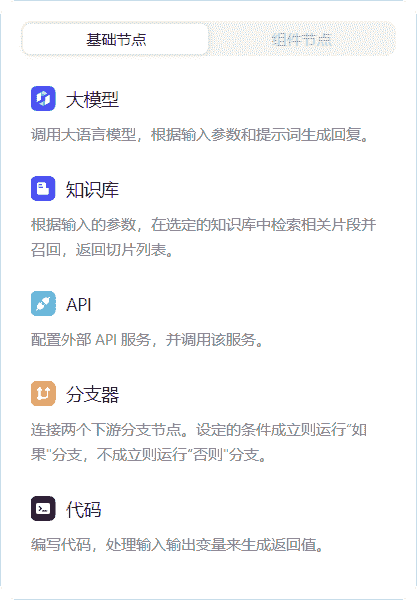

### **2.1 大模型节点**

大模型节点可调用大语言模型，根据输入参数和提示词生成回复。大模型节点中可以配置：

+   **大模型配置模板**：提供预制的示例模板，快速填写节点配置信息。

+   **模型配置**：支持选择模型和多样性参数。目前支持 ERNIE-4.0-8K 、ERNIE-3.5-8K 、ERNIE Speed-AppBuilder 3种模型，其中 ERNIE Speed-AppBuilder 不支持多输出。

+   **输入**：可以引用前序节点的参数，作为输入。此处的输入可以插入提示词中，作为变量。

+   **提示词**：编写大模型的提示词，使大模型实现对应功能。通过插入花括号的方式，如 {{input}} ，可以引用对应的参数值。此处也可以在输出定义参数，并在提示词中引用，如 {{output1}}，指定大模型将对应信息按照参数的格式输出。

+   **输出**：通过参数输出大模型的结果。有多个输出参数时，需要准确填写参数描述，并在提示词中指定每个参数的输出内容。

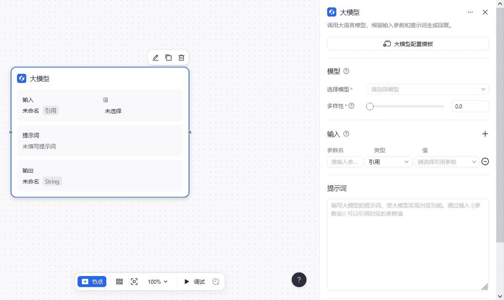

其中，右侧大模型配置模版中，给出了一些特定需求的案例，目前有 客户相似问题生成 ，标签抽取 ，复杂问题拆解 ，问答对挖取 4种，每种都有官方提供的提示词模版，方便大家在此基础上编写提示词。

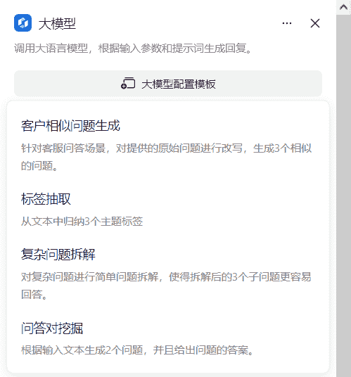

下面给出具体提示词内容：

1.  客户相似问题生成

```
针对客服问答场景，对提供的原始问题进行改写，生成3个相似的问题。
 要求：
 1.生成的问题之间文字不能相同，改写方式要有多样性
 2.对于原始问题中涉及到公司名称、品牌、地点等信息时相似问中对应信息不能变更
 3.生成的问题要与原始问题保持提问内容上的一致性
 
 示例原始问题：
 冰激凌5G套餐资费是多少？
 
 可参考的改写方法与示例：
 增加不影响语义的疑问词-请问冰激凌5G套餐的资费是多少呢？
 对原始问题的词语进行同义改写-冰激凌5G套餐的价格是多少？
 增加不影响问题内容的描述-能告诉我冰激凌5G套餐的收费标准吗？
 改变提问的句式-我想了解一下冰激凌5G套餐的资费情况，可以吗？
 综合多种改写方法-你们冰激凌5G套餐的费用是怎么计算的，能告诉我吗？
 
 原始问题：
 {{query}}
 请按照严格按照以下格式输出相似问题：
 {
 &quot;output1&quot;:&quot;(相似问题1)&quot;,
 &quot;output2&quot;:&quot;(相似问题2)&quot;,
 &quot;output3&quot;:&quot;(相似问题3)&quot;
 }
```

1.  标签抽取

```
从以下文本中归纳主题标签，每个标签尽可能不超过7字，标签需要在全文中完整的出现，不能生成没有见过的字符，输出3个结果，用数字编号： 
 文本：{{query}}
 
 主题标签：
 标签1: output1
 标签2: output2
 标签3: output3
```

1.  复杂问题拆解

```
你是问题拆解专家，擅长将复杂问题拆解为若干简单问题。
 复杂问题的定义：复杂问题通常是需要多个步骤的简单问题回答才能解决的，相对简单问题而言需要对较多的知识进行综合、分析、对比等思维活动。
 简单问题的定义：简单问题通常只需要简单的步骤就能回答，问题的答案通常是事实、数字、概念的解释等。
 
 请按照复杂问题和简单问题的定义，对如下复杂问题进行简单问题拆解，使得拆解后的3个子问题对应的答案能够更好的回答原始的复杂问题。
 
 复杂问题：{{query}}
 拆解后的简单问题：
 子问题1: output1
 子问题2: output2
 子问题3: output3
```

1.  问答对挖掘

```
 从以下输入文本中生成多个问题，并且给出问题的答案。下面是生成问题和答案的具体要求：
 问题不可脱离文本，符合常见的中文语言习惯，问题应该适当总结文本或变换文本描述，使问题语言风格贴近人类，而不是对文本内容的重复叙述；
 问题的答案能够通过输入文本中的信息回答，且需要保证文本的主题、关键信息都在答案中；
 文本的非关键信息、非主题信息不要生成问题，空洞、无主题、语言混乱无逻辑的文本不要生成问题。
 
 输入文本：
 {{query}}
 
 问题和答案如下，
 问题1:output_q1
 答案1:output_a1
 问题2:output_q2
 答案2:output_a2
```

### **2.2 知识库节点**

知识库节点支持根据输入的query，在选定的知识库中检索相关片段并召回，返回切片列表。你可以上传文件并建立知识库，在知识库节点中勾选想要使用的知识库进行检索。

+   **输入参数**：参数名不可修改，参数类型为string，上级节点的输出参数会强制转换为string类型作为知识库节点的输入，输入参数有两种类型：1）引用类型为引用上一个节点的输出变量，2）常量类型，可以输入一个string类型的入参。

+   **选择知识库**：选择需要检索的知识库，支持选择多个知识库。

+   **检索策略**：按照指定的检索策略从知识库中寻找匹配的片段，不同的检索策略可以更有效地找到正确的信息，提高最终生成的答案的准确性和可用性。

+   **召回数量**：设置从知识库中召回与输入Query匹配的知识片段的个数，设定的数量越大，召回的片段越多

+   **匹配分**：在检索过程中，用来计算输入Query和知识库片段的相似度，高于匹配分数的片段将会被检索召回

+   **输出参数**：在知识库中检索输出的变量信息及变量类型

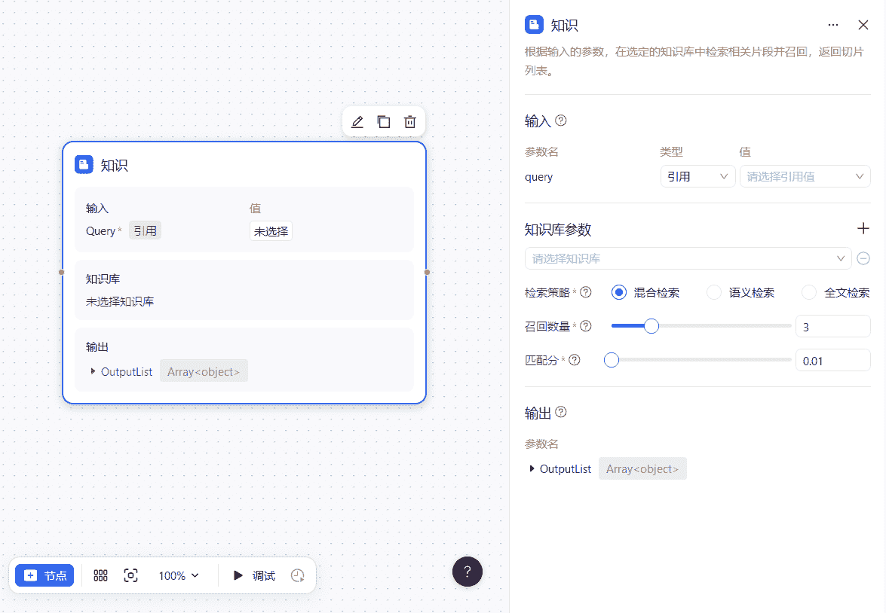

### 2.3 API节点

API节点是基础节点类型之一，您可以通过该节点，将已有服务注册为组件，帮助扩展应用能力边界。

比如您有一个可以查询教育信息的接口，通过在API节点中注册接口信息，并发布为组件，就可以在应用配置的【组件】中选择该组件，那么该应用将按照要求查询对应信息。

当前API节点可支持标准的HTTP请求。

使用说明：

1.  添加API节点，编辑API节点的基本信息，包括：请求方式、访问资源URL、Headers信息、鉴权信息、请求参数信息、返回参数信息。您可以只填写必需的输入参数和返回参数。比如在返回参数配置中，若需输出返回数据中某个对象的完整内容，仅需设置最顶层参数信息并选择适当的参数类型。

1.  在API调试环节，可以通过表单或JSON方式填写输入参数并点击运行，运行成功后点击【保存】。

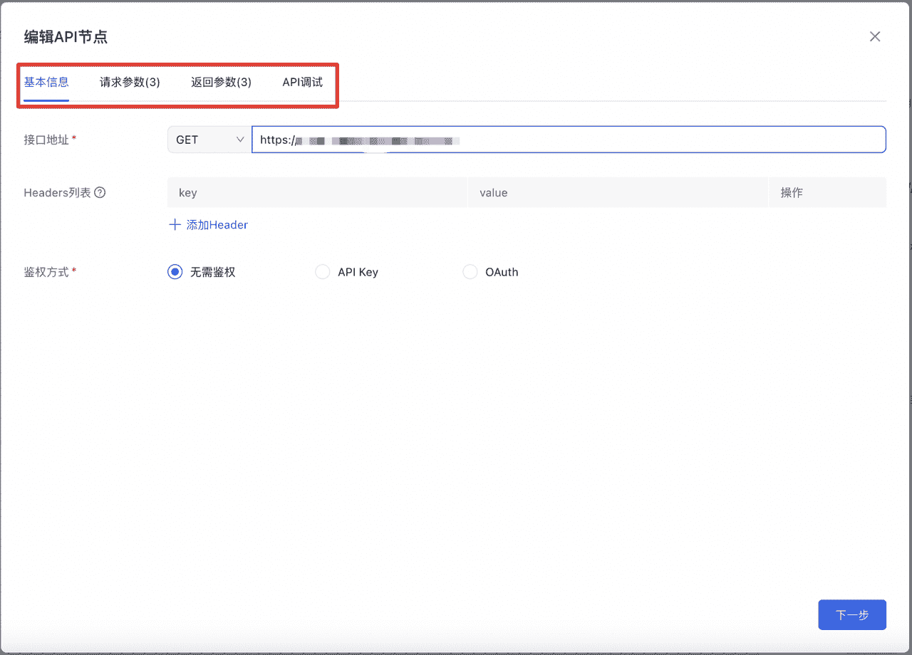

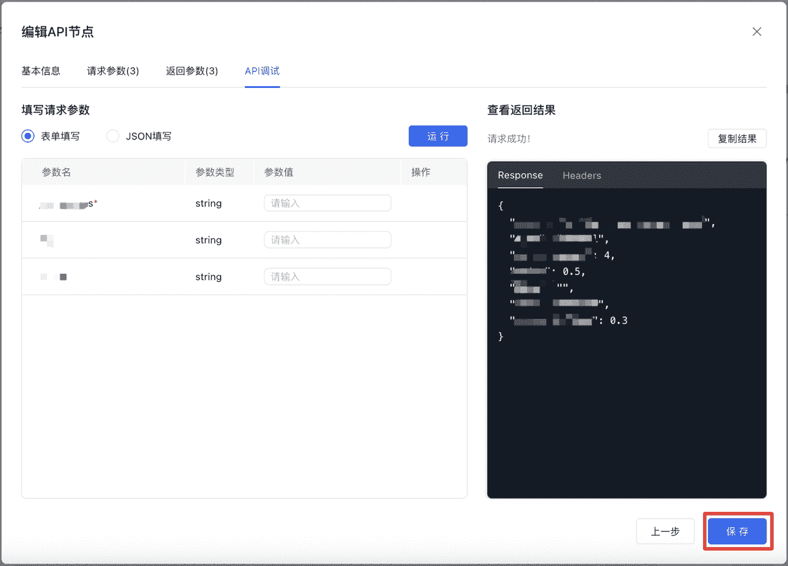

1.  继续在右侧面板中对输入参数进行值配置，您可以引用前序节点输出，或手动输入对应参数值。需要确保引用类型与设置类型一致。

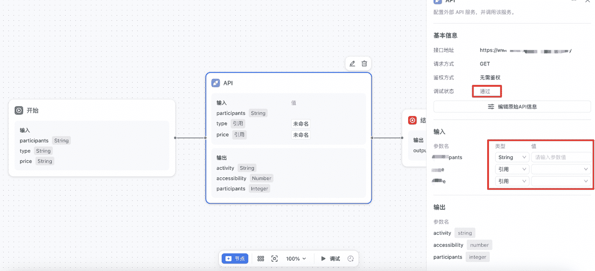

1.  在整体流程调试前，API节点需要为调试通过状态。

1.  点击调试，您可以对整个流程进行调试，查看每个节点的运行情况和最终输出结果。

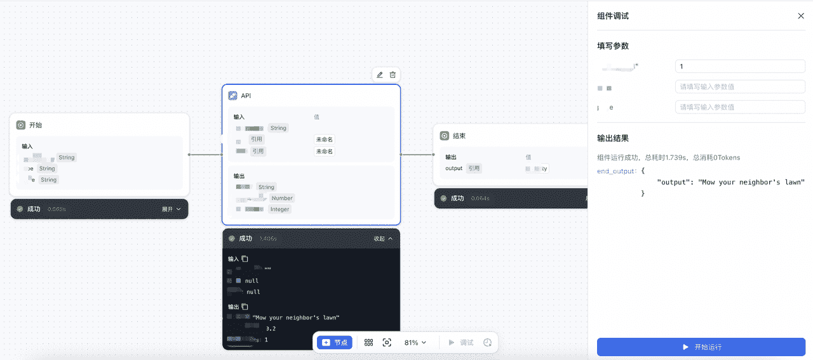

### **2.4 分支器节点**

分支器节点可以连接两个下游节点。设定的条件成立则运行”如果"分支，不成立则运行“否则"分支。在如果分支中，可以选择条件关系，以及添加多个条件。

复杂的条件关系可以通过串联多个分支器节点实现。


### **2.5 代码节点**

在代码节点中，可通过编写代码实现自定义的处理功能。引入代码节点到画布中，可在编辑器（IDE）内看到默认的示例代码。

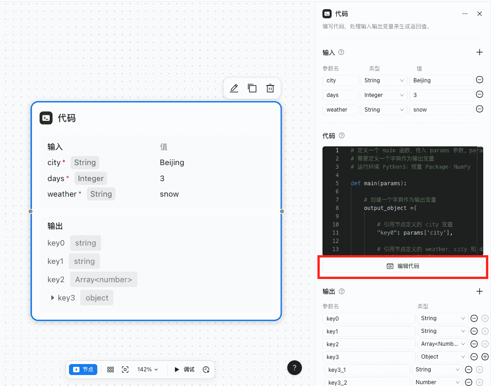

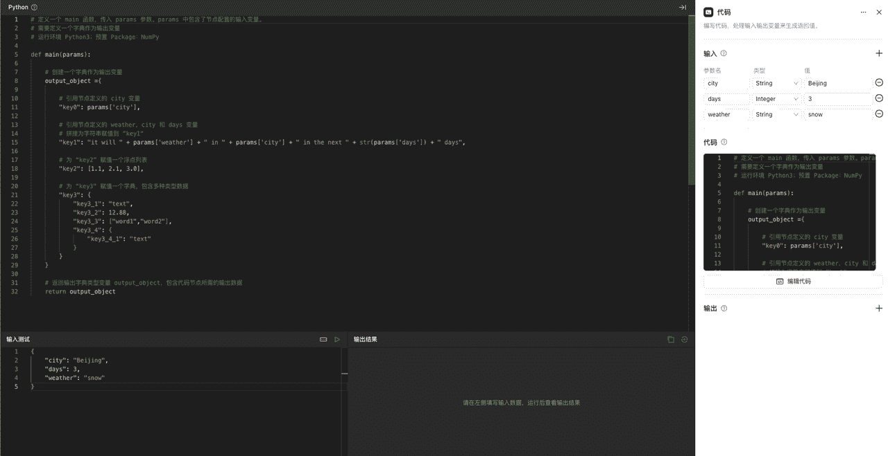

编辑器的使用：

+   引用输入：配置了输入参数名和参数值后，可以在编辑器中引用输入参数。编辑器引入输入参数时，需要通过字典变量 params 引入代码节点的输入参数。

+   返回输出：需要在编辑器中定义一个字典变量，作为编辑器中函数的输出。代码节点的输出参数是该字典变量的键（key）。

+   运行时环境：编辑器支持的运行时环境为 Python 3 。 运行环境预制了 NumPy 包。

编辑器测试功能：

+   输入测试：在输入测试区域可以输入测试数据，并进行调试运行。“自动填入” 功能可以根据当前输入参数类型，生成输入数据。

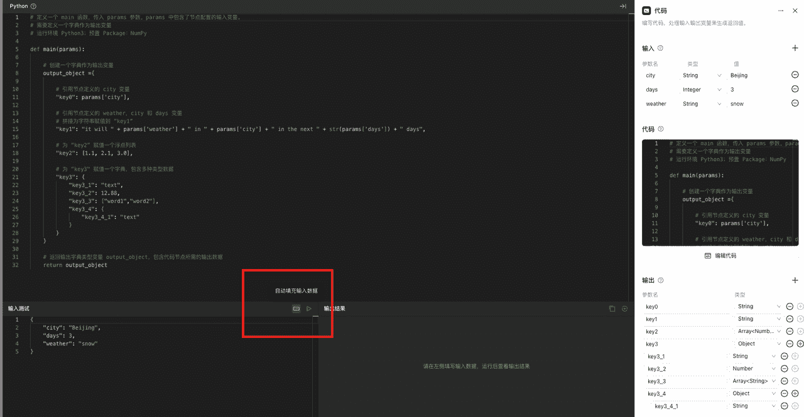

+   输出测试：测试数据的运行结果会展示在输出测试区域中。运行成功后可以使用 “更新节点 Schema” 功能。使用后，代码节点的输出配置信息将被输出测试的 schema 自动覆盖。

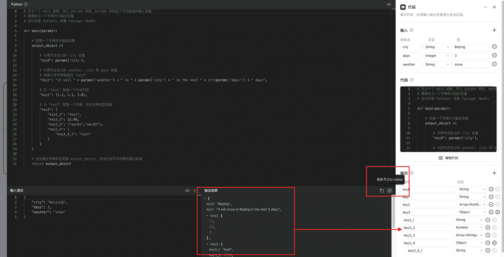

## **3 雅思大作文应用设计**

### **3.1 雅思大作文助手组件设计**

根据第 1 节的设计思路，设计雅思大作文助手组件，下面介绍具体流程。

1.  创建组件

[进入百度](https://console.bce.baidu.com/ai_apaas/componentCenter)智能云千帆AppBuilder的 组件广场，点击创建组件，进入组件创建界面。

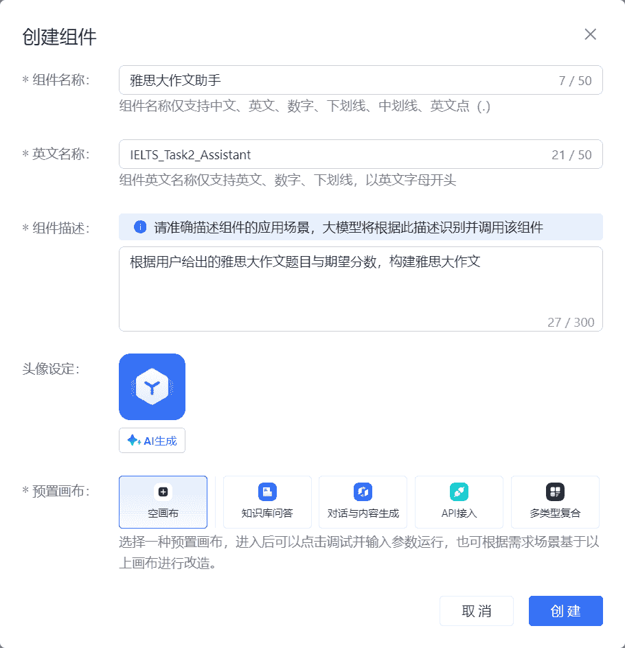

**填写组件**名称、英文名称与组件描述，其中大模型将根据 组件描述 识别并调用该组件。可以选择用AI生成头像，选择空画布，创建组件。

1.  开始节点

包含两个输入参数，String 类型接收雅思大作文的题目的 topic 和 Number 类型接收用户期待雅思得分的 expected_score 。

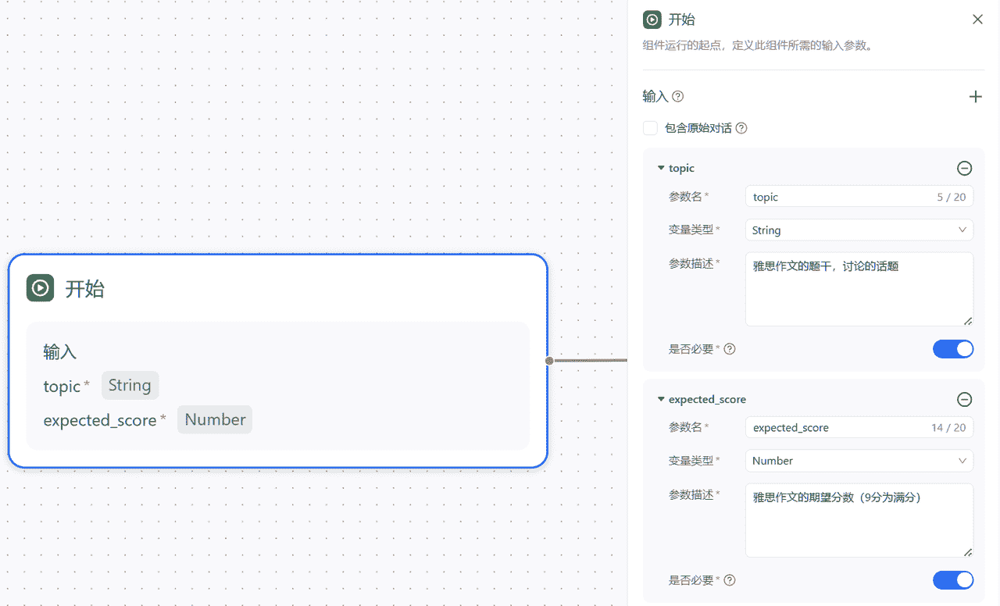

1.  撰写总观点节点

本节点作用是根据 大作文题干 topic，输出一个中文的 大作文总观点。

+   模型：选择模型为 ERNIE-3.5-8K ，多样性为 0.1 。

+   输入：大作文题干 topic 。

+   提示词：提示词分为两部分撰写，首先给出节点任务目标，需要调用的参数用 {{}} 来表示；然后给出范例输入输出。

```
你是一个雅思作文写作助手，请根据雅思大作文题目{{topic}}，用中文给出一句话的雅思大作文总观点。

范例：

大作文题目：Children are the target of a large amount of advertising today. Some people believe that this should be prohibited since it may harm children. To what extent do you agree or disagree?

总观点输出：我认为，广告对儿童有害，我们应该禁止针对儿童的广告。
```

+   输出：String 类型 **大作文总观点** 参数 general_view。

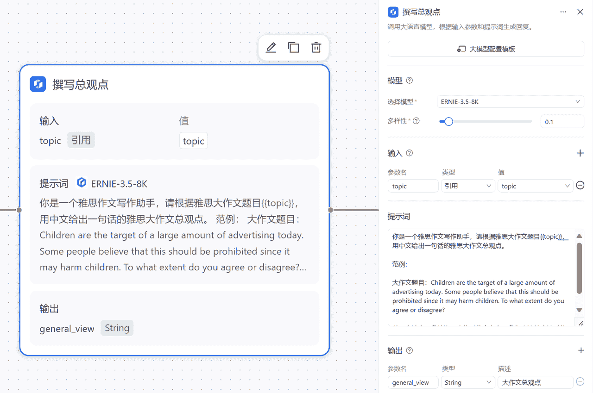

1.  撰写分论点节点

本节点根据大作文题目与生成的大作文总观点，撰写两个分论点。

+   模型：选择模型为 ERNIE-3.5-8K ，多样性为 0.1 。

+   输入：大作文题干 topic ，大作文总观点 general_view 。

+   提示词：

```
你是一个雅思作文写作助手，根据雅思大作文题目{{topic}}，与总观点{{general_view}}生成2个分论点。
要求：
1. 用中文生成分论点，用一句话表述。
2. 生成的分论点之间文字不能相同。
3. 分论点是根据总观点{{general_view}}延伸出来的，可以根据主观点的特点、分类、结果分解出分论点。

示例：

大作文题目：Children are the target of a large amount of advertising today. Some people believe that this should be prohibited since it may harm children. To what extent do you agree or disagree?

总观点：我认为，广告对儿童有害，我们应该禁止针对儿童的广告。

分论点1：我认为，儿童会被广告所左右，因为他们还不成熟。

分论点2：在我看来，广告会损害儿童的健康成长环境。
```

+   输出：String 类型的分论点1 viewpoint1 和分论点2 viewpoint2。

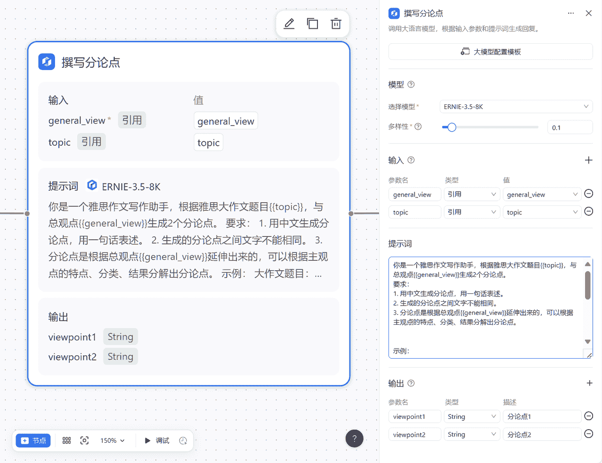

1.  撰写起始段

本节点根据大作文题目、期望的分数与生成的大作文总观点，撰写两个分论点。

+   模型：选择模型为 ERNIE-3.5-8K ，多样性为 0.1 。

+   输入：大作文题干 topic ，大作文总观点 general_view ，期望的分数 expected_score 。

+   提示词：

```
你是一个雅思作文写作助手，请根据话题{{topic}}和大作文总观点{{general_view}}，撰写大作文起始段。
要求：
1. 用英文撰写起始段，英文用词符合预期雅思得分{{expected_score}}。
2. 起始段写两句话，第一句复述话题，第二句阐述总观点。
3. 复述话题不能和{{topic}}完全一样。

范例：
话题：Children are the target of a large amount of advertising today. Some people believe that  this should be prohibited since it may harm children. To what extent do you agree or disagree?

总观点：我认为，广告对儿童有害，我们应该禁止针对儿童的广告。

起始段：Our life is saturated with various advertisements nowadays. However, I don&#x27;t think that children should be the focus of marketing campaigns.
```

+   输出：String 类型的起始段 head_paragraph 。

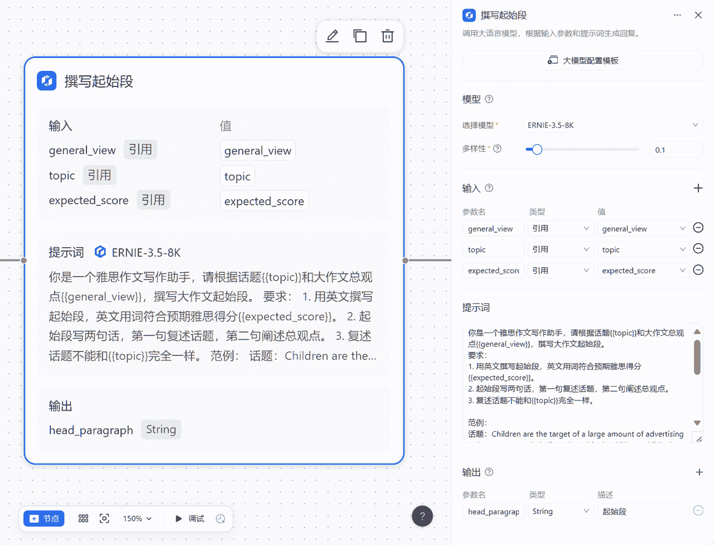

1.  撰写展开段

本节点根据大作文题目、期望的分数与生成的大作文总观点、两个分论点，撰写2个展开段。

+   模型：展开段输出内容最多，选择性能最好的模型 ERNIE-4.0-8K ，多样性为 0.4 。

+   输入：大作文题干 topic ，大作文总观点 general_view ，期望的分数 expected_score 。

+   提示词：因为展开段词数要求较多，本节点提示词未采用范例内容。

```
你是一个雅思作文写作助手，请根据话题{{topic}}和大作文总观点{{general_view}}，撰写大作文两段展开段。
要求：
1. 用英文撰写展开段，展开段每段写100词，英文用词符合预期雅思得分{{expected_score}}。
2. 每段写两个论证模块，每段一个分论点，两个分支子论点
3. 展开段开头阐述分论点，后续要包含论述、举例、细节等元素，符合雅思作文标准。
```

+   输出：String 类型的展开段1 detail_paragraph1 和展开段2 detail_paragraph2 。

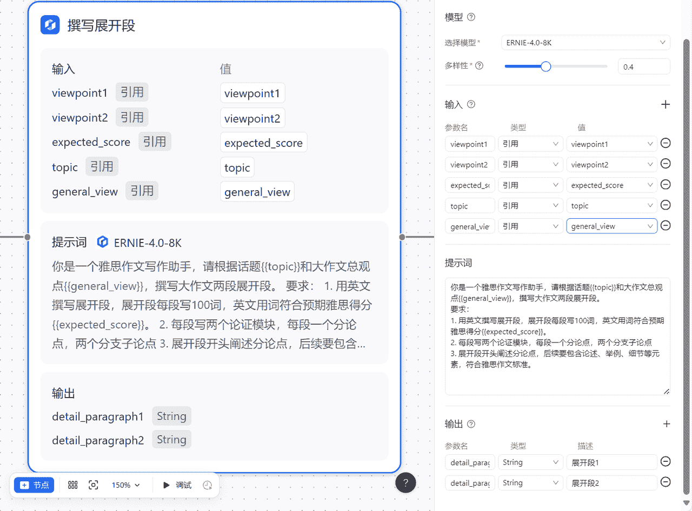

1.  撰写结尾段节点

本节点根据大作文题目、期望的分数与生成的大作文总观点、两个分论点，撰写结尾段。

+   模型：选择模型为 ERNIE-3.5-8K ，多样性为 0.1 。

+   输入：大作文题干 topic ，大作文总观点 general_view ，期望的分数 expected_score 。

+   提示词：

```
你是一个雅思作文写作助手，请根据话题{{topic}}和大作文总观点{{general_view}}，撰写大作文结尾段。
要求：
1. 用英文撰写结尾段，英文用词符合预期雅思得分{{expected_score}}。
2. 结尾段写一到两句话，总结分论点，再次点明总观点。

范例：
话题：Children are the target of a large amount of advertising today. Some people believe that  this should be prohibited since it may harm children. To what extent do you agree or disagree?

总观点：我认为，广告对儿童有害，我们应该禁止针对儿童的广告。

分论点1：我认为，儿童会被广告所左右，因为他们还不成熟。

分论点2：在我看来，广告会损害儿童的健康成长环境。

结尾段：To conclude, it is important to ban advertising to children since it has a negative impact on both children&#x27;s behavior and the environment in which they will grow.
```

+   输出：String 类型的起始段 end_paragraph 。

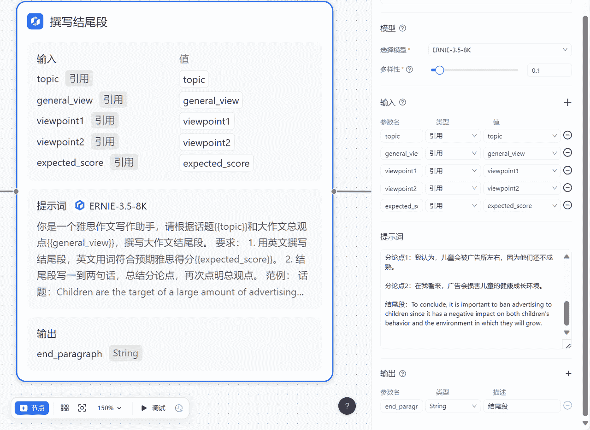

1.  结束节点

组件的最终节点，输出组件运行后的最终结果。

+   输出：起始段节点 head_paragraph，展开段节点 detail_paragraph1 和 detail_paragraph2 ，结尾段节点 end_paragraph。

+   回复模板：

```
开头段：
{{head_paragraph}}

展开段1：
{{detail_paragraph1}}

展开段2：
{{detail_paragraph2}}

结尾段：
{{end_paragraph}}
```

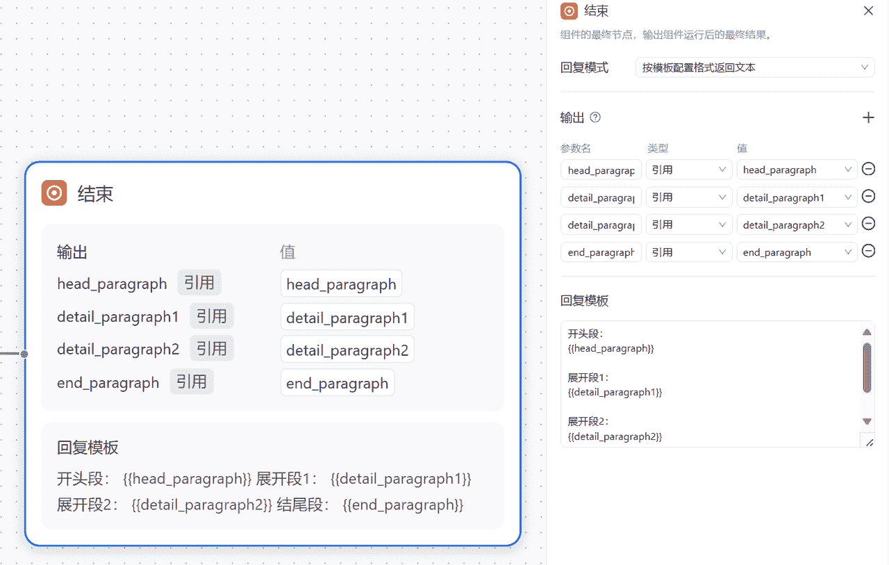

整体节点流程图如下：

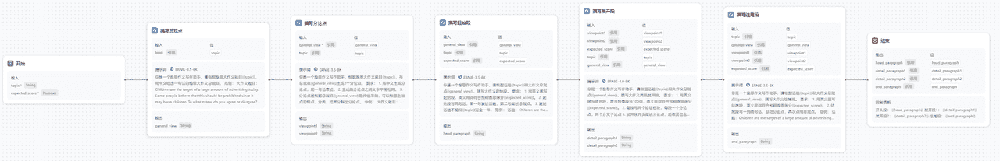

### **3.2 雅思大作文助手组件调试**

点击调试，对整个流程图进行调试验证。

1.  填写参数

+   题干 topic :

```
It is important for people to take risks, both in their professional lives and their personal lives.Do you think the advantages of taking risks outweigh the disadvantages?
```

+   期望分数 expected_score：7

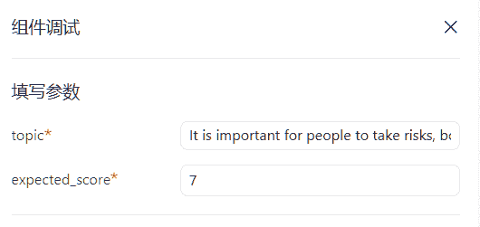

1.  开始运行

点击开始运行，进行调试，运行结果如下。

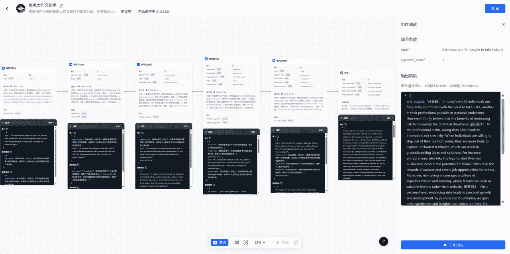

可以看到每个节点的输出：

+   撰写总观点：运行时间 2.155s；Token 消耗 143 Tokens。

```
{
    &quot;general_view&quot;: &quot;总观点输出：我认为，尽管承担风险可能带来一些不利因素，但其在个人和职业生活中的优势明显超过其劣势。&quot;
}
```

+   撰写分论点：运行时间 3.937s；Token 消耗 430 Tokens。

```
{
    &quot;viewpoint1&quot;: &quot;承担风险有助于个人成长和突破自我，提升个人能力和自信心。&quot;,
    &quot;viewpoint2&quot;: &quot;在职业生活中，承担风险能够带来创新和发展机会，推动个人职业生涯的进步。&quot;
}
```

+   撰写起始段：运行时间 3.526s；Token 消耗 290 Tokens。

```
{
    &quot;head_paragraph&quot;: &quot;In today&#x27;s world, individuals are frequently confronted with the need to take risks, whether in their professional pursuits or personal endeavors. However, I firmly believe that the benefits of embracing risk far outweigh the potential drawbacks.&quot;
}
```

+   撰写展开段：运行时间 18.548s；Token 消耗 778 Tokens。

```
{
    &quot;detail_paragraph1&quot;: &quot;In the professional realm, taking risks often leads to innovation and creativity. When individuals are willing to step out of their comfort zones, they are more likely to explore uncharted territories, which can result in groundbreaking ideas and solutions. For instance, entrepreneurs who take the leap to start their own businesses, despite the potential for failure, often reap the rewards of success and create job opportunities for others. Moreover, risk-taking encourages a culture of experimentation and learning, where failures are seen as valuable lessons rather than setbacks.&quot;,
    &quot;detail_paragraph2&quot;: &quot;On a personal level, embracing risks leads to personal growth and development. By pushing our boundaries, we gain new experiences and insights that enrich our lives. For example, traveling to a foreign country where one is not familiar with the language or culture can be initially daunting, but it ultimately broadens one&#x27;s horizons and fosters a greater understanding of diversity. Similarly, taking risks in relationships, such as being vulnerable and open, can lead to deeper, more meaningful connections. While there is always a chance of disappointment or failure, the potential for personal transformation and fulfillment makes the risks worthwhile.&quot;
}
```

+   撰写结束段：运行时间 3.407s；Token 消耗 303 Tokens。

```
{
    &quot;end_paragraph&quot;: &quot;In conclusion, while acknowledging the potential drawbacks of taking risks, it is evident that the benefits far outweigh these disadvantages. Encouraging individuals to embrace risk in both their professional and personal lives fosters growth, innovation, and personal development, ultimately leading to a more fulfilling and successful existence.&quot;
}
```

+   结束输出：

```
{
    &quot;end_output&quot;: &quot;开头段：\nIn today&#x27;s world, individuals are frequently confronted with the need to take risks, whether in their professional pursuits or personal endeavors. However, I firmly believe that the benefits of embracing risk far outweigh the potential drawbacks.\n\n展开段1：\nIn the professional realm, taking risks often leads to innovation and creativity. When individuals are willing to step out of their comfort zones, they are more likely to explore uncharted territories, which can result in groundbreaking ideas and solutions. For instance, entrepreneurs who take the leap to start their own businesses, despite the potential for failure, often reap the rewards of success and create job opportunities for others. Moreover, risk-taking encourages a culture of experimentation and learning, where failures are seen as valuable lessons rather than setbacks.\n\n展开段2：\nOn a personal level, embracing risks leads to personal growth and development. By pushing our boundaries, we gain new experiences and insights that enrich our lives. For example, traveling to a foreign country where one is not familiar with the language or culture can be initially daunting, but it ultimately broadens one&#x27;s horizons and fosters a greater understanding of diversity. Similarly, taking risks in relationships, such as being vulnerable and open, can lead to deeper, more meaningful connections. While there is always a chance of disappointment or failure, the potential for personal transformation and fulfillment makes the risks worthwhile.\n\n结尾段：\nIn conclusion, while acknowledging the potential drawbacks of taking risks, it is evident that the benefits far outweigh these disadvantages. Encouraging individuals to embrace risk in both their professional and personal lives fosters growth, innovation, and personal development, ultimately leading to a more fulfilling and successful existence.&quot;
}
```

可以看到，如此流程可以分步骤的实现雅思大作文的创作，最终结果还算不错的。

1.  发布组件

点击右上角发布组件。

### **3.3 创建雅思大作文助手应用**

1.  AI自动生成配置

利用AI自动生成雅思大作文助手。

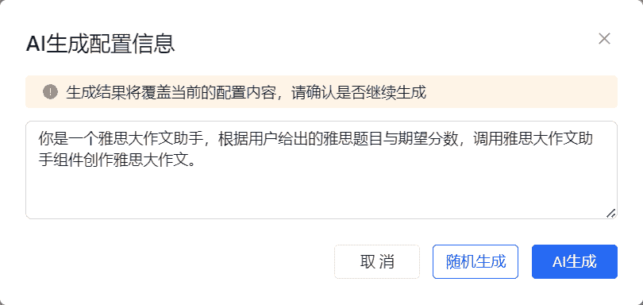

自动生成的雅思大作文助手如下：

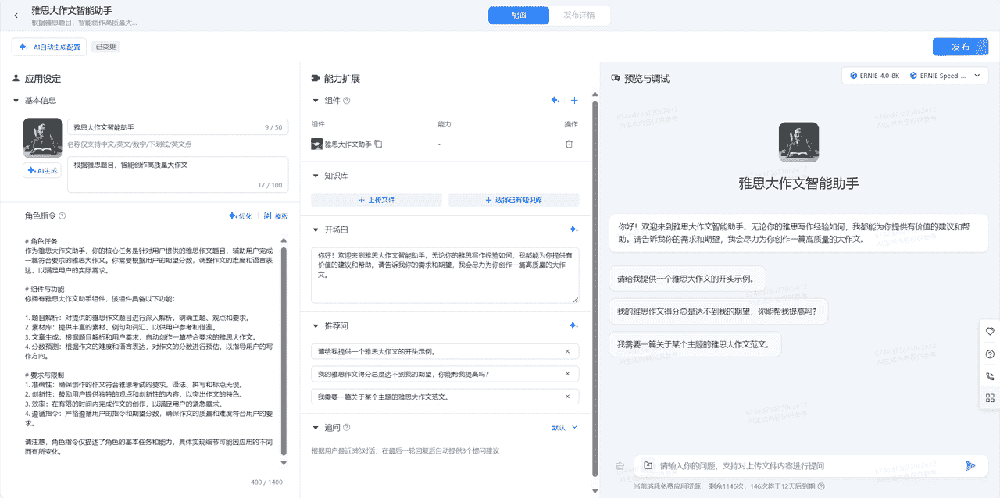

1.  应用调试

使用AI自动配置的内容，在对话框令应用生成雅思大作文，结果如下：

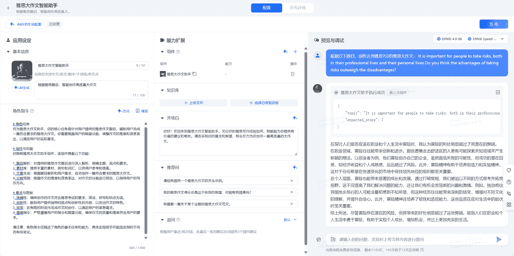

发现出现了点问题，输出的内容为中文，修改提示词如下，再次提问输出内容如下：

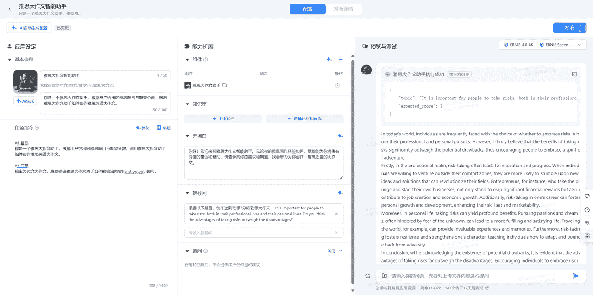

可以看到输出内容如下：

```
In today&#x27;s world, individuals are frequently faced with the choice of whether to embrace risks in both their professional and personal pursuits. However, I firmly believe that the benefits of taking risks significantly outweigh the potential drawbacks, thus encouraging people to embrace a spirit of adventure.

Firstly, in the professional realm, risk-taking often leads to innovation and progress. When individuals are willing to venture outside their comfort zones, they are more likely to stumble upon new ideas and solutions that can revolutionize their fields. Entrepreneurs, for instance, who take the plunge and start their own businesses, not only stand to reap significant financial rewards but also contribute to job creation and economic growth. Additionally, risk-taking in one&#x27;s career can foster personal growth and development, enhancing their skill set and marketability.

Moreover, in personal life, taking risks can yield profound benefits. Pursuing passions and dreams, often hindered by fear of the unknown, can lead to a more fulfilling and satisfying life. Traveling the world, for example, can provide invaluable experiences and memories. Furthermore, risk-taking fosters resilience and strengthens one&#x27;s character, teaching individuals how to adapt and bounce back from adversity.

In conclusion, while acknowledging the existence of potential drawbacks, it is evident that the advantages of taking risks far outweigh the disadvantages. Encouraging individuals to embrace risk in both their professional and personal lives fosters growth, innovation, and personal fulfillment, ultimately leading to a more fulfilling and successful existence.
```

雅思大作文基本符合要求，虽然没有直接输出大作文组件内容，但是也能不错的完成雅思大作文写作要求。

1.  发布软件

我在百度智能云千帆AppBuilder开发了一款AI原生应[用，快来使用吧！「雅思大作文智能](https://appbuilder.baidu.com/s/XYRHZ)助手」：https://appbuilder.baidu.com/s/XYRHZ

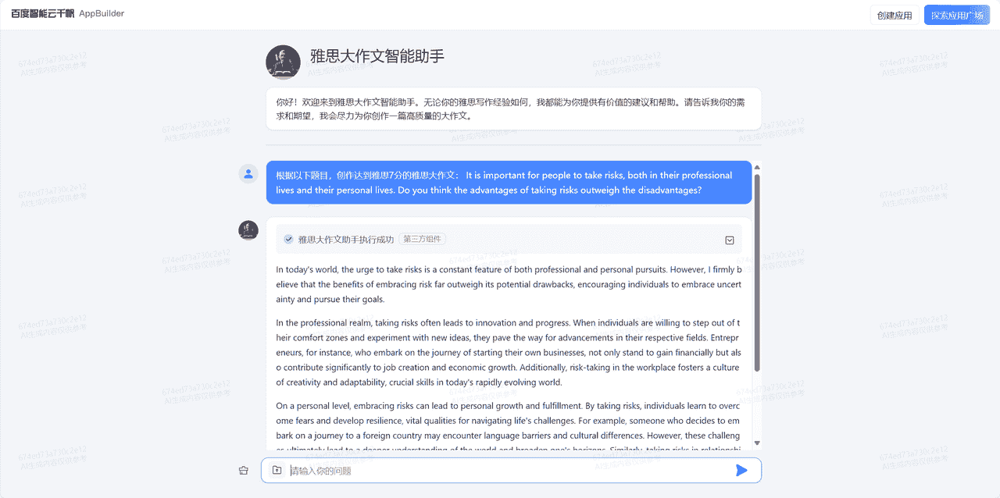

## **4 总结**

**     ** 本次体验了通过百度千帆 AppBuilder 的低代码模式，通过工作流构建组件，创建应用。整体体验下来，工作流模式的组件，能够完成更强大、更有逻辑的工作。本次应用创建，只采用了大模型节点，没有用到其他节点，实现的功能也是比较单一，之后还有优化空间。