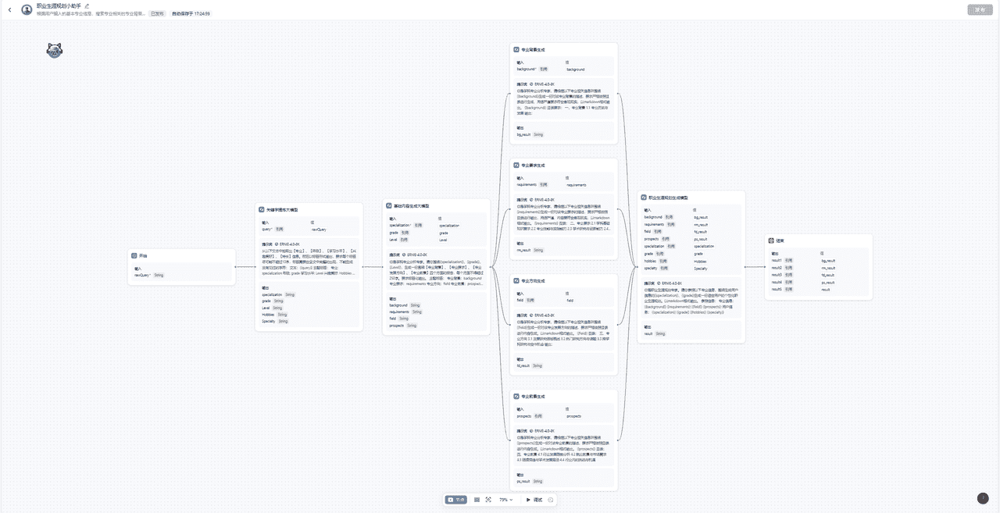
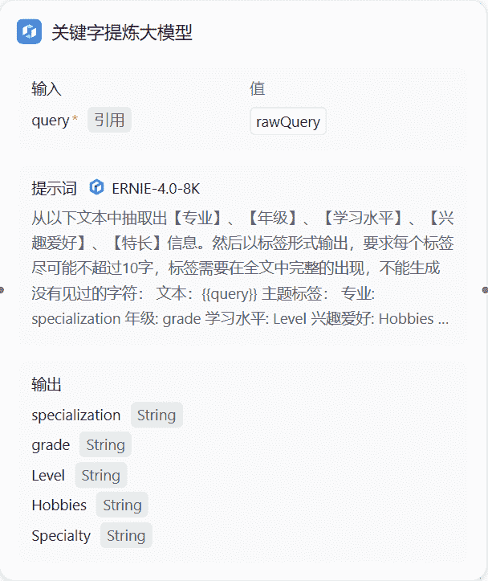
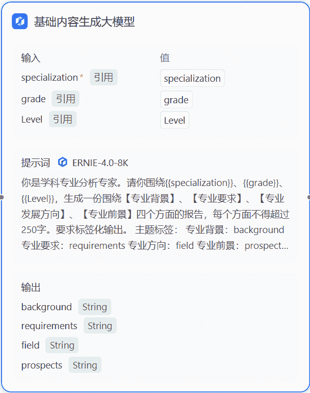
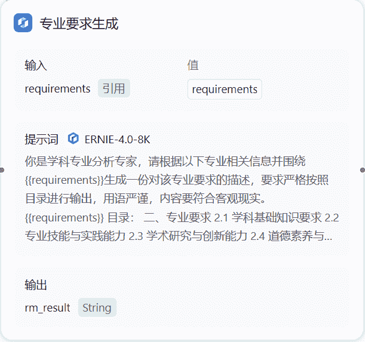
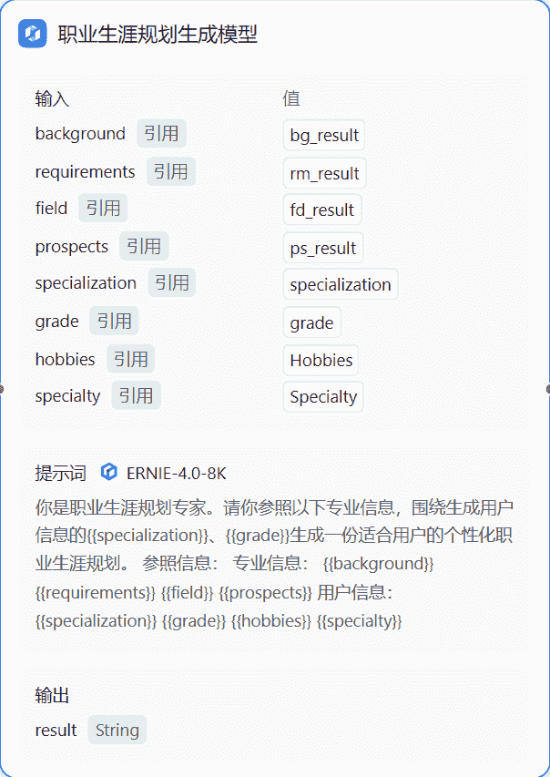
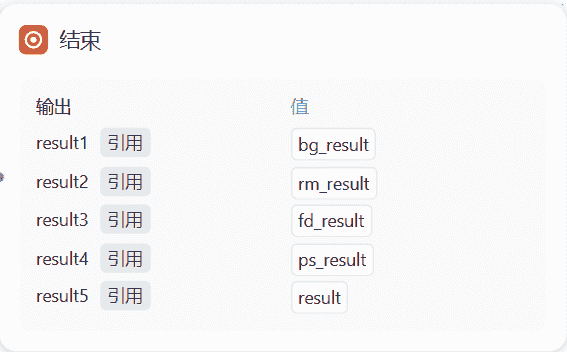

# 更多工作流自建组件案例

> 来源：[https://datawhaler.feishu.cn/docx/PveKd5UPdouGvYxlQQ4c6n2ZnHf](https://datawhaler.feishu.cn/docx/PveKd5UPdouGvYxlQQ4c6n2ZnHf)

> 本内容交给大家共创

> 贡献者（写入自己的飞书账号）：

# 案例一：拼贴式长文本内容生成--以职业生涯规划建议助手为例

> 贡献者 的作品正在集赞中，详见：[2-笨笨的一站式校园服务小助手](https://datawhaler.feishu.cn/wiki/NyfzwxyS9ihgNKkwj3oc0YRHnkP#NqzodHo7loxrQoxjuDvcP7bEnph)

## 设计思路

针对项目计划书、活动策划书以及职业生涯规划等任务，若直接要求大模型输出长篇大论，其效果往往不尽如人意。然而，如果我们转变策略，仅要求模型对项目或活动的某一具体环节进行深入分析与内容展开，那么任务的复杂性将大幅降低，同时生成的文字也会更具深度和丰富性。

参考雅思大作文助手案例，一个有效的做法是将长篇文章进行拆分，分别生成各个部分，最后再将这些部分巧妙地拼接起来，形成一篇完整且高质量的文章。在此基础上，可以采用一种实用的拆分策略——按目录进行拆分。

## 职业生涯规划建议助手的实现流程

利用AppBuilder构建职业生涯规划小助手工作流程设计思路：

Step 1：利用关键字提炼模型从用户的指令中提炼出【专业】、【年级】、【兴趣爱好】以及【特长】等信息，然后标签化输出为参数。

Step 2：使用描述内容生成大模型，对【专业】进行【专业背景】、【专业要求】、【专业发展方向】以及【专业前景】等多个维度的分析。

Step 3：通过四个不同的大模型分别按照给定的【文段目录】，结合【step 2】得到的对应文本描述进行目录主要文字内容的填充。

Step 4：综合【专业】相关的不同维度的信息，结合用户【年级】、【兴趣爱好】以及【特长】等信息，由大模型生成一份职业生涯规划建议书。

Step 5：最后按照目录顺序，依次拼贴文字，就能得到一份包括【专业背景】、【专业要求】、【专业发展方向】、【专业前景】以及【职业生涯规划建议】的文章了。

## 使用到的组件与模型清单

在这个示例中，使用到的节点为大模型节点。根据功能的不同，可以划分为关键字提炼大模型*1、基础内容生成大模型*1、文章片段生成大模型*4以及职业生涯规划生成大模型*1。



### 关键字提炼大模型

用于从用户原始指令中抽取出专业、年级、爱好特长等基础信息。



### 基础内容生成大模型

主要用于生成专业背景、专业要求、专业方向以及专业前景四个方面的简单报告。



### 文章片段生成大模型

以基础内容生成大模型生成的文章为参考信息，按照文章目录，填补对应的文章内容。



###  职业生涯规划生成模型

综合3.3生成的各部分内容，结合用户的基本信息，给出专业的职业生涯规划建议。



### 结果输出

按照专业背景、专业要求、专业发展方向、专业前景和职业生涯规划的顺序，依次输出内容。



## 运行示例

### 用户指令

“我是一名大一新生，专业是食品安全，爱好打篮球，擅长机器学习与python编程。你能够给我提供一些大学生职业生涯规划的建议吗？”。

### 结果输出

```
{
    &quot;result1&quot;: &quot;一、专业背景\n\n食品安全专业是一个综合性的学科领域，其背景涉及广泛的科学范畴，包括化学、生物学、营养学等。这些学科在食品安全领域发挥着至关重要的作用，共同构成了该专业的知识体系和理论基础。\n\n1.1 专业历史与发展\n\n食品安全专业的诞生与发展，与人们对食品安全的持续关注密不可分。随着现代工业化和城市化进程的加速，食品生产、加工、储存、运输及销售等环节日益复杂，食品安全问题也随之凸显。为了应对这一挑战，满足公众对食品安全监管的迫切需求，食品安全专业应运而生。\n\n该专业的发展历程中，不断吸收和融合了化学、生物学、营养学等多个学科的最新研究成果和技术手段。这些学科为食品安全专业提供了丰富的检测和分析方法，使得食品安全监管更加科学、精准和高效。同时，随着科技的不断进步和创新，食品安全专业也在不断探索新的研究领域和应用场景，以适应社会发展和公众需求的变化。\n\n如今，食品安全专业已经发展成为一个涵盖多个学科、具备完善理论体系和实践技能的综合性专业。它在保障公众健康、促进食品产业可持续发展等方面发挥着举足轻重的作用，为构建安全、健康的食品环境提供了有力支撑。&quot;,
    &quot;result2&quot;: &quot;二、专业要求\n\n食品安全专业致力于培养具备全面素质和专业能力的高级专门人才，以确保食品质量与安全，保障公众健康。以下是该专业的具体要求：\n\n2.1 学科基础知识要求\n\n学生需具备扎实的化学和生物学基础知识，包括无机化学、有机化学、分析化学、生物化学等，为后续的食品检测与分析技术提供理论支撑。同时，学生还应掌握食品科学、营养学、微生物学等相关领域的基本理论，以全面了解食品生产、加工、储存及消费过程中的安全问题。\n\n2.2 专业技能与实践能力\n\n学生需熟练掌握食品检测与分析技术，包括食品中化学成分、微生物、毒素等的检测方法，以及食品质量与安全评估技能。此外，学生应通过实践操作与案例分析，不断提升自己在食品生产现场的安全控制、风险评估与应急处理等方面的实践能力，以确保食品质量与安全。\n\n2.3 学术研究与创新能力\n\n在掌握专业基础知识和技能的同时，学生应具备一定的学术研究与创新能力。通过参与科研项目、撰写学术论文等活动，学生应能够针对食品安全领域的热点问题和挑战，提出创新性的解决方案，为推动食品安全学科的发展做出贡献。\n\n2.4 道德素养与职业操守\n\n学生需具备良好的职业道德与责任心，能够严格遵守食品安全法规，诚实守信，不弄虚作假。在从事食品质量与安全相关工作时，学生应始终以公众健康为重，坚守职业操守，为维护食品安全和社会稳定贡献力量。&quot;,
    &quot;result3&quot;: &quot;## 三、专业方向\n\n### 3.1 主要研究领域概述\n\n食品安全专业作为一个综合性强、涉及面广的学科，其主要研究领域涵盖了从食品生产源头到消费者餐桌的全方位安全监控。这包括食品原料的质量控制、食品加工过程中的安全控制、食品储存与运输的安全管理，以及食品销售与消费环节的安全监督等。随着现代科技的不断进步，食品安全检测与分析技术日新月异，为该专业的研究与实践提供了更多可能性。\n\n### 3.2 热门研究方向与课题\n\n在食品安全专业中，当前热门的研究方向与课题主要集中在以下几个方面：一是新型食品安全检测技术的研发与应用，如快速检测技术、无损检测技术等，以提高检测效率与准确性；二是食品中有害物质的分析与评估，包括化学性、生物性和物理性危害的识别与控制；三是食品安全法规与标准的研究，以适应不断变化的国际国内市场需求；四是食品安全风险评估与预警体系的建立与完善，以实现对食品安全问题的早期发现与有效应对。\n\n### 3.3 跨学科研究与合作机会\n\n食品安全专业的跨学科研究与合作机会广泛。由于食品安全涉及多个学科领域，如化学、生物学、营养学、法学等，因此该专业的学生与研究者可以积极寻求与其他学科的交叉合作。例如，与化学专业合作开发新型食品检测试剂与材料，与生物学专业共同研究食品中的微生物污染问题，与营养学专业探讨食品安全与营养健康的关系，以及与法学专业合作推动食品安全法规的完善与实施等。这些跨学科的合作不仅有助于拓宽研究视野，还能为解决复杂的食品安全问题提供更为全面的解决方案。&quot;,
    &quot;result4&quot;: &quot;## 四、专业前景\n\n### 4.1 行业发展趋势分析\n\n食品安全行业正迎来一个前所未有的发展机遇。随着全球化进程的加速和人们健康意识的提升，食品安全问题已成为社会关注的热点。从源头控制到餐桌安全，每一环节都需严格把关，确保食品的质量与安全。因此，食品安全专业将紧跟行业发展趋势，不断拓宽研究领域，提升技术水平，以满足日益增长的食品安全需求。\n\n### 4.2 就业前景与市场需求\n\n在食品安全问题日益受到重视的背景下，政府和企业对食品安全专业人才的需求呈现出快速增长的态势。毕业生可从事食品生产、加工、检验、监管等多个环节的工作，就业岗位多样且广泛。同时，随着全球食品安全标准的不断提高，具备国际视野和专业技能的食品安全人才将更加受到青睐，有望在国内外知名食品企业、政府机构、国际组织等发挥重要作用。\n\n### 4.3 继续深造与学术发展路径\n\n食品安全专业具有深厚的学术底蕴和广阔的研究空间。对于有志于继续深造的学子来说，可以选择攻读硕士或博士学位，进一步提升自己的专业素养和科研能力。在学术发展路径上，既可以专注于食品安全某一细分领域的研究，也可以跨学科融合创新，为食品安全领域的发展贡献自己的力量。\n\n### 4.4 行业内的挑战与机遇\n\n虽然食品安全行业前景广阔，但同样面临着诸多挑战，如技术更新迅速、法规政策不断完善等。然而，这些挑战也为专业人才提供了更多的发展机遇。通过不断学习和实践，食品安全专业人才能够紧跟行业步伐，抓住机遇，迎接挑战，实现个人价值的最大化。同时，他们还将为推动整个食品安全行业的进步与发展做出重要贡献。&quot;,
    &quot;result5&quot;: &quot;**食品安全专业大一学生个性化职业生涯规划**\n\n**一、自我认知**\n\n1. **专业选择**：\n   - 已选择食品安全专业，对食品的质量与安全有浓厚兴趣，愿意投入时间和精力进行深入研究。\n\n2. **个人兴趣**：\n   - 热爱打篮球，具备良好的团队合作精神和体能。\n   - 喜欢唱歌，拥有一定的艺术修养和表演能力。\n\n3. **性格特点**：\n   - 大一新生，充满朝气和活力，对新事物充满好奇。\n   - 具备探索精神和创新意识，适合在学术和实践领域不断突破。\n\n**二、学业规划**\n\n1. **短期目标（大一至大二）**：\n   - 扎实掌握食品安全专业的基础知识，如无机化学、有机化学、分析化学等。\n   - 积极参加学校组织的篮球比赛和歌唱活动，丰富课余生活，提升团队协作能力。\n   - 加入食品安全相关的学术社团或实验室，参与课题研究，培养科研素养。\n\n2. **中期目标（大二至大三）**：\n   - 深入学习食品安全专业的核心课程，如食品检测与分析技术、食品质量与安全评估等。\n   - 参与校外的食品安全实习项目，将理论知识与实践相结合，提升专业技能。\n   - 在学术社团或实验室中担任重要角色，主导或参与科研项目，争取发表学术论文。\n\n3. **长期目标（大三至毕业）**：\n   - 完成毕业论文设计，聚焦食品安全领域的热点问题，提出创新性的解决方案。\n   - 积极参加国内外食品安全相关的学术会议和研讨会，拓宽视野，建立人脉。\n   - 根据个人兴趣和职业规划，选择继续深造或进入优质的食品企业工作。\n\n**三、技能提升与自我发展**\n\n1. **专业技能**：\n   - 通过课程学习和实验操作，熟练掌握食品检测与分析技术，提升实验操作能力。\n   - 学习食品安全法规与标准，了解行业动态，为未来的职业发展做好准备。\n\n2. **软技能**：\n   - 利用篮球和唱歌等兴趣爱好，培养团队合作精神和领导能力。\n   - 参加演讲比赛、辩论会等活动，提升沟通表达和逻辑思维能力。\n\n3. **自我管理与时间规划**：\n   - 制定合理的学习计划，平衡专业学习与兴趣爱好的发展。\n   - 培养自律习惯，高效利用时间，确保学业与生活的双重丰收。\n\n**四、职业规划与未来展望**\n\n1. **职业方向探索**：\n   - 在食品安全监管机构、食品企业、科研机构等领域探索适合自己的职业方向。\n   - 根据个人兴趣和优势，选择从事食品检测、质量控制、食品安全管理等相关工作。\n\n2. **继续深造与学术发展**：\n   - 考虑攻读硕士或博士学位，专注于食品安全领域的深入研究与创新。\n   - 通过学术成果积累，为未来的职业发展奠定坚实基础，成为食品安全领域的专家或学者。\n\n3. **社会责任与贡献**：\n   - 牢记食品安全的重要性，以公众健康为己任，坚守职业操守与道德底线。\n   - 积极参与社会公益活动，普及食品安全知识，提升公众的食品安全意识。\n\n**五、结语**\n\n作为食品安全专业的大一新生，你拥有无限的潜力和广阔的前景。通过制定个性化的职业生涯规划，明确学业目标、提升专业技能与软技能、探索职业方向并承担社会责任，你将在未来的食品安全领域大放异彩，为构建安全、健康的食品环境贡献自己的力量。&quot;
}
```

## 优化思路

现在的这个示例内容制作得比较粗糙，很多细节没有打磨，我能想到的值得优化的思路有两个。

1.  添加知识库组件，添加在关键字提炼模型与基础知识生成模型之间，用来获取更加专业可信的数据作为支撑。

1.  添加百度搜索的api，获取更实时的行业信息。

1.  添加目录生成助手，当前的示例中目录是以预制prompt写好的形式提供给模型的，而非针对问题进行生成，因此实现的功能不具备泛化性。

理论上，只要目录写得够长、模型够多，可以生成的最终文章字数是没有上限的，就算觉得文字不满意仍然可以选择手动润色或者再加一个润色模型（模型叠叠乐）。不过由于appbuilder的限制，输出的文本长度有一定的限制，因此示例中的小助手生成的内容无法直接作为输出提供给用户，但可以作为生成内容的参考。