# 4. 【代码级】AI应用开发入门

> 来源：[https://datawhaler.feishu.cn/docx/KMcwdV3CsoS3iZxc5pqczkz2nod](https://datawhaler.feishu.cn/docx/KMcwdV3CsoS3iZxc5pqczkz2nod)

<https://datawhaler.feishu.cn/sync/DThjdz4ucsio9sbVLnKc0Gc2nHh>

> 本阶段 Task4：代码级开发 为选修模块，目标是让大家放下对高代码的恐惧，理解代码级开发究竟是需要做什么，并从具体的小实践起步，开始自己的项目开发。
>
> 我们的目标是，实现自己的创意，做出小的 demo，快速进行迭代开发，实现更多功能，并展示给更多人~
>
> 快速验证想法和需求的真实性和有效性。
>
> 本次作业为选修，即：
>
> 1. 完成代码级开发的体验
> 2. 从本教程出发，制作自己的 UI，提交本次竞赛的代码级应用
>
> 祝大家都能享受到代码级开发的快乐~

## 一、前言：5分钟走进代码级开发

> 通过前面的内容，相信大家已经掌握了如何使用千帆 AppBuilder 创作 AI 原生对话应用。
>
> 但其提供的对话应用具有一定局限性，很显然没有我们日常使用的 APP、小程序、网页等工具那么方便，如果我们想快速添加常用的 Prompt 模板、或是想要拥有一个历史会话功能，千帆 AppBuilder 网页端就无法满足我们的需求。
>
> 此时，我们就需要上代码级开发了，大家可以先熟悉熟悉下面的学习路径，只要按照这个思路走，入门代码级开发，做出自己的应用 demo 绝对不在话下——

> 那么现在，我们可以花大约 5 分钟的时间，进行一次快速的代码级开发体验，在电脑浏览器中打开 飞桨项目："一键"跑通大模型应用开发！，登录账号并点击【运行一下】即可！

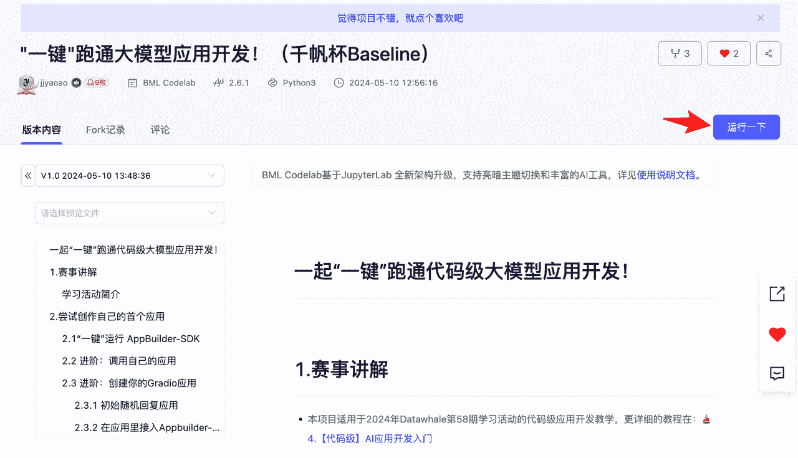

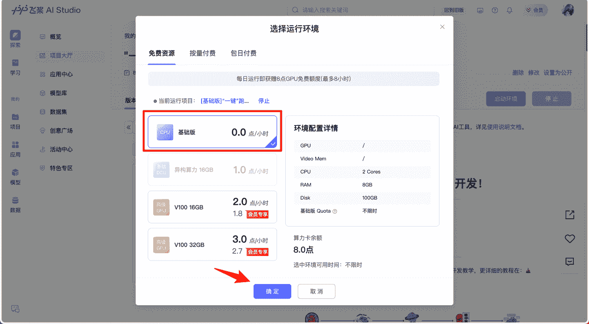

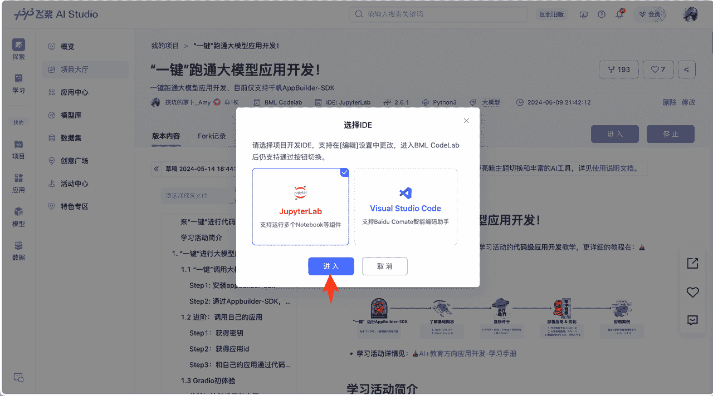

> PS：记得做作业呀~

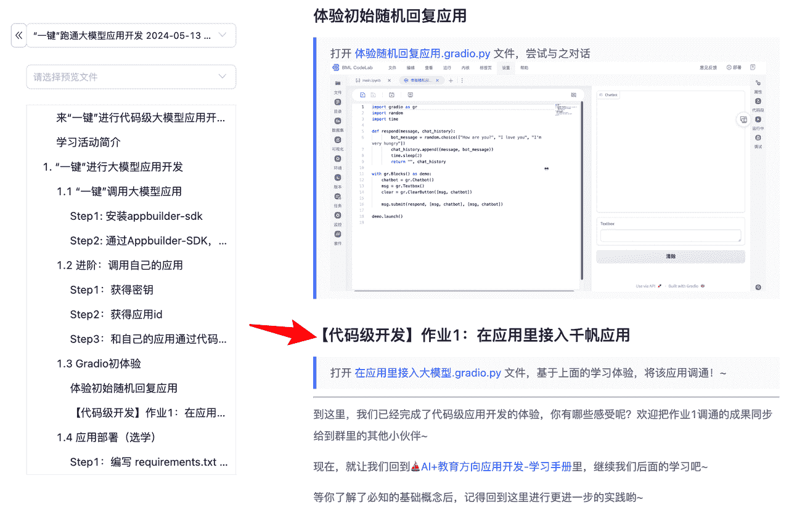

> 体验完回来后，记得点击一下下面的按钮——

> PS：本次教程演示仅包含了 [Gradio](https://www.gradio.app/) 应用 的体验，欢迎喜欢 [Streamlit](https://streamlit.io/) 的学习者共创 [Streamlit](https://streamlit.io/) 的版本~

下面，就让我们更进一步，真正学会如何基于 [AppBuilder SDK](https://github.com/baidubce/app-builder)，巧妙地将创意和相应的功能组合起来，通过 Gradio / Streamlit 快速打造一个富有视觉效果的互动界面吧！

上手迅速、开发方便、操作便捷，各平台支持部署、便于分享的 Demo 开发秘籍即将来袭~

## 二、进阶预备：了解基础概念

> 关于开发类的内容，可能会涉及到很多新概念，为了尽量压缩篇幅，且让大家不用有那么多认知负担，我们仅会对 AppBuilder-SDK、Gradio 和 Streamlit，这几个工具框架以及相关术语进行简单介绍，主要目标是引导大家进入实操，且开始掌握如何解决问题的思路。
>
> 大家如果对相关信息有更多的学习需求，可以通过官方文档、浏览器搜索等方式研习。
>
> [大家可以](https://aistudio.baidu.com/projectdetail/7855566?sUid=4890304&shared=1&ts=1715338683469)先浏览一遍下面的基础概念，然后回到刚刚的飞桨项目中，进行进一步的实践。

> https://github.com/baidubce/app-builder/blob/master/docs/quick_start/README.md
> https://cloud.baidu.com/doc/AppBuilder/s/7luwm2yt0
> [ChatTests-20240420实践记录](https://datawhaler.feishu.cn/docx/Hx3hdDvXqoOnUwxUqdicVguEn1g)
> https://www.gradio.app/

千帆 AppBuilder 作为一个产品来说，有既定的开发规划和功能场景边界，因此要想拥有更符合心意的应用，需要自己进行开发，即：我们需要把在千帆 AppBuilder 创建的对话应用作为一个功能组件，加入到我们自己的应用中去，做出属于我们创意的内容~

创建应用有很多种方式，常见如：网页、浏览器插件、小程序、移动应用程序 (App)、桌面应用软件等。如千帆杯应用赛事官方攻略秘籍中提到，最终产物可以是小程序、App、网页、企业🛰️等形态...形式不限。

一般来说，小程序、App、企业🛰️、订阅号服务等还有一定的开发及审核门槛，且需要学习较多的前端甚至 UI 设计相关的知识，需要具有一定的专业度和人力投入。

因此我们在快速验证功能和设计 demo 时，往往较优的选择是直接通过 Gradio/Streamlit 快捷开发可交互的 demo。

在本篇教程中，大家会发现，我们主要使用了 飞桨 AI Studio 作为云开发平台，减少了很多本地环境配置的麻烦。

我们将在 [飞桨 AI Studio](https://aistudio.baidu.com/index) 上通过 Python 进行开发，使用 [AppBuilder-SDK](https://github.com/baidubce/app-builder)、Gradio 和 Streamlit 只需要在平台上，简单通过 pip 安装对应的 Python 库即可。

在学习之前，这里还有几个基础概念你需要知道：

+ Python：一种简洁、易读、功能强大的高级编程语言，常言道“人生苦短，我用 Python”。AppBuilder-SDK、Gradio 和 Streamlit 都是基于 Python 开发并开源的库。
+ pip：Python 的包管理工具，主要用于安装、管理和卸载 Python 的第三方库。它是 Python 开发中不可或缺的工具之一，常用命令：
  + `pip install xxx`
  + `pip install --upgrade xxx`
  + `pip uninstall xxx`
  + `pip show xxx`
  + `pip install xxx==1.1.1`
  + `pip list`

安装指定 Python 库、升级指定 Python 库、卸载指定 Python 库、查看指定 Python 库的安装情况、安装指定 Python 库的指定版本、列出所有通过 pip 安装的 Python 库

+ 在使用 `gradio`、`streamlit`、以及 `appbuilder-SDK` 时，记得安装这些库哟~
+ SDK：即“软件开发工具包”（Software Development Kit），一般会包含一系列工具和文档的集合，旨在帮助开发者更有效地开发特定的软件应用程序。工具可能包括编程语言的库、APIs、开发环境（IDE）、编译器、调试 & 性能分析工具、相关文档等。
+ [AppBuilder SDK](https://github.com/baidubce/app-builder) 就是帮助开发者更好地使用 Appbuilder 开放能力的一个工具包，开源在 GitHub 上，其 Python 运行版本可通过 `pip` 进行安装。
+ 飞桨 AI Studio：基于百度深度学习平台飞桨（PaddlePaddle）的人工智能学习与实训社区。它提供了一站式的模型在线开发与应用环境，支持多种编程语言和深度学习框架。
+ 我们可以在 AI Studio 上进行 Python 代码编写与运行，且可以免费使用其 CPU 环境（GPU 环境需要付费）
+ 另外我们的 Gradio/Streamlit 项目完成开发后，还可以通过其进行部署，分享给他人体验

> 如果有本地开发的需求，欢迎自己探索环境配置，带着实操经验和问题在学习群进行提问和交流，
>
> PS：还很欢迎大家来参与 [本地开发环境配置经验共创](https://datawhaler.feishu.cn/wiki/WjTmwizJOismWZkVbpoctZZTnqd)~

### 必知必会：AppBuilder SDK

+ 如果忘记了 AppBuilder 分为零代码和代码态，可以点开回忆一下 AppBuilder 的简介

<https://datawhaler.feishu.cn/sync/AhGwdZTJQs5aZVbIafBc2cS8nsf>

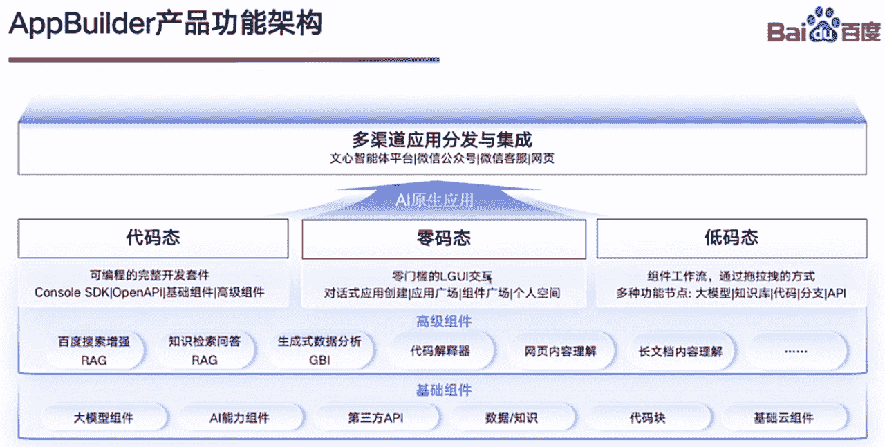

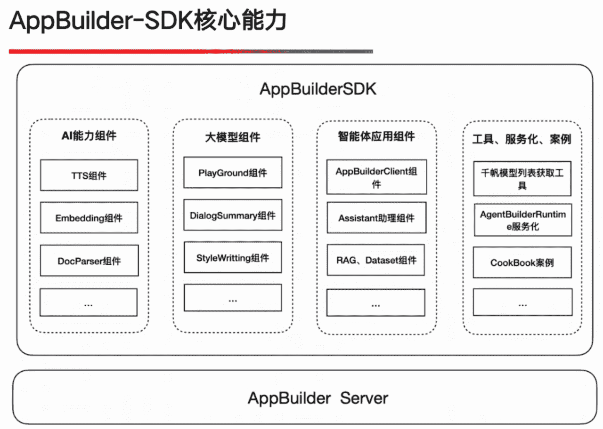

如上面两张图所示，我们可以使用 AppBuilder SDK 进行代码态的开发，AppBuilder SDK 作为大模型开发套件工具，

+ 主要提供了四种组件能力：传统 AI 能力组件（如语音识别）、大模型能力封装组件（如📕风格写作）、智能体应用组件（可调用个人在官网发布的 AI 应用）、以及其他工具能力，详细介绍可见下面的视频（出自百度智能云 AppBuilder-SDK 代码态训练营）：

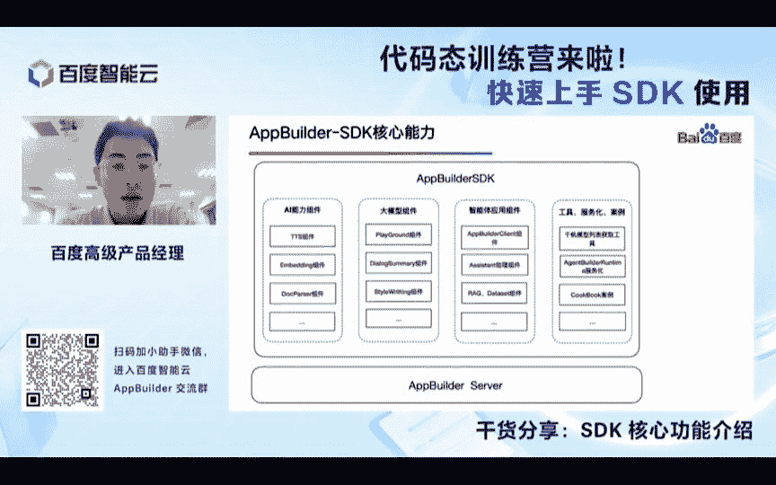

[AppBuilder-SDK 能力介绍.mp4](https://internal-api-drive-stream.feishu.cn/space/api/box/stream/download/all/KussbwYRhoy5WqxAq8ZcYshXnSb)

+ 一切可被抽象的功能，在 AppBuilder SDK 里均称作“组件”
+ [官方文档](https://cloud.baidu.com/doc/AppBuilder/s/llq6grh7e#%E7%BB%84%E4%BB%B6%E6%9C%8D%E5%8A%A1) 中对 SDK 可调用的组件付费介绍如下表所示：

| 组件分类 | 组件名称 | 计费说明 |
| --- | --- | --- |
| AI 能力组件 | 文本转语音 | 免费使用，限额 5 并发 |
| AI 能力组件 | 文档解析、文档切分、表格抽取 | 免费使用，限额 5 QPS |
| AI 能力组件 | 图像内容理解 | 领取免费额度后可用，免费额度用完后可提工单扩容 |
| 大模型组件 | 多轮改写、相似问生成、自然语言转 pandas、标签抽取、会话小结、口语化 Query 生成、复杂 Query 分解、复杂 Query 判定、风格转写、风格写作、问答对挖掘、阅读理解问答、playground 空应用、GBI 选表、GBI 问表、Excel 转图表 | [计费说明](https://cloud.baidu.com/doc/WENXINWORKSHOP/s/Blfmc9dlf) |
| AI 能力组件 | 文本翻译-通用版 | [计费说明](https://ai.baidu.com/ai-doc/MT/ml779m8vi) |
| AI 能力组件 | 文生图 | [计费说明](https://ai.baidu.com/ai-doc/NLP/qla2beec2) |
| AI 能力组件 | 通用物体和场景识别、菜品识别、地标识别、动物识别、植物识别 | [计费说明](https://ai.baidu.com/ai-doc/IMAGERECOGNITION/rk3bcxa9e) |
| AI 能力组件 | 通用文字识别、表格文字识别、手写文字识别、二维码识别、身份证混贴识别、文档矫正增强 | [计费说明](https://ai.baidu.com/ai-doc/OCR/Jk3h7xtsd) |
| AI 能力组件 | 短语音识别、短文本在线合成-基础音库、短文本在线合成-精品音库 | [计费说明](https://ai.baidu.com/ai-doc/SPEECH/Al9mh44v7) |
| AI 能力组件 | 语义匹配、语义向量计算 | [计费说明](https://cloud.baidu.com/doc/WENXINWORKSHOP/s/Blfmc9dlf#%E4%BB%85%E9%99%90api%E8%B0%83%E7%94%A8%E6%9C%8D%E5%8A%A1) |
| 基础云组件 | 百度 Elasticsearch、向量检索 | [计费说明](https://cloud.baidu.com/doc/BES/s/Zke47qq8h) |
| 软硬一体组件 | 多模态 AI 模组 LUCA 系列 | [计费说明](https://aim.baidu.com/product/42f4b425-61b3-440e-8648-eb21c90e4e02) |

+ 可以通过 AppBuilder SDK 调用的组件，其在【[组件广场](https://console.bce.baidu.com/ai_apaas/componentCenter)】中的详情示例如下图：

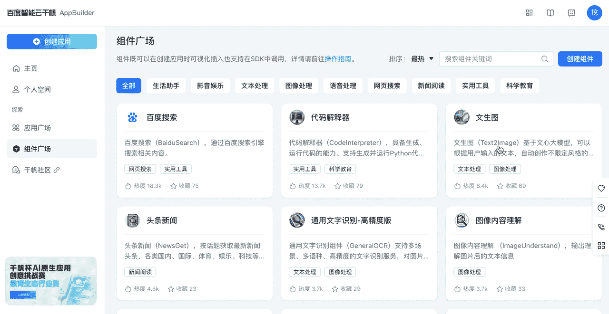

#### 可 SDK 调用的组件：

+ 可供 AppBuilder SDK 调用的组件信息汇总如下

> 【组件广场】目前共 62 个组件，其中 44 个组件提供 SDK 调用

+ 组件调用需单独开通对应组件的服务，大部分有免费额度


+ 应用中限时免费添加的组件，可在应用中调用，消耗 `quota`

多维表格（`IGhAbeMMQaEU5msx7hWcrhEPnTf_tblMFjHJA7NhMA7o`）

+ 大模型组件计费说明详见 [官方文档：计费概述](https://cloud.baidu.com/doc/WENXINWORKSHOP/s/Blfmc9dlf)，需要开通模型服务，调用方式如下代码：

> 即：不可使用官方免费 `quota` 额度，需要自己付费购买大模型 `tokens` 包

```
tag_extraction = appbuilder.TagExtraction(model="ERNIE Speed-AppBuilder")
result = tag_extraction(appbuilder.Message("从这段文本中抽取关键标签"))
```

### 必知必会：Gradio 基础概念

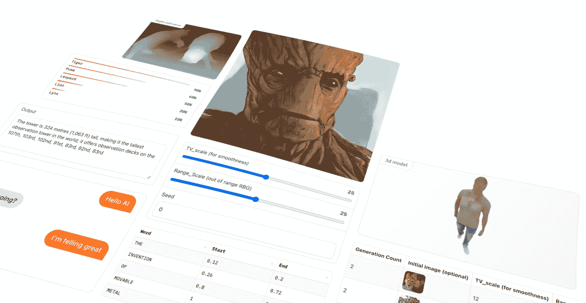

Gradio 可以包装几乎任何 Python 函数为易于使用的用户界面，在 飞桨 AI Studio 上可直接渲染效果，如下图所示：

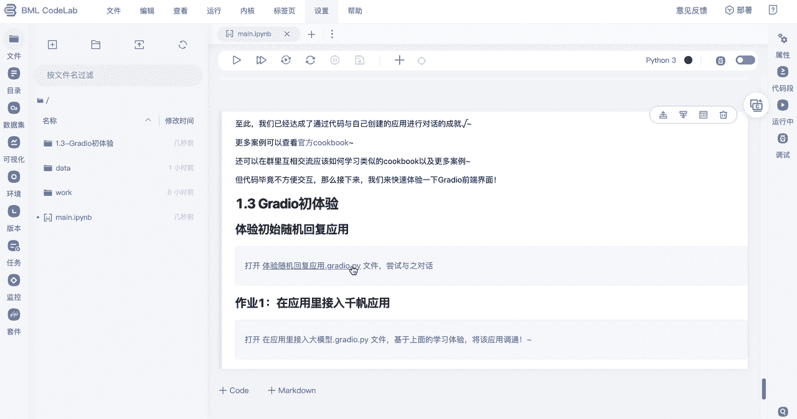

+ 还可以查看运行相关函数从输入到输出所花费的时间

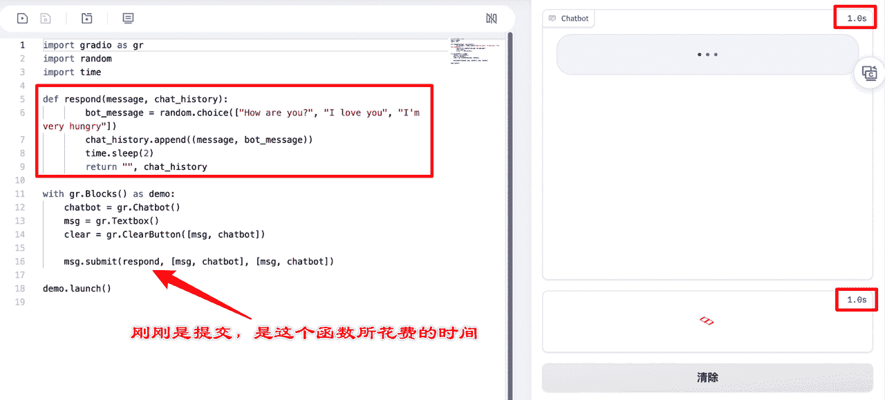

要基于 Gradio 开发应用，必须了解 Gradio 有输入输出组件、控制组件、布局组件几个基础模块，其中

+ 输入输出组件：用于展示内容和获取内容，如：`Textbox` 文本、`Image` 图像
+ 布局组件：用于更好地规划组件的布局，如：`Column`（把组件放成一列）、`Row`（把组件放成一行）
+ 推荐使用 `gradio.Blocks()` 做更多丰富交互的界面，`gradio.Interface()` 只支持单个函数交互
+ 控制组件：用于直接调用函数，无法作为输入输出使用，如：`Button`（按钮）、`ClearButton`（清除按钮）

> Gradio 的设计哲学是将输入和输出组件与布局组件分开。输入组件（如 `Textbox`、`Slider` 等）用于接收用户输入，输出组件（如 `Label`、`Image` 等）用于显示函数的输出结果。而布局组件（如 `Tabs`、`Columns`、`Row` 等）则用于组织和排列这些输入和输出组件，以创建结构化的用户界面。

大部分输入输出组件都有以下三个参数：

+ `fn`：绑定的函数，输入参数需与 `inputs` 列表类型对应
+ `inputs`：输入组件变量名列表，（例如：`[msg, chatbot]`）
+ `outputs`：输出组件变量名列表，（例如：`[msg, chatbot]`）


+   另外不同的 `输入输出组件`、`控制组件` 有不同动作可响应（对应一些方法，如下面的 `msg.submit()`）

> 需要注意，`Gradio` 的组件更新，实现交互，都只能通过绑定的 `fn` 进行实现：

+   `fn` 中需要使用的用户指定的数据来源，均需要放入 `inputs` 中，

+   需要更新的组件均需要通过 `fn` return 回来，并与 `outputs` 中的组件类型意义对应

> 对应到 飞桨项目："一键"跑通大模型应用开发！中的“体验随机回复应用”的示例代码中即：

```
# 导入gradio、random、time库，他们的功能大致如名字所示
import gradio as gr # 通过as指定gradio库的别名为gr
import random
import time

# 自定义函数，功能是随机选返回指定语句，并与用户输入的 message 一起组织为聊天记录的格式返回
def respond(message, chat_history):
    # 在How are you 等语句里随机挑一个返回，放到 bot_message 变量里
    bot_message = random.choice(["How are you?", "I love you", "I'm very hungry"])
    # 添加到 chat_history 变量里
    chat_history.append((message, bot_message))
    # 暂定2s
    time.sleep(2)
    # 返回 空字符，chat_history 变量，空字符用于清空 msg 组件，chat_history 用于更新 chatbot组件
    return "", chat_history

# gr.Blocks()：布局组件，创建并给了他一个名字叫 demo
with gr.Blocks() as demo:
    # gr.Chatbot()：输入输出组件，用于展示对话效果
    chatbot = gr.Chatbot()
    # gr.Textbox()：输入输出组件，用于展示文字
    msg = gr.Textbox()
    # gr.ClearButton：控制组件，用于清空输入输出组件
    clear = gr.ClearButton([msg, chatbot])

    # 定义gr.Textbox()文字组件 msg 的 submit 动作(回车提交)效果，执行函数为respond, 第一个[msg, chatbot]是输入，第二个 [msg, chatbot] 是输出
    msg.submit(fn=respond, inputs=[msg, chatbot], outputs=[msg, chatbot])

# 运行demo
demo.launch()
```

更多的组件效果查看，可见 [飞桨部署](https://www.gradio.app/guides/quickstart) 项目：`Gradio` 组件演示（并不是全部），全量组件相关信息可在官方文档中查看

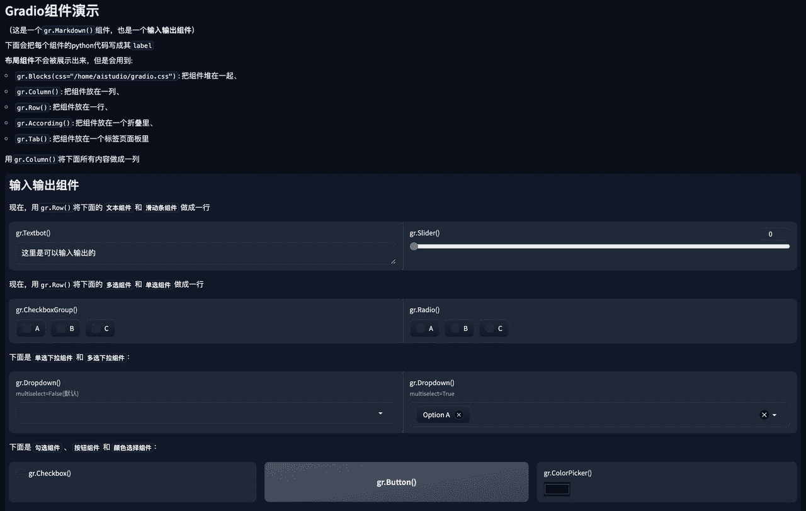

+   但需要注意，在 飞桨AI Studio 上完成了代码修改后，需要再次点击左上角的【运行】，他不会自动更新

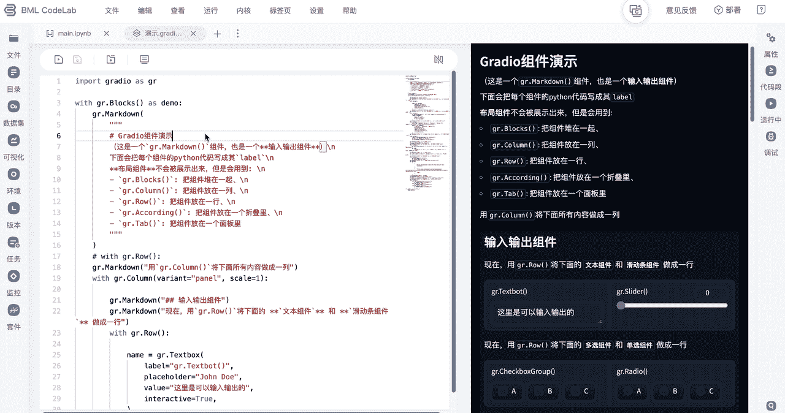

+   当文件重命名，或者调整了文件位置后，需要重新打开代码运行

大家可以通过该项目体验不同组件效果，并设想自己的应用可以如何设计，具体源代码可见 飞桨项目："一键"跑通大模型应用开发！ - "`/3-乱七八糟做中学/演示.gradio.py"`。

[如果想了解更多组件详情](https://www.gradio.app/guides/quickstart)，可查看 官方文档；另外，如果想设计更复杂的界面风格，还可以查看学习 [官方文档：主题](https://www.gradio.app/guides/theming-guide)

## 必知必会：`Streamlit` 基础概念

`Streamlit` 官方的视频演示如下，我们可以直接输入 `markdown` 格式的文本，网页即可渲染好。


[hero-video.mp4](https://internal-api-drive-stream.feishu.cn/space/api/box/stream/download/all/OJtkbrjaroAMYtxgraKcMPM4nzd)

+   `Streamlit` 中没有 `gradio` 的输入和输出概念，也没有布局组件的概念。

+   `Gradio` 和 `Streamlit` 中的【文件组件】对比如下图：

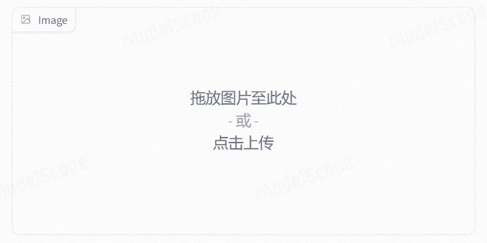

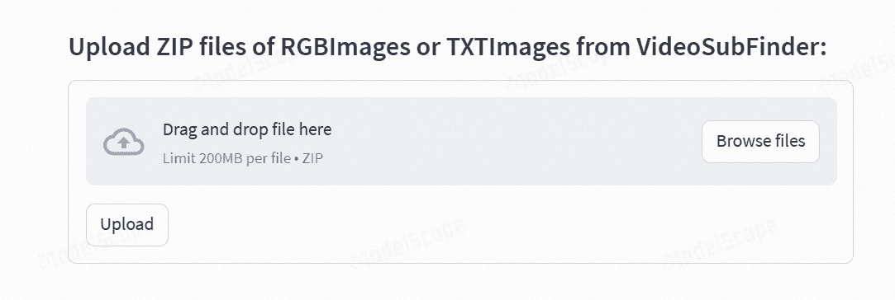

+   `Streamlit` 同样也可以在 飞桨AI Studio 上进行调试和部署

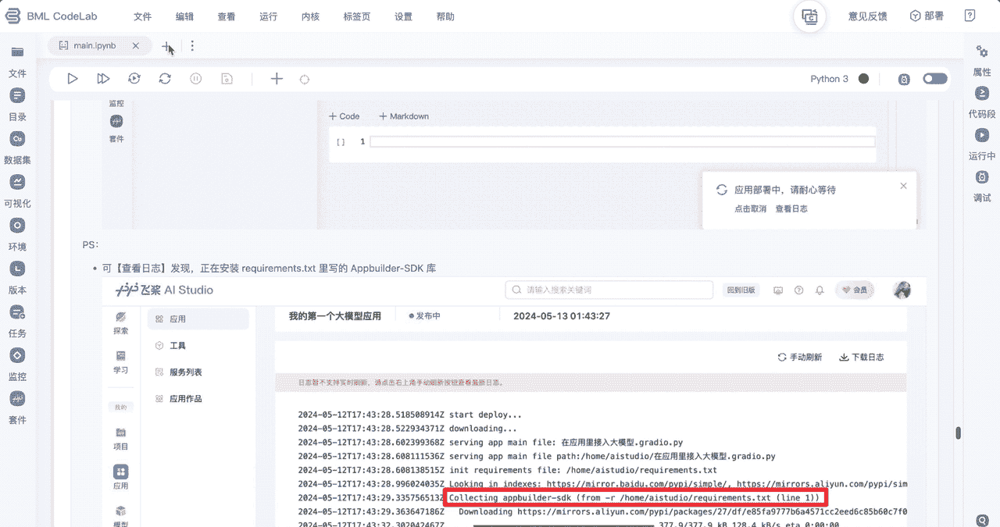

+   [Streamlit](https://docs.streamlit.io/develop/api-reference) 每个组件都是独立的，需要用什么直接查看官方文档即可，大致有如下几种组件：

+   **页面元素**

+   文本

+   数据表格

+   图标绘制（柱状图，散点图等等）

+   输入（文本框，按钮，下拉框，滑块，复选框，文件上传，等等）

+   多媒体（图片，音频，视频）

+   布局和容器

+   `Chat`（聊天对话控件）

+   状态（进度条，加载中，等等元素）

+   第三方组件（提供了更加丰富的组件）

+   **应用逻辑**

+   导航和页面（可以切换页面）

+   执行流程

+   缓存和状态

+   连接和加密（可连接数据库，也可以对内容进行加密处理）

+   自定义组件

+   公共组件（用户信息存储，帮助，以及输出 `html`）

+   `Config`（使用配置文件，来定义一些内容）

+   **工具**

+   应用测试

+   命令行

# 三、下场实践：乱七八糟做中学

> 以加入 `Appbuilder-SDK` 官方组件为例，进行工程化经验记录，

> 所使用到的代码，均可在飞桨项目："一键"跑通大模型应用开发！中找到，包括 `ChatTests` 的源码

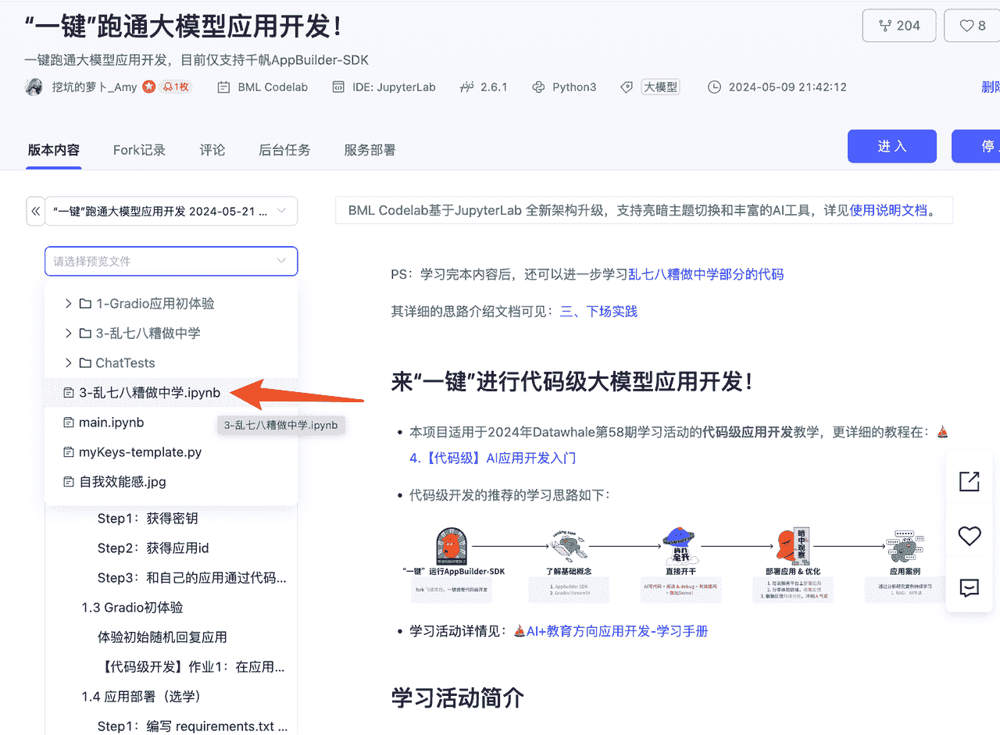

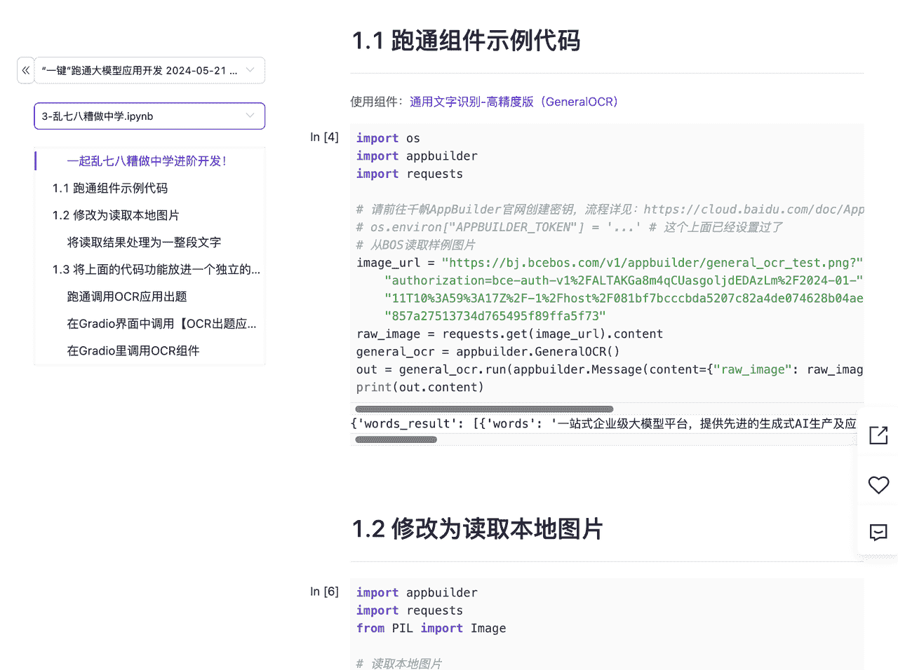

> 举例的项目为：[ChatTests-2024 实践记录](https://datawhaler.feishu.cn/wiki/SllpwyTaJip4IUkcrpscaS5Rnkh) hatTests-0520 版本，代码已开源，更多开发记录详情可见：

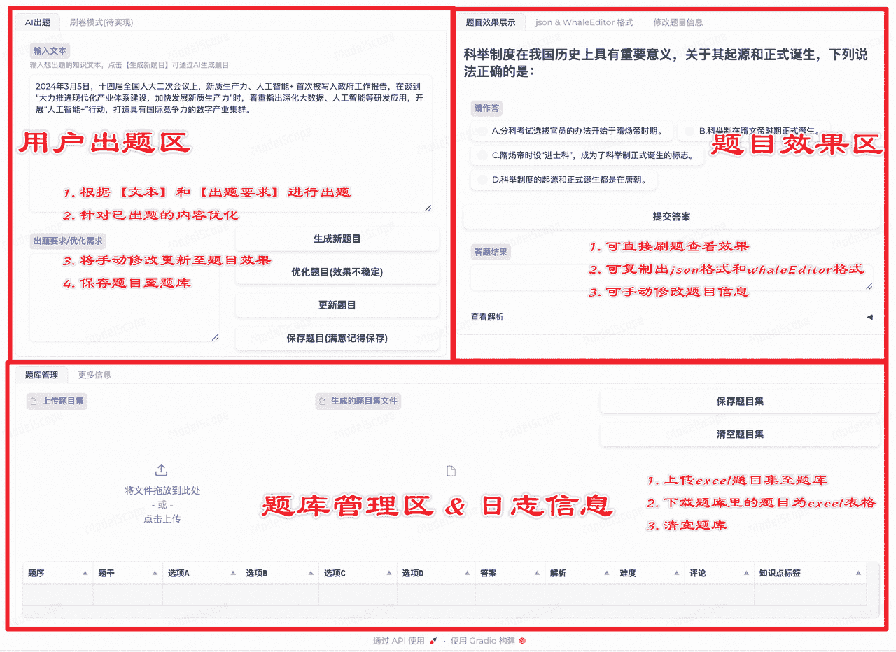

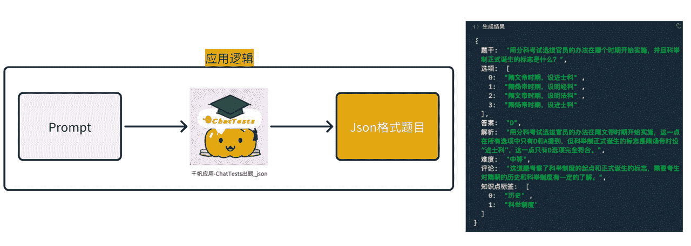

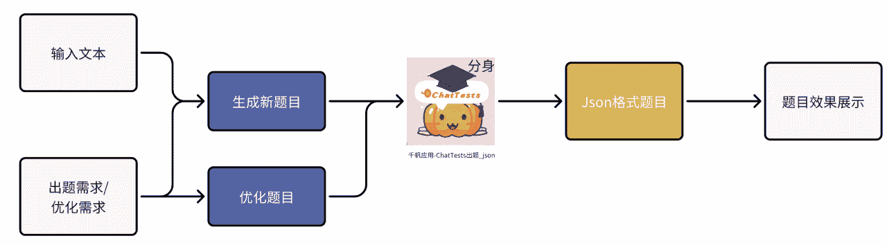

部分功能逻辑示意

## 实现功能demo

> 参考官方文档 + `AI` 辅助 + 调试 `debug`

> 支持 `SDK` 调用的组件汇总在 [可 `SDK` 调用的组件](https://datawhaler.feishu.cn/wiki/R9WNw16imiWYORkV7eOcpX0Pn9c#JfIZdE0zuotM82xIIBwcfBWXnYR)

### 跑通组件示例代码

+   `ChatTests` 项目组在查看了可供 `SDK` 调用的组件后，发现了【通用文字识别-高精度版（`GeneralOCR`）】组件，可以用来增加一个拍照识文，并基于拍照文本进行出题的功能，

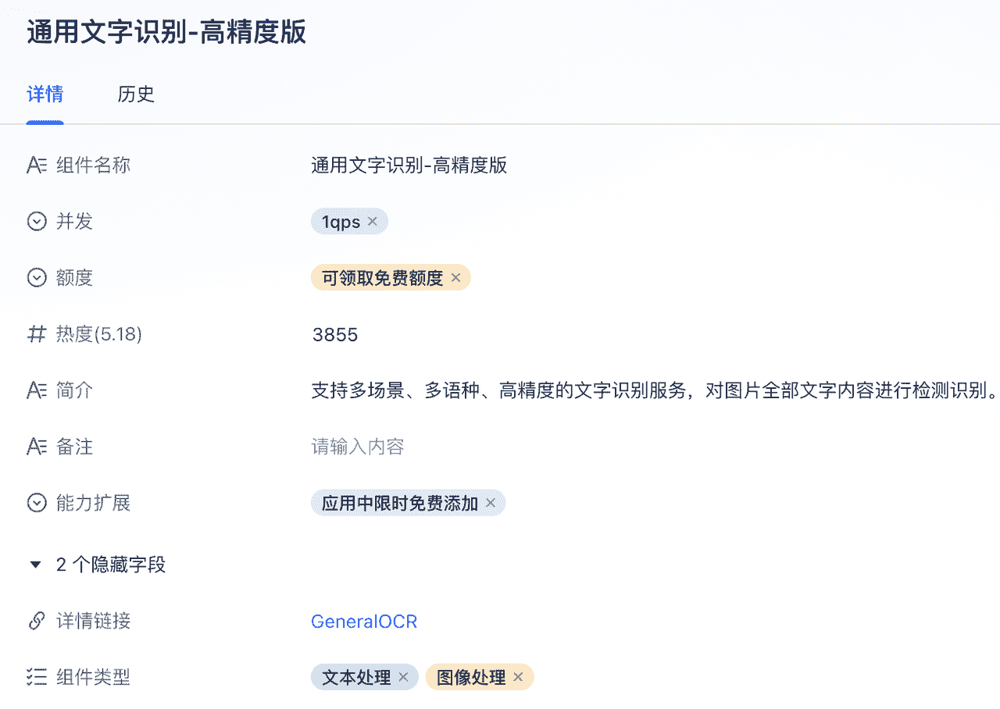

+   在官网找到了调用该组件能力的示例代码，粘贴到本地 `notebook` 进行调试

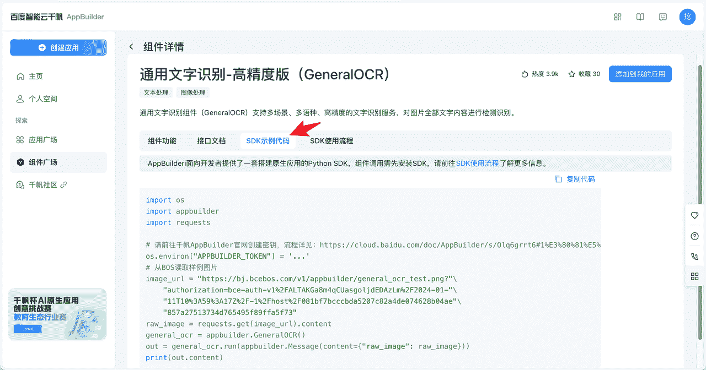

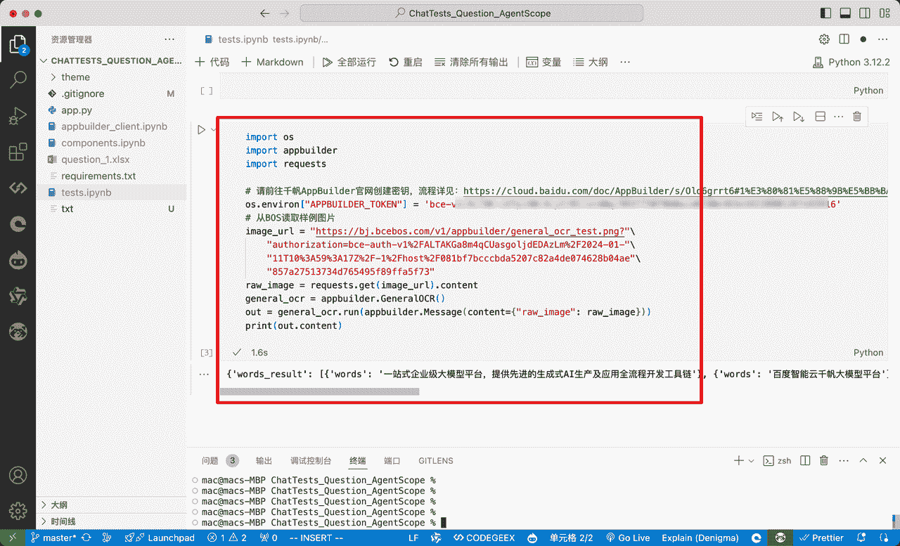

### 修改为读取本地图片

+   确认可调通执行后，尝试让 `AI` 修改其为识别本地图片

+   此处使用的是 `BAIDU COMATE`

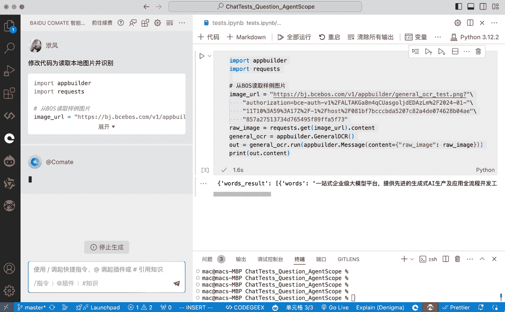

+   替换代码并尝试测试代码

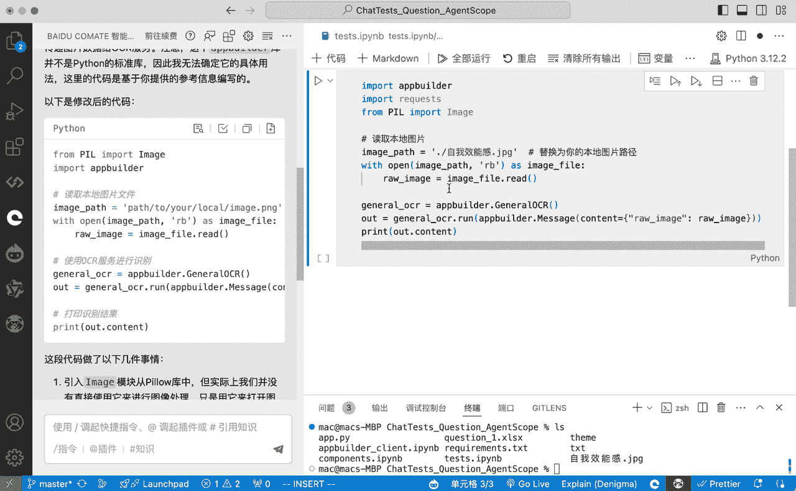

AI 生成的代码替换图片路径后如下：

```
from PIL import Image
import appbuilder

# 读取本地图片文件
image_path = './自我效能感.jpg'  # 替换为你的本地图片路径
with open(image_path, 'rb') as image_file:
    raw_image = image_file.read()

# 使用 OCR 服务进行识别
general_ocr = appbuilder.GeneralOCR()
out = general_ocr.run(appbuilder.Message(content={"raw_image": raw_image}))

# 打印识别结果
print(out.content)
```

> 可以发现，`comate` 会将无效代码删除，并增加注释

+   可以看一下 `OCR` 的文字识别的效果

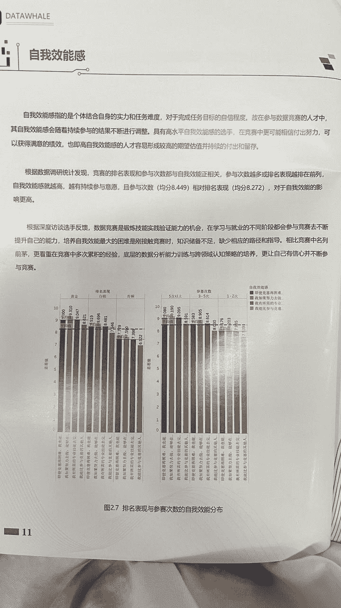

```
{'words_result': [{'words': 'DATAWHAALE'}, {'words': '自我效能感'}, {'words': '自我效能感指的是个体结合自身的实力和任务难度，对于完成任务目标的自信程度。故在参与数据竞赛的人才中，'}, {'words': '其自我效能感会随着持续参与的结果不断进行调整。具有高水平自我效能感的选手，在竞赛中更可能相信付出努力，可'}, {'words': '以获得满意的绩效，也即高自我效能感的人才容易形成较高的期望估值并持续的付出和留存。'}, {'words': '根据数据调研统计发现，竞赛的排名表现和参与次数都与自我效能正相关，参与次数越多或排名表现越排在前列，'}, {'words': '自我效能感就越高，越有持续参与意愿，且参与次数（均分8.449）相对排名表现（均分8.272），对于自我效能的影'}, {'words': '响更高。'}, {'words': '根据深度访谈选手反馈，数据竞赛是锻炼技能实践验证能力的机会，在学习与就业的不同阶段都会参与竞赛去不断'}, {'words': '提升自己的能力，培养自我效能最大的困难是刚接触竞赛时，知识储备不足，缺少相应的路径和指导。相比竞赛中名列'}, {'words': '前茅，更看重在竞赛中多次累积的经验，底层的数据分析能力训练与跨领域认知策略的培养，更让自己有信心并不断参'}, {'words': '与竞赛。'}, {'words': '自我效能感'}, {'words': '排名表现'}, {'words': '参赛次数'}, {'words': '即使竞赛再困难'}, {'words': '黄金'}, {'words': '白银'}, {'words': '青铜'}, {'words': '5次以上'}, {'words': '3-5次'}, {'words': '1-2次'}, {'words': '我如果努力去做'}, {'words': '我有所需的专业'}, {'words': '10'}, {'words': '10'}, {'words': 'OtE.6值'}, {'words': "06T'6"}, {'words': '我能比参与竞赛'}, {'words': '9'}, {'words': 'T29'}, {'words': '9'}, {'words': '08值'}, {'words': '均值'}, {'words': '19.8'}, {'words': '8'}, {'words': '值'}, {'words': '00'}, {'words': '甲均'}, {'words': '8'}, {'words': '品？'}, {'words': '8'}, {'words': '平均值'}, {'words': '7'}, {'words': '229'}, {'words': '7'}, {'words': '6'}, {'words': '6'}, {'words': '三'}, {'words': '5'}, {'words': '5'}, {'words': '4'}, {'words': '2'}, {'words': '10'}, {'words': '图2.7排名表现与参赛次数的自我效能分布'}, {'words': '11'}]}
```

+   可以发现，通过 `OCR` 识别的文字是一行一行的数据，需要拼接成一整段文字，这个同样也交给 `AI`

+   先看一下文字识别的全部结果，没啥另外的信息


# 数据处理与Gradio界面构建

```text
Message(name=msg, content={'words_result': [{'words': 'DATAWHALE'}, {'words': '自我效能感'}, {'words': '自我效能感指的是个体结合自身的实力和任务难度，对于完成任务目标的自信程度。故在参与数据竞赛的人才中，'}, {'words': '其自我效能感会随着持续参与的结果不断进行调整。具有高水平自我效能感的选手，在竞赛中更可能相信付出努力，可'}, {'words': '以获得满意的绩效，也即高自我效能感的人才容易形成较高的期望估值并持续的付出和留存。'}, {'words': '根据数据调研统计发现，竞赛的排名表现和参与次数都与自我效能正相关，参与次数越多或排名表现越排在前列，'}, {'words': '自我效能感就越高，越有持续参与意愿，且参与次数（均分8.449）相对排名表现（均分8.272），对于自我效能的影响更高。'}, {'words': '根据深度访谈选手反馈，数据竞赛是锻炼技能实践验证能力的机会，在学习与就业的不同阶段都会参与竞赛去不断'}, {'words': '提升自己的能力，培养自我效能最大的困难是刚接触竞赛时，知识储备不足，缺少相应的路径和指导。相比竞赛中名列'}, {'words': '前茅，更看重在竞赛中多次累积的经验，底层的数据分析能力训练与跨领域认知策略的培养，更让自己有信心并不断参与竞赛。自我效能感排名表现参赛次数即使竞赛再困难黄金白银'}, {'words': '青铜'}, {'words': '自我效能感'}, {'words': '排名表现'}, {'words': '参赛次数'}, {'words': '即使竞赛再困难'}, {'words': '黄金'}, {'words': '白银'}, {'words': '青铜'}, {'words': '5次以上'}, {'words': '3-5次'}, {'words': '1-2次'}, {'words': '我如果努力去做'}, {'words': '我有所需的专业'}, {'words': '10'}, {'words': '10'}, {'words': 'OtE.6值'}, {'words': '06T\'6'}, {'words': '我能比参与竞赛'}, {'words': '9'}, {'words': 'T29'}, {'words': '9'}, {'words': '08值'}, {'words': '均值'}, {'words': '19.8'}, {'words': '8'}, {'words': '值'}, {'words': '00'}, {'words': '甲均'}, {'words': '8'}, {'words': '品？'}, {'words': '8'}, {'words': '平均值'}, {'words': '7'}, {'words': '229'}, {'words': '7'}, {'words': '6'}, {'words': '6'}, {'words': '三'}, {'words': '5'}, {'words': '5'}, {'words': '4'}, {'words': '2'}, {'words': '10'}, {'words': '图2.7排名表现与参赛次数的自我效能分布'}, {'words': '11'}]}, mtype=dict)
```

+ 然后交给AI去写处理的函数

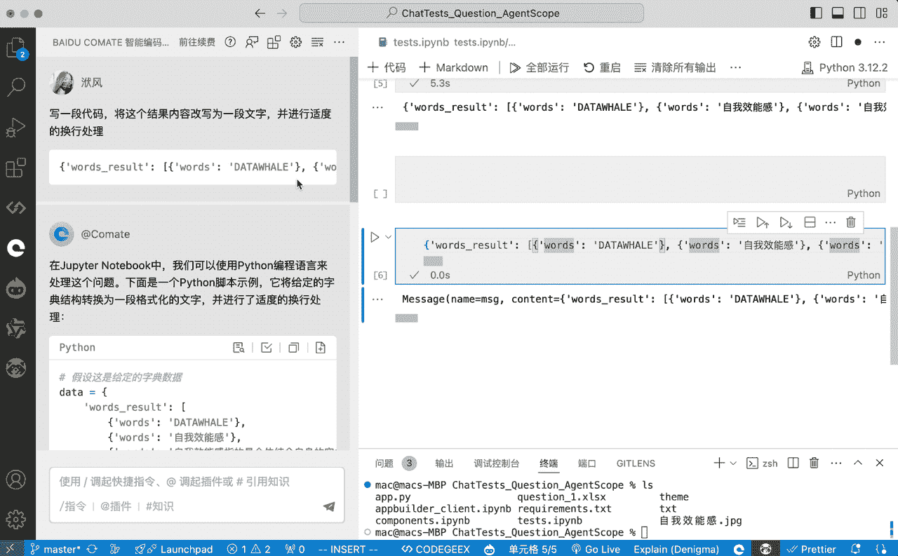

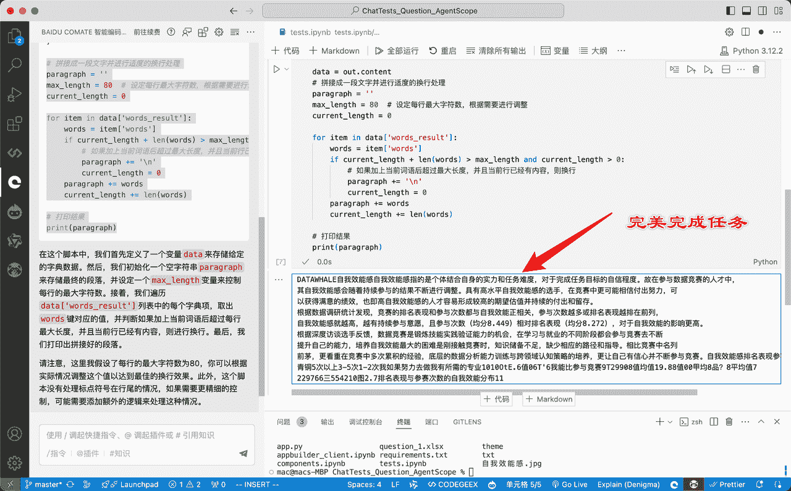

```python
data = out.content
# 拼接成一段文字并进行适度的换行处理
paragraph = ''
max_length = 80  # 设定每行最大字符数，根据需要进行调整
current_length = 0

for item in data['words_result']:
    words = item['words']
    if current_length + len(words) > max_length and current_length > 0:
        # 如果加上当前词语后超过最大长度，并且当前行已经有内容，则换行
        paragraph += '\n'
        current_length = 0
    paragraph += words
    current_length += len(words)

# 打印结果
print(paragraph)
```

```text
DATAWHALE自我效能感自我效能感指的是个体结合自身的实力和任务难度，对于完成任务目标的自信程度。故在参与数据竞赛的人才中，
其自我效能感会随着持续参与的结果不断进行调整。具有高水平自我效能感的选手，在竞赛中更可能相信付出努力，可
以获得满意的绩效，也即高自我效能感的人才容易形成较高的期望估值并持续的付出和留存。
根据数据调研统计发现，竞赛的排名表现和参与次数都与自我效能正相关，参与次数越多或排名表现越排在前列，
自我效能感就越高，越有持续参与意愿，且参与次数（均分8.449）相对排名表现（均分8.272），对于自我效能的影响更高。
根据深度访谈选手反馈，数据竞赛是锻炼技能实践验证能力的机会，在学习与就业的不同阶段都会参与竞赛去不断
提升自己的能力，培养自我效能最大的困难是刚接触竞赛时，知识储备不足，缺少相应的路径和指导。相比竞赛中名列
前茅，更看重在竞赛中多次累积的经验，底层的数据分析能力训练与跨领域认知策略的培养，更让自己有信心并不断参与竞赛。自我效能感排名表现参赛次数即使竞赛再困难黄金白银
青铜5次以上3-5次1-2次我如果努力去做我有所需的专业1010OtE.6值06T'6我能比参与竞赛9T29908值均值19.88值00甲均8品？8平均值7
229766三554210图2.7排名表现与参赛次数的自我效能分布11
```

## 将上面的代码功能放进一个独立的gradio界面

> 这个功能的交互可以这样设计：一个上传图片的组件，上传后，直接进行识图/手动点击按钮开始识图

+ 找到一个gradio上传图片的示例代码
+ 可以直接找官方示例或者他人已经实现过的功能代码
+ 这里我有一个好队友 给了我一个案例代码

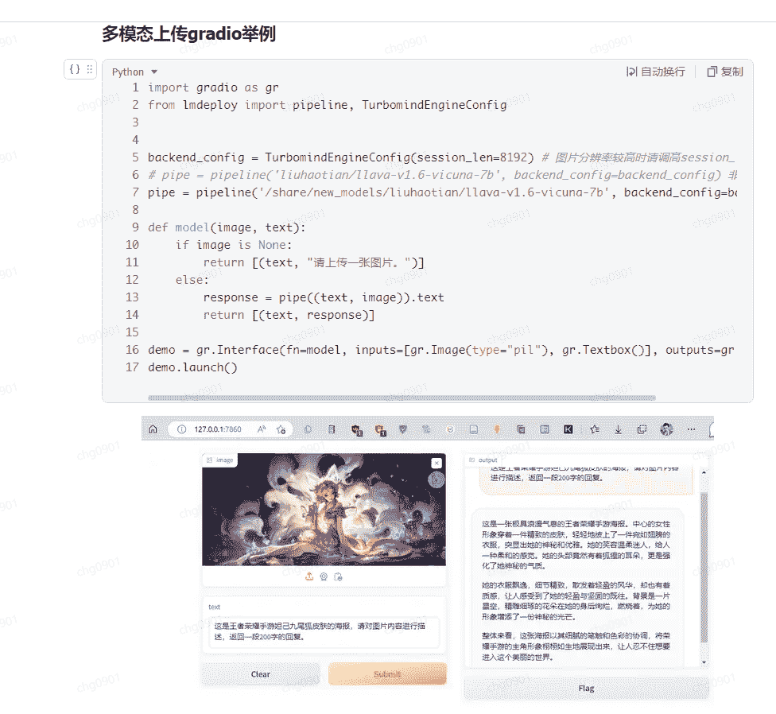

这里如果读不懂，可以让AI帮忙理解

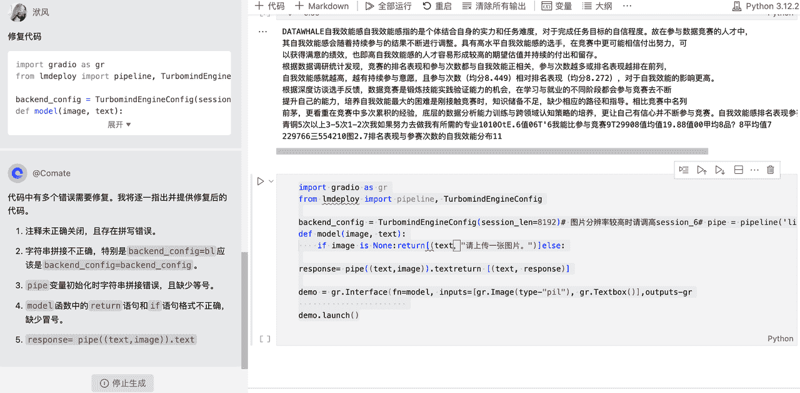

即使只是一张图片，OCR出来的部分代码，也可以进行修复

+ 不过我很快发现，因为`ChatTests`是比较复杂的界面，使用的是`gradio.blocks()`，不适合这段代码，因此开始使用AI去写

> 这里复制了前面用到的代码，并写Prompt：

> “写一段gradio代码，实现上传一张图片，并执行这个ocr任务，把内容放到一个text文本框里，记住使用`gradio.Blocks()`进行展示”

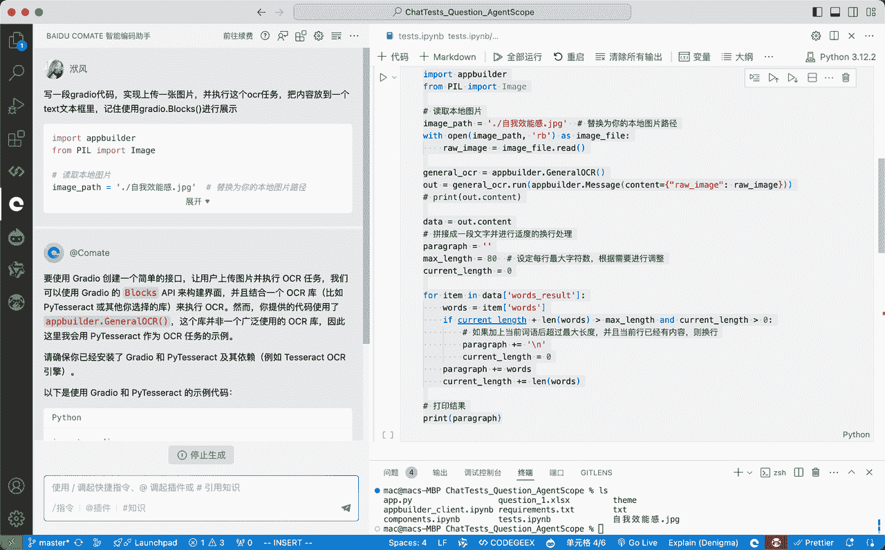

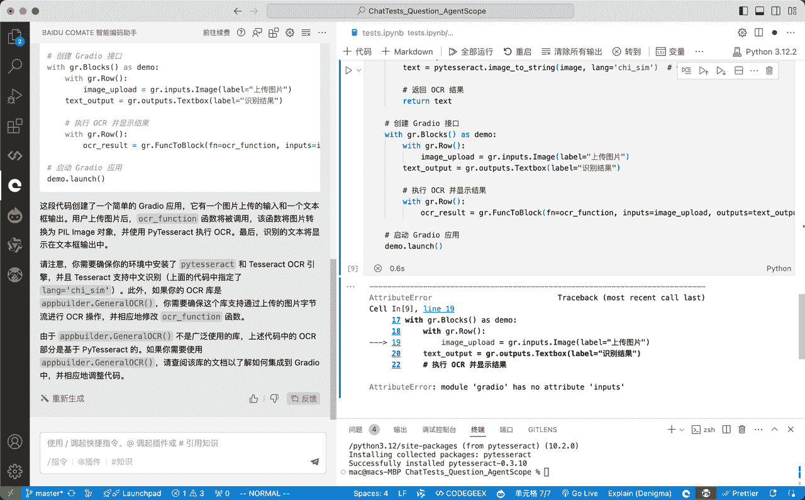

+ [由于AI能力有时不是](https://modelscope.cn/studios/AI-ModelScope/InstantMesh/summary)那么稳定，因此我选择再去魔搭上面找一个有上传图片功能的项目
+ 在其中的`app.py`文件中搜索`Image(`

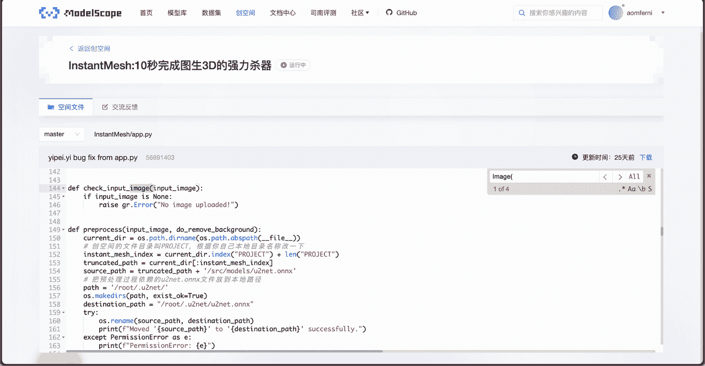

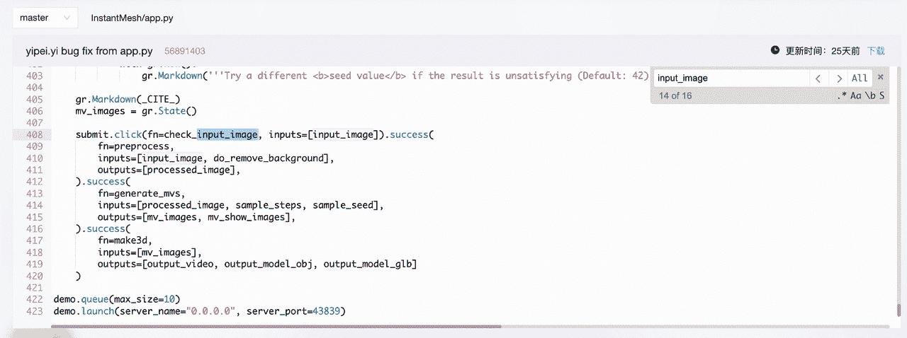

> 发现好像上传就只有上传功能，无法直接执行函数，只能通过button进行函数触发

+ 找来代码，改改就用

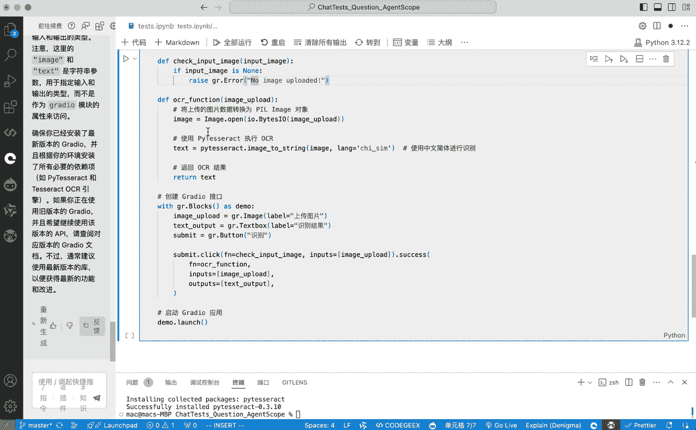

+ 但是运行过程中又遇到了bug，看不懂就找AI


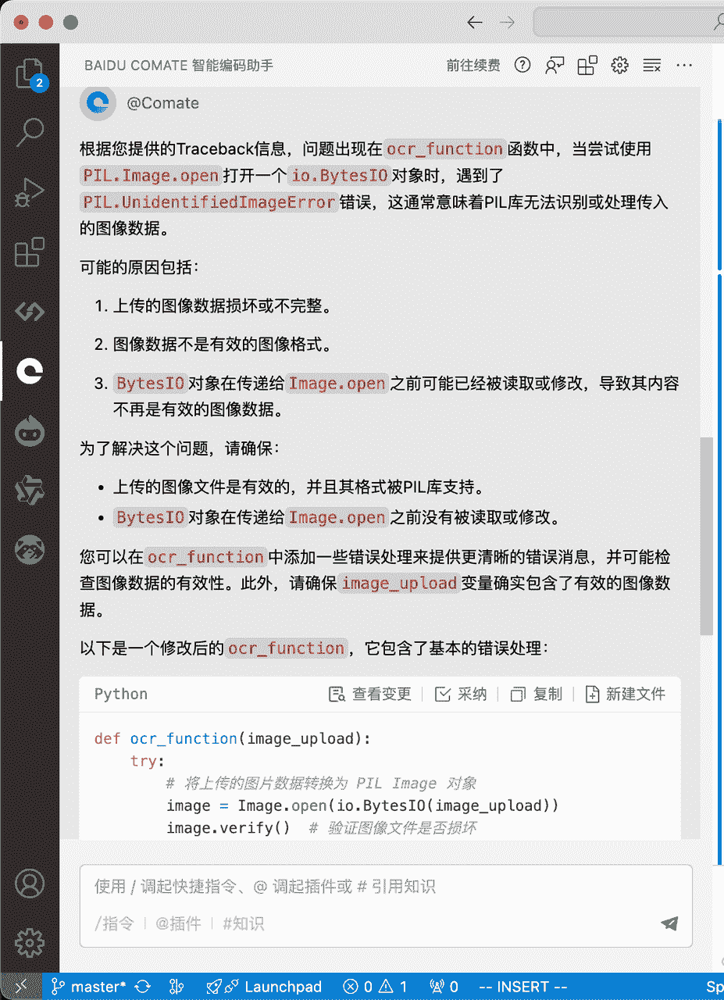

+ AI的解决方案不靠谱，就`print`大法
+ 我们可以不用管AI给出的OCR工具，依旧选用我们的Appbuilder组件
+ 但是`print`发现，现在`click`成功后的函数接收到的图片不是想要的

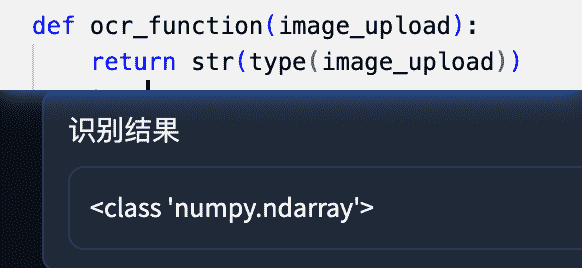

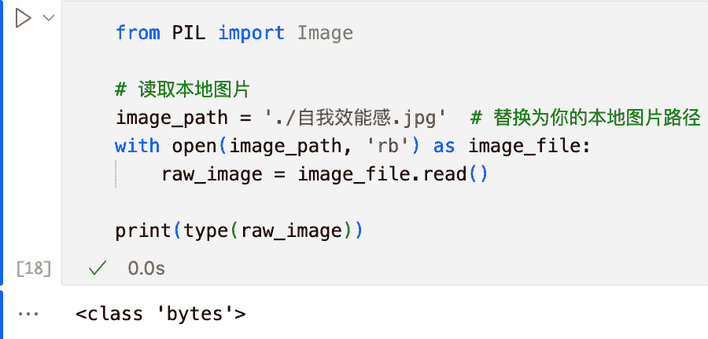

+ 继续分析魔搭上项目的方案，读不懂就交给AI

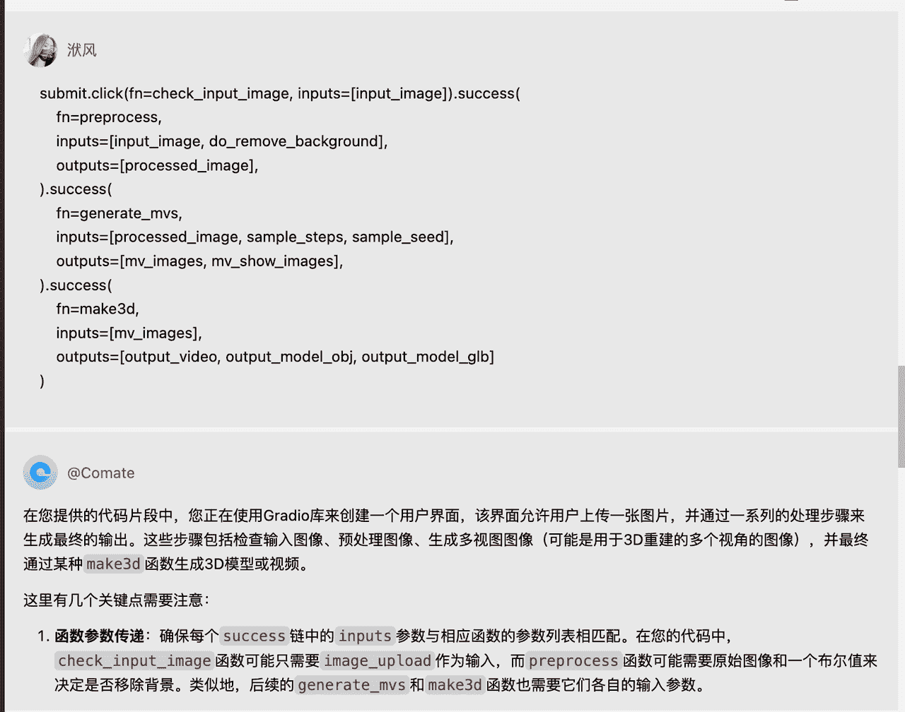

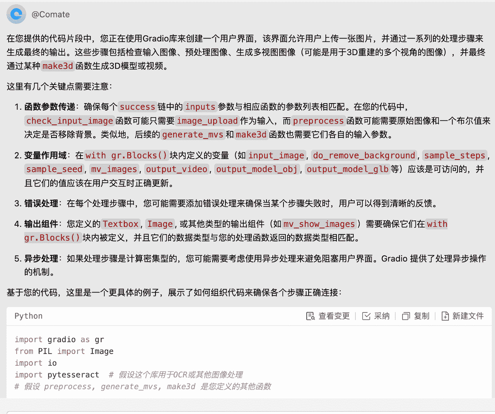

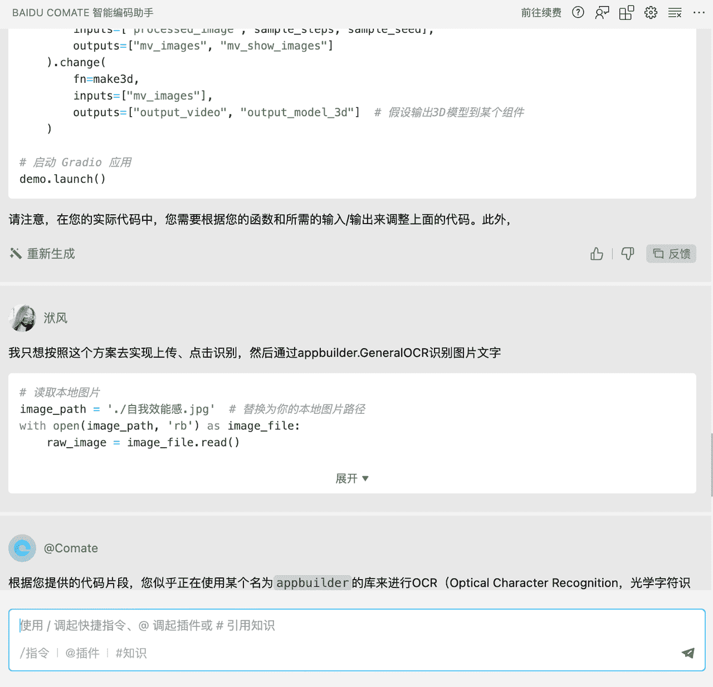

```python
import gradio as gr
from PIL import Image
import io
import pytesseract  # 假设这个库用于OCR或其他图像处理
# 假设 preprocess, generate_mvs, make3d 是您定义的其他函数

def check_input_image(image_upload):
    if image_upload is None or not image_upload:
        raise gr.Error("没有上传图像！")
    return image_upload

def preprocess(image, remove_background):
    # 这里添加预处理逻辑
    # ...
    return processed_image

def generate_mvs(processed_image, sample_steps, sample_seed):
    # 生成多视图图像的逻辑
    # ...
    return mv_images, mv_show_images

def make3d(mv_images):
    # 生成3D模型或视频的逻辑
    # ...
    return output_video, output_model_obj, output_model_glb

# 在这里定义所有的输入和输出组件
with gr.Blocks() as demo:
    image_upload = gr.Image(label="上传图片")
    remove_background = gr.Checkbox(label="移除背景", default=False)
    sample_steps = gr.Slider(minimum=1, maximum=10, label="采样步骤", default=5)
    sample_seed = gr.Number(label="采样种子", default=0)
    processed_image = gr.Image(label="处理后的图像")
    mv_show_images = gr.Gallery(label="多视图图像")
    output_video = gr.Video(label="输出视频")
    output_model_3d = gr.ThreeD(label="输出3D模型")  # 假设您有一个方式来展示3D模型

    # 链式调用设置处理流程
    submit = gr.Button("处理")
    submit.click(
        fn=check_input_image,
        inputs=[image_upload],
        outputs="processed_image"
    ).change(
        fn=preprocess,
        inputs=["processed_image", remove_background],
        outputs="processed_image"
    ).change(
        fn=generate_mvs,
        inputs=["processed_image", sample_steps, sample_seed],
        outputs=["mv_images", "mv_show_images"]
    ).change(
        fn=make3d,
        inputs=["mv_images"],
        outputs=["output_video", "output_model_3d"]  # 假设输出3D模型到某个组件
    )

# 启动 Gradio 应用
demo.launch()
```

+ 通过给AI提供示例，让他生成代码，试试看

> PS：有时候因为他的训练代码有些老，可能有些老的写法现在是不符合语法的

> 还是发现不行，只能去看官方文档，确认图片组件应该如何使用了


```python
import gradio as gr
from PIL import Image
import io
import appbuilder  # 假设appbuilder是您使用的OCR库

def ocr_function(image_upload):
    # 将上传的图片数据转换为 PIL Image 对象
    image = Image.open(io.BytesIO(image_upload))
    
    # 使用 appbuilder 的 GeneralOCR 进行 OCR
    general_ocr = appbuilder.GeneralOCR()
    message = appbuilder.Message(content={&quot;raw_image&quot;: image_upload})
    out = general_ocr.run(message)
    
    # 假设out.content包含识别的文字
    return out.content

# 创建 Gradio 接口
with gr.Blocks() as demo:
    image_upload = gr.Image(label=&quot;上传图片&quot;)
    text_output = gr.Textbox(label=&quot;识别结果&quot;)  # 设置为disabled，因为结果由OCR函数填充
    submit = gr.Button(&quot;识别&quot;)
    
    # 当用户点击&quot;识别&quot;按钮时，触发ocr_function
    submit.click(fn=ocr_function, inputs=[image_upload], outputs=[text_output])

# 启动 Gradio 应用
demo.launch()
```

+ 去官方文档查看图片组件应该如何使用

> 被其他的内容迷花了眼，[官方文档](https://www.gradio.app/guides/quickstart)全英文且内容比较丰富，建议直接搜索，而不是按照目录来找

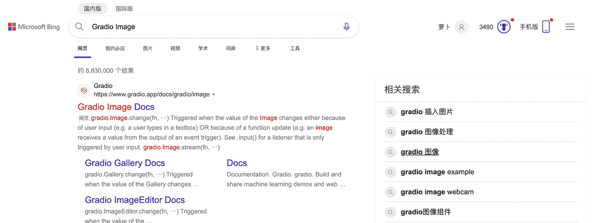

+ 发现作为输入组件，获得的是图片的路径

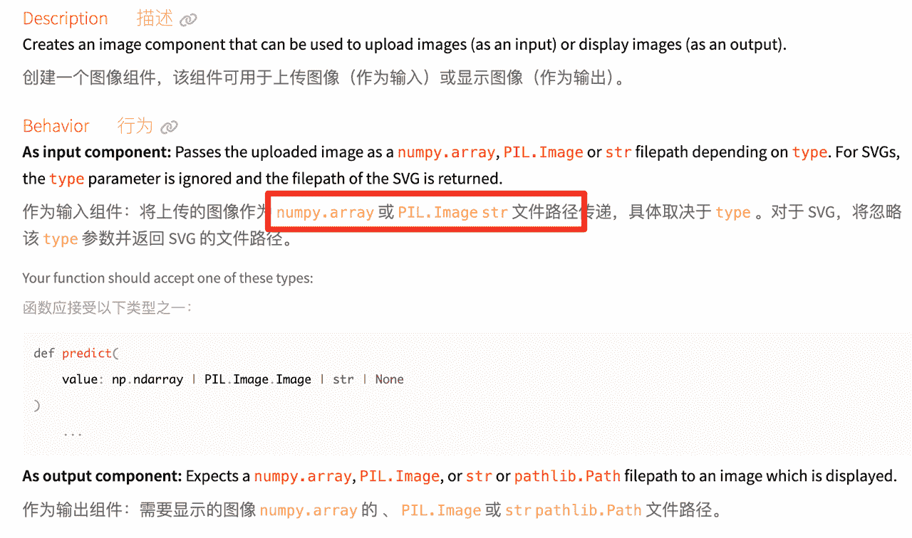

+ 于是进行对应的代码修改，上传对应路径里的图片文件

> PS：这里在前面跑通了调用应用进行OCR并出题

+ 具体代码及其效果

```python
import os
import appbuilder
# 注意需要设置os.environ[&quot;APPBUILDER_TOKEN&quot;]和app_id
# 初始化Agent实例
builder = appbuilder.AgentBuilder(app_id)

# 创建会话ID
conversation_id = builder.create_conversation()

# 上传植物图片
file_id = builder.upload_local_file(conversation_id, &quot;./自我效能感1.png&quot; )
file_id2 = builder.upload_local_file(conversation_id, &quot;./自我效能感2.png&quot;)

# 植物识别
msg = builder.run(conversation_id, &quot;请基于图片文本总结内容，然后出题&quot;, file_ids=[file_id, file_id2])
print(&quot;出题结果：&quot;, msg.content.answer)
```

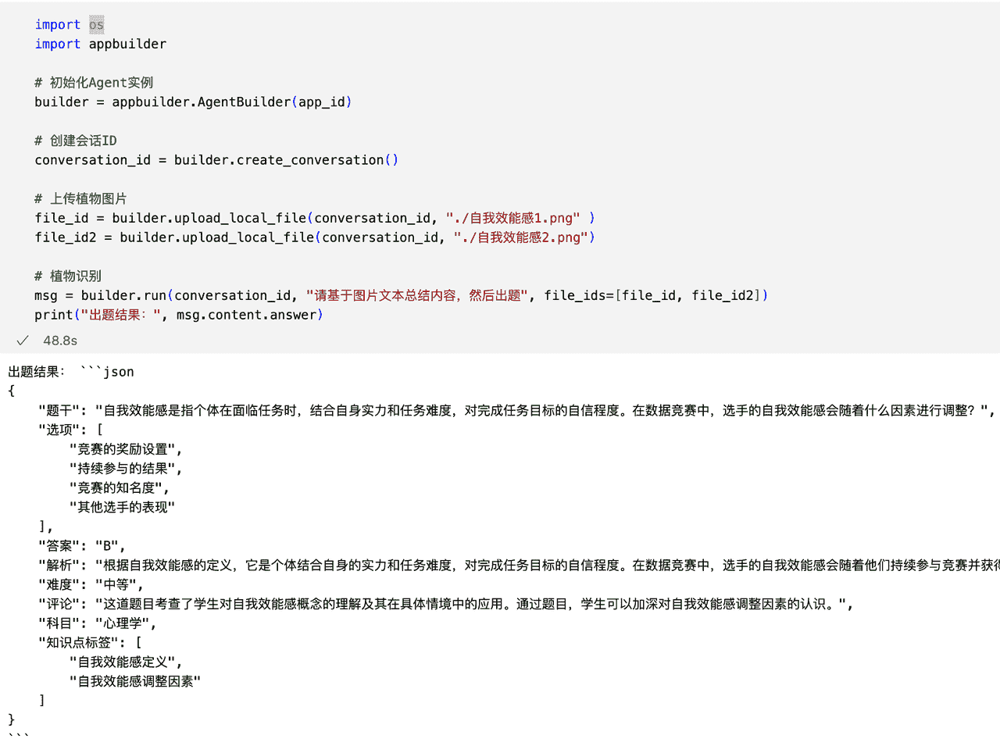

+ 发现仍然报类型错误

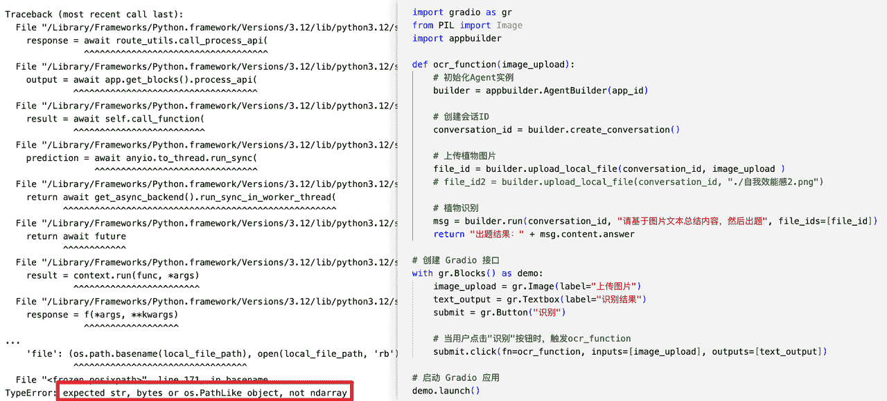

+ 需要设置`Image`组件上传的类型

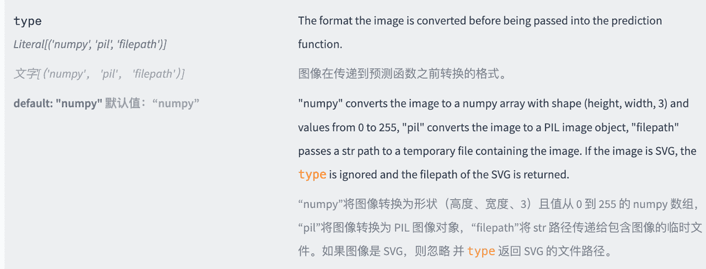

+ 最后成功了~

> 注意：下面的代码都省略了`token`和`app_id`的设置，其中调用应用需要`app_id`，调用组件不需要

### 调用可OCR的应用

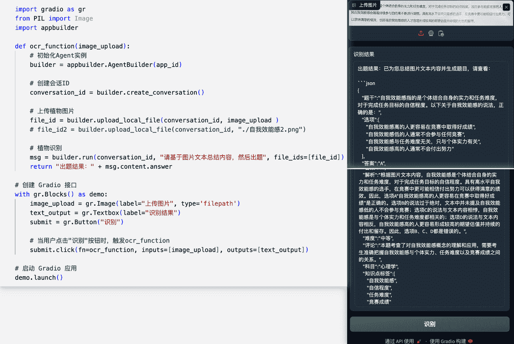

```python
import gradio as gr
from PIL import Image
import appbuilder

def ocr_function(image_upload):
    # 初始化Agent实例
    builder = appbuilder.AgentBuilder(app_id)

    # 创建会话ID
    conversation_id = builder.create_conversation()

    # 上传植物图片
    file_id = builder.upload_local_file(conversation_id, image_upload )
    # file_id2 = builder.upload_local_file(conversation_id, &quot;./自我效能感2.png&quot;)

    # 植物识别
    msg = builder.run(conversation_id, &quot;请基于图片文本总结内容，然后出题&quot;, file_ids=[file_id])
    return &quot;出题结果：&quot; + msg.content.answer

# 创建 Gradio 接口
with gr.Blocks() as demo:
    image_upload = gr.Image(label=&quot;上传图片&quot;, type=&#x27;filepath&#x27;)
    text_output = gr.Textbox(label=&quot;识别结果&quot;) 
    submit = gr.Button(&quot;识别&quot;)
    
    # 当用户点击&quot;识别&quot;按钮时，触发ocr_function
    submit.click(fn=ocr_function, inputs=[image_upload], outputs=[text_output])

# 启动 Gradio 应用
demo.launch()
```

### 调用OCR组件

```python
import gradio as gr
import appbuilder

def ocr_function(image_upload):
    with open(image_upload, &#x27;rb&#x27;) as image_file:
        image = image_file.read()
    
    # 使用 appbuilder 的 GeneralOCR 进行 OCR
    general_ocr = appbuilder.GeneralOCR()
    message = appbuilder.Message(content={&quot;raw_image&quot;: image})
    out = general_ocr.run(message)
    
    return out.content

# 创建 Gradio 接口
with gr.Blocks() as demo:
    image_upload = gr.Image(label=&quot;上传图片&quot;, type=&#x27;filepath&#x27;)
    text_output = gr.Textbox(label=&quot;识别结果&quot;) 
    submit = gr.Button(&quot;识别&quot;)
    
    # 当用户点击&quot;识别&quot;按钮时，触发ocr_function
    submit.click(fn=ocr_function, inputs=[image_upload], outputs=[text_output])

# 启动 Gradio 应用
demo.launch()
```

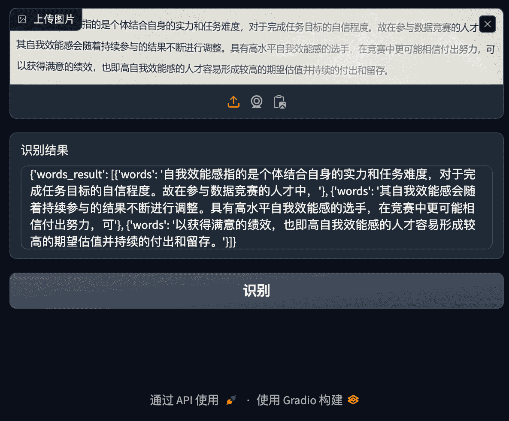

> 可以发现上面的步骤并不是那么一帆风顺，笔者花了大约2天的碎片时间，可能专注时间共用时 5h

> 大家自己在实践的过程中，可以参考如下顺序：

1. 先仔细搜索是否有人完成过类似的功能代码，然后直接复用
2. 如果复用报错，可以先在AI的帮助下分析报错信息和理解该段代码的逻辑
3. 如果仍然报错，考虑换一个代码参考，或者直接开始官方文档，分析具体的函数接口模式
4. 不断试错、不断分析、控制变量进行调试，直到成功

> PS：记得不要卡住自己太久，及时求助

# 整合：将功能加入已有项目

> 然后分析`ChatTests`代码，将上面已经跑通的代码整合上去

## 分析并添加UI

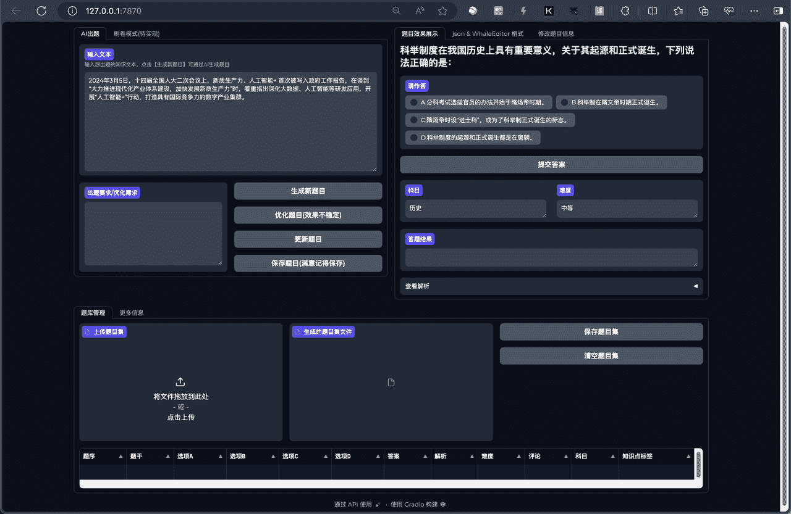

+ 可以考虑将`Image`放在输入文本的左边，修改对应代码后的效果如下：


+ 在这里尝试使用可OCR的应用进行对应的出题，其实最方便的方式是复制【生成新题目】对应的函数，新建一个按钮进行对应的调用，但那样【更新题目】也同时需要进行对应的更新

+ 因此选择直接复用【生成新题目】的按钮和函数代码，需要修改其中调用应用的逻辑

> 在思考实现方案的过程中还有新的发现和思考：

+ 在上传完图片后，直接调用应用识别且生成题目，可能导致后续纯文本生成题目有问题，需要添加一个“清除输入组件”的功能

+ 后续可以考虑将OCR识别文本、语音识别文本做成和生成题目相独立的板块，但目前不清楚`OCR组件`的额度，在找到替代方案之前，考虑直接调用对应的组件

+ 目前只支持调用对应组件的话，可以考虑直接做成`tab`，或者先选择输入方式：图片/纯文本，再显示对应的图片/文本输入组件

+ 或者直接做一个只做OCR功能、不出题的应用

### 将函数代码合并到对应的位置

+ 先将`button`的输入输出修改一下：

修改前的代码：

```python
generate_button.click(chattests.generate_quesiton, 
        inputs = [context_input, advice_input], 
        outputs = [gen_output, question_markdown, 
                   question_gen, choicesA_gen, choicesB_gen, choicesC_gen, choicesD_gen,
                   answer_gen, analysis_gen, difficulty_gen, comment_gen, subject_gen, tags_gen,
                   return_log, whale_format, choices_radio, analysis, op_log, subject, difficulty]
    )
```

修改后的代码：

```python
image_input = gr.Image(type="filepath", label="文本图片", height=400, width=50)

generate_button.click(chattests.generate_quesiton, 
        inputs = [context_input, advice_input, image_input], 
        outputs = [gen_output, question_markdown, 
                   question_gen, choicesA_gen, choicesB_gen, choicesC_gen, choicesD_gen,
                   answer_gen, analysis_gen, difficulty_gen, comment_gen, subject_gen, tags_gen,
                   return_log, whale_format, choices_radio, analysis, op_log, subject, difficulty]
    )
```

+ 在发现`图片组件`内有图片后，调用`OCR组件`：

修改前的代码：

```python
# 初始化Agent
app_id = os.environ.get(&quot;CHATTEST_ID&quot;)

agent_json = appbuilder.AgentBuilder(app_id)


def generate_quesiton(self, context, advice):
        context = &quot;```\n&quot; + context + &quot;```\n&quot; + &quot;请基于以上文本出单选题，正确选项必须唯一，其他选项必须是错误的，不同选项内容必须有差异，选项中不要包含选项字母，答案是正确选项的字母。&quot;

        if advice != &quot;&quot;:

            context = context + &quot;\n 另外：&quot; + advice

        conversation_new = agent_json.create_conversation()

        msg = agent_json.run(conversation_new, context)

        # 提取 JSON 数据，最后生成的类型是‘dict’，可以放入JSON框(否则会报错)

        markdown_text = msg.content.answer

        # print(markdown_text)

        json_start_index = markdown_text.find(&quot;```json&quot;) + 8
        json_end_index = markdown_text.find(&quot;```&quot;, json_start_index) - 1

        json_data = &quot;&quot;

        # print(json_data + &quot;\n json_start_index=&quot; + str(json_start_index))

        if json_start_index != 7:

            json_data = markdown_text[json_start_index:json_end_index].strip()

            self.question_json = json.loads(json_data)

            self.update_self()

            self.addLog(&quot;生成题目成功，题干为：&quot; + self.question)

            self.conversation_current = conversation_new

        else:

            self.addLog(&quot;ERROR：生成题目失败，详见【返回内容】&quot;)

            gr.Warning(&quot;ERROR: 生成题目失败，详见【返回内容】，请重试&quot;)      

        options = [&quot;A.&quot;+self.choices[0]+&quot;\n&quot;,&quot;B.&quot;+self.choices[1]+&quot;\n&quot;, 

                   &quot;C.&quot;+self.choices[2]+&quot;\n&quot;, &quot;D.&quot;+self.choices[3]+&quot;\n&quot;]

        question_markdown = &quot;## &quot;+ self.question

        formatted_whale = self.format_whale_editor()

        radio = gr.Radio(options,label=&quot;选择你认为最正确的一项&quot;)

        return (self.question_json, question_markdown, 

                self.question, self.choices[0], self.choices[1], self.choices[2],

                self.choices[3], self.answer, self.analysis, 

                self.difficulty, self.comment, self.subject, self.tags,

                markdown_text, formatted_whale, radio, self.analysis, self.log,

                self.subject, self.difficulty)

```

修改后的代码：

```python
# 初始化Agent
```


```python
app_id = os.environ.get("CHATTEST_ID")

app_ocr_id = os.environ.get("CHATTEST_OCR_ID")

agent_json = appbuilder.AgentBuilder(app_id)

agent_ocr_json = appbuilder.AgentBuilder(app_ocr_id)

def generate_quesiton(self, context, advice, image_input):

        context = "```\n" + context + "```\n" + "请基于以上文本出单选题，正确选项必须唯一，其他选项必须是错误的，不同选项内容必须有差异，选项中不要包含选项字母，答案是正确选项的字母。"
        if advice != "":
            context = context + "\n 另外：" + advice

        if image_input != None:
            conversation_new = agent_ocr_json.create_conversation()
            # 获取对应图片
            file_id = agent_ocr_json.upload_local_file(conversation_new, image_input)
            # 调用OCR应用，根据图片文字实现出题
            msg = agent_ocr_json.run(conversation_new, context, file_ids=[file_id])
        else:
            conversation_new = agent_json.create_conversation()
            msg = agent_json.run(conversation_new, context)

        # 提取 JSON 数据，最后生成的类型是‘dict’，可以放入JSON框(否则会报错)
        markdown_text = msg.content.answer
        # print(markdown_text)
        
        json_start_index = markdown_text.find("```json") + 8

        json_end_index = markdown_text.find("```", json_start_index) - 1
        json_data = ""

        # print(json_data + "\n json_start_index=" + str(json_start_index))
        
        if json_start_index != 7:
            json_data = markdown_text[json_start_index:json_end_index].strip()
            self.question_json = json.loads(json_data)
            self.update_self()
            self.addLog("生成题目成功，题干为：" + self.question)
            self.conversation_current = conversation_new
        else:
            self.addLog("ERROR：生成题目失败，详见【返回内容】")
            gr.Warning("ERROR: 生成题目失败，详见【返回内容】，请重试")      

        options = ["A."+self.choices[0]+"\n","B."+self.choices[1]+"\n", 
                   "C."+self.choices[2]+"\n", "D."+self.choices[3]+"\n"]
        question_markdown = "## "+ self.question
        formatted_whale = self.format_whale_editor()
        radio = gr.Radio(options,label="选择你认为最正确的一项")

        return (self.question_json, question_markdown, 
                self.question, self.choices[0], self.choices[1], self.choices[2],
                self.choices[3], self.answer, self.analysis, 
                self.difficulty, self.comment, self.subject, self.tags,
                markdown_text, formatted_whale, radio, self.analysis, self.log,
                self.subject, self.difficulty)
```

然后就成啦~


> 后面其实可以继续优化在编程过程中发现的问题~
> 这里就不进行记录啦~
> 期待大家都能顺利做好自己的应用！~

## 部署与分享

> 只有部署到云平台或服务器，才能将做出的应用分享给别人进行查看

+   AI Studio部署可参考 飞桨项目："一键"跑通大模型应用开发！的 1.4 应用部署(选学) 部分

+   魔搭部署可参考：[AgentScope应用开发入门](https://datawhaler.feishu.cn/wiki/GInXwJYKlibkSwk04qrcfOJBnge)

> 其他平台的部署方法，大家可以自己探索，在学习群内与大家分享交流~

> ChatTests的部署详情可见：

+   **AI Studio版**：https://aistudio.baidu.com/application/detail/32213

+   **魔搭版**：https://modelscope.cn/studios/chattests/Chattests_Question_0520/summary


## 迭代&项目管理：

> 记录TODO，一点点完成 + 分享应用体验链接，收集反馈并迭代，参考执行框架如下：


### 记录一个TODO List / 项目管理表

+   TODO的作用是提醒自己和团队成员，当前所需要做的事情有哪些，一个参考的最简示例如下图：


> 最好有一个固定的云文档可用来做记录和展示，方便协作的同时，也方便汇总已有成果。

> **最简单的**TODO List为上图所示的顺序放置，进行紧急程度排序即可线性执行。

> 更多细节详见：[ChatTests-20240420实践记录](https://datawhaler.feishu.cn/docx/Hx3hdDvXqoOnUwxUqdicVguEn1g)

> 另外还可以标注好分工、负责人、截止时间、按照四象限排序等方式。

+   下图是Chattests在2023年刚组队开发时的项目里程碑：


### 反复使用，获得真实反馈

> 做真实被需要的应用，给自己和他人使用，这样更能得到反馈

+   在使用的过程中，从功能性、交互体验、内容准确度等方面思考应用的扩展方向

+   做好用、好玩、或有用的应用~

### 不断学习交流、模仿实践

> 尝试各种新的技术、好的思路，不管是Prompt、还是算法、还是功能代码、还是UI，好的东西都有学习模仿的价值

+   多实践、多思考、多交流和学习经典

+   开发应用最核心的几个要素也许是：洞察需求、快速迭代开发和debug、获得真实的反馈、向优秀的人学习

+   另外，和优秀的作品和大佬同台竞技、从他们身上学到更多有价值的东西~

# 应用案例

## RAG应用：知识库AI伴读

> 本案例由 贡献，可copy代码在本地进行运行，没有AI Studio版本

我使用Streamlit，实现了一个简单的RAG功能，下面是我的开发过程。

### 项目介绍

我们原有一个知识库，主要是放的图书等资源，我为原来的知识库添加了一个AI伴读功能。功能入口页面如下图所示。


点击AI伴读，会进入使用Streamlit创建的AI聊天界面，

聊天界面，如下图所示


### AI伴读页面介绍

下面是使用Streamlit创建的页面的详细介绍。

#### 使用的控件

+   Chat

+   `st.chat_input`

+   `st.chat_message`

+   状态

+   `st.spinner`（显示加载中）

+   缓存与状态

+   `st.session_state`

+   `st.query_params`（获取地址栏参数）

+   文本

+   `st.write`

+   `st.write_stream`

+   `st.markdown`

+   容器

+   `st.container()`

#### 页面搭建流程

##### 首先搭建一个静态页面

首先搭建好一个静态页面，之后再向其中一点点添加功能

这样的好处是，将一个复杂的任务分解开来，降低这件事儿的难度

静态页面的代码如下

```python
# 引入streamlit
import streamlit as st

# 在网页上写上标题
st.markdown('<h1 style="text-align: center;color:rgb(0, 104, 201);">AI伴读</h1>', unsafe_allow_html=True)

# 添加一个容器
messages = st.container()

# 在容器中添加一个聊天控件，并且首先是机器人的打招呼
messages.chat_message("ai").write(f"有什么可以帮助您的？")

# 在页面中添加一个输入框，用来跟大模型交互
if prompt := st.chat_input("Say something"):
    # 将用户输入的内容添加到聊天控件中
    messages.chat_message("human").write(f"{prompt}")
    # 为方便演示，直接将用户输入的内容，添加到机器人的响应中
    messages.chat_message("ai").write(f"{prompt}")
```

直接将代码拷贝到一个.py文件中，然后`streamlit run xxx.py` 即可以运行该程序，得到一个比较美观的界面


##### 隐藏页面上方空白

在页面中可以看到，页面标题上方有大量空白，导致页面显示内容较少。隐藏上方空白代码如下

```python
# 向页面添加样式，来控制页面
st.markdown("""
<style>
    .st-emotion-cache-1ru4d5d {
        padding-top : 15px;
    }
</style>
""", unsafe_allow_html=True)
```

##### 加入历史记录

Streamlit中，每次与页面交互，都会重新刷新整个页面，这样会导致，我们的聊天记录丢失，所以需要用到`st.session_state`控件，将我们的聊天记录缓存下来

```python
# 如果不包含qa_pairs，则赋值为空
if 'qa_pairs' not in st.session_state:
    st.session_state.qa_pairs = []
    
# 在页面中显示历史记录列表
for pair in st.session_state.qa_pairs:
    messages.chat_message("human").write(f"{pair['question']}")
    messages.chat_message("ai").write(f"{pair['answer']}")

# 将对话记录添加到缓存中
st.session_state.qa_pairs.append({"question": prompt, "answer": content})
```

完整代码如下

```python
# 引入streamlit
import streamlit as st

# 向页面添加样式，来控制页面
st.markdown("""
<style>
    .st-emotion-cache-1ru4d5d {
        padding-top : 15px;
    }
</style>
""", unsafe_allow_html=True)

# 在网页上写上标题
st.markdown('<h1 style="text-align: center;color:rgb(0, 104, 201);">AI伴读</h1>', unsafe_allow_html=True)

# 添加一个容器
messages = st.container()

# 在容器中添加一个聊天控件，并且首先是机器人的打招呼
messages.chat_message("ai").write(f"有什么可以帮助您的？")

# 如果不包含qa_pairs，则赋值为空
if 'qa_pairs' not in st.session_state:
    st.session_state.qa_pairs = []

# 在页面中显示历史记录列表
for pair in st.session_state.qa_pairs:
    messages.chat_message("human").write(f"{pair['question']}")
    messages.chat_message("ai").write(f"{pair['answer']}")

# 在页面中添加一个输入框，用来跟大模型交互
if prompt := st.chat_input("Say something"):
    # 将用户输入的内容添加到聊天控件中
    messages.chat_message("human").write(f"{prompt}")
    # 为方便演示，直接将用户输入的内容，添加到机器人的响应中
    messages.chat_message("ai").write(f"{prompt}")
    # 将对话记录添加到缓存中
    st.session_state.qa_pairs.append({"question": prompt, "answer": prompt})
```

##### 获取地址栏参数

我的项目点击时，会传递图书ID等等参数进来，我需要在streamlit中获取这些参数

```python
# 获取地址栏参数
type = st.query_params.get("type", "")
doi = st.query_params.get("doi", "")
id = st.query_params.get("id", "")
parentid = st.query_params.get("parentid", "")
```

##### 显示加载中


# 页面加载与向量创建

进入页面后，如果一本没有阅读过的书，会首先去创建向量，所以需要等待一段时间。此时我会让AI输出“正在加载中，请稍候”，然后加载完成后，会显示“加载已完成，请开始提问”。

```
# 如果不包含qa_pairs，则赋值为空
if 'qa_pairs' not in st.session_state:
    st.session_state.qa_pairs = []
    with messages.chat_message("assistant"):
        with st.spinner('正在加载中，请稍候...'):
            # 等待5秒钟
            time.sleep(5)
            st.write('加载已完成，请开始提问。')
```

## 流式输出

流式输出使用 `st.write_stream`。

```
# 调用流式返回函数call_with_stream
content = st.write_stream(call_with_stream(msgs))
```

构造调用千问模型的message的代码如下

```
# 模拟检索向量，然后重新组装prompt的过程
def getPrompt(question):
    time.sleep(5)
    return question

# 构造msgs
msgs = []
for pair in st.session_state.qa_pairs:
    msgs.append({'role': 'user', 'content': pair['question']})
    msgs.append({'role': 'assistant', 'content': pair['answer']})
    
# 检索向量，获得相关内容，并且组装成新的prompt
result = getPrompt(prompt)
msgs.append({'role': 'user', 'content': result})
```

`call_with_stream` 方法是调用千问大模型，给出流式输出的方法

代码如下

```
from http import HTTPStatus
from dashscope import Generation
import os

def call_with_stream(messages):
    # 从环境变量中获取apikey
    api_key = os.environ.get('qianwen_api_key')

    responses = Generation.call("qwen-max",
                                messages=messages,
                                result_format='message',  # 设置输出为'message'格式
                                stream=True, # 设置输出方式为流式输出
                                incremental_output=True,  # 增量式流式输出
                                api_key=api_key
                            )
    for response in responses:
        if response.status_code == HTTPStatus.OK:
            yield response.output.choices[0]['message']['content']
        else:
            yield ('Request id: %s, Status code: %s, error code: %s, error message: %s' % (
                response.request_id, response.status_code,
                response.code, response.message
            ))
```

## 整体介绍

通过以上步骤，便简单实现了一个RAG系统的页面搭建

完整的页面代码如下

```
# 引入streamlit
import streamlit as st
import time
from tools.qianwen import call_with_stream

# 向页面添加样式，来控制页面
st.markdown("""
<style>
    .st-emotion-cache-1ru4d5d {
        padding-top : 15px;
    }
</style>
""", unsafe_allow_html=True)

# 在网页上写上标题
st.markdown('<h1 style="text-align: center;color:rgb(0, 104, 201);">AI伴读</h1>', unsafe_allow_html=True)

# 添加一个容器
messages = st.container()

# 如果不包含qa_pairs，则赋值为空
if 'qa_pairs' not in st.session_state:
    st.session_state.qa_pairs = []
    with messages.chat_message("assistant"):
        with st.spinner('正在加载中，请稍候...'):
            # 模拟创建向量/检查向量是否已经存在
            time.sleep(5)
            st.write('加载已完成，请开始提问。')

# 在页面中显示历史记录列表
for pair in st.session_state.qa_pairs:
    messages.chat_message("human").write(f"{pair['question']}")
    messages.chat_message("ai").write(f"{pair['answer']}")

# 模拟检索向量，然后重新组装prompt的过程
def getPrompt(question):
    time.sleep(5)
    return question

# 在页面中添加一个输入框，用来跟大模型交互
if prompt := st.chat_input("Say something"):
    # 将用户输入的内容添加到聊天控件中
    messages.chat_message("human").write(f"{prompt}")
    # 构造msgs
    msgs = []
    for pair in st.session_state.qa_pairs:
        msgs.append({'role': 'user', 'content': pair['question']})
        msgs.append({'role': 'assistant', 'content': pair['answer']})

    # 调用千问大模型，获取回复
    with messages.chat_message("ai"):
        with st.spinner(''):
            # 检索向量，获得相关内容，并且组装成新的prompt
            result = getPrompt(prompt)
            msgs.append({'role': 'user', 'content': result})
            # 调用千问模型，获得回复
            content = st.write_stream(call_with_stream(msgs))
            # 添加RAG的引用信息
            st.write("引用1，引用2，引用3")

    # 将对话记录添加到缓存中
    st.session_state.qa_pairs.append({"question": prompt, "answer": content})
```

# 扩展资料

1. llm-universe 的 gradio教程

1. [项目流程简析](https://linklearner.com/lesson/11eee795-2d34-ce9a-abce-00ffd44c5a68/details/11eee795-2d3b-6927-8f2c-00ffd44c5a68)

1. [AgentScope应用开发入门](https://datawhaler.feishu.cn/wiki/GInXwJYKlibkSwk04qrcfOJBnge)

1. 使用 Gradio 的“热重载”模式快速开发 AI 应用

1. [千帆接口在线调试平台](https://console.bce.baidu.com/tools/?_=1692863460488#/api?product=QIANFAN&project=%E5%8D%83%E5%B8%86AppBuilder&parent=OpenAPI&api=v2%2Fapp%2Fconversation&method=post)

1. AppBuilder-代码态训练营：快速上手SDK

1. Appbuilder-代码态训练营：语音对话、多智能体互动

1. https://cloud.baidu.com/doc/AppBuilder/s/7luwm2yt0

1. 一小时实践入门 Gradio-深度学习交互界面（一）

1. 一文搞懂模型展示工具Gradio的所有功能

1. [🎃 ChatTests项目详细说明文档](https://zaiwen-chattests.feishu.cn/docx/IeoQdvZcQo51Yzx8oJIcHSjqnyg)

# ❓QA

### 无法跑通与“地理小达人应用”对话的案例？


> 这是因为案例使用的是官方提供的试用TOKEN，每天使用额度有限制，

> 可能刚好在运行时，额度已经用完。如果跑不通的话，可以先不管，继续往下进行即可

> 也可以在 Appbuilder-SDK官方交流群 内反馈~

### 个人空间没有应用id？

> 需参考[1. 【 0代码】千帆Appbuilder使用入门](https://datawhaler.feishu.cn/wiki/F9ZtwAoI2i7oGBkN1Y3cpMLPn5c)进行创建

### 访问不了体验随机回复应用 `gradio.py` 文件？

1. 先确认自己的项目有没有成功运行，如果没有成功运行项目，此处的链接就不能成功打开。

1. 如果已经成功运行项目，很可能是网络的问题。在国外的学习者，登录百度云可能会卡住，如使用了VPN，也会导致成功运行了项目打不开链接的情况。建议退出VPN和浏览器，重新登陆。


> 这是因为没有运行项目，记得在打开飞桨项目："一键"跑通大模型应用开发！的时候，就点击右上角的【运行一下】

https://datawhaler.feishu.cn/sync/CpMTdKriBs89Xvb43AkcILranFg

### 打开 `在应用里接入大模型.gradio.py` 文件，启动服务失败怎么办？


> 翻译一下右边的ERROR信息(尤其是最后一句)，自己尝试解决，

> 如果解决不了，可以尝试发给AI试试，如下面的gif所示，可以直接在AI Studio上与comate（百度AI编程助手）进行对话，并得到推荐的解决方案


### 如下图，`gradio.py` 中的代码无法直接在 `notebook` 文件(`ipynb`)中运行怎么办？


> 这可能是飞桨AI Studio的限制，可以先不用管，不影响后续直接单独调试 `xxx.gradio.py` 文件。

> [本地开发环境配置经验共创](https://datawhaler.feishu.cn/wiki/WjTmwizJOismWZkVbpoctZZTnqd)外，也可以尝试在本地运行和调试，欢迎大家在 文档中共创~

### 如何学习和实践代码开发？

> 详见共创文档：[编程学习经验讨论](https://datawhaler.feishu.cn/wiki/SklPwqovrimRJOkmR50cf8Ypn3c)

### 如何获取应用调用组件的结果？

> 在返回的`content.events`里能找到


# 🐳 Datawhale简介 & 致谢

<https://datawhaler.feishu.cn/sync/LeXFdL7YjsXOuabuutsc2lTGnxE>

> 本篇的贡献者众多，都很用心在为大家提供内容~ 期待大家的点赞和反馈呀~

> 贡献者清单为： 、 、 、 、 、
