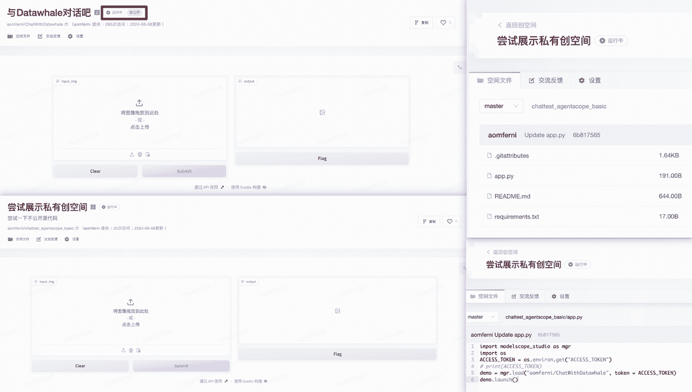
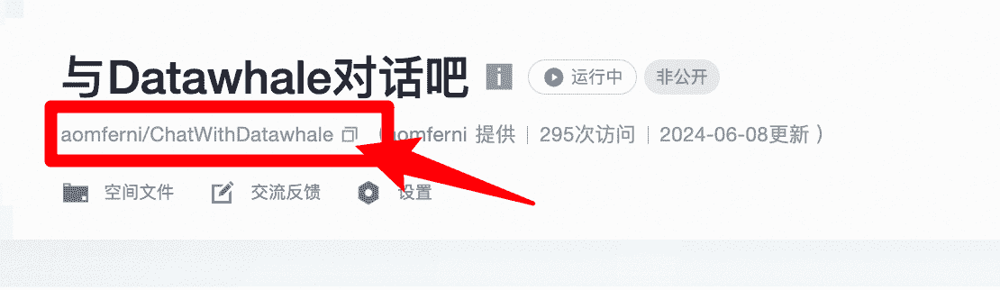
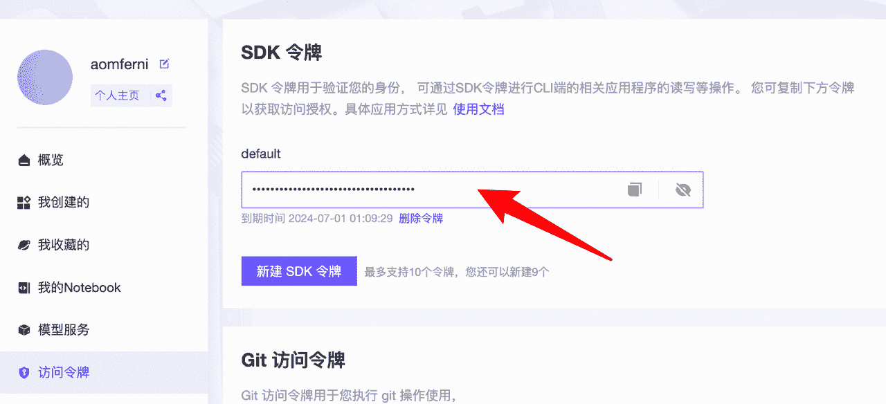
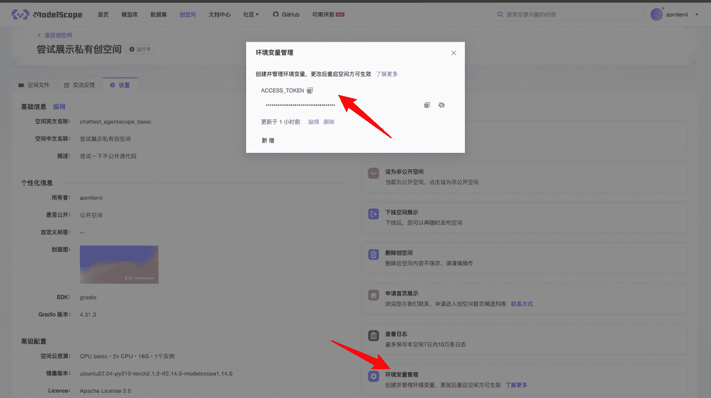

# 各平台部署经验汇总

> 来源：[https://datawhaler.feishu.cn/docx/FeGYdsVpzoUMh9xGsYec0pY0nyh](https://datawhaler.feishu.cn/docx/FeGYdsVpzoUMh9xGsYec0pY0nyh)

#  AI Studio

[AI Studio部署排坑指南](https://datawhaler.feishu.cn/wiki/PsyxwQHNGigRpLkIJZ3ceS0rnBf)

# 魔搭

[AgentScope应用开发入门](https://datawhaler.feishu.cn/wiki/GInXwJYKlibkSwk04qrcfOJBnge)

> 如果不想公开自己的源码可尝试下面的方式，展示自己未公开的创空间

```
import modelscope_studio as mgr
import os
ACCESS_TOKEN = os.environ.get(&quot;ACCESS_TOKEN&quot;)
demo = mgr.load(&quot;aomferni/ChatWithDatawhale&quot;, token = ACCESS_TOKEN)
demo.launch()
```

+   效果图如下：

> “[与Datawhale对话吧](https://modelscope.cn/studios/aomferni/ChatWithDatawhale/summary)（点击可打开创空间）”是【运行中，未公开】状态的一个创空间

> “[尝试展示私有空间](https://www.modelscope.cn/studios/aomferni/chattest_agentscope_basic/summary)（点击可打开创空间）”是展示“与Datawhale对话吧”效果的创空间

> 这样，[尝试展示私有空间](https://www.modelscope.cn/studios/aomferni/chattest_agentscope_basic/summary) 可以运行[与Datawhale对话吧](https://modelscope.cn/studios/aomferni/ChatWithDatawhale/summary)的代码，但[与Datawhale对话吧](https://modelscope.cn/studios/aomferni/ChatWithDatawhale/summary)的代码不会被公开可阅读



+   需要注意，将上述代码中的aomferni/ChatWithDatawhale和 ACCESS_TOKEN环境变量设置为自己的内容

+   aomferni/ChatWithDatawhale是需要展示的创空间的地址标识，在创空间名称下方即可查看



ACCESS_TOKEN环境变量是SDK令牌https://modelscope.cn/my/myaccesstoken

处可查看复制



+   注意隐藏自己的ACCESS_TOKEN，需要创建环境变量



+   另外

# 👸号

# Hugging face

# Laf

https://doc.laf.run/zh/

# colab