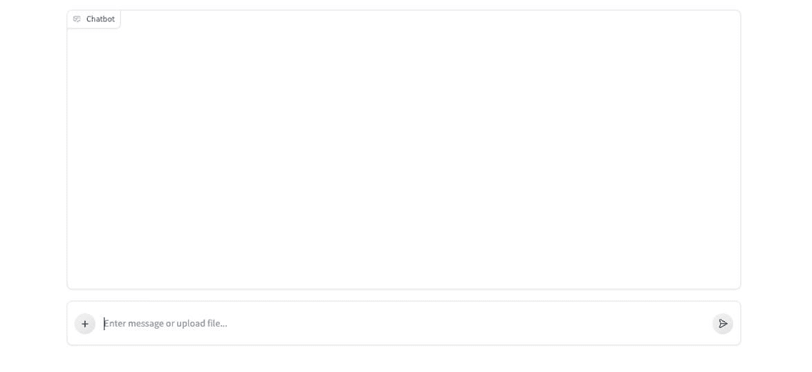

# Gradio实践笔记

> 来源：[https://datawhaler.feishu.cn/docx/CsMadTsCJobptBxTUNMclGXmnOd](https://datawhaler.feishu.cn/docx/CsMadTsCJobptBxTUNMclGXmnOd)

# Gradio 实现 OpenAI 流式问答机器人教程

本文将介绍如何使用Gradio和OpenAI API来实现一个流式问答机器人。通过这个教程，你将学会如何构建一个可以处理文本输入并返回连续响应的聊天机器人。

## 环境准备

在开始之前，确保你已经安装了必要的Python库。你可以使用以下命令安装Gradio和OpenAI库：

```
pip install gradio openai
```

## 代码结构

我们将代码分为几个部分进行详细解读：

1.  **导入必要的库**

1.  **定义消息添加函数**

1.  **定义机器人响应函数**

1.  **创建Gradio界面**

### 1. 导入必要的库

首先，我们需要导入Gradio和OpenAI库，以及操作系统相关的库。

```
import os
import gradio as gr
from openai import OpenAI
```

### 2. 定义消息添加函数

add_message函数用于将用户的输入消息添加到聊天记录中。

```
def add_message(history, message):
    for x in message[&quot;files&quot;]:
        history.append(((x,), None))
    if message[&quot;text&quot;] is not None:
        history.append((message[&quot;text&quot;], None))
    return history, gr.MultimodalTextbox(value=None, interactive=False)
```

函数参数：

+   history：聊天记录。

+   message：用户输入的消息，是一个字符串。

函数功能：

+   将文件或文本消息添加到聊天记录中。

+   返回更新后的聊天记录和一个新的空的输入框。

### 3. 定义机器人响应函数

bot函数用于处理用户输入，并通过OpenAI API生成机器人响应。

```
def bot(history):
    history[-1][1] = &quot;&quot;

    history_openai_format = []
    for human, assistant in history[:-1]:
        history_openai_format.append({&quot;role&quot;: &quot;user&quot;, &quot;content&quot;: human})
        history_openai_format.append({&quot;role&quot;: &quot;assistant&quot;, &quot;content&quot;: assistant})
    history_openai_format.append({&quot;role&quot;: &quot;user&quot;, &quot;content&quot;: history[-1][0]})

    client = OpenAI(
        api_key=os.getenv(&quot;DASHSCOPE_API_KEY&quot;),
        base_url=&quot;https://dashscope.aliyuncs.com/compatible-mode/v1&quot;,
    )
    completion = client.chat.completions.create(
        model=&quot;qwen-turbo&quot;,
        messages=history_openai_format,
        temperature=0.1,
        stream=True,
    )
    for chunk in completion:
        history[-1][1] += chunk.choices[0].delta.content
        yield history

```

函数参数：

+   history：聊天记录。

函数功能：

+   从聊天记录中获取最新的用户输入（prompt）。

+   拼接历史消息history，这是一个二维数组，每条消息包含用户输入和LLM输出。

+   使用OpenAI API创建一个聊天完成请求。

+   设置API请求的模型和消息内容。

+   逐步接收API响应，并将内容追加到最新的消息响应中。

+   使用yield逐步更新聊天记录，实现流式响应。

> 为方便对接国内大模型，我们使用了DashScope API代替OpenAI API，只需要改写api_key、base_url和model即可使用。

### 4. 创建Gradio界面

接下来，我们使用Gradio创建一个用户界面来展示聊天机器人。

```
with gr.Blocks() as demo:
    chatbot = gr.Chatbot([], elem_id=&quot;chatbot&quot;, bubble_full_width=False)

    chat_input = gr.MultimodalTextbox(
        interactive=True,
        file_types=[],
        placeholder=&quot;Enter message or upload file...&quot;,
        show_label=False,
    )

    chat_msg = chat_input.submit(
        add_message, [chatbot, chat_input], [chatbot, chat_input]
    )
    bot_msg = chat_msg.then(bot, chatbot, chatbot, api_name=&quot;bot_response&quot;)
    bot_msg.then(lambda: gr.MultimodalTextbox(interactive=True), None, [chat_input])

demo.queue()
demo.launch()
```

步骤说明：

+   创建一个gr.Blocks实例作为整个应用的容器。

+   创建一个Chatbot组件来显示聊天内容。

+   创建一个MultimodalTextbox组件作为用户的输入框。

+   当用户提交消息时，调用add_message函数更新聊天记录。

+   使用then方法链式调用bot函数处理并生成机器人响应。

+   重新启用输入框供用户继续输入。

+   最后，通过launch()启动Gradio应用。

## 完整代码

```
import os

import gradio as gr
from openai import OpenAI


def add_message(history, message):
    for x in message[&quot;files&quot;]:
        history.append(((x,), None))
    if message[&quot;text&quot;] is not None:
        history.append((message[&quot;text&quot;], None))
    return history, gr.MultimodalTextbox(value=None, interactive=False)


def bot(history):
    history[-1][1] = &quot;&quot;

    history_openai_format = []
    for human, assistant in history[:-1]:
        history_openai_format.append({&quot;role&quot;: &quot;user&quot;, &quot;content&quot;: human})
        history_openai_format.append({&quot;role&quot;: &quot;assistant&quot;, &quot;content&quot;: assistant})
    history_openai_format.append({&quot;role&quot;: &quot;user&quot;, &quot;content&quot;: history[-1][0]})

    client = OpenAI(
        api_key=os.getenv(&quot;DASHSCOPE_API_KEY&quot;),
        base_url=&quot;https://dashscope.aliyuncs.com/compatible-mode/v1&quot;,
    )
    completion = client.chat.completions.create(
        model=&quot;qwen-turbo&quot;,
        messages=history_openai_format,
        temperature=0.1,
        stream=True,
    )
    for chunk in completion:
        history[-1][1] += chunk.choices[0].delta.content
        yield history


with gr.Blocks() as demo:
    chatbot = gr.Chatbot([], elem_id=&quot;chatbot&quot;, bubble_full_width=False)

    chat_input = gr.MultimodalTextbox(
        interactive=True,
        file_types=[],
        placeholder=&quot;Enter message or upload file...&quot;,
        show_label=False,
    )

    chat_msg = chat_input.submit(
        add_message, [chatbot, chat_input], [chatbot, chat_input]
    )
    bot_msg = chat_msg.then(bot, chatbot, chatbot, api_name=&quot;bot_response&quot;)
    bot_msg.then(lambda: gr.MultimodalTextbox(interactive=True), None, [chat_input])

demo.queue()
demo.launch()

```

## 效果展示

可以看到，LLM响应是流式输出的，并且LLM在处理第二个问题“里面有哪些教程”时，理解了用户想要问的上下文是“Datawhale里面有哪些教程”。



[Screen Recording 2024-06-11 at 11.00.43.mov](https://internal-api-drive-stream.feishu.cn/space/api/box/stream/download/all/LkMSbG3THoinaBxaDEncL7Ppnxg)

## 总结

通过上述步骤，我们成功地实现了一个基于Gradio和OpenAI的流式问答机器人。这个教程展示了如何处理用户输入并使用OpenAI API生成连续的响应，希望对你有所帮助。

现在，你可以根据自己的需求进一步定制和扩展这个聊天机器人，例如添加更多的对话逻辑或支持更多类型的输入。

## 参考资料

+   https://www.gradio.app/docs/gradio/chatbot

+   https://www.gradio.app/guides/creating-a-custom-chatbot-with-blocks

+   https://www.gradio.app/guides/creating-a-chatbot-fast#a-streaming-example-using-openai

+   https://help.aliyun.com/zh/dashscope/developer-reference/compatibility-of-openai-with-dashscope/