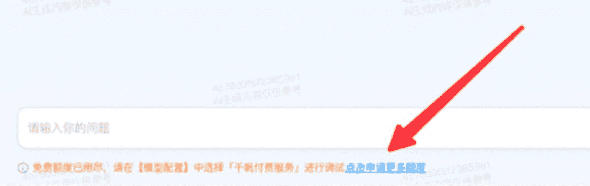
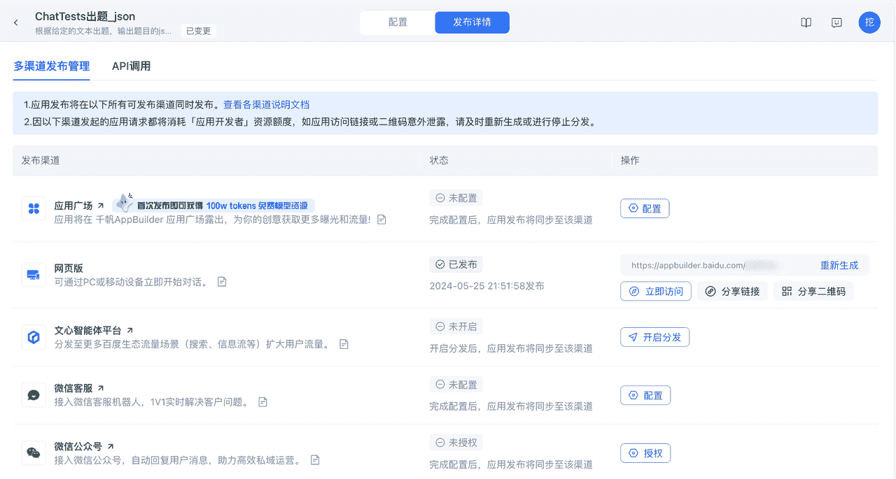

# 学习交流 | 千帆教育

> 来源：[https://datawhaler.feishu.cn/docx/VfS6dvAcwoOLd3x0UNtcm1CVnYj](https://datawhaler.feishu.cn/docx/VfS6dvAcwoOLd3x0UNtcm1CVnYj)

> 欢迎来到**《千帆杯赛事学习》**课程 共创笔记板块！

> **在这个文档中，我们将**共同整理和总结学习过程中的重点内容、问题和解答。

> 欢迎随时分享你的笔记和心得，我们一起完善这份笔记！

> 通过共同创作，我们将建立起一份全面、实用的实战笔记，

> 帮助到更多的学习者进行相关学习和实践，以及迭代优化开源项目！

> 欢迎大家共同编写此文档，你的任何一小段的尝试和思考都有其参考价值和独特的意义！

> 

> 此文档的内容完全开源，可基于此文档进行二创

>

> **感谢答疑的讲师——**

> 感谢积极学习答疑的优秀学习者/助教——

<https://datawhaler.feishu.cn/sync/WfPJdTkREs3I0XbeTSrcOM3CnPh>

**分享 & 讨论 可参考如下话题**：

1.  ⚙ 技术概念解析

1.  🎥 直播笔记

1.  📒 优秀笔记

1.  💓 学习感悟

1.  ❓ 学习过程中的QA

# [组队学习攻略](https://datawhaler.feishu.cn/wiki/YWN9wvCkriEZZFkhFcccwCMMnEd)

<https://datawhaler.feishu.cn/sync/FoMhdsTAzsnHyPbfoMlckpltnmb>

# 贡献者清单

| **角色** | **姓名** |
| --- | --- |
| 课程设计者 |  |
| 运营助教 |  |
| 专业助教 |  |
| 优秀学习者 |  |

# 推荐其他经验文档

# ❓ QA板块

> 此处收集直播以及学习群交流的相关问题的解答，鼓励大家共创QA板块，并基于QA板块输出自己的学习笔记等，Ctrl + F 一下，会发现很多惊喜哟~

## 学习手册

<https://datawhaler.feishu.cn/sync/S1BrdS1FjsjL8ebgLlbcQtegnPd>

## 开营：赛事解读 + Appbuilder入门

1.  **免费次数用完了会有补充嘛 ？ **

> 1000次免费quota消耗完后可以在应用配置下方向官方申请，效果应该类似下图

1.  **创建后，广场看不到我的应用？**

> 应用发布后是私有的，如果把链接给到别人调用，会消耗你的tokens或者quota

> 但是如果想分发，可以在发布渠道进行分发：应用广场、网页版、文心一言、微信、公众号等

1.  文心一言那边能看到我发布的应用吗？

> 两边创建是不同的，想在文心一言那边看到的话，可以在那边创建应用

> PS：但好像可以分发到文心那边，感兴趣的话可以试试

1.  **可以创建多agent对话吗？ **

> 单纯Appbuilder官网创建的Chatbot无法实现，可以创建多个应用，然后通过调用多个应用实现类似功能，但还有很多细节问题

1.  **参加比赛需不需要代码操作？**

> 单纯Appbuilder官网创建不需要代码操作，但是自建组件想写一点Python代码的话也可以。

> [4. 【代码级】AI应用开发入门](https://datawhaler.feishu.cn/wiki/R9WNw16imiWYORkV7eOcpX0Pn9c)外还可以使用Appbuilder-SDK进行二次开发，这个可以详见

1.  这个应用开发其实就是纯prompt工程么？

> 只用官网功能的话大部分是 带工具调用的Prompt工程，但如果有需要，可以用官方SDK调用官方API开发更多形态的应用

> [另外：单纯Pro](https://cloud.baidu.com/qianfandev/matchs)mpt工程也能开发很多有意思的应用，案例详见 千帆杯参赛作品集

1.  刚才调试的时候就消耗了一个资源，当我发布以后别人用也会扣资源吗？

> 是的，每次对话都会消耗一个quota，就算点击了【停止生成】，也无法撤销消耗

> 但是参赛即有1000免费quota，用完了还可以申请，亲测够用

1.  我发布的应用可以接入到企业微信吗？

> 【发布详情】里好像可以接入企业微信客服，感兴趣可以试试

1.  **不懂小程序和App开发怎么办？**

> 提交赛事不一定需要构建小程序和App，官方接受各种软件形态，大家可以根据自己的能力选择合适的开发目标

> PS：本次[4. 【代码级】AI应用开发入门](https://datawhaler.feishu.cn/wiki/R9WNw16imiWYORkV7eOcpX0Pn9c)教程为大家介绍了“一键”跑通大模型应用开发的方式，使用 Gradio/Streamlit 可方便快捷地完成应用开发

## [prompt工程场景及方案-QA手册](https://datawhaler.feishu.cn/wiki/M8ebwmyGWiHayKkbYAdccVEqndc)

## Appbuilder进阶QA

1.  **组件里的引用变量是全局的吗？**

1.  **工作流在哪里进去？**

1.  **rag是什么？**

1.  **知识增强是什么？**

1.  **切片怎么切更准确？**

1.  **怎么自动切片？**

1.  有组件可以实现登录用户和记忆用户行为吗？

1.  可不可以用知识库去取代大模型的记忆？

1.  组件可以有记忆吗？可以寄存变量吗？

1.  **能不能用组件去切片啊？**

1.  **知识库处理能写代码吗？**

1.  **数据清洗是那个百度做好了吗？**

1.  长期记忆是存储在哪里？以什么形式存储？

1.  百度Appbuilder是黑盒，需要自己敲代码在自己的外部代码里实现

1.  切片之后，自动以QA形式存储的吗？

1.  有知识库之后，agent是先调用知识库，知识库没有的再找其他的吗？

1.  【角色指令】里可以设计

1.  写的时候写**{{组件名}}**，但是优化后不会有花括号

1.  **如果我想让模型的回答根据我给的大**量已有数据仿照风格和内容进行回答可以吗？

1.  很多开放的方案，Prompt就可以实现，

1.  实在不行，微调

1.  切片的目的是让模型根据问题更方便和准确找到一些有关的内容进行回答吗？

1.  **代码可以关联静态表格吗（我自己实现知识库） **我想做一些随机性抽取啥的感觉都不太好做？

1.  **不能寄存变量怎么搭建哄哄？**

1.  **工作流的存储不是很好用？**

1.  知识库比较黑箱，不知道会消耗多少token？quota

1.  **类似于copilot那种，输入一半**，另一半自动出来是怎么实现的，速度很快？

1.  去拆包看copilot

1.  补全功能纯前端工作，要自己做个前端，

1.  win11搜索快捷，字典数据库，匹配，没有用到大模型

1.  **动物识别的组件讨论**

1.  **推荐提问怎么实现？**

1.  有官方向量数据库，通过组件读写就好了？

1.  SDK有功能可以上传文件到知识库，

1.  调用知识库的切片，会消耗token吗？

1.  不会，自动切片，免费

1.  **表格和图片平台这块怎么解决的？**

1.  官方没有解决方案，代码解释器呢？

1.  上工作流可以有一定的加分？但也要考虑应用效果？

1.  数据库里有图片，可以输出这个图片吗？

1.  **组件的调用逻辑，怎么组合？**

1.  顺序，先出思考链？比较难控制，一般单组件效果较好

1.  拆分应用

1.  **思维导图就是****markdown格式****啊 你生成md就是思维导图了**

1.  生图变成文本，输出的思维导图没有意义，无法编辑，不可控

1.  makdown可以的，大模型写个code，到解释器工具，类似obsidian那种

1.  **怎么输出excel？**

1.  SDK、输出json，喂到excel

1.  代码解释器好像是可以的，给你一个下载链接

1.  如果可以调用外部API的话，可以把格式化的数据写入某个外部数据库，SDK吧

1.  **教育**的本质是提高成绩？是学习方法论？学习元认知、元学习？

1.  那你可以研究如何学习佛学啊，就不会有竞争性灾难的问题了

1.  工具和问题场景之间的关系？

1.  多做点引导类的

1.  我觉得对评委来说 你的方案关键是要有人用 在白送或者倒贴钱的情况下 会形成用户。。。

1.  考虑用户视角的需求，解决一些问题，满足一些需求

1.  教育的目的还是行业专家，把你的经验孪生，解决了需求就好了，他能帮到你就好了

1.  ai PPT怎么实现的左侧可编辑大纲文本，右侧可以自动修改PPT内容？

1.  **教育的本质是一棵树晃动另一棵树，一个灵魂**幻想另一个灵魂。就像datawhale？

## 代码级开发入门

1.

# 📚 推荐资料

# 🎗 继续往前冲吧！~

### 欢迎随时共建~或是基于本文档的内容二创文章，更加欢迎投稿~

>

> 在Datawhale开源学习社区，我们都是学习者，我们一起成长！

>

> 虽然只是一次短期学习的结束，但更是我们更多结伴学习、成长旅程的开端！

>

> Datawhale 陪你一路前行，在AI学习的路上，我们并不孤单！相互鼓励，走好每一步！

>

> 冲鸭！心怀梦想的学习者们！！！成为战士，勇敢无畏地披荆斩棘、乘风破浪！战胜一个个学习的难关！

>

> 就继续勇敢往前冲吧！！！学习群随时还可以进行沟通交流~ 我们这次连接并不是终点~