# 千帆杯速通交流会 & 24点游戏讨论会记录

> 来源：[https://datawhaler.feishu.cn/docx/USPgd9mcUoJE7Kx2xC3cO6Vqnqb](https://datawhaler.feishu.cn/docx/USPgd9mcUoJE7Kx2xC3cO6Vqnqb)

> 千帆杯速通交流会&24点游戏讨论会(6月13日，点击可查看腾讯会议回放，访问密码：DATV)

> 相关材料：

+   [千帆杯参赛速通手册](https://datawhaler.feishu.cn/wiki/IQurwmjeoi6EVZkzGmhcDc9rnpD)

+   [董大祥：通过搭建24点小游戏应用实战，带](https://mp.weixin.qq.com/s/h9fudYXthgM-dkc7f_rbKA)你了解 AppBuilder 的技术原理

+   游戏实现效果：https://console.bce.baidu.com/ai_apaas/examplePage/e9a7935c-aac3-4465-b86d-8ced27a0bc6e


# 关于这篇文章你收获了哪些想分享的知识点？

1.  AI原生应用究竟是什么？跟传统应用的区别是什么？

> AI 原生应用与传统应用的最大区别是交互形态彻底的拟人化，通过文本、语音、视觉信号直接驱动应用为用户完成具体任务。

>

1.  AI 原生应用的原型版本创建的关键步骤有哪些？

+   **创意描述**：一句话描述你的创意

+   **创意拆解**：将创意拆解为 **思考模型 **和 **组件 **两类工作

+   **创意实现**：选择合适的工具，通过自然语言描述思考模式，实现组件

>

> PS：24点小游戏游戏规则为，给出 4个 1到13 之间的数字，使用加减乘除和括号进行运算，使最后结果等于24。例如，如果给出的数字是1、2、3和4，一个可能的答案是(1+2+3)*4=24

+   如 **对话式24点小游戏：**

+   **创意描述**：（一句话描述创意）

+   用户可以通过对话的方式要求该应用随机出一个 24 点的题目，

+   并可以验证用户提供的数学公式计算结果是否为 24。

+   在用户提出需要帮助的时候能够提示当前题目的解法。

+   **创意拆解**：（将创意拆解为 **思考模型 **和 **组件 **两类工作）

+   用大语言模型把下面三个功能串联成一个可以通过对话方式使用的应用

+   **三个功能**：

+   随机生成几个数字来构建 24 点游戏

+   验证一段文本中的数学表达式计算结果是否为 24

+   根据当前的题目给出解题建议

+   这三个功能本质上都涉及到数值计算，用代码实现会非常简单。但是用大语言模型把这些功能串联成一个可以通过对话方式使用的应用就会让人摸不到头脑。

+   **创意实现**：（选择合适的工具，通过自然语言描述思考模式，实现组件）

+   基于Appbuilder的 Prompt + 组件，关系如下图所示

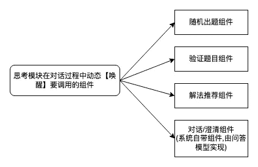

+   非对话式的24点小游戏网上有这样的：

+   https://www.truhoo.net/24.shtml

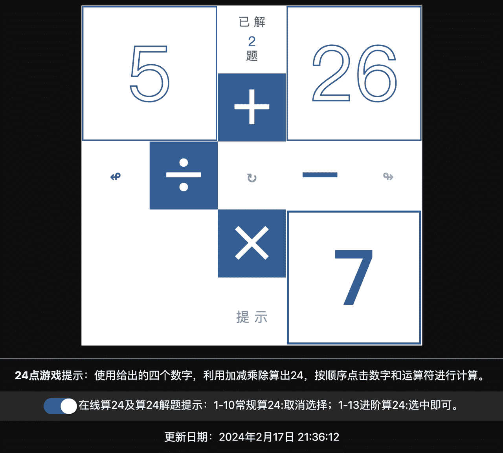

+   https://www.metools.info/other/o123.html

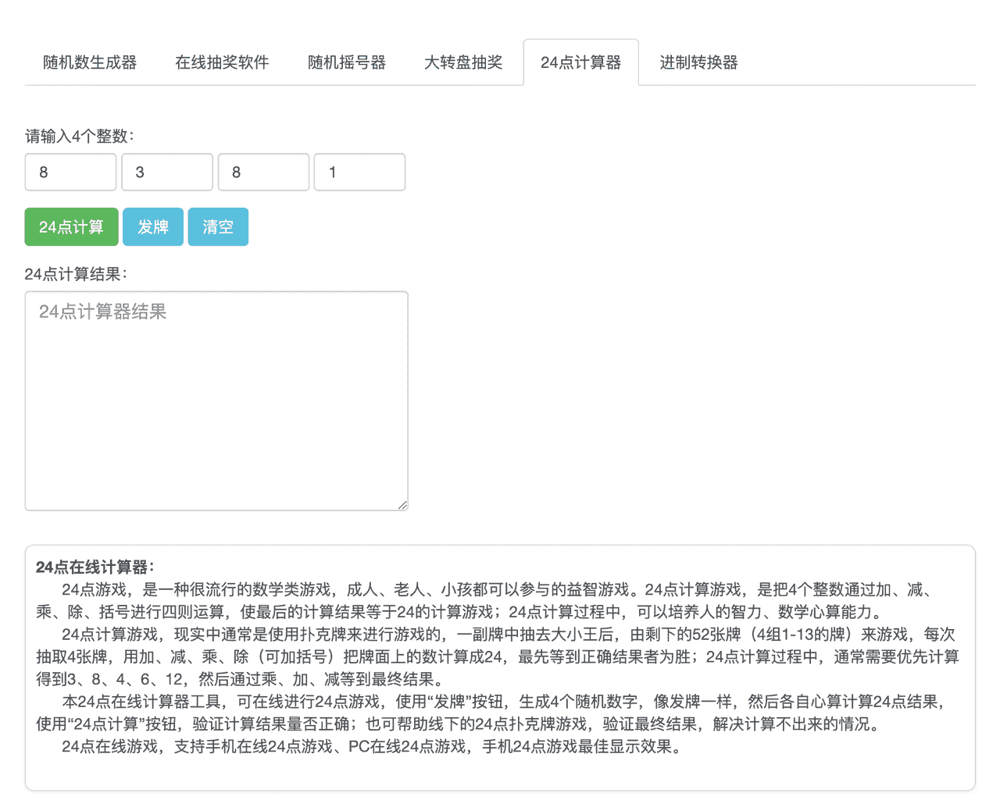

+   https://www.zhanid.com/tool/24dian.html

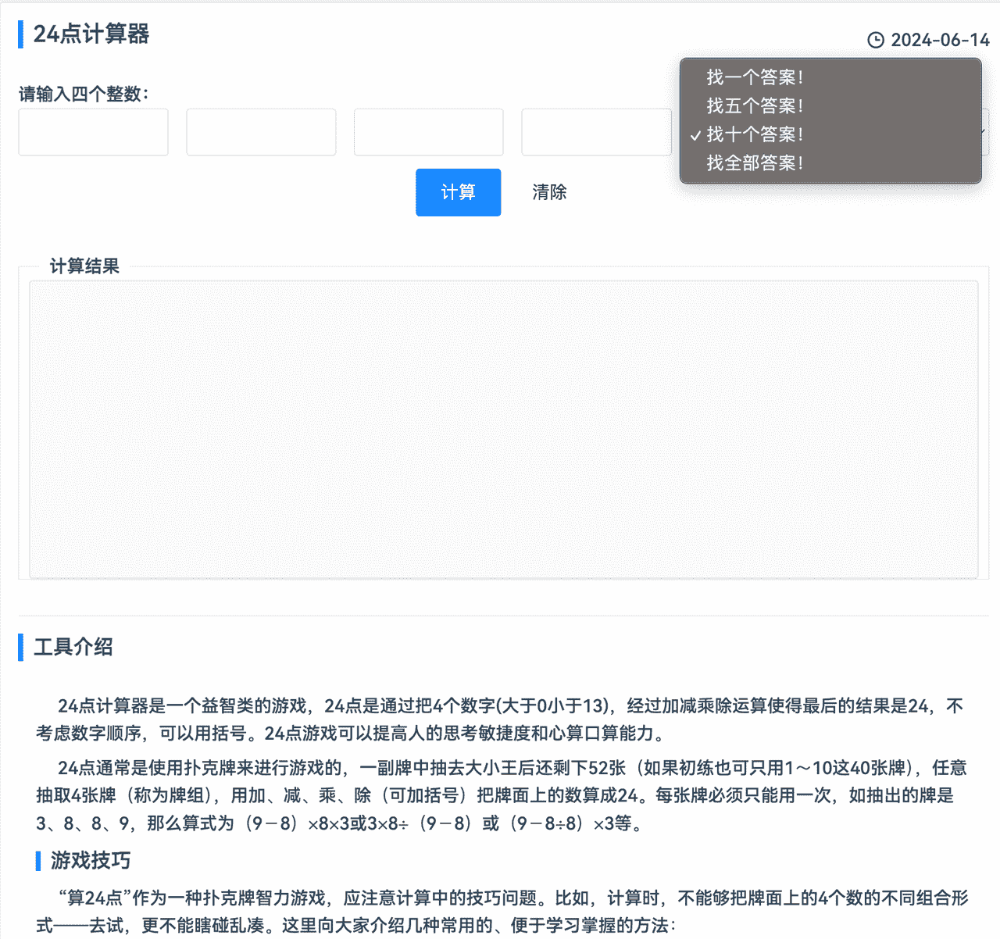

+   https://www.3699.cc/p/6425.htm

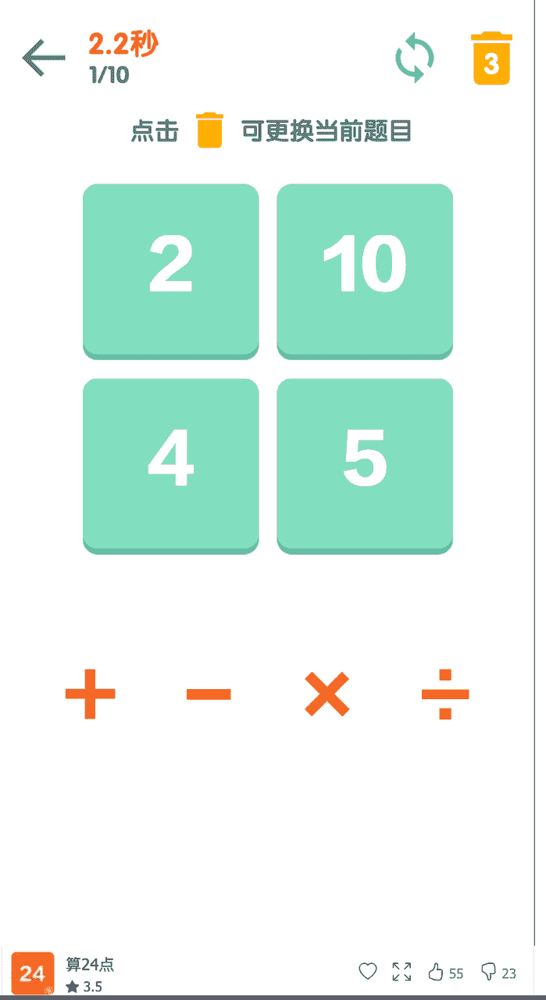

+   [Leetcod](https://leetcode.cn/articles/24-game/)e有一道算法题的解法是这样的：24 Game

1.  哪些情况单纯靠提示词工程或指令微调无法实现？

1.  Agent技术在本文中的定义是什么？

> Agent 技术是一种基于工具组件增强的大语言模型技术，也是一种设计模式，即：通过自然语言驱动大语言模型决策要使用的工具，并能够根据工具执行的结果进行下一步决策。

>

> **对于大部分简单任**务来**讲，都可以把**任务分解为 定义「思考模块」和 实现工具组件。

+   其中，思考模块一般是一个思考模型，做的事情就是思考、规划和决策。

+   在构建 AppBuilder 的过程中，思考模型需要遵循复杂的指令，例如格式遵循、用户指令、系统指令、对话历史、组件执行历史等，

+   底座模型的指令遵循能力是最关键的能力，其效率、稳定性、成本是构建 Agent 的关键。

>

> 24点小游戏任务拆解案例：

+   **定义思考模块的功能边界**：基于大语言模型定义调用组件的协议，包括调用组件的条件描述、组件本身的描述、组件入参的设计。

+   **实现组件**：结合思考模块中定义的组件描述、组件入参设计，实现具体组件的功能。

1.  Appbuilder框架设计原理

> AppBuilder 是一个包含「思考+组件」的完备Agent框架

> 以交互式对话为主线和应用入口

>

> **思考过程**

+   对话过程中，**思考模型**通过不断**整合系统/用户采集环境中的信息**来进行**决策和反馈**，最终**实现任务**

+   整个框架的理论基础来源于 ReAct 算法，不是最高效的解决框架，但执行流程的可解释性比较好

>

> **执行组件**

> 所有组件都是以**标准的表达方式**呈现给思考模型，而组件的**具体执行则依赖工程化**的实现

> 在对话执行过程中系统会将**影响思考模型决策的关键信息**整理好送给模型。包括但不限于：

+   **长期记忆**：例如持久化的变量、知识库中检索的内容。

+   **短期记忆**：多轮对话历史、系统时间、时效性信息等。

+   **组件描述**：官方组件自带标准描述，用户自定义组件依赖用户定义描述。

+   **组件执行结果**：对于单轮对话下无法用一次组件调用完成的任务，通常需要调用多次组件，历史组件的调用结果需要告知思考模型。

+   **系统指令**：通常是内置的一段用户不可见的 prompt。

+   **用户角色指令**：用户自定义的指令。当前对话的 Query、用户上传的文件信息等。

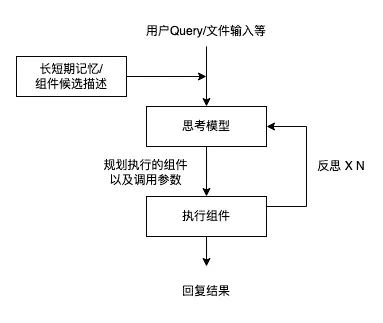

1.  影响智能体效果的关键要素一般有哪些？

+   **角色指令**：通过自然语言描述应用的作用、组件的功能、组件的调度规则。

+   **组件**：开发者选择的组件(官方组件/自定义组件)，即为思考模型可见的组件，在自然语言对话过程中有一定概率会被模型唤醒和执行。

+   **思考模型**：用户对角色的定义、对组件的定义、对组件调度的规则描述都会通过思考模型生效。

+   **问答模型**：组件生成的结果使用自然语言进行总结回复的模型，问答模型会参考开发者定义的角色指令进行回复，即问答模型的行为也可以通过角色指令影响。

1.  **对话式24点小游戏 案例**

```
# 角色任务
作为24点游戏助手，你的任务是随机生成4个1到13之间的数字，要求玩家使用加减乘除和括号进行运算，使最后结果等于24.你需要判断玩家给出的答案是否正确，并在必要时提供提示。

# 工具能力
1. 出题
用户需要出一道题，或者开始游戏、再来一道题时，使用该工具进行出题。
2. 解题建议
用户希望给一些做题建议的时候，使用解题建议工具来给出解题方案。
3. 答案验证
当用户给出了一个计算24点的表达式，使用24点计算来验证用户的计算是否正确。
```

+   **出题组件**

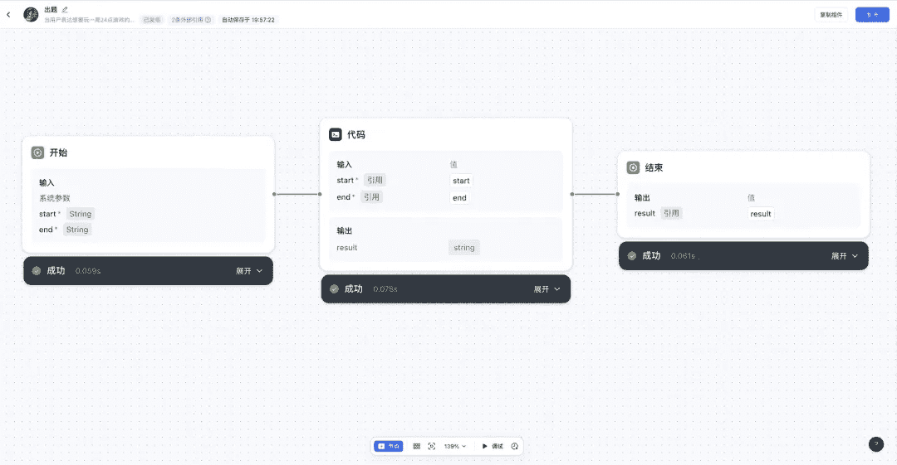

```
描述：当用户表达想要玩一局 24 点游戏的时候，使用该组件进行出题，返回的是一道计算 24 点题目的 4 个数字。

参数设计：
{&quot;name&quot;: &quot;start&quot;, &quot;type&quot;: &quot;string&quot;, &quot;desc&quot;: &quot;24 点题目中，4 个数字里的最小值&quot;}，
{&quot;name&quot;: &quot;end&quot;, &quot;type&quot;: &quot;string&quot;, 24 点题目中，4 个数字里的最大值&quot;&quot;}

import random  
def main(params):  
    # 提取参数并设置默认值  
    start = int(params.get(&quot;start&quot;, 1))  
    end = int(params.get(&quot;end&quot;, 13))  
    
    # 校验并调整范围  
    start = max(1, start)  
    end = min(13, max(end, start))  
    
    # 生成随机数  
    numbers = [str(random.randint(start, end)) for _ in range(4)]  
    
    # 构建输出字典  
    result = {  
        &quot;result&quot;: f&quot;已为您出题，请使用{&#x27;, &#x27;}.join(numbers)}计算24点，你只能使用加减乘除&quot;  
    }  
    
    return result
```

+   **答案验证组件**

```
描述：对用户提供的表达式进行是否能够计算出 24 点的验证，给出结果。

参数设计：
{&quot;name&quot;: &quot;expression&quot;, &quot;type&quot;: &quot;string&quot;, &quot;desc&quot;: &quot;用户提供的计算 24 点数学表达式&quot;}


```

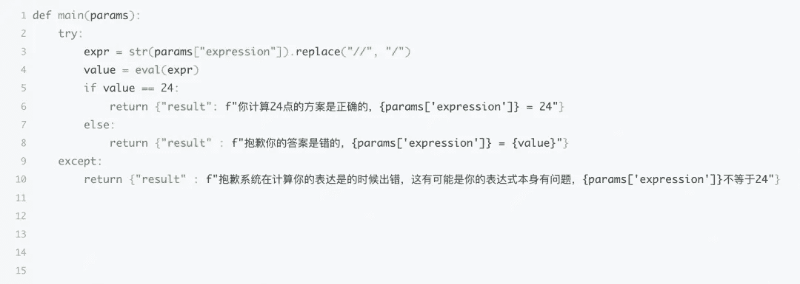

+   **解题建议组件**

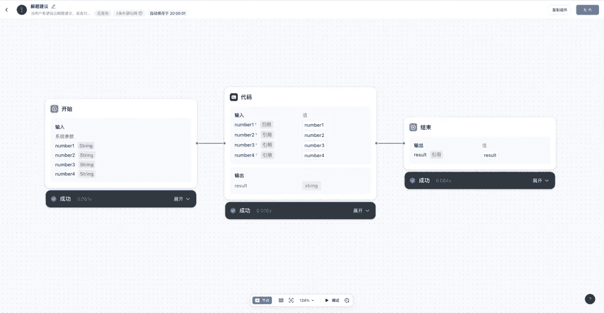

```
描述：当用户希望给出解题建议，或者对题目如何解没有思路时，使用该组件进行候选答案建议，如果当前题目无法计算出来答案，也明确告知用户无法得到答案。

参数设计：{&quot;name&quot;: &quot;number1&quot;, &quot;type&quot;: &quot;string&quot;, &quot;desc&quot;: &quot;第一数字&quot;}，{&quot;name&quot;: &quot;number2&quot;, &quot;type&quot;: &quot;string&quot;, &quot;desc&quot;: &quot;第二数字&quot;}，{&quot;name&quot;: &quot;number3&quot;, &quot;type&quot;: &quot;string&quot;， &quot;desc&quot;: &quot;第三数字&quot;}，{&quot;name&quot;: &quot;number4&quot;, &quot;type&quot;: &quot;string&quot;， &quot;desc&quot;: &quot;第四数字&quot;}


def main(params):  
    from itertools import permutations, product  
    def can_make_24(nums):  
        for numbers in permutations(nums):  
            for ops in product([&#x27;+&#x27;, &#x27;-&#x27;, &#x27;*&#x27;, &#x27;/&#x27;], repeat=3):  
                expressions = [  
                    f&#x27;({numbers[0]} {ops[0]} {numbers[1]}) {ops[1]} {(numbers[2]) {ops[2]}} {(numbers[3]))}&#x27;,  
                    f&#x27;(({numbers[0]} {ops[0]} {numbers[1]}) {ops[1]} {numbers[2]}) {ops[2]}) - {numbers[3]}&#x27;,  
                    f&#x27;{{numbers[0]}{ops[0]}((numbers[1]}{ops[1]}{numbers[2]}) {ops[2]}{numbers[3]})&#x27;,  
                    f&#x27;(numbers[0]{ops[0]}{(numbers[1]}{ops[1]}{(numbers[2]}{ops[2]}{numbers[3]))})&#x27;,  
                    f&#x27;(numbers[0]{ops[0]}{(numbers[1]}{ops[1]}{numbers[2]}) {ops[2]}{numbers[3]}&#x27;  
                ]  
                # 尝试计算每个表达式  
                for expr in expressions:  
                    try:  
                        result = eval(expr)  
                        return True, expr if result == 24  
                    except:  
                        continue  
                return False, &quot; &quot;
                
                
# 测试一组数字  
result, expression = can_make_24([int(params[&quot;number1&quot;]), int(params[&quot;number2&quot;]), int(params[&quot;number3&quot;]), int(params[&quot;number4&quot;])])  
if result:  
    return {&quot;result&quot;: &quot;给您一个计算24点的建议：&quot; + expression}  
else:  
    return {&quot;result&quot;: &quot;对不起，这个题目提出的有点问题，这几个数字无法计算出来24&quot;}  
```

# 你有哪些问题想讨论?

1.  哪些是用prompt来实现，哪些是要第三方组件写代码来实现，怎么切分功能的？

>

1.  解题建议的组件为什么给出错误的建议？如：1，13，10，10

1.  文章里给的代码

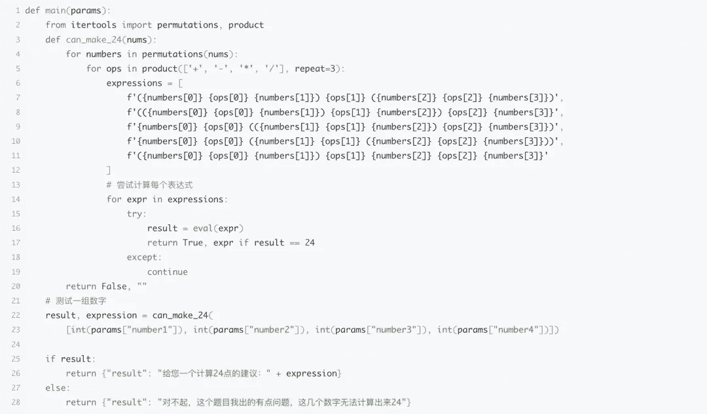

1.  庚给的代码

```
from itertools import permutations, product

def calc(a, b, op):
    &quot;&quot;&quot;根据运算符计算两个数字&quot;&quot;&quot;
    if op == &#x27;+&#x27;:
        return a + b
    elif op == &#x27;-&#x27;:
        return a - b
    elif op == &#x27;*&#x27;:
        return a * b
    elif op == &#x27;/&#x27;:
        if b != 0:
            return a / b
        else:
            return None

def try_operations(numbers, target=24):
    &quot;&quot;&quot;尝试所有可能的运算符组合来达到目标值&quot;&quot;&quot;
    if len(numbers) == 1:
        return abs(numbers[0] - target) &lt; 1e-6

    for perm in permutations(numbers):
        for ops in product(&#x27;+-*/&#x27;, repeat=len(numbers)-1):
            stack = [perm[0]]
            for num, op in zip(perm[1:], ops):
                if op in &#x27;+*&#x27; and (stack[-1], op) not in [(&#x27;*&#x27;, &#x27;+&#x27;), (&#x27;+&#x27;, &#x27;*&#x27;)]:
                    stack.append(num)
                    stack.append(op)
                else:
                    b = stack.pop()
                    a = stack.pop() if stack else 0
                    stack.append(calc(a, b, op))
                    stack.append(num)
            result = stack.pop()
            if try_operations([result], target):
                return True
    return False

def can_reach_24(numbers):
    &quot;&quot;&quot;检查是否可以从给定的数字中计算出24&quot;&quot;&quot;
    if not numbers or len(numbers) != 4:
        print(&quot;需要提供四个数字。&quot;)
        return False
    return try_operations(numbers)

# 测试
numbers = [3, 3, 8, 8]  # 例子输入
if can_reach_24(numbers):
    print(f&quot;{numbers} 可以组合成24。&quot;)
else:
    print(f&quot;{numbers} 不能组合成24。&quot;)
```

# 一些彩蛋

## 利用【网页内容总结】组件，可以给自己的应用提建议

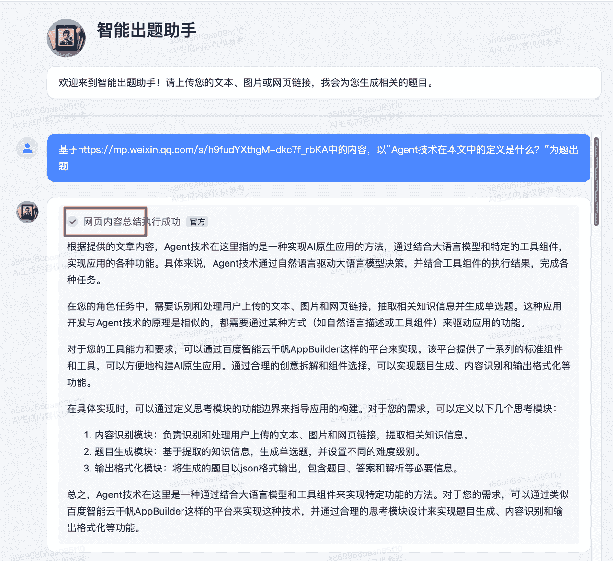

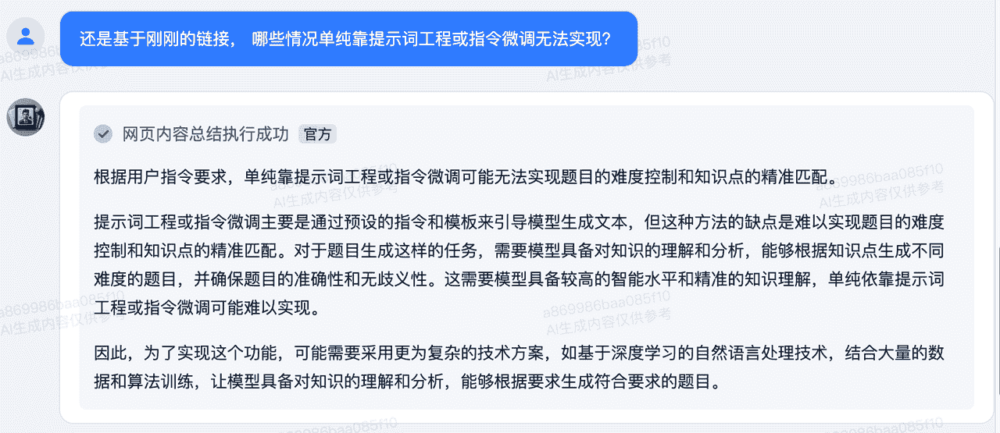