# 《十万个为什么》AI创意应用赛学习手册

> 来源：[https://datawhaler.feishu.cn/docx/BiztdlY2xoYpE7x1G9pc6XwOn1d](https://datawhaler.feishu.cn/docx/BiztdlY2xoYpE7x1G9pc6XwOn1d)

> 欢迎大家来到——**L**IC·2024 语言与智能技术竞赛 学习活动，

+   **面向对象**：希望**(组队)设计 & 开发**《十万个为什么》AI创意应用的学习者

+   纯小白也能做出自己的应用！不限于：开发、产品、创业者...

+   **学习目标**：制作教育相关应用并参加**L**IC·2024 语言与智能技术竞赛

+   **学习时间**：5月13日~5月26日

+   **学习内容提要**：

+   来自MumuLab项目主理人的启发演讲

+   [1. 【RAG赛道】案例](https://datawhaler.feishu.cn/wiki/LiqFwbMW7idMRskqieGcMX0qnVf)**分享**

+   [2. 【多模态赛道】案例](https://datawhaler.feishu.cn/wiki/X5nhwvF7sitrISk3LRJc12hynOf)**分享**

+   **报名链接：**https://aistudio.baidu.com/competition/detail/1171/0/introduction

+   **学习活动组织方**：[Datawhale](https://datawhale.cn/)

#### **14万奖金池****等你瓜分！**

**① 扫码加入学习群**

**② 扫码查看学习手册**

推荐的主要**学习路径**示意如下图：

# 赛事介绍：LIC·2024 语言与智能技术竞赛

> **LIC**：由 [中国中文信息学会（CIPS）](http://www.cipsc.org.cn/) 和 [中国计算机学会（CCF）](https://www.ccf.org.cn/)联合主办，百度公司、中国中文信息学会评测工作委员会和中国计算机学会自然语言处理专委会承办的中文NLP顶级赛事，迄今已举办五届，已成为中文NLP领域内最权威、最热门的赛事之一。

> 本次 2**024语言与智能技术竞赛（LI**C）与上海少年儿童出版社有限公司合作，竞赛将由上海少年儿童出版社提供面向真实应用场景的“十万个为什么”系列特色数据集

> 诚邀具有AI原生创新思维的开发者、创业者们，结合自身的专业背景与“想象力”，一同挖掘文心大模型的无限应用潜力！共同推动语言理解与交互技术发展！

## 🫀 赛事解读

+   **【赛题主题】**：LIC·2024 语言与智能技术竞赛

+   **【开发者任务】**

+   基于“十万个为什么”系列特色全量数据集

**（**初赛仅开放[**天文数据**](https://aistudio.baidu.com/datasetdetail/269367)**，**但设计整体方案时最好考虑全部数据）

+   基于**文心ERNIE大模型**能力：使用 [**ERNIE Bot SDK**](https://github.com/PaddlePaddle/ERNIE-Bot-SDK)、[**AppBuilder-SDK**](https://github.com/baidubce/app-builder?tab=readme-ov-file)** **等均可

+   **设计并开发**具有**产业价值**的**大模型原生应用产品**

+   **(初赛) **提交**应用技术方案构思设计PDF**

+   **(复赛) **在**飞桨星河社区**发布**产品demo**(Gradio/Streamlit/静态网页)，
提交应用链接&演示视频&展示PPT

+   **(决赛) ****线上答辩**，**10 **min PPT展示 + **5 **min Q&A

+   【**参考方向**】

> 赛事有两大方向（RAG应用 & 多模态创意类应用），分别评选：

> **1** 个一等奖(￥3w)、**1** 个二等奖(￥2w)、**1** 个三等奖(￥1w)、**2** 个优胜奖(￥5k)

1.  基于《十万**个为**什么》**的R**AG应**用：**场景化知识问答、知识检索、知识推荐应用等

结合**搜索技术**和**知识图谱**等方法，来**提升信息**的**相关性和实用性**。

这种应用通常涉及到从大量文档或数据源中检索信息，并将这些信息以更合适的方式展示给用户，

提高结果的**相关性和准确性**，增强用户体验

1.  《十**万个为什么》****多模态**创意类**应用：十**万科普儿童绘本（漫画插图、有声绘本）、“十万”故事机、十万竞赛游戏等

+   **【限制】**

+   基于**“****十万个为什么”系列特色**全量数据集，数据集仅可用于本次赛事

+   基于**文心ERNIE大模型**能力：[**ERNIE Bot SDK**](https://github.com/PaddlePaddle/ERNIE-Bot-SDK)、[**AppBuilder-SDK**](https://github.com/baidubce/app-builder?tab=readme-ov-file)** **等方案

+   **(复赛)**在**飞桨星河社区**发布**产品demo**(Gradio/Streamlit/静态网页)

+   **【评审方案】**

+   **线上初赛**：评测委员会（来自中国中文信息学会、中国计算机学会**、飞桨&**文心大模型官方、少儿社专家）**通过评分标准**打分，选出决赛入选队伍（预计40-50支，邮件通知）。

+   **评分标准**：

+   **创新性**—— 考察 **需求洞察**、**产品定义**** **能力（**30%**）

+   **实用性与可行性**—— 考察对于 **产品落地**** **的可行性思考（**30%**）

+   **技术实践**—— 对 **文心大模型**能力运用** **及 **技术思路&难度**（**40%**）

+   **复赛评分标准：**

+   **完整性**—— 考察应用产品**开发完整性**&是否发布至**星河社区**（**50%**）

+   **技术实践**——对**文心大模型**能力运用及**技术思路&难度**（**50%**）

+   **决赛**：决赛将以**线上答辩**的形式进行，具体要求和安排另行通知。

+   **评审标准：**

+   **创新性**（**20%**）、**实用性与可行性**（**25%**）、**完整度**（**25%**）、**技术实践**（**30%**），

+   **加分项**（**5%**）：飞桨星河社区上的 **“热度”** 数据（数据收集至答辩前一天）。

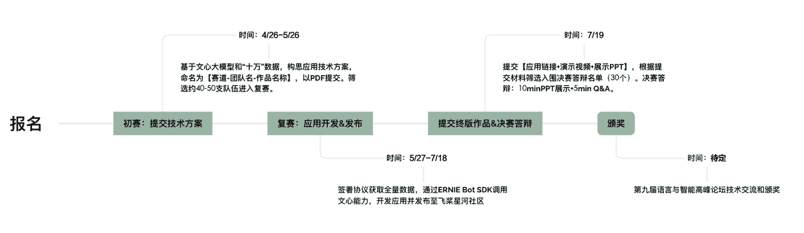

## ⚠️ 官方组队注意事项

1.  需要通过官网复制链接邀请队员

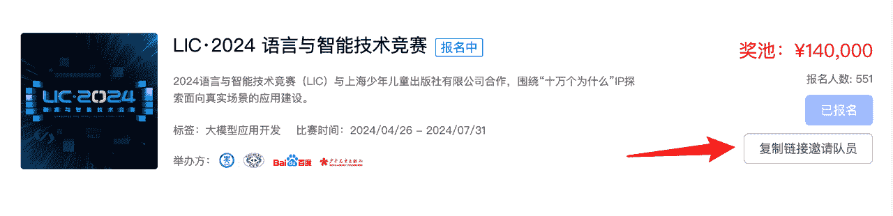

1.  **队伍人数：1~5人，**如果不想单人组队，需在提交作品前完成组队（单人团队无法解散）

1.  每名参赛选手只能加入**一支队伍**（单人队伍或者多人队伍）

1.  更多详见【组队须知】

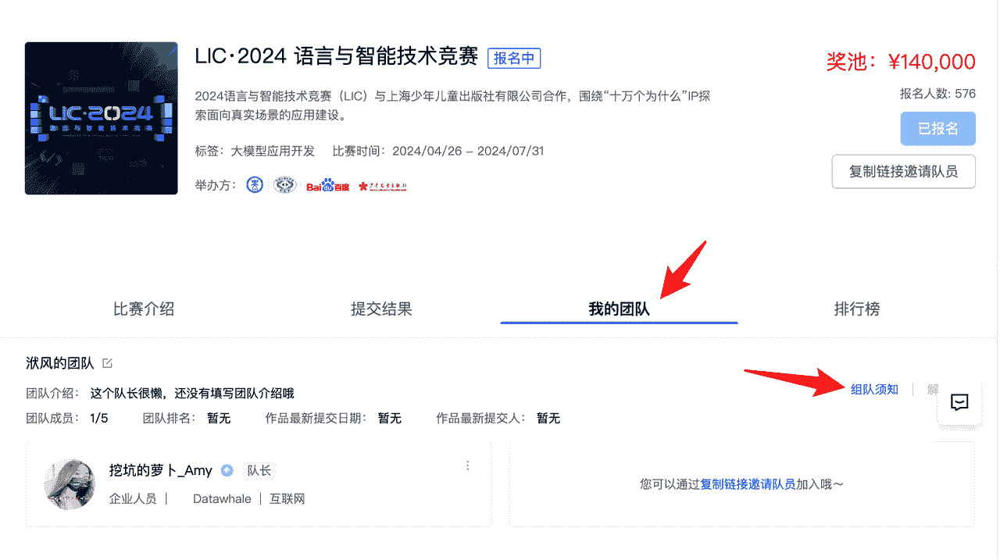

# 学习详情

## 🏆 奖励说明

1.  **赛事资源权益包（更新中）**

+   首次注册的用户有 100w token，可以通过该链接查看额度：https://aistudio.baidu.com/token/manage，调用时使用的 token 密钥可查看 https://aistudio.baidu.com/account/accessToken

+   做任务领token（非首次用户也可领）：https://aistudio.baidu.com/ai-learning

+   **前10名团队可以获得奖金****（两个赛道分开评选）**

+   **每个赛道**：**1** 个一等奖(￥3w)、**1** 个二等奖(￥2w)、**1** 个三等奖(￥1w)、**4** 个优胜奖(￥5k)

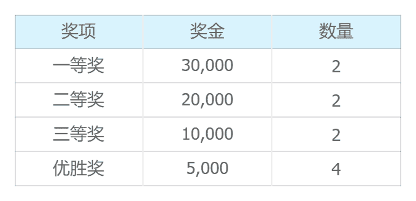

+   **入围团队****福利**

**社区合作**：产品共创支持 & Token 扶持

**创业扶持**：投融资机构对接

**品牌曝光**：媒体宣传与曝光

**技术支持**：文心&飞桨技术指导

1.  **Datawhale学习支持**

1.  **助教全程陪伴的学习群**：学习开营结营两周半的助教陪伴

1.  **丰富的学习资料**：从零代码到低代码的学习资源，有任何需求还可随时交流建议

1.  **作品交流机会**：只要提交作品即可进入作品交流群，获得更多更优质的技术交流机会

1.  **周边奖励**：在学习活动期间提交作品，有机会抽取Datawhale周边礼品

1.  **一等奖**** 3 份**：T恤/《ChatGPT原理与应用开发(蝴蝶书)》

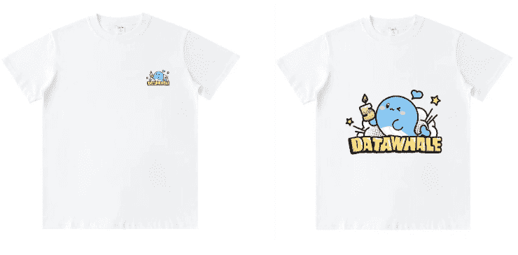

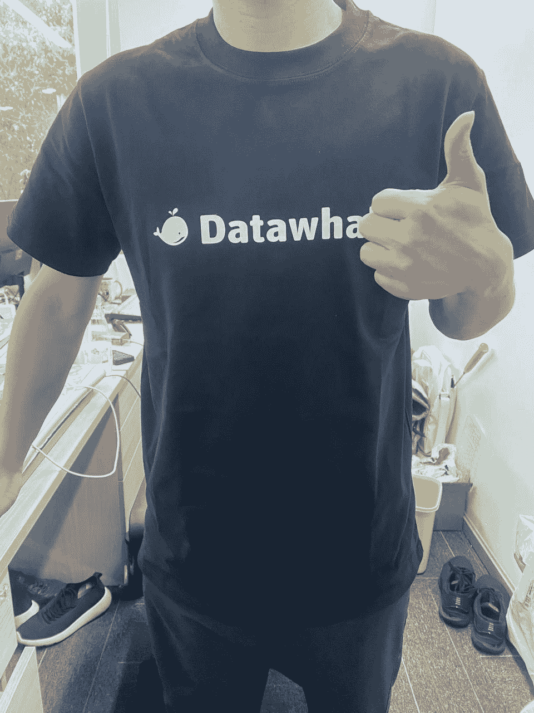

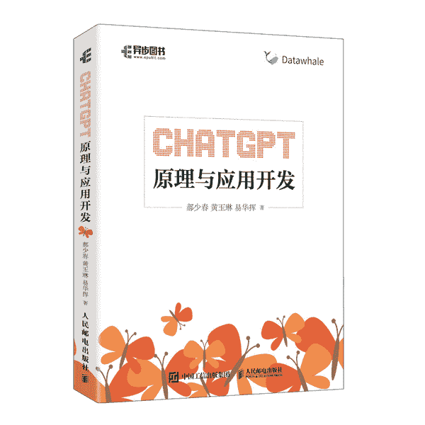

1.  **二等奖 ****5 份**：小鼠标垫/书签/金属钥匙扣 + 贴纸

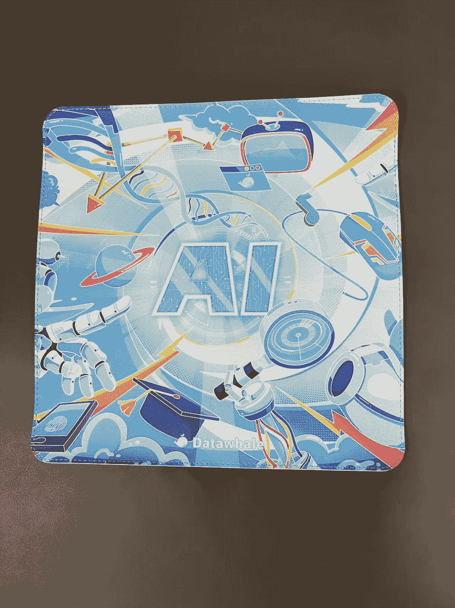

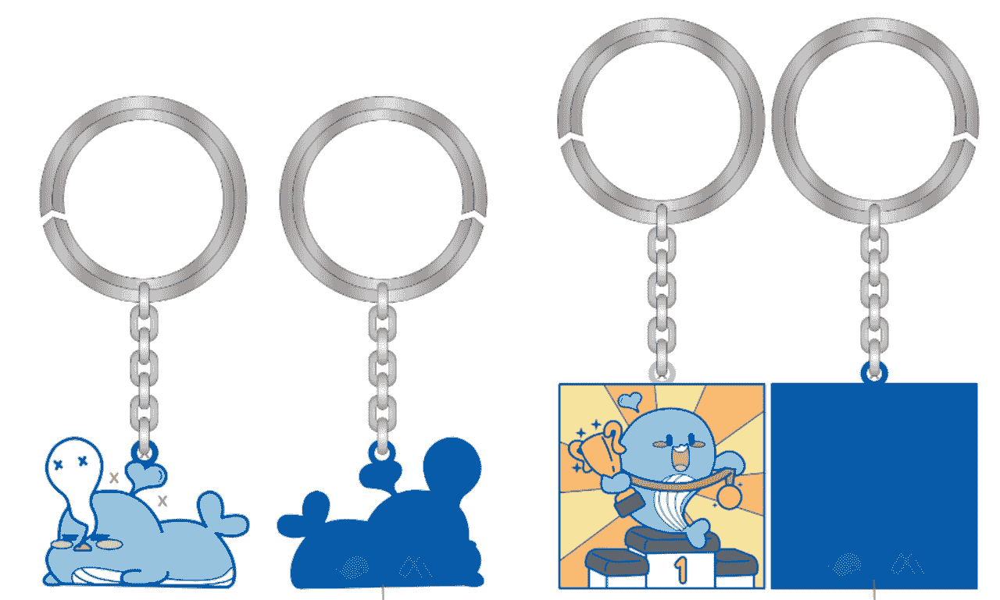

1.  **三等奖 ****8 份****：**帆布袋/卡套 + 贴纸

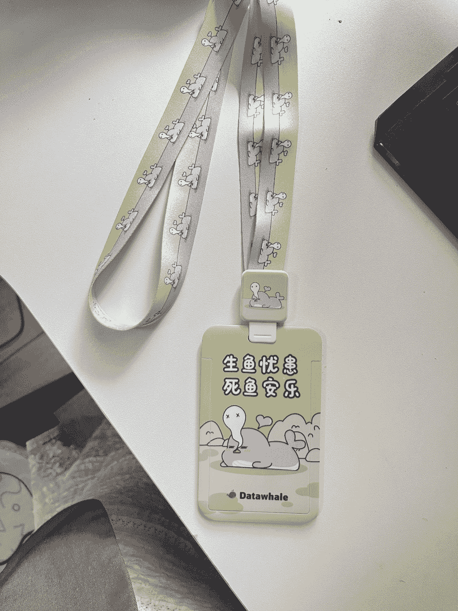

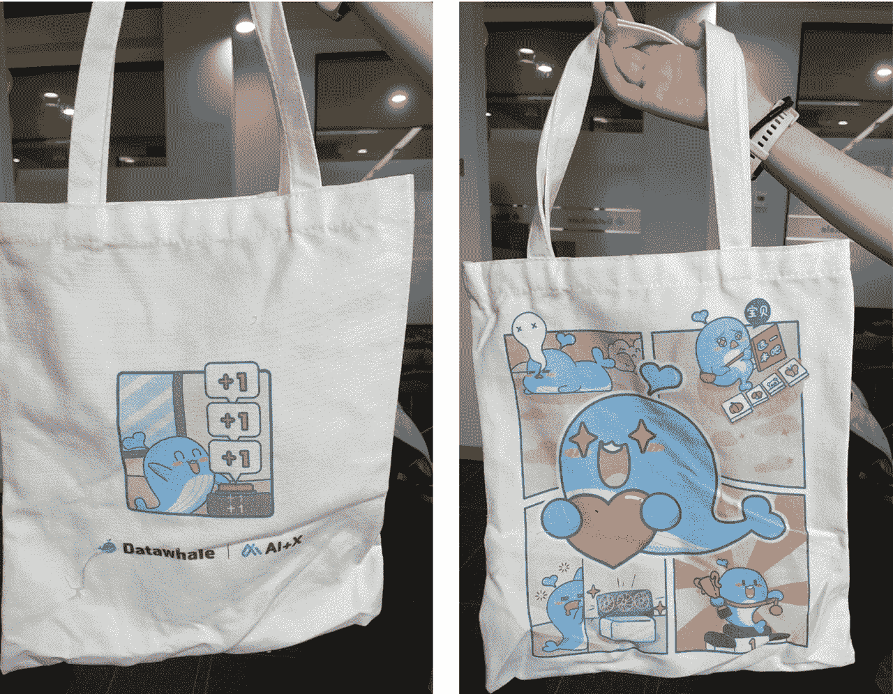

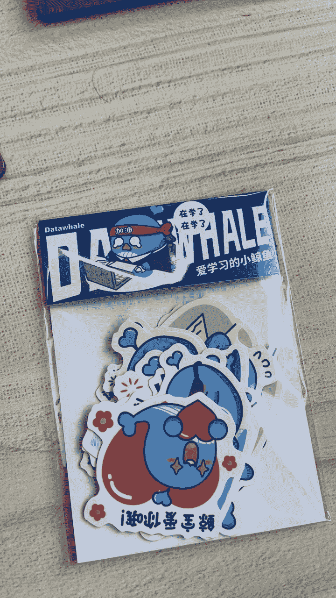

1.  **优秀学习者证书**：在学习活动期间提交符合要求作品的学习者将获得Datawhale优秀学习者证书

## 🙋‍♀️ 作品提交说明

> 除了官方提交，Datawhale这边也会收集一份信息

> **需要在**[**官网**](https://aistudio.baidu.com/competition/detail/1171/0/submit-result)**进行提交，然后通过**[**表单**](https://doc.weixin.qq.com/forms/AFwAjwcuADYAQsANwazAPAKEM8jwnPQPf?page=1)提交可进入作品交流群抽奖！！！！！！

+   **(初赛) ****5月26日**（ ）前，提交 **PDF/ZIP压缩包 **(命名：【赛道-团队名-作品名称】)

> 提交 技术方案PDF + 个人作品介绍(可选)

+   **技术方案PDF内容要求：**

+   **团队介绍、项目名称、项目背景**、

+   **产品说明**（需包含解决的**实际用户需求**）、**产品设计图、技术实现路径 **等

+   ** + 个人作品参考**

+   **参考PPT模板见**：[《十万个为什么》AI创意应用赛-参考模板.pptx](https://datawhaler.feishu.cn/wiki/CqgWwUNUiibGcukLnRVcwYjRnIb)（写作完成后，导出为PDF即可）

+   **(复赛) ****7月18日****（**** ****）前提交 ZIP压缩****包** (命名：【团队名-作品名称】)

> 提交 应用链接 + 演示视频 + 展示PPT

+   需在**飞桨星河社区**发布**产品demo**(Gradio/Streamlit/静态网页)

+   **(决赛) ****7月19日****（**** ****）****线上答辩**

> 10min PPT展示 + 5min Q&A

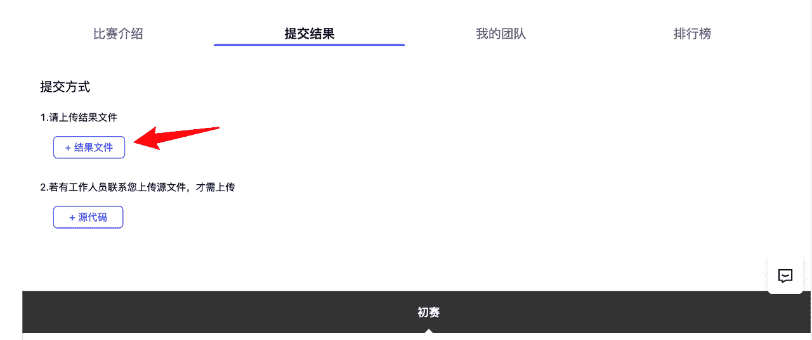

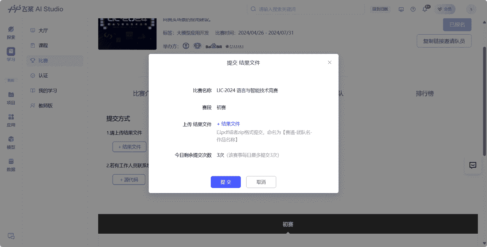

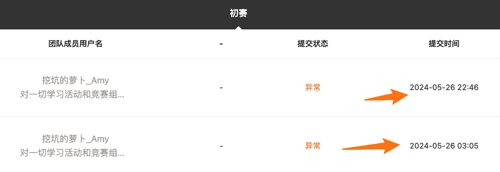

# 学习内容

## 直播/交流活动汇总

| **活动名称** | **活动时间(1h)** | **活动形式** | **分享材料** |
| --- | --- | --- | --- |
| [**【十万个**](https://meeting.tencent.com/v2/cloud-record/share?id=135ba48a-eee2-438a-9638-bf9b1849e270&amp;from=3&amp;is-single=false&amp;record_type=2)为什么-AI创意应用开发】-开营仪式 | 2024/05/13 19:30 | B站、视频号直播 | [《十万个为什么》AI创意应用赛学习手册](https://datawhaler.feishu.cn/wiki/SeJNwVNimiao🐧kZAVhc2ljcnzc) |
| [**【十万个**](https://meeting.tencent.com/v2/cloud-record/share?id=b2a9af25-4aef-4428-9283-b03d28825ed6&amp;from=3&amp;record_type=2)为什么-AI创意应用开发】-启发分享 | 2024/05/14 21:00 | B站、视频号直播 | [创意脑暴记录](https://datawhaler.feishu.cn/wiki/S9E6wxXfgiklankzUykcLvMRnKd) |
| [**【十万个为什么-A**](https://meeting.tencent.com/v2/cloud-record/share?id=e9d87129-ef86-4409-83f8-f4b754935b68&amp;from=3&amp;is-single=false&amp;record_type=2)I创意应用开发】-RAG赛道案例分享 | 2024/05/16 21:00 | B站、视频号直播 | [1. 【RAG赛道】案例](https://datawhaler.feishu.cn/wiki/LiqFwbMW7idMRskqieGcMX0qnVf) |
| [**【十万个为什么-A**](https://meeting.tencent.com/v2/cloud-record/share?id=7780c79a-bae2-47d7-8435-b0525030c115&amp;from=3&amp;is-single=false&amp;record_type=2)I创意应用开发】-多模态赛道案例分享 | 2024/05/17 21:00 | B站、视频号直播 | [2. 【多模态赛道】案例](https://datawhaler.feishu.cn/wiki/X5nhwvF7sitrISk3LRJc12hynOf) |
| **【十万个为什**么-AI创意应用开发】-案例方案互评 | 2024/05/25 15:00 | 腾讯会议 | [《十万》方案交流会](https://datawhaler.feishu.cn/wiki/FDPxwLp33iilPhkab5XccruDnxp) |
| **【十万个**为什么-AI创意应用开发】-结营仪式 | 2024/05/27 20:00 | 🛰️群 |  |

## 官方工具文档汇总

1.  [**ERNIE BOT**](https://aistudio.baidu.com/cooperate/erniebotsdk)

+   ERNIE Bot SDK基础使用教程： 快速完成包含文本创作、通用对话、语义向量、AI作图在内的多项任务；

+   ERNIE Bot SDK进阶教程：函数调用(Function Calling)功能，用户可以从大模型获取结构化数据，进而利用编程手段将大模型与已有的内外部API结合以构建应用；

+   [**github仓库：/Paddle**](https://github.com/PaddlePaddle/ERNIE-Bot-SDK)Paddle/ERNIE-Bot-SDK

+   ernie-bot-agent.readthedocs.io

1.  [**AppBuilder-SDK**](https://github.com/baidubce/app-builder?tab=readme-ov-file)

1.  百度飞桨 AI studio 使用说明

1.  AI Studio 官方文档：静态资源部署

## [加学群学习情况记录](https://datawhaler.feishu.cn/wiki/DyAywrKmliIrL5krjZtc843lnXc)

> 没有过大模型应用开发相关经验的小伙伴，可添加助教🛰️加入【加学群】

> 加学群会为大家提供加学任务，更好地参与本次赛事

> 每个任务都有分数评定（完成加分，提交、未完成0分，未提交减分，补交撤销扣分），

> 分数-2的小伙伴将被清出加学群

# 赛事作品汇总（等你展示）

## 本期参赛作品：29 个

| **作品名** | **队伍名称(橙底进入复赛)** | **赛道** | **作品简介** | **体验链接** |
| --- | --- | --- | --- | --- |
| **WonderWiz** | WonderWorm | 多模态应用赛道 | 探索奇妙世界，与AI共享《十万个为什么》乐趣。『WonderWiz』不仅为孩子们带来『十万个为什么』的精品盲盒卡片、答题竞赛等互动游戏，更提供AI驱动的《十万个为什么》问答助手，点亮孩子们的求知之心，养成热爱科学的良好习惯。而我们的AI智能对话助手则能够随时陪伴孩子们在《十万个为什么》的知识海洋中尽情游弋。 | https://aistudio.baidu.com/application/detail/32089 |
| **鲁宝的科普皮影沙盒** | 鲁宝早教探究 | 多模态应用赛道 | 效果详见：https://www.bilibili.com/video/BV1Gi421Q7vB | https://aistudio.baidu.com/application/detail/33347 |
| **《十万个为什么》家长伴读版** | yuan_pocket | RAG应用赛道 | 《十万个为什么》家长伴读版应用是一个专为家庭设计的数字化教育工具。它通过智能AI技术，将复杂的科学问题转化为儿童易于理解的孩子口吻。应用的核心功能包括答案快速搜索、语音合成，允许家长和孩子通过看或听的方式学习，亲子共读等。此应用适合家长使用，选择问题，将科普答案自己念给孩子听（可以选择原文，也可以选择AI改编后的儿童口吻），或者直接语音播放。同时也适合小朋友自己听读。 | https://aistudio.baidu.com/application/detail/32475 |
| **快乐星球** | 你说的对 | RAG应用赛道 | https://g5b4uupmby.feishu.cn/wiki/F3REwiI46iSOa0kGFfecPN3jnxc |  |
| 知趣阅读-KnowledgeJoy | 知趣 | 多模态应用赛道 | 适应碎片时间和碎片化阅读，通过大模型把书中内容提取、重组，成为一块块碎片故事或知识，以feed流形式呈现（效果类似📕、视频号主页等）。帖子内部加入问答测试和对话环节。 |  |
| 趣刷——文心助力的十万科普儿童短视频应用 | 二倍速的书–zsbd | 多模态应用赛道 | 趣刷——就是让小朋友在兴趣驱使下刷视频，同时收获了一本书的知识。我们的视频基于书中知识点，视频推荐系统结合浏览历史。其中视频部分不同于一般的组图展示，更有结合文字内容的动画展示，深入浅出。小朋友看完视频学习后，还可以继续向AI BOT提问互动。 | https://aistudio.baidu.com/application/detail/32902 |
| **智慧启迪绘** | 十万个所以 | RAG应用赛道 | 智慧启迪绘不仅仅是一个应用程序，它是一个能引领孩子们踏上一段奇妙求知之旅的伙伴，带领孩子们进入神奇知识世界的导航员，父母陪伴自己孩子一起阅读《十万个为什么》系列丛书和解答阅读过程中更多疑问的知识助手。  借由集成RAG技术与多模态生成技术的力量，我们倾心打造了一款既具娱乐性又富含教育意义，充满趣味性和互动性的视频生成平台，在孩子们阅读《十万个为什么》系列丛书时，进一步激发他们的好奇心，培养更好的观察能力、思考能力和表达能力。  我们致力于创造一个既能娱乐也能教育的视频生成应用，将《十万个为什么》系列丛书的丰富知识转化为易于消化和吸收的内容，使之成为亲子共读的桥梁，在欢声笑语中助力孩子们在轻松愉快的氛围中学习成长。智慧启迪绘不仅是一个应用，它是开启孩子智慧大门的一把钥匙。在这里，学习不再是枯燥的任务，而是充满乐趣和惊喜的旅程。让我们携手，为孩子们构建一个充满想象力和知识启迪的成长空间，见证《十万个为什么》系列丛书丰富有趣知识的魔力！ | 【智慧启迪绘】 |
| **十万个ChatTests** | ChatTests-五月竞赛组 | 多模态应用赛道 | 十万个ChatTests是ChatTests的《十万个为什么》特供版，  在当今信息爆炸的时代，用户可以随时随地提出各种问题。然而，并不是所有问题都是有价值的。很多时候，用户缺乏提出高质量、深度问题的能力。尤其是对于学生和知识工作者而言，提出好问题不仅能够激发深入思考，还能提高学习和工作效率。目前，市面上缺乏一个能够有效帮助用户提升提问能力的工具。  十万个ChatTests旨在探索通过模仿《十万个为什么》的思考方式，为用户提供提问能力的训练，提升用户的提问能力和信息洞察能力、 | https://aistudio.baidu.com/application/detail/32213 |
| **WonderWhy** | WonderWhy | RAG应用赛道 | 一款基于大语言模型与生成式人工智能技术的跨平台家庭教育类AI应用 |  |
| **动手做十万个为什么** | 动手做就对 | RAG应用赛道 | 传统的“十万个为什么”类读物内容多以文字和图片为主，缺乏互动性和实践性，难以真正激发儿童的探索欲望。”动手做十万个为什么”能基于十万个为什么里的內容生成一个有趣的实验方案，让孩子能对所学的内容有更深刻的理解。 |  |
| **海洋探秘迷踪** | 海底为什么 | RAG应用赛道 | 海洋知识问答 | https://aistudio.baidu.com/app/highcode/32945/app  因为token受限，体验链接实际的api未放开。 |
| **智海探索者** | MumuLab | 多模态应用赛道 | 从小朋友、大朋友、出版社角度出发对经典书籍《十万个为什么》进行探索，通过AI让书籍以更丰富的形式进行知识展示、通过AI让知识以更加灵活的方式进行传递，在智慧的海洋里进行探索。 | https://console.bce.baidu.com/ai_apaas/examplePage/950b03d0-abee-4e86-90fb-e4a9e41801b2 |
| **情境化学习玩转十万个为什么** | 模法创新者队 | 多模态应用赛道 | 在数字化教育日新月异的今天，我们团队深刻认识到情境教学法对于儿童认知发展的重要性。情境教学法不仅仅是知识传递的一种手段，更是激发好奇心、培养问题意识、探索精神及科学思维能力的钥匙。它通过模拟真实或虚构的情境，让孩子在探索与实践的过程中主动寻求答案，从而深化对世界的理解。鉴于此，我们着手构建一款面向儿童的智能教育平台，旨在通过引人入胜的故事场景和互动体验，让孩子们在探索“十万个为什么”的过程中，自然而然地掌握知识，享受发现的乐趣。本项目基于对情境教育理论的深入研究，结合最新的人工智能技术，如大语言模型、智能体技术，力图打造一个既个性化又具有高度互动性的学习环境，让孩子在游玩中成长 |  |
| **童心绘故事** | Push三人组 | 多模态应用赛道 | 《童心绘世界》是一个多模态学习应用，为儿童提供一个全面、互动的学习环境。应用的核心根据签案生成相应的音频解读和动画视频，以视觉和听觉的双重体验，帮助孩子们探索未知。 |  |
| **星际迷航v1.0** | 智领未来 | RAG应用赛道 |  | https://aistudio.baidu.com/application/detail/32992 |
| **是谁在装逼APP** | 是谁在装逼 | RAG应用赛道 | 基于《十万个为什么》的抢答APP，旨在通过竞技的模式，刺激大家了解更广泛的知识 |  |
| **智途问答大冒险** | GO!!!!! | 多模态应用赛道 | 基于《十万个为什么》数据集制作的科普大冒险游戏 | https://aistudio.baidu.com/application/detail/32904 |
| **知识问答之一站到底** | 瓦力向前冲 | RAG应用赛道 | 知识问答之大PK，可支持各种竞赛规则 |  |
| **奇趣故事绘** | Hook | 多模态应用赛道 | 我们的项目基于《十万个为什么》知识，打造了一款多模态应用，旨在解答小朋友们的无尽疑问，满足他们旺盛的好奇心与奇妙想象。应用采用亲切童真的语气进行互动，使知识传递充满乐趣与温情。我们的应用还融入了有声绘本生成功能，能将小朋友们提问的问题转化为生动有趣的视频，让小朋友在娱乐中学习。 |  |
| **致学星AI助手** | 天天有草莓 | RAG应用赛道 | 本项目专注于“AI+十万个为什么”，旨在为学生打造一个既富有趣味性又具挑战性的学习环境，让他们在游戏中享受学习的乐趣，在挑战中提升自我。同时，也为家长和老师提供了教学辅助工具与便捷的评估反馈机制，使他们能够更深入地了解学生的学习情况，从而提供更精准的指导与帮助。 |  |
| **科学小探险家** | 幻想科普 | 多模态应用赛道 | 多模态互动游戏 |  |
| **知识探险家** | 知识探险家俱乐部 | RAG应用赛道 | 通过知识提取的方式，优化RAG的回答准确度 |  |
| lntelligent robot | WN&amp;WM | RAG应用赛道 | 基于《十万个为什么》生成的智能对话机器人，分为两个版本，家庭版和儿童版 |  |
| **星空探秘小助手** | 知识猎手队 | RAG应用赛道 | 该产品在市场中定位为一种领先的互动教育展示工具，通过智能问答和虚拟互动，为少年宫和博物馆提供一个现代化、富有吸引力的图文展示平台。其差异化优势在于利用RAG技术，实现实时互动和个性化回答，显著提升参观体验。 |  |
| **小小自然家** | 大自然队 | 多模态应用赛道 | 我是一位小小自然家，帮助小朋友识别身边的动物、植物、果蔬等：  1. 小朋友可以上传图片，我会帮您识别图片的内容，讲给您听  2. 小朋友也可以直接问想认识什么，我会讲给您听，画给您看 | https://aistudio.baidu.com/application/detail/32945 |
| **智学乐园教学娱乐小助手** | 智学乐园施工队 | 多模态应用赛道 | 我们打算制作一个用于娱乐和教学的科普小助手。有两个模式，自学模式用于学生自我娱乐学习知识，教学模式用于教师家长对孩子进行教学和考核。 | https://console.bce.baidu.com/ai_apaas/examplePage/950b03d0-abee-4e86-90fb-e4a9e41801b2 |
| **探秘万问** | telos团队 | 多模态应用赛道 | 探秘万问 是一个多模态交互式教育游戏，旨在通过冒险游戏的形式，使用户在娱乐的同时学习《十万个为什么》中的科普知识。用户通过输入个人信息（如姓名、年龄、性别等）开始游戏，并选择不同的科普主题（如：星际探秘主题、生灵百态主题、海古遗迹主题等）进行探险。游戏会根据用户的年龄和性别调整内容的难易度和表达方式，以适应不同年龄段的认知能力。 |  |
| **深海寻宝** | 道可道非常道 | 多模态应用赛道 | 《深海寻宝》将成为一个结合虚拟养成、知识问答和探险元素的互动平台，孩子们将扮演一名深海探险家，通过完成各种任务和挑战，学习到关于深海生物、地质、气候等方面的知识。 |  |
| **星际探险家** | ctrlcv | RAG应用赛道 | 🤖你好，探索者！我是你的领航员艾莉森🚀，只需提出你的问题或想法，我就能为你编织一个引人入胜的星际探险故事，让我们一起探索那未知而壮丽的宇宙诗篇。现在，就让我们启航吧！你的第一个故事灵感是什么？ |  |

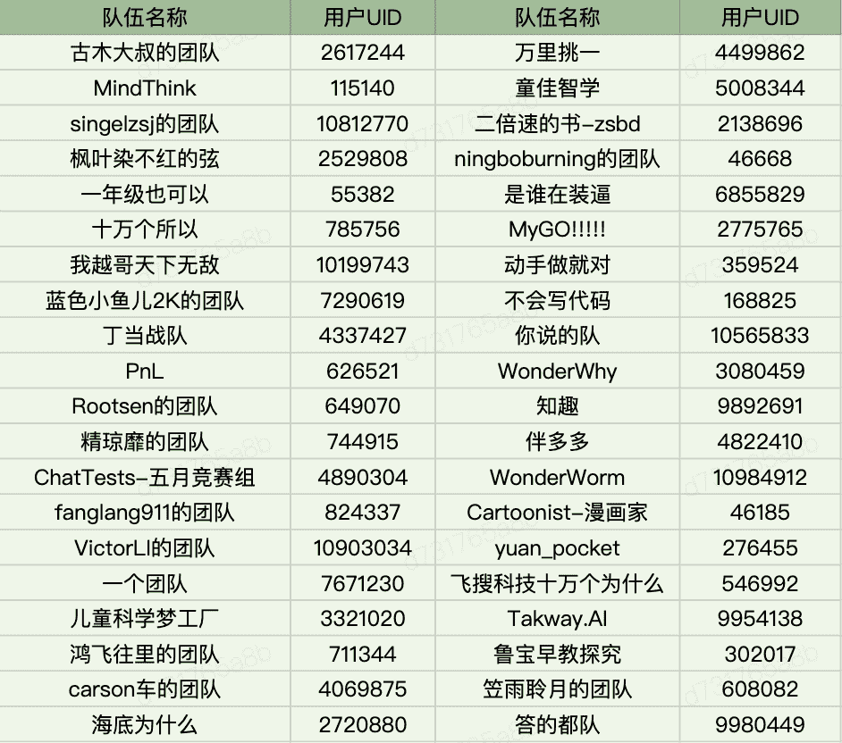

## 往期案例

#### K12教育常规赛

> 35个小伙伴参赛，57个作品，6个作品获奖（1个先锋应用奖、1个创新卓越奖、4个优秀作品奖）

多维表格（ZlHebZOaPa0wbcsiXnRchopXnUd_tbl1sl5eDQAos6Jl）

#### 寻找游戏大模王

> 共31个作品，其中**穿越秦朝-荆轲刺秦王**获得TOP1

| **游戏名称** | **作品介绍B站链接** | **队伍名称** |
| --- | --- | --- |
| 1. 杂鱼勇者 | [https://www.bilibili.co](https://www.bilibili.com/video/BV1b64y1j7M8)m/video/BV1b64y1j7M8 | 鬼车 |
| 2. 成功救出王子 | [https://www.bilibili.com](https://www.bilibili.com/video/BV17e411o7Rm/)/video/BV17e411o7Rm/ | 天奇 |
| 3. 史莱姆的修炼之旅：AI游戏制作 | [https://www.bilibili.com](https://www.bilibili.com/video/BV1SM411R73z/)/video/BV1SM411R73z/ | 彩虹队 |
| 4. 穿越秦朝-荆轲刺秦王v1.0 | [https://www.bilibili.com](https://www.bilibili.com/video/BV1iC4y1c7S5/)/video/BV1iC4y1c7S5/ | 荆轲刺秦王 |
| 5. 古堡逃生 | [https://www.bilibili.co](https://www.bilibili.com/video/BV1cu4y1u7Bs)m/video/BV1cu4y1u7Bs | 鸭鸭冲呀 |
| 6. ai辩手 | [https://www.bilibili.co](https://www.bilibili.com/video/BV1fH4y1r7uz)m/video/BV1fH4y1r7uz | 不行也得行 |
| 7. 模法学院-通往法治巅峰 | [https://www.bilibili.com](https://www.bilibili.com/video/BV15c411D7jb/)/video/BV15c411D7jb/ | 模法创新者队 |
| 8. 末世余晖:2104 | [https://m.bilibili.co](https://m.bilibili.com/video/BV1gH4y1k76o)m/video/BV1gH4y1k76o | 末世余晖 |
| 9. 守护之战 | [https://www.bilibili.co](https://www.bilibili.com/video/BV1Gu4y1G7NL)m/video/BV1Gu4y1G7NL | GTNLLMGDU |
| 10. 你重生了，但上帝是AI？ | [https://www.bilibili.com](https://www.bilibili.com/video/BV1fc411i7uj/)/video/BV1fc411i7uj/ | 晨旭不想写程序 |
| 11. 文字冒险之旅 | [https://www.bilibili.com](https://www.bilibili.com/video/BV1hb4y1L73p/)/video/BV1hb4y1L73p/ | 文字冒险 |
| 12. 瑾的故事 | [https://www.bilibili.com](https://www.bilibili.com/video/BV1NN41157aH/)/video/BV1NN41157aH/ | 挖坑的萝卜 |
| 13. 邻家小宋初长成 | [https://www.bilibili.com](https://www.bilibili.com/video/BV1kQ4y1V7EC/)/video/BV1kQ4y1V7EC/ | TNT |
| 14. 无限跑团 | [https://www.bilibili.com](https://www.bilibili.com/video/BV1Uw411b7Xk/)/video/BV1Uw411b7Xk/ | 喵～ |
| 15. 女流氓勇创游乐园 | [https://www.bilibili.co](https://www.bilibili.com/video/BV1Hj411L7LR)m/video/BV1Hj411L7LR | 游戏人生 |
| 16. 《让温暖善良的酒馆老板为你讲恐怖海龟汤》 | [https://www.bilibili.com](https://www.bilibili.com/video/BV1W64y1j7vs/)/video/BV1W64y1j7vs/ | 啊对对队 |
| 17. 逃出实验室 | [https://www.bilibili.co](https://www.bilibili.com/video/BV1V94y177SH)m/video/BV1V94y177SH | 机器开发小组 |
| 18. 《穿越秦朝：荆轲刺秦王》全新更新 | [https://www.bilibili.co](https://www.bilibili.com/video/BV1DG411v7sr)m/video/BV1DG411v7sr | 荆轲刺秦王 |
| 19. 庄园密案：谁是真凶 | [https://www.bilibili.com](https://www.bilibili.com/video/BV1z64y157XY/)/video/BV1z64y157XY/ | 荆轲刺秦王 |
| 20. 不要乱开门 | [https://m.bilibili.co](https://m.bilibili.com/video/BV1ZG411v7Wv)m/video/BV1ZG411v7Wv | 大吉大利 |
| 21.讨价还价 | https://m.bilibili.com/video/BV1mc411i75e | 大吉大利 |
| 22.征服异星生物 | https://www.bilibili.com/video/BV1uC4y1X7GF | 阿瓜冲呀 |
| 23.《985博士过劳死后穿越回古代带着现代知识》 | https://www.bilibili.com/video/BV1MC4y1w7bd/ | 菠萝吹雪队 |
| 24.幻想小镇 | https://www.bilibili.com/video/BV1E64y1575R | 心予 |
| 25.情感香槟 | https://www.bilibili.com/video/BV1b94y177Qy/ | 情感香槟 |
| 26.砍树小达人 | https://www.bilibili.com/video/BV1Di4y1e7Vu | 天奇 |
| 27.文字提示小游戏 | https://www.bilibili.com/video/BV1VH4y1k7au/ | 哒哒踏 |
| 28.疯狂WDL | https://www.bilibili.com/video/BV15i4y1v7MR/ | 忘了😭，进击的生信！ |
| 29.机器人凯尔的决策 | https://www.bilibili.com/video/BV1rc411i7RE/? | 今天天气哈哈哈 |
| 30.ai海龟汤 | https://www.bilibili.com/video/BV1Rg4y1o7ZV/ | 汤圆 |
| 31.无限世界 | https://www.bilibili.com/video/BV1VN4y1a7rY | 哪吒团队 |

# ❓ 常见QA

1.  使用 epub 数据创建 embeddings 出错。

> 先将epub数据改为zip数据格式，再将数据进行解压。具体操作为在项目文件操作台直接将epub后缀修改为zip后缀，然后按右键进行解压即可。

1.  为什么初赛阶段提交作品后显示提交异常。

> 因为初赛不需要提供代码，但提交版面有这一块，所以显示异常，但是这不影响初赛作品提交。

1.  **参赛须知官方补充**

> **参赛须知补充**

> （1）**公平竞技**： 参赛者禁止在比赛中抄袭他人作品、交换答案、使用多个小号，经发现将取消比赛成绩并严肃处理；

> （2）**组织声明**： 组委会保留对比赛规则、赛事安排进行调整和修改的权利、比赛作弊行为的判定权利和处置权利、收回或拒绝授予影响组织及公平性的参赛团队奖项的权利；

> （3）**数据安全****： 赛事发布《十万个为什么》系**列数据集仅可用于本次赛事应用开发，不可用于其他用途，严禁用于商业用途，违者必究；

> （4）**作品产权**： 参赛作品(包含但不限于算法、模型等)知识产权归参赛选手所有，组委会有权将参赛作品、作品相关、参赛团队信息用于宣传品、相关出版物、指定及授权媒体发布、官方网站浏览及下载、展览（含巡展）等活动项目，大赛组织单位享有优先合作权利。

> **反作弊说明**

> （1） 参与者禁止注册多账户报名，经发现将取消成绩并严肃处理；

> （2） 参与者禁止在考核技术能力的范围外利用规则漏洞或技术漏洞等不良途径提高成绩排名，经发现将取消成绩并严肃处理；

> （3） 可以接触到赛题相关数据的人员，其提交作品将不计入排行榜及评奖；

> （4） AI Studio将收集选手信息以及代码、模型、系统报告用于成绩评定、比赛通知等相关比赛事项。

1.  **官方提供tokens吗？**

> 初赛仅新注册用户有100w tokens，因此初赛并不要求有实际demo

> 复赛预计官方会给一定tokens支持，具体需要看官方回应

# 🐳 D[atawhale简](https://www.datawhale.cn)介

<https://datawhaler.feishu.cn/sync/LeXFdL7YjsXOuabuutsc2lTGnxE>