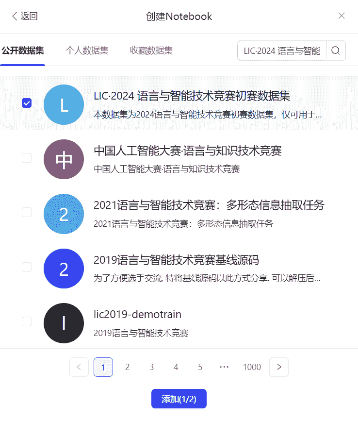
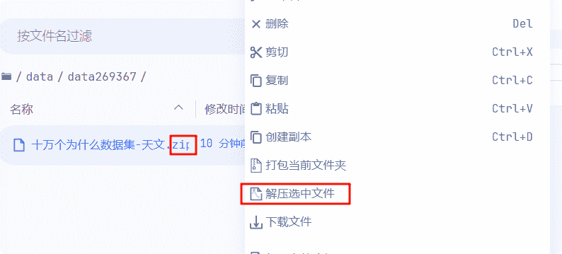
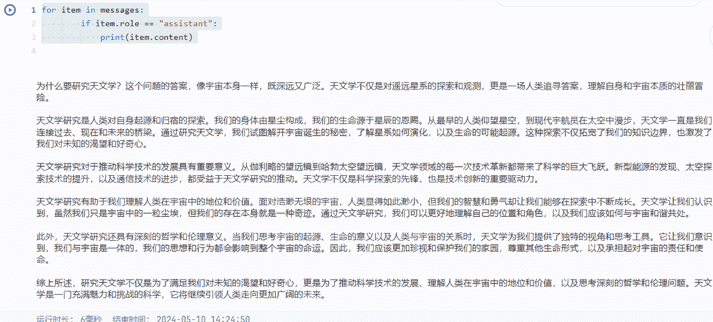
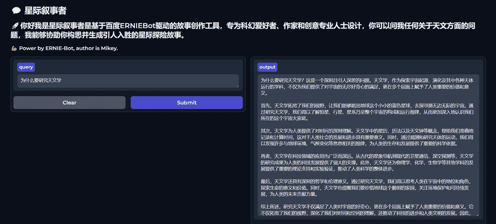

# 1. 【RAG赛道】案例

> 来源：[https://datawhaler.feishu.cn/docx/EHqddVj9xoWfJ4xjaoKcLaqCnBg](https://datawhaler.feishu.cn/docx/EHqddVj9xoWfJ4xjaoKcLaqCnBg)

<https://datawhaler.feishu.cn/sync/LqDLdpBGJsKMnvb9wuOcubgPny2>

> 贡献者 说：本教程基于LIC·2024 语言与智能技术竞赛，我会从下面几个方面带着大家一起实现一个小案例，从构思到实现，最后会有一个小demo，帮助大家快速的实现一个应用，希望对大家有所帮助，如果有问题也希望大家指出。

> 期待大家多多点赞和评论哟~

# 一、明确主题

什么是 RAG ？

> **RAG**，即Retrieval-Augmented Generation，是一种结合了检索（Retrieval）和生成（Generation）的深度学习模型，用于处理需要大量上下文信息的任务，如问答、文本摘要、内容创作等。RAG模型的核心思想是利用检索系统提供的信息来辅助生成模型生成更准确、更丰富的文本。

如何构建一个RAG应用呢？

> 要完成一个 RAG 应用，我们需要明确数据格式，比如此次比赛是基于《十万个为什么》文本数据，并且其中还有图片，我们如何处理这些图片就是要面临的技术挑战之一，如何对文本数据筛选也是我们要考虑的一点。

> 那么根据赛题要求针对儿童创作应用，我们可以有以下几种应用方案：

1.  故事创作——利用[ERNIE Bot ](https://aistudio.baidu.com/datasetdetail/236195)的文本创作能力

1.  智能问答——利用[ERNIE Bot ](https://aistudio.baidu.com/datasetdetail/236195)的通用对话能力

1.  情景交流——利用[ERNIE Bot ](https://aistudio.baidu.com/datasetdetail/236195)的通用对话能力

> **赛事介绍中提到《十万个为什么》**分为了不同方向，其中包括星际探险、生灵百态还有海古遗迹，根据初赛给定的《十万个为什么-天文》数据集，我们可以围绕星际探险这个主题来创建应用。

# 二、项目背景

确定好应用主题以后，我们就可以围绕这个主题做项目背景的描述了，这里我们选的是星际探险，如果我们以故事创作为应用方案，我们可以这样写：

> **项目背景：星际探险故事创作**

> 随着人类对宇宙探索的渴望不断增长，星际探险已成为科幻文学和电影中一个永恒的主题。然而，创作一个引人入胜的星际探险故事需要丰富的想象力、对科学原理的理解以及对叙事结构的精湛掌握。为了帮助作家、爱好者以及任何对创作星际探险故事感兴趣的人，我们提出了一个基于ERNIE Bot的故事创作的——星际叙事者agent。

> **项目愿景：**

> 我们的目标是开发一个能够辅助用户构思和生成复杂星际探险故事的智能系统。该产品使用的是百度飞桨推出的基于文心大模型编排能力的大模型智能体开发框架ERNIE Bot，我们使用ERNIE Bot来提供一个既科学准确又富有想象力的创作平台。

> **应用场景：**

+   **作家辅助**：为专业作家提供一个工具，帮助他们快速构思故事框架，生成故事情节，以及构思角色对话和描述。

+   **教育工具**：作为教育工具，激发学生对天文学和创意写作的兴趣，帮助他们在科学和文学之间建立联系。

+   **娱乐体验**：为广泛的科幻爱好者提供一个互动式的娱乐体验，让他们能够创造属于自己的星际探险故事。

> **项目挑战：**

+   确保生成的故事既科学合理又富有想象力。

+   处理和整合《十万个为什么-天文》数据集以及网络数据，以提供准确的信息检索。

+   设计一个能够理解和生成复杂叙事结构的生成模型。

当然上面只是简单的示例，我们可以根据我们应用的具体功**能来扩展**，上实例中的一部分内容可以拿来做产品说明，当然也需要大家根据自己的应用来完善。创新性在项目评分中占30%对产品的描述越细致越吸引人，分数可能就越高。

# 三、产品说明

对**于一个**以星际探险为主题的故事创作产品，我们的产品说明应该详细阐述产品的功能、技术特点、用户受益以及如何使用该产品，这里的侧重点在于“创新”，我们可以详细讲一下产品所遇到困难以及如何解决的，用到了哪些技术，以及产品的功能有哪些，特点在哪里。还有就是针对哪些用户群体，对这些用户群体有何帮助，最后对产品进行总结，一定要总结最关键最具有创新点的内容。下面是一个示例供大家参考：

> **产品名称：** 星际叙事者 (Stellar Narrator)

> **产品简介：**

> 星际叙事者是一款先进的AI驱动的故事创作工具，专为科幻爱好者、作家和创意专业人士设计。利用RAG技术并使用ERNIE Bot，该产品能够协助用户构思并生成引人入胜的星际探险故事。这个充满创新和探索的时代，我们的产品不仅仅是一个工具，更是一个开启星际之旅的钥匙，它拥有独特的功能和前沿的技术，旨在带给用户前所未有的体验。我们的产品具备强大的故事创作功能。用户可以通过它构建自己的星际探险故事，选择不同的星球、宇宙生物和探险任务，每一个选择都会影响故事的发展。此外，我们的产品还配备了智能推荐系统，根据用户的喜好和历史选择，推荐更加符合他们口味的探险场景和情节，让每一个故事都独一无二。

> **核心功能：**

1.  **智能检索：** 从《十万个为什么-天文》数据库中检索与用户输入相关的情节、角色和背景信息。

1.  **文本生成：** 基于检索到的信息和用户提示，生成连贯、创意的故事文本。

1.  **交互式编辑：** 用户可以实时编辑和迭代生成的故事，以满足个性化需求。

1.  **情节构建：** 提供情节提示和建议，帮助用户构建复杂的叙事结构。

1.  **角色开发：** 辅助用户设计和细化故事中的角色，包括背景故事和性格特点。

1.  **科学准确性：** 确保故事中的科学元素与现实世界的天文学知识相符合。

> **技术特点：**

+   **预训练语言模型：** 使用最先进的语言模型来理解复杂的叙事和语言模式。

+   **大规模数据集：** 集成了广泛的科幻文学和天文学资料，以提供丰富的信息检索。

+   **用户友好界面：** 设计简洁直观的用户界面，便于用户快速上手。

+   **定制化体验：** 允许用户根据自己的创作风格和偏好定制生成的故事。

> **用户受益：**

+   **提高创作效率：** 快速生成故事草稿，节省构思时间。

+   **激发创意：** 通过智能提示和建议，激发用户的创作灵感。

+   **教育价值：** 作为学习和探索科幻文学及天文学的工具。

+   **科学结合：** 在创作中融入科学的准确性，提升故事的可信度。

> **使用指南：**

1.  **输入提示：** 用户输入想要探索的主题或故事概念。

1.  **检索信息：** 系统检索相关的故事元素和科学信息。

1.  **生成故事：** 根据检索结果，系统生成初步的故事文本。

1.  **编辑和迭代：** 用户根据需要编辑和完善故事内容。

1.  **分享和导出：** 用户可以将最终的故事分享或导出为不同格式。

> 我们的产品是一款集创新、探索和乐趣于一体的星际探险故事创作工具。它拥有强大的功能和丰富的用户体验，旨在带给用户一个全新的星际探险世界。我们相信，随着技术的不断进步和产品的不断完善，我们的产品将会吸引更多的用户加入星际探险的行列，共同探索宇宙的奥秘和无限可能。

# 四、产品设计图

产品**确定好就要**进行实现了，确定我们使用的技术以及我们的实现步骤，技术路径可以在下面的技术路径中详细介绍，这里可以对产品的形式以及功能做主要展示，当然我个人觉得可以这样做，大家有什么想法也可以自行发挥了😀。下面根据星际叙事者提供一个示例：

上面是**星际叙事者**的简单的设计图，有些地方的描述可能不太好，大家可以修改的。这一部分只要是把产品的设计流程描述清楚就可以了，也不用太复杂，毕竟在技术实现路径上面可以做详细的描述。应用的实用性与可行性也占30%的，所有大家对这一部分的描述也该具体和详细。

# 五、技术实现路径

这一部分就需要对你应用实现所使用的技术做详细描述了，比如你的数据怎么处理的，用到了哪些技术，逻辑处理等等。还有就是如果想要把项目真正用在实际应用上，就要有长期规划了。

> 注：还有就是在技术实践部分，对文心大模型能力运用及技术思路&难度占40%，你的技术对文心大模型的哪些能力进行了应用，做了哪些优化都要详细介绍，这分值很大的。

下面给一个**星际叙事者**的技术实现路径模板：

1.  **技术选型**：

+   选择适合的编程语言、框架和工具。

+   确定向量数据库和部署平台。

1.  **数据收集与处理**：

+   收集科幻故事、星际探险相关的数据集。

+   清洗和预处理数据，为模型训练做准备。

1.  [**模型设计**](https://datawhaler.feishu.cn/wiki/LiqFwbMW7idMRskqieGcMX0qnVf#CeApd5Cjhoo4Bnxpvx9c7mzgnyf)：

+   设计故事生成模型，可能基于RAG模型或类似的NLP技术。

+   设计检索系统，用于检索相关的故事片段或信息。

1.  [**前端开发**](https://datawhaler.feishu.cn/wiki/LiqFwbMW7idMRskqieGcMX0qnVf#LXIGdUROKoXrCWxQ2IycqdNonde)：

+   设计用户界面（UI）和用户体验（UX）。

+   使用前端技术（如React, Vue.js等）实现界面。

1.  **后端开发**：

+   实现API接口，用于前端与后端的通信。

+   实现业务逻辑，包括故事生成、检索等。

1.  **模型训练与优化**：

+   使用收集的数据训练模型。

+   调整模型参数，进行优化以提高生成故事的质量。

1.  **部署**：

+   将应用部署到服务器或云平台。

这一部分需要根据你的应用做说明，在主题上面，明确你要做什么类型的应用，在后续的开发实现中才能更好的确定使用的技术。

> 注：这里面ERNIE Bot的FunctionAgentWithRetrieval是支持工具调用可以根据应用需要做详细介绍，比如用来文字转语言啊，为什么用这个，可以有哪些用户体验啊之类的，这方面的扩展性也很高。

# 六、应用代码详解与部署

下面给大家看一下**星际叙事者**的小demo，希望对大家有帮助，可以快速的构建自己的应用，我将带着大家从0创建环境进行开发。

## 环境配置

[当我们完成账号注册](https://aistudio.baidu.com/overview)以后，我们来到AI Studio的官网，点击项目


然后我们创建一个新项目，选择Notebook


创建一个**星空叙事者**的Notebook，然后这里我们可以直接添加官方提供的数据集


我们搜索LIC·2024 语言与智能技术竞赛初赛数据集点击添加



然后创建Notebook就可以了。

为了方便大家进行环境配置大家可以创建一个requirements.txt文件填入一下内容：

```
erniebot
erniebot-agent[all]
beautifulsoup4
faiss-cpu
unstructured
spacy
lxml
```

> 如果是本地部署， 有gpu的话， 可以加速建库，请替换faiss-cpu为faiss-gpu

然后在终端运行pip install -r requirements.txt --user

由于我们在分词的时候会用到SpacyTextSplitter的中文分词模型所以我们需要spacy下载，但是可能由于网络问题下载失败，所以下面给大家提供whl包，上传到AI Studio上面运行pip install zh_core_web_sm-3.7.0-py3-none-any.whl安装即可


[zh_core_web_sm-3.7.0-py3-none-any.whl](https://internal-api-drive-stream.feishu.cn/space/api/box/stream/download/all/MZwgbpIWgovmKVxeXIycEopQnTc)

完成安装以后我们的基础环境就配好了。

## 数据处理

然后在数据处理方面，我们需要对epub文件解压缩，得到xhtml格式的文件。



然后/home/aistudio/data/data269367/OEBPS/Text/目录下就是我们需要的数据。

这里我们使用Section0002_0002.xhtml文件做演示。

## 导包

```
import os
from erniebot_agent.agents.function_agent_with_retrieval import FunctionAgentWithRetrieval
from erniebot_agent.memory.whole_memory import WholeMemory
from erniebot_agent.chat_models.erniebot import ERNIEBot
from langchain.text_splitter import SpacyTextSplitter
from langchain.vectorstores import FAISS
from langchain_community.document_loaders.directory import DirectoryLoader
from langchain_community.document_loaders import BSHTMLLoader
from erniebot_agent.extensions.langchain.embeddings import ErnieEmbeddings
from sklearn.metrics.pairwise import cosine_similarity
from erniebot_agent.tools import RemoteToolkit
from langchain_community.embeddings import AlephAlphaSymmetricSemanticEmbedding

os.environ[&quot;EB_AGENT_ACCESS_TOKEN&quot;] = &quot;替换为自己的&quot;
access_token = os.environ.get(&quot;EB_AGENT_ACCESS_TOKEN&quot;, &quot;&quot;)
```

## 创建FaissSearch函数

创建FaissSearch是为了在查询时匹配最相似的内容的，这一部分在ERNIE Bot的官方文档中有写，大家可以看一下

```
class FaissSearch:
    def __init__(self, db):
        # 类的初始化方法，接收一个数据库实例并将其存储在类的实例变量 self.db 中
        self.db = db

    def search(self, query: str, top_k: int = 10, **kwargs):
        # 定义一个搜索方法，接受一个查询字符串 &#x27;query&#x27; 和一个整数 &#x27;top_k&#x27;，默认为 10
        docs = self.db.similarity_search(query, top_k)
        # 调用数据库的 similarity_search 方法来获取与查询最相关的文档
        para_result = embeddings.embed_documents([i.page_content for i in docs])
        # 对获取的文档内容进行嵌入（embedding），以便进行相似性比较
        query_result = embeddings.embed_query(query)
        # 对查询字符串也进行嵌入
        similarities = cosine_similarity([query_result], para_result).reshape((-1,))
        # 计算查询嵌入和文档嵌入之间的余弦相似度
        retrieval_results = []
        for index, doc in enumerate(docs):
            retrieval_results.append(
                {&quot;content&quot;: doc.page_content, &quot;score&quot;: similarities[index], &quot;title&quot;: doc.metadata[&quot;source&quot;]}
            )
        # 遍历每个文档，将内容、相似度得分和来源标题作为字典添加到结果列表中
        return retrieval_results  # 返回包含搜索结果的列表
```

## 创建embeddings并构建向量数据库

前面也提到过可以使用DirectoryLoader加载目录下的所有文件，也可以使用BSHTMLLoader加载单个文件，但是ErnieEmbeddings对输入的prompt有长度限制所以如果使用DirectoryLoader的话需要跟换embedding模型。

```
embeddings = ErnieEmbeddings(aistudio_access_token=access_token, chunk_size=16)
faiss_name = &quot;faiss_index&quot;
if os.path.exists(faiss_name):
    db = FAISS.load_local(faiss_name, embeddings, allow_dangerous_deserialization=True)
else:
    # loader = DirectoryLoader(&quot;/home/aistudio/data/data269367/OEBPS/Text&quot;,glob=&quot;Section0002_*.xhtml&quot;)
    loader = BSHTMLLoader(&quot;/home/aistudio/data/data269367/OEBPS/Text/Section0002_0002.xhtml&quot;)
    documents = loader.load()
    text_splitter = SpacyTextSplitter(pipeline=&quot;zh_core_web_sm&quot;, chunk_size=100, chunk_overlap=0)
    docs = text_splitter.split_documents(documents)
    db = FAISS.from_documents(docs, embeddings)
    db.save_local(faiss_name)
```

## 创建agent

完成向量数据库的构建以后，我们就可以创建agent了，tools我们上面提到过你可以添加需要的工具。

```
faiss_search = FaissSearch(db=db)
# 创建一个ERNIEBot实例，使用&quot;ernie-3.5&quot;模型。
llm = ERNIEBot(model=&quot;ernie-3.5&quot;)
# 创建一个WholeMemory实例。这是一个用于存储对话历史和上下文信息的类，有助于模型理解和持续对话。
memory = WholeMemory()
# 创建一个FunctionAgentWithRetrieval实例。这个代理将使用上面创建的ERNIEBot模型、WholeMemory和faiss_search。
agent = FunctionAgentWithRetrieval(
    llm=llm, tools=[], memory=memory, knowledge_base=faiss_search, threshold=0.9
)
```

## 定义prompt并提问

这里定义一个prompt作为输入和问题一起传给模型，让他能够定向的输出结果，大家可以根据自己的应用做相应的prompt。

```
# 定义一个作为星际叙事者的prompt。
prompt = &quot;&quot;&quot;
你现在是一个星际叙事者，你需要根据我的问题和你所知道的知识为我创作关于星际探险的文章，你有以下功能：
基础故事设定提示：

&quot;生成一个关于遥远星系中，一个孤独的宇航员发现一个未知文明的故事。&quot;
角色驱动的提示：

“创造一个勇敢的女船长，她领导着一队多样化的船员，穿越一个充满危险的虫洞。”
主题或情感的提示：

“描述一个宇航员在太空中经历孤独和恐惧，最终找到内心平静的过程。”
科学和技术的提示：

“以一个科学家团队发现一种新型能源，能够解决星际旅行能源危机的故事。”
冲突和解决方案的提示：

“讲述一艘太空船在遭遇太空海盗袭击后，船员们如何团结起来，智取胜利的故事。”
特定场景的提示：

“生成一个场景，描述一个探险队在未知星球上第一次接触外星生物的紧张时刻。”
时间旅行或多宇宙的提示：

“构思一个故事，宇航员通过一个时间异常点，意外地回到了过去，并试图改变历史。”
哲学或伦理问题的提示：

“探索一个宇航员在发现一个与地球相似但科技落后的星球时，所面临的道德困境。”
科幻元素的提示：

“以一个宇航员遭遇一个拥有高度智慧的太空生命体，两者之间展开的心灵对话为故事核心。”
用户自定义的提示：

“根据用户输入的特定元素（如特定的外星生物、科技设备、星系名称等），生成一个独特的故事。”

我的问题是：
&quot;&quot;&quot;
query = &quot;为什么要研究天文学&quot;
# 使用agent的async_run方法来异步执行查询。由于这是异步操作，因此需要使用&#x27;await&#x27;关键字。
prompts = prompt+query
response = await agent._run(prompts)
messages = response.chat_history
```

## 输出结果

最后我们输出模型的回答

```
for item in messages:
        if item.role == &quot;assistant&quot;:
            print(item.content)
```

我们看一下结果吧：



大家感觉怎么样呢？

## Gradio 界面

最后给大家使用gradio生成交互界面的代码：

```
import os
import asyncio
from erniebot_agent.agents.function_agent_with_retrieval import FunctionAgentWithRetrieval
from erniebot_agent.memory.whole_memory import WholeMemory
from erniebot_agent.chat_models.erniebot import ERNIEBot
from langchain.text_splitter import SpacyTextSplitter
from langchain.vectorstores import FAISS
from langchain_community.document_loaders import BSHTMLLoader
from erniebot_agent.extensions.langchain.embeddings import ErnieEmbeddings
from sklearn.metrics.pairwise import cosine_similarity

import gradio as gr
# 设置环境变量和访问令牌
os.environ[&quot;EB_AGENT_ACCESS_TOKEN&quot;] = &quot;4d09d154ef0e72e50cd6e2375ef966f7292576d8&quot;
access_token = os.environ.get(&quot;EB_AGENT_ACCESS_TOKEN&quot;, &quot;&quot;)

# 初始化ERNIEBot和相关组件
embeddings = ErnieEmbeddings(aistudio_access_token=access_token, chunk_size=16)
faiss_name = &quot;faiss_index&quot;
if os.path.exists(faiss_name):
    db = FAISS.load_local(faiss_name, embeddings, allow_dangerous_deserialization=True)
else:
    # loader = DirectoryLoader(&quot;/home/aistudio/data/data269367/OEBPS/Text&quot;,glob=&quot;Section0002_*.xhtml&quot;)
    loader = BSHTMLLoader(&quot;./data/data269367/OEBPS/Text/Section0002_0002.xhtml&quot;)
    documents = loader.load()
    text_splitter = SpacyTextSplitter(pipeline=&quot;zh_core_web_sm&quot;, chunk_size=100, chunk_overlap=0)
    docs = text_splitter.split_documents(documents)
    db = FAISS.from_documents(docs, embeddings)
    db.save_local(faiss_name)

class FaissSearch:
    def __init__(self, db):
        # 类的初始化方法，接收一个数据库实例并将其存储在类的实例变量 self.db 中
        self.db = db

    def search(self, query: str, top_k: int = 10, **kwargs):
        # 定义一个搜索方法，接受一个查询字符串 &#x27;query&#x27; 和一个整数 &#x27;top_k&#x27;，默认为 10
        docs = self.db.similarity_search(query, top_k)
        # 调用数据库的 similarity_search 方法来获取与查询最相关的文档
        para_result = embeddings.embed_documents([i.page_content for i in docs])
        # 对获取的文档内容进行嵌入（embedding），以便进行相似性比较
        query_result = embeddings.embed_query(query)
        # 对查询字符串也进行嵌入
        similarities = cosine_similarity([query_result], para_result).reshape((-1,))
        # 计算查询嵌入和文档嵌入之间的余弦相似度
        retrieval_results = []
        for index, doc in enumerate(docs):
            retrieval_results.append(
                {&quot;content&quot;: doc.page_content, &quot;score&quot;: similarities[index], &quot;title&quot;: doc.metadata[&quot;source&quot;]}
            )
        # 遍历每个文档，将内容、相似度得分和来源标题作为字典添加到结果列表中
        return retrieval_results  # 返回包含搜索结果的列表

# 定义一个异步函数来运行代理并获取响应
async def run_agent(query: str):
    faiss_search = FaissSearch(db=db)
    # 创建一个ERNIEBot实例，使用&quot;ernie-3.5&quot;模型。
    llm = ERNIEBot(model=&quot;ernie-3.5&quot;)
    # 创建一个WholeMemory实例。这是一个用于存储对话历史和上下文信息的类，有助于模型理解和持续对话。
    memory = WholeMemory()
    # 创建一个FunctionAgentWithRetrieval实例。这个代理将使用上面创建的ERNIEBot模型、WholeMemory和faiss_search。
    agent = FunctionAgentWithRetrieval(
        llm=llm, tools=[], memory=memory, knowledge_base=faiss_search, threshold=0.9
    )
    prompt = &quot;&quot;&quot;
    你现在是一个星际叙事者，你需要根据我的问题和你所知道的知识为我创作关于星际探险的文章，你有以下功能：
    基础故事设定提示：

    &quot;生成一个关于遥远星系中，一个孤独的宇航员发现一个未知文明的故事。&quot;
    角色驱动的提示：

    “创造一个勇敢的女船长，她领导着一队多样化的船员，穿越一个充满危险的虫洞。”
    主题或情感的提示：

    “描述一个宇航员在太空中经历孤独和恐惧，最终找到内心平静的过程。”
    科学和技术的提示：

    “以一个科学家团队发现一种新型能源，能够解决星际旅行能源危机的故事。”
    冲突和解决方案的提示：

    “讲述一艘太空船在遭遇太空海盗袭击后，船员们如何团结起来，智取胜利的故事。”
    特定场景的提示：

    “生成一个场景，描述一个探险队在未知星球上第一次接触外星生物的紧张时刻。”
    时间旅行或多宇宙的提示：

    “构思一个故事，宇航员通过一个时间异常点，意外地回到了过去，并试图改变历史。”
    哲学或伦理问题的提示：

    “探索一个宇航员在发现一个与地球相似但科技落后的星球时，所面临的道德困境。”
    科幻元素的提示：

    “以一个宇航员遭遇一个拥有高度智慧的太空生命体，两者之间展开的心灵对话为故事核心。”
    用户自定义的提示：

    “根据用户输入的特定元素（如特定的外星生物、科技设备、星系名称等），生成一个独特的故事。”

    我的问题是：
    &quot;&quot;&quot;
    prompts = prompt + query
    response = await agent._run(prompts)
    messages = response.chat_history
    for item in messages:
        if item.role == &quot;assistant&quot;:
            return item.content

# 创建一个同步版本的run_agent函数，因为gradio不支持异步函数
def sync_run_agent(query: str):
    return asyncio.run(run_agent(query))

with gr.Blocks(theme=gr.themes.Soft()) as demo:
    gr.Markdown(&quot;# 💬 星际叙事者 &quot;)
    gr.Markdown(&quot;&quot;&quot;
    ## 🚀你好我是星际叙事者是基于百度ERNIEBot驱动的故事创作工具，专为科幻爱好者、作家和创意专业人士设计，你可以问我任何关于天文方面的问题，我能够协助你构思并生成引人入胜的星际探险故事。
    &quot;&quot;&quot;)
    gr.Markdown(&quot;### 💪 Power by ERNIE-Bot, author is Mikey. &quot;)
    gr.Interface(
        fn=sync_run_agent,
        inputs=&quot;text&quot;,
        outputs=&quot;text&quot;,
        examples=[[&quot;为什么要研究天文学&quot;]]
    )

demo.launch(share=True)
```

给大家看一下效果：



最后给大家放上**星空叙事者**的Notebook地址，祝大家比赛取得好成绩！！！

# ❓ QA

1.