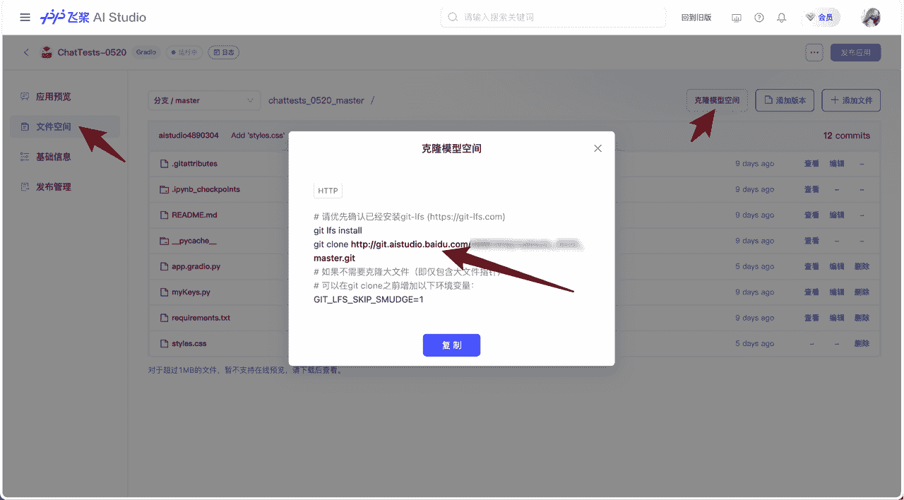
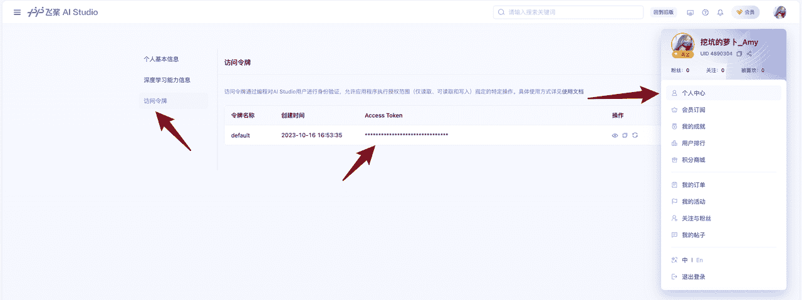
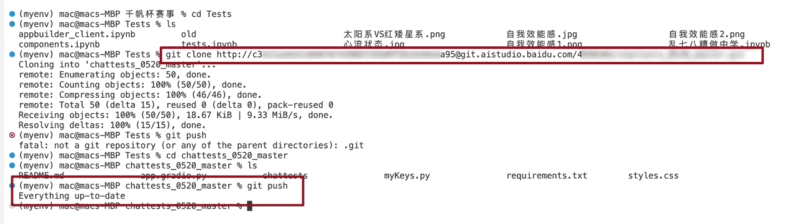
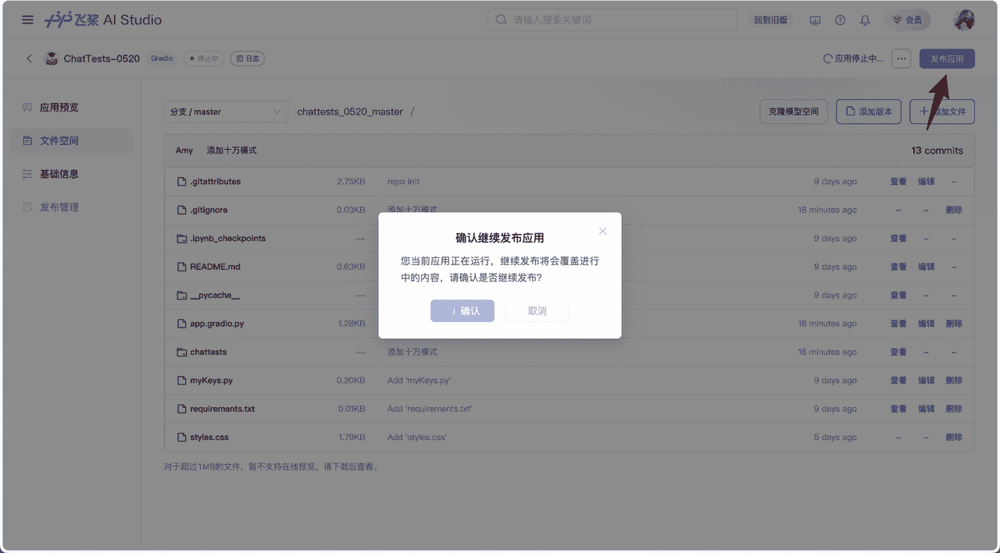
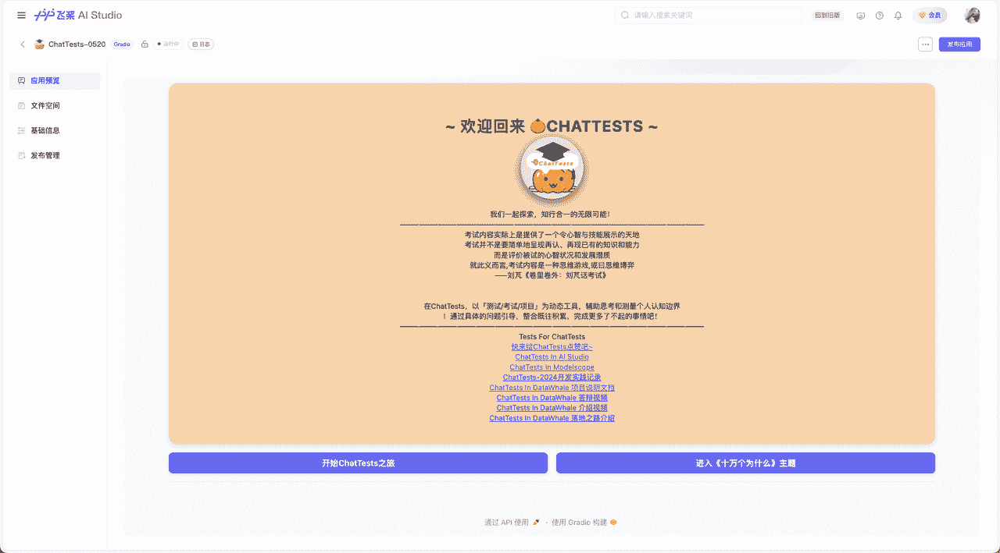
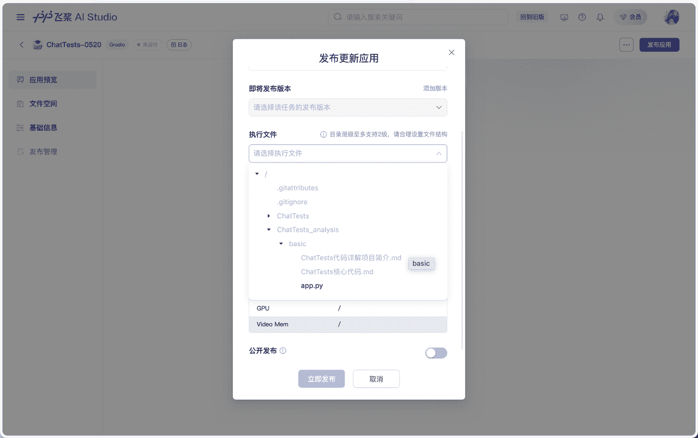

# AI Studio部署排坑指南

> 来源：[https://datawhaler.feishu.cn/docx/ITILdxcqkofnxyx3Va9cD0QPne6](https://datawhaler.feishu.cn/docx/ITILdxcqkofnxyx3Va9cD0QPne6)

# 更新应用

1.  建议本地调试，复制这行git命令

> ps：这里我们会发现，需要谨防他人看到我们应用的git clone命令，要不然他们能拿到代码

1.  拿到自己的令牌加到git命令上，要不然push不上去

> 组合起来的命令类似

> git clone http://${GitToken}@git.aistudio.baidu.com/123/hello-world.git

1.  更新代码并push上去后，点击【发布应用】

> 记得添加新版本，要不然不会更新效果，用的会是老的代码

# 执行文件与包下载

1.  只支持执行 xxx.gradio.py的文件

1.  可能安装支持不了一些paddle之外的框架

1.  安装baidu镜像之外的包可能比较慢

1.  应用目录层级不能超过2级

