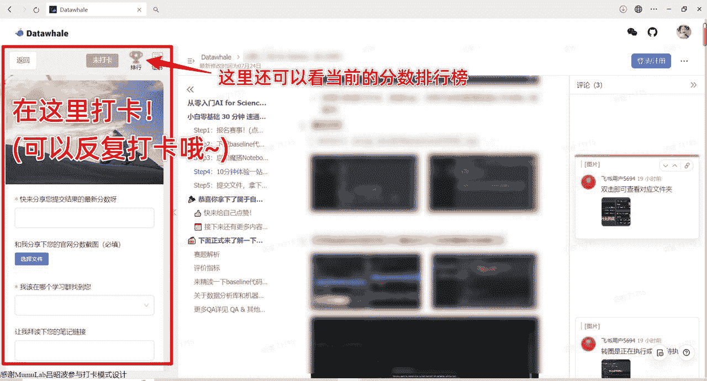
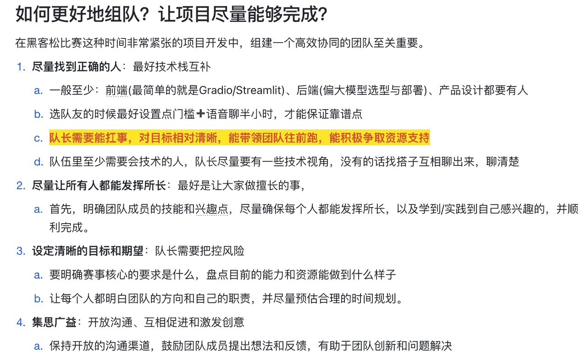

# 动手学大模型应用全栈开发-学习者手册

> 来源：[https://datawhaler.feishu.cn/docx/QdMVdf6GLoiIYrxpKiBcFvzEntd](https://datawhaler.feishu.cn/docx/QdMVdf6GLoiIYrxpKiBcFvzEntd)

# 学习活动介绍

> 从 浪潮信息源大模型部署、Gradio 入门 大模型算法原理 和 大模型应用开发，到通过 RAG技术、微调技术 入门相关 技术原理 提升应用效果。

## 学习目标

+   学习【浪潮信息源大模型】RAG技术原理与应用，掌握大模型应用开发核心技能

+   学习【浪潮信息源大模型】微调技术原理与应用，利用大模型的能力，当创意落地成应用

## 面向对象

+   适合谁来学？

+   具备一定的**技术基础**或**实际项目经历**（可以没有算法经验，但至少熟练使用Python等语言）

+   **希望在实际中运**用大模型微调，掌握大模型应用开发核心技能，构建创新应用

+   想学习浪潮信息源大模型RAG技术原理与应用和源大模型微调技术原理与应用

## 学习亮点

+   学习内容：

+   国内大模型应用开发的最佳实践-**浪潮信息源大模型**

+   大模型应用**开发工具和技巧梳理** 与 **开箱即用**的大模型应用**实战代码**

+   持续助力**打磨作品**

+   学习支持：

+   往期[**优秀同学作品案例**](https://datawhaler.feishu.cn/wiki/LSpmwpplNigJKwkvRYQcKxbTnkb#ZbB8d28MMoz7f8xRT9kciqcmnh2)，看见不同的创意如何落地

+   **刻意练习**，磨炼大模型开发技能

+   开展**头脑风暴会和技术交流会**等各种交流会，助力你创作应用作品

+   遇见志同道合的伙伴，**让学习不再孤独**

# 学习规划

## 学习排期

| 学习内容 | 打卡 |
| --- | --- |
| 预习阶段 | 完成速通手册并填写打卡-组队表 |
| Task01 | **第一个任务作业提交截止时间** |
| Task02 | **第二个任务作业提交截止时间** |
| Task03 | **第三个任务作业提交截止时间** |
| Task04 | **第四个任务作业提交截止时间** |
| Task05 | **第一轮作品提交截止时间** |
| Demo Day1：项目路演 | Demo Day1 |

## 学习内容

<https://datawhaler.feishu.cn/sync/QMB9diwsNsBXkkb4qSPckLuVnze>

## 如何学习

+   整个学习期间**就一个任务****，结**合自己的热爱与兴趣，组队学习和组队完成作品，提交你的作品，要求如下：

+   提交作品需包含：

1.  应用方案（必选）：项目背景、产品功能、技术方案、运行效果、应用价值及团队介绍等。PDF或PPT格式，不超过100MB。

1.  应用作品（必选）：应用体验入口及体验方式

1.  项目代码（可选）：应用程序源代码、必要的编译产物和依赖库、程序运行指引文档README等，确保可复现。

+   T**alk is chea**p，Show me the demo，作品重在完成而不是完美

+   鼓励组队，**找到志同道合的队友**一起开发大模型应用（群里吆喝）

+   最后一次[打卡完整作品提交链接](https://datawhaler.feishu.cn/share/base/form/shrcnbLAWydDXkK3lFwbIQBecCg)（填写下面的作品收集表即可）

<https://datawhaler.feishu.cn/share/base/form/shrcnbLAWydDXkK3lFwbIQBecCg?iframeFrom=docx&ccm_open=iframe>

+   过程中会穿插**7**场直播、头脑风暴后和技术交流会，邀请往期优秀开源项目来做案例分享，记得定好闹钟，助教群内也会提醒

## 如何提交

+   作品提交材料包括：

1.  01应用作品体验链接（必选）

1.  02项目作品应用方案和参赛信息.PDF/PPTX（必选）：项目背景、项目阐述、产品功能、技术方案、运行效果、迭代计划、应用价值、商业模式及团队介绍等

1.  03应用demo功能演示视频（必选）

1.  04项目代码.zip（可选）：项目代码的合集压缩包

+   项目应用方案提交模版参考：

1.  [提交作品规则 & Task1案例：智能编程助手](https://datawhaler.feishu.cn/wiki/BxMQwyxBgiW7H4kmeHgcMeK1nzd?from=from_copylink).作品提交模版案例1-智能编程助手

1.  [Task3案例：AI科研助手](https://datawhaler.feishu.cn/wiki/VqMbwzvPsilBWLkWX8zcIVXKn5g?from=from_copylink).作品提交模版案例2-AI科研助手

1.  [Task4案例：AI简历助手](https://datawhaler.feishu.cn/wiki/FWgSwZw4GitsFAk4E3qc05U6nhg?from=from_copylink).作品提交模版案例3-AI简历助手

+   最后一次[打卡完整作](https://datawhaler.feishu.cn/share/base/form/shrcnbLAWydDXkK3lFwbIQBecCg)品提交链接（填写下面的作品收集表）

<https://datawhaler.feishu.cn/share/base/form/shrcnbLAWydDXkK3lFwbIQBecCg?iframeFrom=docx&ccm_open=iframe>

# 评审与奖项

## 评审细则

<https://datawhaler.feishu.cn/sync/MdWedWW4jsic9HbEmyrcCArTn2d>

## 奖项细则

1.  整体奖项

1.  多位评委交叉评审，按总分从高到低排序

1.  若作品部署到魔搭创空间，按照应用点赞热度可获得最多10%的加分

1.  若作品开源到GitHub，按照项目Star数可获得最多10%的加分

1.  **前10%卓越作品奖**，**10% - 30%杰出作品奖**，**其他作品 优秀作品奖**（提交了可访问且有内容的链接）

1.  **Top1**：一等奖一名，获得Datawhale X 浪潮信息荣誉证书、Datawhale夏令营奖学金

1.  **Top2-Top3**：二等奖2名，获得Datawhale X 浪潮信息荣誉证书、Datawhale夏令营奖学金

1.  **Top4-Top10**：三等奖7名，获得Datawhale X 浪潮信息荣誉证书

1.  最佳奖项

1.  **最佳创新奖** **1**名，创新性 + 技术成熟度等维度综合最高的作品

1.  **最佳应用奖** **1**名，应用性、商业价值与应用demo等维度综合最高的作品

1.  以上奖项为**并列**关系，同一个作品可同时获得多个奖项

1.  小彩蛋：从优质作品选出大模型经典应用案例，将有机会获得为期一周（168小时）的算力资源等福利，并获得品牌宣传和曝光机会

## 夏令营学习者激励

<https://datawhaler.feishu.cn/sync/TOk2dZV4Bs71Pcb0eJ7ca8qpnIc>

## 获奖公示（待补充）

# 往期优秀同学的作品案例

https://datawhaler.feishu.cn/share/base/view/shrcnTUCeBNdVHg4SyevvRJmdAj

+   夏令营第二期-大模型应用开发作品

https://datawhaler.feishu.cn/share/base/view/shrcn69XoGIaattIXCjieIOVs0f

# 其他

## 重要链接

**学习相关QA汇总文档**：

## 常见问题Q&A

### 如何打卡？

**打卡说明**：

+   Task01打卡：夏令营第四期大模型应用开发-找搭子辅助表- Task01打卡链接https://docs.qq.com/sheet/DZlVtR1RCdnJxVllr

+   Task02和Task04教程左侧显示栏完成，每个任务打卡表单不一样。

+   同一个Task任务打卡为覆盖形式，比如填了笔记链接打卡后，再不填笔记链接打卡就会【没有笔记链接】，辛苦大家注意再加一下笔记链接哈

### 如何组队？

Step1:填写夏令营第四期大模型应用开发-找搭子辅助表-打卡链接https://docs.qq.com/sheet/DZlVtR1RCdnJxVllr

Step2:主动寻找队友，添加好友备注来源，然后语音沟通组队意见

### 如何写笔记？

**笔记说明：**

本期笔记要求：文章标题带上“Datawhale AI 夏令营”

具体笔记，可按照task来做多份笔记，也可沿用单个笔记持续更新内容

打卡时提交标题带“Datawhale AI夏令营“的可公开查看的笔记链接，不限笔记平台，CSDN、知乎、📕、👸号、掘金等

### 如何获得实习证明？

学习者仅能获得实践证明，详见【三、夏令营学习者奖励】

后续参加 **助教/宣传大使/教程共创 **等贡献，表现优秀者可获得实习证明，有兴趣的同学可以咨询负责人