# 酷蛙部署-三张照片拥有不一样的你

> 来源：[https://datawhaler.feishu.cn/docx/IOJ6dMwrronzXMxrflDcP9Kmn0c](https://datawhaler.feishu.cn/docx/IOJ6dMwrronzXMxrflDcP9Kmn0c)

> 本文作者：不要葱姜蒜

> **酷蛙部署教程，首先需要有一点点点**点知识，比如知道怎么使用复制和粘贴命令~

> 也可能需要一点点解决问题的耐心~

# 酷蛙

FaceChain是一个可以用来打造个人数字形象的深度学习模型工具。我们仅需要提供最低三张照片即可获得独属于自己的个人形象数字替身。FaceChain支持在gradio的界面中使用模型训练和推理能力，也支持资深开发者使用python脚本进行训练推理；项目地址：https://github.com/modelscope/facechain.git

# 克隆项目

# **首先通读一遍**[阿里云机器学习Pai-DSW服务器部署教程](https://qwosdw576oc.feishu.cn/docx/NajfdyJm3oripXxrPFFczjSon4z)**，**通读一遍，了解一下，但不要跟着做。

> 这个文档可以帮助你了解如何创建阿里云DSW实例。

# 以本教程为主，上面链接引用的教程只是了解如何创建DSW实例。

+   **接着选择一台A10的GPU机器****（再三核对，是****可**抵扣计算时的，只有这个是免费资源）。

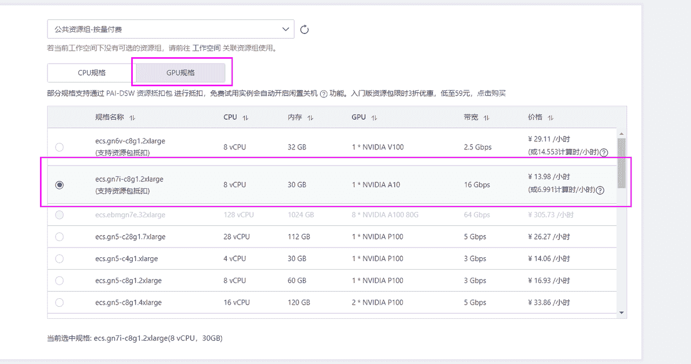

+   **然**后再底部的环境选择，选择最下面的一行环境modelscope:ubuntu20.04-cuda11.7.1-py38-torch2.0.1-tf1.15.5-1.8.1

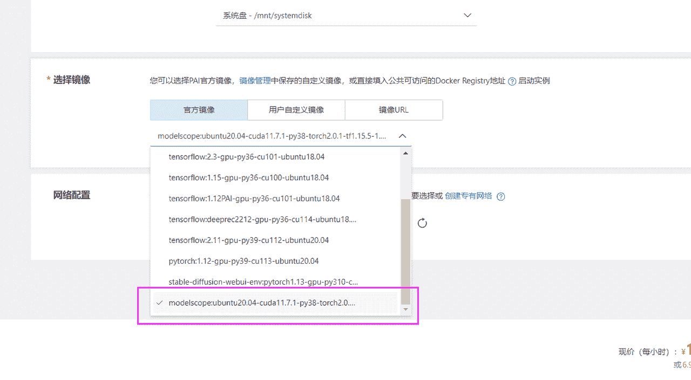

+   再次确实计费规则是 **可抵扣计算时**，然后点击下一步，点击创建环境，等待一小会。

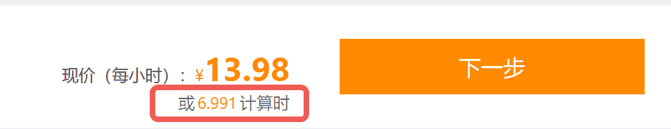

+   点击启动环境，进入环境之后，进入命令行，更新apt-get，安装git-lfs。

```
apt-get update
apt-get install git-lfs

git init
git lfs install
```

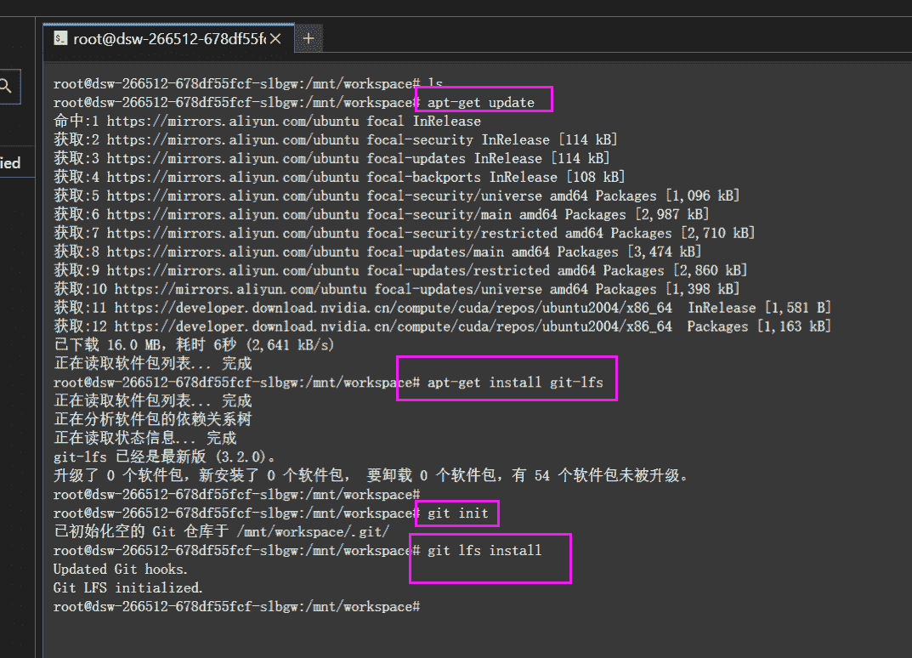

+   克隆项目

```
git clone https://github.com/modelscope/facechain.git --depth 1
GIT_LFS_SKIP_SMUDGE=1
```

+   安装依赖

```
cd ./facechain
pip install -r requirements.txt
pip install -U openmim 
```

# 修改代码

+   然后在run_inference.py文件第8行添加如下代码。作用是运行的时候不会重复下载模型，节省时间。

```
snapshot_download(&#x27;some-model-id&#x27;)
```

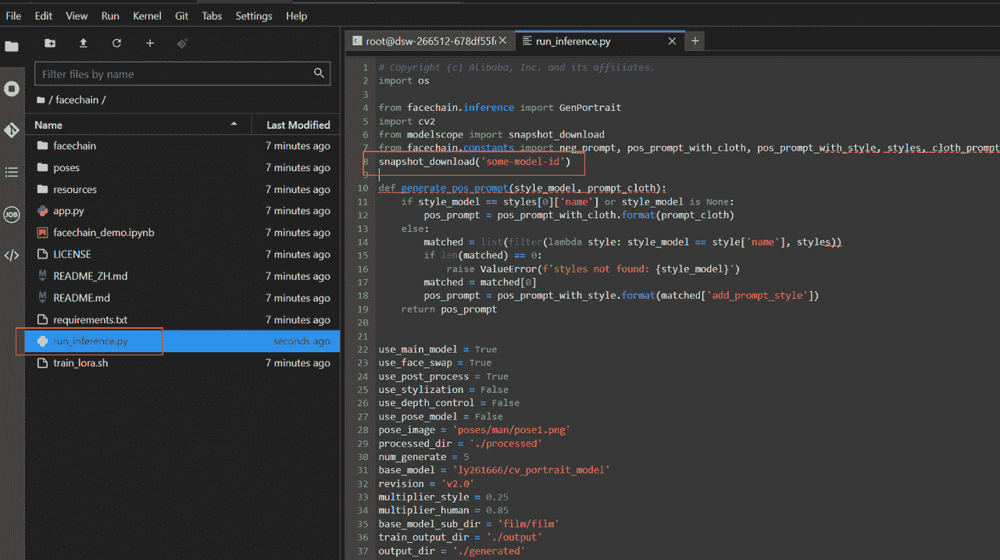

# 运行代码

+   在命令行输入python app.py，在页面直接点击这个链接进入gradio界面即可。

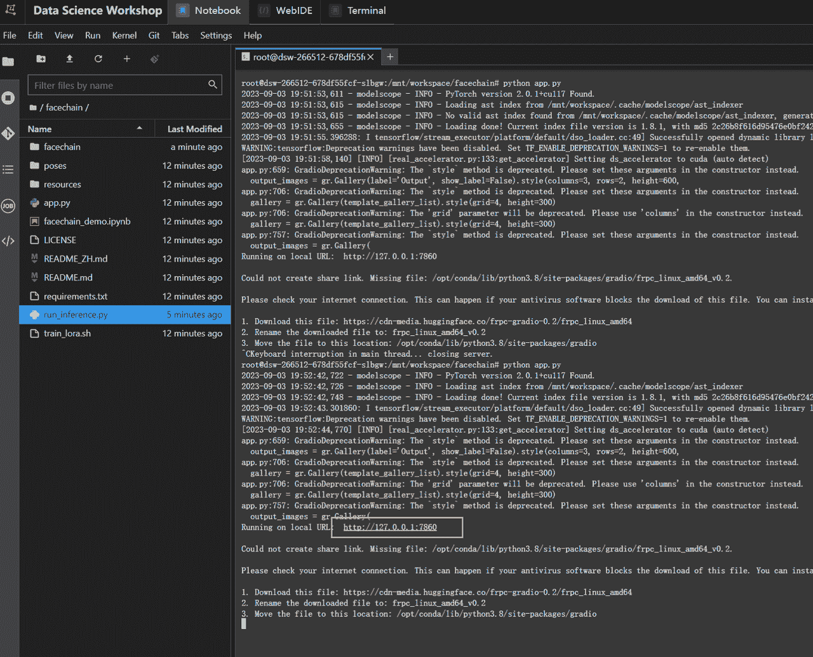

+   点击形象定制，选择第二个模型（这个模型风格比较多，哈哈哈，大家也可以尝试第一个模型），选择照片上传，需要三张没有遮挡面部的照片。

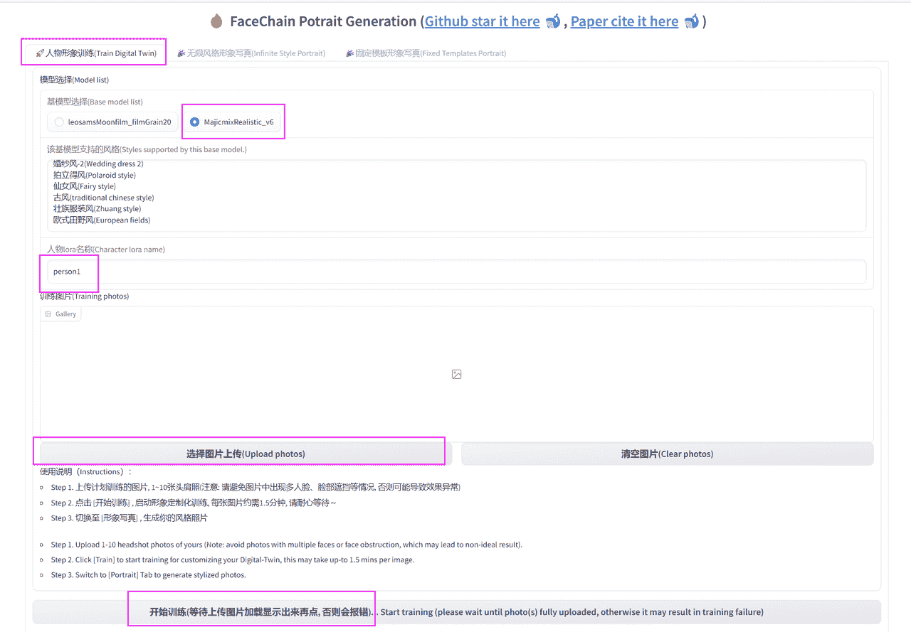

+   然后点击开始训练，这个过程大概有10分钟左右。

> **注意：gradio界面可能会出现error报错（等待时间过**长），不用管，我们只看命令行的日志即可。

+   当命令行出现“训练已完成字样”，即可进行下一步。

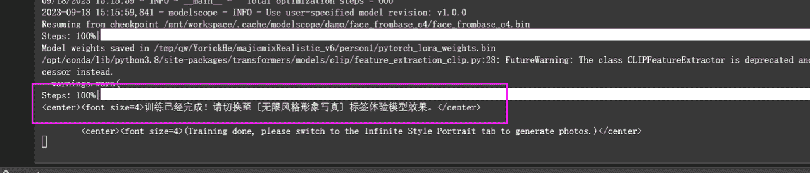

+   点击形象管理，选择刚刚训练的模型，和产出模型。选择你喜欢的风格，如果你是男生，当然可以把prompt中的1girl更换为1boy。

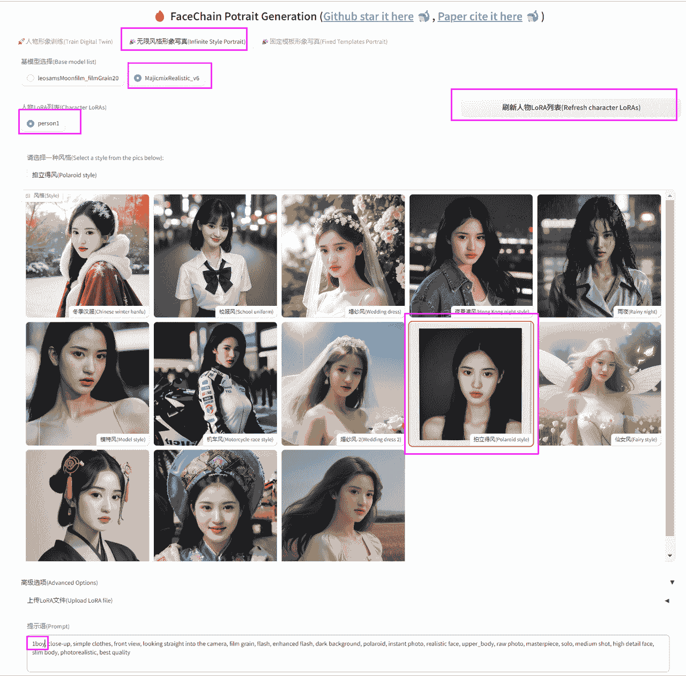

+   点击你喜欢的姿态。（也可以在poses目录中上传你喜欢的姿态文件，在constants.py文件中pose_examples中添加姿态图片目录），然后点击开始生成。

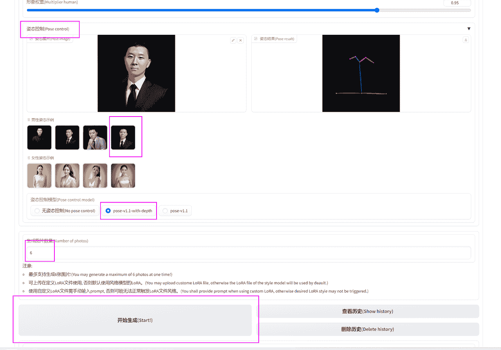

+   下载完模型之后，需要个几分钟叭~

> **注**意：gradio界面会出现error报错（因为下载模型时间过长），所以再次点击开始生成即可。（前面修改过代码，不会重复下载模型~）

# 图片展示

## 拍立得风

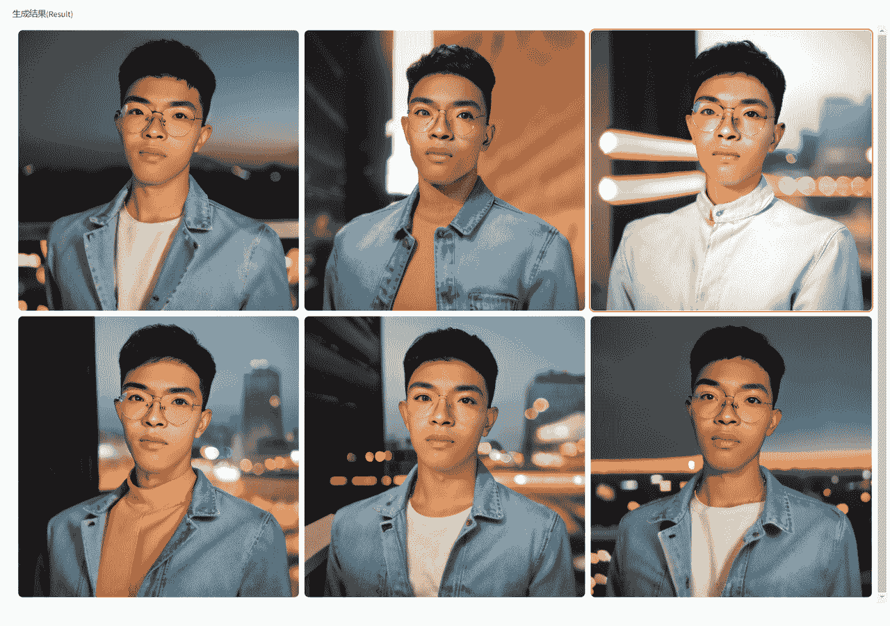

> 其他风格都是适合女生的，俺驾驭不来，大家自己尝试嗷~