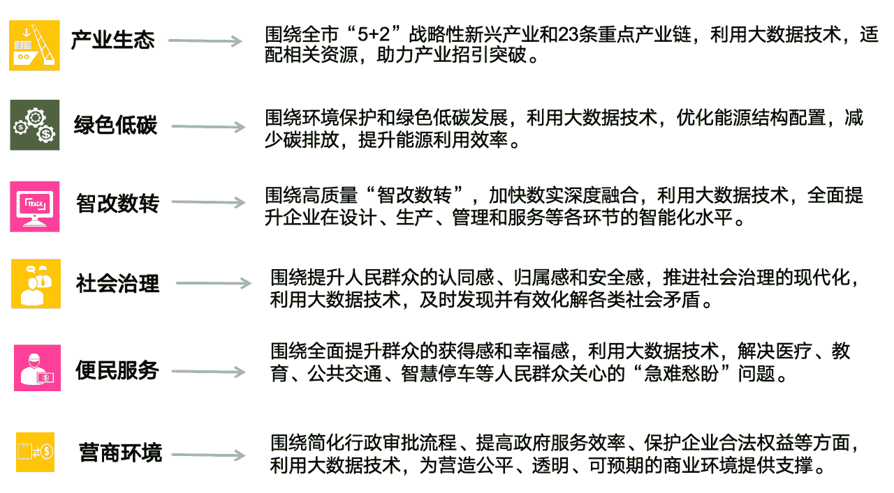
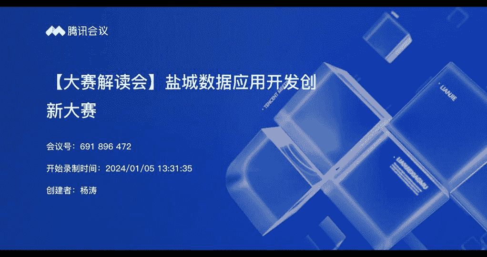
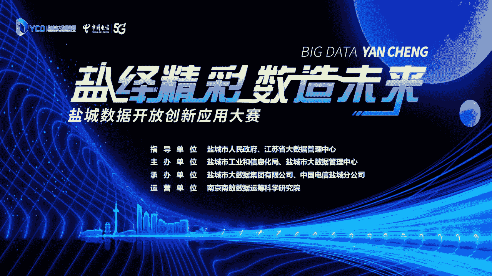
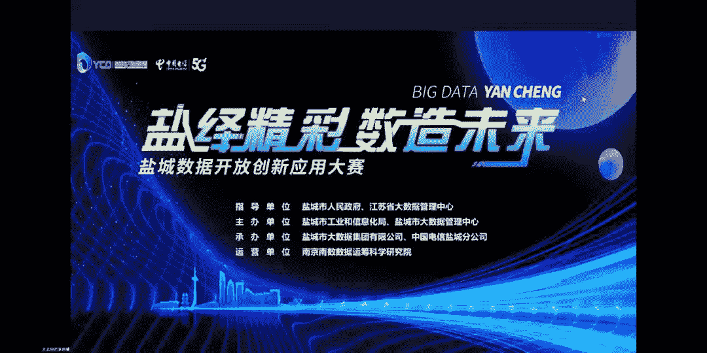
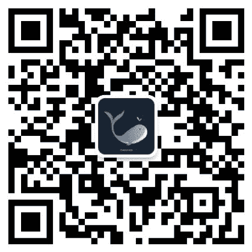
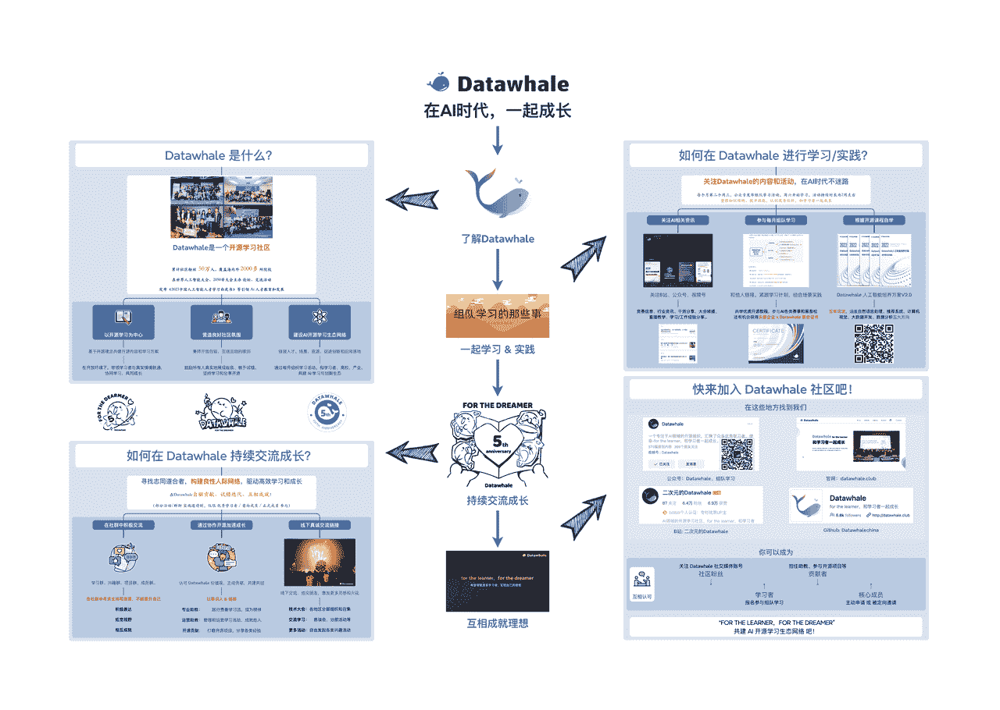
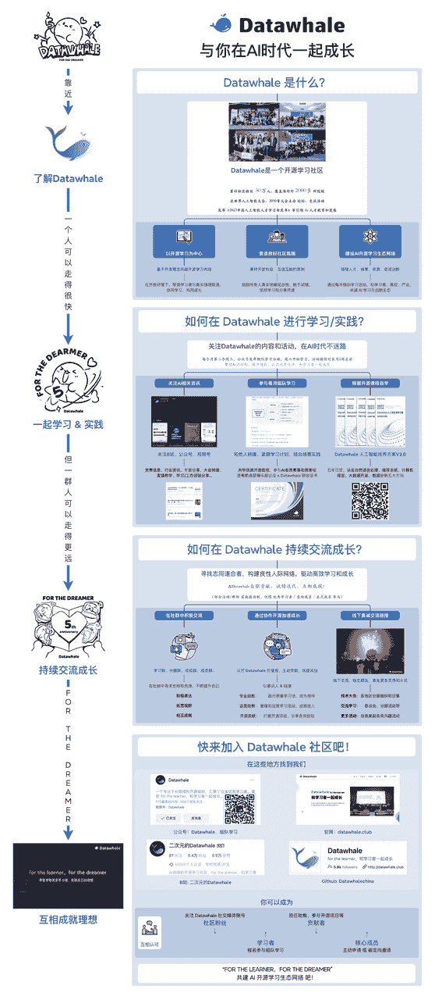

# 《2023盐城数据开放创新应用赛》

> 来源：[https://datawhaler.feishu.cn/docx/IuI4d6hPjon7fLx957CcQIPsn6d](https://datawhaler.feishu.cn/docx/IuI4d6hPjon7fLx957CcQIPsn6d)

## 学习目标

+   创作/开发出具有 **创新性、可行性、数据利用价值 **的 **创新应用产品**，参加比赛

+   学会探索数据价值、挖掘数据应用创新玩法

+   学习期间**提交作品**

## 面向对象

+   有一定**创新思维**与**Python基础**

+   具备一定的 **开发基础 **或 **实际项目经历**（可以没有算法经验，但至少熟练使用Python等语言）

+   希望 **提升****AI****、****数据挖掘****、产品设计与开发 **实战能力，有**足够的精力**投入，热爱分享

## 如何学习

+   参加比赛，**提交作品**

+   [**创新创意赛道（数据产品方向）**](https://www.marsbigdata.com/competition/details?id=40784248085)** 和 **[**创新产品赛道（数据应用方向）**](https://www.marsbigdata.com/competition/details?id=40779593528)

+   可思考的产品领域为：

+   盐城开放数据-可参考开放数据集：https://www.yancheng.gov.cn/opendata/index

+   T**alk is chea**p，Show me the demo，作品重在完成而不是完美

+   鼓励组队，**找到志同道合的队友**一起进行产品创作（群里吆喝）

+   过程中会穿插**多场直播**，分享赛事解读和作品，记得定好闹钟，小助手群内也会提醒

### 学习内容

| **直播名称** | **分享嘉宾** | **视频录播（记得****三连****）** | **PPT** |
| --- | --- | --- | --- |
| 盐城数据开放创新应用大赛**解读会** | [MARS](https://www.marsbigdata.com/)-大赛运营负责人 |  |  |
| 盐城数据开放创新应用大赛**案例分享会** | [MARS](https://www.marsbigdata.com/)-大赛运营负责人 |  | **（正在路上）** |
| …… | ... | ... | ... |
| 盐城数据赛事 - **开营仪式 &amp; 赛题解读** | 牧小熊：Datawhale武汉分部负责人 | 2023盐城数据开放创新应用大赛：创新创意赛道、创新产品赛道-赛题解读 | [2023盐城数据开放创新应用大赛-赛题解读.pptx](https://datawhaler.feishu.cn/file/VUknbs7SooyB62xmdlGcvMCynbg)** ** |
| 盐城数据赛事-**偏产品创意方向 方案分享** | 牧小熊：Datawhale武汉分部负责人 | 2023盐城数据开放创新应用大赛：创新创意赛道分享 | [2023盐城数据开放创新应用大赛-创新创意赛道.pptx](https://datawhaler.feishu.cn/file/Ni5vbfgwjoSpDbxIsmvcoBMnnMh)** ** |
| 盐城数据赛事-**偏数据应用方向 方案分享** | 牧小熊：Datawhale武汉分部负责人 | 2023盐城数据开放创新应用大赛：创新产品赛道分享 | [2023盐城数据开放创新应用大赛-创新产品.pptx](https://datawhaler.feishu.cn/file/ZEY1b4kozopCQ9xFhQrc1BIjn11)** ** |

[赛事解读回放视频.mp4](https://internal-api-drive-stream.feishu.cn/space/api/box/stream/download/all/HMgqbPYTdoj8b6xyqHDcaoQknob)

[赛事解读.pdf](https://internal-api-drive-stream.feishu.cn/space/api/box/stream/download/all/D2amb2nJPoJV7uxt8encE6J8nad)

[案例分享会.mp4](https://internal-api-drive-stream.feishu.cn/space/api/box/stream/download/all/PvZEbfiUOoYBbyxgORucCSJvn6f)

### 学习任务

| **学习阶段** | **学习任务** | **建议动作** |
| --- | --- | --- |
| **报名赛事** | 了解活动背景，选择一个赛事方向进行报名 | +   报名 |
| **Part1** | 思考idea，自由组队(1~5人) | +   多看、多听、多学、多想、多讨论 |
| **Part2** | **创作 ****数据挖掘**** 产品方案/应用！！！** | +   学习相关技术，提升个人实力 |
| **Part3** | **上传作品介绍的.zip压缩包** | +   组队学习期间**提交作品** |

+   **开营仪式 & 赛题解读**

+   **偏产品创意方向 方案分享**

+   **偏数据应用方向 方案分享**

+   如“智改数转-xxx团队.zip”

+   以 **PPT或PDF **为主，

+   其他辅助性材料一起打包在压缩包内

# 组织方简介

## [Datawhale](http://www.datawhale.club)

扫描下方二维码关注公众号：@Datawhale

更多组队学习和赛事等你参与~

Datawhale成立于2018年，是国内头部的开源学习组织，汇聚了来自伯克利、斯坦福、港中文、港科大、清华、北大、上交、复旦、浙大等全球近百所高校的成员，吸引了数十万的AI领域学习者关注；组织以 for the learner 为使命，致力于构建开源学习社区，和学习者一起成长。

Datawhale开源学习已经有20多万人参与线上学习，覆盖了海**内外2000多所院校，**让更多院校的学生获得和全球的AI学习者一起交流学习的机会，构建没有围墙的同学关系。在世界人工智能大会、全球人**工智能开发者先锋大会、2**050等线下大会，北京、上海、杭州、广州、深圳等城市，以及上海交通大学、浙江大学、厦门大学、华北电力大学、杭州电子科技大学等高校，Datawhale组织了论坛、讲座、交流活动，持续推动青年AI人才培养。

成立**5年来，Datawh**ale开源学习已经成为全国知名的学习活动，不断吸引具有影响力的顶尖学者、知名教授、企业家、优秀青年人才等在此分享知识和远见，成为关注青年人才成长的主阵地，加快高校和产业的链接。

## [MARS](https://www.marsbigdata.com/)

扫描下方二维码关注公众号：@MARS数据科学平台

更多赛事等你参与~

MARS开发者平台，是南数研究院积极响应政府实施数字经济战略、培育数据经济新业态、推进“上云用数赋智”的政策，以培养数据人才为目的，倾力打造的数据科学开放平台。专注于大数据和人工智能，通过数据科学的方法，将业务问题转换为数学建模问题、数据分析问题、大数据计算问题、计算机工程问题等。服务于产业链发展需要，服务于技术转化需要创立的公网开放的SaaS平台。