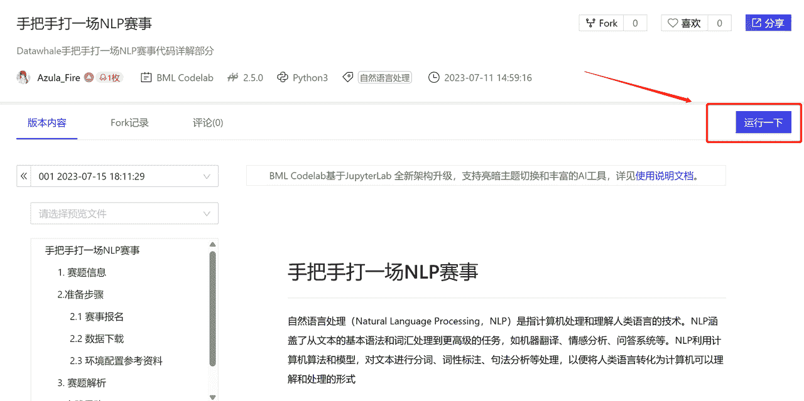
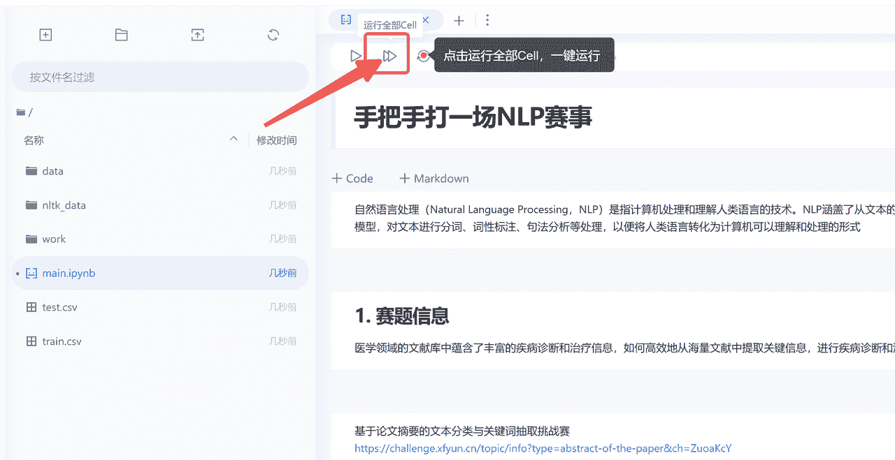
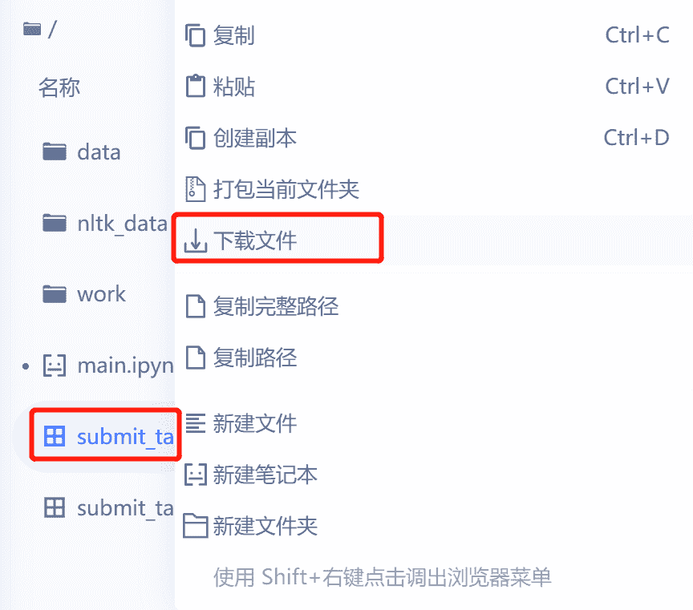
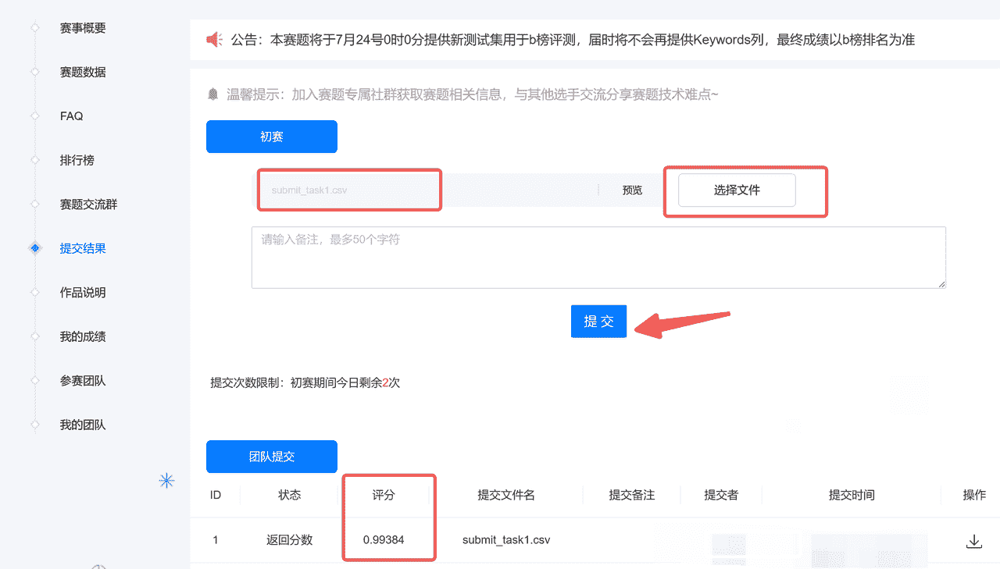
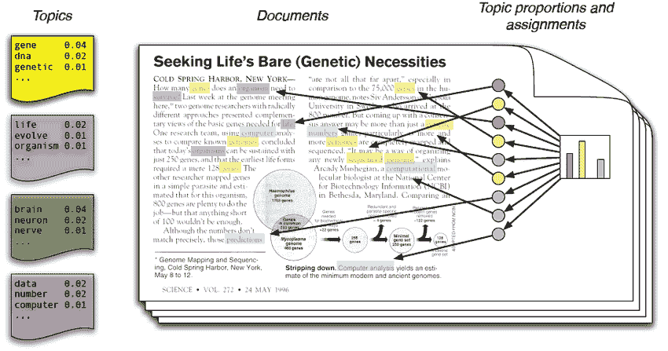
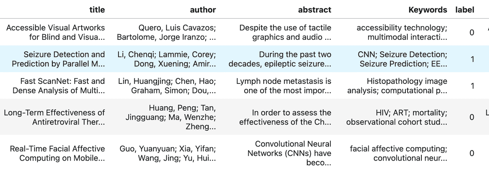
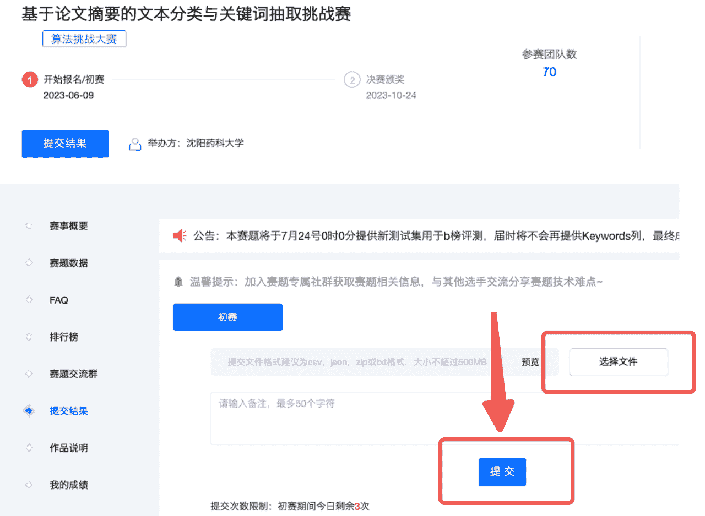

# AI夏令营 - NLP实践教程

> 来源：[https://datawhaler.feishu.cn/docx/EVoodR6WroWZxXxa3a0cukIanRO](https://datawhaler.feishu.cn/docx/EVoodR6WroWZxXxa3a0cukIanRO)

> 本教程会带领大家项目制学习，由浅入深，逐渐进阶。从跑通最简的Baseline，精读Baseline，到底层算法原理与进阶实践技巧的学习，千里之行，始于足下，从这里，开启你的 AI 学习之旅吧

> —— Datawhale贡献者团队

## 学习任务：

| 学习任务 | 相关直播 |
| --- | --- |
| **任务一：** | **必修直播**：[开营 + 实践全流程基础演示](https://www.bilibili.com/video/BV1rM4y1s7RH) |
| **任务二：** | **必修直播**：双任务赛题解析 + Baseline逐行精读 |
| **任务三：** | **必修直播**：[Bert原理及上分技巧](https://www.bilibili.com/video/BV1nX4y1E7Sn/) |

# 在线版本Baseline

> Baseline是一份简易的入门教程，可以帮助同学们迈出 AI 训练大师之路的第一步。建议入门的同学可以暂时不用着急去弄懂各个代码的原理，先跑通代码，动手实践，看到成绩。

快速跑通全流程，我们基于百度AI Studio，将本教程Baseline部署在线上平台，可一键fork运行代码，提交结果，看到成绩。

一键运行：https://aistudio.baidu.com/aistudio/projectdetail/6522950?sUid=377372&shared=1&ts=1689827255213

+   运行时，可以选择**CPU2核8G** 或 **V100 16G**的配置

+   总运行时间大约需要 **6min** 或 **2min**，请耐心等待

+   **遇到缺少数据集文**件/数据集地址错误，fork最新版本，重新运行

+   **视频演示**：AI夏令营：开营仪式|实践全流程基础演示_哔哩哔哩_bilibili，对应的NLP章节





输出**submit.csv**文件后，右键可下载到本地，在[赛事提交结果](https://challenge.xfyun.cn/topic/info?type=abstract-of-the-paper&ch=ZuoaKcY)页面提交。





# 赛题解析

## 赛题信息

> 基于论文摘要的文本分类与关键词抽取挑战赛

> https://challenge.xfyun.cn/topic/info?type=abstract-of-the-paper&ch=ZuoaKcY

医学领域的文献库中蕴含了丰富的疾病诊断和治疗信息，如何高效地从海量文献中提取关键信息，进行疾病诊断和治疗推荐，对于临床医生和研究人员具有重要意义。



## **实践任务**

本任务分为两个子任务：

1.  从论文标题、摘要作者等信息，判断该论文是否属于医学领域的文献。

1.  从论文标题、摘要作者等信息，提取出该论文关键词。

第一个任务看作是一个文本二分类任务。机器需要根据对论文摘要等信息的理解，将论文划分为医学领域的文献和非医学领域的文献两个类别之一。第二个任务看作是一个文本关键词识别任务。机器需要从给定的论文中识别和提取出与论文内容相关的关键词。

## 数据解析

训练集与测试集数据为CSV格式文件，各字段分别是标题、作者和摘要。Keywords为任务2的标签，label为任务1的标签。训练集和测试集都可以通过pandas读取。



## 实践思路

**任务一：文献领域分类**

针对文本分类任务，可以提供两种实践思路，一种是使用传统的特征提取方法（如TF-IDF/BOW）结合机器学习模型，另一种是使用预训练的BERT模型进行建模。使用特征提取 + 机器学习的思路步骤如下：

1.  数据预处理：首先，对文本数据进行预处理，包括文本清洗（如去除特殊字符、标点符号）、分词等操作。可以使用常见的NLP工具包（如NLTK或spaCy）来辅助进行预处理。

1.  特征提取：使用TF-IDF（词频-逆文档频率）或BOW（词袋模型）方法将文本转换为向量表示。TF-IDF可以计算文本中词语的重要性，而BOW则简单地统计每个词语在文本中的出现次数。可以使用scikit-learn库的TfidfVectorizer或CountVectorizer来实现特征提取。

1.  构建训练集和测试集：将预处理后的文本数据分割为训练集和测试集，确保数据集的样本分布均匀。

1.  选择机器学习模型：根据实际情况选择适合的机器学习模型，如朴素贝叶斯、支持向量机（SVM）、随机森林等。这些模型在文本分类任务中表现良好。可以使用scikit-learn库中相应的分类器进行模型训练和评估。

1.  模型训练和评估：使用训练集对选定的机器学习模型进行训练，然后使用测试集进行评估。评估指标可以选择准确率、精确率、召回率、F1值等。

1.  调参优化：如果模型效果不理想，可以尝试调整特征提取的参数（如词频阈值、词袋大小等）或机器学习模型的参数，以获得更好的性能。

**任务二：关键词提取**

论文关键词划分为两类：

+   在标题和摘要中出现的关键词

+   没有在标题和摘要中出的关键词

在标题和摘要中出现的关键词：这些关键词是文本的核心内容，通常在文章的标题和摘要中出现，用于概括和提炼文本的主题或要点。对于提取这类关键词，可以采用以下方法：

+   词频统计：统计标题和摘要中的词频，选择出现频率较高的词语作为关键词。同时设置停用词去掉价值不大、有负作用的词语。

+   词性过滤：根据文本的词性信息，筛选出名词、动词、形容词等词性的词语作为关键词。

+   TF-IDF算法：计算词语在文本中的词频和逆文档频率，选择TF-IDF值较高的词语作为关键词。

没有在标题和摘要中出现的关键词：这类关键词可能在文本的正文部分出现，但并没有在标题和摘要中提及。要提取这些关键词，可以考虑以下方法：

+   文本聚类：将文本划分为不同的主题或类别，提取每个主题下的关键词。

+   上下文分析：通过分析关键词周围的上下文信息，判断其重要性和相关性。

+   基于机器学习/深度学习的方法：使用监督学习或无监督学习的方法训练模型，从文本中提取出未出现在标题和摘要中的关键词。

# Baseline代码精读

> 视频讲解：https://www.bilibili.com/video/BV1qu4y1U7hp/

> 视频配套代码文件：https://datawhaler.feishu.cn/drive/folder/VUg1fSFSzlhBGgdehymcbvE1ne7

**任务一：文献领域分类**

Baseline中我们选择使用BOW将文本转换为向量表示，选择逻辑回归模型来完成训练和评估

代码演示如下：

**完整代码如下：**

```
# 导入pandas用于读取表格数据
import pandas as pd

# 导入BOW（词袋模型），可以选择将CountVectorizer替换为TfidfVectorizer（TF-IDF（词频-逆文档频率）），注意上下文要同时修改，亲测后者效果更佳
from sklearn.feature_extraction.text import CountVectorizer

# 导入LogisticRegression回归模型
from sklearn.linear_model import LogisticRegression

# 过滤警告消息
from warnings import simplefilter
from sklearn.exceptions import ConvergenceWarning
simplefilter(&quot;ignore&quot;, category=ConvergenceWarning)


# 读取数据集
train = pd.read_csv(&#x27;./基于论文摘要的文本分类与关键词抽取挑战赛公开数据/train.csv&#x27;)
train[&#x27;title&#x27;] = train[&#x27;title&#x27;].fillna(&#x27;&#x27;)
train[&#x27;abstract&#x27;] = train[&#x27;abstract&#x27;].fillna(&#x27;&#x27;)

test = pd.read_csv(&#x27;./基于论文摘要的文本分类与关键词抽取挑战赛公开数据/test.csv&#x27;)
test[&#x27;title&#x27;] = test[&#x27;title&#x27;].fillna(&#x27;&#x27;)
test[&#x27;abstract&#x27;] = test[&#x27;abstract&#x27;].fillna(&#x27;&#x27;)


# 提取文本特征，生成训练集与测试集
train[&#x27;text&#x27;] = train[&#x27;title&#x27;].fillna(&#x27;&#x27;) + &#x27; &#x27; +  train[&#x27;author&#x27;].fillna(&#x27;&#x27;) + &#x27; &#x27; + train[&#x27;abstract&#x27;].fillna(&#x27;&#x27;)+ &#x27; &#x27; + train[&#x27;Keywords&#x27;].fillna(&#x27;&#x27;)
test[&#x27;text&#x27;] = test[&#x27;title&#x27;].fillna(&#x27;&#x27;) + &#x27; &#x27; +  test[&#x27;author&#x27;].fillna(&#x27;&#x27;) + &#x27; &#x27; + test[&#x27;abstract&#x27;].fillna(&#x27;&#x27;)+ &#x27; &#x27; + train[&#x27;Keywords&#x27;].fillna(&#x27;&#x27;)

vector = CountVectorizer().fit(train[&#x27;text&#x27;])
train_vector = vector.transform(train[&#x27;text&#x27;])
test_vector = vector.transform(test[&#x27;text&#x27;])


# 引入模型
model = LogisticRegression()

# 开始训练，这里可以考虑修改默认的batch_size与epoch来取得更好的效果
model.fit(train_vector, train[&#x27;label&#x27;])

# 利用模型对测试集label标签进行预测
test[&#x27;label&#x27;] = model.predict(test_vector)

# 生成任务一推测结果
test[[&#x27;uuid&#x27;, &#x27;Keywords&#x27;, &#x27;label&#x27;]].to_csv(&#x27;submit_task1.csv&#x27;, index=None)
```

在任务1中还可以尝试BERT模型，但直接TF-IDF（词频-逆文档频率）或BOW（词袋模型）方法的效果已经足够好，已经可以在测试集达到0.99+的分数。

**任务二：关键词提取**

```
# 引入分词器
from nltk import word_tokenize, ngrams

# 定义停用词，去掉出现较多，但对文章不关键的词语
stops = [
    &#x27;will&#x27;, &#x27;can&#x27;, &quot;couldn&#x27;t&quot;, &#x27;same&#x27;, &#x27;own&#x27;, &quot;needn&#x27;t&quot;, &#x27;between&#x27;, &quot;shan&#x27;t&quot;, &#x27;very&#x27;,
     &#x27;so&#x27;, &#x27;over&#x27;, &#x27;in&#x27;, &#x27;have&#x27;, &#x27;the&#x27;, &#x27;s&#x27;, &#x27;didn&#x27;, &#x27;few&#x27;, &#x27;should&#x27;, &#x27;of&#x27;, &#x27;that&#x27;, 
     &#x27;don&#x27;, &#x27;weren&#x27;, &#x27;into&#x27;, &quot;mustn&#x27;t&quot;, &#x27;other&#x27;, &#x27;from&#x27;, &quot;she&#x27;s&quot;, &#x27;hasn&#x27;, &quot;you&#x27;re&quot;,
     &#x27;ain&#x27;, &#x27;ours&#x27;, &#x27;them&#x27;, &#x27;he&#x27;, &#x27;hers&#x27;, &#x27;up&#x27;, &#x27;below&#x27;, &#x27;won&#x27;, &#x27;out&#x27;, &#x27;through&#x27;,
     &#x27;than&#x27;, &#x27;this&#x27;, &#x27;who&#x27;, &quot;you&#x27;ve&quot;, &#x27;on&#x27;, &#x27;how&#x27;, &#x27;more&#x27;, &#x27;being&#x27;, &#x27;any&#x27;, &#x27;no&#x27;,
     &#x27;mightn&#x27;, &#x27;for&#x27;, &#x27;again&#x27;, &#x27;nor&#x27;, &#x27;there&#x27;, &#x27;him&#x27;, &#x27;was&#x27;, &#x27;y&#x27;, &#x27;too&#x27;, &#x27;now&#x27;,
     &#x27;whom&#x27;, &#x27;an&#x27;, &#x27;ve&#x27;, &#x27;or&#x27;, &#x27;itself&#x27;, &#x27;is&#x27;, &#x27;all&#x27;, &quot;hasn&#x27;t&quot;, &#x27;been&#x27;, &#x27;themselves&#x27;,
     &#x27;wouldn&#x27;, &#x27;its&#x27;, &#x27;had&#x27;, &quot;should&#x27;ve&quot;, &#x27;it&#x27;, &quot;you&#x27;ll&quot;, &#x27;are&#x27;, &#x27;be&#x27;, &#x27;when&#x27;, &quot;hadn&#x27;t&quot;,
     &quot;that&#x27;ll&quot;, &#x27;what&#x27;, &#x27;while&#x27;, &#x27;above&#x27;, &#x27;such&#x27;, &#x27;we&#x27;, &#x27;t&#x27;, &#x27;my&#x27;, &#x27;d&#x27;, &#x27;i&#x27;, &#x27;me&#x27;,
     &#x27;at&#x27;, &#x27;after&#x27;, &#x27;am&#x27;, &#x27;against&#x27;, &#x27;further&#x27;, &#x27;just&#x27;, &#x27;isn&#x27;, &#x27;haven&#x27;, &#x27;down&#x27;,
     &quot;isn&#x27;t&quot;, &quot;wouldn&#x27;t&quot;, &#x27;some&#x27;, &quot;didn&#x27;t&quot;, &#x27;ourselves&#x27;, &#x27;their&#x27;, &#x27;theirs&#x27;, &#x27;both&#x27;,
     &#x27;re&#x27;, &#x27;her&#x27;, &#x27;ma&#x27;, &#x27;before&#x27;, &quot;don&#x27;t&quot;, &#x27;having&#x27;, &#x27;where&#x27;, &#x27;shouldn&#x27;, &#x27;under&#x27;,
     &#x27;if&#x27;, &#x27;as&#x27;, &#x27;myself&#x27;, &#x27;needn&#x27;, &#x27;these&#x27;, &#x27;you&#x27;, &#x27;with&#x27;, &#x27;yourself&#x27;, &#x27;those&#x27;,
     &#x27;each&#x27;, &#x27;herself&#x27;, &#x27;off&#x27;, &#x27;to&#x27;, &#x27;not&#x27;, &#x27;m&#x27;, &quot;it&#x27;s&quot;, &#x27;does&#x27;, &quot;weren&#x27;t&quot;, &quot;aren&#x27;t&quot;,
     &#x27;were&#x27;, &#x27;aren&#x27;, &#x27;by&#x27;, &#x27;doesn&#x27;, &#x27;himself&#x27;, &#x27;wasn&#x27;, &quot;you&#x27;d&quot;, &#x27;once&#x27;, &#x27;because&#x27;, &#x27;yours&#x27;,
     &#x27;has&#x27;, &quot;mightn&#x27;t&quot;, &#x27;they&#x27;, &#x27;ll&#x27;, &quot;haven&#x27;t&quot;, &#x27;but&#x27;, &#x27;couldn&#x27;, &#x27;a&#x27;, &#x27;do&#x27;, &#x27;hadn&#x27;,
     &quot;doesn&#x27;t&quot;, &#x27;your&#x27;, &#x27;she&#x27;, &#x27;yourselves&#x27;, &#x27;o&#x27;, &#x27;our&#x27;, &#x27;here&#x27;, &#x27;and&#x27;, &#x27;his&#x27;, &#x27;most&#x27;,
     &#x27;about&#x27;, &#x27;shan&#x27;, &quot;wasn&#x27;t&quot;, &#x27;then&#x27;, &#x27;only&#x27;, &#x27;mustn&#x27;, &#x27;doing&#x27;, &#x27;during&#x27;, &#x27;why&#x27;,
     &quot;won&#x27;t&quot;, &#x27;until&#x27;, &#x27;did&#x27;, &quot;shouldn&#x27;t&quot;, &#x27;which&#x27;
]

# 定义方法按照词频筛选关键词

def extract_keywords_by_freq(title, abstract):
    ngrams_count = list(ngrams(word_tokenize(title.lower()), 2)) + list(ngrams(word_tokenize(abstract.lower()), 2))
    ngrams_count = pd.DataFrame(ngrams_count)
    ngrams_count = ngrams_count[~ngrams_count[0].isin(stops)]
    ngrams_count = ngrams_count[~ngrams_count[1].isin(stops)]
    ngrams_count = ngrams_count[ngrams_count[0].apply(len) &gt; 3]
    ngrams_count = ngrams_count[ngrams_count[1].apply(len) &gt; 3]
    ngrams_count[&#x27;phrase&#x27;] = ngrams_count[0] + &#x27; &#x27; + ngrams_count[1]
    ngrams_count = ngrams_count[&#x27;phrase&#x27;].value_counts()
    ngrams_count = ngrams_count[ngrams_count &gt; 1]
    return list(ngrams_count.index)[:5]

## 对测试集提取关键词   

test_words = []
for row in test.iterrows():
    # 读取第每一行数据的标题与摘要并提取关键词
    prediction_keywords = extract_keywords_by_freq(row[1].title, row[1].abstract)
    # 利用文章标题进一步提取关键词
    prediction_keywords = [x.title() for x in prediction_keywords]
    # 如果未能提取到关键词
    if len(prediction_keywords) == 0:
        prediction_keywords = [&#x27;A&#x27;, &#x27;B&#x27;]
    test_words.append(&#x27;; &#x27;.join(prediction_keywords))
    
test[&#x27;Keywords&#x27;] = test_words
test[[&#x27;uuid&#x27;, &#x27;Keywords&#x27;, &#x27;label&#x27;]].to_csv(&#x27;submit_task2.csv&#x27;, index=None)
```

在提交结果处提交，分别提交 submit_task1.csv 文件和提交 submit_task2.csv 文件，在排名结果页查看自己的成绩排名。完整baseline运行后a榜分数在0.97655左右


# **进阶技巧 **

## BERT

> Bert原理与技巧视频讲解：https://www.bilibili.com/video/BV1nX4y1E7Sn/

> 视频配套PPT与代码：：https://datawhaler.feishu.cn/drive/folder/M25PfywzhlsImXdrmFqcxenRn9c

### 使用预训练的BERT模型解决文本二分类问题

**导入前置依赖**

```
#导入前置依赖
import os
import pandas as pd
import torch
from torch import nn
from torch.utils.data import Dataset, DataLoader
# 用于加载bert模型的分词器
from transformers import AutoTokenizer
# 用于加载bert模型
from transformers import BertModel
from pathlib import Path
```

**设置全局配置**

```
batch_size = 16
# 文本的最大长度
text_max_length = 128
# 总训练的epochs数，我只是随便定义了个数
epochs = 100
# 学习率
lr = 3e-5
# 取多少训练集的数据作为验证集
validation_ratio = 0.1
device = torch.device(&#x27;cuda&#x27; if torch.cuda.is_available() else &#x27;cpu&#x27;)

# 每多少步，打印一次loss
log_per_step = 50

# 数据集所在位置
dataset_dir = Path(&quot;./基于论文摘要的文本分类与关键词抽取挑战赛公开数据&quot;)
os.makedirs(dataset_dir) if not os.path.exists(dataset_dir) else &#x27;&#x27;

# 模型存储路径
model_dir = Path(&quot;./model/bert_checkpoints&quot;)
# 如果模型目录不存在，则创建一个
os.makedirs(model_dir) if not os.path.exists(model_dir) else &#x27;&#x27;

print(&quot;Device:&quot;, device)
```

**进行数据读取与数据预处理**

```
# 读取数据集，进行数据处理

pd_train_data = pd.read_csv(&#x27;./基于论文摘要的文本分类与关键词抽取挑战赛公开数据/train.csv&#x27;)
pd_train_data[&#x27;title&#x27;] = pd_train_data[&#x27;title&#x27;].fillna(&#x27;&#x27;)
pd_train_data[&#x27;abstract&#x27;] = pd_train_data[&#x27;abstract&#x27;].fillna(&#x27;&#x27;)

test_data = pd.read_csv(&#x27;./基于论文摘要的文本分类与关键词抽取挑战赛公开数据/test.csv&#x27;)
test_data[&#x27;title&#x27;] = test_data[&#x27;title&#x27;].fillna(&#x27;&#x27;)
test_data[&#x27;abstract&#x27;] = test_data[&#x27;abstract&#x27;].fillna(&#x27;&#x27;)
pd_train_data[&#x27;text&#x27;] = pd_train_data[&#x27;title&#x27;].fillna(&#x27;&#x27;) + &#x27; &#x27; +  pd_train_data[&#x27;author&#x27;].fillna(&#x27;&#x27;) + &#x27; &#x27; + pd_train_data[&#x27;abstract&#x27;].fillna(&#x27;&#x27;)+ &#x27; &#x27; + pd_train_data[&#x27;Keywords&#x27;].fillna(&#x27;&#x27;)
test_data[&#x27;text&#x27;] = test_data[&#x27;title&#x27;].fillna(&#x27;&#x27;) + &#x27; &#x27; +  test_data[&#x27;author&#x27;].fillna(&#x27;&#x27;) + &#x27; &#x27; + test_data[&#x27;abstract&#x27;].fillna(&#x27;&#x27;)+ &#x27; &#x27; + pd_train_data[&#x27;Keywords&#x27;].fillna(&#x27;&#x27;)

```

```
# 从训练集中随机采样测试集
validation_data = pd_train_data.sample(frac=validation_ratio)
train_data = pd_train_data[~pd_train_data.index.isin(validation_data.index)]
```

构建训练所需的dataloader与dataset

```
# 构建Dataset
class MyDataset(Dataset):

    def __init__(self, mode=&#x27;train&#x27;):
        super(MyDataset, self).__init__()
        self.mode = mode
        # 拿到对应的数据
        if mode == &#x27;train&#x27;:
            self.dataset = train_data
        elif mode == &#x27;validation&#x27;:
            self.dataset = validation_data
        elif mode == &#x27;test&#x27;:
            # 如果是测试模式，则返回内容和uuid。拿uuid做target主要是方便后面写入结果。
            self.dataset = test_data
        else:
            raise Exception(&quot;Unknown mode {}&quot;.format(mode))

    def __getitem__(self, index):
        # 取第index条
        data = self.dataset.iloc[index]
        # 取其内容
        text = data[&#x27;text&#x27;]
        # 根据状态返回内容
        if self.mode == &#x27;test&#x27;:
            # 如果是test，将uuid做为target
            label = data[&#x27;uuid&#x27;]
        else:
            label = data[&#x27;label&#x27;]
        # 返回内容和label
        return text, label

    def __len__(self):
        return len(self.dataset)

```

```
train_dataset = MyDataset(&#x27;train&#x27;)
validation_dataset = MyDataset(&#x27;validation&#x27;)
```

```
train_dataset.__getitem__(0)
```

```
#获取Bert预训练模型
tokenizer = AutoTokenizer.from_pretrained(&quot;bert-base-uncased&quot;)
```

**构造Dataloader**

```
#接着构造我们的Dataloader。
#我们需要定义一下collate_fn，在其中完成对句子进行编码、填充、组装batch等动作：
def collate_fn(batch):
    &quot;&quot;&quot;
    将一个batch的文本句子转成tensor，并组成batch。
    :param batch: 一个batch的句子，例如: [(&#x27;推文&#x27;, target), (&#x27;推文&#x27;, target), ...]
    :return: 处理后的结果，例如：
             src: {&#x27;input_ids&#x27;: tensor([[ 101, ..., 102, 0, 0, ...], ...]), &#x27;attention_mask&#x27;: tensor([[1, ..., 1, 0, ...], ...])}
             target：[1, 1, 0, ...]
    &quot;&quot;&quot;
    text, label = zip(*batch)
    text, label = list(text), list(label)

    # src是要送给bert的，所以不需要特殊处理，直接用tokenizer的结果即可
    # padding=&#x27;max_length&#x27; 不够长度的进行填充
    # truncation=True 长度过长的进行裁剪
    src = tokenizer(text, padding=&#x27;max_length&#x27;, max_length=text_max_length, return_tensors=&#x27;pt&#x27;, truncation=True)

    return src, torch.LongTensor(label)
```

```
train_loader = DataLoader(train_dataset, batch_size=batch_size, shuffle=True, collate_fn=collate_fn)
validation_loader = DataLoader(validation_dataset, batch_size=batch_size, shuffle=False, collate_fn=collate_fn)
```

```
inputs, targets = next(iter(train_loader))
print(&quot;inputs:&quot;, inputs)
print(&quot;targets:&quot;, targets)
```

**定义预测模型**

```
#定义预测模型，该模型由bert模型加上最后的预测层组成
class MyModel(nn.Module):

    def __init__(self):
        super(MyModel, self).__init__()

        # 加载bert模型
        self.bert = BertModel.from_pretrained(&#x27;bert-base-uncased&#x27;, mirror=&#x27;tuna&#x27;)

        # 最后的预测层
        self.predictor = nn.Sequential(
            nn.Linear(768, 256),
            nn.ReLU(),
            nn.Linear(256, 1),
            nn.Sigmoid()
        )

    def forward(self, src):
        &quot;&quot;&quot;
        :param src: 分词后的推文数据
        &quot;&quot;&quot;

        # 将src直接序列解包传入bert，因为bert和tokenizer是一套的，所以可以这么做。
        # 得到encoder的输出，用最前面[CLS]的输出作为最终线性层的输入
        outputs = self.bert(**src).last_hidden_state[:, 0, :]

        # 使用线性层来做最终的预测
        return self.predictor(outputs)

```

```
model = MyModel()
model = model.to(device)
```

**定义出损失函数和优化器**

```
#定义出损失函数和优化器。这里使用Binary Cross Entropy：
criteria = nn.BCELoss()
optimizer = torch.optim.Adam(model.parameters(), lr=lr)
```

```
# 由于inputs是字典类型的，定义一个辅助函数帮助to(device)
def to_device(dict_tensors):
    result_tensors = {}
    for key, value in dict_tensors.items():
        result_tensors[key] = value.to(device)
    return result_tensors
```

**定义验证方法**

```
#定义一个验证方法，获取到验证集的精准率和loss
def validate():
    model.eval()
    total_loss = 0.
    total_correct = 0
    for inputs, targets in validation_loader:
        inputs, targets = to_device(inputs), targets.to(device)
        outputs = model(inputs)
        loss = criteria(outputs.view(-1), targets.float())
        total_loss += float(loss)

        correct_num = (((outputs &gt;= 0.5).float() * 1).flatten() == targets).sum()
        total_correct += correct_num

    return total_correct / len(validation_dataset), total_loss / len(validation_dataset)
```

**模型训练**

```
# 首先将模型调成训练模式
model.train()

# 清空一下cuda缓存
if torch.cuda.is_available():
    torch.cuda.empty_cache()

# 定义几个变量，帮助打印loss
total_loss = 0.
# 记录步数
step = 0

# 记录在验证集上最好的准确率
best_accuracy = 0

# 开始训练
for epoch in range(epochs):
    model.train()
    for i, (inputs, targets) in enumerate(train_loader):
        # 从batch中拿到训练数据
        inputs, targets = to_device(inputs), targets.to(device)
        # 传入模型进行前向传递
        outputs = model(inputs)
        # 计算损失
        loss = criteria(outputs.view(-1), targets.float())
        loss.backward()
        optimizer.step()
        optimizer.zero_grad()

        total_loss += float(loss)
        step += 1

        if step % log_per_step == 0:
            print(&quot;Epoch {}/{}, Step: {}/{}, total loss:{:.4f}&quot;.format(epoch+1, epochs, i, len(train_loader), total_loss))
            total_loss = 0

        del inputs, targets

    # 一个epoch后，使用过验证集进行验证
    accuracy, validation_loss = validate()
    print(&quot;Epoch {}, accuracy: {:.4f}, validation loss: {:.4f}&quot;.format(epoch+1, accuracy, validation_loss))
    torch.save(model, model_dir / f&quot;model_{epoch}.pt&quot;)

    # 保存最好的模型
    if accuracy &gt; best_accuracy:
        torch.save(model, model_dir / f&quot;model_best.pt&quot;)
        best_accuracy = accuracy
```

```
#加载最好的模型，然后进行测试集的预测
model = torch.load(model_dir / f&quot;model_best.pt&quot;)
model = model.eval()
```

```
test_dataset = MyDataset(&#x27;test&#x27;)
test_loader = DataLoader(test_dataset, batch_size=batch_size, shuffle=False, collate_fn=collate_fn)
```

**输出结果**

```
results = []
for inputs, ids in test_loader:
    outputs = model(inputs.to(device))
    outputs = (outputs &gt;= 0.5).int().flatten().tolist()
    ids = ids.tolist()
    results = results + [(id, result) for result, id in zip(outputs, ids)]
```

```
test_label = [pair[1] for pair in results]
test_data[&#x27;label&#x27;] = test_label
test_data[[&#x27;uuid&#x27;, &#x27;Keywords&#x27;, &#x27;label&#x27;]].to_csv(&#x27;submit_task1.csv&#x27;, index=None)
```

在提交结果处提交，分别提交 submit_task1.csv 文件和提交 submit_task2.csv 文件，在排名结果页查看自己的成绩排名。


### 使用预训练的BERT模型解决关键词提取

当我们想从特定文档中了解关键信息时，通常会转向关键词提取（keyword extraction）。关键词提取（keyword extraction）是提取与输入文本最相关的词汇、短语的自动化过程。

目前已经有很多的集成工具库类似KeyBERT，已经能够达到非常好的效果，但是在这里我们选择使用BERT创建自己的关键词提取模型，来帮助大家更好的完成文本关键词提取的整个流程

**导入前置依赖**

```
# 导入pandas用于读取表格数据
import pandas as pd

# 导入BOW（词袋模型），可以选择将CountVectorizer替换为TfidfVectorizer（TF-IDF（词频-逆文档频率）），注意上下文要同时修改，亲测后者效果更佳
from sklearn.feature_extraction.text import TfidfVectorizer
# 导入Bert模型
from sentence_transformers import SentenceTransformer

# 导入计算相似度前置库，为了计算候选者和文档之间的相似度，我们将使用向量之间的余弦相似度，因为它在高维度下表现得相当好。
from sklearn.metrics.pairwise import cosine_similarity

# 过滤警告消息
from warnings import simplefilter
from sklearn.exceptions import ConvergenceWarning
simplefilter(&quot;ignore&quot;, category=ConvergenceWarning)

```

**读取数据集并处理**

```
# 读取数据集
test = pd.read_csv(&#x27;./基于论文摘要的文本分类与关键词抽取挑战赛公开数据/test.csv&#x27;)
test[&#x27;title&#x27;] = test[&#x27;title&#x27;].fillna(&#x27;&#x27;)
test[&#x27;abstract&#x27;] = test[&#x27;abstract&#x27;].fillna(&#x27;&#x27;)

test[&#x27;text&#x27;] = test[&#x27;title&#x27;].fillna(&#x27;&#x27;) + &#x27; &#x27; +test[&#x27;abstract&#x27;].fillna(&#x27;&#x27;)
```

stop.txt文件链接：链接: https://pan.baidu.com/s/1mQ50_gsKZHWERHzfiDnheg?pwd=qzuc 提取码: qzuc

```

# 定义停用词，去掉出现较多，但对文章不关键的词语
stops =[i.strip() for i in open(r&#x27;stop.txt&#x27;,encoding=&#x27;utf-8&#x27;).readlines()] 

```

**Bert预训练模型**方面，这里我们使用distiluse-base-multilingual-cased，因为它在相似性任务中表现出了很好的性能，这也是我们对关键词/关键短语提取的目标!

由于transformer模型有token长度限制，所以在输入大型文档时，你可能会遇到一些错误。在这种情况下，您可以考虑将您的文档分割成几个小的段落，并对其产生的向量进行平均池化（mean pooling ，要取平均值）。

```
model = SentenceTransformer(r&#x27;xlm-r-distilroberta-base-paraphrase-v1&#x27;)
```

**提取关键词**

这里我的思路是获取文本内容的embedding，同时与文本标题的embedding进行比较，文章的关键词往往与标题内容有很强的相似性，为了计算候选者和文档之间的相似度，我们将使用向量之间的余弦相似度，因为它在高维度下表现得相当好。

```
test_words = []
for row in test.iterrows():
    # 读取第每一行数据的标题与摘要并提取关键词
    # 修改n_gram_range来改变结果候选词的词长大小。例如，如果我们将它设置为(3，3)，那么产生的候选词将是包含3个关键词的短语。
    n_gram_range = (2,2)
    # 这里我们使用TF-IDF算法来获取候选关键词 
    count = TfidfVectorizer(ngram_range=n_gram_range, stop_words=stops).fit([row[1].text])
    candidates = count.get_feature_names_out()
    # 将文本标题以及候选关键词/关键短语转换为数值型数据（numerical data）。我们使用BERT来实现这一目的
    title_embedding = model.encode([row[1].title])
    
    candidate_embeddings = model.encode(candidates)
    
    # 通过修改这个参数来更改关键词数量
    top_n = 15
    # 利用文章标题进一步提取关键词
    distances = cosine_similarity(title_embedding, candidate_embeddings)
    keywords = [candidates[index] for index in distances.argsort()[0][-top_n:]]
    
    if len( keywords) == 0:
         keywords = [&#x27;A&#x27;, &#x27;B&#x27;]
    test_words.append(&#x27;; &#x27;.join( keywords))
    
```

得到结果，最后输出为要求格式

```
test[&#x27;Keywords&#x27;] = test_words
test[[&#x27;uuid&#x27;, &#x27;Keywords&#x27;]].to_csv(&#x27;submit_task2.csv&#x27;, index=None)
```

在提交结果处提交，分别提交 submit_task1.csv 文件和提交 submit_task2.csv 文件，在排名结果页查看自己的成绩排名。


## 大模型

> 视频讲解：https://www.bilibili.com/video/BV12841117Nn/

> 配套代码：[微调ChatGLM2-6b模型解决文本二分类任务.ipynb](https://datawhaler.feishu.cn/file/JfVQbt9GHojAY0xD4cqcSL0ynCg)

> 拓展链接：https://github.com/KMnO4-zx/huanhuan-chat.git

### 微调ChatGLM2-6b模型解决文本二分类任务

**导入数据**

```
import pandas as pd

train_df = pd.read_csv(&#x27;./csv_data/train.csv&#x27;)
test_df = pd.read_csv(&#x27;./csv_data/test.csv&#x27;)
```

**制作数据集**

```
res = []

for i in range(len(train_df)):
    paper_item = train_df.loc[i]
    tmp = {
    &quot;instruction&quot;: &quot;Please judge whether it is a medical field paper according to the given paper title and abstract, output 1 or 0, the following is the paper title, author and abstract --&gt;&quot;,
    &quot;input&quot;: f&quot;title:{paper_item[1]},abstract:{paper_item[3]}&quot;,
    &quot;output&quot;: str(paper_item[5])
  }
    res.append(tmp)

import json

with open(&#x27;paper_label.json&#x27;, mode=&#x27;w&#x27;, encoding=&#x27;utf-8&#x27;) as f:
    json.dump(res, f, ensure_ascii=False, indent=4)
```

**微调大模型**

+   首先需要clone微调脚本：git clone https://github.com/KMnO4-zx/huanhuan-chat.git

+   进入目录安装环境：cd ./huanhuan-chat；pip install -r requirements.txt

+   将脚本中的model_name_or_path更换为你本地的chatglm2-6b模型路径，然后运行脚本：sh xfg_train.sh

+   微调过程大概需要两个小时（我使用阿里云A10-24G运行了两个小时左右），微调过程需要18G的显存，推荐使用24G显存的显卡，比如3090，4090等。

+   当然，我们已经把训练好的lora权重放在了仓库里，您可以直接运行下面的代码。

+   更多微调的细节我们会持续在这个仓库更新，欢迎关注star！https://github.com/KMnO4-zx/huanhuan-chat.git

加载训练好的LoRA权重，进行预测

```
from peft import PeftModel
from transformers import AutoTokenizer, AutoModel, GenerationConfig, AutoModelForCausalLM

model_path = &quot;chatglm2-6b&quot;
model = AutoModel.from_pretrained(model_path, trust_remote_code=True).half().cuda()
tokenizer = AutoTokenizer.from_pretrained(model_path, trust_remote_code=True)
# 加载lora权重
model = PeftModel.from_pretrained(model, &#x27;huanhuan-chat/output/label_xfg&#x27;).half()
model = model.eval()
response, history = model.chat(tokenizer, &quot;你好&quot;, history=[])
response
```

```
# 预测函数

def predict(text):
    response, history = model.chat(tokenizer, f&quot;Please judge whether it is a medical field paper according to the given paper title and abstract, output 1 or 0, the following is the paper title, author and abstract --&gt;{text}&quot;, history=[],
    temperature=0.01)
    return response
```

**制作submit**

```
# 预测测试集
from tqdm import tqdm

label = []

for i in tqdm(range(len(test_df))):
    test_item = test_df.loc[i]
    test_input = f&quot;title:{test_item[1]},author:{test_item[2]},abstract:{test_item[3]}&quot;
    label.append(int(predict(test_input)))

test_df[&#x27;label&#x27;] = label
submit = test_df[[&#x27;uuid&#x27;, &#x27;Keywords&#x27;, &#x27;label&#x27;]]
submit.to_csv(&#x27;submit.csv&#x27;, index=False)
```

微调后的chatglm2-6b，任务一的准确率在0.985左右，将制作好的submit文件，在提交结果出提交即可。

在提交结果处提交，分别提交 submit_task1.csv 文件和提交 submit_task2.csv 文件，在排名结果页查看自己的成绩排名。



# 附录 - 实践环境配置

**AI****环境配置：**

+   **视频讲解：**AI夏令营：手把手带你配置AI环境_哔哩哔哩_bilibili

+   **图文材料：**https://gitee.com/anine09/learn-python-the-smart-way-v2/blob/main/slides/chapter_0-Installation.ipynb

**其他材料**

+   **python环境的搭建请参考：**

+   Mac设备：Mac上安装Anaconda最全教程

+   Windows设备：[A](https://blog.csdn.net/fan18317517352/article/details/123035625)naconda超详细安装教程(Windows环境下)_菜鸟1号!!的博客-CSDN博客_windows安装anaconda

+   Jupyter 编辑器的使用请参考：

+   Jupyter Notebook最全使用教程，看这篇就够了！

##