# AI夏令营第三期 - 基于论文摘要的文本分类与关键词抽取挑战赛教程

> 来源：`https://datawhaler.feishu.cn/docx/HGiNdHedwoAtcVx0kkScwaI3nKc`

> 本教程会带领大家项目制学习，由浅入深，逐渐进阶。从跑通最简的Baseline，精读Baseline，到底层算法原理与进阶实践技巧的学习，千里之行，始于足下，从这里，开启你的 AI 学习之旅吧

> —— Datawhale贡献者团队

## 赛题解析

> 基于论文摘要的文本分类与关键词抽取挑战赛

> `https://challenge.xfyun.cn/topic/info?type=abstract-of-the-paper&ch=ymfk4uU`

### 赛题背景

医学领域的文献库中蕴含了丰富的疾病诊断和治疗信息，如何高效地从海量文献中提取关键信息，进行疾病诊断和治疗推荐，对于临床医生和研究人员具有重要意义。

### 赛事任务

机器通过对论文摘要等信息的理解，判断该论文是否属于医学领域的文献。

任务示例：

输入：

论文信息，格式如下：

`Inflammatory Breast Cancer: What to Know About This Unique, Aggressive Breast Cancer.`，

`[Arjun Menta, Tamer M Fouad, Anthony Lucci, Huong Le-Petross, Michael C Stauder, Wendy A Woodward, Naoto T Ueno, Bora Lim]`，

`Inflammatory breast cancer (IBC) is a rare form of breast cancer that accounts for only 2% to 4% of all breast cancer cases. Despite its low incidence, IBC contributes to 7% to 10% of breast cancer caused mortality. Despite ongoing international efforts to formulate better diagnosis, treatment, and research, the survival of patients with IBC has not been significantly improved, and there are no therapeutic agents that specifically target IBC to date. The authors present a comprehensive overview that aims to assess the present and new management strategies of IBC.`，

`Breast changes; Clinical trials; Inflammatory breast cancer; Trimodality care.`

输出：

`是(1)`

### 赛题数据集

训练集与测试集数据为CSV格式文件，各字段分别是标题、作者、摘要、关键词。

### 评价指标

本次竞赛的评价标准采用`F1_score`，分数越高，效果越好。

### 解题思路

文献领域分类

针对文本分类任务，可以提供两种实践思路，一种是使用传统的特征提取方法（如`TF-IDF`/`BOW`）结合机器学习模型，另一种是使用预训练的`BERT`模型进行建模。

使用特征提取 + 机器学习的思路步骤如下：

1. 数据预处理：首先，对文本数据进行预处理，包括文本清洗（如去除特殊字符、标点符号）、分词等操作。可以使用常见的NLP工具包（如`NLTK`或`spaCy`）来辅助进行预处理。

2. 特征提取：使用`TF-IDF`（词频-逆文档频率）或`BOW`（词袋模型）方法将文本转换为向量表示。`TF-IDF`可以计算文本中词语的重要性，而`BOW`则简单地统计每个词语在文本中的出现次数。可以使用`scikit-learn`库的`TfidfVectorizer`或`CountVectorizer`来实现特征提取。

3. 构建训练集和测试集：将预处理后的文本数据分割为训练集和测试集，确保数据集的样本分布均匀。

4. 选择机器学习模型：根据实际情况选择适合的机器学习模型，如朴素贝叶斯、支持向量机（`SVM`）、随机森林等。这些模型在文本分类任务中表现良好。可以使用`scikit-learn`库中相应的分类器进行模型训练和评估。

5. 模型训练和评估：使用训练集对选定的机器学习模型进行训练，然后使用测试集进行评估。评估指标可以选择准确率、精确率、召回率、`F1值`等。

6. 调参优化：如果模型效果不理想，可以尝试调整特征提取的参数（如词频阈值、词袋大小等）或机器学习模型的参数，以获得更好的性能。

我们Baseline选择使用机器学习方法，在解决机器学习问题时，一般会遵循以下流程：

## 任务一：机器学习方法Baseline

刚刚我们完成了基本的问题分析，接下来会带领大家跑通数据探索、数据清洗、特征工程、模型训练、模型验证、结果输出的全部竞赛实践流程。

### 快速跑通

> Baseline是一份简易的入门教程，可以帮助同学们迈出 AI 训练大师之路的第一步。建议入门的同学可以暂时不用着急去弄懂各个代码的原理，先跑通代码，动手实践，看到成绩。

快速跑通全流程，我们基于百度AI Studio，将本教程Baseline部署在线上平台，可一键`fork`运行代码，提交结果，看到成绩。

一键运行：`https://aistudio.baidu.com/aistudio/projectdetail/6522950?sUid=377372&shared=1&ts=1689827255213`

+ 运行时，可以选择`CPU2核8G` 或 `V100 16G`的配置

+ 总运行时间大约需要 `6min` 或 `2min`，请耐心等待

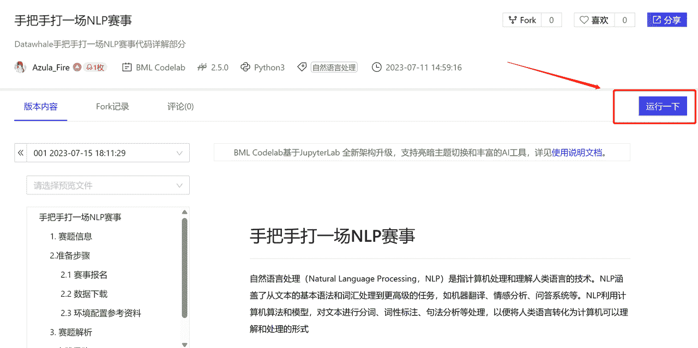

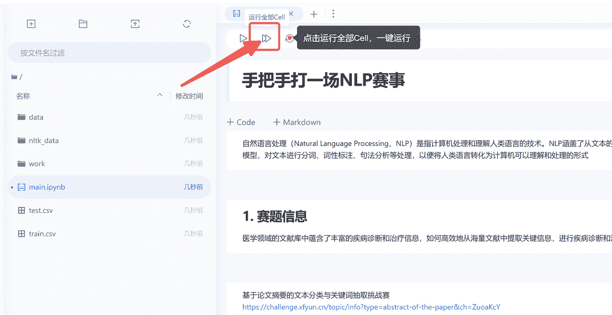

输出`submit.csv`文件后，右键可下载到本地，在[赛事提交结果](https://challenge.xfyun.cn/topic/info?type=abstract-of-the-paper&ch=ZuoaKcY)页面提交。

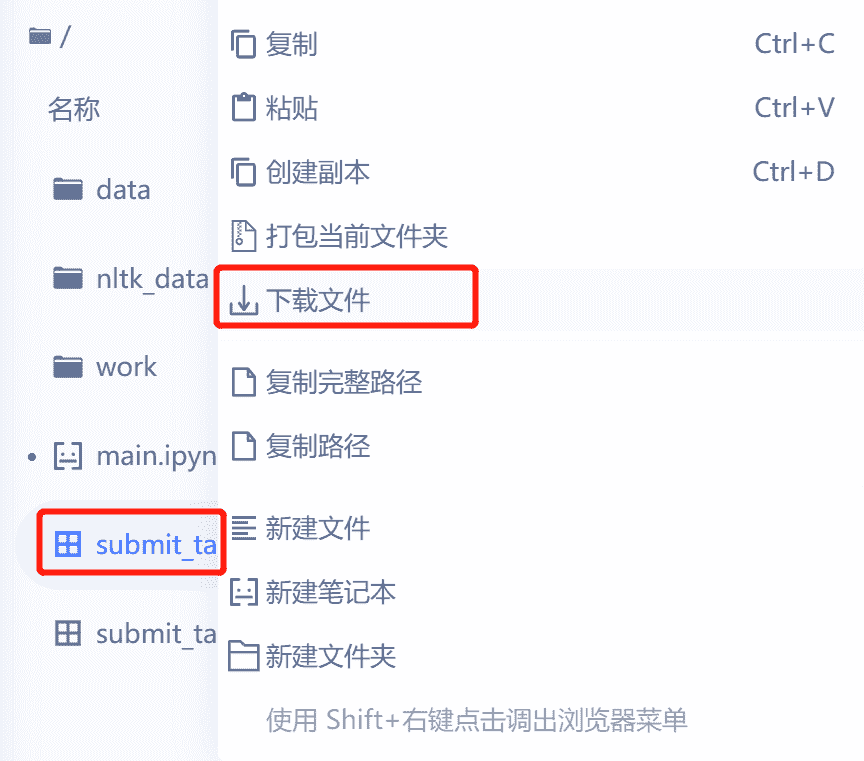

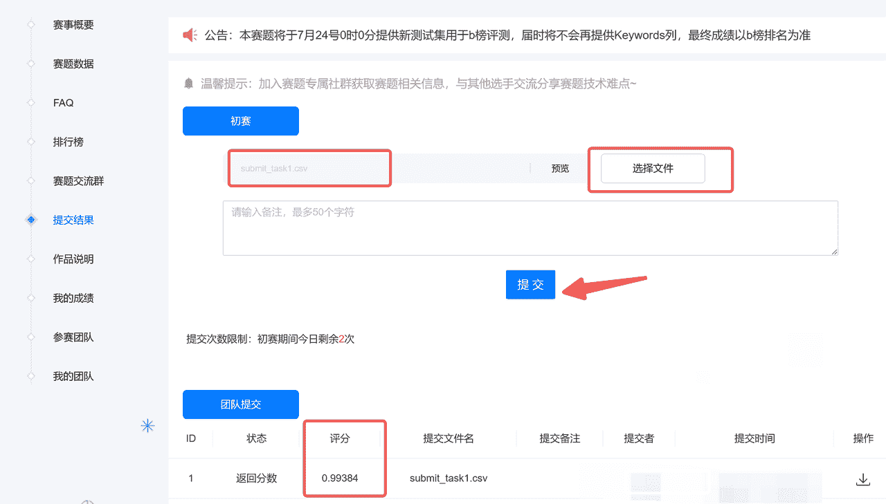

在这个 Baseline 中，我们使用机器学习的`LogisticRegression`模型

### 导入模块

导入我们本次Baseline代码所需的模块

```
#import 相关库
# 导入pandas用于读取表格数据
import pandas as pd

# 导入BOW（词袋模型），可以选择将CountVectorizer替换为TfidfVectorizer（TF-IDF（词频-逆文档频率）），注意上下文要同时修改，亲测后者效果更佳
from sklearn.feature_extraction.text import CountVectorizer

# 导入LogisticRegression回归模型
from sklearn.linear_model import LogisticRegression

# 过滤警告消息
from warnings import simplefilter
from sklearn.exceptions import ConvergenceWarning
simplefilter("ignore", category=ConvergenceWarning)
```

#### Pandas介绍

##### pandas简介

这里借用菜鸟教程中的一段话

`Pandas` 是 Python 语言的一个扩展程序库，用于数据分析。

`Pandas` 是一个开放源码、BSD 许可的库，提供高性能、易于使用的数据结构和数据分析工具。

`Pandas` 名字衍生自术语 "panel data"（面板数据）和 "Python data analysis"（Python 数据分析）。

`[Panda](https://www.runoob.com/numpy/numpy-tutorial.html)s` 一个强大的分析结构化数据的工具集，基础是 `Numpy`（提供高性能的矩阵运算）。

`Pandas` 可以从各种文件格式比如 CSV、JSON、SQL、Microsoft Excel 导入数据。

`Pandas` 可以对各种数据进行运算操作，比如归并、再成形、选择，还有数据清洗和数据加工特征。

`Pandas` 广泛应用在学术、金融、统计学等各个数据分析领域。

在本次学习中我们将使用`pandas`来完成训练集，测试集的读入，同时完成数据的解析，涉及的知识点较少，如果你对这部分内容有更深的兴趣，可以进一步访问同样由Datawhale产出的`pandas`优秀教程`joyrl-pandas`

##### pandas安装

`pandas` 库可以简单地通过 `pip` 命令或 `conda` 命令安装

```
# 使用 pip 安装
pip install pandas
# 使用 conda 安装
conda install pandas
```

#### scikit-learn模块介绍

##### sklearn 简介

`Sklearn` 是一个机器学习、深度学习中非常常用的 Python 第三方库，内部封装了多种机器学习算法与数据处理算法，提供了包括数据清洗、数据预处理、建模调参、数据验证、数据可视化的全流程功能，是入门机器学习的必备工具。

通过使用 `sklearn`，你可以便捷地完成机器学习的整体流程，尝试使用多种模型完成训练与预测任务，而不需要再手动实现各种机器学习算法。本次基础 Baseline 的各个部分都将使用 `sklearn` 封装的算法来完成，我们在此处简单介绍 `sklearn` 的安装、使用与本次用到的相关算法与原理。如想要进一步学习 `sklearn` 库的用法，可以参见该社区：`https://scikit-learn.org.cn/`。

##### sklearn 安装

`Sklearn` 库可以简单地通过 `pip` 命令或 `conda` 命令安装即可，但要注意，安装名称是 `scikit-learn`：

```
# 使用 pip 安装
pip install scikit-learn
# 使用 conda 安装
conda install scikit-learn
```

##### 特征提取

特征提取是机器学习任务中的一个重要步骤。我们将训练数据的每一个维度称为一个特征，例如，如果我们想要基于二手车的品牌、价格、行驶里程数三个变量来预测二手车的价格，则品牌、价格、行驶里程数为该任务的三个特征。所谓特征提取，即从训练数据的特征集合中创建新的特征子集的过程。提取出来的特征子集特征数一般少于等于原特征数，但能够更好地表征训练数据的情况，使用提取出的特征子集能够取得更好的预测效果。对于 NLP、CV 任务，我们通常需要将文本、图像特征提取为计算机可以处理的数值向量特征。我们一般可以使用 `sklearn` 库中的 `feature_extraction` 包来实现文本与图片的特征提取。

在 NLP 任务中，特征提取一般需要将自然语言文本转化为数值向量表示，常见的方法包括基于 `TF-IDF`（词频-逆文档频率）提取或基于 `BOW`（词袋模型）提取等，两种方法均在 `sklearn.feature_extraction` 包中有所实现。

###### 3.1 基于 TF-IDF 提取

`TF-IDF`(term frequency–inverse document frequency)是一种用于信息检索与数据挖掘的常用加权技术，其中，`TF` 指 term frequence，即词频，指某个词在文章中出现次数与文章总词数的比值；`IDF` 指 inverse document frequence，即逆文档频率，指包含某个词的文档数占语料库总文档数的比例。例如，假设语料库为 `{"今天 天气 很好","今天 心情 很 不好", "明天 天气 不好"}`，每一个句子为一个文档，则“今天”的 `TF` 和 `IDF` 分别为：

每个词最终的 `IF-IDF` 即为 `TF` 值乘以 `IDF` 值。计算出每个词的 `TF-IDF` 值后，使用 `TF-IDF` 计算得到的数值向量替代原文本即可实现基于 `TF-IDF` 的文本特征提取。

我们可以使用 `sklearn.feature_extraction.text` 中的 `TfidfVectorizer` 类来简单实现文档基于 `TF-IDF` 的特征提取：

```
# 首先导入该类
from sklearn.feature_extraction.text import TfidfVectorizer

# 假设我们已从本地读取数据为 DataFrame 类型，并已经过基本预处理，data 为已处理的 DataFrame 数据
# 实例化一个 TfidfVectorizer 对象，并使用 fit 方法来拟合数据
vector = TfidfVectorizer().fit(data["text"])

# 拟合之后，调用 transform 方法即可得到提取后的特征数据
train_vector = vector.transform()
```

###### 3.2 基于 BOW

`BOW`（Bag of Words）是一种常用的文本表示方法，其基本思想是假定对于一个文本，忽略其词序和语法、句法，仅仅将其看做是一些词汇的集合，而文本中的每个词汇都是独立的。简单说就是讲每篇文档都看成一个袋子（因为里面装的都是词汇，所以称为词袋，Bag of words即因此而来），然后看这个袋子里装的都是些什么词汇，将其分类。具体而言，词袋模型表示一个文本，首先会维护一个词库，词库里维护了每一个词到一个数值向量的映射关系。例如，最简单的映射关系是独热编码，假设词库里一共有四个词，今天、天气、很、不好，那么独热编码会将四个词分别编码为：

今天——（1,0,0,0）

天气——（0,1,0,0）

很   ——（0,0,1,0）

不好——（0,0,0,1）

而使用词袋模型，就会将上述这句话编码为：

我们一般使用 `sklearn.feature_extraction.text` 中的 `CountVectorizer` 类来简单实现文档基于频数统计的 `BOW` 特征提取，其主要方法与 `TfidfVectorizer` 的主要使用方法一致：

```
# 首先导入该类
from sklearn.feature_extraction.text import CountVectorizer

# 假设我们已从本地读取数据为 DataFrame 类型，并已经过基本预处理，data 为已处理的 DataFrame 数据
# 实例化一个 CountVectorizer 对象，并使用 fit 方法来拟合数据
vector = CountVectorizer().fit(data["text"])

# 拟合之后，调用 transform 方法即可得到提取后的特征数据
train_vector = vector.transform()
```

###### 3.3 停用词

停用词(Stop Words)是自然语言处理领域的一个重要工具，通常被用来提升文本特征的质量，或者降低文本特征的维度。

当我们在使用`TF-IDF`或者`BOW`模型来表示文本时，总会遇到一些问题。

在特定的NLP任务中，一些词语不能提供有价值的信息作用、可以忽略。这种情况在生活里也非常普遍。以本次学习任务为例，我们希望医学类的词语在特征提取时被突出，对于不是医学类词语的数据就应该考虑让他在特征提取时被淡化，同时一些日常生活中使用频率过高而普遍出现的词语，我们也应该选择忽略这些词语，以防对我们的特征提取产生干扰

举个例子，我们依然以讲解`BOW`模型时举的这个例子介绍：

当我们需要对这句话进行情感分类时，我们就需要突出它的情感特征，也就是我们希望‘不好’这个词在经过`BOW`模型编码后的值能够大一点

但是如果我们不使用停用词，那么“今天天气很好还是不好”这句话经过`BOW`模型编码后的值就会与上面这句话的编码高度相似，从而严重影响模型判断的结果。

那么我们如何使用停用词解决这个问题呢，理想一点，我们将除了情感元素的词语全部停用，也就是编码时不考虑，仅保留情感词语，也就是判断句子中好这个词出现的多还是少，很明显好这个词出现的多那情感很显然就是正向的。

对于本次任务而言，日常生活中出现的词语可能都对模型分类很难有太大帮助例如（`or`，`again`，`and`），下面贴出我收集的一些对任务可能没有那么多帮助的词语文件。

> `stop.txt`文件链接：链接: `https://pan.baidu.com/s/1mQ50_gsKZHWERHzfiDnheg?pwd=qzuc` 提取码: `qzuc`

如何使用这个文件呢，利用下面所示方法读取该文件

```
stops =[i.strip() for i in open(r'stop.txt',encoding='utf-8').readlines()] 
```

读取这个文件后在使用`CountVectorizer()`方法时指定`stop_words`参数为`stops`就可以

```
vector = CountVectorizer(stop_words=stops).fit(train['text'])
```

#### 划分数据集


在机器学习任务中，我们一般会有三个数据集：训练集、验证集、预测集。训练集为我们训练模型的拟合数据，是我们前期提供给模型的输入；验证集一般是我们自行划分出来验证模型效果以选取最优超参组合的数据集；测试集是最后检验模型效果的数据集。例如在本期竞赛任务中，比赛方提供的 `test.csv` 就是预测集，我们最终的任务是建立一个模型在预测集上实现较准确的预测。但是预测集一般会限制预测次数，例如在本期比赛中，每人每天仅能提交三次，但是我们知道，机器学习模型一般有很多超参数，为了选取最优的超参组合，我们一般需要多次对模型进行验证，即提供一部分数据让已训练好的模型进行预测，来找到预测准确度最高的模型。

因此，我们一般会将比赛方提供的训练集也就是 `train.csv` 进行划分，划分为训练集和验证集。我们会使用划分出来的训练集进行模型的拟合和训练，而使用划分出来的验证集验证不同参数及不同模型的效果，来找到最优的模型及参数再在比赛方提供的预测集上预测最终结果。

划分数据集的方法有很多，基本原则是同分布采样。即我们划分出来的验证集和训练集应当是同分布的，以免验证不准确（事实上，最终的预测集也应当和训练集、验证集同分布）。此处我们介绍交叉验证，即对于一个样本总量为 `T` 的数据集，我们一般随机采样 10%~20%（也就是 `0.1T`~`0.2T` 的样本数）作为验证集，而取其他的数据为训练集。如要了解更多的划分方法，可查阅该博客：`https://blog.csdn.net/hcxddd/article/details/119698879`。我们可以使用 `sklearn.model_selection` 中的 `train_test_split` 函数便捷实现数据集的划分：

`baseline` 中并没有划分验证集，你也可以自行划分验证集来观察训练中的准确率

```
from sklearn.model_selection import train_test_split

# 该函数将会根据给定比例将数据集划分为训练集与验证集
trian_data, eval_data = train_test_split(data, test_size = 0.2)
# 参数 data 为总数据集，可以是 DataFrame 类型
# 参数 test_size 为划分验证集的占比，此处选择0.2，即划分20%样本作为验证集 
```

## 选择机器学习模型

我们可以选择多种机器学习模型来拟合训练数据，不同的业务场景、不同的训练数据往往最优的模型也不同。常见的模型包括线性模型、逻辑回归、决策树、支持向量机、集成模型、神经网络等。想要深入学习各种机器学习模型的同学，推荐学习《西瓜书》或《统计学习方法》。

`Sklearn` 封装了多种机器学习模型，常见的模型都可以在 `sklearn` 中找到，`sklearn` 根据模型的类别组织在不同的包中，此处介绍几个常用包：

+ `sklearn.linear_model`：线性模型，如线性回归、逻辑回归、岭回归等

+ `sklearn.tree`：树模型，一般为决策树

+ `sklearn.neighbors`：最近邻模型，常见如 K 近邻算法

+ `sklearn.svm`：支持向量机

+ `sklearn.ensemble`：集成模型，如 `AdaBoost`、`GBDT` 等

本案例中，我们使用简单但拟合效果较好的逻辑回归模型作为 Baseline 的模型。此处简要介绍其原理。

逻辑回归模型，即 `Logistic Regression`，实则为一个线性分类器，通过 `Logistic` 函数（或 `Sigmoid` 函数），将数据特征映射到 0～1 区间的一个概率值（样本属于正例的可能性），通过与 `0.5` 的比对得出数据所属的分类。逻辑回归的数学表达式为：

逻辑回归模型简单、可并行化、可解释性强，同时也往往能够取得不错的效果，是较为通用的模型。

我们可以使用 `sklearn.linear_model.LogisticRegression` 来调用已实现的逻辑回归模型：

```
# 引入模型
model = LogisticRegression()
# 可以在初始化时控制超参的取值，此处使用默认值，具体参数可以查阅官方文档

# 开始训练，这里可以考虑修改默认的batch_size与epoch来取得更好的效果
# 此处的 train_vector 是已经经过特征提取的训练数据
model.fit(train_vector, train['label'])

# 利用模型对测试集label标签进行预测，此处的 test_vector 同样是已经经过特征提取的测试数据
test['label'] = model.predict(test_vector)
```

事实上，`sklearn` 提供的多种机器学习模型都封装成了类似的类，绝大部分使用方法均和上述一致，即先实例化一个模型对象，再使用 `fit` 函数拟合训练数据，最后使用 `predict` 函数预测测试数据即可。

## 数据探索

数据探索性分析，是通过了解数据集，了解变量间的相互关系以及变量与预测值之间的关系，对已有数据在尽量少的先验假设下通过作图、制表、方程拟合、计算特征量等手段探索数据的结构和规律的一种数据分析方法，从而帮助我们后期更好地进行特征工程和建立模型，是机器学习中十分重要的一步。

本次 `baseline` 实践中我们使用 `pandas` 来读取数据以及数据探索

### 使用 `pandas` 读取数据

在这部分内容里我们利用 `pd.read_csv()` 方法对赛题数据进行读取，`pd.read_csv()` 参数为需要读取的数据地址，读取后返回一个 `DataFrame` 数据

```
import pandas as pd
train = pd.read_csv('./基于论文摘要的文本分类与关键词抽取挑战赛公开数据/train.csv')
train['title'] = train['title'].fillna('')
train['abstract'] = train['abstract'].fillna('')

test = pd.read_csv('./基于论文摘要的文本分类与关键词抽取挑战赛公开数据/testB.csv')
test['title'] = test['title'].fillna('')
test['abstract'] = test['abstract'].fillna('')
```

通过 `pandas` 提供的一些方法，我们可以在本地快速查看数据的一些特征

通过 `DataFrame.apply(len).describe()` 方法查看数据长度

```
print(train['text'].apply(len).describe())
```

```
count     6000.000000
mean      1620.251500
std        496.956005
min        286.000000
25%       1351.750000
50%       1598.500000
75%       1885.000000
max      10967.000000
Name: text, dtype: float64
```

观察输出发现数据长度平均值在 1620 左右

通过 `DataFrame.value_counts()` 方法查看数据数量

```
print(train["label"].value_counts())
```

```
label
0    3079
1    2921
Name: count, dtype: int64
```

观察输出发现 01 标签分布的比较均匀，也就是说我们不必担心数据分布不均而发生过拟合，保证模型的泛化能力

## 数据清洗

数据和特征决定了机器学习的上限，而模型和算法只是逼近这个上限而已。俗话说：garbage in, garbage out。分析完数据后，特征工程前，必不可少的步骤是对数据清洗。

数据清洗的作用是利用有关技术如数理统计、数据挖掘或预定义的清理规则将脏数据转化为满足数据质量要求的数据。主要包括缺失值处理、异常值处理、数据分桶、特征归一化/标准化等流程。

同时由于表格中存在较多列，我们将这些列的重要内容组合在一起生成一个新的列方便训练

```
# 提取文本特征，生成训练集与测试集
train['text'] = train['title'].fillna('') + ' ' +  train['author'].fillna('') + ' ' + train['abstract'].fillna('') + ' ' + train['Keywords'].fillna('')
test['text'] = test['title'].fillna('') + ' ' +  test['author'].fillna('') + ' ' + test['abstract'].fillna('')
```

在实践学习中有些同学反映对于 `fillna('')` 方法存在疑惑，`pandas` 中 `fillna()` 方法，能够使用指定的方法填充 NA/NaN 值。如果数据集中某行缺少 `title` `author` `abstract` 中的内容，我们需要利用 `fillna()` 来保证不会出现报错。

## 特征工程

特征工程指的是把原始数据转变为模型训练数据的过程，目的是获取更好的训练数据特征。特征工程能使得模型的性能得到提升，有时甚至在简单的模型上也能取得不错的效果。

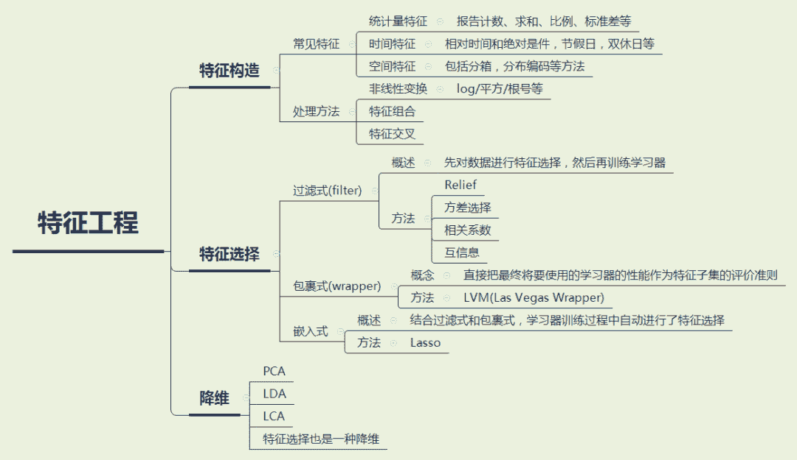

这里我们选择使用 BOW 将文本转换为向量表示

```
# 特征工程
vector = CountVectorizer().fit(train['text'])
train_vector = vector.transform(train['text'])
test_vector = vector.transform(test['text'])
```

## 模型训练与验证

特征工程也好，数据清洗也罢，都是为最终的模型来服务的，模型的建立和调参决定了最终的结果。模型的选择决定结果的上限， 如何更好的去达到模型上限取决于模型的调参。

建模的过程需要我们对常见的线性模型、非线性模型有基础的了解。模型构建完成后，需要掌握一定的模型性能验证的方法和技巧

```
# 模型训练
model = LogisticRegression()

# 开始训练，这里可以考虑修改默认的batch_size与epoch来取得更好的效果
model.fit(train_vector, train['label'])
```

## 结果输出

提交结果需要符合提交样例结果

```
# 利用模型对测试集label标签进行预测
test['label'] = model.predict(test_vector)
test['Keywords'] = test['title'].fillna('')
# 生成任务一推测结果
test[['uuid', 'Keywords', 'label']].to_csv('submit_task1.csv', index=None)
```

**完整代码如下：**

```
# 导入 pandas 用于读取表格数据
import pandas as pd

# 导入 BOW（词袋模型），可以选择将 CountVectorizer 替换为 TfidfVectorizer（TF-IDF（词频-逆文档频率）），注意上下文要同时修改，亲测后者效果更佳
from sklearn.feature_extraction.text import CountVectorizer

# 导入 LogisticRegression 回归模型
from sklearn.linear_model import LogisticRegression

# 过滤警告消息
from warnings import simplefilter
from sklearn.exceptions import ConvergenceWarning
simplefilter("ignore", category=ConvergenceWarning)


# 读取数据集
train = pd.read_csv('./基于论文摘要的文本分类与关键词抽取挑战赛公开数据/train.csv')
train['title'] = train['title'].fillna('')
train['abstract'] = train['abstract'].fillna('')

test = pd.read_csv('./基于论文摘要的文本分类与关键词抽取挑战赛公开数据/testB.csv')
test['title'] = test['title'].fillna('')
test['abstract'] = test['abstract'].fillna('')


# 提取文本特征，生成训练集与测试集
train['text'] = train['title'].fillna('') + ' ' +  train['author'].fillna('') + ' ' + train['abstract'].fillna('') + ' ' + train['Keywords'].fillna('')
test['text'] = test['title'].fillna('') + ' ' +  test['author'].fillna('') + ' ' + test['abstract'].fillna('')

vector = CountVectorizer().fit(train['text'])
train_vector = vector.transform(train['text'])
test_vector = vector.transform(test['text'])


# 引入模型
model = LogisticRegression()

# 开始训练，这里可以考虑修改默认的 batch_size 与 epoch 来取得更好的效果
model.fit(train_vector, train['label'])

# 利用模型对测试集 label 标签进行预测
test['label'] = model.predict(test_vector)
# 因为任务一并不涉及关键词提取，而提交中需要这一行所以我们用 title 列填充 Keywords 列
test['Keywords'] = test['title'].fillna('')
# 生成任务一推测结果
test[['uuid', 'Keywords', 'label']].to_csv('submit_task1.csv', index=None)
```

# 任务二：进阶实践 - 深度方法

进阶方法中训练 `bert` 模型的主要代码都依赖 `pytorch` 构建，如果你对学习中的与 `pytorch` 代码相关的内容存在任何疑惑，你可以查看同样由 Datawhale 成员出品的深入浅出 PyTorch 课程来快速学习 `pytorch` 内容。本文中，对于 `pytorch` 部分仅会简单讲解。

## 解题思路

使用预训练的 `BERT` 模型进行建模的思路步骤如下：

1. **数据预处理**：首先，对文本数据进行预处理，包括文本清洗（如去除特殊字符、标点符号）、分词等操作。可以使用常见的 NLP 工具包（如 `NLTK` 或 `spaCy`）来辅助进行预处理。

1. 构建训练所需的 `dataloader` 与 `dataset`，构建 `Dataset` 类时，需要定义三个方法 `__init__`、`__getitem__`、`__len__`，其中 `__init__` 方法完成类初始化，`__getitem__` 要求返回返回内容和 `label`，`__len__` 方法返回数据长度

1. **构造 `Dataloader`**，在其中完成对句子进行编码、填充、组装 `batch` 等动作：

1. 定义预测模型利用预训练的 `BERT` 模型来解决文本二分类任务，我们将使用 `BERT` 模型编码中的 `[CLS]` 向量来完成二分类任务

`[CLS]` 就是 classification 的意思，可以理解为用于下游的分类任务。

主要用于以下两种任务：


单文本分类任务：对于文本分类任务，BERT模型在文本前插入一个`[CLS]`符号，并将该符号对应的输出向量作为整篇文本的语义表示，用于文本分类，如下图所示。可以理解为：与文本中已有的其它字/词相比，这个无明显语义信息的符号会更“公平”地融合文本中各个字/词的语义信息。

在模型设计中思路就体现为我们取出文本数据经过向量化后的`[CLS]`向量，然后经过二分类预测层得到最终的结果

```
outputs = self.bert(**src).last_hidden_state[:, 0, :]
self.predictor(outputs)
self.predictor = nn.Sequential(
            nn.Linear(768, 256),
            nn.ReLU(),
            nn.Linear(256, 1),
            nn.Sigmoid()
        )
```

1. 模型训练和评估：使用训练集对选定的机器学习模型进行训练，然后使用测试集进行评估。评估指标可以选择准确率、精确率、召回率、F1值等。

1. 调参优化：如果模型效果不理想，可以尝试调整特征提取的参数（如词频阈值、词袋大小等）或机器学习模型的参数，以获得更好的性能。

在这个进阶实践中，我们使用深度学习方法，一般会遵循以下流程：

在进阶Baseline中，我们会使用`Bert`模型，该模型介绍如下：

## BERT 介绍

### 一、BERT 简介

BERT，是一个经典的深度学习、预训练模型。2018年，由 Google 团队发布的论文《BERT: Pre-training of Deep Bidirectional Transformers for Language Understanding》提出了预训练模型 BERT（Bidirectional Encoder Representations from Transformers），在自然语言处理领域掀起了巨大浪潮。该模型实现了包括 GLUE、MultiNLI 等七个自然语言处理评测任务的 the-state-of-art（最优表现），堪称里程碑式的成果。自 BERT 推出以来，预训练+微调的模式开始成为自然语言处理任务的主流，标志着各种自然语言处理任务的重大进展以及预训练模型的统治地位建立，一直到去年 ChatGPT 的发布将研究范式带向大语言模型+提示工程，但时至今天，BERT 仍然是自然语言处理领域最常用、最重要的预训练模型之一。

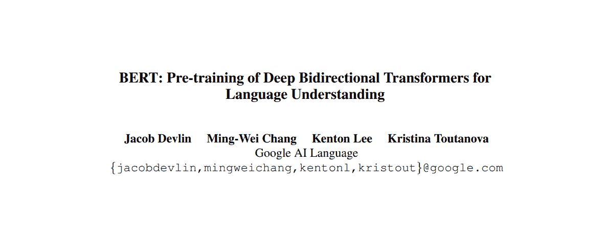

本次进阶 Baseline 拟采用 BERT 作为进阶模型，指导大家如何部署应用 BERT 来完成本期竞赛任务，此处简要介绍 BERT 的原理及其思想。

### 二、预训练 + 微调范式

自然语言处理领域一直在发展变化，能够在各种任务上达到最优效果的模型、算法也层出不穷。最早的范式是文本表示+ 机器学习，如基础 Baseline 所演示的方法，通过将自然语言文本表示为数值向量，再建立统计机器学习模型实习下游任务。但随着深度学习的发展，自2013年，神经网络词向量登上时代舞台，神经网络逐渐成为了 NLP 的核心方法，NLP 的核心研究范式逐渐向深度学习演化。

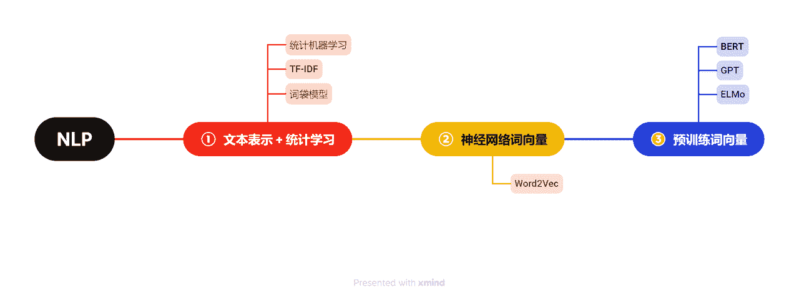

深度学习的研究方法，主要是通过多层的神经网络来端到端处理下游任务，将文本表示、特征工程、建模预测都融合在深度神经网络中，减少了人工特征构建的过程，显著提升了自然语言处理能力。神经网络词向量是其中的核心部分，即文本通过神经网络后的向量表示，这些向量表示能够蕴含深层语义且维度合适，后续研究往往可以直接使用以替代传统的文本表示方法，典型的应用如 Word2Vec 。

但是，Word2Vec 是静态词向量，即对于每一个词有一个固定的向量表示，无法解决一词多义、复杂特征等问题。2018年，ELMo 模型的提出拉开了动态词向量、预训练模型的时代大幕。ELMo 模型基于双向 LSTM 架构，在训练数据上基于语言模型进行预训练，再针对下游任务进行微调，表现出了更加优越的性能，标志着预训练+微调范式的诞生。

所谓预训练+微调范式，指先在海量文本数据上进行预训练，再针对特定的下游任务进行微调。预训练一般基于语言模型，即给定上一个词，预测下一个词。语言模型可以在所有文本数据上建模，无需人工标注，因此很容易在海量数据上进行训练。通过在海量数据上进行预训练，模型可以学习到深层的自然语言逻辑。再通过在指定的下游任务上进行微调，即针对部分人工标注的任务数据进行特定训练，如文本分类、文本生成等，来训练模型执行下游任务的能力。

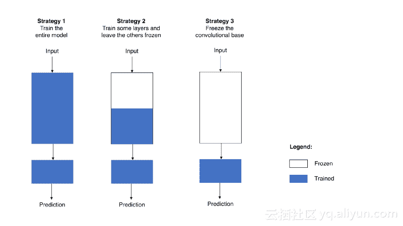

预训练+微调范式一定程度上缓解了标注数据昂贵的问题，显著提升了模型性能，但是，ELMo 使用的双向 LSTM 架构存在难以解决长期依赖、并行效果差的天生缺陷，ELMo 本身也保留了词向量作为特征输入的应用，并没能一锤定音地敲定预训练+微调范式的主流地位。2017年，Transformer 模型的提出，为自然语言处理领域带来了一个新的重要成员——Attention 架构。基于 Attention 架构，同样在2018年，OpenAI 提出的 GPT 模型基于 Transformer 模型，结合 ELMo 模型提出的预训练+微调范式，进一步刷新了众多自然语言处理任务的上限。2023年爆火出圈的 ChatGPT 就是以 GPT 模型作为基础架构的。

从静态编码到神经网络计算的静态词向量，再到基于双向 LSTM 架构的预训练+微调范式，又诞生了基于 Transformer的预训练+微调模式，预训练模型逐步成为自然语言处理的主流。但，真正奠定预训练+微调范式的重要地位的，还是之后提出的 BERT。BERT 可以说是综合了 ELMo 和 GPT，使用预训练+微调范式，基于 Transformer 架构而抛弃了存在天生缺陷的 LSTM，又针对 GPT 仅能够捕捉单向语句关系的缺陷提出了能够捕捉深层双向语义关系的 MLM 预训练任务，从而将预训练模型推向了一个高潮。

### 三、Transformer 与 Attention

BERT 乃至目前正火的 LLM 的成功，都离不开 Attention 机制与基于 Attention 机制搭建的 Transformer 架构。此处简单介绍 Transformer 与 Attention 机制。

在 Attention 机制提出之前，深度学习主要有两种基础架构：卷积神经网络（CNN）与循环神经网络（RNN）。其中，CNN 在 CV 领域表现突出，而 RNN 及其变体 LSTM 在 NLP 方向上一枝独秀。然而，RNN 架构存在两个天然缺陷：① 序列依序计算的模式限制了计算机并行计算的能力，导致 RNN 为基础架构的模型虽然参数量不算特别大，但计算时间成本却很高。 ② RNN 难以捕捉长序列的相关关系。在 RNN 架构中，距离越远的输入之间的关系就越难被捕捉，同时 RNN 需要将整个序列读入内存依次计算，也限制了序列的长度。

针对上述两个问题，2017年 Vaswani 等人发表了论文《Attention Is All You Need》，创造性提出了 Attention 机制并完全抛弃了 RNN 架构。Attention 机制最先源于计算机视觉领域，其核心思想为当我们关注一张图片，我们往往无需看清楚全部内容而仅将注意力集中在重点部分即可。而在自然语言处理领域，我们往往也可以通过将重点注意力集中在一个或几个 `token`，从而取得更高效高质的计算效果。

Attention 机制的特点是通过计算 `Query` (查询值)与`Key`(键值)的相关性为真值加权求和，从而拟合序列中每个词同其他词的相关关系。其大致计算过程如图：

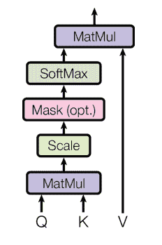

具体而言，可以简单理解为一个输入序列通过不同的参数矩阵映射为 `Q`、`K`、`V` 三个矩阵，其中，`Q` 是计算注意力的另一个句子（或词组），`V` 为待计算句子，`K` 为待计算句子中每个词的对应键。通过对 `Q` 和 `K` 做点积，可以得到待计算句子（`V`）的注意力分布（即哪些部分更重要，哪些部分没有这么重要），基于注意力分布对 `V` 做加权求和即可得到输入序列经过注意力计算后的输出，其中与 `Q` （即计算注意力的另一方）越重要的部分得到的权重就越高。

而 Transformer 正是基于 Attention 机制搭建了 `Encoder-Decoder`（编码器-解码器）结构，主要适用于 `Seq2Seq`（序列到序列）任务，即输入是一个自然语言序列，输出也是一个自然语言序列。其整体架构如下：

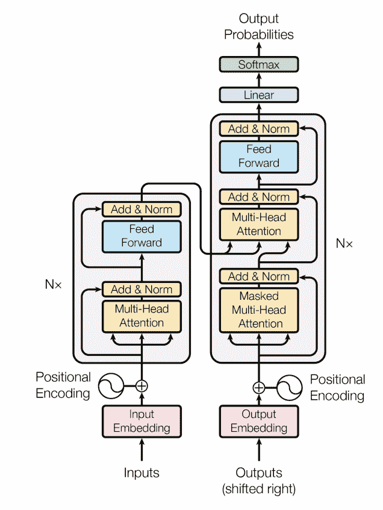

Transformer 由一个 `Encoder`，一个 `Decoder` 外加一个 `Softmax` 分类器与两层编码层构成。上图中左侧方框为 `Encoder`，右侧方框为 `Decoder`。

由于是一个 `Seq2Seq` 任务，在训练时，Transformer 的训练语料为若干个句对，具体子任务可以是机器翻译、阅读理解、机器对话等。在原论文中是训练了一个英语与德语的机器翻译任务。在训练时，句对会被划分为输入语料和输出语料，输入语料将从左侧通过编码层进入 `Encoder`，输出语料将从右侧通过编码层进入 `Decoder`。`Encoder` 的主要任务是对输入语料进行编码再输出给 `Decoder`，`Decoder` 再根据输出语料的历史信息与 `Encoder` 的输出进行计算，输出结果再经过一个线性层和 `Softmax` 分类器即可输出预测的结果概率，整体逻辑如下图：

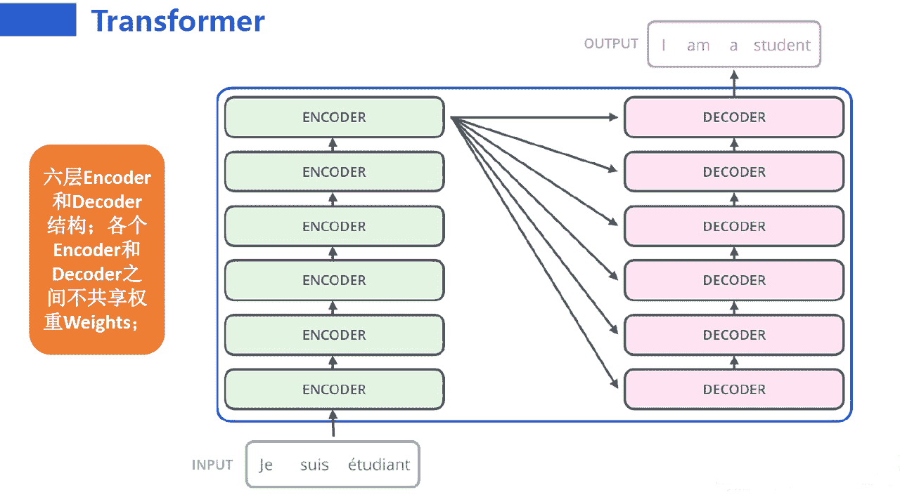

Transformer 整体是一个很值得探究的话题，此处不再赘述，如有感兴趣的同学欢迎阅读原论文《Attention Is All You Need》(https://arxiv.org/pdf/1706.03762.pdf) 与基于 Pytorch 的 Transformer 源码解读：

### 四、预训练任务

BERT 的模型架构直接使用了 Transformer 的 `Encoder` 作为整体架构，其最核心的思想在于提出了两个新的预训练任务——MLM（Masked Language Model，掩码模型）和 NSP（Next Sentence Prediction，下个句子预测），而不是沿用传统的 LM（语言模型）。

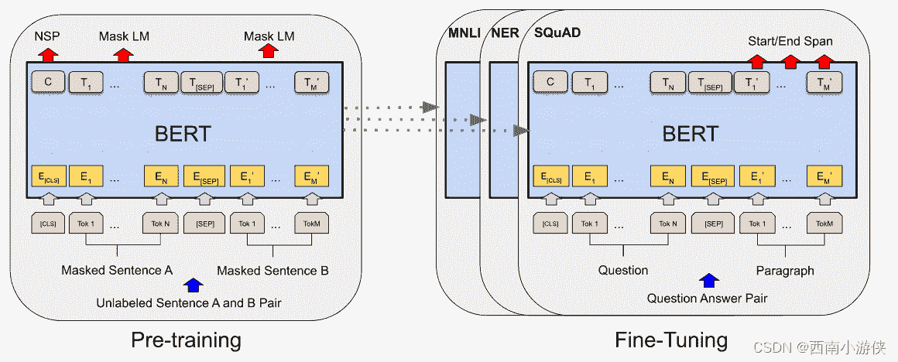

MLM 任务，是 BERT 能够深层拟合双向语义特征的基础。简单来讲，MLM 任务即以一定比例对输入语料的部分 `token` 进行遮蔽，替换为 ``(MASK)`` 标签，再让模型基于其上下文预测还原被遮蔽的单词，即做一个完形填空任务。由于在该任务中，模型需要针对 `(MASK)` 标签左右的上下文信息来预测标签本身，从而会充分拟合双向语义信息。

例如，原始输入为 I like you。以30%的比例进行遮蔽，那么遮蔽之后的输入可能为：I `(MASK)` you。而模型的任务即为基于该输入，预测出 `(MASK)` 标签对应的单词为 like。

NSP 任务，是 BERT 用于解决句级自然语言处理任务的预训练任务。BERT 完全采用了预训练+微调的范式，因此着重通过预训练生成的模型可以解决各种多样化的下游任务。MLM 对 `token` 级自然语言处理任务（如命名实体识别、关系抽取等）效果极佳，但对于句级自然语言处理任务（如句对分类、阅读理解等），由于预训练与下游任务的模式差距较大，因此无法取得非常好的效果。NSP 任务，是将输入语料都整合成句对类型，句对中有一半是连贯的上下句，标记为 `IsNext`，一半则是随机抽取的句对，标记为 `NotNext`。模型则需要根据输入的句对预测是否是连贯上下句，即预测句对的标签。

例如，原始输入句对可能是 (I like you ; Because you are so good) 以及 (I like you; Today is a nice day)。而模型的任务即为对前一个句对预测 `IsNext` 标签，对后一个句对预测 `NotNext` 标签。

基于上述两个预训练任务，BERT 可以在预训练阶段利用大量无标注文本数据实现深层语义拟合，从而取得良好的预测效果。同时，BERT 追求预训练与微调的深层同步，由于 Transformer 的架构可以很好地支持各类型的自然语言处理任务，从而在 BERT 中，微调仅需要在预训练模型的最顶层增加一个 `SoftMax` 分类层即可。同样值得一提的是，由于在实际下游任务中并不存在 MLM 任务的遮蔽，因此在策略上进行了一点调整，即对于选定的遮蔽词，仅 80% 的遮蔽被直接遮蔽，其余将有 10% 被随机替换，10% 被还原为原单词。

## 导入模块

导入我们本次Baseline代码所需的模块

```
#import 相关库
#导入前置依赖
import os
import pandas as pd
import torch
from torch import nn
from torch.utils.data import Dataset, DataLoader
# 用于加载bert模型的分词器
from transformers import AutoTokenizer
# 用于加载bert模型
from transformers import BertModel
from pathlib import Path
```

## 设置全局配置

```
batch_size = 16
# 文本的最大长度
text_max_length = 128
# 总训练的epochs数，我只是随便定义了个数
epochs = 100
# 学习率
lr = 3e-5
# 取多少训练集的数据作为验证集
validation_ratio = 0.1
device = torch.device('cuda' if torch.cuda.is_available() else 'cpu')

# 每多少步，打印一次loss
log_per_step = 50

# 数据集所在位置
dataset_dir = Path("./基于论文摘要的文本分类与关键词抽取挑战赛公开数据")
os.makedirs(dataset_dir) if not os.path.exists(dataset_dir) else ''

# 模型存储路径
model_dir = Path("./model/bert_checkpoints")
# 如果模型目录不存在，则创建一个
os.makedirs(model_dir) if not os.path.exists(model_dir) else ''

print("Device:", device)
```

## 数据收集与准备

在赛题主页下载数据，读取数据集，数据预处理（考虑数据扩增）

```
# 读取数据集，进行数据处理

pd_train_data = pd.read_csv('./基于论文摘要的文本分类与关键词抽取挑战赛公开数据/train.csv')
pd_train_data['title'] = pd_train_data['title'].fillna('')
pd_train_data['abstract'] = pd_train_data['abstract'].fillna('')

test_data = pd.read_csv('./基于论文摘要的文本分类与关键词抽取挑战赛公开数据/testB.csv')
test_data['title'] = test_data['title'].fillna('')
test_data['abstract'] = test_data['abstract'].fillna('')
pd_train_data['text'] = pd_train_data['title'].fillna('') + ' ' +  pd_train_data['author'].fillna('') + ' ' + pd_train_data['abstract'].fillna('')+ ' ' + pd_train_data['Keywords'].fillna('')
test_data['text'] = test_data['title'].fillna('') + ' ' +  test_data['author'].fillna('') + ' ' + test_data['abstract'].fillna('')
```

```
# 从训练集中随机采样测试集
validation_data = pd_train_data.sample(frac=validation_ratio)
train_data = pd_train_data[~pd_train_data.index.isin(validation_data.index)]
```

## 构建训练所需的 DataLoader 与 Dataset

### 定义 `dataset`


# PyTorch 自定义数据集与模型训练

Pytorch 中自定义dataset需要继承`torch.utils.data.Dataset`，继承`Dataset`这个类时，它要求你必须重写`__getitem__(self, index)`、`__len__(self)` 两个方法，前者通过提供索引返回数据，也就是提供 `DataLoader`获取数据的方式；后者返回数据集的长度，`DataLoader`依据 `len` 确定自身索引采样器的长度。

而本次教程中，我们在初始化类方法`__init__`中引入我们的训练数据，重写`__getitem__(self, index)`方法，保证能够取出`index`对应行的`text` 与`label` 值，也就是我们训练需要的数据以及训练希望得到的结果，在`__len__` 方法中，我们需要返回数据集的总长度，这里直接利用`Dataframe`数据的`len()`方法就能完成。

```
# 构建Dataset
class MyDataset(Dataset):

    def __init__(self, mode='train'):
        super(MyDataset, self).__init__()
        self.mode = mode
        # 拿到对应的数据
        if mode == 'train':
            self.dataset = train_data
        elif mode == 'validation':
            self.dataset = validation_data
        elif mode == 'test':
            # 如果是测试模式，则返回内容和uuid。拿uuid做target主要是方便后面写入结果。
            self.dataset = test_data
        else:
            raise Exception("Unknown mode {}".format(mode))

    def __getitem__(self, index):
        # 取第index条
        data = self.dataset.iloc[index]
        # 取其内容
        text = data['text']
        # 根据状态返回内容
        if self.mode == 'test':
            # 如果是test，将uuid做为target
            label = data['uuid']
        else:
            label = data['label']
        # 返回内容和label
        return text, label

    def __len__(self):
        return len(self.dataset)
```

`train_dataset = MyDataset('train')`
`validation_dataset = MyDataset('validation')`

`train_dataset.__getitem__(0)`

### 构造 Dataloader

在`DataLoader`中，我们需要利用`Dataloader`来加载训练数据与训练目标，需要注意的是，加载完成后的数据需要为`tensor`（张量）形式，因此在下文中我们定义了`collate_fn`来帮助完成batch组装以及将文本内容向量化，而文本内容向量化这部分内容，我们利用`bert`模型来完成，而`label`值的向量化我们直接使用`torch.LongTensor()`方法完成

```
#获取Bert预训练模型
tokenizer = AutoTokenizer.from_pretrained("bert-base-uncased")
```

```
#接着构造我们的Dataloader。
#我们需要定义一下collate_fn，在其中完成对句子进行编码、填充、组装batch等动作：
def collate_fn(batch):
    """
    将一个batch的文本句子转成tensor，并组成batch。
    :param batch: 一个batch的句子，例如: [('推文', target), ('推文', target), ...]
    :return: 处理后的结果，例如：
             src: {'input_ids': tensor([[ 101, ..., 102, 0, 0, ...], ...]), 'attention_mask': tensor([[1, ..., 1, 0, ...], ...])}
             target：[1, 1, 0, ...]
    """
    text, label = zip(*batch)
    text, label = list(text), list(label)

    # src是要送给bert的，所以不需要特殊处理，直接用tokenizer的结果即可
    # padding='max_length' 不够长度的进行填充
    # truncation=True 长度过长的进行裁剪
    src = tokenizer(text, padding='max_length', max_length=text_max_length, return_tensors='pt', truncation=True)

    return src, torch.LongTensor(label)
```

`train_loader = DataLoader(train_dataset, batch_size=batch_size, shuffle=True, collate_fn=collate_fn)`
`validation_loader = DataLoader(validation_dataset, batch_size=batch_size, shuffle=False, collate_fn=collate_fn)`

```
inputs, targets = next(iter(train_loader))
print("inputs:", inputs)
print("targets:", targets)
```

## 定义模型

pytorch中定义模型需要继承`nn.Module`类，其中需要至少定义两个方法，一个是初始化模型结构的方法`__init__`，另一个方法`forward`来完成推理流程。

```
#定义预测模型，该模型由bert模型加上最后的预测层组成
class MyModel(nn.Module):

    def __init__(self):
        super(MyModel, self).__init__()

        # 加载bert模型
        self.bert = BertModel.from_pretrained('bert-base-uncased', mirror='tuna')

        # 最后的预测层
        self.predictor = nn.Sequential(
            nn.Linear(768, 256),
            nn.ReLU(),
            nn.Linear(256, 1),
            nn.Sigmoid()
        )

    def forward(self, src):
        """
        :param src: 分词后的推文数据
        """

        # 将src直接序列解包传入bert，因为bert和tokenizer是一套的，所以可以这么做。
        # 得到encoder的输出，用最前面[CLS]的输出作为最终线性层的输入
        outputs = self.bert(**src).last_hidden_state[:, 0, :]

        # 使用线性层来做最终的预测
        return self.predictor(outputs)
```

`model = MyModel()`
`model = model.to(device)`

### 定义损失函数和优化器

```
#定义出损失函数和优化器。这里使用Binary Cross Entropy：
criteria = nn.BCELoss()
optimizer = torch.optim.Adam(model.parameters(), lr=lr)
```

```
# 由于inputs是字典类型的，定义一个辅助函数帮助to(device)
def to_device(dict_tensors):
    result_tensors = {}
    for key, value in dict_tensors.items():
        result_tensors[key] = value.to(device)
    return result_tensors
```

### 定义验证方法

```
#定义一个验证方法，获取到验证集的精准率和loss
def validate():
    model.eval()
    total_loss = 0.
    total_correct = 0
    for inputs, targets in validation_loader:
        inputs, targets = to_device(inputs), targets.to(device)
        outputs = model(inputs)
        loss = criteria(outputs.view(-1), targets.float())
        total_loss += float(loss)

        correct_num = (((outputs >= 0.5).float() * 1).flatten() == targets).sum()
        total_correct += correct_num

    return total_correct / len(validation_dataset), total_loss / len(validation_dataset)
```

## 模型训练、评估

模型训练、评估

```
# 首先将模型调成训练模式
model.train()

# 清空一下cuda缓存
if torch.cuda.is_available():
    torch.cuda.empty_cache()

# 定义几个变量，帮助打印loss
total_loss = 0.
# 记录步数
step = 0

# 记录在验证集上最好的准确率
best_accuracy = 0

# 开始训练
for epoch in range(epochs):
    model.train()
    for i, (inputs, targets) in enumerate(train_loader):
        # 从batch中拿到训练数据
        inputs, targets = to_device(inputs), targets.to(device)
        # 传入模型进行前向传递
        outputs = model(inputs)
        # 计算损失
        loss = criteria(outputs.view(-1), targets.float())
        loss.backward()
        optimizer.step()
        optimizer.zero_grad()

        total_loss += float(loss)
        step += 1

        if step % log_per_step == 0:
            print("Epoch {}/{}, Step: {}/{}, total loss:{:.4f}".format(epoch+1, epochs, i, len(train_loader), total_loss))
            total_loss = 0

        del inputs, targets

    # 一个epoch后，使用过验证集进行验证
    accuracy, validation_loss = validate()
    print("Epoch {}, accuracy: {:.4f}, validation loss: {:.4f}".format(epoch+1, accuracy, validation_loss))
    torch.save(model, model_dir / f"model_{epoch}.pt")

    # 保存最好的模型
    if accuracy > best_accuracy:
        torch.save(model, model_dir / f"model_best.pt")
        best_accuracy = accuracy
```

```
#加载最好的模型，然后进行测试集的预测
model = torch.load(model_dir / f"model_best.pt")
model = model.eval()
```

```
test_dataset = MyDataset('test')
test_loader = DataLoader(test_dataset, batch_size=batch_size, shuffle=False, collate_fn=collate_fn)
```

## 结果输出

提交需要符合提交样例结果

```
results = []
for inputs, ids in test_loader:
    outputs = model(inputs.to(device))
    outputs = (outputs >= 0.5).int().flatten().tolist()
    ids = ids.tolist()
    results = results + [(id, result) for result, id in zip(outputs, ids)]
```

```
test_label = [pair[1] for pair in results]
test_data['label'] = test_label
test_data['Keywords'] = test_data['title'].fillna('')
test_data[['uuid', 'Keywords', 'label']].to_csv('submit_task1.csv', index=None)
```

# 任务三：进阶实践 - 大模型方法

> 大模型方法为Topline，预计8-23解锁，不计入最终成绩

# 附录 - 实践环境配置

## 实践环境配置

### AI环境配置：

+   **视频讲解：**AI夏令营：手把手带你配置AI环境_哔哩哔哩_bilibili

+   **图文材料：**https://gitee.com/anine09/learn-python-the-smart-way-v2/blob/main/slides/chapter_0-Installation.ipynb

## 工具使用与提分思路

+   竞赛实践路线：[竞赛实践路线分享](https://datawhaler.feishu.cn/docx/EJ2Edl0hXoIWwuxO15CcEj9Wnxn)

## Baseline提分技巧

+   更换其他模型

考虑更换其他分类模型，如`RidgeClassifier`等

+   添加停用词

这部分在上文中已经有提及

+   进一步进行数据预处理

文中的`author`列信息对文本二分类任务贡献有限，可以考虑清洗这部分数据来提高表现

## Bert提分技巧

+   修改训练超参数来获得更好的训练表现

+   考虑修改预测层结构，换成更复杂的网络

## 大模型提分技巧

+   大模型全流程跑完，任务一的分数应该在1.000左右。可以尝试修改`prompt`，看看效果。
