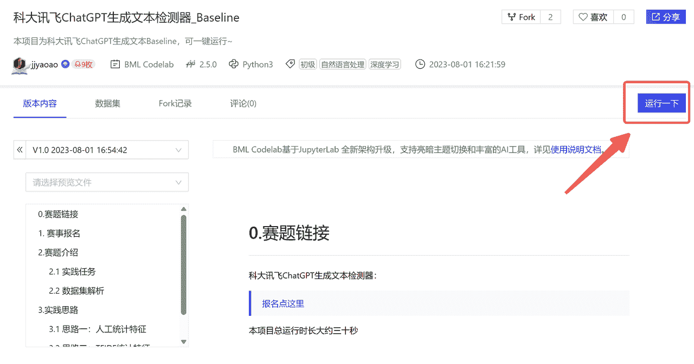
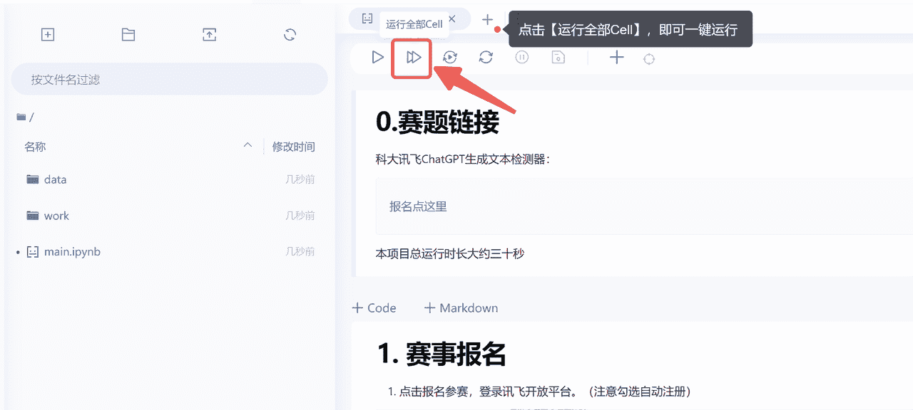
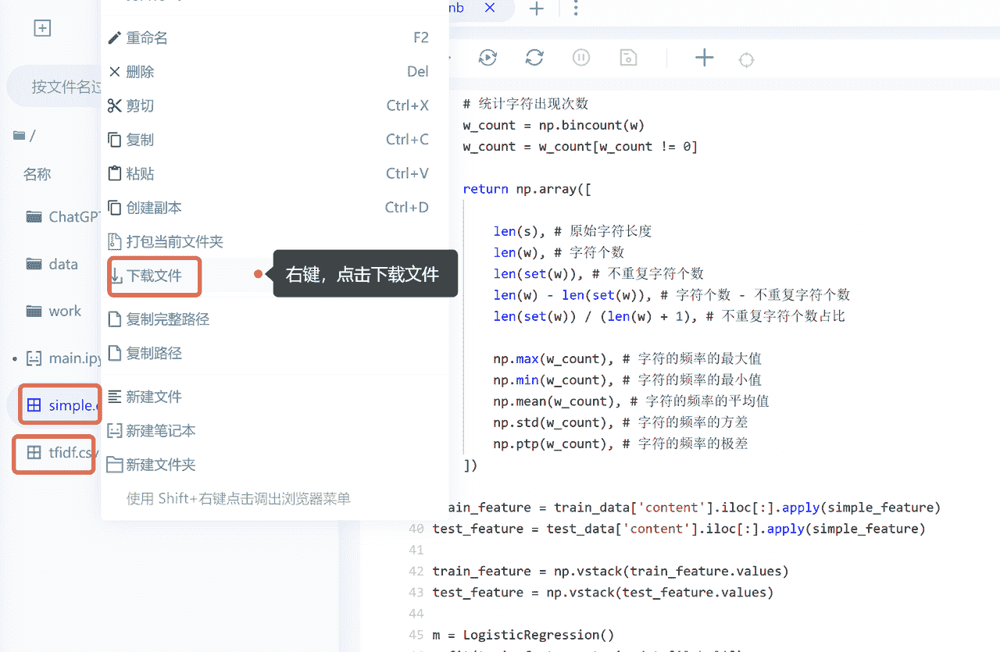
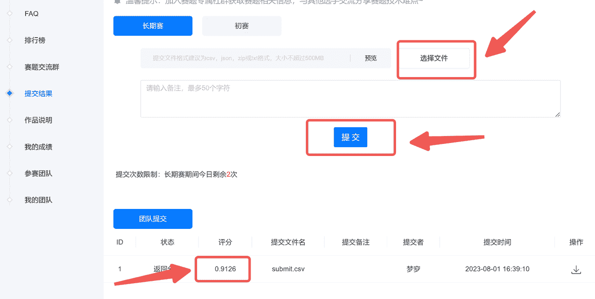
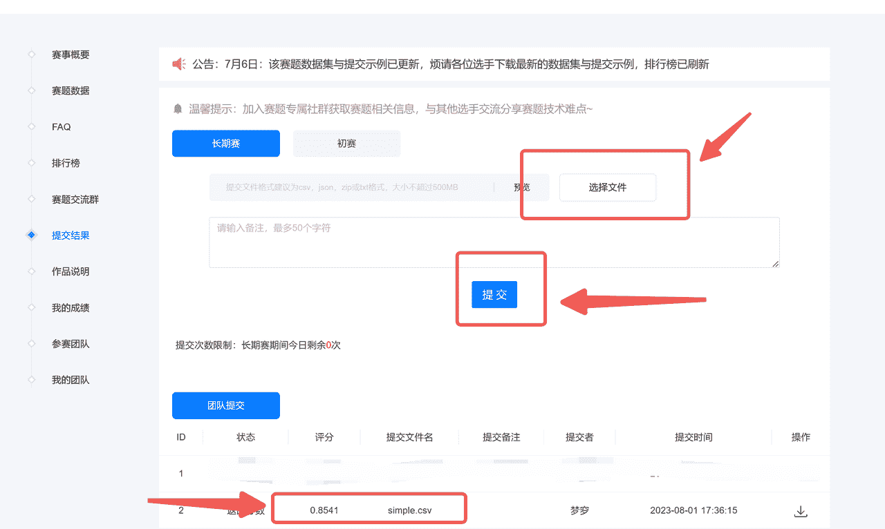

# AI夏令营（第二期） - NLP赛事实践教程

> 来源：[https://datawhaler.feishu.cn/docx/NehLd4seGoI8AkxKaAxcG3kRnzd](https://datawhaler.feishu.cn/docx/NehLd4seGoI8AkxKaAxcG3kRnzd)

> 本教程会带领大家项目制学习，由浅入深，逐渐进阶。从竞赛通用流程与跑通最简的Baseline，到深入各个竞赛环节，精读Baseline与进阶实践技巧的学习。

> 千里之行，始于足下，从这里，开启你的 AI 学习之旅吧！

> —— Datawhale贡献者团队

| 学习任务 | 相关直播 |
| --- | --- |
| **任务一：** | **开营直播&amp;竞赛流程科普分享** |
| **任务二：** | **直播：竞赛进阶上分思路与技巧** |

# 在线版本Baseline

> Baseline是一份简易的入门教程，可以帮助同学们迈出 AI 训练大师之路的第一步。建议入门的同学可以暂时不用着急去弄懂各个代码的原理，先跑通代码，动手实践，看到成绩。

快速跑通全流程，我们基于百度AI Studio，将本教程Baseline部署在线上平台，可一键fork运行代码，看到成绩。

一键运行：https://aistudio.baidu.com/aistudio/projectdetail/6598009?sUid=2554132&shared=1&ts=1690880878013

+   运行时，选择**基础2核8G - CPU版本**的配置

+   总运行时间大约需要**30s**，请耐心等待。





输出**simple.csv**与**tfidf.csv **文件后，右键可下载到本地，在[赛题提交结果](https://challenge.xfyun.cn/topic/info?type=text-detector&option=tjjg&ch=ymfk4uU)提交文件，获取分数。





# 赛题解析与解题思路

> **ChatGPT生成文本检测器：**

> https://challenge.xfyun.cn/topic/info?type=text-detector&ch=ymfk4uU

> 举办方：科大讯飞 x Datawhale

## **赛题背景**

近年来人工智能在自然语言处理领域取得了巨大的进展。其中一项引人注目的技术是生成模型，如OpenAI的GPT-3.5。这类模型通过学习大量的文本数据，具备了生成高质量文本的能力，从而引发了一系列关于文本生成真实性的讨论。


正因为生成模型的迅猛发展，也引发了一个新的挑战，即如何区分人类编写的文本与机器生成的文本。传统上，我们借助语法错误、逻辑不连贯等特征来辨别机器生成的文本，但随着生成模型的不断改进，这些特征变得越来越难以区分。因此，为了解决这一问题，研究人员开始探索使用NLP文本分类技术来区分人类编写的文本和机器生成的文本。

## **赛事任务**

本赛题旨在构建一个文本分类模型，以区分真实对话和由ChatGPT生成的对话文本。在给定的数据集中，包含了一系列真实对话和ChatGPT生成的对话样本，参赛选手需要设计并训练一个模型，使其能够准确地将这两种类型的对话进行分类。

## **赛题数据集**

数据集为中文作文样本，其中从互联网上采集得到了真实作文，并且ChatGLM-6B生成了部分作文。参赛选手的任务是根据文本内容，区分作文的来源。

## **评价指标**

本次竞赛的评价标准采用准确率指标，最高分为1。

## 解题思路

本题的任务是需要对输入的匿名文本进行类别来源的判断，是典型的文本分类问题。

+   输入：文本序列

+   输出：文本类别

文本分类是自然语言处理（NLP）中的一个重要任务，其作用是将输入的文本按照预先定义的类别或标签进行分类。在文本分类中，我们通过使用计算机算法和机器学习技术，使计算机能够自动地将大量的文本数据归类到不同的类别中，从而帮助我们更好地理解和组织文本数据，以及从中获得有用的信息。

处理文本分类问题的思路和步骤通常可以概括为以下几个主要步骤：

1.  **数据收集与预处理：** 在数据竞赛中，赛题设计方已经准备好数据，大家只需下载即可。

1.  在预处理阶段，对文本数据进行清洗、分词、去除停用词和特殊字符等操作，以便为后续的特征提取和模型训练做准备。

1.  **特征提取：** 特征提取是将文本数据转换为计算机可处理的数值表示的过程。

1.  常用的特征提取方法包括词袋模型（Bag of Words）、TF-IDF（词频-逆文档频率）、Word2Vec、BERT（Bidirectional Encoder Representations from Transformers）等。

1.  这些方法能够将文本数据转换为向量形式，保留了文本的语义和语法信息。

1.  **模型训练：** 在特征提取之后，我们需要选择一个适合的分类模型来训练。

1.  常见的分类模型包括逻辑回归（Logistic Regression）、支持向量机（SVM）、决策树（Decision Tree）、和深度学习模型如循环神经网络（RNN）等。

1.  将预处理后的特征数据输入选择的分类模型，并对模型进行训练。在训练过程中，模型根据已标注的数据样本进行学习和优化，调整模型的参数以最小化分类错误。

1.  **模型评估与优化：** 使用测试集来评估训练好的模型的性能。

1.  常见的评估指标包括准确率、精确率、召回率、F1 分数等。本次竞赛评估指标为准确率。

1.  根据评估结果，可以对模型进行调优优化，以提高模型的性能。调优方法包括调整模型参数、优化特征提取过程、尝试不同的分类模型等。

1.  **结果输出：**按照赛题要求输出结果。

1.  本赛题预测结果文件按照csv格式提交，编码为UTF-8，第一行为表头

1.  提交前请确保预测结果的格式与sample_submit.csv中的格式一致

# Baseline实践

## **文本统计特征**

刚刚我们完成了基本的问题分析，在这个 Baseline 中，我们使用文本统计特征方法来解决本次问题，会带领大家跑通数据收集与预处理、特征提取、模型训练、模型评估与优化、结果输出的全部竞赛实践流程。

在文本分类和自然语言处理中，常见的文本统计特征是指通过对文本数据的统计信息进行提取，将文本转换为数值表示的特征。这些统计特征通常用于构建文本分类模型或其他文本相关任务的输入。以下是一些常见的文本统计特征：

1. **文本长度：** 文本长度是指文本包含的词或字符的数量。文本长度可以在一定程度上反映文本的复杂度和信息量。

2. **句子数量：** 句子数量表示文本中包含的句子数目。句子数量可能与文本的复杂性和组织结构有关。

3. **特殊字符数量：** 特殊字符数量表示文本中包含的特殊字符（如标点符号、数字等）的个数。特殊字符的数量可能与文本的风格和语言表达有关。

4. **词汇丰富性：** 词汇丰富性是指文本中不同词汇的种类数。丰富多样的词汇可能表示文本更加丰富和多样化。

5. **句子平均长度：** 句子平均长度是指文本中句子的平均词数。较长的句子可能包含更多信息。

6. **词汇覆盖率：** 词汇覆盖率表示文本中不同词汇与整个文本数据集中的不同词汇之间的比例。词汇覆盖率高表示文本包含的词汇较为丰富。

7. **情感词频：** 在情感分析任务中，可以统计文本中情感词汇（如积极、消极的词汇）出现的频率，用于判断文本的情感倾向。

**方法优缺点（运行时间2分钟）：**

+   思路简单，可以人工添加特征

+   精度较差，无法捕获高阶统计特征

> 以下为具体的代码，分数大概0.85

## **导入模块**

[导入我们本次Basel](https://aistudio.baidu.com/aistudio/projectdetail/6598009?sUid=2554132&shared=1&ts=1690880878013)[ine代码所需的模块（](https://datawhaler.feishu.cn/docx/NehLd4seGoI8AkxKaAxcG3kRnzd#doxcnRrb7pSBEXwlfINTLsiWUsh)直接用云环境Baseline30s内可全部跑通，如希望尝试本地，参考附录 - 实践环境配置）

```
import glob
import numpy as np
import pandas as pd
from sklearn.linear_model import LogisticRegression
```

## **数据收集与准备**

在赛题主页下载数据，读取数据集。

```
train_data = pd.read_csv(&#x27;./ChatGPT生成文本检测器公开数据-更新/train.csv&#x27;)
test_data = pd.read_csv(&#x27;./ChatGPT生成文本检测器公开数据-更新/test.csv&#x27;)

train_data[&#x27;content&#x27;] = train_data[&#x27;content&#x27;].apply(lambda x: x[1:-1])
test_data[&#x27;content&#x27;] = test_data[&#x27;content&#x27;].apply(lambda x: x[1:-1])
```

## **特征提取**

构建如下常见的文本统计特征

```
def simple_feature(s):
    if len(s) == 0:
        s = &#x27;123 123&#x27;
    
    w = s.split()
    
    # 统计字符出现次数
    w_count = np.bincount(w)
    w_count = w_count[w_count != 0]
    
    return np.array([
        
        len(s), # 原始字符长度
        len(w), # 字符个数
        len(set(w)), # 不重复字符个数
        len(w) - len(set(w)), # 字符个数 - 不重复字符个数
        len(set(w)) / (len(w) + 1), # 不重复字符个数占比
        
        np.max(w_count), # 字符的频率的最大值
        np.min(w_count), # 字符的频率的最小值
        np.mean(w_count), # 字符的频率的平均值
        np.std(w_count), # 字符的频率的方差
        np.ptp(w_count), # 字符的频率的极差
    ])
    
    
train_feature = train_data[&#x27;content&#x27;].iloc[:].apply(simple_feature)
test_feature = test_data[&#x27;content&#x27;].iloc[:].apply(simple_feature)

train_feature = np.vstack(train_feature.values)
test_feature = np.vstack(test_feature.values)
```

## **模型训练、评估与优化**

采取逻辑回归算法，训练模型

```
#模型训练
m = LogisticRegression()
m.fit(train_feature, train_data[&#x27;label&#x27;])
```

## **结果输出**

生成测试集提交结果，输出submit.csv。

```
# 生成测试集提交结果
test_data[&#x27;label&#x27;] = m.predict(test_feature)
test_data[[&#x27;name&#x27;, &#x27;label&#x27;]].to_csv(&#x27;simple.csv&#x27;, index=None)
```

+   在提交结果处提交，提交** simple.csv **文件，在排名结果页查看自己的成绩排名。



# **进阶实践**

## TFIDF

在baseline阶段，我们使用的文本统计特征的传统方法完成了解决文本分类的全部流程，得到了基础的分数。

在进阶实践部分，将采用TDIDF算法来解决文本分类问题。

TF-IDF（Term Frequency-Inverse Document Frequency）是一种常用的文本特征表示方法，用于衡量一个词在文本中的重要性。TF-IDF结合了词频（TF）和逆文档频率（IDF），用于对每个词赋予一个权重，从而将文本数据转换为数值形式，便于在机器学习算法中使用。

> 以下为具体的代码，分数大概0.91

## **导入模块**

[导入我们本次Basel](https://aistudio.baidu.com/aistudio/projectdetail/6598009?sUid=2554132&shared=1&ts=1690880878013)[ine代码所需的模块（](https://datawhaler.feishu.cn/docx/NehLd4seGoI8AkxKaAxcG3kRnzd#doxcnRrb7pSBEXwlfINTLsiWUsh)直接用云环境Baseline30s内可全部跑通，如希望尝试本地，参考附录 - 实践环境配置）

```
import glob
import numpy as np
import pandas as pd
from sklearn.linear_model import LogisticRegression
from sklearn.feature_extraction.text import TfidfVectorizer
from sklearn.model_selection import cross_val_predict
from sklearn.metrics import classification_report
```

## **数据收集与准备**

在赛题主页下载数据，读取数据集

```
train_data = pd.read_csv(&#x27;./ChatGPT生成文本检测器公开数据-更新/train.csv&#x27;)
test_data = pd.read_csv(&#x27;./ChatGPT生成文本检测器公开数据-更新/test.csv&#x27;)

train_data[&#x27;content&#x27;] = train_data[&#x27;content&#x27;].apply(lambda x: x[1:-1])
test_data[&#x27;content&#x27;] = test_data[&#x27;content&#x27;].apply(lambda x: x[1:-1])
```

## **特征提取**

定义三种不同的TFIDF参数，进行特征提取

```
# 第1种tfidf参数
tfidf = TfidfVectorizer(token_pattern=r&#x27;\w{1}&#x27;, max_features=2000)
train_tfidf = tfidf.fit_transform(train_data[&#x27;content&#x27;])
test_tfidf = tfidf.fit_transform(test_data[&#x27;content&#x27;])
print(classification_report(
    cross_val_predict(
        LogisticRegression(),
        train_tfidf,
        train_data[&#x27;label&#x27;]
    ),
    train_data[&#x27;label&#x27;],
    digits=4
))

# 第2种tfidf参数
tfidf = TfidfVectorizer(token_pattern=r&#x27;\w{1}&#x27;, max_features=5000)
train_tfidf = tfidf.fit_transform(train_data[&#x27;content&#x27;])
test_tfidf = tfidf.fit_transform(test_data[&#x27;content&#x27;])
print(classification_report(
    cross_val_predict(
        LogisticRegression(),
        train_tfidf,
        train_data[&#x27;label&#x27;]
    ),
    train_data[&#x27;label&#x27;],
    digits=4
))

# 第3种tfidf参数
tfidf = TfidfVectorizer(token_pattern=r&#x27;\w{1}&#x27;, max_features=5000, ngram_range=(1,2))
train_tfidf = tfidf.fit_transform(train_data[&#x27;content&#x27;])
test_tfidf = tfidf.fit_transform(test_data[&#x27;content&#x27;])
print(classification_report(
    cross_val_predict(
        LogisticRegression(),
        train_tfidf,
        train_data[&#x27;label&#x27;]
    ),
    train_data[&#x27;label&#x27;],
    digits=4
))

```

## **模型训练、评估与优化**

采取逻辑回归算法，训练模型

```
m = LogisticRegression()
m.fit(
    train_tfidf,
    train_data[&#x27;label&#x27;]
)
```

## 结果输出

生成测试集提交结果，输出submit.csv。

```
test_data[&#x27;label&#x27;] = m.predict(test_tfidf)
test_data[[&#x27;name&#x27;, &#x27;label&#x27;]].to_csv(&#x27;tfidf.csv&#x27;, index=None)
```

+   在提交结果处提交，提交** tfidf.csv **文件，在排名结果页查看自己的成绩排名。


## ernie-3.0预训练模型

在 AIStudio 上部署的深度学习版的Baseline，https://aistudio.baidu.com/aistudio/projectdetail/6573696

两篇参考的阅读论文材料：

https://arxiv.org/abs/2301.07597

https://arxiv.org/abs/2301.11305

# 附录

## 实践环境配置

**AI****环境配置：**

+   **视频讲解：**AI夏令营：手把手带你配置AI环境_哔哩哔哩_bilibili

+   **图文材料：**https://gitee.com/anine09/learn-python-the-smart-way-v2/blob/main/slides/chapter_0-Installation.ipynb

## 工具使用与提分思路

+   竞赛实践路线：[竞赛实践路线分享](https://datawhaler.feishu.cn/docx/EJ2Edl0hXoIWwuxO15CcEj9Wnxn)

+   数据竞赛入门讲义：[《数据竞赛入门讲义》.pdf](https://datawhaler.feishu.cn/file/IXdDbOBgIoZbtvxLukqc2432nQd?from=from_copylink)

+   TFIDF算法介绍：https://zh-yue.wikipedia.org/wiki/Tf-idf