# Task1：赛题方案解读

> 来源：[https://datawhaler.feishu.cn/docx/EGD2d7J6AowQblx9lXAckTLen9b](https://datawhaler.feishu.cn/docx/EGD2d7J6AowQblx9lXAckTLen9b)

> **教程贡献者说：**

>

> **随着数字媒体编辑技术的发展，越来越多的AI手段和工具能够轻易对凭证材料进行篡改，大量的黑产**团伙也逐渐掌握PS、AIGC等工具制作逼真的凭证样本，并对金融审核带来巨大挑战。

>

+   本次学习活动适合对**计算机视觉模型**、**物体检测模型**、**YOLO**等相关技术感兴趣的学习者

>

> **学习内容提要**：视觉分割、YOLO模型原理、图像数据增强

>

> 千里之行，始于足下，从这里，开启你的 AI 学习之旅吧！

> 记得在每次完成学习后，写笔记打卡哟~ 及时总结沉淀能让学习事半功倍~

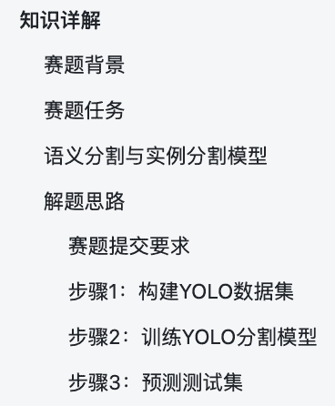

# 30分钟赛事速通指南

| **方向** | CV |
| --- | --- |
| **核心技术栈** | 计算机视觉模型、物体检测模型、YOLO模型 |
| **赛事名称** | 全球AI攻防挑战赛—赛道二：AI核身之金融场景凭证篡改检测 |
| **赛事链接** | [**h**](https://tianchi.aliyun.com/s/14a815673dc09ef786edf5794bf3bce2)ttps://tianchi.aliyun.com/s/14a815673dc09ef786edf5794bf3bce2 |
| **背景简介** |  |

> 金融领域交互式自证业务中涵盖信用成长、用户开户、商家入驻、职业认证、商户解限等多种应用场景，

> 通常都需要用户提交一定的材料（即凭证）用于证明资产收入信息、身份信息、所有权信息、交易信息、资质信息等，而凭证的真实性一直是困扰金融场景自动化审核的一大难题。

>

> 随着数字媒体编辑技术的发展，越来越多的AI手段和工具能够轻易对凭证材料进行篡改，大量的黑产团伙也逐渐掌握PS、AIGC等工具制作逼真的凭证样本，并对金融审核带来巨大挑战。

>

> 为此，开设AI核身-金融凭证篡改检测赛道。将会发布大规模的凭证篡改数据集，参赛队伍在给定的大规模篡改数据集上进行模型研发，同时给出对应的测试集用于评估算法模型的有效性。

## Step1：报名赛事！(点击即可跳转)

> 赛事链接：https://tianchi.aliyun.com/s/14a815673dc09ef786edf5794bf3bce2

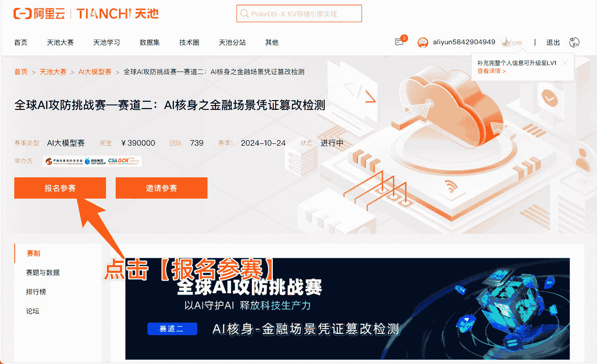

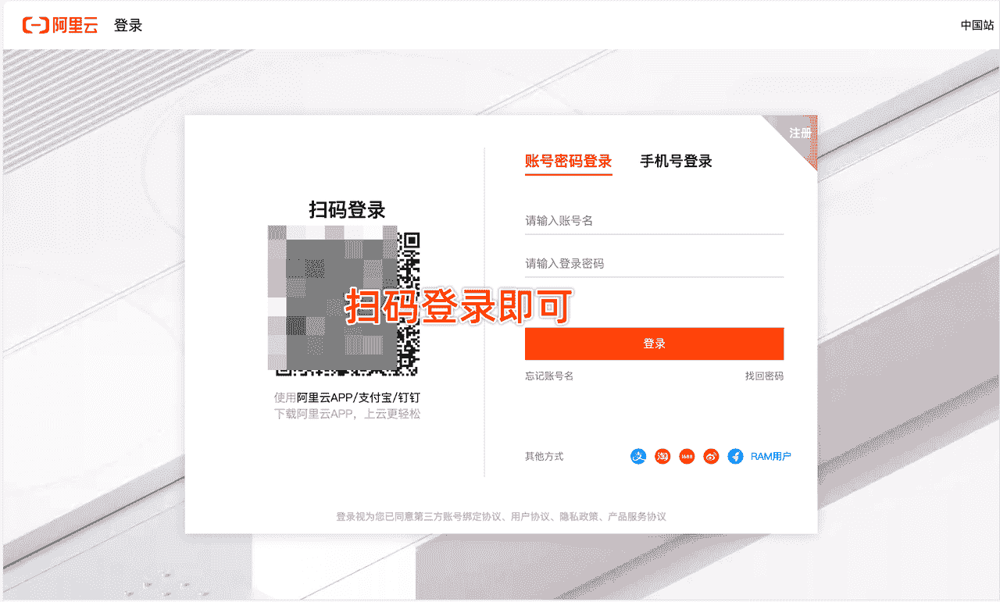

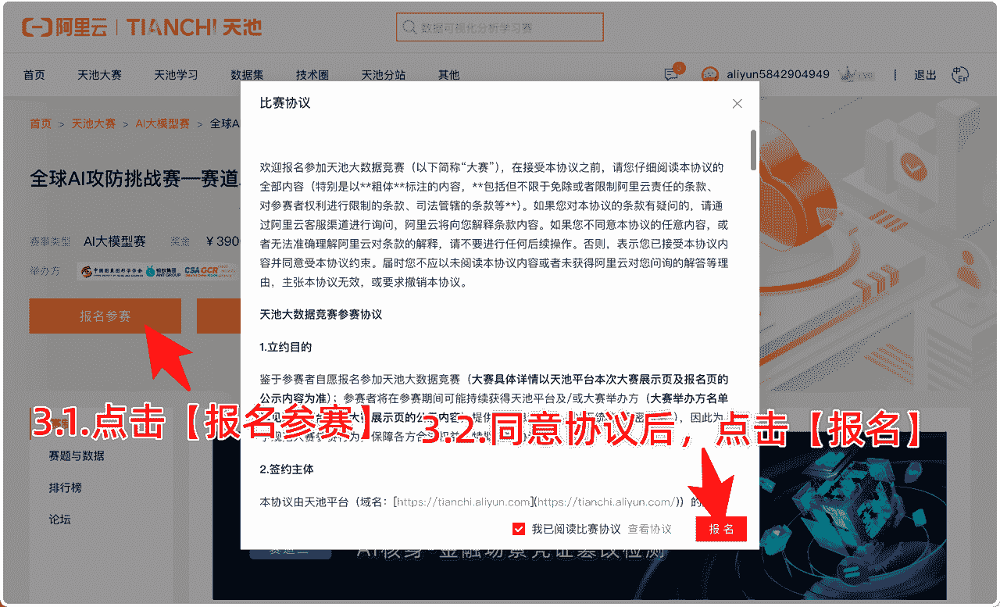

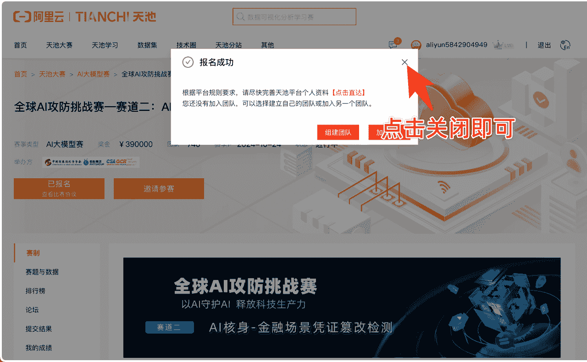

## Step2：启动魔搭Notebook！（点击即可跳转）

> 链接：https://www.modelscope.cn/my/mynotebook/preset

> **选择方式二 GPU环境，启动！**

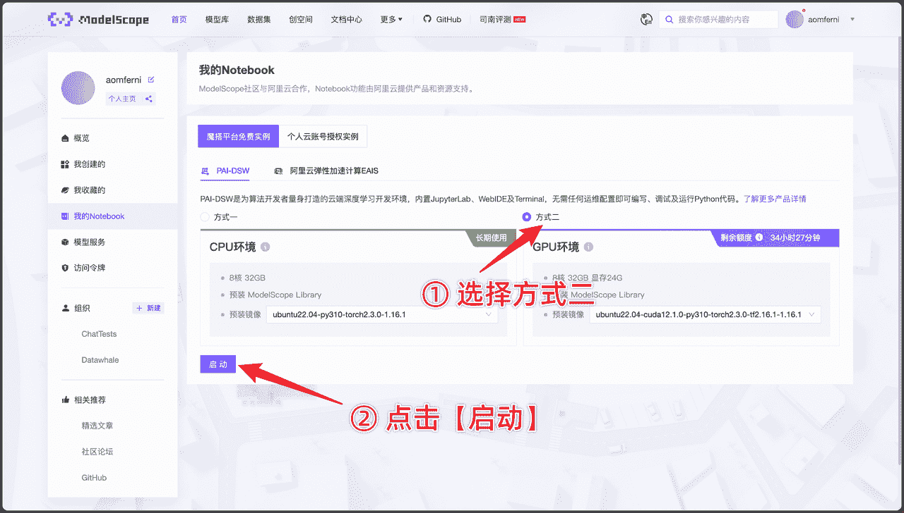

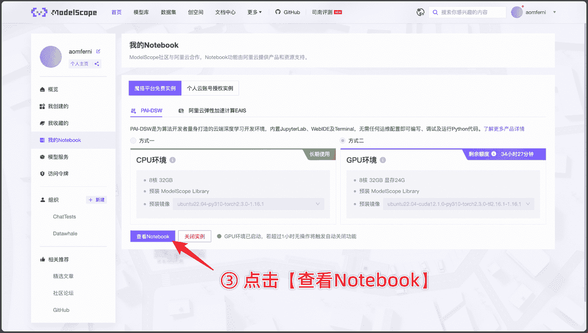

<https://datawhaler.feishu.cn/sync/H03Edp1Ozs86WsbAivYcxgRlnLe>

## Step3：30 分钟体验一站式 baseline！

<https://datawhaler.feishu.cn/sync/KVF4dBmDvsX4HGbfpyhcwACtnUU>

1.  下载baseline代码

> 复制下列命令，回车执行：

```
git lfs install
git clone https://www.modelscope.cn/datasets/Datawhale/dw_AI_defense_track2.git
```

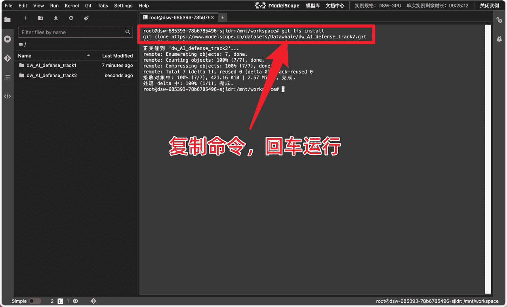

1.  打开baseline文件，一键执行（大概需要30分钟）

> PS：注意baseline文件的后缀是.ipynb

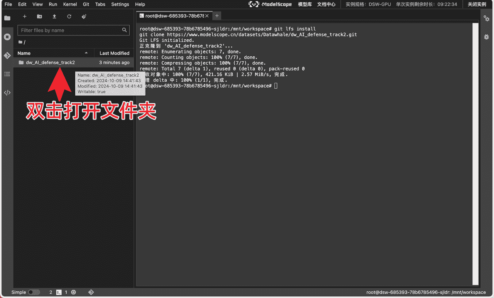

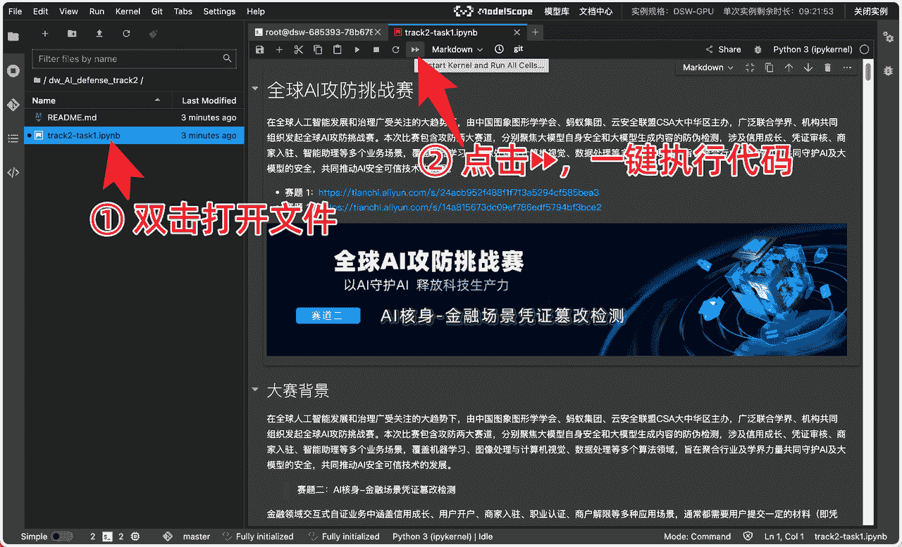

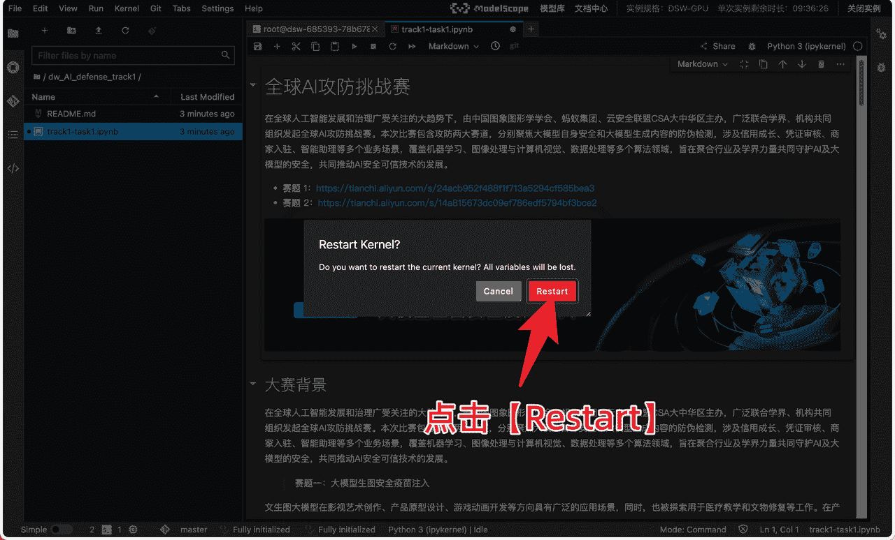

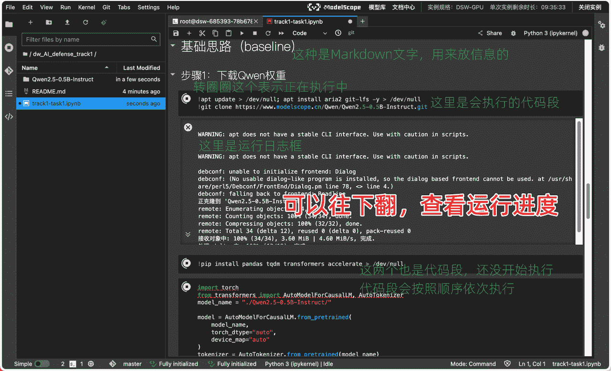

1.  下载结果文件

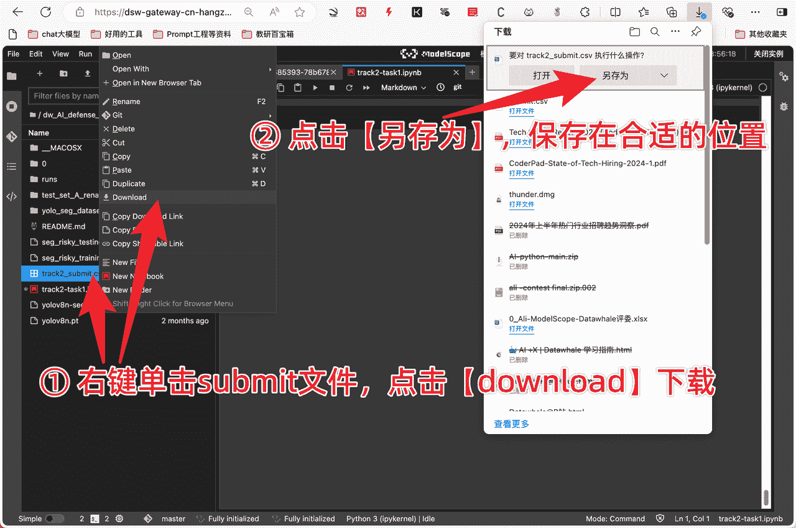

## Step4：提交文件，拿下第一个分数！(点击即可跳转官网进行提交)

> 链接：https://tianchi.aliyun.com/s/14a815673dc09ef786edf5794bf3bce2

> 点击【提交结果】，选择本地文件，提交并等待。

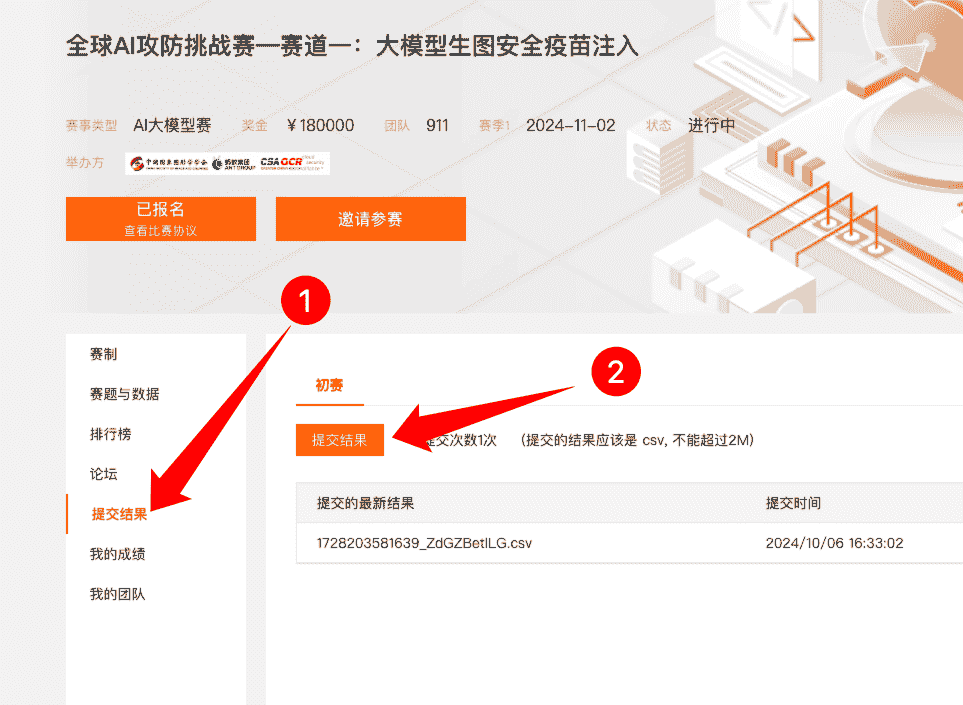

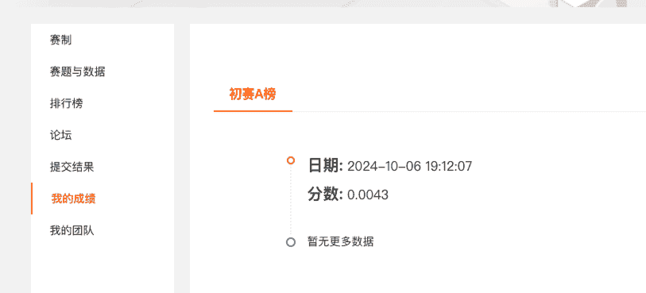

> 评分大概需要 2 分钟～可以在**【我的成绩】**处看到评分结果哟！（预期分数在0.0043分左右😉~）

## Step5：关闭实例！

<https://datawhaler.feishu.cn/sync/CKKcd02X0sBltZbRAXZcuW2Endg>

# 🎉 恭喜完成赛事初体验~

完成比赛提交记得来打卡哦～

<https://datawhaler.feishu.cn/share/base/form/shrcnDmuBAjclXVvp7acCTmq6ze?iframeFrom=docx&ccm_open=iframe>

## 速通体验我们完成了什么？

<https://datawhaler.feishu.cn/sync/UaOhdN8BisGnuPbqrp3cWHpgnUf>

**在本次学习活动中，我们的b**aseline是通过YOLO模型解决 AI攻防：AI篡改图片检测 竞赛赛题的代码。

刚刚通过一键运行 **baseline**，我们实现了赛事数据的下载[、数据处理与](https://datawhaler.feishu.cn/wiki/KovEwSWRjisOzfkPgpGcB2Sin5y#ICfrdU0VXoCBYKx5HFkcbiGGniA)模型训练，并使用训练好的模型，进行了赛事测试数据的预测（检测是否被AI篡改，以及哪些部分被篡改），这些都将在【解题思路】部分进行详细解释。

## 后续学习规划表

| ## 从零入门 AI篡改图片检测(金融场景) |  |  |  |
| --- | --- | --- | --- |
| **Task** | **Task 描述** | **相关知识点** | **学习安排** |
| **Task 1** |  | 1.  赛题报名与baseline阅读 |  |
| **Task 2** |  | 1.  YOLO模型原理介绍 | +   **赛事解读分享** (直播) |
| **Task 3** |  | 1.  图像数据增强方法 | +   **上分思路交流会** (腾讯会议) |
|  |  |  |  |

> **打怪难度：简单**

1.  跑通 **baseline**，拿下第一个分数！

1.  写笔记，完成 **Task1 **打卡

> **打怪难度：⭐️**

1.  学习**YOLO模型**

1.  写笔记，完成**Task2 **打卡

> **打怪难度：⭐️⭐️**

1.  学习并实践更多上分技巧

1.  参与**上分思路交流会**

1.  写笔记，完成 **Task3 **打卡

### 祝大家上分顺利，学习愉快~ 多在群里提问和交流哟！

+   赛事链接：https://tianchi.aliyun.com/s/14a815673dc09ef786edf5794bf3bce2

+   提问前建议先查看**  **[ QA & 其他彩蛋 | 图片篡改检测](https://datawhaler.feishu.cn/wiki/IWXcwF8PuijGbJkjVmmcuuAqnxh)** **是否早已收录你的问题~** 
（QA文档可**任意编辑，助教和教程贡献者会不定时查看）

# 知识详解

## 赛题背景

金融领**域交互式自证业务中涵盖信用成长、用户开户、商家入驻、职业认证、商户解限等多种应用场景，通常**都需要用户提交一定的材料（即凭证）用于证明资产收入信息、身份信息、所有权信息、交易信息、资质信息等，而凭证的真实性一直是困扰金融场景自动化审核的一大难题。随着数字媒体编辑技术的发展，越来越多的AI手段和工具能够轻易对凭证材料进行篡改，大量的黑产团伙也逐渐掌握PS、AIGC等工具制作逼真的凭证样本，并对金融审核带来巨大挑战。

## 赛题任务

在本任务中，要求参赛者设计算法，找出凭证图像中的被篡改的区域。

## 语义分割与实例分割模型

语义分割和实例分割都是计算机视觉领域中的对象识别任务，它们的目标是识别并理解图像中的内容。简单来说，语义分割关注的是“这是什么”，而实例分割关注的是“这是什么”以及“这是哪一件”。实例分割比语义分割更复杂，因为它需要更多的上下文信息来区分不同的实例。

+   语义分割（Semantic Segmentation）：将图像中的每个像素分配给一个类别标签，从而识别出图像中所有对象的类别。

+   实例分割（Instance Segmentation）：不仅要识别图像中的对象类别，还要区分同一类别中的不同实例。

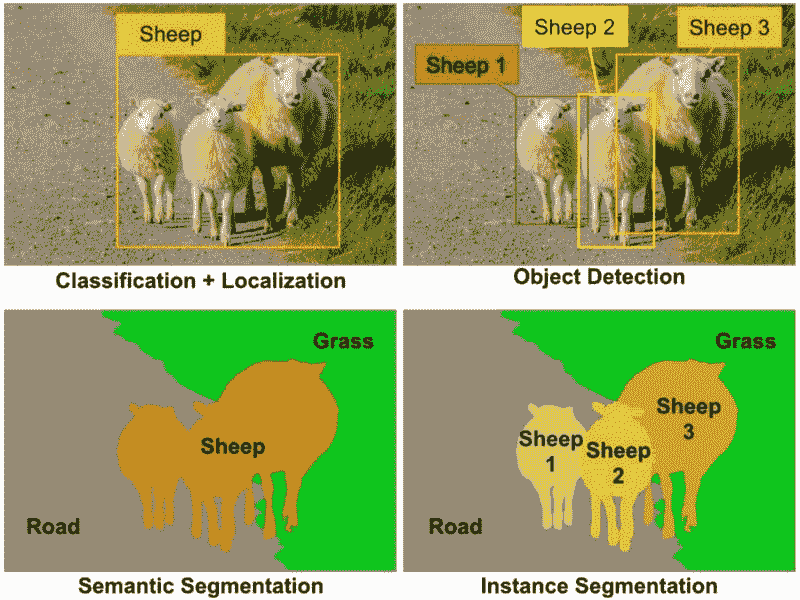

## 解题思路

赛题是一个典型的计算机视觉问题，涉及到图像处理和模式识别。赛题需要识别和定位图像中被篡改的区域。

+   物体检测模型：可以将篡改区域视为需要检测的“物体”。使用像Faster R-CNN或YOLO这样的物体检测模型，可以定位图像中的不同区域，并判断这些区域是否被篡改。

+   语义分割模型：语义分割模型可以将图像中的每个像素分配给一个类别，这可以用来识别图像中的篡改区域。U-Net、DeepLab或Mask R-CNN是常用的语义分割模型。

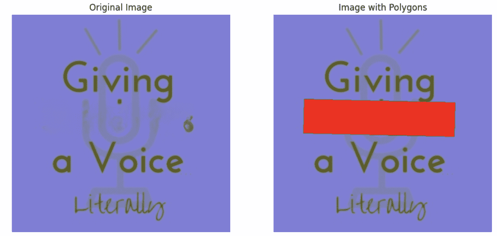

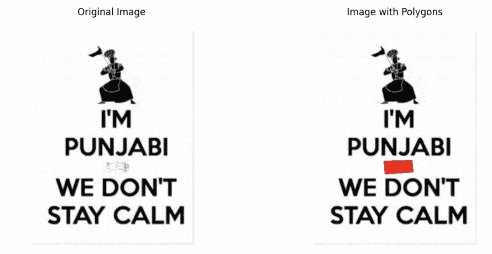

### 赛题提交要求

+   训练集数据总量为100w，提供篡改后的凭证图像及其对应的篡改位置标注，标注文件以csv格式给出，csv文件中包括两列，内容示例如下：

+   测试集分为A榜和B榜，分别包含10w测试数据。测试集中数据格式与训练集中一致，但不包含标注文件。

比赛期间，参赛队伍通过天池平台下载数据，本地调试算法，在线提交结果，结果文件命名为"参赛队名称-result.csv"，包含"Path"和"Polygon"列，"Polygon"列中采用轮廓点的方式存储每个篡改区域的位置，每个区域包含[左上，右上，右下，左下]4个点的坐标。例如:

### 步骤1：构建YOLO数据集

由于比赛原始数据集较大，我们采样部分数据构建训练集和验证集：

```
if os.path.exists(&#x27;yolo_seg_dataset&#x27;):
    shutil.rmtree(&#x27;yolo_seg_dataset&#x27;)

os.makedirs(&#x27;yolo_seg_dataset/train&#x27;)
os.makedirs(&#x27;yolo_seg_dataset/valid&#x27;)

def normalize_polygon(polygon, img_width, img_height):
    return [(x / img_width, y / img_height) for x, y in polygon]

# 采样训练集
for row in training_anno.iloc[:10000].iterrows():
    shutil.copy(row[1].Path, &#x27;yolo_seg_dataset/train&#x27;)

    img = cv2.imread(row[1].Path)
    img_height, img_width = img.shape[:2]
    txt_filename = os.path.join(&#x27;yolo_seg_dataset/train/&#x27; + row[1].Path.split(&#x27;/&#x27;)[-1][:-4] + &#x27;.txt&#x27;)
    with open(txt_filename, &#x27;w&#x27;) as up:
        for polygon in row[1].Polygons:
            normalized_polygon = normalize_polygon(polygon, img_width, img_height)
            normalized_coords = &#x27; &#x27;.join([f&#x27;{coord[0]:.3f} {coord[1]:.3f}&#x27; for coord in normalized_polygon])
            up.write(f&#x27;0 {normalized_coords}\n&#x27;)
 
 # 采用验证集     
 for row in training_anno.iloc[10000:10150].iterrows():
    shutil.copy(row[1].Path, &#x27;yolo_seg_dataset/valid&#x27;)

    img = cv2.imread(row[1].Path)
    img_height, img_width = img.shape[:2]
    txt_filename = os.path.join(&#x27;yolo_seg_dataset/valid/&#x27; + row[1].Path.split(&#x27;/&#x27;)[-1][:-4] + &#x27;.txt&#x27;)
    with open(txt_filename, &#x27;w&#x27;) as up:
        for polygon in row[1].Polygons:
            normalized_polygon = normalize_polygon(polygon, img_width, img_height)
            normalized_coords = &#x27; &#x27;.join([f&#x27;{coord[0]:.3f} {coord[1]:.3f}&#x27; for coord in normalized_polygon])
            up.write(f&#x27;0 {normalized_coords}\n&#x27;)
```

写入YOLO配置文件：

```
with open(&#x27;yolo_seg_dataset/data.yaml&#x27;, &#x27;w&#x27;) as up:
    data_root = os.path.abspath(&#x27;yolo_seg_dataset/&#x27;)
    up.write(f&#x27;&#x27;&#x27;
path: {data_root}
train: train
val: valid

names:
    0: alter
&#x27;&#x27;&#x27;)
```

### 步骤2：训练YOLO分割模型

```
from ultralytics import YOLO

model = YOLO(&quot;./yolov8n-seg.pt&quot;)  
results = model.train(data=&quot;./yolo_seg_dataset/data.yaml&quot;, epochs=10, imgsz=640)
```

### 步骤3：预测测试集

```
from ultralytics import YOLO
import glob
from tqdm import tqdm

model = YOLO(&quot;./runs/segment/train6/weights/best.pt&quot;)  
test_imgs = glob.glob(&#x27;./test_set_A_rename/*/*&#x27;)
```

```
Polygon = []
for path in tqdm(test_imgs[:]):
    results = model(path, verbose=False)
    result = results[0]
    if result.masks is None:
        Polygon.append([])
    else:
        Polygon.append([mask.astype(int).tolist() for mask in result.masks.xy])
        
import pandas as pd
submit = pd.DataFrame({
    &#x27;Path&#x27;: [x.split(&#x27;/&#x27;)[-1] for x in test_imgs[:]],
    &#x27;Polygon&#x27;: Polygon
})
submit.to_csv(&#x27;track2_submit.csv&#x27;, index=None)
```

# [ QA & 其他彩蛋 | 图片篡改检测](https://datawhaler.feishu.cn/wiki/IWXcwF8PuijGbJkjVmmcuuAqnxh)

> [ QA & 其他彩蛋 | 图片篡改检测](https://datawhaler.feishu.cn/wiki/IWXcwF8PuijGbJkjVmmcuuAqnxh)任何想法都可以在学习群里交流或在   进行填写哟~

>

> 本教程主要由 Datawhale的小伙伴们 写作贡献，

> 融合了多位助教的内测体验和宝贵建议。

> 如果你觉得对你有价值和启发，请在下面点赞和评论哟~

>

### 另外别忘了写笔记打卡呀！！~

### 及时思考、沉淀和产出能让你的学习事半功倍！

>

> **注：本文采用 ****署名—非商业性使用**—相同方式共享 4.0 协议国际版许可协议进行许可。