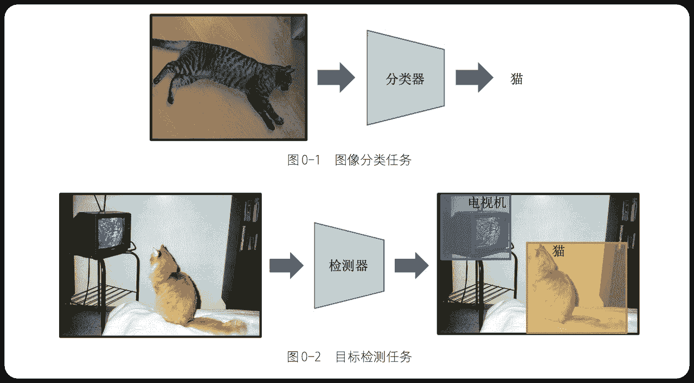
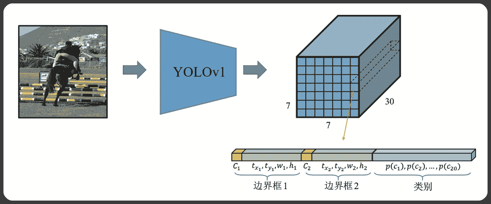
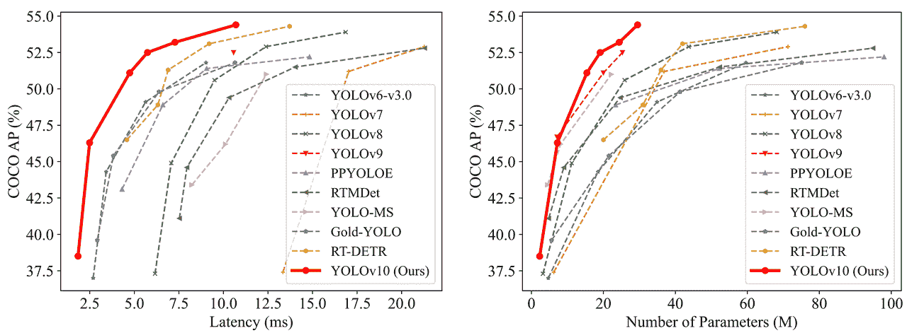
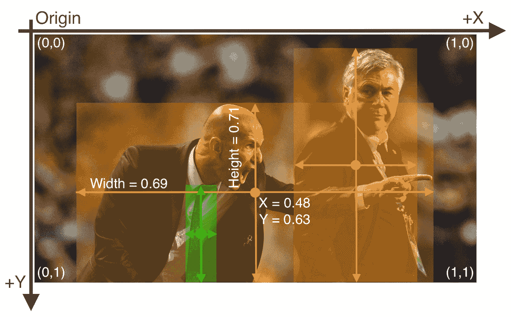
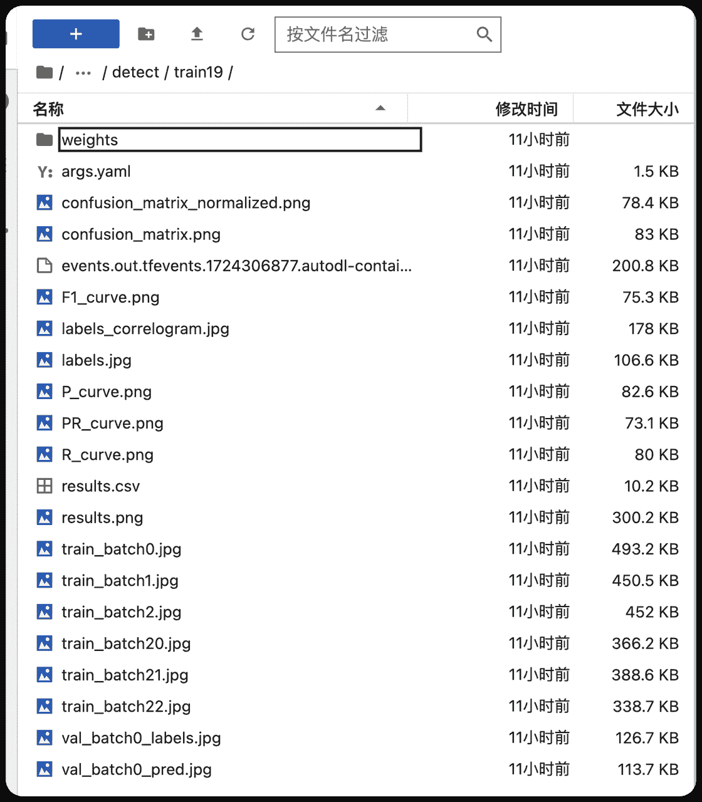
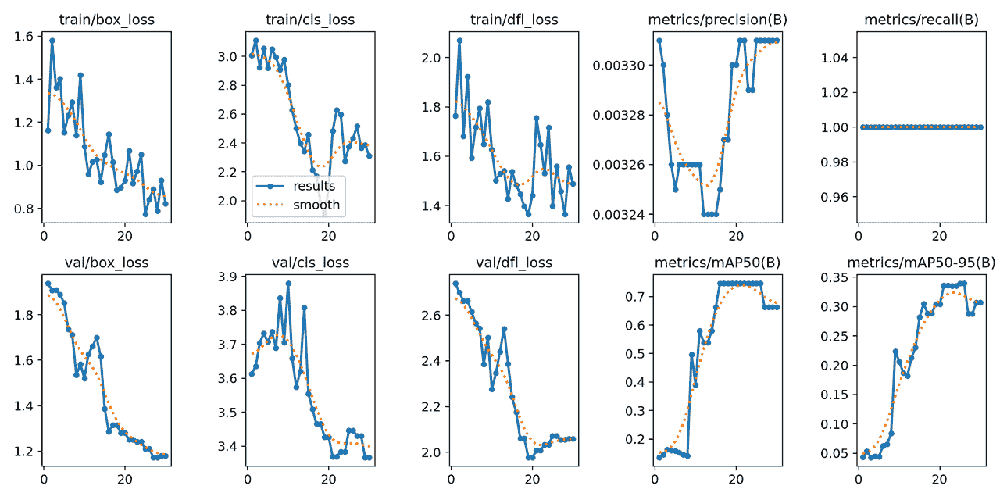
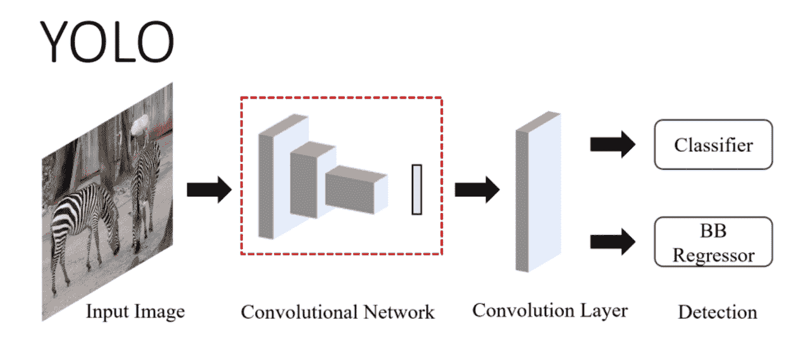
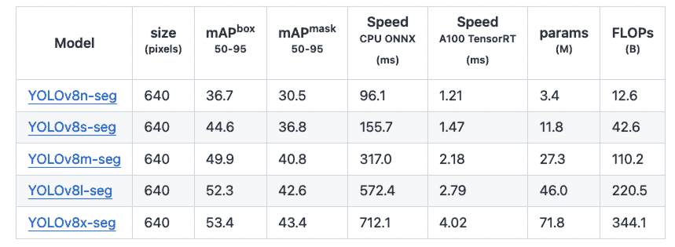

# Task2：建模方案解读与进阶

> 来源：[https://datawhaler.feishu.cn/docx/XSFzdXriEoVinPxgSdJcyQTLnIb](https://datawhaler.feishu.cn/docx/XSFzdXriEoVinPxgSdJcyQTLnIb)

> **教程贡献者说：**

> 继我们在Task1中完成了YOLO基础实践之后，现在我们将进一步探索YOLO算法。我们将掌握YOLO在实际项目中的应用，包括数据集准备、模型训练、评估和部署。

>

> 需注意：本文档主要提供YOLO模型介绍，具体如何使用在咱们的赛题中就欢迎大家在评论区和学习群里积极讨论啦～

# YOLO 模型介绍

# YOLO 模型介绍

物体检测是计算机视觉领域的一个重要任务，它的目标是在图像或视频帧中识别和定位感兴趣的物体。物体检测算法不仅要识别图像中的对象属于哪个类别，还要确定它们在图像中的具体位置，通常以边界框（bounding box）的形式表示。以下是物体检测的一些关键概念和步骤：

1.  **输入**：物体检测算法的输入通常是一张图像或视频帧。

1.  **特征提取**：算法使用深度学习模型（如卷积神经网络CNN）来提取图像的特征。这些特征捕捉了图像中的视觉信息，为后续的物体识别和定位提供基础。

1.  **候选区域生成**：在某些检测算法中，如基于区域的卷积神经网络（R-CNN）及其变体，首先需要生成图像中的候选区域，这些区域可能包含感兴趣的物体。

1.  **区域分类和边界框回归**：对于每个候选区域，算法需要判断它是否包含特定类别的物体，并预测物体的边界框。这通常涉及到分类任务和回归任务的结合。

1.  **非极大值抑制（NMS）**：在检测过程中，可能会产生多个重叠的边界框，用于表示同一物体。NMS是一种常用的技术，用于选择最佳的边界框并去除多余的框。



YOLO，全称为"You Only Look Once"，是一种流行的实时目标检测算法，由Joseph Redmon等人于2015年首次提出。YOLO的核心思想是将目标检测任务视为一个单一的回归问题，直接从图像像素到边界框坐标和类别概率的映射。这种设计使得YOLO能够以非常快的速度进行目标检测，同时保持较高的精度，特别适合需要实时处理的应用场景。



1.  YOLO算法的一个显著特点是它在单个网络评估中同时预测多个边界框和类别概率，而不是像传统的滑动窗口方法那样多次评估。

1.  YOLO使用一个卷积神经网络（CNN）来提取图像特征，然后使用这些特征来预测边界框和类别概率。YOLO的网络结构通常包括多个卷积层和池化层。

1.  YOLO为每个边界框预测一个置信度，这个置信度反映了边界框包含目标的概率以及预测的类别。置信度的计算公式是：Pr(Object) * IOU(pred, truth)，其中Pr(Object)表示格子中存在目标的概率，IOU(pred, truth)表示预测框和真实框的交并比。

YOLO（You Only Look Once）是一种革命性的目标检测算法，以其快速和高效的性能而闻名。自2015年YOLOv1的首次推出以来，YOLO系列已经经历了多次迭代，每一次迭代都在速度、准确性和计算效率方面做出了显著的贡献。

| 版本号 | 年份 | 主要贡献与特点 |
| --- | --- | --- |
| YOLOv1 | 2015 | 实时端到端物体检测，将检测视为回归问题，单次网络评估预测位置和类别。 |
| YOLOv2 | 2016 | 引入批量归一化，高分辨率分类器，全卷积网络，能检测超过9000个类别。 |
| YOLOv3 | 2018 | 使用更深的Darknet-53网络，引入特征金字塔网络提高多尺度目标检测能力。 |
| YOLOv4 | 2020 | 结合CSPNet、PANet、SAM等技术，提高特征提取和检测效率。 |
| **YOLOv5** | 2020 | 使用Pytorch框架，不同大小模型版本适应不同环境，易用性和性能显著改进。 |
| YOLOv6 | 2021 | 多种不同尺寸模型适应工业应用，继续在YOLO系列基础上改进。 |
| YOLOv7 | 2022 | 架构变化和一系列免费包提高准确率，保持实时性。 |
| **YOLOv8** | 2023 | 新功能和改进，包括新的骨干网络、Anchor-Free检测头和新损失函数，提升性能和灵活性。 |
| YOLOv9 | 2023 | 引入可编程梯度信息（PGI）和基于梯度路径规划的通用高效层聚合网络（GELAN）架构。 |
| YOLOv10 | 2024 | 通过消除非最大抑制（NMS-Free）和优化各种模型组件，实现了最先进的性能。 |



> YOLOv1至YOLOv3主要由Joseph Redmon及其合作者提出，而后续版本则由不同的研究者和团队负责开发。YOLOv4之后的版本，尤其是YOLOv5和YOLOv8，由Ultralytics公司开发和维护。YOLOv5和YOLOv8也是现在比较流行的版本。

# YOLO 数据集格式

YOLO算法的标注格式主要使用.txt文件来存储图像中物体的标注信息。每个图像都有一个对应的.txt文件，文件中的每行表示一个物体的标注，包括物体的类别索引和边界框（bounding box）的坐标。以下是YOLO标注格式的详细介绍：

1.  **类别索引**：每个物体的类别由一个整数索引表示，索引对应于预先定义的类别列表。

1.  **边界框坐标**：边界框由其中心点坐标(x_center, y_center)和宽度width、高度height组成。这些值通常是归一化到图像宽度和高度的比例值，范围在0到1之间。

1.  **坐标格式**：边界框坐标通常按照[class_index x_center y_center width height]的格式记录，其中class_index是类别索引，x_center和y_center是边界框中心点的x和y坐标，width和height是边界框的宽度和高度。



在YOLO的训练过程中，这样的配置文件允许用户轻松地指定数据集的位置和类别信息，从而无需硬编码在训练脚本中。具体来说，这段配置的含义如下：

+   path: 指定了数据集的根目录路径，即所有数据子文件夹的上级目录。这里的路径是相对于当前配置文件的路径或者相对于执行训练脚本的工作目录。

+   train: 定义了训练集图像的相对路径。在训练模型时，程序会在指定的路径下查找图像文件。

+   val: 定义了验证集图像的相对路径。验证集用于在训练过程中评估模型性能，避免过拟合。

+   nc: 表示类别的数量，这里设置为2，意味着数据集中有两类物体需要被识别。

+   names: 是一个列表，包含了每个类别的名称。这里有两个类别，名称分别是"0"和"1"。这些名称在训练和测试过程中用于引用特定的类别。

```
# Train/val/test sets as 1) dir: path/to/imgs, 2) file: path/to/imgs.txt, or 3) list: [path/to/imgs1, path/to/imgs2, ..]
path: ../dataset/  # dataset root dir
train: images/train/  # train images (relative to &#x27;path&#x27;) 128 images
val: images/val/  # train images (relative to &#x27;path&#x27;) 128 images

# Classes
nc: 2  # number of classes
names: [&quot;0&quot;, &#x27;1&#x27;]  # class names
```

# YOLO 训练日志

在使用YOLO进行训练时，生成的exp/detect/train类型的文件夹是训练过程中的一个关键组成部分。

+   **模型权重** (.pt 或 .pth 文件): 训练过程中保存的模型权重，可以用于后续的测试或继续训练。

+   **日志文件** (.log 文件): 包含训练过程中的所有输出信息，如损失值、精度、速度等。

+   **配置文件** (.yaml 或 .cfg 文件): 训练时使用的配置文件副本，记录了数据路径、类别名、模型架构等设置。

+   **图表和可视化**: 有时YOLO会生成训练过程中的性能图表，如损失曲线、精度曲线等。

+   **测试结果**: 如果训练过程中包括了测试阶段，可能会有测试结果的保存，如检测结果的图片或统计数据。



1.  **F**1_curve.png, PR_curve.png, P_curve.png, R_curve.png: 包含模型性能的不同评估指标曲线图，如F1分数(F1_curve.png)、精确率-召回率曲线(PR_curve.png)、精确率(P_curve.png)和召回率(R_curve.png)。

1.  **results.csv**: 一个CSV文件，包含模型训练或测试的结果数据。

1.  **results.png**: 包含训练结果的汇总图表或图像。

1.  **train_batch*****.jpg**: 包含训练过程中不同批次的图像和它们的标注。

1.  **val_batch0_labels.jpg,** val_batch0_pred.jpg: 验证集批次的图像，可能包含真实标签(labels)和模型预测(pred)的可视化。

1.  **weights/**: 一个目录，通常包含模型训练过程中保存的权重文件，如.pt或.pth文件。

在训练过程中和训练完成后，都可以查看训练日志。可以优先查看results.png，图像的内容类似如下。从验证集上的损失 (val/box_loss, val/cls_loss, val/dfl_loss) 和性能指标可以评估模型在未见数据上的泛化能力。在下面的训练日志中，我们发现模型在验证集发生了过拟合。



# YOLO分割原理

https://github.com/ultralytics/ultralytics/blob/main/ultralytics/utils/loss.py#L264

YOLO分割模型模型在 YOLOv8 的基础上，针对实例分割问题，定义了一个包含多部分的损失函数，其中包括：

+   **边界框损失（box loss）**：用于计算预测的边界框和真实边界框之间的差异。

+   分类损失（class loss）：用于计算预测的分类分数与真实类别之间的差异。

+   分割损失（segmentation loss）：用于计算实例掩码（masks）之间的差异。

+   **距离分布损失（distribut**ion focal loss, DFL）：用于增强预测边界框的精确性。



在前向传播中，该模型会接受网络的预测输出 preds 以及一个批次的真实标签 batch：

+   preds 通常包括三个部分：feats（特征图）、pred_masks（预测掩码系数）、proto（原型掩码）。

+   特征图 feats 包含用于解码边界框和分类标签的特征；pred_masks 和 proto 共同用于生成预测掩码。

在处理实例掩码时，模型考虑了是否存在掩码重叠的情况：

+   **无重叠**时，每个目标的掩码是单独的，直接与预测的掩码进行匹配。

+   **存在重叠**时，掩码值表示不同目标的索引，模型会处理多个目标之间的重叠关系。

# Baseline 进阶思路

如果想要在原有代码上提高模型思路，可以有如下操作：

1、使用所有的数据集训练模型，从比赛页面下载所有的图片。

2、切换不同的模型预训练权重。



# 参考资料

+   https://docs.ultralytics.com/tasks/segment/

# 致谢

<https://datawhaler.feishu.cn/sync/LPCkdy7uGseO3ob97dfcSPKvnuh>