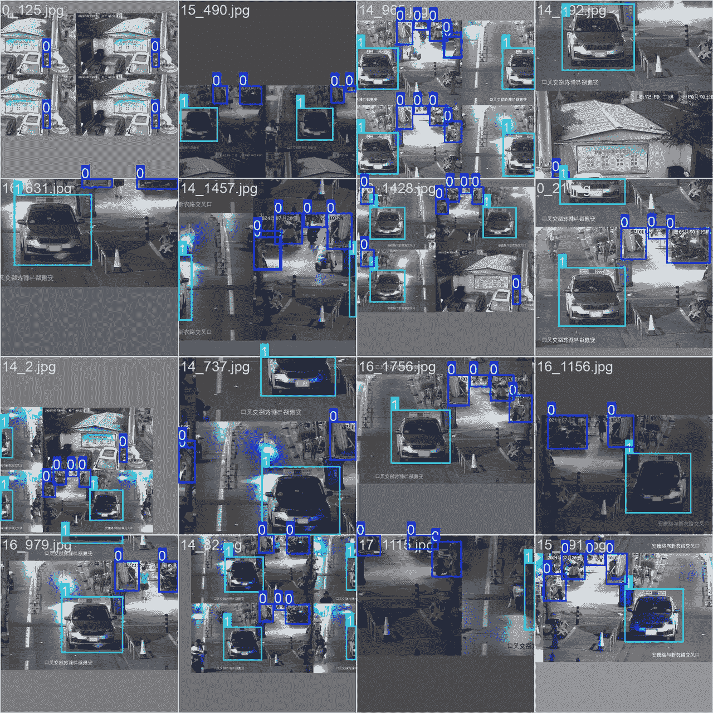

# Task3：赛题进阶思路

> 来源：[https://datawhaler.feishu.cn/docx/BI1QdukDQoRoq5xCAodca7iPnhd](https://datawhaler.feishu.cn/docx/BI1QdukDQoRoq5xCAodca7iPnhd)

> **教程贡献者说：**

> 在之前我们学习了 YOLO 模型的基础使用，接下来将学习进阶的知识。

>

> 同样的，期待大家能从中吸收可用的知识，运用在咱们本次赛事当中！

# 上分点一：数据集增强

数据增强是机器学习和深度学习中常用的技术，用于通过从现有数据集中生成新的训练样本来提高模型的泛化能力。干净一致的数据对于创建性能良好的模型至关重要。常见的增强技术包括翻转、旋转、缩放和颜色调整。多个库，例如 Albumentations、Imgaug 和 TensorFlow的 ImageDataGenerator，可以生成这些增强。

如下图所示，是一个数据集增强的效果示例，针对原有数据集进行了翻转、随机拼贴、剪切等处理：



# 上分点二：设置 YOLO 模型训练参数

> https://docs.ultralytics.com/usage/cfg/#train-settings

YOLO 模型的训练设置包括多种超参数和配置，这些设置会影响模型的性能、速度和准确性。微调涉及采用预先训练的模型并调整其参数以提高特定任务或数据集的性能。该过程也称为模型再训练，使模型能够更好地理解和预测在实际应用中将遇到的特定数据的结果。您可以根据模型评估重新训练模型，以获得最佳结果。

通常，在初始训练时期，学习率从低开始，逐渐增加以稳定训练过程。但是，由于您的模型已经从以前的数据集中学习了一些特征，因此立即从更高的学习率开始可能更有益。在 YOLO 中绝大部分参数都可以使用默认值。

1.  **imgsz**: 训练时的目标图像尺寸，所有图像在此尺寸下缩放。

1.  **save_period**: 保存模型检查点的频率（周期数），-1 表示禁用。

1.  **device**: 用于训练的计算设备，可以是单个或多个 GPU，CPU 或苹果硅的 MPS。

1.  **optimizer**: 训练中使用的优化器，如 SGD、Adam 等，或 'auto' 以根据模型配置自动选择。

1.  **momentum**: SGD 的动量因子或 Adam 优化器的 beta1。

1.  **weight_decay**: L2 正则化项。

1.  **warmup_epochs**: 学习率预热的周期数。

1.  **warmup_momentum**: 预热阶段的初始动量。

1.  **warmup_bias_lr**: 预热阶段偏置参数的学习率。

1.  **box**: 边界框损失在损失函数中的权重。

1.  **cls**: 分类损失在总损失函数中的权重。

1.  **dfl**: 分布焦点损失的权重。

在YOLOv5及其后续版本中，imgsz可以被设置为一个整数，用于训练和验证模式，表示将输入图像调整为正方形的尺寸，例如imgsz=640意味着图像将被调整为640x640像素。对于预测和导出模式，imgsz可以被设置为一个列表，包含宽度和高度，例如imgsz=[640, 480]，表示图像将被调整为640像素宽和480像素高。较大的图像尺寸可能会提高模型的准确性，但会增加计算量和内存消耗。较小的图像尺寸可能会降低模型的准确性，但会提高计算速度和内存效率。因此，用户应根据实际场景需求及硬件资源限制，设置合适的输入图像尺寸

# 上分点三：设置 YOLO 模型预测行为和性能

> 提高速度、

YOLO模型的预测结果通常包括多个组成部分，每个部分提供关于检测到的对象的不同信息。同时 YOLO 能够处理包括单独图像、图像集合、视频文件或实时视频流在内的多种数据源，也能够一次性处理多个图像或视频帧，进一步提高推理速度。

```
from ultralytics import YOLO

# Load a model
model = YOLO(&quot;yolov8n.pt&quot;)  # pretrained YOLOv8n model

# Run batched inference on a list of images
results = model([&quot;im1.jpg&quot;, &quot;im2.jpg&quot;])  # return a list of Results objects

# Process results list
for result in results:
    boxes = result.boxes  # Boxes object for bounding box outputs
    masks = result.masks  # Masks object for segmentation masks outputs
    keypoints = result.keypoints  # Keypoints object for pose outputs
    probs = result.probs  # Probs object for classification outputs
    obb = result.obb  # Oriented boxes object for OBB outputs
    result.show()  # display to screen
    result.save(filename=&quot;result.jpg&quot;)  # save to disk
```

YOLOv8模型的使用者提供了灵活性，允许根据特定应用场景的需求调整模型的行为和性能。例如，如果需要减少误报，可以提高conf阈值；如果需要提高模型的执行速度，可以在支持的硬件上使用half精度；如果需要处理视频数据并希望加快处理速度，可以调整vid_stride来跳过某些帧。这些参数的适当配置对于优化模型的预测性能至关重要。

# 参考资料

+   https://docs.ultralytics.com/modes/predict/#inference-arguments

+   https://docs.ultralytics.com/yolov5/tutorials/tips_for_best_training_results/?h=result#model-selection

+   https://docs.ultralytics.com/yolov5/tutorials/test_time_augmentation/

# 致谢

<https://datawhaler.feishu.cn/sync/LPCkdy7uGseO3ob97dfcSPKvnuh>