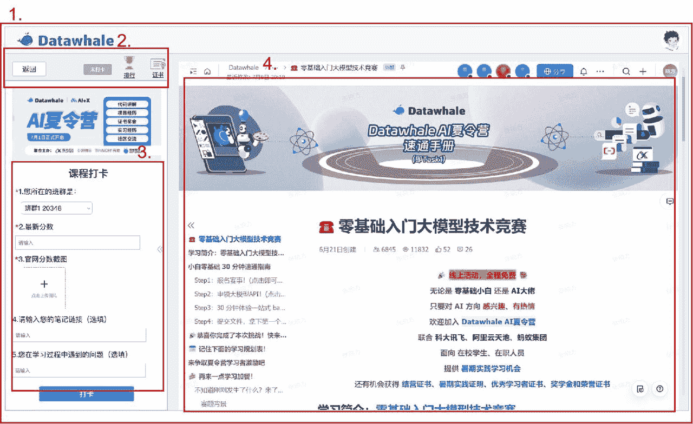

# 从零上手CV竞赛学习者手册

> 来源：[https://datawhaler.feishu.cn/docx/GACbdqIfKoECOyxlwN0cZ2n2nTj](https://datawhaler.feishu.cn/docx/GACbdqIfKoECOyxlwN0cZ2n2nTj)

# 一、重要链接

**赛事官网**：https://www.marsbigdata.com/competition/details?id=3839107548872（报名需填写Datawhale）

**打卡链接**：https://linklearner.com/activity/16/16/49

**排行榜（奖学金依据）：****https://linklearner.c**om/activity/16/16/49

**学习相关QA汇总文档**：[ QA & 其他彩蛋](https://datawhaler.feishu.cn/wiki/WGtfwSP0aiZsXZkrS2Fc1YxUnGg?from=from_copylink)

# 二、学习规划

每个任务的教程可直接点击链接跳转

每个直播回放也可通过点击直播跳转，哔哩哔哩“二次元的Datawhale”第二天可观看回放

<https://datawhaler.feishu.cn/sync/MkNxdOIq2sO0HKbv1A4cZr7JnSh>

# 三、夏令营学习者奖励

<https://datawhaler.feishu.cn/sync/NjjQdrvSvsE1smbLnLJcRg8Pnpf>

# 四、常见问题Q&A

## **打卡说明**：官网打卡

+   教程左侧显示栏完成，每个任务打卡表单不一样，排行榜分数取最高分（无效数据会被删除，请仔细核对）。

+   同一个Task任务打卡为覆盖形式，比如填了笔记链接打卡后，再不填笔记链接打卡就会【没有笔记链接】，辛苦大家注意再加一下笔记链接哈

## 如何撰写笔记？

**优秀笔记合集：**[夏令营优秀笔记](https://exn8g66dnwu.feishu.cn/sheets/M4LFsR8oAhnFKZtGdZHcDJn4ncg?from=from_copylink)

| 任务名 | 笔记截止提交时间 | 笔记评选时间 | 优秀笔记公布时间 |
| --- | --- | --- | --- |
| Task01 | 8月26号晚24:00 | 8月27号 | 8月28号 |
| Task02 | 8月29号晚24:00 | 8月30号 | 8月30号 |
| Task03 | 8月31号晚24:00 | 8月31号 | 8月31号晚 |

**笔记说明：**

本期笔记要求：文章标题带上“Datawhale AI 夏令营”

> 学习规则：

1.  打卡规则：

+   官网报名夏令营成功即可参与打卡，在每个学习任务左侧显示栏打卡

+   同一个Task任务打卡为覆盖形式，比如填了笔记链接打卡后，再不填笔记链接打卡就会【没有笔记链接】，辛苦大家注意再加一下笔记链接哈

1.  笔记规则：

+   为了鼓励大家多表达多输出，方便助教和其他学习者进行笔记的查看，更好地进行学习交流

+   **我们【仅推荐】大家在 CSDN、掘金、知乎、📕、b**ilibili、👸号、博客园 发布笔记

+   ！！！其余链接均不会进行查看并评选，请大家注意！！！

1.  **不会进行查看并评选情况**：

1.  笔记是AI生成的；

1.  直接提交教程链接；

1.  直接照抄教程内容；

1.  笔记链接错误

1.  笔记直接没有链接，而是一行字

1.  笔记无实质性内容，而是“简单的打卡”

## 如何获得实习证明？

学习者仅能获得实践证明，详见【三、夏令营学习者奖励】

后续参加 **助教/宣传大使/教程共创 **等贡献，表现优秀者可获得实习证明，有兴趣的同学可以咨询负责人