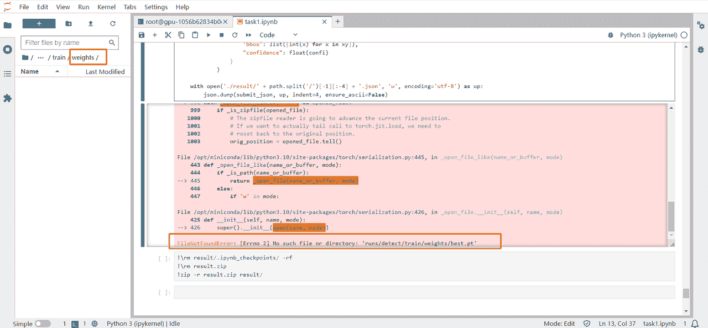

#  QA & 其他彩蛋

> 来源：[https://datawhaler.feishu.cn/docx/Zkx7dQuVoobCmvxXQMfcHHrgnJg](https://datawhaler.feishu.cn/docx/Zkx7dQuVoobCmvxXQMfcHHrgnJg)

> 别忘了持续上分！我们赛事提交的网址在：

<https://datawhaler.feishu.cn/sync/WbWwdPDRgsjXkWbnpMfcdSajnd2>

> 回答问题后记得署名让大家知道你的贡献哟~

# 直播内容QA

## 开营直播-QA汇总

| 已回答 | ## 问题 | ## 回答 |
| --- | --- | --- |
|  | 老师，能先讲讲怎么提升效果吗 |  |
|  | 没什么深度学习代码基础怎么快速上手这次竞赛 |  |
|  | 怎么优化模型，除了调参 |  |
|  | 为什么选择用yolo而不是选择其他模型呢 |  |
|  | 数据集太多了 gup磁盘不足 有什么方法可以去处理数据集 |  |
|  | 能具体讲讲怎么识别出来这几种违规行为吗？就只是硬生生地训练模型吗？ |  |
|  | 虽然跑完，但有点不求甚解的感觉 | 总体来说就是从某一个库调出一个YOLO的模型，把训练集往YOLO模型里面一丢，接着把测试集丢进训练好的模型里面跑测试结果。 |
|  |  |  |
|  |  |  |

## Baseline精读/原理精讲直播-QA汇总

| 已回答 | ## 问题 | ## 回答 |
| --- | --- | --- |
|  | 可以讲一讲为什么mAP最重要吗 |  |
|  | 可以用AMD驱动的电脑训练吗 |  |
|  | 这个局部变量和全局变量能讲一讲嘛 |  |
|  | 最后保存的提交的是权重吗还是预测结果 |  |
|  | 可以使用Yolov9嘛 |  |
|  | 他这个数据的标注是人工标注的吗？ |  |
|  | 请问baseline 的链接可以分享一下 |  |
|  | 是把result.csv写到zip文件吗 |  |
|  | 在训练过程中他的特征是什么？ |  |
|  | 图片结果该显示文字的地方显示方框 |  |
|  | 预测那个置信度0.05会不会太低了，能不能调高一点 |  |
|  | 刚才那个glob那个地方为什么需要全局变量 |  |
|  | 能讲一讲损失是怎么计算的吗？是直接计算边界框的差异吗？ |  |
|  | yolov8的n,s,x都是什么意思 |  |
|  | 在模型中，输入特征是什么？图像的像素值吗？那在测试集中如何找到相对应的违规区域？ |  |
|  | 有没有提升性能的建议 | 检测效果方面增加训练轮数，增加训练数据集的数据量可以有一定提升。还有就是进行数据增强、改网络。 |
|  |  |  |
|  |  |  |

# 教程内容QA

## Task1 QA汇总

| 已回答 | ## 问题 | ## 回答 |
| --- | --- | --- |
|  |  | 有可能是前面下载的内容没下完整，可以把train文件夹删除后重新运行。 |
|  |  |  |
|  |  |  |
|  |  |  |
|  |  |  |

## Task2 QA汇总：

| 已回答 | ## 问题 | ## 回答 |
| --- | --- | --- |
|  |  |  |
|  |  |  |
|  |  |  |
|  |  |  |
|  |  |  |

## Task3 QA汇总：

| 已回答 | ## 问题 | ## 回答 |
| --- | --- | --- |
|  |  |  |
|  |  |  |
|  |  |  |
|  |  |  |
|  |  |  |

# 贡献者清单

| **角色** | **姓名** |
| --- | --- |
| **教程贡献者** |  |
| **运营助教** |  |
| **专业助教** |  |
| **优秀学习者** |  |
| **QA贡献者** |  |

# 别忘了随时查看学习规划表~

<https://datawhaler.feishu.cn/sync/MkNxdOIq2sO0HKbv1A4cZr7JnSh>

# 给你的学习群点个赞吧~