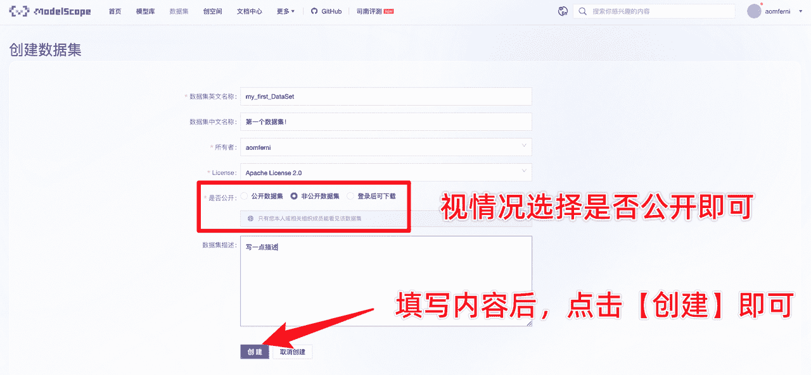
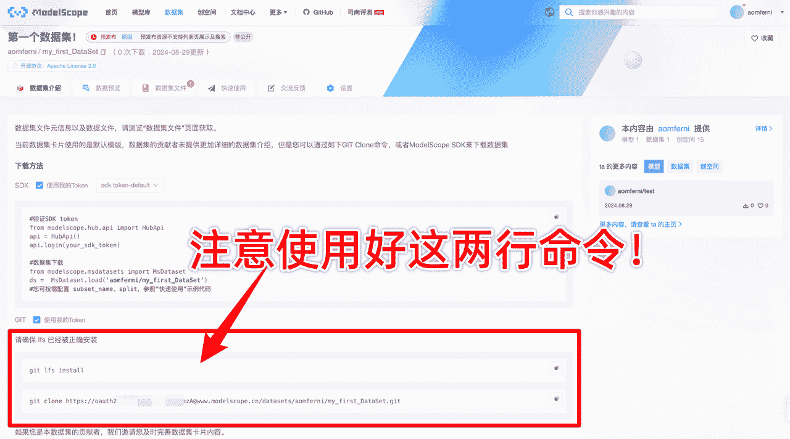

# 魔搭数据集快捷使用指南

> 来源：[https://datawhaler.feishu.cn/docx/MtpsdJcM8odAFjxm3z4cnKrDn6e](https://datawhaler.feishu.cn/docx/MtpsdJcM8odAFjxm3z4cnKrDn6e)

> 为了方便大家更好地使用云算力进行相关算法验证和尝试，推荐大家使用租赁云算力 + 使用魔搭数据集git仓库的强力组合，方便地进行各个平台的数据同步，以及快捷地进行算法的验证~

>

> 祝大家食用愉快，模型收敛快、效果好~

>

> [PS：此文](https://modelscope.cn/docs/%E6%95%B0%E6%8D%AE%E9%9B%86%E4%BB%8B%E7%BB%8D)档的使用指南与官方略显不同，官方的使用方法详见：数据集介绍

使用魔搭数据集主要需要了解

1.  如何**创建魔搭数据集**

1.  如何**下载文件**

1.  如何**上传&更新文件**

# [创建一个魔搭数据集](https://modelscope.cn/datasets/create)

> https://modelscope.cn/datasets/create

> 记得要登录魔搭平台，然后按照你的情况进行具体内容填写就好了~

> 至此，我们就有了一个魔搭数据集~

> 相当于一个**git仓库**，可以进行相关文件的管理~

>

> **git仓库**：从各个平台同步的角度来看，Git仓库就像是一个“代码的云盘”。无论你是在家里的电脑、办公室的工作站，还是在咖啡店的笔记本上编写代码，只要这些设备都能连接到同一个Git仓库，你就可以随时随地访问和更新你的代码。

>

> 它的价值在于实现了跨平台的无缝协作。你可以在任何地方(云平台，本地电脑等)开始工作，然后在另一个地方继续，只要进行手动同步，所有的改动就都会记录在案并在所有平台统一呈现。

# 下载魔搭数据集

> 在需要使用数据集的环境，执行git clone命令即可~

> PS：确保你已经成功安装 git 和 git LFS（Large File Storage）哟~

+   如果 git 没有安装，可以通过 https://git-scm.com/ 安装

# 彩蛋

## 通过魔搭组织协作

## Git仓库更多介绍

Git仓库就像是一个代码的“时间胶囊”，它帮你记录每一次对代码的改动，就像给代码拍了一张张快照。这样，无论什么时候，你都可以回到过去的某个版本，看看当时的代码是什么样子。

它的价值在于提供了个人代码管理的便利。比如，当你尝试新功能但不小心搞砸了代码时，Git仓库可以让你迅速回到之前稳定的状态，避免了手动备份和恢复的麻烦。同时，它还能帮你跟踪自己的学习进度和项目发展，让你对自己的工作有更清晰的认识和掌控。

如果存在团队协作的话，还可以是团队合作的“超级备忘录”。大家一起写代码时，Git仓库能帮你们记住谁改了什么，什么时候改的，还能让你们在不同的想法上各自尝试（就像在不同的纸上画画），最后再把这些不同的尝试合并起来，不会弄乱原来的作品。这样，大家合作起来既高效又不会出错，保证了代码的安全和有序。