# AI夏令营第三期 - 脑PET图像分析和疾病预测挑战赛教程

> 来源：[https://datawhaler.feishu.cn/docx/K6RndJlW5ocYfZxJ02ucGIwmnqd](https://datawhaler.feishu.cn/docx/K6RndJlW5ocYfZxJ02ucGIwmnqd)

> 本教程会带领大家项目制学习，由浅入深，逐渐进阶。从跑通最简的Baseline，精读Baseline，到底层算法原理与进阶实践技巧的学习，千里之行，始于足下，从这里，开启你的 AI 学习之旅吧

> —— Datawhale贡献者团队

# 赛题解析

> 脑PET图像分析和疾病预测挑战赛

> https://challenge.xfyun.cn/topic/info?type=pet-2023&ch=ymfk4uU

## **赛题背景**

脑PET全称为脑部正电子发射计算机断层显像(brain positron emission tomography PET)，是反映脑部病变的基因、分子、代谢及功能状态的显像。它是利用正电子核素标记葡萄糖等人体代谢物作为显像剂，通过病灶对显像剂的摄取来反映其代谢变化，从而为临床提供疾病的生物代谢信息，为脑癫痫病、脑肿瘤、帕金森病、阿尔茨海默综合征等提供了有效的检测手段。可利用脑PET图像检测出轻度认知障碍病灶，并提前介入治疗，从而延缓发病，对后续患者康复治疗有着积极的意义。因此本赛题以轻度认知障碍为例对脑PET图像进行分析与疾病预测。

## **赛事任务**

为研究基于脑PET图像的疾病预测，本次大赛提供了海量脑PET数据集作为脑PET图像检测数据库的训练样本，参赛者需根据提供的样本构建模型，对轻度认知障碍进行分析和预测。

脑PET图像检测数据库，记录了老年人受试志愿者的脑PET影像资料，其中包括确诊为轻度认知障碍（MCI）患者的脑部影像数据和健康人（NC）的脑部影像数据。

被试者按医学诊断分为两类：

NC：健康

MCI：轻度认知障碍

## **赛题数据集**

本次大赛所用脑PET图像检测数据库，图像格式为nii。

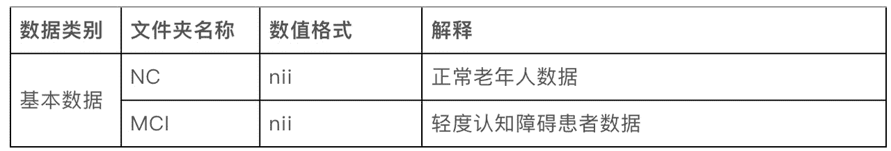

## **评价指标**

本次竞赛的评价标准采用F1_score，分数越高，效果越好。

## 解题思路

使用计算机视觉方法进行脑PET图像分类可以帮助提取脑部疾病的特征并进行疾病预测。下面是一个使用计算机视觉思路进行脑PET图像分类的一般步骤：

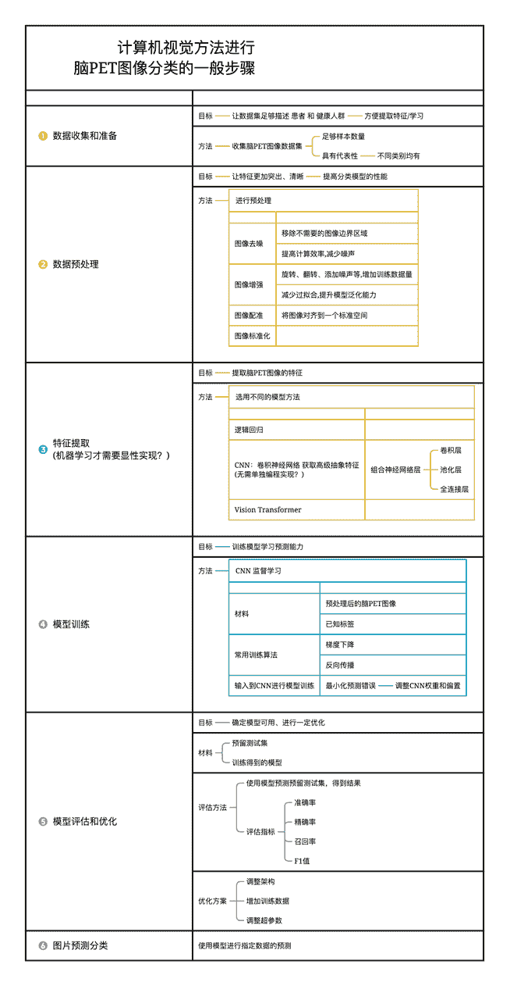

# 任务1：统计方法Baseline

> Baseline是一份简易的入门教程，可以帮助同学们迈出 AI 训练大师之路的第一步。建议入门的同学可以暂时不用着急去弄懂各个代码的原理，先跑通代码，动手实践，看到成绩。

## 快速跑通

快速跑通全流程，我们基于百度AI Studio，将本教程Baseline部署在线上平台，可一键fork运行代码，看到成绩。

一键运行：https://aistudio.baidu.com/aistudio/projectdetail/6554002?sUid=377372&shared=1&ts=1689768420818

+   运行时，选择**CPU2核8G**的配置

+   总运行时间大约需要**3分钟**，请耐心等待。

+   **视频演示**：AI夏令营：开营仪式|实践全流程基础演示_哔哩哔哩_bilibili，对应的CV章节

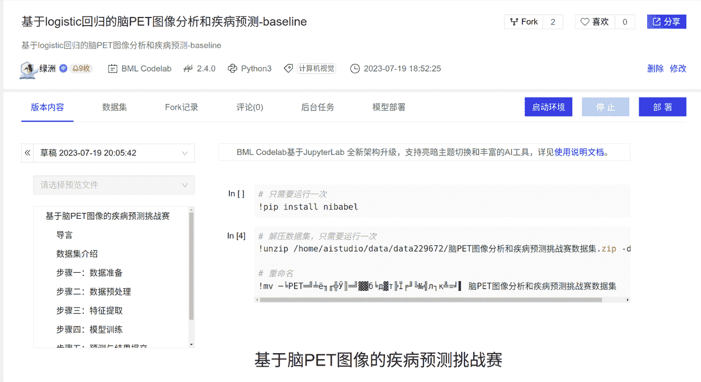

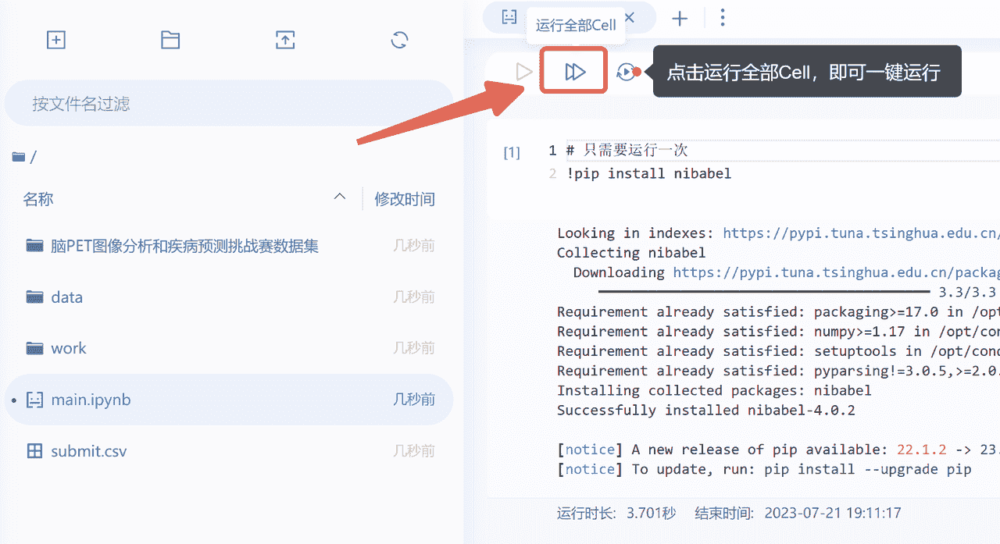

输出**submit.csv**文件后，右键可下载到本地，在[赛题提交结果](https://challenge.xfyun.cn/topic/info?type=pet-2023&ch=vWxQGFU)提交文件，获取分数。

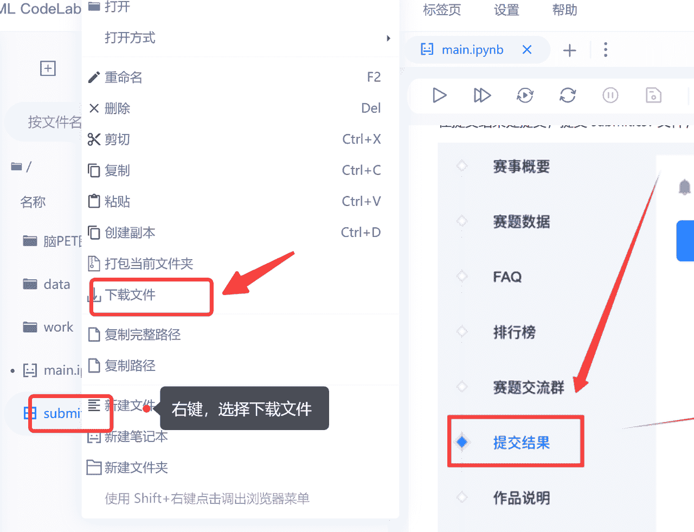

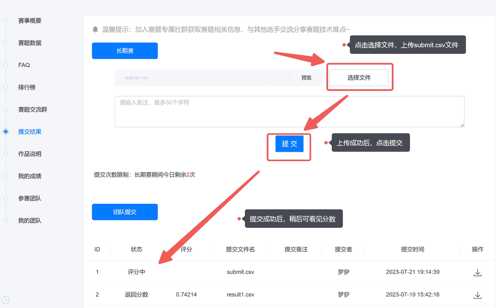

## 实践步骤

> 视频讲解：https://www.bilibili.com/video/BV1pm4y1L7H4

**图像特征统计（传统方法）**

图像特征统计是指对图像中的像素或图像区域进行统计分析，以提取和描述图像的特征信息。

1.  占比特征：通过统计图像中不同像素值或颜色通道的像素数量，计算其在整个图像中的比例或占比。

1.  边缘特征：边缘是图像中像素值或颜色发生剧烈变化的区域，通常表示物体的边界或纹理的边界。

1.  纹理特征：描述了图像中的纹理信息，反映了图像的细节和结构。

**方法优****缺点**（运行时间5分钟，不要GPU）：

+   思路简单，不需要GPU就可以运行完成。

+   精度较差，且容易受到形态比较形似的影响。

**代码流程图：**

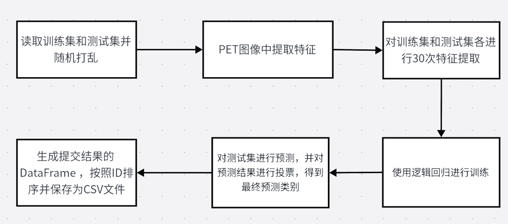

**完整代码如下：**

```
import glob                # 获取文件路径
import numpy as np
import pandas as pd
import nibabel as nib      # 处理医学图像数据
from nibabel.viewers import OrthoSlicer3D    # 图像可视化
from collections import Counter              # 计数统计

# 读取训练集文件路径
train_path = glob.glob(&#x27;./脑PET图像分析和疾病预测挑战赛公开数据/Train/*/*&#x27;)
test_path = glob.glob(&#x27;./脑PET图像分析和疾病预测挑战赛公开数据/Test/*&#x27;)

# 打乱训练集和测试集的顺序
np.random.shuffle(train_path)
np.random.shuffle(test_path)

# 对PET文件提取特征
def extract_feature(path):
    # 加载PET图像数据
    img = nib.load(path)
    # 获取第一个通道的数据
    img = img.dataobj[:, :, :, 0]
    
    # 随机筛选其中的10个通道提取特征
    random_img = img[:, :, np.random.choice(range(img.shape[2]), 10)]
    
    # 对图片计算统计值
    feat = [
        (random_img != 0).sum(),               # 非零像素的数量
        (random_img == 0).sum(),               # 零像素的数量
        random_img.mean(),                     # 平均值
        random_img.std(),                      # 标准差
        len(np.where(random_img.mean(0))[0]),  # 在列方向上平均值不为零的数量
        len(np.where(random_img.mean(1))[0]),  # 在行方向上平均值不为零的数量
        random_img.mean(0).max(),              # 列方向上的最大平均值
        random_img.mean(1).max()               # 行方向上的最大平均值
    ]
    
    # 根据路径判断样本类别（&#x27;NC&#x27;表示正常，&#x27;MCI&#x27;表示异常）
    if &#x27;NC&#x27; in path:
        return feat + [&#x27;NC&#x27;]
    else:
        return feat + [&#x27;MCI&#x27;]

# 对训练集进行30次特征提取，每次提取后的特征以及类别（&#x27;NC&#x27;表示正常，&#x27;MCI&#x27;表示异常）被添加到train_feat列表中。
train_feat = []
for _ in range(30):
    for path in train_path:
        train_feat.append(extract_feature(path))
     
# 对测试集进行30次特征提取   
test_feat = []
for _ in range(30):
    for path in test_path:
        test_feat.append(extract_feature(path))
        
# 使用训练集的特征作为输入，训练集的类别作为输出，对逻辑回归模型进行训练。
from sklearn.linear_model import LogisticRegression
m = LogisticRegression(max_iter=1000)
m.fit(
    np.array(train_feat)[:, :-1].astype(np.float32),  # 特征
    np.array(train_feat)[:, -1]                       # 类别
)

# 对测试集进行预测并进行转置操作，使得每个样本有30次预测结果。
test_pred = m.predict(np.array(test_feat)[:, :-1].astype(np.float32))
test_pred = test_pred.reshape(30, -1).T

# 对每个样本的30次预测结果进行投票，选出最多的类别作为该样本的最终预测类别，存储在test_pred_label列表中。
test_pred_label = [Counter(x).most_common(1)[0][0] for x in test_pred]

# 生成提交结果的DataFrame，其中包括样本ID和预测类别。
submit = pd.DataFrame(
    {
        &#x27;uuid&#x27;: [int(x.split(&#x27;/&#x27;)[-1][:-4]) for x in test_path],  # 提取测试集文件名中的ID
        &#x27;label&#x27;: test_pred_label                                  # 预测的类别
    }
)

# 按照ID对结果排序并保存为CSV文件
submit = submit.sort_values(by=&#x27;uuid&#x27;)
submit.to_csv(&#x27;submit1.csv&#x27;, index=None)
```

在提交结果处提交，提交 **submit.csv **文件，在排名结果页查看自己的成绩排名。


# 任务2：深度学习**Baseline**

## Pytorch CNN

> 视频讲解：https://www.bilibili.com/video/BV18h4y1V7as/

卷积神经网络（Convolutional Neural Network，CNN）是一种深度学习模型，广泛用于图像识别、计算机视觉和模式识别任务中。CNN 在处理具有网格结构数据（如图像）时表现出色，它能够自动学习和提取图像中的特征，并在分类、定位和分割等任务中取得优秀的性能。

方法优缺点（运行时间20分钟，如果有GPU可以更快）：

+   CNN带来的精度更好，但需要训练更长的时间

+   CNN模型调优需要GPU

**Step1：自定义数据集**

```
import os, sys, glob, argparse
import pandas as pd
import numpy as np
from tqdm import tqdm

import cv2
from PIL import Image
from sklearn.model_selection import train_test_split, StratifiedKFold, KFold

import torch
torch.manual_seed(0)
torch.backends.cudnn.deterministic = False
torch.backends.cudnn.benchmark = True

import torchvision.models as models
import torchvision.transforms as transforms
import torchvision.datasets as datasets
import torch.nn as nn
import torch.nn.functional as F
import torch.optim as optim
from torch.autograd import Variable
from torch.utils.data.dataset import Dataset

import nibabel as nib
from nibabel.viewers import OrthoSlicer3D

train_path = glob.glob(&#x27;./脑PET图像分析和疾病预测挑战赛公开数据/Train/*/*&#x27;)
test_path = glob.glob(&#x27;./脑PET图像分析和疾病预测挑战赛公开数据/Test/*&#x27;)

np.random.shuffle(train_path)
np.random.shuffle(test_path)

DATA_CACHE = {}
class XunFeiDataset(Dataset):
    def __init__(self, img_path, transform=None):
        self.img_path = img_path
        if transform is not None:
            self.transform = transform
        else:
            self.transform = None
    
    def __getitem__(self, index):
        if self.img_path[index] in DATA_CACHE:
            img = DATA_CACHE[self.img_path[index]]
        else:
            img = nib.load(self.img_path[index]) 
            img = img.dataobj[:,:,:, 0]
            DATA_CACHE[self.img_path[index]] = img
        
        # 随机选择一些通道            
        idx = np.random.choice(range(img.shape[-1]), 50)
        img = img[:, :, idx]
        img = img.astype(np.float32)

        if self.transform is not None:
            img = self.transform(image = img)[&#x27;image&#x27;]
        
        img = img.transpose([2,0,1])
        return img,torch.from_numpy(np.array(int(&#x27;NC&#x27; in self.img_path[index])))
    
    def __len__(self):
        return len(self.img_path)
        
import albumentations as A
train_loader = torch.utils.data.DataLoader(
    XunFeiDataset(train_path[:-10],
            A.Compose([
            A.RandomRotate90(),
            A.RandomCrop(120, 120),
            A.HorizontalFlip(p=0.5),
            A.RandomContrast(p=0.5),
            A.RandomBrightnessContrast(p=0.5),
        ])
    ), batch_size=2, shuffle=True, num_workers=1, pin_memory=False
)

val_loader = torch.utils.data.DataLoader(
    XunFeiDataset(train_path[-10:],
            A.Compose([
            A.RandomCrop(120, 120),
        ])
    ), batch_size=2, shuffle=False, num_workers=1, pin_memory=False
)

test_loader = torch.utils.data.DataLoader(
    XunFeiDataset(test_path,
            A.Compose([
            A.RandomCrop(128, 128),
            A.HorizontalFlip(p=0.5),
            A.RandomContrast(p=0.5),
        ])
    ), batch_size=2, shuffle=False, num_workers=1, pin_memory=False
)

```

**Step2：自定义CNN模型**

```
class XunFeiNet(nn.Module):
    def __init__(self):
        super(XunFeiNet, self).__init__()
                
        model = models.resnet18(True)
        model.conv1 = torch.nn.Conv2d(50, 64, kernel_size=(7, 7), stride=(2, 2), padding=(3, 3), bias=False)
        model.avgpool = nn.AdaptiveAvgPool2d(1)
        model.fc = nn.Linear(512, 2)
        self.resnet = model
        
    def forward(self, img):        
        out = self.resnet(img)
        return out
        
model = XunFeiNet()
model = model.to(&#x27;cuda&#x27;)
criterion = nn.CrossEntropyLoss().cuda()
optimizer = torch.optim.AdamW(model.parameters(), 0.001)
```

**Step3：模型训练与验证**

```
def train(train_loader, model, criterion, optimizer):
    model.train()
    train_loss = 0.0
    for i, (input, target) in enumerate(train_loader):
        input = input.cuda(non_blocking=True)
        target = target.cuda(non_blocking=True)

        output = model(input)
        loss = criterion(output, target)

        optimizer.zero_grad()
        loss.backward()
        optimizer.step()

        if i % 20 == 0:
            print(loss.item())
            
        train_loss += loss.item()
    
    return train_loss/len(train_loader)
            
def validate(val_loader, model, criterion):
    model.eval()
    val_acc = 0.0
    
    with torch.no_grad():
        for i, (input, target) in enumerate(val_loader):
            input = input.cuda()
            target = target.cuda()

            # compute output
            output = model(input)
            loss = criterion(output, target)
            
            val_acc += (output.argmax(1) == target).sum().item()
            
    return val_acc / len(val_loader.dataset)
    
for _  in range(3):
    train_loss = train(train_loader, model, criterion, optimizer)
    val_acc  = validate(val_loader, model, criterion)
    train_acc = validate(train_loader, model, criterion)
    
    print(train_loss, train_acc, val_acc)
```

**Step4：模型预测与提交**

```
def predict(test_loader, model, criterion):
    model.eval()
    val_acc = 0.0
    
    test_pred = []
    with torch.no_grad():
        for i, (input, target) in enumerate(test_loader):
            input = input.cuda()
            target = target.cuda()

            output = model(input)
            test_pred.append(output.data.cpu().numpy())
            
    return np.vstack(test_pred)
    
pred = None
for _ in range(10):
    if pred is None:
        pred = predict(test_loader, model, criterion)
    else:
        pred += predict(test_loader, model, criterion)
        
submit = pd.DataFrame(
    {
        &#x27;uuid&#x27;: [int(x.split(&#x27;/&#x27;)[-1][:-4]) for x in test_path],
        &#x27;label&#x27;: pred.argmax(1)
})
submit[&#x27;label&#x27;] = submit[&#x27;label&#x27;].map({1:&#x27;NC&#x27;, 0: &#x27;MCI&#x27;})
submit = submit.sort_values(by=&#x27;uuid&#x27;)
submit.to_csv(&#x27;submit2.csv&#x27;, index=None)
```

在提交结果处提交，提交 **submit.csv **文件，在排名结果页查看自己的成绩排名。

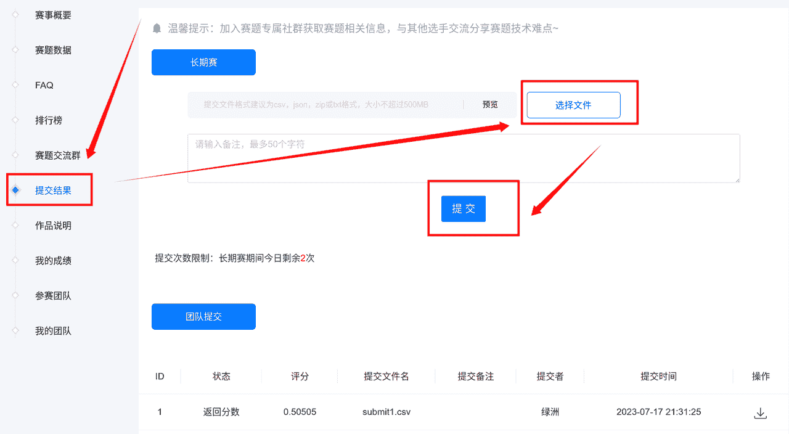

## 使用PP套件

> 视频讲解：https://www.bilibili.com/video/BV1ku411G7M9/

> 配套代码：https://aistudio.baidu.com/aistudio/projectdetail/6549820?sUid=377372&shared=1&ts=1689758134677

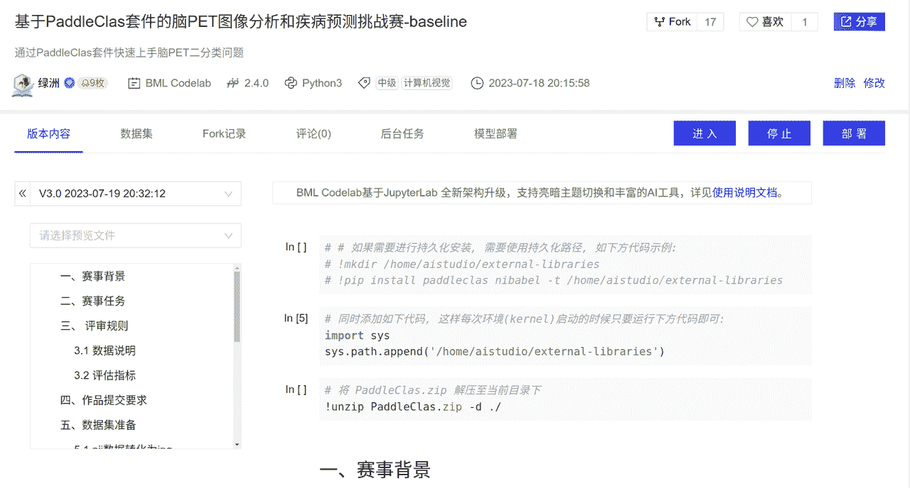

# 任务3 - 进阶4选2：预训练模型

ResNet（Residual Network）是一个非常重要的深度学习架构，它在2015年由Kaiming He等人提出，并在ImageNet图像分类竞赛中获得了优异的成绩。ResNet解决了深度神经网络中出现的梯度消失和梯度爆炸等问题，使得训练非常深的神经网络变得可能。

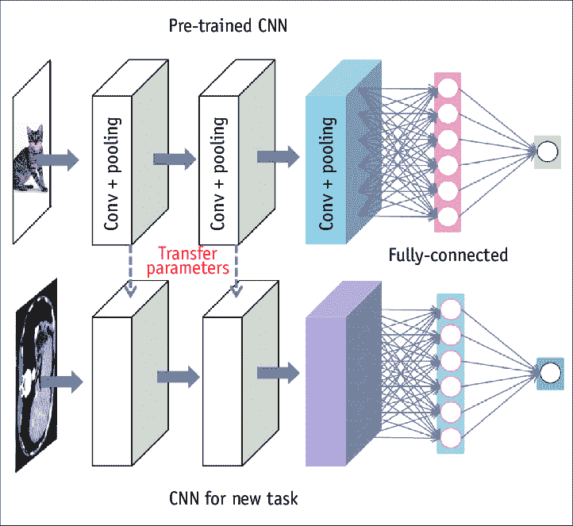

在之前的代码中，包含了一些细节：

+   使用PyTorch内置的 models.resnet18(True) 载入预训练的ResNet-18模型。True 参数表示加载预训练的权重。

+   修改 model.conv1：对ResNet-18的第一个卷积层进行了修改，将输入通道数从3改为50。这可能是针对特定问题或数据集的定制。

+   修改 model.avgpool：替换原有的平均池化层为自适应平均池化层，这允许不同大小的输入图像得到相同尺寸的输出特征。

+   修改 model.fc：替换ResNet的全连接分类层，将输出类别数从原来的1000改为2，以适应特定的二分类任务。

```
class XunFeiNet(nn.Module):
    def __init__(self):
        super(XunFeiNet, self).__init__()
                
        model = models.resnet18(True)
        model.conv1 = torch.nn.Conv2d(50, 64, kernel_size=(7, 7), stride=(2, 2), padding=(3, 3), bias=False)
        model.avgpool = nn.AdaptiveAvgPool2d(1)
        model.fc = nn.Linear(512, 2)
        self.resnet = model
        
    def forward(self, img):        
        out = self.resnet(img)
        return out
```

在torchvison中内置了很多预训练模型：https://pytorch.org/vision/stable/models.html#classification

在参赛的过程中，可以自由选择。但选择的过程需要考虑到模型的复杂度，也需要考虑到自身的显存大小。

```
from torchvision.models import resnet50
model = resnet50(True)
```

实践步骤：

+   将任务2中的ResNet-18修改为ResNet-34和ResNet-50，分别进行训练模型。

+   记录下每个模型的训练时间和模型精度。

# 任务3 - 进阶4选2：数据增强方法

数据增强是在训练深度学习模型时常用的一种技术，通过对原始数据进行各种变换和扩充，生成更多、更多样化的训练样本，从而提升模型的性能和泛化能力。数据增强的目标是增加模型对不同变化、角度和噪声的鲁棒性，使其更好地应对现实世界中的各种情况。

以下是一些常见的数据增强技术：

1.  随机翻转（Random Flip）：对图像进行水平或垂直方向的翻转，以扩充数据集。对于图像分类等任务，通常使用水平翻转，而对于语义分割等任务，垂直翻转也可能有用。

1.  随机旋转（Random Rotation）：对图像进行随机角度的旋转，增加模型对旋转变换的适应能力。

1.  随机裁剪（Random Crop）：在图像中随机选取一个区域作为新的样本，这可以帮助模型学习对不同尺寸和位置的物体的识别。

1.  颜色变换（Color Jittering）：调整图像的亮度、对比度、饱和度和色调，以模拟不同光照条件下的图像。

1.  添加噪声（Adding Noise）：在图像中添加随机噪声，例如高斯噪声，以提高模型对噪声的鲁棒性。

1.  缩放和尺度变换（Scale and Size Augmentation）：调整图像的尺寸，使模型能够处理不同大小的物体。

1.  透视变换（Perspective Transformation）：对图像进行透视变换，模拟不同视角下的图像。

1.  随机遮挡（Random Occlusion）：在图像中随机添加遮挡物，以让模型学习处理部分信息丢失的情况。

1.  自适应平均池化（Adaptive Average Pooling）：将不同大小的输入图像转换为相同大小，有助于模型处理变化的图像尺寸。

1.  混合数据（Mixup and CutMix）：将不同样本的特征进行混合，生成新的样本，以增加数据集的多样性。

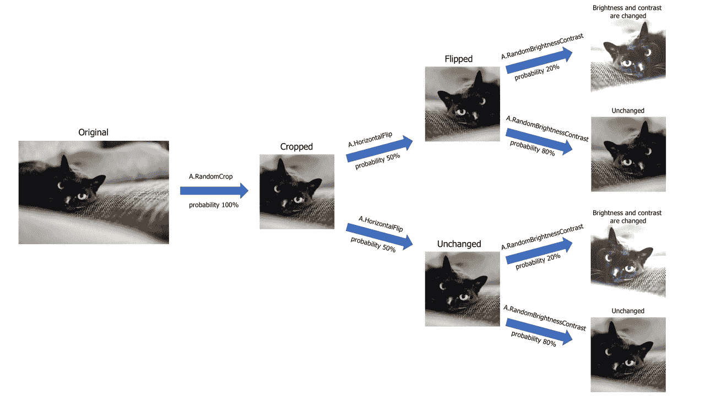

Albumentations是一个用于图像数据增强的开源Python库，旨在为深度学习项目提供灵活且高效的数据增强工具。它提供了许多各种各样的图像增强操作，可以应用于图像分类、目标检测、语义分割等不同的任务。

https://albumentations.ai/docs/getting_started/image_augmentation/

https://demo.albumentations.ai/

下面的代码展示了如何使用PyTorch的 DataLoader 结合 albumentations 库进行数据加载和增强。这主要用于训练深度学习模型时，对训练数据进行批量加载和数据增强操作。

```
import albumentations as A
train_loader = torch.utils.data.DataLoader(
    XunFeiDataset(train_path[:-10],
            A.Compose([
            A.RandomRotate90(),
            A.RandomCrop(120, 120),
            A.HorizontalFlip(p=0.5),
            A.RandomContrast(p=0.5),
            A.RandomBrightnessContrast(p=0.5),
        ])
    ), batch_size=2, shuffle=True, num_workers=1, pin_memory=False
)
```

实践步骤：

+   阅读albumentations库的文档，增加额外的2种数据增强方法。

+   记录下训练时间和模型精度。

# 任务3 - 进阶4选2：模型交叉验证

交叉验证（Cross-Validation，简称CV）是一种在机器学习中用于评估模型性能和选择参数的技术。它的目标是充分利用有限的数据，减少因数据分布不均匀或随机性带来的评估误差。交叉验证将数据分成多个子集（折叠），然后多次训练和测试模型，以获取更准确的性能评估。

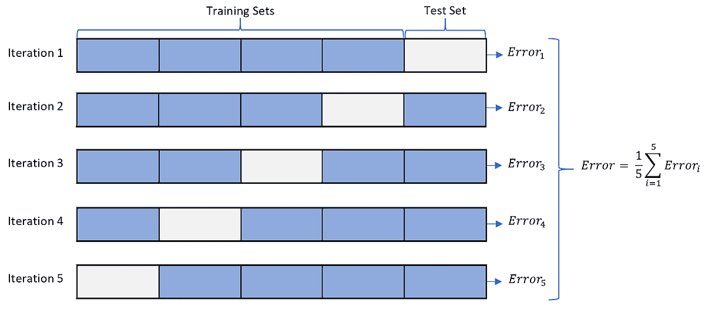

在原始的代码中使用了最后10个样本作为验证集：

```

train_loader = torch.utils.data.DataLoader(
    XunFeiDataset(train_path[:-10],
    ...
)

val_loader = torch.utils.data.DataLoader(
    XunFeiDataset(train_path[-10:],
    ...
)
```

如下使用交叉验证，伪代码逻辑如下：

```
from sklearn.model_selection import train_test_split, StratifiedKFold, KFold
skf = KFold(n_splits=10, random_state=233, shuffle=True)

for fold_idx, (train_idx, val_idx) in enumerate(skf.split(train_path, train_path)):

    train_loader = torch.utils.data.DataLoader(
        XunFeiDataset(train_path[train_idx],
        ...
    )
    
    val_loader = torch.utils.data.DataLoader(
        XunFeiDataset(train_path[val_idx],
        ...
    )
    
    model = XunFeiNet()
    model = model.to(&#x27;cuda&#x27;)
    criterion = nn.CrossEntropyLoss().cuda()
    optimizer = torch.optim.AdamW(model.parameters(), 0.001)
    
    for _  in range(3):
        train_loss = train(train_loader, model, criterion, optimizer)
        val_acc  = validate(val_loader, model, criterion)
        train_acc = validate(train_loader, model, criterion)
        
        print(train_loss, train_acc, val_acc)
        torch.save(model.state_dict(), &#x27;./resnet18_fold{0}.pt&#x27;.format(fold_idx))
```

实践步骤：

+   补全上面交叉验证的代码，训练多个模型，并保存模型权重。

+   思考如何划分验证集更加合理，KFold是随机划分方法。

# 任务3 - 进阶4选2：测试集增强

测试集增强（Test-time Augmentation，简称TTA）是一种在模型推理阶段（测试阶段）应用数据增强技术的方法。通常，在模型训练阶段使用数据增强是为了提升模型的鲁棒性和泛化能力，但是在真实应用中，对于单个样本的预测，模型可能会因为不同的变换产生不同的预测结果。为了减少这种不确定性，可以在预测时对同一个样本应用多种不同的数据增强方式，然后将预测结果进行集成，最终得到一个更稳定的预测。

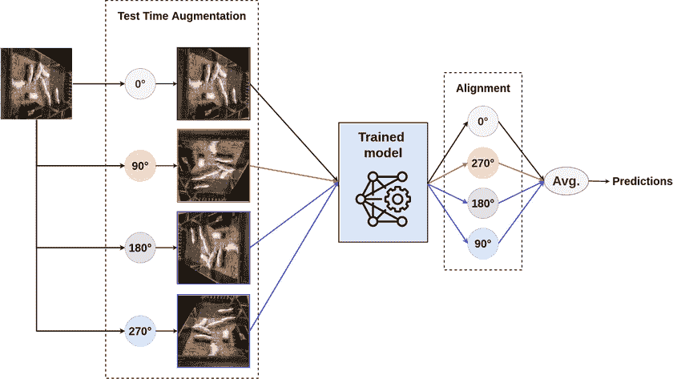

如下伪代码是结合了多折和测试集数据增强：

```
pred = None

for model_path in [&#x27;resnet18_fold0.pt&#x27;, &#x27;resnet18_fold1.pt&#x27;, &#x27;resnet18_fold2.pt&#x27;,
                  &#x27;resnet18_fold3.pt&#x27;, &#x27;resnet18_fold4.pt&#x27;, &#x27;resnet18_fold5.pt&#x27;,
                  &#x27;resnet18_fold6.pt&#x27;, &#x27;resnet18_fold7.pt&#x27;, &#x27;resnet18_fold8.pt&#x27;,
                  &#x27;resnet18_fold9.pt&#x27;]:
         
    model = XunFeiNet()
    model = model.to(&#x27;cuda&#x27;)
    model.load_state_dict(torch.load(model_path))
    
    for _ in range(10):
        if pred is None:
            pred = predict(test_loader, model, criterion)
        else:
            pred += predict(test_loader, model, criterion)
```

实践步骤：

+   补全上面预测的代码，从多个模型进行预测。

+   计算一下对同一个样本预测的次数。

# 附录

## **AI****环境配置：**

+   **视频讲解：**AI夏令营：手把手带你配置AI环境_哔哩哔哩_bilibili

+   **图文材料：**https://gitee.com/anine09/learn-python-the-smart-way-v2/blob/main/slides/chapter_0-Installation.ipynb

## **其他材料**

+   **python环境的搭建请参考：**

+   Mac设备：Mac上安装Anaconda最全教程

+   Windows设备：[A](https://blog.csdn.net/fan18317517352/article/details/123035625)naconda超详细安装教程(Windows环境下)_菜鸟1号!!的博客-CSDN博客_windows安装anaconda

+   Jupyter 编辑器的使用请参考：

+   Jupyter Notebook最全使用教程，看这篇就够了！