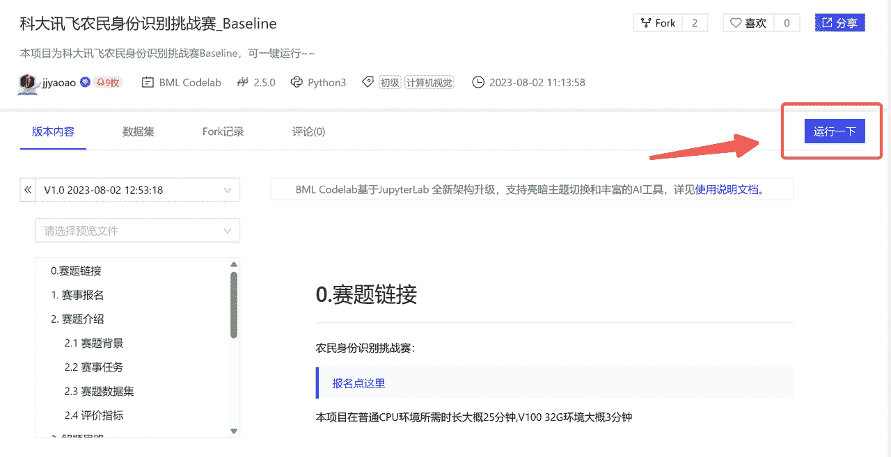
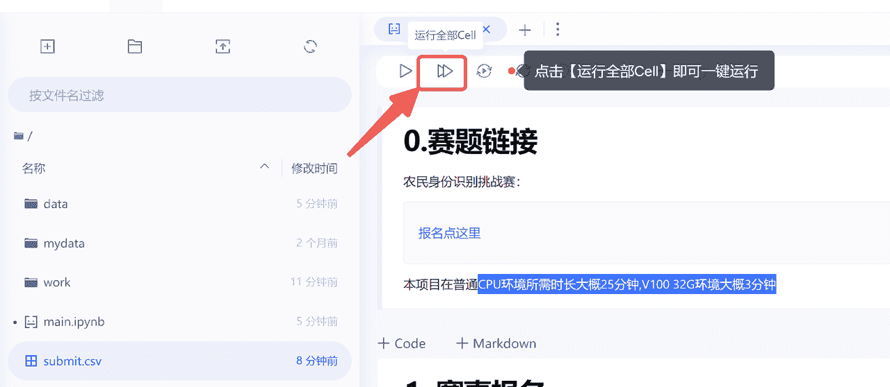
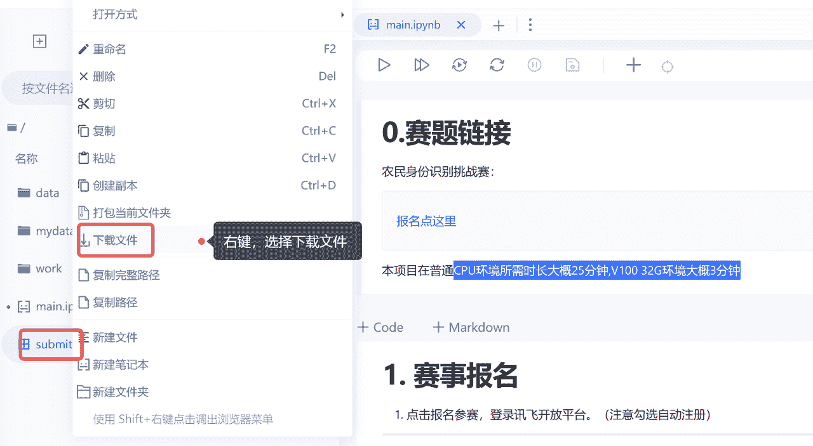
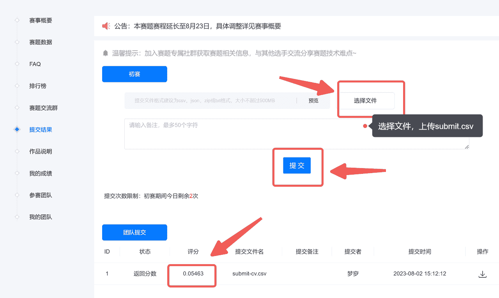
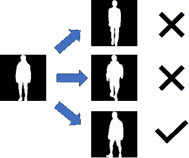
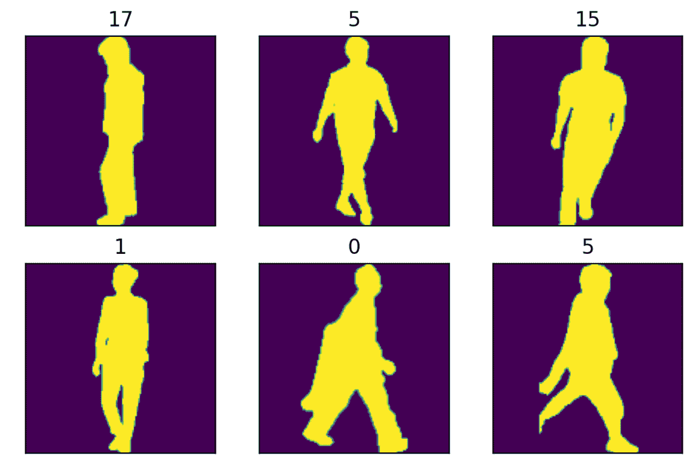
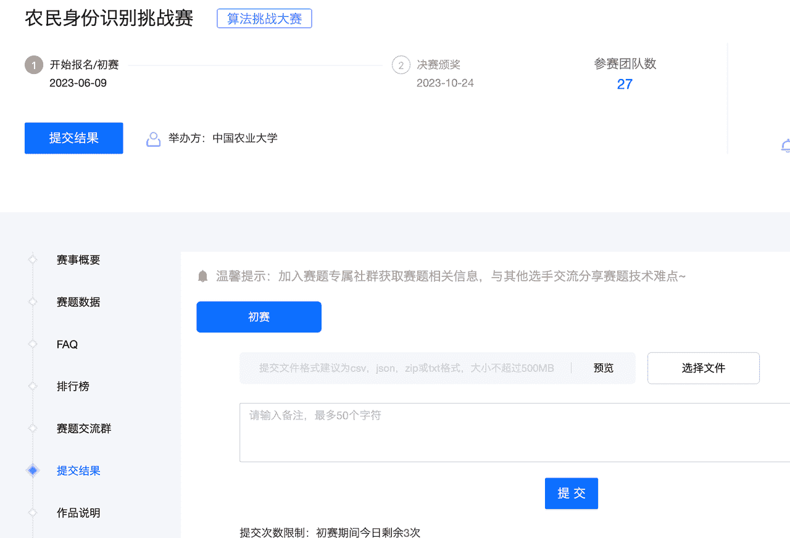

# AI夏令营（第二期） - CV赛事实践教程

> 来源：[https://datawhaler.feishu.cn/docx/NqqEd7XKUoMY9oxpkPqcfMVqnWd](https://datawhaler.feishu.cn/docx/NqqEd7XKUoMY9oxpkPqcfMVqnWd)

> 本教程会带领大家项目制学习，由浅入深，逐渐进阶。从竞赛通用流程与跑通最简的Baseline，到深入各个竞赛环节，精读Baseline与进阶实践技巧的学习。

> 千里之行，始于足下，从这里，开启你的 AI 学习之旅吧！

> —— Datawhale贡献者团队

| 学习任务 | 相关直播 |
| --- | --- |
| 任务一： | [开营直播&竞赛流程科普分享](https://datawhaler.feishu.cn/docx/GEN4dJPwLoHChxxGqXsc0IQ6nse#part-KVabdd6V5oamHlxF7AScvr3qnQb) |
| 直播：竞赛进阶上分思路与技巧 | |

## 在线版本Baseline

> Baseline是一份简易的入门教程，可以帮助同学们迈出 AI 训练大师之路的第一步。建议入门的同学可以暂时不用着急去弄懂各个代码的原理，先跑通代码，动手实践，看到成绩。

快速跑通全流程，我们基于百度AI Studio，将本教程Baseline部署在线上平台，可一键fork运行代码，看到成绩。

一键运行：https://aistudio.baidu.com/aistudio/projectdetail/6600383?sUid=2554132&shared=1&ts=1690952028201

+   运行时，选择2核8G的CPU环境所需时长大概25分钟，V100 32G环境大概3分钟，请耐心等待





输出`submit.csv`文件后，右键可下载到本地，在[赛题提交结果](https://challenge.xfyun.cn/topic/info?type=peasant-identity&option=tjjg&ch=ymfk4uU)提交文件，获取分数。





## 赛题解析与解题思路

> 农民身份识别挑战赛：

> https://challenge.xfyun.cn/topic/info?type=peasant-identity&ch=ymfk4uU

> 举办方：中国农业大学

### 赛题背景

机器虽然被大量用到农业生产中，但人还是不可或缺的因素。通过农民身份识别，可以真实客观地记录农民的状态，为农场管理和农产品追溯提供真实的客观数据；较之直接存储视频，可以有效地降低存储空间；自动识别也比人工监管，大幅度提高效率，减少人工成本。

### 赛事任务

农民身份识别需要对农民进行分类，本次大赛提供了中国农业大学实验室视频制成的图像序列。参赛选手先对图像进行预处理，并制作样本，对图像中的农民进行识别。选手需要自行训练模型，并上传自己训练好的模型和权重。

### 赛题数据集

本次比赛为参赛选手提供了25名农民身份，每个身份包含10段视频制成的图像序列，选手需要对图像序列进行预处理，打标签，并对农民进行身份识别。



### 评价指标

本模型依据提交的结果文件，采用Macro-F1进行评价。

### 解题思路

本题的任务是对图像进行预处理，并制作样本，对图像中的农民进行识别，是典型的图像分类问题。

+   输入：10段视频制成的图像序列，

+   输出：图像类别



图像分类是计算机视觉领域的一个重要任务，旨在将输入的图像分为不同的预定义类别。图像分类在很多领域都有广泛的应用，包括图像识别、人脸识别、自动驾驶、医学图像分析等。

这项任务的目标是让计算机能够理解和识别图像的内容，并将其归类到已知的类别中。图像分类一般的处理流程为：

+   数据收集和准备：在数据竞赛中，赛题设计方已经准备好数据，大家只需下载即可。

+   需要收集具有不同类别标签的图像数据集，这些图像可以手动标记或通过自动化方法获得。

+   数据集应包含足够的样本来代表每个类别，并且需要进行预处理和标准化，以便在模型训练过程中获得良好的性能。

+   特征提取：在图像分类中，常用的特征提取方法是图像特征统计 或 使用卷积神经网络（CNN）。

+   图像特征统计是指对图像中的像素或图像区域进行统计分析，以提取和描述图像的特征信息

+   CNN是一种专门设计用于处理图像数据的神经网络架构，能够有效地从原始像素中学习和提取特征。

+   通过一系列的卷积层、池化层和全连接层，CNN能够自动学习具有区分性的图像特征。

+   模型训练：在模型训练阶段，使用标记好的图像数据集来训练图像分类模型。

+   通过将图像输入到模型中，并根据预定义的类别标签进行监督学习，模型逐渐学会从图像中提取有用的特征，并预测图像的类别。

+   常用的训练算法包括梯度下降和反向传播，用于调整模型的权重和偏置，以最小化预测错误。

+   模型评估和优化：训练完成后，需要对模型进行评估和优化。

+   通常会将一部分未在训练中使用过的图像数据作为测试集，用于评估模型在新数据上的性能。

+   评估指标可以包括准确率（Accuracy）、精确率（Precision）、召回率（Recall）和F1值等。

+   如果模型性能不理想，可以通过调整模型架构、增加训练数据、调整超参数等方法进行优化。

## Baseline实践

### 图像特征统计（传统方法）

刚刚我们完成了基本的问题分析，在这个 Baseline 中，我们使用图像特征统计方法来解决本次问题，会带领大家跑通数据收集与准备、特征提取、模型训练、模型评估与优化、结果输出的全部竞赛实践流程。

图像特征统计是指对图像中的像素或图像区域进行统计分析，以提取和描述图像的特征信息。

1.  占比特征：通过统计图像中不同像素值或颜色通道的像素数量，计算其在整个图像中的比例或占比。

1.  边缘特征：边缘是图像中像素值或颜色发生剧烈变化的区域，通常表示物体的边界或纹理的边界。

1.  纹理特征：描述了图像中的纹理信息，反映了图像的细节和结构。

方法优缺点（运行时间5分钟，不要GPU）：

+   思路简单，不需要GPU就可以运行完成

+   精度较差，且容易受到形态比较形似的影响

### 导入模块

[导入我们本次Baseline代码所需的模块](https://aistudio.baidu.com/aistudio/projectdetail/6600383?sUid=2554132&shared=1&ts=1690952028201)（直接用云环境Baseline可30s全部跑通，如希望尝试本地，参考附录 - 实践环境配置）

```
import os, sys, glob, argparse
from PIL import Image
import cv2
import pandas as pd
import numpy as np
from tqdm import tqdm

from sklearn.neighbors import KNeighborsClassifier
from sklearn.ensemble import RandomForestClassifier
from sklearn.model_selection import cross_val_predict
from sklearn.metrics import classification_report
```

### 数据收集与准备

在赛题主页下载数据，读取数据集。

```
# 读取数据集
train_path = glob.glob('./农民身份识别挑战赛公开数据/train/*')
test_path = glob.glob('./农民身份识别挑战赛公开数据/test/*')

train_path.sort()
test_path.sort()

train_df = pd.read_csv('农民身份识别挑战赛公开数据/train.csv')
train_df = train_df.sort_values(by='name')
train_label = train_df['label'].values
```

### 特征提取

构建占比特征、边缘特征、纹理特征

```
# 读取图像特征
def image_feat(path):
    img = cv2.imread(path, 0)
    img = img.astype(np.float32)
    feat = [
        (img != 0).sum(),              # 非零像素的数量
        (img == 0).sum(),              # 零像素的数量
        img.mean(),                    # 平均值
        img.std(),                     # 标准差
        len(np.where(img.mean(0))[0]), # 在列方向上平均值不为零的数量
        len(np.where(img.mean(1))[0]), # 在行方向上平均值不为零的数量
        img.mean(0).max(),             # 列方向上的最大平均值
        img.mean(1).max()              # 行方向上的最大平均值
    ]
    return feat
```

### 模型训练、评估与优化

采取K近邻的算法构建模型

```
# 训练集特征
train_feat = []
for path in tqdm(train_path):
    train_feat += [image_feat(path)]

# 测试集特征
test_feat = []
for path in tqdm(test_path):
    test_feat += [image_feat(path)]
    
# 训练集交叉验证
train_pred = cross_val_predict(
    KNeighborsClassifier(),
    np.array(train_feat),
    train_label
)
print(classification_report(train_label, train_pred))

# 模型训练与预测
model = KNeighborsClassifier()
model.fit(
    np.array(train_feat),
    train_label
)
test_pred = model.predict(np.array(test_feat))
```

### 结果输出

生成测试集提交结果，输出`submit.csv`。

```
# 生成测试集提交结果
submit = pd.DataFrame(
    {
        'name': [x.split('/')[-1] for x in test_path],
        'label': test_pred
})
submit = submit.sort_values(by='name')
submit.to_csv('submit.csv', index=None)
```

## 进阶实践

### CNN（深度学习方法）

在baseline阶段，我们使用图像特征统计的传统方法完成了解决图像分类的全部流程，得到了基础的分数。

在进阶实践部分，将采用CNN模型来解决图像分类问题。

卷积神经网络（Convolutional Neural Network，CNN）是一种深度学习模型，广泛用于图像识别、计算机视觉和模式识别任务中。CNN 在处理具有网格结构数据（如图像）时表现出色，它能够自动学习和提取图像中的特征，并在分类、定位和分割等任务中取得优秀的性能。

方法优缺点（运行时间20分钟，如果有GPU可以更快）：

+   CNN带来的精度更好，但需要训练更长的时间

+   CNN模型调优需要GPU

### 导入模块

导入我们本次Baseline代码所需的模块，以下为PyTorch版本（直接用PaddlePaddle云环境Baseline可3min全部跑通，本地可参考附录 - 实践环境配置，配置深度学习环境）

```
import os, sys, glob, argparse
import pandas as pd
import numpy as np
from tqdm import tqdm

import cv2, time
from PIL import Image
from sklearn.model_selection import train_test_split, StratifiedKFold, KFold

import torch
torch.manual_seed(0)
torch.backends.cudnn.deterministic = False
torch.backends.cudnn.benchmark = True

import torchvision.models as models
import torchvision.transforms as transforms
import torchvision.datasets as datasets
import torch.nn as nn
import torch.nn.functional as F
import torch.optim as optim
from torch.autograd import Variable
from torch.utils.data.dataset import Dataset

# Check if GPU is available
if torch.cuda.is_available():
    device = torch.device("cuda")
else:
    device = torch.device("cpu")
```

### 数据收集与准备

在赛题主页下载数据，读取数据集，自定义数据集（带有图片缓存的逻辑），定义训练集，验证集，测试集。


# 读取数据集

```
train_path = glob.glob('./农民身份识别挑战赛公开数据/train/*')
test_path = glob.glob('./农民身份识别挑战赛公开数据/test/*')

train_path.sort()
test_path.sort()

train_df = pd.read_csv('农民身份识别挑战赛公开数据/train.csv')
train_df = train_df.sort_values(by='name')
train_label = train_df['label'].values

# 自定义数据集
# 带有图片缓存的逻辑
DATA_CACHE = {}
class XunFeiDataset(Dataset):
    def __init__(self, img_path, img_label, transform=None):
        self.img_path = img_path
        self.img_label = img_label
        if transform is not None:
            self.transform = transform
        else:
            self.transform = None
    def __getitem__(self, index):
        if self.img_path[index] in DATA_CACHE:
            img = DATA_CACHE[self.img_path[index]]
        else:
            img = cv2.imread(self.img_path[index])
            DATA_CACHE[self.img_path[index]] = img
        if self.transform is not None:
            img = self.transform(image = img)['image']
        img = img.transpose([2, 0, 1])
        return img, torch.from_numpy(np.array(self.img_label[index]))
    def __len__(self):
        return len(self.img_path)

import albumentations as A
# 训练集
train_loader = torch.utils.data.DataLoader(
    XunFeiDataset(train_path[:-1000], train_label[:-1000],
            A.Compose([
            A.RandomRotate90(),
            A.Resize(256, 256),
            A.RandomCrop(224, 224),
            A.HorizontalFlip(p=0.5),
            A.RandomContrast(p=0.5),
            A.RandomBrightnessContrast(p=0.5),
            A.Normalize(mean=(0.485, 0.456, 0.406), std=(0.229, 0.224, 0.225))
        ])
    ), batch_size=30, shuffle=True, num_workers=1, pin_memory=False
)

# 验证集
val_loader = torch.utils.data.DataLoader(
    XunFeiDataset(train_path[-1000:], train_label[-1000:],
            A.Compose([
            A.Resize(256, 256),
            A.RandomCrop(224, 224),
            A.Normalize(mean=(0.485, 0.456, 0.406), std=(0.229, 0.224, 0.225))
        ])
    ), batch_size=30, shuffle=False, num_workers=1, pin_memory=False
)

# 测试集
test_loader = torch.utils.data.DataLoader(
    XunFeiDataset(test_path, [0] * len(test_path),
            A.Compose([
            A.Resize(256, 256),
            A.RandomCrop(224, 224),
            A.HorizontalFlip(p=0.5),
            A.RandomContrast(p=0.5),
            A.Normalize(mean=(0.485, 0.456, 0.406), std=(0.229, 0.224, 0.225))
        ])
    ), batch_size=2, shuffle=False, num_workers=1, pin_memory=False
)
```

## 特征提取

自定义`CNN`模型，我们本次采取`ResNet18`来提取图像特征。

```
class XunFeiNet(nn.Module):
    def __init__(self):
        super(XunFeiNet, self).__init__()
        model = models.resnet18(True)
        model.avgpool = nn.AdaptiveAvgPool2d(1)
        model.fc = nn.Linear(512, 25)
        self.resnet = model
    def forward(self, img):
        out = self.resnet(img)
        return out

model = XunFeiNet()
model = model.to(device)
criterion = nn.CrossEntropyLoss().cuda()
optimizer = torch.optim.AdamW(model.parameters(), 0.001)
```

## 模型训练、评估与优化

生成测试集提交结果，输出`submit.csv`。

```
# 模型训练
def train(train_loader, model, criterion, optimizer):
    model.train()
    train_loss = 0.0
    for i, (input, target) in enumerate(train_loader):
        input = input.to(device)
        target = target.to(device)
        output = model(input)
        loss = criterion(output, target)
        optimizer.zero_grad()
        loss.backward()
        optimizer.step()

        if i % 100 == 0:
            print('Train loss', loss.item())

        train_loss += loss.item()
    return train_loss / len(train_loader)

# 模型验证
def validate(val_loader, model, criterion):
    model.eval()
    val_acc = 0.0

    with torch.no_grad():
        end = time.time()
        for i, (input, target) in enumerate(val_loader):
            input = input.to(device)
            target = target.to(device)
            output = model(input)
            loss = criterion(output, target)

            val_acc += (output.argmax(1) == target).sum().item()

    return val_acc / len(val_loader.dataset)

# 模型预测
def predict(test_loader, model, criterion):
    model.eval()
    val_acc = 0.0

    test_pred = []
    with torch.no_grad():
        end = time.time()
        for i, (input, target) in enumerate(test_loader):
            input = input.to(device)
            target = target.to(device)
            output = model(input)
            test_pred.append(output.data.cpu().numpy())

    return np.vstack(test_pred)

for _ in range(1):
    train_loss = train(train_loader, model, criterion, optimizer)
    val_acc = validate(val_loader, model, criterion)
    train_acc = validate(train_loader, model, criterion)
    print(train_loss, train_acc, val_acc)
```

## 结果输出

```
# 对测试集多次预测
pred = None
for _ in range(3):
    if pred is None:
        pred = predict(test_loader, model, criterion)
    else:
        pred += predict(test_loader, model, criterion)
submit = pd.DataFrame(
    {
        'name': [x.split('/')[-1] for x in test_path],
        'label': pred.argmax(1)
    }
)

# 生成提交结果
submit = submit.sort_values(by='name')
submit.to_csv('submit.csv', index=None)
```

+ 在提交结果处提交，提交`submit.csv`文件（入门同学可以使用思路1），在排名结果页查看自己的成绩排名。



# 附录

## 实践环境配置

AI环境配置：

+ **视频讲解：**AI夏令营：手把手带你配置AI环境_哔哩哔哩_bilibili

+ **图文材料：**https://gitee.com/anine09/learn-python-the-smart-way-v2/blob/main/slides/chapter_0-Installation.ipynb

## 工具使用与提分思路

+ 竞赛实践路线：[竞赛实践路线分享](https://datawhaler.feishu.cn/docx/EJ2Edl0hXoIWwuxO15CcEj9Wnxn)

+ 数据竞赛入门讲义：[《数据竞赛入门讲义》.pdf](https://datawhaler.feishu.cn/file/IXdDbOBgIoZbtvxLukqc2432nQd?from=from_copylink)

+ 李沐动手学深度学习

+ [残差网络 ResNet](https://www.bilibili.com/video/BV1bV41177ap) 视频讲解

+ ResNet图文讲解：https://zh-v2.d2l.ai/chapter_convolutional-modern/resnet.html
