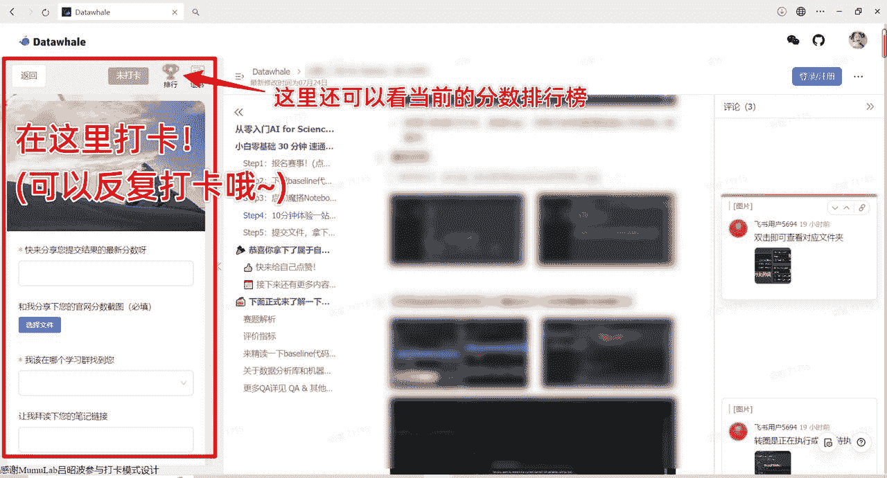
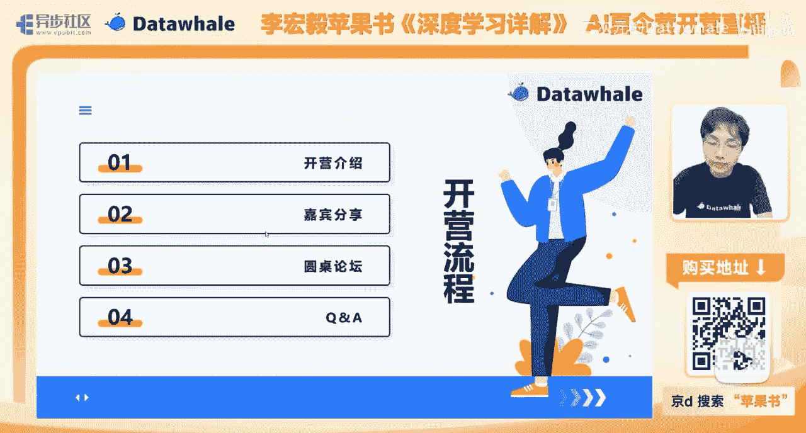
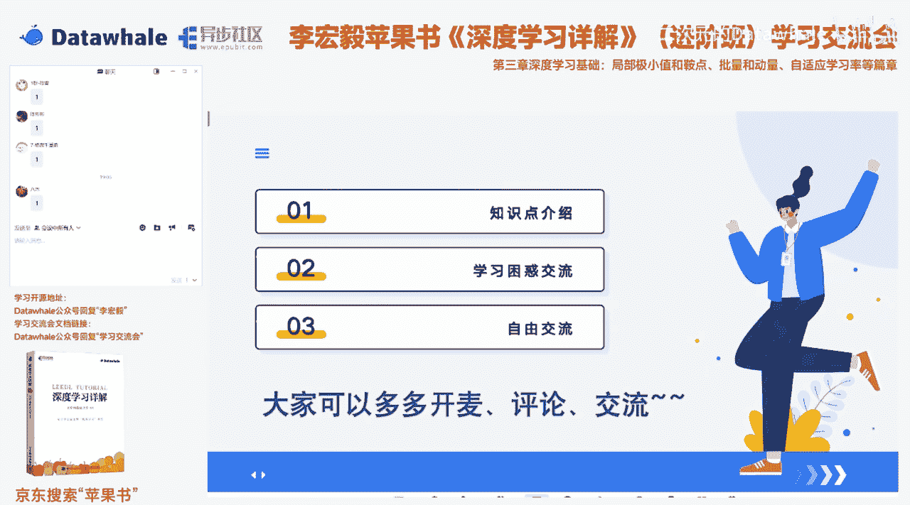

# 跟李宏毅学深度学习(进阶) - 学习说明

> 来源：[https://datawhaler.feishu.cn/docx/XnZUdFsUBov9CbxKUSqcqD51nEd](https://datawhaler.feishu.cn/docx/XnZUdFsUBov9CbxKUSqcqD51nEd)

<https://datawhaler.feishu.cn/sync/Zdm7dV7rjszZpSbOKJPcajeEnwg>

> 前面四期夏令营，我们大多是通过赛事来实践 机器学习/深度学习/大模型 ，解决特定场景的问题

> [**在第五期，Dat**](https://book.douban.com/subject/36997460/)awhale开源项目孵化的《深度学习详解》新书发布之际，我们一起抓住暑假的尾巴~

>

> 通过[**《深度学习详解》**](https://book.douban.com/subject/36997460/)和 李宏毅老师 21年的机器学习课程视频，

> 学习/复习一下 **深度学习 **的理论 吧~

>

> [**《深度学习详解》**](https://book.douban.com/subject/36997460/)主要内容源于[《机器学习》（2021年春）](https://speech.ee.ntu.edu.tw/~hylee/ml/2021-spring.html)，选取了[《机器学习》（2017年春）](https://speech.ee.ntu.edu.tw/~hylee/ml/2017-spring.php) 的部分内容，在这些基础上进行了一定的原创，补充了不少除这门公开课之外的深度学习相关知识。

>

> 为了尽可能地降低阅读门槛，笔者对这门公开课的精华内容进行选取并优化，对所涉及的公式都给出详细的推导过程，对较难理解的知识点进行了重点讲解和强化，以方便读者较为轻松地入门。

>

> 在理论严谨的基础上，本书保留了公开课中大量生动有趣的例子，帮助读者从生活化的角度理解深度学习的概念、建模过程和核心算法细节，包括——

+   卷积神经网络、Transformer、生成模型、自监督学习（包括 BERT 和 GPT）等深度学习常见算法，

+   对抗攻击、领域自适应、强化学习、元学习、终身学习、网络压缩等深度学习相关进阶算法。

>

> 开源教程还[获得了李宏毅老师的推荐~](https://twitter.com/HungyiLee2/status/1754042391211004235)

> 链接指路：https://github.com/datawhalechina/leedl-tutorial（欢迎大家star~）

# 学习目标

## 任务说明

| ## 任务 | ## 截止时间 | ## 内容说明 |
| --- | --- | --- |
| **Task1** | 2024年8月27日 23:59 | 1.  开营直播：AI学习路线 |
| **Task2** | 2024年8月31日 23:59 | 1.  学习 深度学习基础：线性模型自适应学习率（文字+视频） |
| **Task3** | **2024年9月3日 23:59** | 1.  学习 **批量归一化**（文字+视频） |
| **选修** |  | 1.  学习 **自注意力机制**（文字+视频） |

## 打卡说明

+   教程左侧显示栏完成，每个任务打卡表单不一样。

+   同一个Task任务打卡为覆盖形式，比如填了笔记链接打卡后，再不填笔记链接打卡就会【没有笔记链接】，辛苦大家注意再加一下笔记链接哈

## 笔记说明

[夏令营优秀笔记](https://exn8g66dnwu.feishu.cn/sheets/M4LFsR8oAhnFKZtGdZHcDJn4ncg?from=from_copylink)

**本期笔记要求：文章标题带上“Dataw**hale X 李宏毅苹果书 AI夏令营”

1.  笔记规则：

+   为了鼓励大家多表达多输出，方便助教和其他学习者进行笔记的查看，更好地进行学习交流

+   **我们【仅推荐】大家在 ****CSDN**、掘金、知乎、📕、bilibili、👸号、博客园 发布笔记

+   ！！！其余链接均不会进行查看并评选，请大家注意！！！

# 学习内容

## 文字教程 & 视频教程

<https://datawhaler.feishu.cn/sync/REoRdGS5dsmMEAbXWvJcPAkcnWe>

多维表格（V7IybSm6JaBRGmsXxeFcVe7SnMf_tblihuxaTJF2bezm）

<https://datawhaler.feishu.cn/sync/O1rYdch7Esw3gXbkN9CcyI30nBf>

## 直播规划

| ## **直播主题** | ## **直播时间** | ## **直播内容简介** |
| --- | --- | --- |
| [**开营直播**](https://www.bilibili.com/video/BV1ZdsxeoEkX/)[**  (点击跳转**](https://www.bilibili.com/video/BV1ZdsxeoEkX/)) | 2024年8月26日 20:00 |  |
| [**第三章学习交流会**](https://www.bilibili.com/video/BV1XKHKeUEEd)[**  (点击跳转**](https://www.bilibili.com/video/BV1XKHKeUEEd)) | 2024年8月27日 19:00 |  |
| **第四章学习交流会** | **2024年9月****2****日 19:00** | 1.  《深度学习详解》第四章串讲 |

# 学习激励

<https://datawhaler.feishu.cn/sync/MKmVdritesWegubwogmcipfSnxh>

# 欢迎报名参与学习交流会分享~

如您想参与学习交流会分享你的李宏毅深度学习-学习故事等，欢迎在你的学习群联系负责人报名哦

# 学习活动设计贡献鸣谢~

> 感谢以下同学对李宏毅深度学习（进阶）学习规划和内容设计提出宝贵建议

+   杭州电子科技大学，林炜智，zcj

+   中国地质大学，汪润东

+   盐城师范学院，秦天霞

+   福州大学，蔡鋆捷

+   甘肃政法大学，陈辅元

>

## 更多QA详见[ QA & 其他彩蛋](https://datawhaler.feishu.cn/wiki/BdEMwwcDoiUf72k0zADchzO2n1e)！

### 另外别忘了写笔记打卡呀！！~

### 及时思考、沉淀和产出能让你的学习事半功倍！