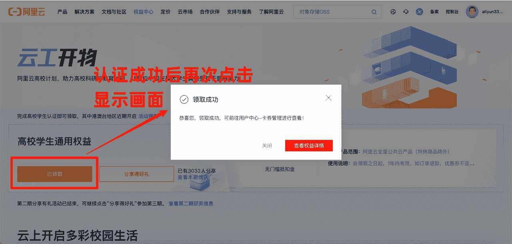
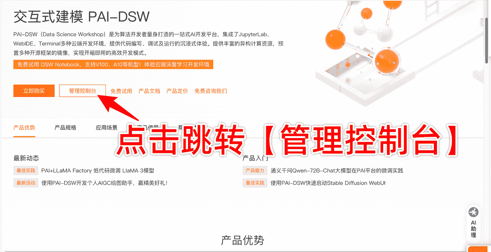
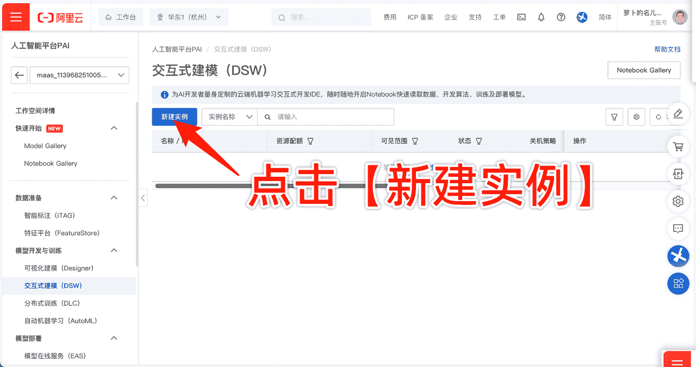
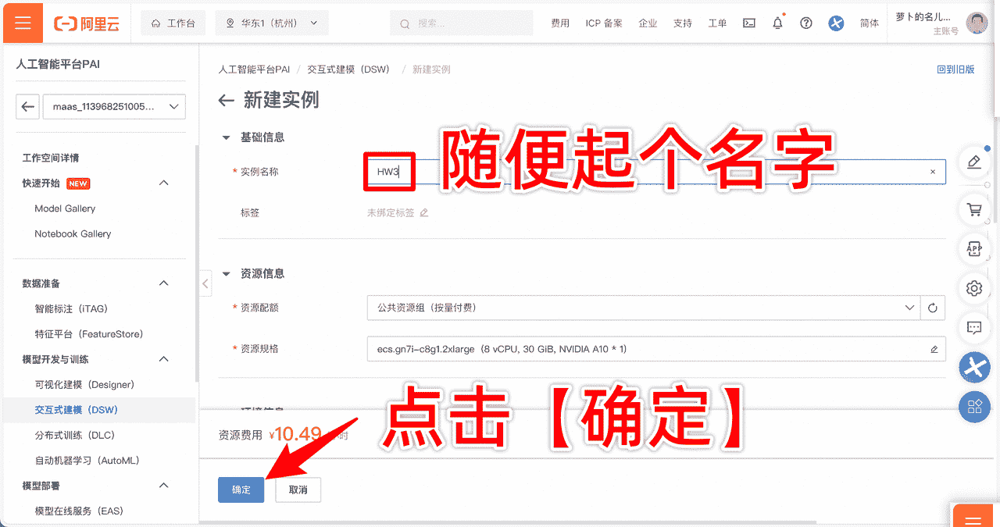
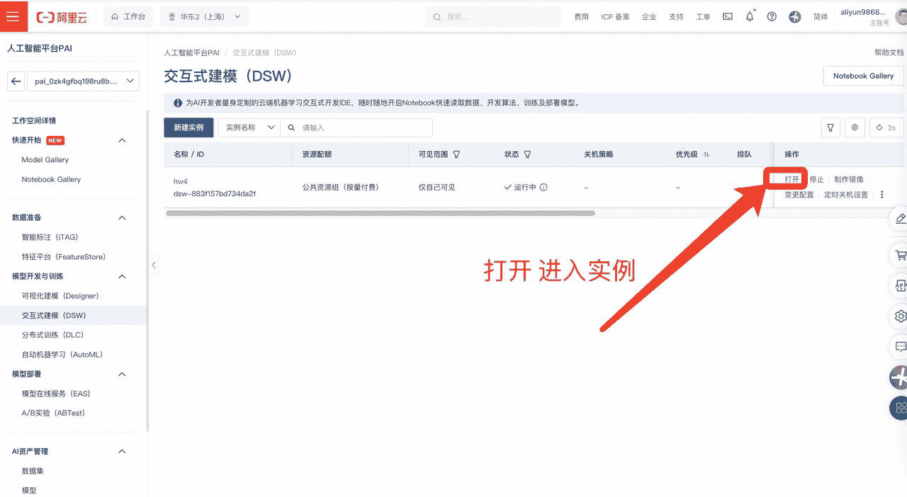
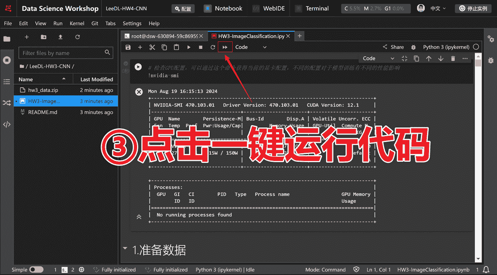
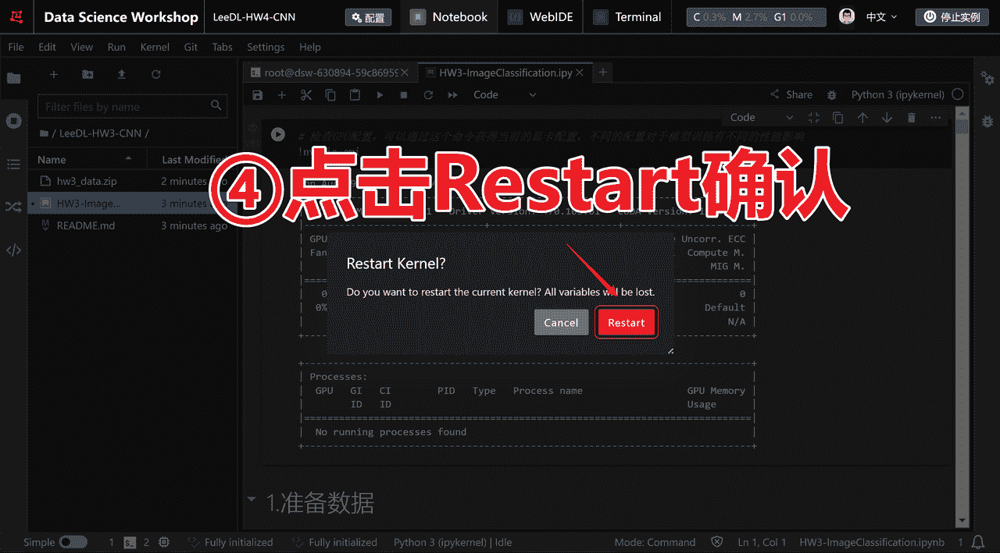
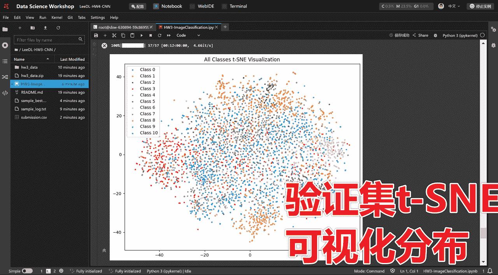
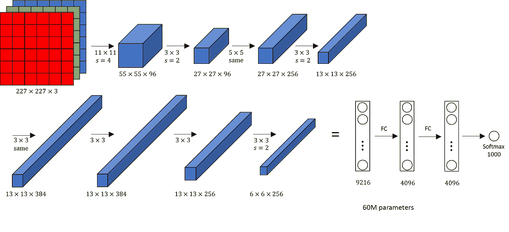
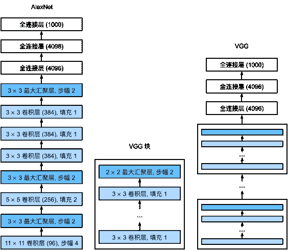

# Task2.3（实践任务）：HW3(CNN)卷积神经网络-图像分类

> 来源：[https://datawhaler.feishu.cn/docx/E7bVdtLd7o0MobxBGdycz4rbnph](https://datawhaler.feishu.cn/docx/E7bVdtLd7o0MobxBGdycz4rbnph)

> 本文为《深度学习详解》的Homework3 CNN的内容，为学习者提供了10分钟一键运行的体验和详细的注释补充

>

> Homework3的内容是通过利用卷积神经网络架构，通过一个较小的10种食物的图像的数据集训练一个模型完成图像分类的任务。

>

> Ps. 纸质版教材指路（享五折优惠~）：https://u.jd.com/muCV8tI

# 15分钟速通Homework3

## [Step1：准备算力](https://university.aliyun.com/mobile?userCode=1h9ofupt)

+   学生认证云工开物，领取算力抵扣金（点击即可跳转）

> 链接：https://university.aliyun.com/mobile?userCode=1h9ofupt




+   在阿里云PAI-DSW创建算力（点击即可跳转）

> 链接：https://www.aliyun.com/activity/bigdata/pai/dsw









## Step2：一键运行Notebook

### 获得的数据集和代码文件

**启动创建的实例，等待几分钟直到启动完成，然后点击进入JupyterLab。接着，点击“Terminal**”打开命令行窗口，输入以下代码并按下回车键。稍等片刻，数据集和代码文件（notebook）将会自动下载，大约需要一分钟。

> git lfs install

> git clone https://www.modelscope.cn/datasets/Datawhale/LeeDL-HW3-CNN.git


### 一键运行代码

**点击打开****LeeDL-HW3-CNN****文件夹**


**点击**HW3-ImageClassification.ipynb






**等待约12分钟后即可获得结果。通过单元格（cell）查看模型的训练准确率。生成的**`submission.csv`文件包含分类结果，可提交至Kaggle进行评估。


代码将打印出当前模型的结构，并绘制两个数据集的图像分析和分类结果分布图，以帮助更好地理解模型的表现。




## Step3：运行完成后记得停止实例

<https://datawhaler.feishu.cn/sync/BSzAdp3RrsPXjybwLJycp3qJnEh>

---

# 代码详解

卷积神经网络是深度学习中的一个非常重要的分支，本作业提供了进行图像分类任务的基本范式。

+   准备数据

+   训练模型

+   应用模型

要完成一个深度神经网络训练模型的代码，大概需要完成下面的内容：

1.  导入所需要的库/工具包

1.  数据准备与预处理

1.  定义模型

1.  定义损失函数和优化器等其他配置

1.  训练模型

1.  评估模型

1.  进行预测

此范式不仅适用于图像分类任务，对于广泛的深度学习任务也是适用的。

#### 1. 导入所需要的库/工具包

这段代码导入了进行图像处理和深度学习任务所需的各种Python库和模块，涵盖了数据处理、神经网络构建、数据集操作、图像转换和显示进度条等功能，为后续的模型训练和评估做好准备。

```
# 导入必要的库
import numpy as np
import pandas as pd
import torch
import os
import torch.nn as nn
import torchvision.transforms as transforms
from PIL import Image
# “ConcatDataset” 和 “Subset” 在进行半监督学习时可能是有用的。
from torch.utils.data import ConcatDataset, DataLoader, Subset, Dataset
from torchvision.datasets import DatasetFolder, VisionDataset
# 这个是用来显示进度条的。
from tqdm.auto import tqdm
import random
```

此外，为了确保实验的可重复性，设置随机种子，并对CUDA进行配置以确保确定性：

```
# 设置随机种子以确保实验结果的可重复性
myseed = 6666

# 确保在使用CUDA时，卷积运算具有确定性，以增强实验结果的可重复性
torch.backends.cudnn.deterministic = True
torch.backends.cudnn.benchmark = False

# 为numpy和pytorch设置随机种子
np.random.seed(myseed)
torch.manual_seed(myseed)

# 如果使用CUDA，为所有GPU设置随机种子
if torch.cuda.is_available():
    torch.cuda.manual_seed_all(myseed)
```

#### 2. 数据准备与预处理

数据准备包括从指定路径加载图像数据，并对其进行预处理。作业中对图像的预处理操作包括调整大小和将图像转换为Tensor格式。为了增强模型的鲁棒性，可以对训练集进行数据增强。相关代码如下：

```
# 在测试和验证阶段，通常不需要图像增强。
# 我们所需要的只是调整PIL图像的大小并将其转换为Tensor。
test_tfm = transforms.Compose([
    transforms.Resize((128, 128)),
    transforms.ToTensor(),
])

# 不过，在测试阶段使用图像增强也是有可能的。
# 你可以使用train_tfm生成多种图像，然后使用集成方法进行测试。
train_tfm = transforms.Compose([
    # 将图像调整为固定大小（高度和宽度均为128）
    transforms.Resize((128, 128)),
    # TODO：你可以在这里添加一些图像增强的操作。

    # ToTensor()应该是所有变换中的最后一个。
    transforms.ToTensor(),
])
```

```
class FoodDataset(Dataset):
    &quot;&quot;&quot;
    用于加载食品图像数据集的类。

    该类继承自Dataset，提供了对食品图像数据集的加载和预处理功能。
    它可以自动从指定路径加载所有的jpg图像，并对这些图像应用给定的变换。
    &quot;&quot;&quot;

    def __init__(self, path, tfm=test_tfm, files=None):
        &quot;&quot;&quot;
        初始化FoodDataset实例。

        参数:
        - path: 图像数据所在的目录路径。
        - tfm: 应用于图像的变换方法（默认为测试变换）。
        - files: 可选参数，用于直接指定图像文件的路径列表（默认为None）。
        &quot;&quot;&quot;
        super(FoodDataset).__init__()
        self.path = path
        # 列出目录下所有jpg文件，并按顺序排序
        self.files = sorted([os.path.join(path, x) for x in os.listdir(path) if x.endswith(&quot;.jpg&quot;)])
        if files is not None:
            self.files = files  # 如果提供了文件列表，则使用该列表
        self.transform = tfm  # 图像变换方法

    def __len__(self):
        &quot;&quot;&quot;
        返回数据集中图像的数量。

        返回:
        - 数据集中的图像数量。
        &quot;&quot;&quot;
        return len(self.files)

    def __getitem__(self, idx):
        &quot;&quot;&quot;
        获取给定索引的图像及其标签。

        参数:
        - idx: 图像在数据集中的索引。

        返回:
        - im: 应用了变换后的图像。
        - label: 图像对应的标签（如果可用）。
        &quot;&quot;&quot;
        fname = self.files[idx]
        im = Image.open(fname)
        im = self.transform(im)  # 应用图像变换

        # 尝试从文件名中提取标签
        try:
            label = int(fname.split(&quot;/&quot;)[-1].split(&quot;_&quot;)[0])
        except:
            label = -1  # 如果无法提取标签，则设置为-1（测试数据无标签）

        return im, label
```

```
# 构建训练和验证数据集
# &quot;loader&quot; 参数定义了torchvision如何读取数据
train_set = FoodDataset(&quot;./hw3_data/train&quot;, tfm=train_tfm)
# 创建训练数据加载器，设置批量大小、是否打乱数据顺序、是否使用多线程加载以及是否固定内存地址
train_loader = DataLoader(train_set, batch_size=batch_size, shuffle=True, num_workers=0, pin_memory=True)
# 构建验证数据集
# &quot;loader&quot; 参数定义了torchvision如何读取数据
valid_set = FoodDataset(&quot;./hw3_data/valid&quot;, tfm=test_tfm)
# 创建验证数据加载器，设置批量大小、是否打乱数据顺序、是否使用多线程加载以及是否固定内存地址
valid_loader = DataLoader(valid_set, batch_size=batch_size, shuffle=True, num_workers=0, pin_memory=True)
```

#### 3. 定义模型

这段代码定义了一个图像分类器类（Classifier），继承自PyTorch的nn.Module。该分类器通过一系列卷积层、批归一化层、激活函数和池化层构建卷积神经网络（CNN），用于提取图像特征。随后，这些特征被输入到全连接层进行分类，最终输出11个类别的概率，用于图像分类任务。

```
class Classifier(nn.Module):
    &quot;&quot;&quot;
    定义一个图像分类器类，继承自PyTorch的nn.Module。
    该分类器包含卷积层和全连接层，用于对图像进行分类。
    &quot;&quot;&quot;
    def __init__(self):
        &quot;&quot;&quot;
        初始化函数，构建卷积神经网络的结构。
        包含一系列的卷积层、批归一化层、激活函数和池化层。
        &quot;&quot;&quot;
        super(Classifier, self).__init__()
        # 定义卷积神经网络的序列结构
        self.cnn = nn.Sequential(
            nn.Conv2d(3, 64, 3, 1, 1),  # 输入通道3，输出通道64，卷积核大小3，步长1，填充1
            nn.BatchNorm2d(64),        # 批归一化，作用于64个通道
            nn.ReLU(),                 # ReLU激活函数
            nn.MaxPool2d(2, 2, 0),      # 最大池化，池化窗口大小2，步长2，填充0
            
            nn.Conv2d(64, 128, 3, 1, 1), # 输入通道64，输出通道128，卷积核大小3，步长1，填充1
            nn.BatchNorm2d(128),        # 批归一化，作用于128个通道
            nn.ReLU(),
            nn.MaxPool2d(2, 2, 0),      # 最大池化，池化窗口大小2，步长2，填充0
            
            nn.Conv2d(128, 256, 3, 1, 1), # 输入通道128，输出通道256，卷积核大小3，步长1，填充1
            nn.BatchNorm2d(256),        # 批归一化，作用于256个通道
            nn.ReLU(),
            nn.MaxPool2d(2, 2, 0),      # 最大池化，池化窗口大小2，步长2，填充0
            
            nn.Conv2d(256, 512, 3, 1, 1), # 输入通道256，输出通道512，卷积核大小3，步长1，填充1
            nn.BatchNorm2d(512),        # 批归一化，作用于512个通道
            nn.ReLU(),
            nn.MaxPool2d(2, 2, 0),       # 最大池化，池化窗口大小2，步长2，填充0
            
            nn.Conv2d(512, 512, 3, 1, 1), # 输入通道512，输出通道512，卷积核大小3，步长1，填充1
            nn.BatchNorm2d(512),        # 批归一化，作用于512个通道
            nn.ReLU(),
            nn.MaxPool2d(2, 2, 0),       # 最大池化，池化窗口大小2，步长2，填充0
        )
        # 定义全连接神经网络的序列结构
        self.fc = nn.Sequential(
            nn.Linear(512*4*4, 1024),    # 输入大小512*4*4，输出大小1024
            nn.ReLU(),
            nn.Linear(1024, 512),        # 输入大小1024，输出大小512
            nn.ReLU(),
            nn.Linear(512, 11)           # 输入大小512，输出大小11，最终输出11个类别的概率
        )

    def forward(self, x):
        &quot;&quot;&quot;
        前向传播函数，对输入进行处理。
        
        参数:
        x -- 输入的图像数据，形状为(batch_size, 3, 128, 128)
        
        返回:
        输出的分类结果，形状为(batch_size, 11)
        &quot;&quot;&quot;
        out = self.cnn(x)               # 通过卷积神经网络处理输入
        out = out.view(out.size()[0], -1)  # 展平输出，以适配全连接层的输入要求
        return self.fc(out)             # 通过全连接神经网络得到最终输出
```

#### 4. 定义损失函数和优化器等其他配置

这段代码实现了图像分类模型的初始化和训练配置，目的是准备好训练环境和参数。它选择合适的设备（GPU或CPU），设置模型、批量大小、训练轮数、提前停止策略，定义了损失函数和优化器，为后续的模型训练奠定了基础。

```
# 根据GPU是否可用选择设备类型
device = &quot;cuda&quot; if torch.cuda.is_available() else &quot;cpu&quot;

# 初始化模型，并将其放置在指定的设备上
model = Classifier().to(device)

# 定义批量大小
batch_size = 64

# 定义训练轮数
n_epochs = 8

# 如果在&#x27;patience&#x27;轮中没有改进，则提前停止
patience = 5

# 对于分类任务，我们使用交叉熵作为性能衡量标准
criterion = nn.CrossEntropyLoss()

# 初始化优化器，您可以自行调整一些超参数，如学习率
optimizer = torch.optim.Adam(model.parameters(), lr=0.0003, weight_decay=1e-5)
```

#### 5. 训练模型

这段代码实现了一个图像分类模型的训练和验证循环，目的是通过多轮训练（epochs）逐步优化模型的参数，以提高其在验证集上的性能，并保存效果最好的模型。训练阶段通过前向传播、计算损失、反向传播和参数更新来优化模型，验证阶段评估模型在未见过的数据上的表现。如果验证集的准确率超过了之前的最好成绩，保存当前模型，并在连续多轮验证性能未提升时提前停止训练。

```
# 初始化追踪器，这些不是参数，不应该被更改
stale = 0
best_acc = 0

for epoch in range(n_epochs):
    # ---------- 训练阶段 ----------
    # 确保模型处于训练模式
    model.train()

    # 这些用于记录训练过程中的信息
    train_loss = []
    train_accs = []

    for batch in tqdm(train_loader):
        # 每个批次包含图像数据及其对应的标签
        imgs, labels = batch
        # imgs = imgs.half()
        # print(imgs.shape,labels.shape)

        # 前向传播数据。（确保数据和模型位于同一设备上）
        logits = model(imgs.to(device))

        # 计算交叉熵损失。
        # 在计算交叉熵之前不需要应用softmax，因为它会自动完成。
        loss = criterion(logits, labels.to(device))

        # 清除上一步中参数中存储的梯度
        optimizer.zero_grad()

        # 计算参数的梯度
        loss.backward()

        # 为了稳定训练，限制梯度范数
        grad_norm = nn.utils.clip_grad_norm_(model.parameters(), max_norm=10)

        # 使用计算出的梯度更新参数
        optimizer.step()

        # 计算当前批次的准确率
        acc = (logits.argmax(dim=-1) == labels.to(device)).float().mean()

        # 记录损失和准确率
        train_loss.append(loss.item())
        train_accs.append(acc)

    train_loss = sum(train_loss) / len(train_loss)
    train_acc = sum(train_accs) / len(train_accs)

    # 打印信息
    print(f&quot;[ 训练 | {epoch + 1:03d}/{n_epochs:03d} ] loss = {train_loss:.5f}, acc = {train_acc:.5f}&quot;)
```

#### 6. 评估模型

训练完成后，需要在测试集上评估模型的性能。通过计算准确率来衡量模型在测试集上的表现。

```
# ---------- 验证阶段 ----------
    # 确保模型处于评估模式，以便某些模块如dropout被禁用，模型能够正常工作
    model.eval()

    # 这些用于记录验证过程中的信息
    valid_loss = []
    valid_accs = []

    # 按批次迭代验证集
    for batch in tqdm(valid_loader):
        # 每个批次包含图像数据及其对应的标签
        imgs, labels = batch
        # imgs = imgs.half()

        # 我们在验证阶段不需要梯度。
        # 使用 torch.no_grad() 加速前向传播过程。
        with torch.no_grad():
            logits = model(imgs.to(device))

        # 我们仍然可以计算损失（但不计算梯度）。
        loss = criterion(logits, labels.to(device))

        # 计算当前批次的准确率
        acc = (logits.argmax(dim=-1) == labels.to(device)).float().mean()

        # 记录损失和准确率
        valid_loss.append(loss.item())
        valid_accs.append(acc)
        # break

    # 整个验证集的平均损失和准确率是所记录值的平均
    valid_loss = sum(valid_loss) / len(valid_loss)
    valid_acc = sum(valid_accs) / len(valid_accs)

    # 打印信息
    print(f&quot;[ 验证 | {epoch + 1:03d}/{n_epochs:03d} ] loss = {valid_loss:.5f}, acc = {valid_acc:.5f}&quot;)

    # 更新日志
    if valid_acc &gt; best_acc:
        with open(f&quot;./{_exp_name}_log.txt&quot;, &quot;a&quot;):
            print(f&quot;[ 验证 | {epoch + 1:03d}/{n_epochs:03d} ] loss = {valid_loss:.5f}, acc = {valid_acc:.5f} -&gt; 最佳&quot;)
    else:
        with open(f&quot;./{_exp_name}_log.txt&quot;, &quot;a&quot;):
            print(f&quot;[ 验证 | {epoch + 1:03d}/{n_epochs:03d} ] loss = {valid_loss:.5f}, acc = {valid_acc:.5f}&quot;)
# 李老师的课程原文件里面确实缺少write，如果想要log文件里面有内容，可以按照下面的参考，此部分不是重点
#if valid_acc &gt; best_acc:
#    with open(f&quot;./{_exp_name}_log.txt&quot;, &quot;a&quot;) as log_file:
#        log_file.write(f&quot;[ Valid | {epoch + 1:03d}/{n_epochs:03d} ] loss = {valid_loss:.5f}, acc = {valid_acc:.5f} -&gt; best\n&quot;)
#    print(f&quot;[ Valid | {epoch + 1:03d}/{n_epochs:03d} ] loss = {valid_loss:.5f}, acc = {valid_acc:.5f} -&gt; best&quot;)
#else:
#    with open(f&quot;./{_exp_name}_log.txt&quot;, &quot;a&quot;) as log_file:
#        log_file.write(f&quot;[ Valid | {epoch + 1:03d}/{n_epochs:03d} ] loss = {valid_loss:.5f}, acc = {valid_acc:.5f}\n&quot;)
#    print(f&quot;[ Valid | {epoch + 1:03d}/{n_epochs:03d} ] loss = {valid_loss:.5f}, acc = {valid_acc:.5f}&quot;)


    # 保存模型
    if valid_acc &gt; best_acc:
        print(f&quot;在第 {epoch} 轮找到最佳模型，正在保存模型&quot;)
        torch.save(model.state_dict(), f&quot;{_exp_name}_best.ckpt&quot;)  # 只保存最佳模型以防止输出内存超出错误
        best_acc = valid_acc
        stale = 0
    else:
        stale += 1
        if stale &gt; patience:
            print(f&quot;连续 {patience} 轮没有改进，提前停止&quot;)
            break
```

#### 7. 进行预测

最后的代码构建一个测试数据集和数据加载器，以便高效地读取数据。实例化并加载预训练的分类器模型，并将其设置为评估模式。在不计算梯度的情况下，遍历测试数据，使用模型进行预测，并将预测标签存储在列表中。将预测结果与测试集的ID生成一个DataFrame，并将其保存为submission.csv文件。

```
# 构建测试数据集
# &quot;loader&quot;参数指定了torchvision如何读取数据
test_set = FoodDataset(&quot;./hw3_data/test&quot;, tfm=test_tfm)
# 创建测试数据加载器，批量大小为batch_size，不打乱数据顺序，不使用多线程，启用pin_memory以提高数据加载效率
test_loader = DataLoader(test_set, batch_size=batch_size, shuffle=False, num_workers=0, pin_memory=True)

# 实例化分类器模型，并将其转移到指定的设备上
model_best = Classifier().to(device)

# 加载模型的最优状态字典
model_best.load_state_dict(torch.load(f&quot;{_exp_name}_best.ckpt&quot;))

# 将模型设置为评估模式
model_best.eval()

# 初始化一个空列表，用于存储所有预测标签
prediction = []

# 使用torch.no_grad()上下文管理器，禁用梯度计算
with torch.no_grad():
    # 遍历测试数据加载器
    for data, _ in tqdm(test_loader):
        # 将数据转移到指定设备上，并获得模型的预测结果
        test_pred = model_best(data.to(device))
        # 选择具有最高分数的类别作为预测标签
        test_label = np.argmax(test_pred.cpu().data.numpy(), axis=1)
        # 将预测标签添加到结果列表中
        prediction += test_label.squeeze().tolist()

# 创建测试csv文件
def pad4(i):
    &quot;&quot;&quot;
    将输入数字i转换为长度为4的字符串，如果长度不足4，则在前面补0。
    :param i: 需要转换的数字
    :return: 补0后的字符串
    &quot;&quot;&quot;
    return &quot;0&quot; * (4 - len(str(i))) + str(i)

# 创建一个空的DataFrame对象
df = pd.DataFrame()
# 使用列表推导式生成Id列，列表长度等于测试集的长度
df[&quot;Id&quot;] = [pad4(i) for i in range(len(test_set))]
# 将预测结果赋值给Category列
df[&quot;Category&quot;] = prediction
# 将DataFrame对象保存为submission.csv文件，不保存索引
df.to_csv(&quot;submission.csv&quot;, index=False)        
```

---

# 🎉 恭喜你完成了Task2的实践作业！

## 👍🏻 快来给自己点赞！

# 优化方向（建议学习Task3后进行尝试~）

代码的最后一部分提供了数据增强/图像增广的示例，并结合t-SNE算法对增强后的特征进行降维和可视化。这种可视化方法有助于分析数据分布、评估数据增强的效果，并为进一步优化模型分类精度提供直观的指导。

**t-SNE（t-Distributed Stochastic** Neighbor Embedding）是一种非线性降维技术，广泛应用于数据可视化。它的核心思想是通过在高维空间中保持数据点之间的局部相似性，将数据映射到低维（通常是二维或三维）空间，从而使得不同类别的数据点在低维空间中形成清晰的聚类结构。这种技术特别适用于高维特征数据的可视化，有助于直观地理解数据的内在结构。

优化卷积神经网络（CNN）模型的过程涵盖了多个方面，这些方面的改进可以显著提升模型的性能和泛化能力。常见的优化方向包括：

1.  **优化网络结构**：设计更深或更宽的网络，引入残差连接等现代架构。

1.  **使用正则化技术**：如L2正则化、Dropout、Batch Normalization等，以防止过拟合。

1.  **优化激活函数**：选择适当的激活函数如ReLU、Leaky ReLU、Swish等，以加速训练并提升模型表现。

1.  **优化算法**：采用先进的优化算法如Adam、RMSprop或学习率调度器。

1.  **数据增强**：通过各种数据增强技术扩展训练数据，提高模型的鲁棒性。

1.  **约束初始化权重**：利用He或Xavier初始化，确保训练的稳定性。

1.  **损失函数调整**：选择或设计合适的损失函数，以更好地反映模型目标。

1.  **模型压缩**：通过剪枝、量化或知识蒸馏来减少模型复杂度，提高推理速度。

1.  **混合精度训练**：结合半精度和单精度浮点数训练，加快训练速度并减少显存占用。

1.  **硬件加速**：利用GPU、TPU等硬件加速器，以显著提升训练和推理的效率。

## 优化网络结构

优化网络结构是提升卷积神经网络（CNN）性能的重要步骤。CNN通常由多个模块或组块结构组成，通过合理设计和优化这些结构，可以显著增强模型的学习能力和泛化性能。以下是几种优化网络结构的策略：

1.  **增加网络深度与调整卷积核大小**
增加网络的深度（即增加卷积层的数量）和调整卷积核的大小是提升模型学习能力的常见方法。更深的网络能够捕捉到更复杂和抽象的特征，而不同大小的卷积核则可以提取多尺度的信息。比如，使用3x3的小卷积核可以更精确地捕捉局部细节，而5x5或7x7的卷积核则能够获取更大范围的上下文信息。此外，通过在网络中结合不同尺寸的卷积核，还可以增强模型对多尺度特征的感知能力。

1.  **引入先进的结构如残差连接**
残差网络（ResNet）通过引入跳跃连接（skip connections），有效解决了深度网络中的梯度消失和梯度爆炸问题。这些残差连接允许信息在网络中直接跨层传递，使得极深的网络也能顺利训练。这不仅提高了网络的稳定性，还加快了收敛速度，从而进一步提升模型的整体表现。此外，残差结构在多个现代深度网络中得到了广泛应用，证明了其在处理深度网络优化挑战中的有效性。

1.  **应用现代卷积神经网络架构**
采用经过验证的现代卷积神经网络架构是提升模型性能的有效途径。比如：

+   **AlexNet**：作为深度学习在图像分类领域的开创性架构，AlexNet通过较大的卷积核和ReLU激活函数引领了深度学习的应用潮流。

+   **VGG**：VGG通过使用多层3x3卷积核构建深层网络，既简化了网络设计又提升了模型的准确性，成为多个任务的基准模型。

+   **Inception**：Inception网络引入了多路径结构，使得网络能够在不同的尺度上并行提取特征，有效提高了计算效率和模型的表现力。

+   **ResNet**：ResNet的残差结构成功解决了深度网络中常见的优化难题，使得训练非常深的网络成为可能，并在多个计算机视觉任务中表现卓越。





**学有余力的同学可以看:**[**7. 现代卷积神经网络 — 动手学深度学习**](https://zh-v2.d2l.ai/chapter_convolutional-modern/index.html) 2.0.0 documentation

### 调整为ResNet

```
import torch.nn as nn
import torch.nn.functional as F

class BasicBlock(nn.Module):
    def __init__(self, in_channels, out_channels, stride=1, downsample=None):
        super(BasicBlock, self).__init__()
        self.conv1 = nn.Conv2d(in_channels, out_channels, kernel_size=3, stride=stride, padding=1)
        self.bn1 = nn.BatchNorm2d(out_channels)
        self.conv2 = nn.Conv2d(out_channels, out_channels, kernel_size=3, stride=1, padding=1)
        self.bn2 = nn.BatchNorm2d(out_channels)
        self.downsample = downsample
        self.relu = nn.ReLU(inplace=True)

    def forward(self, x):
        identity = x
        out = self.conv1(x)
        out = self.bn1(out)
        out = self.relu(out)
        out = self.conv2(out)
        out = self.bn2(out)
        
        if self.downsample is not None:
            identity = self.downsample(x)
        
        out += identity
        out = self.relu(out)
        return out

class ResNetClassifier(nn.Module):
    def __init__(self, block, layers, num_classes=11):
        super(ResNetClassifier, self).__init__()
        self.in_channels = 64
        self.conv1 = nn.Conv2d(3, 64, kernel_size=7, stride=2, padding=3)
        self.bn1 = nn.BatchNorm2d(64)
        self.relu = nn.ReLU(inplace=True)
        self.maxpool = nn.MaxPool2d(kernel_size=3, stride=2, padding=1)
        self.layer1 = self._make_layer(block, 64, layers[0])
        self.layer2 = self._make_layer(block, 128, layers[1], stride=2)
        self.layer3 = self._make_layer(block, 256, layers[2], stride=2)
        self.layer4 = self._make_layer(block, 512, layers[3], stride=2)
        self.avgpool = nn.AdaptiveAvgPool2d((1, 1))
        self.fc = nn.Linear(512, num_classes)

    def _make_layer(self, block, out_channels, blocks, stride=1):
        downsample = None
        if stride != 1 or self.in_channels != out_channels:
            downsample = nn.Sequential(
                nn.Conv2d(self.in_channels, out_channels, kernel_size=1, stride=stride),
                nn.BatchNorm2d(out_channels),
            )

        layers = []
        layers.append(block(self.in_channels, out_channels, stride, downsample))
        self.in_channels = out_channels
        for _ in range(1, blocks):
            layers.append(block(out_channels, out_channels))

        return nn.Sequential(*layers)

    def forward(self, x):
        x = self.conv1(x)
        x = self.bn1(x)
        x = self.relu(x)
        x = self.maxpool(x)

        x = self.layer1(x)
        x = self.layer2(x)
        x = self.layer3(x)
        x = self.layer4(x)

        x = self.avgpool(x)
        x = x.view(x.size(0), -1)
        x = self.fc(x)
        return x

# 使用ResNet18风格的层数
model = ResNetClassifier(BasicBlock, [2, 2, 2, 2])
```

## 数据/图像增强

图像数据增强是提升卷积神经网络（CNN）性能的重要策略之一，尤其是在数据量有限的情况下。通过对现有训练数据进行各种变换，数据增强可以有效扩展数据集规模，增强模型的鲁棒性和泛化能力。

+   几何变换（Geometric Transformations）

+   **旋转（Rotation）**：随机旋转图像一定角度，有助于CNN学习旋转不变性，使得模型能够更好地处理不同角度的对象。

+   **平移（Translation）**：对图像进行随机水平或垂直方向的平移，帮助模型更好地应对对象位置的变化。

+   **翻转（Flipping）**：常见的操作是水平翻转，用于应对左右对称的对象，如人脸、动物等。

+   **缩放（Scaling）**：随机缩放图像可以帮助模型学习处理不同尺度的对象，增强模型的尺度不变性。

+   **剪切（Shearing）**：通过改变图像形状，模拟对象的倾斜或变形，这有助于模型在面对非标准形状的对象时仍能做出正确的判断。

```
from torchvision import transforms

# 旋转：随机旋转图像一定角度
transform_rotate = transforms.RandomRotation(degrees=30)

# 平移：随机水平或垂直方向的平移
transform_translate = transforms.RandomAffine(degrees=0, translate=(0.1, 0.1))

# 翻转：水平翻转
transform_flip = transforms.RandomHorizontalFlip(p=0.5)

# 缩放：随机缩放图像
transform_scale = transforms.RandomResizedCrop(size=224, scale=(0.8, 1.0))

# 剪切：随机剪切图像
transform_shear = transforms.RandomAffine(degrees=0, shear=20)
```

+   颜色变换（Color Transformations）

+   亮度调整（Brightness Adjustment）：通过随机增加或减少图像的亮度，可以模拟不同光照条件下的图像，增强模型的光照不变性。

+   对比度调整（Contrast Adjustment）：随机改变图像的对比度，帮助模型在不同对比度的场景中保持鲁棒性。

+   饱和度调整（Saturation Adjustment）：调整图像的颜色饱和度，增强模型对颜色变化的适应性。

+   色调调整（Hue Adjustment）：通过改变图像的色调，可以增强模型对不同颜色组合的鲁棒性。

```
from torchvision import transforms

# 亮度调整：随机增加或减少图像的亮度
transform_brightness = transforms.ColorJitter(brightness=0.5)

# 对比度调整：随机改变图像的对比度
transform_contrast = transforms.ColorJitter(contrast=0.5)

# 饱和度调整：调整图像的颜色饱和度
transform_saturation = transforms.ColorJitter(saturation=0.5)

# 色调调整：改变图像的色调
transform_hue = transforms.ColorJitter(hue=0.2)
```

+   噪声添加（Adding Noise）

+   高斯噪声（Gaussian Noise）：在图像中添加高斯噪声，可以使模型对真实世界中的噪声数据更加稳健。

+   椒盐噪声（Salt and Pepper Noise）：通过随机在图像中加入白色和黑色像素点，模拟图像传感器噪声，提升模型的抗噪能力。

```
import torch
import torchvision.transforms.functional as F
from PIL import Image
import numpy as np

# 高斯噪声
class AddGaussianNoise(object):
    def __init__(self, mean=0.0, std=1.0):
        self.mean = mean
        self.std = std

    def __call__(self, img):
        noise = torch.randn(img.size()) * self.std + self.mean
        noisy_img = img + noise
        return noisy_img.clamp(0, 1)

# 椒盐噪声
class AddSaltPepperNoise(object):
    def __init__(self, prob=0.01):
        self.prob = prob

    def __call__(self, img):
        img_np = np.array(img)
        num_salt = np.ceil(self.prob * img_np.size * 0.5)
        num_pepper = np.ceil(self.prob * img_np.size * 0.5)

        coords = [np.random.randint(0, i - 1, int(num_salt)) for i in img_np.shape]
        img_np[coords[0], coords[1], :] = 1

        coords = [np.random.randint(0, i - 1, int(num_pepper)) for i in img_np.shape]
        img_np[coords[0], coords[1], :] = 0

        return Image.fromarray(img_np)

transform_gaussian_noise = transforms.Compose([
    transforms.ToTensor(),
    AddGaussianNoise(mean=0, std=0.1),
    transforms.ToPILImage()
])

transform_salt_pepper_noise = transforms.Compose([
    AddSaltPepperNoise(prob=0.01)
])
```

+   裁剪和填充（Cropping and Padding）

+   随机裁剪（Random Cropping）：从图像中随机裁剪出一部分并进行训练，有助于模型聚焦于图像中的重要区域。

+   **填充（Padding）**：在图像周围添加像素，使得裁剪后的图像恢复到原始大小，这样可以保持数据的一致性。

```
from torchvision import transforms

# 随机裁剪
transform_random_crop = transforms.RandomCrop(size=224)

# 填充：在图像周围添加像素
transform_padding = transforms.Pad(padding=4)
```

+   **高级数据增强技术**

+   **混合增强（MixUp）**：通过将两张图像的像素值进行加权平均，生成新的训练样本，从而使模型在处理类间关系时更加稳健。

+   随机擦除（Random Erasing）：随机遮挡图像中的部分区域，迫使模型在信息不完整的情况下仍能正确分类，增强模型的鲁棒性。

+   对抗样本生成（Adversarial Augmentation）：生成对抗样本，通过微小的扰动引起模型错误分类，从而使模型对这种干扰更加不敏感。

```
import torchvision.transforms as transforms

# 混合增强：需要在数据加载时处理
def mixup_data(x, y, alpha=1.0):
    &#x27;&#x27;&#x27;Returns mixed inputs, pairs of targets, and lambda&#x27;&#x27;&#x27;
    if alpha &gt; 0:
        lam = np.random.beta(alpha, alpha)
    else:
        lam = 1

    batch_size = x.size()[0]
    index = torch.randperm(batch_size)

    mixed_x = lam * x + (1 - lam) * x[index, :]
    y_a, y_b = y, y[index]
    return mixed_x, y_a, y_b, lam

# 随机擦除
transform_random_erasing = transforms.RandomErasing(p=0.5, scale=(0.02, 0.33), ratio=(0.3, 3.3), value=0)

# 对抗样本生成（Adversarial Augmentation）：需要使用外部库如`advertorch`，下面是一个简单的例子
from advertorch.attacks import LinfPGDAttack

def adversarial_attack(model, x, y):
    adversary = LinfPGDAttack(
        model, loss_fn=torch.nn.CrossEntropyLoss(), eps=0.3,
        nb_iter=40, eps_iter=0.01, rand_init=True, clip_min=0.0, clip_max=1.0,
        targeted=False)
    adv_perturbation = adversary.perturb(x, y)
    return adv_perturbation
```

**学有余力的同学可以看：**13.1.1. 常用的图像增广方法 ¶

## 更多QA详见[ QA & 其他彩蛋](https://datawhaler.feishu.cn/wiki/BdEMwwcDoiUf72k0zADchzO2n1e)！

> [ QA & 其他彩蛋](https://datawhaler.feishu.cn/wiki/BdEMwwcDoiUf72k0zADchzO2n1e)任何想法都可以在学习群里交流或在 进行填写哟~

>

> 本教程主要由    写作贡献，

> 融合了多位助教的内测体验和宝贵建议。

> 如果你觉得对你有价值和启发，请在下面点赞和评论哟~

>

### 另外别忘了写笔记打卡呀！！~

### 及时思考、沉淀和产出能让你的学习事半功倍！

>

> **注：本文采用 ****署名—非商业性使用**—相同方式共享 4.0 协议国际版许可协议进行许可。