#  从零入门机器学习竞赛

> 来源：[https://datawhaler.feishu.cn/docx/BVw0dfO8roNetixN7ODcHJ59nah](https://datawhaler.feishu.cn/docx/BVw0dfO8roNetixN7ODcHJ59nah)

> **从零入门机器学习竞赛 **是 Datawh**ale 2024** 年 AI 夏令营第**二期的学习活动（“机器**学习”方向），基于讯飞开放平台“电力需求预测挑战赛”开展的实践学习——

+   适合想 入门并实践 机器学习算法、用AI解决时序问题、电力需求预测 的学习者参与

+   **只要会用电脑**，就能跟着本文档内容，在** 5分钟内，**根据本文档内容**完成赛事速通体验！**

+   快来拿下你的第一个 **“电力需求预测挑战赛”**** **分数

让我们一起学习进阶，动手实践、写笔记打卡，

努力**上分**冲刺**夏令营TOP10**，获得**荣誉证书和奖学金**！

# 小白零基础 5 分钟速通指南

> 我们整个学习活动，将带你从 **跑通最简的Baseline**，到**了解竞赛通用流程**、**深入各个竞赛环节**，**精读Baseline与进阶实践**，这些一个都不会少！

>

> 当前环节可让你在 **5分钟**** ****内，从一个完全小白的选****手，**跑通 “电力需求预测挑战赛” ！

>

> 千里之行，始于足下，从这里，开启你的 AI 学习之旅吧！

> 记得在完成速通后，填写打卡表单抽奖哟~

> —— Datawhale贡献者团队

## Step1：报名赛事！(点击即可跳转)

> 赛事链接：[https://challenge.xfyun.cn/h5/detai](https://challenge.xfyun.cn/h5/detail?type=electricity-demand&ch=dw24_uGS8Gs)l?type=electricity-demand&ch=dw24_uGS8Gs

> **直接登录报名即可~**

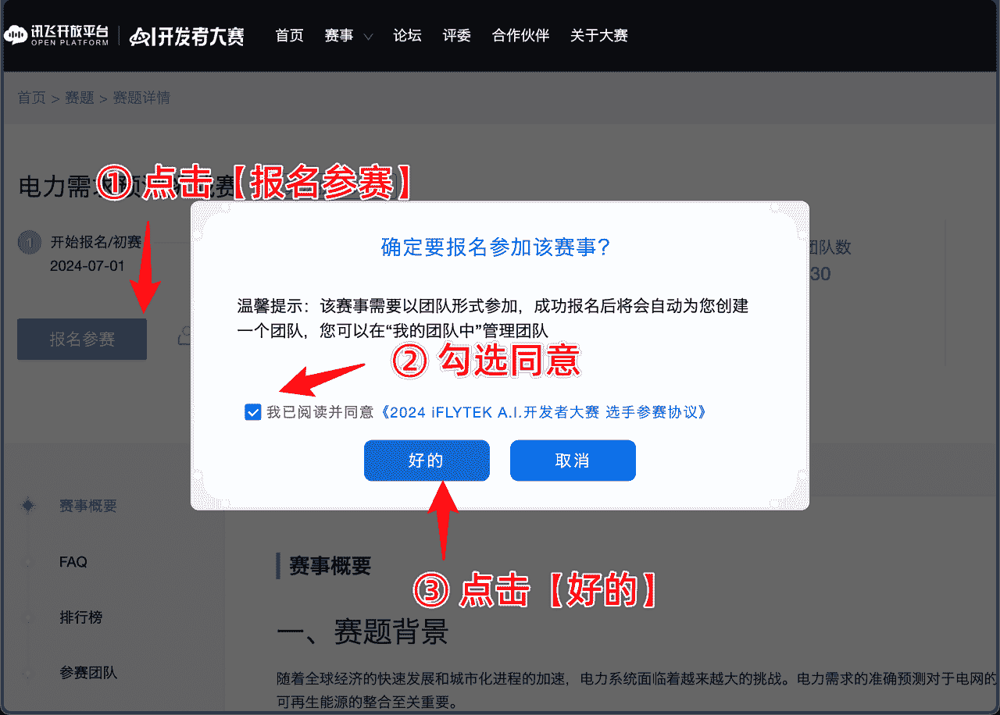

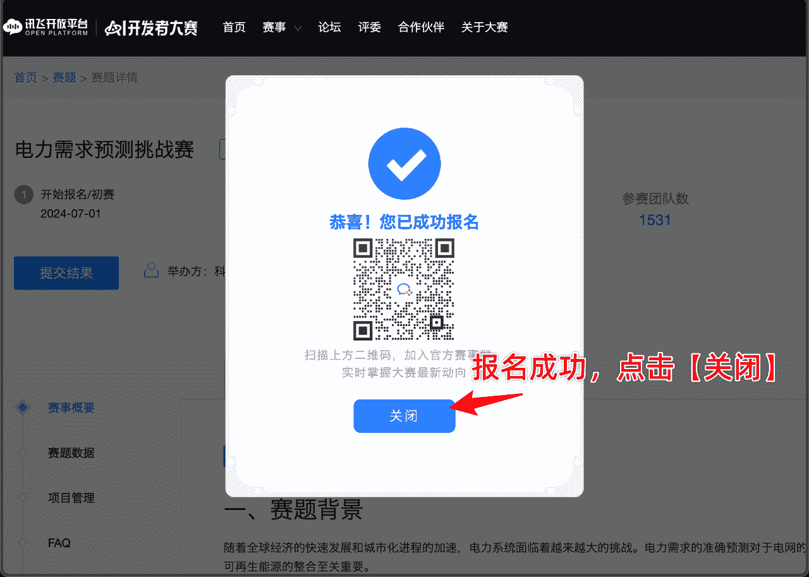

## Step2：5 分钟体验一站式 baseline！（点击即可跳转）

> 项目链接：https://aistudio.baidu.com/projectdetail/8151133

> 项目食用指南如下所示，别忘了完成后回到本文档哦～

1.  登录百度账号

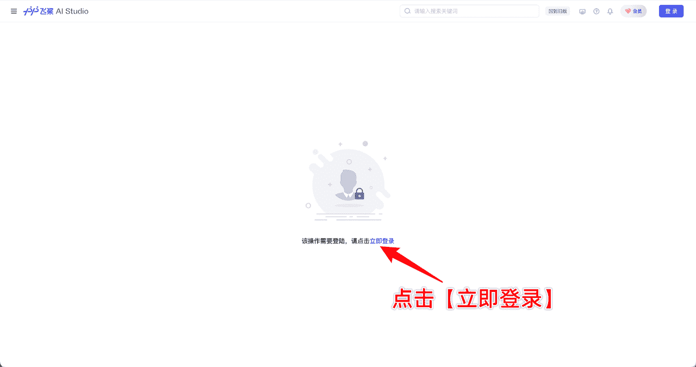


1.  运行项目

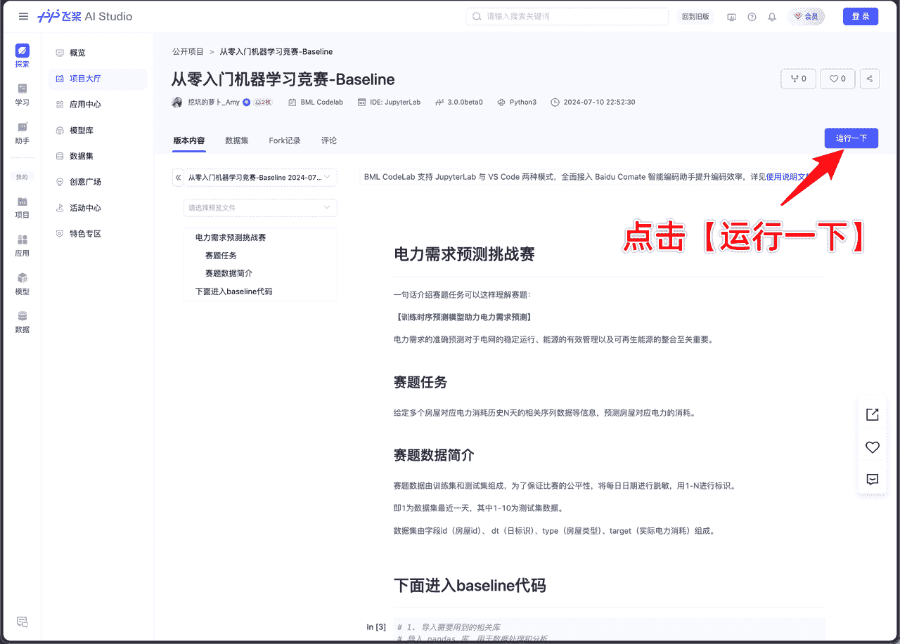

+   如果是新用户，需要完善信息：

> 填写完信息后刷新即可

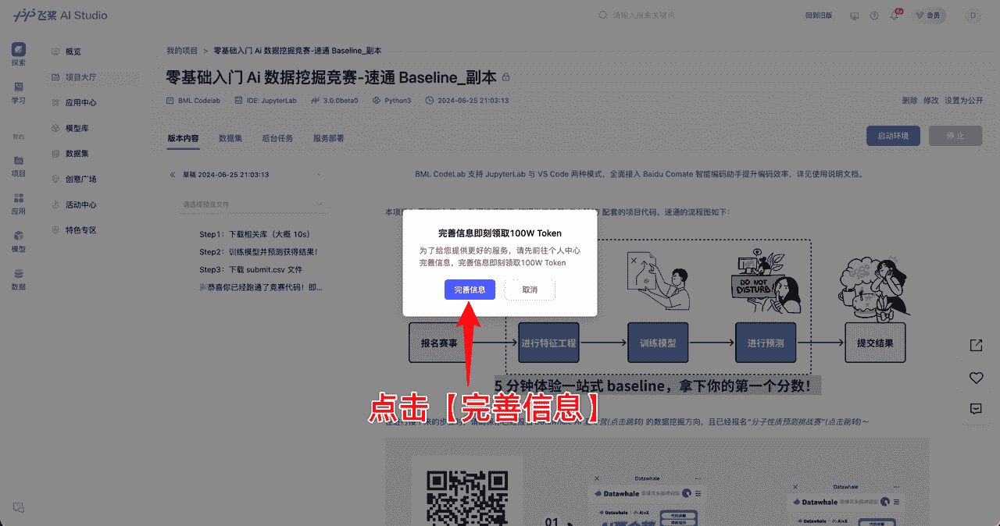

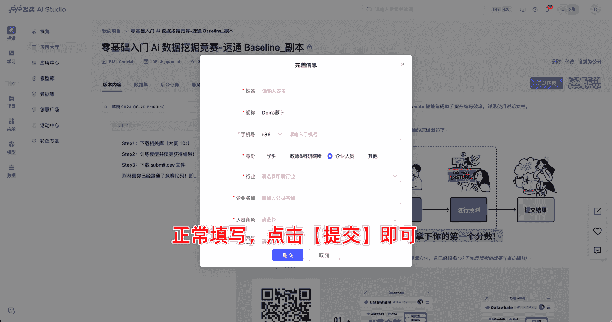

1.  启动环境

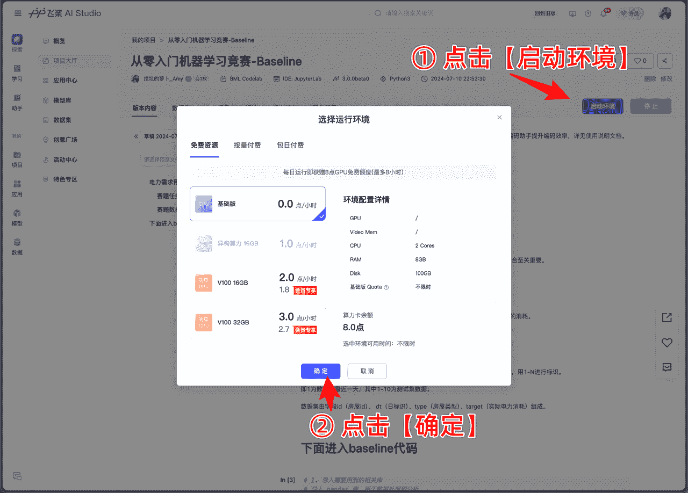

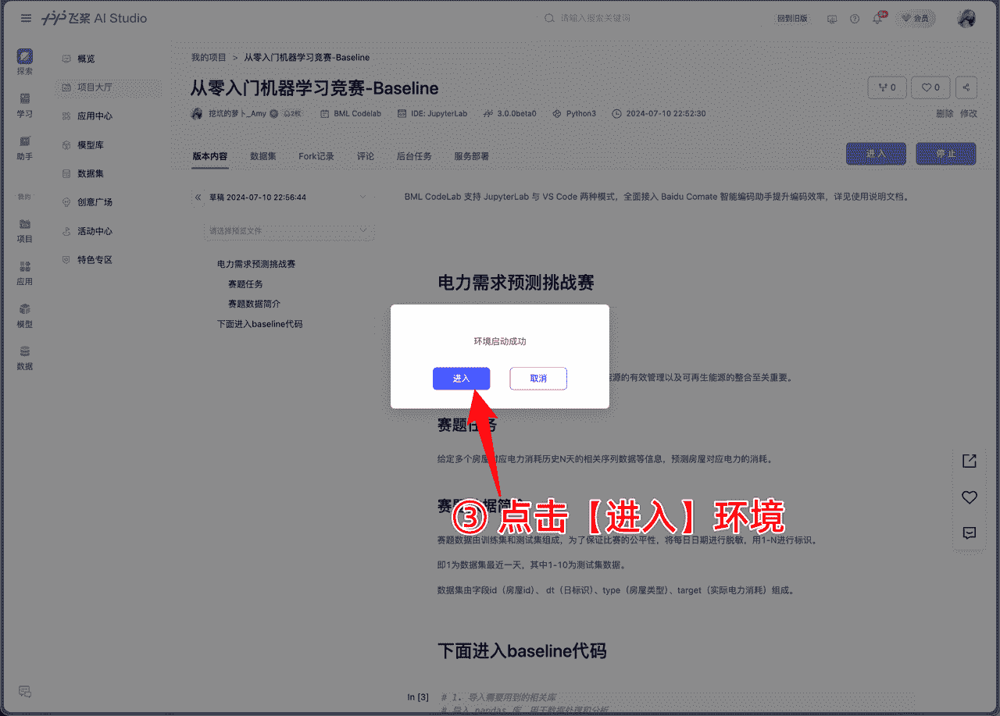

1.  运行全部Cell

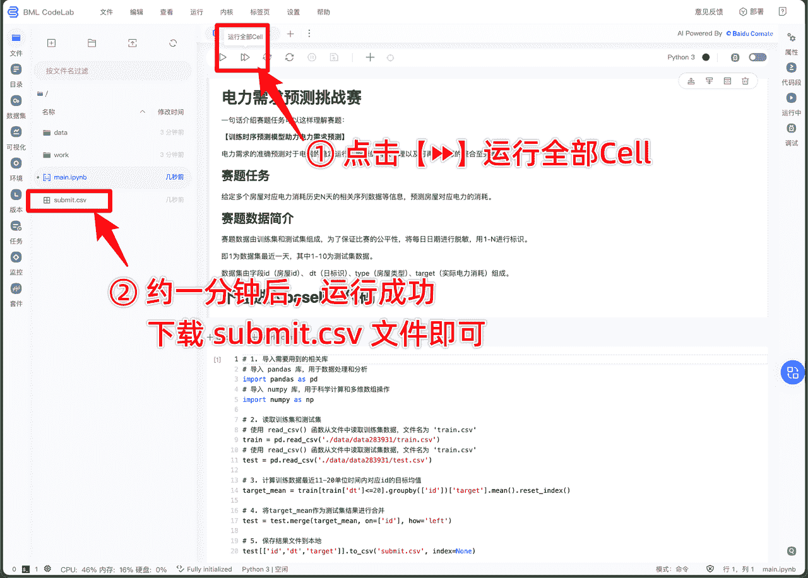

1.  下载 submit.csv 文件

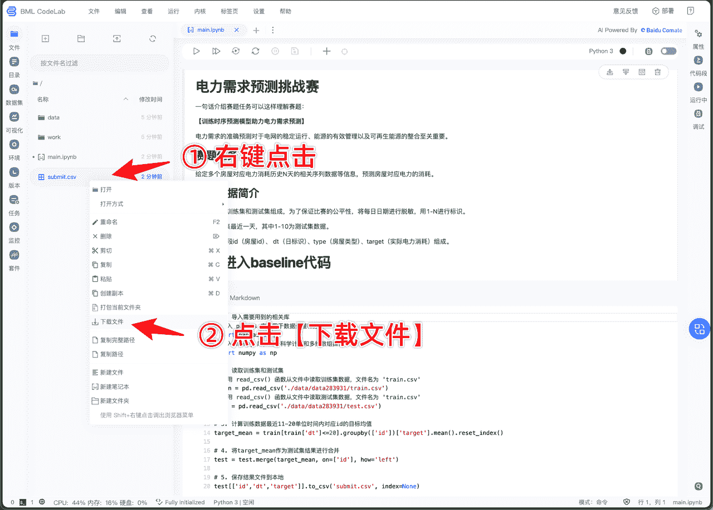

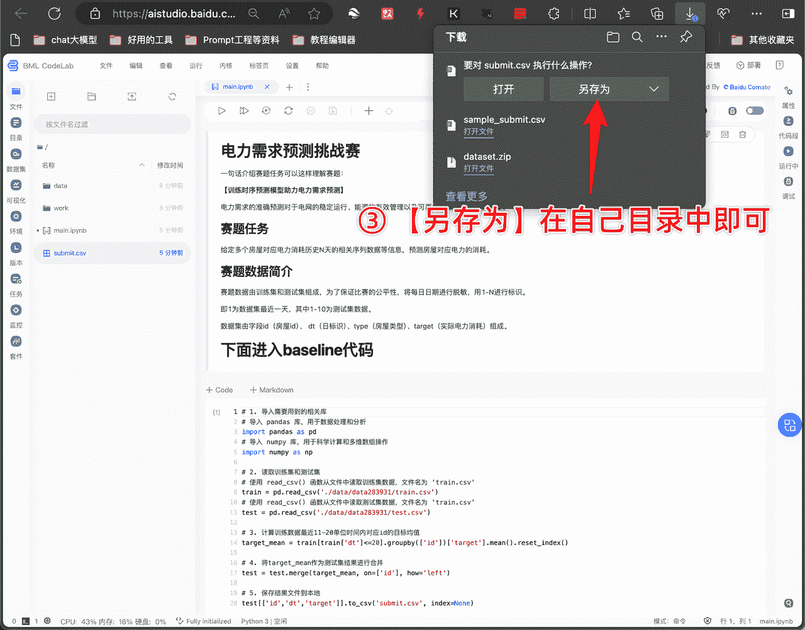

## Step3：提交文件，拿下第一个分数！(点击即可跳转官网进行提交)

> 链接：[https://challenge.xfyun.cn/h5/detai](https://challenge.xfyun.cn/h5/detail?type=electricity-demand&ch=dw24_uGS8Gs)l?type=electricity-demand&ch=dw24_uGS8Gs

> **使用刚刚下载的 ****submit.csv** 文件进行提交！拿下第一个分数！

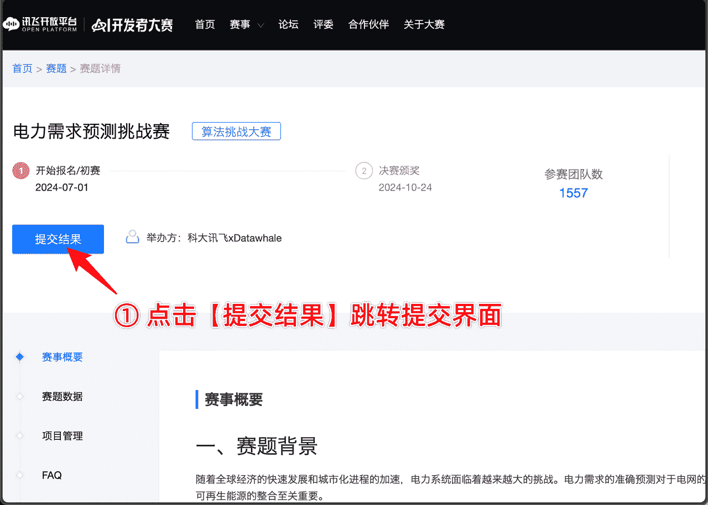

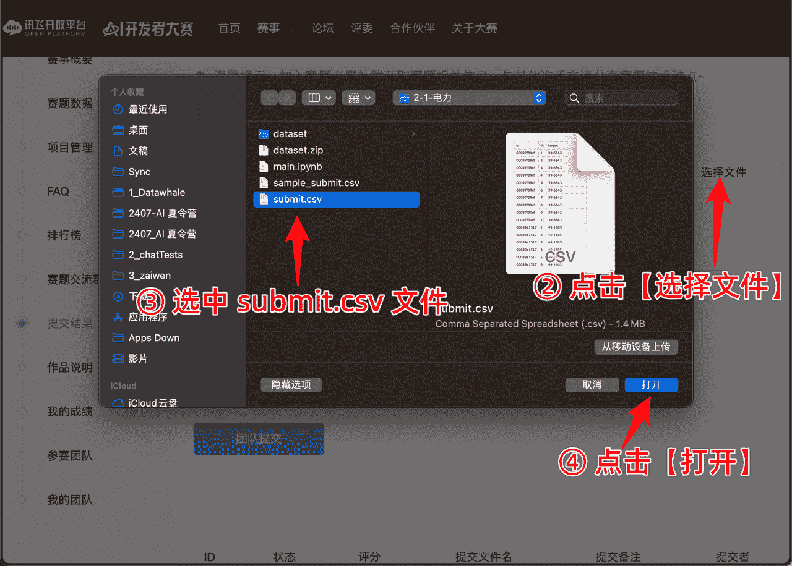

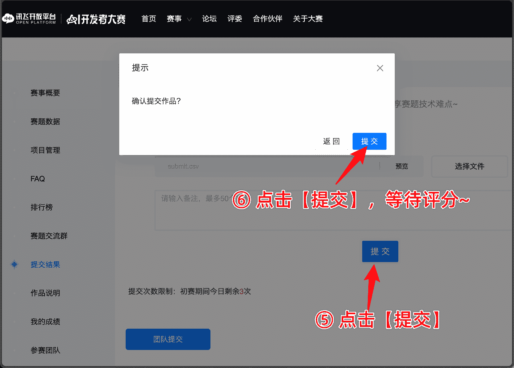

> **评分大概需要 2 分钟～**评分结束后可以在下方看到自己提交的评分结果哟！

# 🎉恭喜你拿下了属于自己的第一个分数！

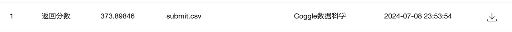

## 快来给自己点赞！

## 然后填写表单，开启抽奖吧~祝你好运~

> 请大家提交完作品后填写下面的表单哦~

> 参与者还可以参与Datawhale【抽奖】哦~有机会获得Datawhale精美周边小礼品！！

> 也可以把你的分数截图转发到群里呀~

<https://datawhaler.feishu.cn/share/base/form/shrcn3KaiQKXtoURUhwWlgyLdKc?iframeFrom=docx&ccm_open=iframe>

# 📅 记住下面的学习规划表！

> **教程贡献者说：**

> 恭喜大家成功完成了本次学习活动的Task1速通，相信大家一定有非常多的困惑，这些在下面的学习加餐中可能会得到一些解答。

> 但是我们先不急，先简单介绍一下我们接下来的学习规划，如下面的学习规划表所见，我们接下来，主要还有2个Task，会涉及到这些知识点：

1.  进一步分析时间序列问题，理解并实践其数据应该如何处理和分析

1.  根据竞赛通用流程，一一对应到赛题，理解关键步骤和环节

1.  开始入门机器学习模型构建方法，了解如何选型并训练模型解决本赛题问题

1.  开始入门深度学习方法，学会更多上分技巧

>

> **详情都在下方啦~**

| ## **从零入门AI****竞赛(机**器学习方向)-学习规划表（7天） |  |  |  |  |  |
| --- | --- | --- | --- | --- | --- |
| #### [**电力需求预测挑战赛**](https://challenge.xfyun.cn/h5/detail?type=electricity-demand&amp;ch=dw24_uGS8Gs) |  |  |  |  |  |
| **Task** | **学习时间** | **Task 描述** | **相关知识点** | **学习文件&amp;链接** | **学习安排** |
| **Task 1** | **7.14** | **目标**：跑通baseline，体验机器学习解决问题的流程，基本了解赛题要求，理解赛题场景 | 1.  时间序列问题的定义 | 1.  [ 从零入门机器学习竞赛](https://datawhaler.feishu.cn/wiki/CuhBw9vBaiG1nJklIPkcRhqVnmk) | [**开营直播**](https://meeting.tencent.com/v2/cloud-record/share?id=fb91a822-4f83-4b8d-aaa9-d80a537171c3&amp;from=3&amp;is-single=false&amp;record_type=2) |
| **Task 2** | **7.15~7.17** | **目标**：通过baseline代码和进阶代码分析数据、学习特征构建方式，分数初步提高，入门机器学习建模 | 1.  竞赛通用流程 | 1.  [Task2：入门lightgbm，开始特征工程](https://datawhaler.feishu.cn/wiki/MaARwcr8li63nikSFRRciRKSnje) | **baseline进阶直播1** |
| **Task 3** | **7.18~7.20** | **目标**：通过进阶代码入门深度学习建模，持续提分 | 1.  特征优化（偏上分） | 1.  [Task3：尝试使用深度学习方案](https://datawhaler.feishu.cn/wiki/G8WywyV8iiYtuGkVjoOchdjxnib) | **进阶分享直播2** |
|  |  |  |  |  |  |

### 祝大家上分顺利，学习愉快~ 不要害怕在群里提问和交流哟！

> 不过建议先查看[ QA & 其他彩蛋](https://datawhaler.feishu.cn/wiki/ZDnFwgX0riyIXkkFRAjcJhvqnqf)是否早已解决并收录你的问题~ 然后再在群里仔细描述清楚问题进行提问哟~

> QA文档可任意编辑，可随时留言提问，我们的助教会关注，遇到感兴趣的问题还可以在上面进行回答哟~

# 🍰 再来一点学习加餐！

### 你知道刚刚发生了什么吗？

> 刚刚我们跑通了参与这次数据竞赛的MVP，想必你一定很好奇这背后发生了什么吧？

> 在学习的过程中，不单单要知道如何做，更要知道为什么要这样做。这样我们在遇到同类型的问题时，才能举一反三。

> 一般情况下，拿到一个赛题之后，我们需要明确：

> 1）这是一个什么场景下的赛题；

> 2）这个赛题要解决什么问题。

> 深度思考这些问题，既能帮助我们更好地解决相关问题，更能让我们在后续遇到相关问题时，更好地完成迁移。

>

### 本赛题是一个典型的**时间序列问题**

> **时间序列问题****是指对按时**间顺序排列的数据点进行分析和预测的问题，往往用来做未来的趋势预测。比如，基于历史股票每天的股价，预测未来股票的价格走向。

>

> **简单来说****，本次赛题的****目标很简单清晰——【**训练 时序预测模型 助力电力需求预测】

> 电力需求的准确预测对于电网的稳定运行、能源的有效管理以及可再生能源的整合至关重要。

## 来了解一下时间序列预测问题！

### **常见的时间序列场景有：**

1.  **金融领域**：股票价格预测、利率变动、汇率预测等。

1.  **气象领域**：温度、降水量、风速等气候指标的预测。

1.  **销售预测**：产品或服务的未来销售额预测。

1.  **库存管理**：预测库存需求，优化库存水平。

1.  **能源领域**：电力需求预测、石油价格预测等。

1.  **医疗领域**：疾病爆发趋势预测、医疗资源需求预测。

>

### 时间序列问题的数据往往有如下特点：

1.  **时间依赖性**：数据点之间存在时间上的连续性和依赖性。

1.  **非平稳性**：数据的统计特性（如均值、方差）随时间变化。

1.  **季节性**：数据表现出周期性的模式，如年度、月度或周度。

1.  **趋势**：数据随时间推移呈现长期上升或下降的趋势。

1.  **周期性**：数据可能存在非固定周期的波动。

1.  **随****机波动**：数据可能受到随机事件的影响，表现出不确定性。

>

> 本赛题数据集中某个数据按照时间轴绘制的示意图如下，从中你能看出什么规律吗？可以在学习群和大家一起聊聊~

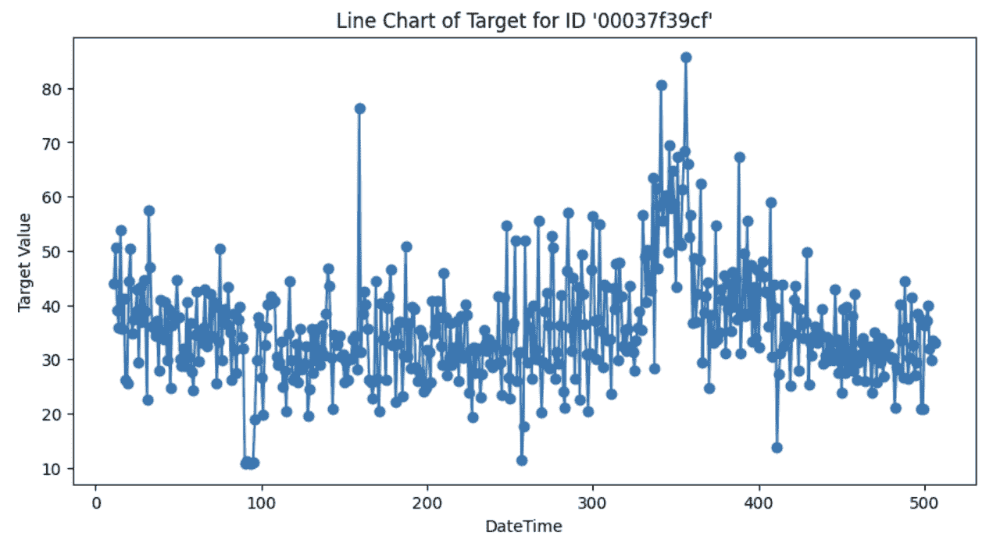

**时间序列预测问题****可以通过多种**建**模方法来解决**，**包括传统的时****间**序列模型、机器学习模型和深度学习模型。

以下是这三种方法的建模思路、优缺点对比：

| ##### 模型 | ##### 建模思路 | ##### 优点 | ##### 缺点 |
| --- | --- | --- | --- |
| ##### 传统时间序列模型 | +   基于时间序列数据的统计特性，如自相关性、季节性等。 | +   模型结构简单，易于理解和解释。 | +   对于非线性模式和复杂的时间序列数据，预测能力有限。 |
| ##### 机器学习模型 | +   将时间序列数据转换为监督学习问题，使用历史数据作为特征，未来值作为标签。 | +   能够处理非线性关系和复杂的数据模式。 | +   对于时间序列数据的内在时间结构和季节性可能不够敏感。 |
| ##### 深度学习模型 | +   使用**循环神经网络（RNN）**、**长短期记忆网络（LSTM）**或一维卷积神经网络（1D-CNN）等模型。 | +   能够处理非常复杂的数据模式和长期依赖关系。 | +   需要大量的数据和计算资源。 |
| ##### 对比总结 |  |  |  |

> 在实际应用中，选择哪种模型取决于具体问题的需求、数据的特性以及可用的计算资源。有时，结合多种方法的混合模型可以提供更好的预测性能。

## 再来精读一下代码

> Task1中的baseline使用python代码构建了一个经验模型（使用均值作为结果数据）

> 主要通过了如下几个步骤对数据进行处理——

1.  **导入库**：首先，代码导入了需要用到的库，包括 pandas（用于数据处理和分析）。

1.  **读取数据**：代码通过使用 pd.read_csv 函数从文件中读取训练集和测试集数据，并将其存储在 train.csv 和 test.csv 两个数据框中。

1.  **计算最近时间的用电均值**：

- 计算训练数据最近11-20单位时间内对应id的目标均值，可以用来反映最近的用电情况。

1.  **将用电均值直接作为预测结果**：

- 这里使用merge函数根据'id'列将test和target_mean两个DataFrame进行左连接，这意味着测试集的所有行都会保留。

1.  **保存结果文件到本地：**

- 使用to_csv()函数将测试集的'id'、'dt'和'target'列保存为CSV文件，文件名为'submit.csv'。index=None参数表示在保存时不包含行索引。

代码在这里：

```
# 1. 导入需要用到的相关库
# 导入 pandas 库，用于数据处理和分析
import pandas as pd
# 导入 numpy 库，用于科学计算和多维数组操作
import numpy as np

# 2. 读取训练集和测试集
# 使用 read_csv() 函数从文件中读取训练集数据，文件名为 &#x27;train.csv&#x27;
train = pd.read_csv(&#x27;train.csv&#x27;)
# 使用 read_csv() 函数从文件中读取测试集数据，文件名为 &#x27;test.csv&#x27;
test = pd.read_csv(&#x27;test.csv&#x27;)

# 3. 计算训练数据最近11-20单位时间内对应id的目标均值
target_mean = train[train[&#x27;dt&#x27;]&lt;=20].groupby([&#x27;id&#x27;])[&#x27;target&#x27;].mean().reset_index()

# 4. 将target_mean作为测试集结果进行合并
test = test.merge(target_mean, on=[&#x27;id&#x27;], how=&#x27;left&#x27;)

# 5. 保存结果文件到本地
test[[&#x27;id&#x27;,&#x27;dt&#x27;,&#x27;target&#x27;]].to_csv(&#x27;submit.csv&#x27;, index=None)
```

## 接下来，大家可以思考，以上代码为何能用来完成赛事要求？

>

> 有任何想法都可以在学习群里交流哟~

>

> [Task2：进阶lightgbm，开始特征工程](https://datawhaler.feishu.cn/wiki/MaARwcr8li63nikSFRRciRKSnje)**外**，如果大家等不及想提分的话，还可以直接开始  的学习哟~

## 关于Pandas、numpy库和机器学习

### 关于Pandas和numpy库

> **baseli**n**e代码中主**要用到了pandas和numpy两个python库来处理数据。

> **Pandas** 和 **NumPy** 是 **Python 编程语言 **中两个非常重要的库，它们封装了很多函数功能，广泛应用于数据分析和科学计算领域，为我们的代码开发实现提供了便利。

+   **Pandas** 是基于 **NumPy** 的一个数据分析和操作库，提供了快速、灵活和表达力强的数据结构，旨在使数据清洗和分析工作变得更加简单易行。

+   **NumPy **提供了多维数组对象、派生对象（如掩码数组和矩阵）以及用于快速操作数组的各种例程，包括数学、逻辑、形状操作、排序、选择、I/O、离散傅立叶变换、基本线性代数、基本统计运算、随机模拟等等。

> **Pandas** 和 **NumPy** 通常一起使用，因为 Pandas 的设计初衷就是为了与 NumPy 无缝集成，利用 NumPy 的数组结构来提高性能。

>

> **Datawhale**有一个开源教程项目叫 [**Joyful Pandas**](https://inter.joyfulpandas.datawhale.club/Home.html)，出版图书[《pandas数据处理与分析》](https://book.douban.com/subject/35998391/)的豆瓣链接是https://book.douban.com/subject/35998391/

>

> 文字版教程链接：https://inter.joyfulpandas.datawhale.club/Home.html

> 视频教程链接：https://www.bilibili.com/video/BV1tK4y177AF/

>

### 关于机器学习

> 后续我们会开始学习使用机器学习方法来解决这次的赛题场景，

> 大概1980年代以后，有了**机器学习****的方法，**让机器具有学习的能力，是达成人工智能目标的手段。

> **人工智能**是一个人类长远以来的目标——希望机器可以跟人一样的聪明。

> 深度学习是机器学习的其中一种方法。

> **Datawhale**翻译过**李宏毅**老师的**机器学习教程**，可在 https://linklearner.com/learn/summary/13 查看。

>

>

> ————————————

> 大家在本次学习过程中，可以一边将上面推荐的材料作为字典，遇到问题时通过这些材料、大模型、搜索引擎，去翻阅查看，做到理论和实践的结合，真正理解这些理论知识的价值、以及究竟要如何在真实的问题场景中使用。

>

> （如果大家想仔细研读的话，可以在学习过程中，依照其中的内容进行实践；

> 还可以多多在此处留言，也许夏令营后就会展开相关内容的组队学习哟~）

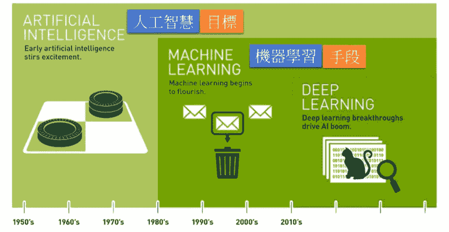

## 更多QA详见[ QA & 其他彩蛋](https://datawhaler.feishu.cn/wiki/ZDnFwgX0riyIXkkFRAjcJhvqnqf)！

> 本教程主要由 [**@鱼遇雨欲语与余**](https://www.zhihu.com/people/wang-he-13-93)、 、  写作贡献，融合了多位助教的内测体验和宝贵建议。如果你觉得对你有价值和启发，请在下面点赞和评论哟~