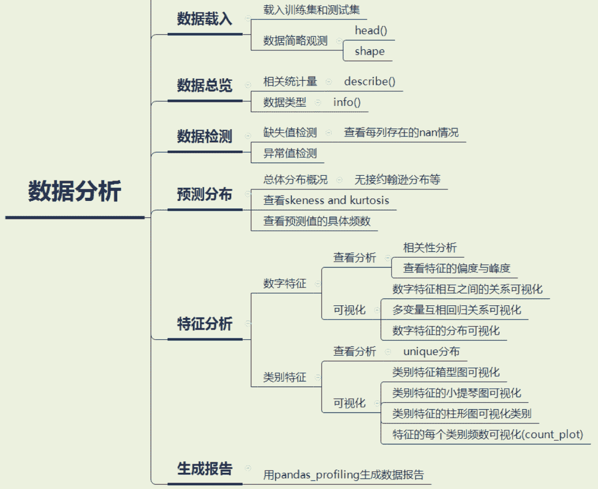
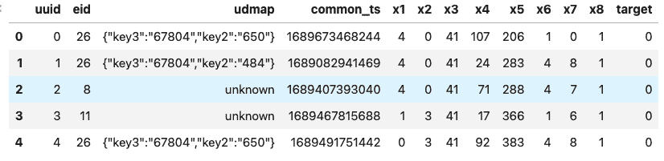
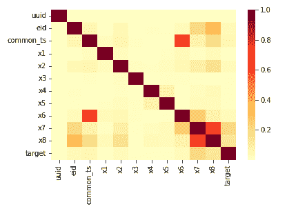
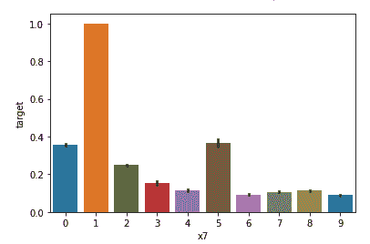
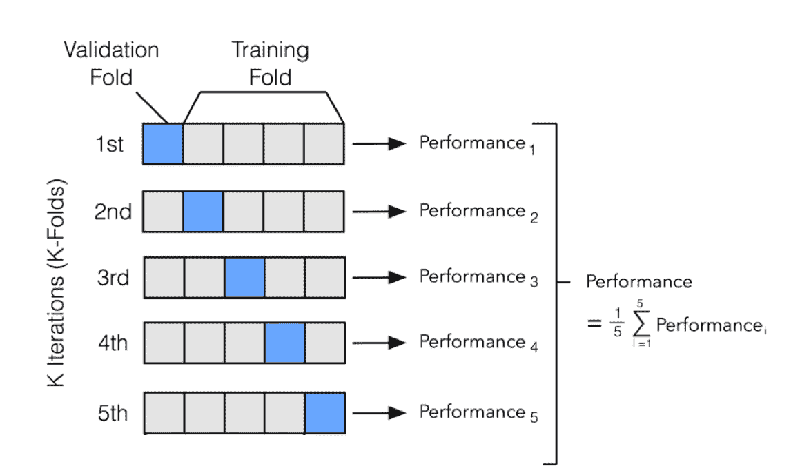
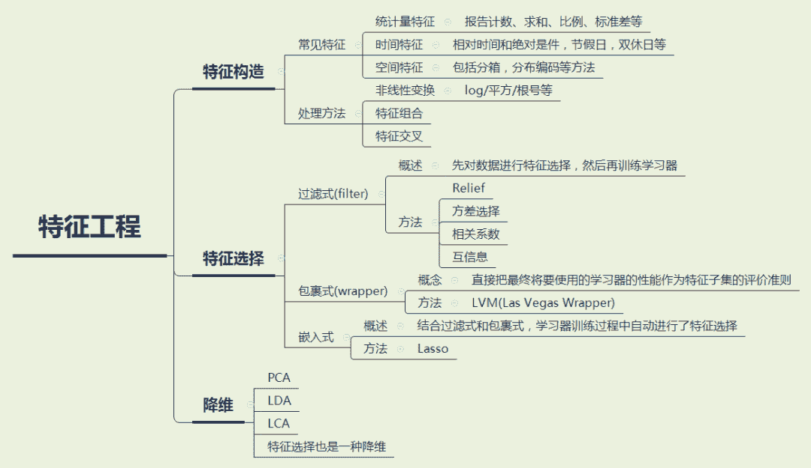

# AI夏令营第三期 - 用户新增预测挑战赛教程

> 来源：[https://datawhaler.feishu.cn/docx/HBIHd7ugzoOsMqx0LEncR1lJnCf](https://datawhaler.feishu.cn/docx/HBIHd7ugzoOsMqx0LEncR1lJnCf)

> 本教程会带领大家项目制学习，由浅入深，逐渐进阶。从竞赛通用流程与跑通最简的`Baseline`，到深入各个竞赛环节，精读`Baseline`与进阶实践技巧的学习。

> 千里之行，始于足下，从这里，开启你的 AI 学习之旅吧！

> —— Datawhale贡献者团队

# 赛题解析与解题思路

> 用户新增预测挑战赛：

> [https://challenge.xfyun.cn/topic/info?type=s](https://challenge.xfyun.cn/topic/info?type=subscriber-addition-prediction&ch=ymfk4uU)ubscriber-addition-prediction&ch=ymfk4uU

> 举办方：科大讯飞

## 赛题背景

讯飞开放平台针对不同行业、不同场景提供相应的AI能力和解决方案，赋能开发者的产品和应用，帮助开发者通过AI解决相关实际问题，实现让产品能听会说、能看会认、能理解会思考。

用户新增预测是分析用户使用场景以及预测用户增长情况的关键步骤，有助于进行后续产品和应用的迭代升级。

## 赛事任务

本次大赛提供了讯飞开放平台海量的应用数据作为训练样本，参赛选手需要基于提供的样本构建模型，预测用户的新增情况。

## 赛题数据集

赛题数据由约62万条训练集、20万条测试集数据组成，共包含13个字段。其中`uuid`为样本唯一标识，`eid`为访问行为ID，`udmap`为行为属性，其中的`key1`到`key9`表示不同的行为属性，如项目名、项目id等相关字段，`common_ts`为应用访问记录发生时间（毫秒时间戳），其余字段`x1`至`x8`为用户相关的属性，为匿名处理字段。`target`字段为预测目标，即是否为新增用户。

## 评价指标

本次竞赛的评价标准采用`f1_score`，分数越高，效果越好

## 解题思路

参赛选手的任务是基于训练集的样本数据，构建一个模型来预测测试集中用户的新增情况。这是一个二分类任务，其中目标是根据用户的行为、属性以及访问时间等特征，预测该用户是否属于新增用户。具体来说，选手需要利用给定的数据集进行特征工程、模型选择和训练，然后使用训练好的模型对测试集中的用户进行预测，并生成相应的预测结果。

我们`Baseline`选择使用机器学习方法，在解决机器学习问题时，一般会遵循以下流程：

> 思考：这里为什么选择机器学习算法？为什么不考虑深度学习？

在许多机器学习问题中，特征工程的重要性不容忽视。如果特征工程能够充分捕捉数据的关键特征，那么机器学习算法也能够表现很好。深度学习在某种程度上可以自动学习特征，但对于特定问题，手动设计特征可能会更有效。

> 思考：这里从逻辑回归和决策树中选择，哪一个模型更加合适？

+ 决策树能够处理非线性关系，并且可以自动捕获特征之间的交互作用。

+ 它可以生成可解释的规则，有助于理解模型如何做出决策。

+ 决策树能够处理不同类型的特征，包括分类和数值型。

# 任务1：跑通`Baseline`

## 快速跑通

快速跑通`Baseline`，我们基于百度AI Studio，将本教程`Baseline`部署在线上平台，可一键`fork`运行代码，提交结果，看到成绩。

一键运行：https://aistudio.baidu.com/aistudio/projectdetail/6618108?contributionType=1&sUid=1020699&shared=1&ts=1691406191660

+ 运行时，可以选择 CPU2核8G 或 V100 16G 的配置

+ 总运行时间大约需要 5 min 或 1 min，请耐心等待

+ 视频讲解

+ `baseline`运行操作演示视频 @魏庆伟 助教贡献

https://meeting.tencent.com/user-center/shared-record-info?id=939ff28e-1108-49e4-89cf-bdd637e8067d&from=3&is-single=true&reload=1

+ 用户新增预测挑战赛`Baseline`讲解 助教贡献

<https://player.bilibili.com/player.html?bvid=11z4y1g7cA&spm_id_from=333.999.0.0>

+ Python与机器学习新手快速入门导引 助教贡献

<https://player.bilibili.com/player.html?bvid=1xr4y1d7vR>

## 实践步骤

1. 导入库：首先，代码导入了需要用到的库，包括 `pandas`（用于数据处理和分析）和 `DecisionTreeClassifier`（决策树分类器）等。

1. 读取数据：代码通过使用 `pd.read_csv` 函数从文件中读取训练集和测试集数据，并将其存储在 `train_data` 和 `test_data` 两个数据框中。

1. 特征工程：

- `udmap_onethot` 函数将原始的 `udmap` 特征进行了预处理，将其转换为一个长度为9的向量，表示每个`key`是否存在。

- 对 `udmap` 特征进行编码，生成 `udmap_isunknown` 特征，表示该特征是否为空。

- 将处理后的 `udmap` 特征与原始数据拼接起来，形成新的数据框。

- 提取 `eid` 特征的频次（出现次数）和均值，并添加为新的特征。

- 使用时间戳 `common_ts` 提取小时部分，生成 `common_ts_hour` 特征。

1. 决策树模型训练和预测：

- 创建了一个 `DecisionTreeClassifier` 的实例，即决策树分类器。

- 使用 `fit` 函数对训练集中的特征和目标进行拟合，训练了决策树模型。

- 对测试集使用已训练的模型进行预测，得到预测结果。

- 将预测结果和相应的 `uuid` 组成一个 `DataFrame`，并将其保存到 `submit.csv` 文件中。

实践代码：


```python
# 1. 导入需要用到的相关库
# 导入 pandas 库，用于数据处理和分析
import pandas as pd
# 导入 numpy 库，用于科学计算和多维数组操作
import numpy as np
# 从 sklearn.tree 模块中导入 DecisionTreeClassifier 类
# DecisionTreeClassifier 用于构建决策树分类模型
from sklearn.tree import DecisionTreeClassifier

# 2. 读取训练集和测试集
# 使用 read_csv() 函数从文件中读取训练集数据，文件名为 'train.csv'
train_data = pd.read_csv('用户新增预测挑战赛公开数据/train.csv')
# 使用 read_csv() 函数从文件中读取测试集数据，文件名为 'test.csv'
test_data = pd.read_csv('用户新增预测挑战赛公开数据/test.csv')

# 3. 将 'udmap' 列进行 One-Hot 编码 
# 数据样例：
#                    udmap  key1  key2  key3  key4  key5  key6  key7  key8  key9
# 0           {'key1': 2}     2     0     0     0     0     0     0     0     0
# 1           {'key2': 1}     0     1     0     0     0     0     0     0     0
# 2  {'key1': 3, 'key2': 2}   3     2     0     0     0     0     0     0     0

# 在 python 中, 形如 {'key1': 3, 'key2': 2} 格式的为字典类型对象, 通过key-value键值对的方式存储
# 而在本数据集中, udmap实际是以字符的形式存储, 所以处理时需要先用eval 函数将'udmap' 解析为字典

# 具体实现代码：
# 定义函数 udmap_onethot，用于将 'udmap' 列进行 One-Hot 编码
def udmap_onethot(d):
    v = np.zeros(9)  # 创建一个长度为 9 的零数组
    if d == 'unknown':  # 如果 'udmap' 的值是 'unknown'
        return v  # 返回零数组
    d = eval(d)  # 将 'udmap' 的值解析为一个字典
    for i in range(1, 10):  # 遍历 'key1' 到 'key9', 注意, 这里不包括10本身
        if 'key' + str(i) in d:  # 如果当前键存在于字典中
            v[i-1] = d['key' + str(i)]  # 将字典中的值存储在对应的索引位置上
            
    return v  # 返回 One-Hot 编码后的数组

# 注: 对于不理解的步骤, 可以逐行 print 内容查看
# 使用 apply() 方法将 udmap_onethot 函数应用于每个样本的 'udmap' 列
# np.vstack() 用于将结果堆叠成一个数组
train_udmap_df = pd.DataFrame(np.vstack(train_data['udmap'].apply(udmap_onethot)))
test_udmap_df = pd.DataFrame(np.vstack(test_data['udmap'].apply(udmap_onethot)))
# 为新的特征 DataFrame 命名列名
train_udmap_df.columns = ['key' + str(i) for i in range(1, 10)]
test_udmap_df.columns = ['key' + str(i) for i in range(1, 10)]
# 将编码后的 udmap 特征与原始数据进行拼接，沿着列方向拼接
train_data = pd.concat([train_data, train_udmap_df], axis=1)
test_data = pd.concat([test_data, test_udmap_df], axis=1)

# 4. 编码 udmap 是否为空
# 使用比较运算符将每个样本的 'udmap' 列与字符串 'unknown' 进行比较，返回一个布尔值的 Series
# 使用 astype(int) 将布尔值转换为整数（0 或 1），以便进行后续的数值计算和分析
train_data['udmap_isunknown'] = (train_data['udmap'] == 'unknown').astype(int)
test_data['udmap_isunknown'] = (test_data['udmap'] == 'unknown').astype(int)

# 5. 提取 eid 的频次特征
# 使用 map() 方法将每个样本的 eid 映射到训练数据中 eid 的频次计数
# train_data['eid'].value_counts() 返回每个 eid 出现的频次计数
train_data['eid_freq'] = train_data['eid'].map(train_data['eid'].value_counts())
test_data['eid_freq'] = test_data['eid'].map(train_data['eid'].value_counts())

# 6. 提取 eid 的标签特征
# 使用 groupby() 方法按照 eid 进行分组，然后计算每个 eid 分组的目标值均值
# train_data.groupby('eid')['target'].mean() 返回每个 eid 分组的目标值均值
train_data['eid_mean'] = train_data['eid'].map(train_data.groupby('eid')['target'].mean())
test_data['eid_mean'] = test_data['eid'].map(train_data.groupby('eid')['target'].mean())

# 7. 提取时间戳
# 使用 pd.to_datetime() 函数将时间戳列转换为 datetime 类型
# 样例：1678932546000 -> 2023-03-15 15:14:16
# 注: 需要注意时间戳的长度, 如果是13位则unit 为 毫秒, 如果是10位则为 秒, 这是转时间戳时容易踩的坑
# 具体实现代码：
train_data['common_ts'] = pd.to_datetime(train_data['common_ts'], unit='ms')
test_data['common_ts'] = pd.to_datetime(test_data['common_ts'], unit='ms')

# 使用 dt.hour 属性从 datetime 列中提取小时信息，并将提取的小时信息存储在新的列 'common_ts_hour'
train_data['common_ts_hour'] = train_data['common_ts'].dt.hour
test_data['common_ts_hour'] = test_data['common_ts'].dt.hour

# 8. 加载决策树模型进行训练(直接使用sklearn中导入的包进行模型建立)
clf = DecisionTreeClassifier()
# 使用 fit 方法训练模型
# train_data.drop(['udmap', 'common_ts', 'uuid', 'target'], axis=1) 从训练数据集中移除列 'udmap', 'common_ts', 'uuid', 'target'
# 这些列可能是特征或标签，取决于数据集的设置
# train_data['target'] 是训练数据集中的标签列，它包含了每个样本的目标值
clf.fit(
    train_data.drop(['udmap', 'common_ts', 'uuid', 'target'], axis=1),  # 特征数据：移除指定的列作为特征
    train_data['target']  # 目标数据：将 'target' 列作为模型的目标进行训练
)

# 9. 对测试集进行预测，并保存结果到result_df中
# 创建一个DataFrame来存储预测结果，其中包括两列：'uuid' 和 'target'
# 'uuid' 列来自测试数据集中的 'uuid' 列，'target' 列将用来存储模型的预测结果
result_df = pd.DataFrame({
    'uuid': test_data['uuid'],  # 使用测试数据集中的 'uuid' 列作为 'uuid' 列的值
    'target': clf.predict(test_data.drop(['udmap', 'common_ts', 'uuid'], axis=1))  # 使用模型 clf 对测试数据集进行预测，并将预测结果存储在 'target' 列中
})

# 10. 保存结果文件到本地
# 将结果DataFrame保存为一个CSV文件，文件名为 'submit.csv'
# 参数 index=None 表示不将DataFrame的索引写入文件中
result_df.to_csv('submit.csv', index=None)
```

+ 如果将`submit.csv`提交到讯飞比赛页面，会有多少的分数？
+ 代码中如何对`udmp`进行了人工的onehot？

# 任务2.1：数据分析与可视化

数据探索性分析，是通过了解数据集，了解变量间的相互关系以及变量与预测值之间的关系，对已有数据在尽量少的先验假设下通过作图、制表、方程拟合、计算特征量等手段探索数据的结构和规律的一种数据分析方法，从而帮助我们后期更好地进行特征工程和建立模型，是机器学习中十分重要的一步。



## 实践步骤

1. 导入必要的库，特别是画图库。
2. 计算特征与标签之间的相关性，展示热力图。
3. 展示特征与标签分组统计tu。







## 实践代码

```python
# 导入库
import pandas as pd
import numpy as np
import matplotlib.pyplot as plt
import seaborn as sns

# 读取训练集和测试集文件
train_data = pd.read_csv('用户新增预测挑战赛公开数据/train.csv')
test_data = pd.read_csv('用户新增预测挑战赛公开数据/test.csv')

# 相关性热力图
sns.heatmap(train_data.corr().abs(), cmap='YlOrRd')

# x7分组下标签均值
sns.barplot(x='x7', y='target', data=train_data)
```

+ 字段`x1`至`x8`为用户相关的属性，为匿名处理字段。添加代码对这些数据字段的取值分析，那些字段为数值类型？那些字段为类别类型？
+ 对于数值类型的字段，考虑绘制在标签分组下的箱线图。
+ 从`common_ts`中提取小时，绘制每小时下标签分布的变化。
+ 对`udmap`进行onehot，统计每个`key`对应的标签均值，绘制直方图。

# 任务2.2：模型交叉验证

交叉验证（Cross-Validation）是机器学习中常用的一种模型评估方法，用于评估模型的性能和泛化能力。它的主要目的是在有限的数据集上，尽可能充分地利用数据来评估模型，避免过拟合或欠拟合，并提供对模型性能的更稳健的估计。

交叉验证的基本思想是将原始的训练数据划分为多个子集（也称为折叠），然后将模型训练和验证进行多次循环。在每一次循环中，使用其中一个子集作为验证集，其他子集作为训练集。这样可以多次计算模型的性能指标，并取这些指标的平均值作为最终的模型性能评估结果。



## 实操步骤

1. 加载数据集，并对数据进行编码
2. 导入多个模型进行交叉验证
3. 比较模型的F1精度


```python
# 导入库
import pandas as pd
import numpy as np

# 读取训练集和测试集文件
train_data = pd.read_csv('用户新增预测挑战赛公开数据/train.csv')
test_data = pd.read_csv('用户新增预测挑战赛公开数据/test.csv')

# 提取udmap特征，人工进行onehot
def udmap_onethot(d):
    v = np.zeros(9)
    if d == 'unknown':
        return v
    d = eval(d)
    for i in range(1, 10):
        if 'key' + str(i) in d:
            v[i-1] = d['key' + str(i)]
            
    return v
train_udmap_df = pd.DataFrame(np.vstack(train_data['udmap'].apply(udmap_onethot)))
test_udmap_df = pd.DataFrame(np.vstack(test_data['udmap'].apply(udmap_onethot)))
train_udmap_df.columns = ['key' + str(i) for i in range(1, 10)]
test_udmap_df.columns = ['key' + str(i) for i in range(1, 10)]

# 编码udmap是否为空
train_data['udmap_isunknown'] = (train_data['udmap'] == 'unknown').astype(int)
test_data['udmap_isunknown'] = (test_data['udmap'] == 'unknown').astype(int)

# udmap特征和原始数据拼接
train_data = pd.concat([train_data, train_udmap_df], axis=1)
test_data = pd.concat([test_data, test_udmap_df], axis=1)

# 提取eid的频次特征
train_data['eid_freq'] = train_data['eid'].map(train_data['eid'].value_counts())
test_data['eid_freq'] = test_data['eid'].map(train_data['eid'].value_counts())

# 提取eid的标签特征
train_data['eid_mean'] = train_data['eid'].map(train_data.groupby('eid')['target'].mean())
test_data['eid_mean'] = test_data['eid'].map(train_data.groupby('eid')['target'].mean())

# 提取时间戳
train_data['common_ts'] = pd.to_datetime(train_data['common_ts'], unit='ms')
test_data['common_ts'] = pd.to_datetime(test_data['common_ts'], unit='ms')
train_data['common_ts_hour'] = train_data['common_ts'].dt.hour
test_data['common_ts_hour'] = test_data['common_ts'].dt.hour

# 导入模型
from sklearn.linear_model import SGDClassifier
from sklearn.tree import DecisionTreeClassifier
from sklearn.naive_bayes import MultinomialNB
from sklearn.ensemble import RandomForestClassifier

# 导入交叉验证和评价指标
from sklearn.model_selection import cross_val_predict
from sklearn.metrics import classification_report

# 训练并验证SGDClassifier
pred = cross_val_predict(
    SGDClassifier(max_iter=10),
    train_data.drop(['udmap', 'common_ts', 'uuid', 'target'], axis=1),
    train_data['target']
)
print(classification_report(train_data['target'], pred, digits=3))

# 训练并验证DecisionTreeClassifier
pred = cross_val_predict(
    DecisionTreeClassifier(),
    train_data.drop(['udmap', 'common_ts', 'uuid', 'target'], axis=1),
    train_data['target']
)
print(classification_report(train_data['target'], pred, digits=3))

# 训练并验证MultinomialNB
pred = cross_val_predict(
    MultinomialNB(),
    train_data.drop(['udmap', 'common_ts', 'uuid', 'target'], axis=1),
    train_data['target']
)
print(classification_report(train_data['target'], pred, digits=3))

# 训练并验证RandomForestClassifier
pred = cross_val_predict(
    RandomForestClassifier(n_estimators=5),
    train_data.drop(['udmap', 'common_ts', 'uuid', 'target'], axis=1),
    train_data['target']
)
print(classification_report(train_data['target'], pred, digits=3))
```

编写代码回答下面的问题：

+ 在上面模型中哪一个模型的macro F1效果最好，为什么这个模型效果最好？

+ 使用树模型训练，然后对特征重要性进行可视化；

+ 再加入3个模型训练，对比模型精度；

# 任务2.3：特征工程

特征工程指的是把原始数据转变为模型训练数据的过程，目的是获取更好的训练数据特征。特征工程能使得模型的性能得到提升，有时甚至在简单的模型上也能取得不错的效果。



实操步骤：

1. `common_ts_day` 特征：从时间戳 `common_ts` 中提取出日期部分的天数，以创建一个新的特征表示访问日期。

1. `x1_freq` 和 `x1_mean` 特征：计算特征 `x1` 在训练集中的频次（出现次数）以及在训练集中对应的目标列 `target` 的均值。这些特征可以捕捉 `x1` 特征的重要性和与目标的关系。

1. 类似地，对于其他 `x2`、`x3`、`x4`、`x6`、`x7` 和 `x8` 特征，进行了类似的操作，分别计算它们在训练集中的频次和均值。

实践代码：

```
train_data['common_ts_day'] = train_data['common_ts'].dt.day
test_data['common_ts_day'] = test_data['common_ts'].dt.day

train_data['x1_freq'] = train_data['x1'].map(train_data['x1'].value_counts())
test_data['x1_freq'] = test_data['x1'].map(train_data['x1'].value_counts())
train_data['x1_mean'] = train_data['x1'].map(train_data.groupby('x1')['target'].mean())
test_data['x1_mean'] = test_data['x1'].map(train_data.groupby('x1')['target'].mean())

train_data['x2_freq'] = train_data['x2'].map(train_data['x2'].value_counts())
test_data['x2_freq'] = test_data['x2'].map(train_data['x2'].value_counts())
train_data['x2_mean'] = train_data['x2'].map(train_data.groupby('x2')['target'].mean())
test_data['x2_mean'] = test_data['x2'].map(train_data.groupby('x2')['target'].mean())

train_data['x3_freq'] = train_data['x3'].map(train_data['x3'].value_counts())
test_data['x3_freq'] = test_data['x3'].map(train_data['x3'].value_counts())

train_data['x4_freq'] = train_data['x4'].map(train_data['x4'].value_counts())
test_data['x4_freq'] = test_data['x4'].map(train_data['x4'].value_counts())

train_data['x6_freq'] = train_data['x6'].map(train_data['x6'].value_counts())
test_data['x6_freq'] = test_data['x6'].map(train_data['x6'].value_counts())
train_data['x6_mean'] = train_data['x6'].map(train_data.groupby('x6')['target'].mean())
test_data['x6_mean'] = test_data['x6'].map(train_data.groupby('x6')['target'].mean())

train_data['x7_freq'] = train_data['x7'].map(train_data['x7'].value_counts())
test_data['x7_freq'] = test_data['x7'].map(train_data['x7'].value_counts())
train_data['x7_mean'] = train_data['x7'].map(train_data.groupby('x7')['target'].mean())
test_data['x7_mean'] = test_data['x7'].map(train_data.groupby('x7')['target'].mean())

train_data['x8_freq'] = train_data['x8'].map(train_data['x8'].value_counts())
test_data['x8_freq'] = test_data['x8'].map(train_data['x8'].value_counts())
train_data['x8_mean'] = train_data['x8'].map(train_data.groupby('x8')['target'].mean())
test_data['x8_mean'] = test_data['x8'].map(train_data.groupby('x8')['target'].mean())
```

编写代码回答下面的问题：

+ 加入特征之后模型的精度有什么变化？

+ 思考并加入3个额外的特征，并观测模型精度的变化

# 任务3：模型迭代优化

在进阶实践部分，将在原有Baseline基础上做更多优化，一般优化思路，从特征工程与模型中来思考。

1. 特征选择与删除：分析特征的重要性，可以使用特征选择方法（如基于模型的特征重要性）来选择最具有预测能力的特征，也可以删除一些对模型性能影响较小的特征。

1. 特征组合与交互：将不同特征进行组合、相乘、相除等操作，创建新的特征，以捕捉特征之间的复杂关系。

1. 数值型特征的分桶（Binning）：将连续的数值型特征划分为多个区间，可以提高模型对特征的鲁棒性。

1. 类别型特征的编码：除了One-Hot编码外，可以尝试使用其他编码方式，如Label Encoding、Target Encoding等，来更好地处理类别型特征。

1. 时间特征的挖掘：除了示例中的日期和小时提取，还可以尝试提取星期几、月份等时间信息，可能会影响用户行为。

1. 特征缩放：对数值型特征进行缩放，将它们映射到一个相似的范围，有助于模型收敛和性能提升。

实操步骤：

1. 在现有特征工程基础上，加入新的特征观察模型F1是否发生变化。

1. 尝试三组能增加模型精度的特征，并记录下特征编码过程

1. 将最优的特征从新训练模型，提交结果。

# 附录

## 实践环境配置

**AI环境配置：**

+ **视频讲解：**AI夏令营：手把手带你配置AI环境_哔哩哔哩_bilibili

+ **图文材料：**`https://gitee.com/anine09/learn-python-the-smart-way-v2/blob/main/slides/chapter_0-Installation.ipynb`

## 工具使用与提分思路

+ 竞赛实践路线：[竞赛实践路线分享](https://datawhaler.feishu.cn/docx/EJ2Edl0hXoIWwuxO15CcEj9Wnxn)
