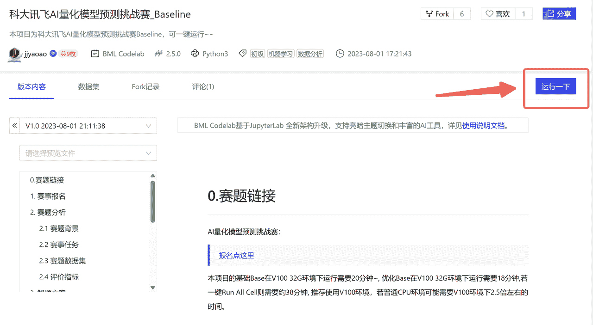
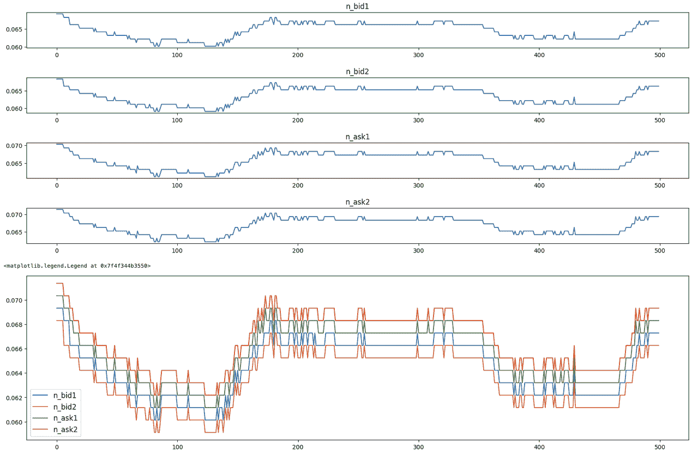
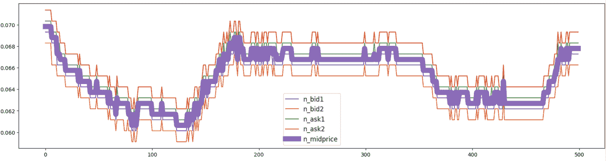
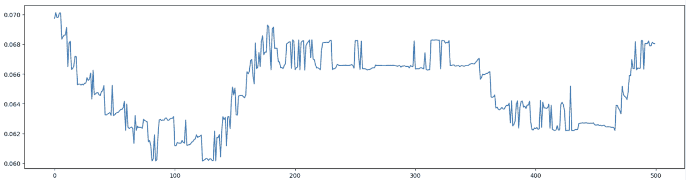
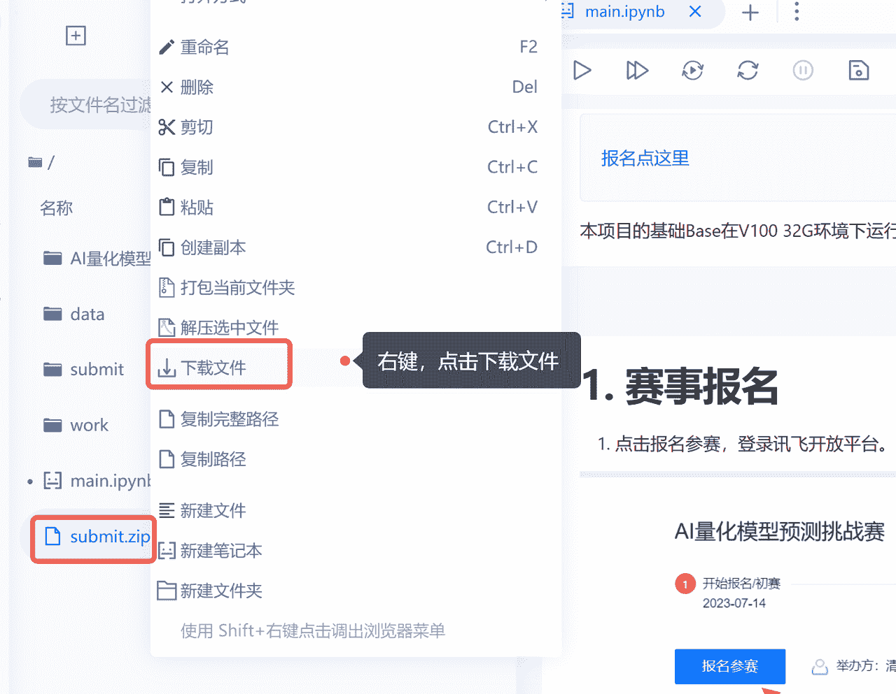
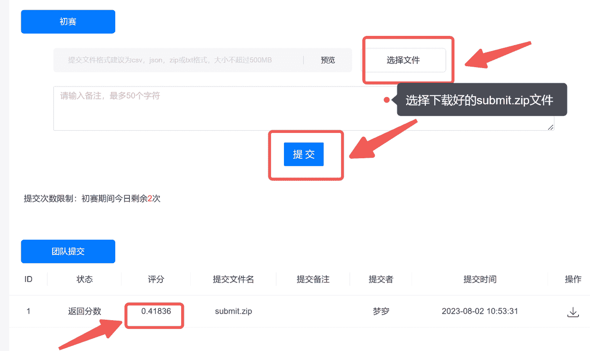
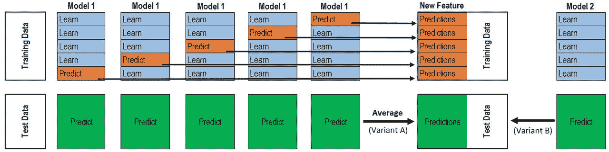
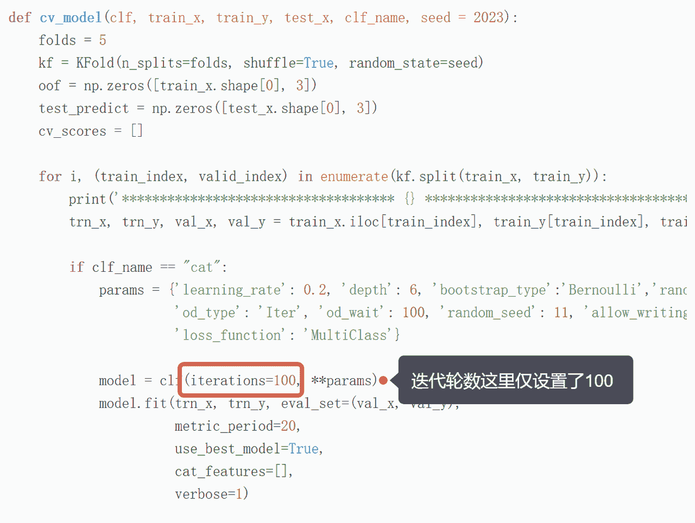

# AI夏令营(第二期) - AI量化模型预测挑战赛实践教程

> 来源：[https://datawhaler.feishu.cn/docx/EOypdKkujom8THxWkGZc3F4qn8c](https://datawhaler.feishu.cn/docx/EOypdKkujom8THxWkGZc3F4qn8c)

> 本教程会带领大家项目制学习，由浅入深，逐渐进阶。从竞赛通用流程与跑通最简的Baseline，到深入各个竞赛环节，精读Baseline与进阶实践技巧的学习。

> 千里之行，始于足下，从这里，开启你的 AI 学习之旅吧！

> —— Datawhale贡献者团队

| 学习任务 | 相关直播 |
| --- | --- |
| **任务一：** | [**开营直播&竞赛流程科普分享**](https://datawhaler.feishu.cn/docx/GEN4dJPwLoHChxxGqXsc0IQ6nse#part-KVabdd6V5oamHlxF7AScvr3qnQb) |
| **任务二：** | **直播：竞赛进阶上分思路与技巧** |

## 在线版本Baseline

> Baseline是一份简易的入门教程，可以帮助同学们迈出 AI 训练大师之路的第一步。建议入门的同学可以暂时不用着急去弄懂各个代码的原理，先跑通代码，动手实践，看到成绩。

快速跑通全流程，我们基于百度AI Studio，将本教程Baseline部署在线上平台，可一键`fork`运行代码，看到成绩。

一键运行：https://aistudio.baidu.com/aistudio/projectdetail/6598302?sUid=2554132&shared=1&ts=1690895519028

+ 运行时，选择`V100 32G`的配置  
+ 总运行时间大约需要20min（Baseline），40min（Baseline+优化进阶），请耐心等待。




输出`submit.zip`文件后，右键可下载到本地，在[赛题提交结果](https://challenge.xfyun.cn/topic/info?type=quantitative-model&ch=ymfk4uU)提交文件，获取分数。


## 赛题解析与解题思路

> **AI量化模型预测挑战赛：**

> https://challenge.xfyun.cn/topic/info?type=quantitative-model&ch=ymfk4uU

> 举办方：清华大学

### 赛题背景

量化金融在国外已经有数十年的历程，而在国内兴起还不到十年。这是一个极具挑战的领域。量化金融结合了数理统计、金融理论、社会学、心理学等多学科的精华，同时特别注重实践。由于市场博弈参与个体的差异性和群体效应的复杂性，量化金融极具挑战与重大的机遇的特点。

本赛事通过大数据与机器学习的方法和工具，理解市场行为的原理，通过数据分析和模型创建量化策略，采用历史数据，验证量化策略的有效性，并且通过实时数据进行评测。

### 赛事任务

**给定数据集： **给定训练集（含验证集）， 包括10只（不公开）股票、79个交易日的L1snapshot数据（前64个交易日为训练数据，用于训练；后15个交易日为测试数据，不能用于训练）， 数据已进行规范化和隐藏处理，包括5档量/价，中间价，交易量等数据（具体可参考后续数据说明）。

**预测任务：**利用过往及当前数据预测未来中间价的移动方向，在数据上进行模型训练与预测

**输入数据：**

行情频率：3秒一个数据点（也称为1个tick的snapshot）；

每个数据点包括当前最新成交价/五档量价/过去3秒内的成交金额等数据；

训练集中每个数据点包含5个预测标签的标注； 允许利用过去不超过100tick（包含当前tick）的数据，预测未来N个tick后的中间价移动方向。

预测时间跨度：5、10、20、40、60个tick，5个预测任务；

即在t时刻，分别预测t+5tick，t+10tick，t+20tick，t+40tick，t+60tick以后： 最新中间价相较t时刻的中间价：下跌/不变/上涨。

### 赛题数据集

+ 行情频率：3秒一个数据点（也称为1个tick的snapshot）；

+ 每个数据点包括当前最新成交价/五档量价/过去3秒内的成交金额等数据；

+ 训练集中每个数据点包含5个预测标签的标注；允许利用过去不超过100tick（包含当前tick）的数据，预测未来N个tick后的中间价移动方向。

+ 预测时间跨度：5、10、20、40、60个tick，5个预测任务；即在t时刻，分别预测t+5tick，t+10tick，t+20tick，t+40tick，t+60tick以后：最新中间价相较t时刻的中间价：下跌/不变/上涨。

### 评价指标

本模型依据提交的结果文件，采用`macro-F1` score进行评价，取`label_5`、`label_10`、`label_20`、`label_40`、`label_60`五项中的最高分作为最终得分。

### 解题思路

本题的任务是构建一种AI量化模型，利用过往及当前数据预测未来中间价的移动方向。

这种AI量化任务是典型的时间序列回归预测问题。处理该问题，一般推荐使用机器学习方法，如`CatBoost`、`LightGBM`、`XGBoost`等树模型，树模型能够比较好地处理数值型数据，可解释性较高。或者使用深度学习方法，但深度模型的搭建上比较复杂，需要自己构建模型结构，对于数值型数据需要进行标准化处理，可解释性弱。

我们在解决机器学习问题时，一般会遵循以下流程：

## Baseline实践

刚刚我们完成了基本的问题分析，在这个 Baseline 中，我们使用机器学习的`CatBoost`模型来解决本次问题，会带领大家跑通数据探索、特征工程、模型训练、模型验证、结果输出的全部竞赛实践流程。

### 导入模块

[导入我们本次Baseline代码所需的模块](https://datawhaler.feishu.cn/docx/EOypdKkujom8THxWkGZc3F4qn8c#doxcnNetmKRr155mpGfCaGBxRJg) 直接用云环境Baseline可全部跑通，如希望尝试本地，参考附录 - 实践环境配置

```
import numpy as np
import pandas as pd
from catboost import CatBoostClassifier
from sklearn.model_selection import StratifiedKFold, KFold, GroupKFold
from sklearn.metrics import accuracy_score, f1_score, roc_auc_score, log_loss, mean_squared_log_error
import tqdm, sys, os, gc, argparse, warnings
warnings.filterwarnings('ignore')
```

### 数据探索

数据探索性分析，是通过了解数据集，了解变量间的相互关系以及变量与预测值之间的关系，从而帮助我们后期更好地进行特征工程和建立模型，是机器学习中十分重要的一步。

```
# 读取数据
path = 'AI量化模型预测挑战赛公开数据/'

train_files = os.listdir(path+'train/')
train_df = pd.DataFrame()
for filename in tqdm.tqdm(train_files):
    tmp = pd.read_csv(path+'train/'+filename)
    tmp['file'] = filename
    train_df = pd.concat([train_df, tmp], axis=0, ignore_index=True)

test_files = os.listdir(path+'test/')
test_df = pd.DataFrame()
for filename in tqdm.tqdm(test_files):
    tmp = pd.read_csv(path+'test/'+filename)
    tmp['file'] = filename
    test_df = pd.concat([test_df, tmp], axis=0, ignore_index=True)
```

首先可以对买价卖价进行可视化分析

选择任意一个股票数据进行可视化分析，观察买价和卖价的关系。下面是对买价和卖价的简单介绍：

+ 买价指的是买方愿意为一项股票/资产支付的最高价格。
+ 卖价指的是卖方愿意接受的一项股票/资产的最低价格。
+ 这两个价格之间的差异被称为点差；点差越小，该品种的流动性越高。

```
cols = ['n_bid1','n_bid2','n_ask1','n_ask2']
tmp_df = train_df[train_df['file']=='snapshot_sym7_date22_pm.csv'].reset_index(drop=True)[-500:]
tmp_df = tmp_df.reset_index(drop=True).reset_index()
for num, col in enumerate(cols):
    plt.figure(figsize=(20,5))
   
    plt.subplot(4,1,num+1)
    plt.plot(tmp_df['index'],tmp_df[col])
    plt.title(col)
plt.show()
plt.figure(figsize=(20,5))

for num, col in enumerate(cols):
    plt.plot(tmp_df['index'],tmp_df[col],label=col)
plt.legend(fontsize=12)
```



加上中间价继续可视化，中间价即买价与卖价的均值，数据中有直接给到，我们也可以自己计算。

```
plt.figure(figsize=(20,5))

for num, col in enumerate(cols):
    
    plt.plot(tmp_df['index'],tmp_df[col],label=col)
    
plt.plot(tmp_df['index'],tmp_df['n_midprice'],label='n_midprice',lw=10)
plt.legend(fontsize=12)
```



波动率是给定股票价格变化的重要统计指标，因此要计算价格变化，我们首先需要在固定间隔进行股票估值。我们将使用已提供的数据的加权平均价格（WAP）进行可视化，WAP的变化反映股票波动情况。

```
train_df['wap1'] = (train_df['n_bid1']*train_df['n_bsize1'] + train_df['n_ask1']*train_df['n_asize1'])/(train_df['n_bsize1'] + train_df['n_asize1'])
test_df['wap1'] = (test_df['n_bid1']*test_df['n_bsize1'] + test_df['n_ask1']*test_df['n_asize1'])/(test_df['n_bsize1'] + test_df['n_asize1'])

tmp_df = train_df[train_df['file']=='snapshot_sym7_date22_pm.csv'].reset_index(drop=True)[-500:]
tmp_df = tmp_df.reset_index(drop=True).reset_index()
plt.figure(figsize=(20,5))
plt.plot(tmp_df['index'], tmp_df['wap1'])
```



### 特征工程

在特征工程阶段，构建基本的时间特征，提取小时、分钟等相关特征，主要是为了刻画不同时间阶段可能存在的差异性信息。需要注意数据是分多个文件存储的，所以需要进行文件合并，然后在进行后续的工作。

```
   
# 时间相关特征
train_df['hour'] = train_df['time'].apply(lambda x:int(x.split(':')[0]))
test_df['hour'] = test_df['time'].apply(lambda x:int(x.split(':')[0]))

train_df['minute'] = train_df['time'].apply(lambda x:int(x.split(':')[1]))
test_df['minute'] = test_df['time'].apply(lambda x:int(x.split(':')[1]))

# 入模特征
cols = [f for f in test_df.columns if f not in ['uuid','time','file']]
```

### 模型训练与验证

选择使用`CatBoost`模型，也是通常作为机器学习比赛的基线模型，在不需要过程调参的情况下也能得到比较稳定的分数。这里使用五折交叉验证的方式进行数据切分验证，最终将五个模型结果取平均作为最终提交。


```
def cv_model(clf, train_x, train_y, test_x, clf_name, seed = 2023):
    folds = 5
    kf = KFold(n_splits=folds, shuffle=True, random_state=seed)
    oof = np.zeros([train_x.shape[0], 3])
    test_predict = np.zeros([test_x.shape[0], 3])
    cv_scores = []

    for i, (train_index, valid_index) in enumerate(kf.split(train_x, train_y)):
        print('************************************ {} ************************************'.format(str(i+1)))
        trn_x, trn_y, val_x, val_y = train_x.iloc[train_index], train_y[train_index], train_x.iloc[valid_index], train_y[valid_index]

        if clf_name == "cat":
            params = {'learning_rate': 0.2, 'depth': 6, 'bootstrap_type': 'Bernoulli', 'random_seed': 2023,
                      'od_type': 'Iter', 'od_wait': 100, 'random_seed': 11, 'allow_writing_files': False,
                      'loss_function': 'MultiClass'}

            model = clf(iterations=5000, **params)
            model.fit(trn_x, trn_y, eval_set=(val_x, val_y),
                      metric_period=1000,
                      use_best_model=True,
                      cat_features=[],
                      verbose=1)

            val_pred  = model.predict_proba(val_x)
            test_pred = model.predict_proba(test_x)

        oof[valid_index] = val_pred
        test_predict += test_pred / kf.n_splits

        F1_score = f1_score(val_y, np.argmax(val_pred, axis=1), average='macro')
        cv_scores.append(F1_score)
        print(cv_scores)

    return oof, test_predict

for label in ['label_5', 'label_10', 'label_20', 'label_40', 'label_60']:
    print(f'=================== {label} ===================')
    cat_oof, cat_test = cv_model(CatBoostClassifier, train_df[cols], train_df[label], test_df[cols], 'cat')
    train_df[label] = np.argmax(cat_oof, axis=1)
    test_df[label] = np.argmax(cat_test, axis=1)
```

本次比赛采用 `macro-F1 score` 进行评价，取 `label_5`、`label_10`、`label_20`、`label_40`、`label_60` 五项中的最高分作为最终得分，所以在初次建模的时候对应五个目标都需要进行建模，确定分数最高的目标，之后进行优化的时候仅需对最优目标进行建模即可，大大节省时间，聚焦单个目标优化。

## 结果输出

提交结果需要符合提交样例结果，然后将文件夹进行压缩成 `zip` 格式提交。

```
import pandas as pd
import os

# 指定输出文件夹路径
output_dir = './submit'

# 如果文件夹不存在则创建
if not os.path.exists(output_dir):
    os.makedirs(output_dir)

# 首先按照 'file' 字段对 dataframe 进行分组
grouped = test_df.groupby('file')

# 对于每一个group进行处理
for file_name, group in grouped:
    # 选择你所需要的列
    selected_cols = group[['uuid', 'label_5', 'label_10', 'label_20', 'label_40', 'label_60']]

    # 将其保存为csv文件，file_name作为文件名
    selected_cols.to_csv(os.path.join(output_dir, f'{file_name}'), index=False)


# 现在就可以得到答案的压缩包啦~~~
_ = !zip -r submit.zip submit/
```

输出 `submit.zip` 文件后，右键可下载到本地，在[赛题提交结果](https://challenge.xfyun.cn/topic/info?type=quantitative-model&ch=ymfk4uU)提交文件，获取分数。





# 进阶实践

> 直播讲解：

在baseline阶段，我们使用 `CatBoost` 完成了解决机器学习问题的全部流程，得到了基础的分数。在进阶实践部分，将在原有Baseline基础上做更多优化，一般优化思路，从特征工程与模型中来思考。

## 优化方法建议

1. **提取更多特征：**在数据挖掘比赛中，**特征**总是最终制胜法宝，去思考什么信息可以帮助我们提高预测精准度，然后将其转化为特征输入到模型。对于本次赛题可以从业务角度构建特征，在量化交易方向中，常说的因子与机器学习中的特征基本一致，趋势因子、收益波动率因子、买卖压力、同成交量衰减、斜率 价差/深度，可以围绕成交量、买价和卖价进行构建。也可以从时间序列预测角度构建特征，比如历史平移特征、差分特征、和窗口统计特征。

2. **尝试不同的模型：**模型间存在很大的差异，预测结果也会不一样，比赛的过程就是不断的实验和试错的过程，通过不断的实验寻找最佳模型，同时帮助自身加强模型的理解能力。

## 特征优化

这里主要构建了当前时间特征、历史平移特征、差分特征、和窗口统计特征；每种特征都是有理可据的，具体说明如下：

### （1）当前时间特征

围绕买卖价格和买卖量进行构建，暂时只构建买一卖一和买二卖二相关特征，进行优化时可以加上其余买卖信息；

### （2）历史平移特征

通过历史平移获取上个阶段的信息；

### （3）差分特征

可以帮助获取相邻阶段的增长差异，描述数据的涨减变化情况。在此基础上还可以构建相邻数据比值变化、二阶差分等；

### （4）窗口统计特征

窗口统计可以构建不同的窗口大小，然后基于窗口范围进统计均值、最大值、最小值、中位数、方差的信息，可以反映最近阶段数据的变化情况。

**参考代码如下：**


# 特征工程

```python
# 为了保证时间顺序的一致性，故进行排序
train_df = train_df.sort_values(['file', 'time'])
test_df = test_df.sort_values(['file', 'time'])

# 当前时间特征
# 围绕买卖价格和买卖量进行构建
# 暂时只构建买一卖一和买二卖二相关特征，进行优化时可以加上其余买卖信息
train_df['wap1'] = (train_df['n_bid1'] * train_df['n_bsize1'] + train_df['n_ask1'] * train_df['n_asize1']) / (train_df['n_bsize1'] + train_df['n_asize1'])
test_df['wap1'] = (test_df['n_bid1'] * test_df['n_bsize1'] + test_df['n_ask1'] * test_df['n_asize1']) / (test_df['n_bsize1'] + test_df['n_asize1'])

train_df['wap2'] = (train_df['n_bid2'] * train_df['n_bsize2'] + train_df['n_ask2'] * train_df['n_asize2']) / (train_df['n_bsize2'] + train_df['n_asize2'])
test_df['wap2'] = (test_df['n_bid2'] * test_df['n_bsize2'] + test_df['n_ask2'] * test_df['n_asize2']) / (test_df['n_bsize2'] + test_df['n_asize2'])

train_df['wap_balance'] = abs(train_df['wap1'] - train_df['wap2'])
train_df['price_spread'] = (train_df['n_ask1'] - train_df['n_bid1']) / ((train_df['n_ask1'] + train_df['n_bid1']) / 2)
train_df['bid_spread'] = train_df['n_bid1'] - train_df['n_bid2']
train_df['ask_spread'] = train_df['n_ask1'] - train_df['n_ask2']
train_df['total_volume'] = (train_df['n_asize1'] + train_df['n_asize2']) + (train_df['n_bsize1'] + train_df['n_bsize2'])
train_df['volume_imbalance'] = abs((train_df['n_asize1'] + train_df['n_asize2']) - (train_df['n_bsize1'] + train_df['n_bsize2']))

test_df['wap_balance'] = abs(test_df['wap1'] - test_df['wap2'])
test_df['price_spread'] = (test_df['n_ask1'] - test_df['n_bid1']) / ((test_df['n_ask1'] + test_df['n_bid1']) / 2)
test_df['bid_spread'] = test_df['n_bid1'] - test_df['n_bid2']
test_df['ask_spread'] = test_df['n_ask1'] - test_df['n_ask2']
test_df['total_volume'] = (test_df['n_asize1'] + test_df['n_asize2']) + (test_df['n_bsize1'] + test_df['n_bsize2'])
test_df['volume_imbalance'] = abs((test_df['n_asize1'] + test_df['n_asize2']) - (test_df['n_bsize1'] + test_df['n_bsize2']))

# 历史平移
# 获取历史信息
for val in ['wap1', 'wap2', 'wap_balance', 'price_spread', 'bid_spread', 'ask_spread', 'total_volume', 'volume_imbalance']:
    for loc in [1, 5, 10, 20, 40, 60]:
        train_df[f'file_{val}_shift{loc}'] = train_df.groupby(['file'])[val].shift(loc)
        test_df[f'file_{val}_shift{loc}'] = test_df.groupby(['file'])[val].shift(loc)

# 差分特征
# 获取与历史数据的增长关系
for val in ['wap1', 'wap2', 'wap_balance', 'price_spread', 'bid_spread', 'ask_spread', 'total_volume', 'volume_imbalance']:
    for loc in [1, 5, 10, 20, 40, 60]:
        train_df[f'file_{val}_diff{loc}'] = train_df.groupby(['file'])[val].diff(loc)
        test_df[f'file_{val}_diff{loc}'] = test_df.groupby(['file'])[val].diff(loc)

# 窗口统计
# 获取历史信息分布变化信息
# 可以尝试更多窗口大小已经统计方式，如min、max、median等
for val in ['wap1', 'wap2', 'wap_balance', 'price_spread', 'bid_spread', 'ask_spread', 'total_volume', 'volume_imbalance']:
    train_df[f'file_{val}_win7_mean'] = train_df.groupby(['file'])[val].transform(lambda x: x.rolling(window=7, min_periods=3).mean())
    train_df[f'file_{val}_win7_std'] = train_df.groupby(['file'])[val].transform(lambda x: x.rolling(window=7, min_periods=3).std())

    test_df[f'file_{val}_win7_mean'] = test_df.groupby(['file'])[val].transform(lambda x: x.rolling(window=7, min_periods=3).mean())
    test_df[f'file_{val}_win7_std'] = test_df.groupby(['file'])[val].transform(lambda x: x.rolling(window=7, min_periods=3).std())
```

## 模型融合

模型融合代码参考：

定义`cv_model`函数，内部可以选择使用`lightgbm`、`xgboost`和`catboost`模型，可以依次跑完这三个模型，然后将三个模型的结果进行取平均进行融合。


```python
def cv_model(clf, train_x, train_y, test_x, clf_name, seed=2023):
    folds = 5
    kf = KFold(n_splits=folds, shuffle=True, random_state=seed)
    oof = np.zeros([train_x.shape[0], 3])
    test_predict = np.zeros([test_x.shape[0], 3])
    cv_scores = []
    
    for i, (train_index, valid_index) in enumerate(kf.split(train_x, train_y)):
        print('************************************ {} ************************************'.format(str(i+1)))
        trn_x, trn_y, val_x, val_y = train_x.iloc[train_index], train_y[train_index], train_x.iloc[valid_index], train_y[valid_index]
        
        if clf_name == "lgb":
            train_matrix = clf.Dataset(trn_x, label=trn_y)
            valid_matrix = clf.Dataset(val_x, label=val_y)
            params = {
                'boosting_type': 'gbdt',
                'objective': 'multiclass',
                'num_class': 3,
                'min_child_weight': 6,
                'num_leaves': 2 ** 6,
                'lambda_l2': 10,
                'feature_fraction': 0.8,
                'bagging_fraction': 0.8,
                'bagging_freq': 4,
                'learning_rate': 0.35,
                'seed': 2023,
                'nthread': 16,
                'verbose': -1,
            }
            model = clf.train(params, train_matrix, 2000, valid_sets=[train_matrix, valid_matrix],
                              categorical_feature=[], verbose_eval=1000, early_stopping_rounds=100)
            val_pred = model.predict(val_x, num_iteration=model.best_iteration)
            test_pred = model.predict(test_x, num_iteration=model.best_iteration)
        
        if clf_name == "xgb":
            xgb_params = {
              'booster': 'gbtree', 
              'objective': 'multi:softprob',
              'num_class': 3,
              'max_depth': 5,
              'lambda': 10,
              'subsample': 0.7,
              'colsample_bytree': 0.7,
              'colsample_bylevel': 0.7,
              'eta': 0.35,
              'tree_method': 'hist',
              'seed': 520,
              'nthread': 16
              }
            train_matrix = clf.DMatrix(trn_x, label=trn_y)
            valid_matrix = clf.DMatrix(val_x, label=val_y)
            test_matrix = clf.DMatrix(test_x)
            
            watchlist = [(train_matrix, 'train'), (valid_matrix, 'eval')]
            
            model = clf.train(xgb_params, train_matrix, num_boost_round=2000, evals=watchlist, verbose_eval=1000, early_stopping_rounds=100)
            val_pred = model.predict(valid_matrix)
            test_pred = model.predict(test_matrix)
            
        if clf_name == "cat":
            params = {'learning_rate': 0.35, 'depth': 5, 'bootstrap_type': 'Bernoulli', 'random_seed': 2023,
                      'od_type': 'Iter', 'od_wait': 100, 'random_seed': 11, 'allow_writing_files': False,
                      'loss_function': 'MultiClass'}
            
            model = clf(iterations=2000, **params)
            model.fit(trn_x, trn_y, eval_set=(val_x, val_y),
                      metric_period=1000,
                      use_best_model=True, 
                      cat_features=[],
                      verbose=1)
            
            val_pred = model.predict_proba(val_x)
            test_pred = model.predict_proba(test_x)
        
        oof[valid_index] = val_pred
        test_predict += test_pred / kf.n_splits
        
        F1_score = f1_score(val_y, np.argmax(val_pred, axis=1), average='macro')
        cv_scores.append(F1_score)
        print(cv_scores)
        
    return oof, test_predict

# 参考 demo，具体对照 baseline 实践部分调用 cv_model 函数
# 选择 lightgbm 模型
lgb_oof, lgb_test = cv_model(lgb, train_df[cols], train_df['label'], test_df[cols], 'lgb')
# 选择 xgboost 模型
xgb_oof, xgb_test = cv_model(xgb, train_df[cols], train_df['label'], test_df[cols], 'xgb')
# 选择 catboost 模型
cat_oof, cat_test = cv_model(CatBoostClassifier, train_df[cols], train_df['label'], test_df[cols], 'cat')

# 进行取平均融合
final_test = (lgb_test + xgb_test + cat_test) / 3
```

## 模型融合方式

将结果取平均进行融合是比较基础的融合的方式，另外一种经典融合方式为 stacking，stacking 是一种分层模型集成框架。以两层为例，第一层由多个基学习器组成，其输入为原始训练集，第二层的模型则是以第一层基学习器的输出作为特征加入训练集进行再训练，从而得到完整的 stacking 模型。



### 第一层：基学习器（类比 `cv_model()` 函数）

1. 划分训练数据为 K 折（5 折为例，每次选择其中四份作为训练集，一份作为验证集）；
1. 针对各个模型 `RF`、`ET`、`GBDT`、`XGB`，分别进行 5 次训练，每次训练保留一份样本用作训练时的验证，训练完成后分别对 Validation set、Test set 进行预测，对于 Test set 一个模型会对应 5 个预测结果，将这 5 个结果取平均；对于 Validation set 一个模型经过 5 次交叉验证后，所有验证集数据都含有一个标签。此步骤结束后：5 个验证集（总数相当于训练集全部）在每个模型下分别有一个预测标签，每行数据共有 4 个标签（4 个算法模型），测试集每行数据也拥有四个标签（4 个模型分别预测得到的）

### 第二层：元学习器（类比 `stack_model()` 函数）

1. 将训练集中的四个标签外加真实标签当作五列新的特征作为新的训练集，选取一个训练模型，根据新的训练集进行训练，然后应用测试集的四个标签组成的测试集进行预测作为最终的 `result`。

## Stacking 参考代码

需要特别注意，代码给出的是解决二分类问题的流程，对于多分类问题大家可以自行尝试。

```python
def stack_model(oof_1, oof_2, oof_3, predictions_1, predictions_2, predictions_3, y):
    """
    输入的 oof_1, oof_2, oof_3 可以对应 lgb_oof，xgb_oof，cat_oof
    predictions_1, predictions_2, predictions_3 对应 lgb_test，xgb_test，cat_test
    """
    train_stack = pd.concat([oof_1, oof_2, oof_3], axis=1)
    test_stack = pd.concat([predictions_1, predictions_2, predictions_3], axis=1)
    
    oof = np.zeros((train_stack.shape[0],))
    predictions = np.zeros((test_stack.shape[0],))
    scores = []
    
    from sklearn.model_selection import RepeatedKFold
    folds = RepeatedKFold(n_splits=5, n_repeats=2, random_state=2021)
    
    for fold_, (trn_idx, val_idx) in enumerate(folds.split(train_stack, train_stack)): 
        print("fold n°{}".format(fold_+1))
        trn_data, trn_y = train_stack.loc[trn_idx], y[trn_idx]
        val_data, val_y = train_stack.loc[val_idx], y[val_idx]
        
        clf = Ridge(random_state=2021)
        clf.fit(trn_data, trn_y)

        oof[val_idx] = clf.predict(val_data)
        predictions += clf.predict(test_stack) / (5 * 2)
        
        score_single = roc_auc_score(val_y, oof[val_idx])
        scores.append(score_single)
        print(f'{fold_+1}/{5}', score_single)
    print('mean: ', np.mean(scores))
   
    return oof, predictions
```

> 完整代码参见: https://aistudio.baidu.com/aistudio/projectdetail/6598302?sUid=2554132&shared=1&ts=1690895519028
> 章节 4.1 优化后的 Baseline 一键运行
> 注意优化后的云端完整代码，分数为 0.33 左右
> 大家可能会好奇，为何没有优化后的代码比优化后的还高，这是因为特征数量增多以后，训练所需要的时间明显应该更多才对，然而在这里为了大家运行的速度考虑，仅设置了 `iterations=100`，这通常来说是不够的，想要取得更好的成绩可以考虑将其设置的更高，这样会使得模型学到更多数据中的特征~



# 附录

## 实践环境配置

### AI 环境配置：

+   **视频讲解：** AI 夏令营：手把手带你配置 AI 环境_哔哩哔哩_bilibili
+   **图文材料：** https://gitee.com/anine09/learn-python-the-smart-way-v2/blob/main/slides/chapter_0-Installation.ipynb

## 工具使用与提分思路

+   竞赛实践路线：[竞赛实践路线分享](https://datawhaler.feishu.cn/docx/EJ2Edl0hXoIWwuxO15CcEj9Wnxn)
+   数据竞赛入门讲义：[《数据竞赛入门讲义》.pdf](https://datawhaler.feishu.cn/file/IXdDbOBgIoZbtvxLukqc2432nQd?from=from_copylink)
+   Scikit-Learn 保姆教程：https://mp.weixin.qq.com/s/4NSVh1HniNT4CGakzHxm1w
+   时间序列预测方法总结：https://zhuanlan.zhihu.com/p/67832773
+   水哥开营分享的 `LGB` 的 baseline，有能力小伙伴自行尝试：https://github.com/datawhalechina/competition-baseline/tree/master/competition/%E7%A7%91%E5%A4%A7%E8%AE%AF%E9%A3%9EAI%E5%BC%80%E5%8F%91%E8%80%85%E5%A4%A7%E8%B5%9B2023
