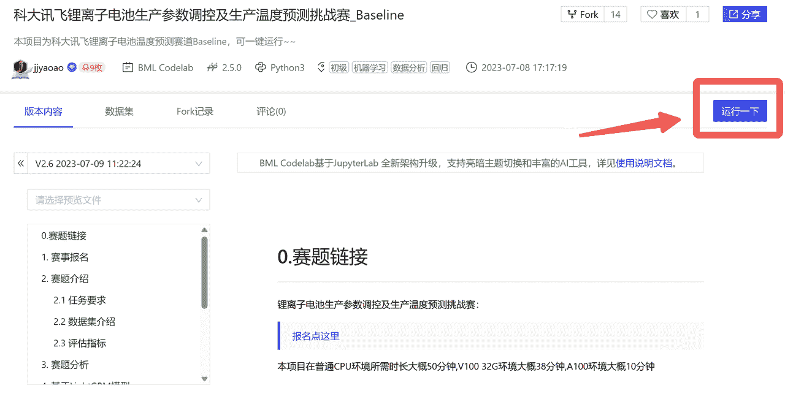
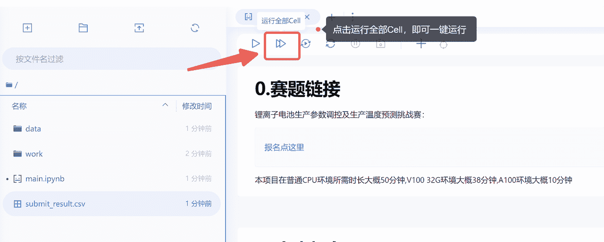
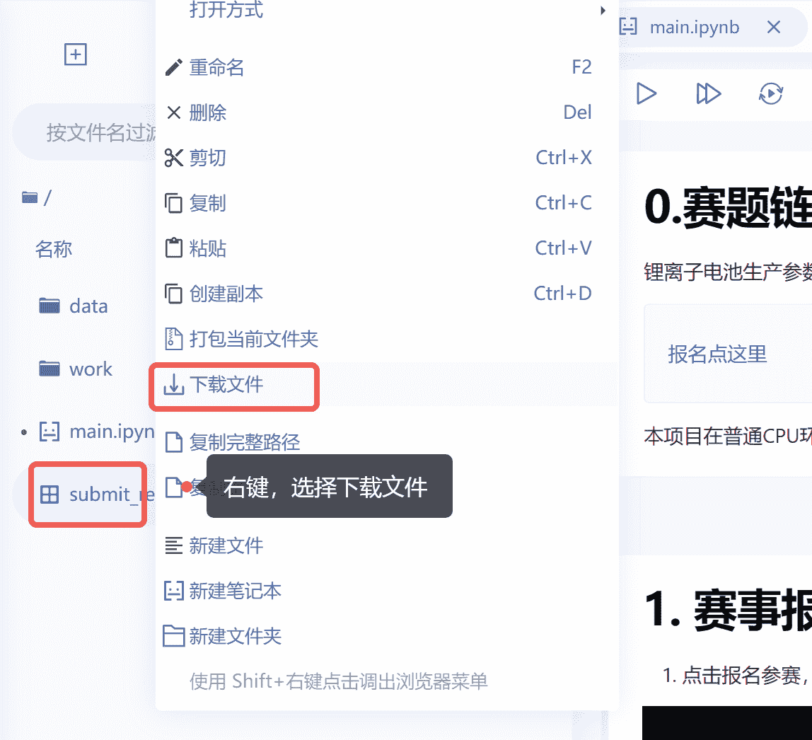
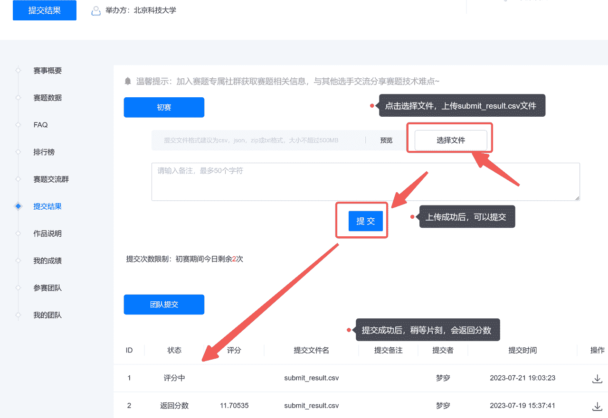
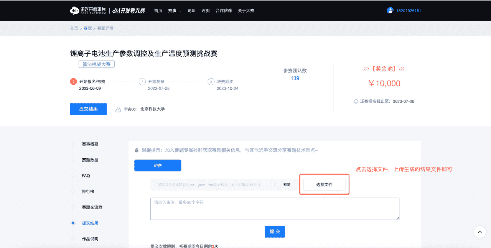

# AI夏令营 - ML实践教程

> 来源：[https://datawhaler.feishu.cn/docx/PB2nd23zyoPtvYxEfxncBwJBnDf](https://datawhaler.feishu.cn/docx/PB2nd23zyoPtvYxEfxncBwJBnDf)

> 本教程会带领大家项目制学习，由浅入深，逐渐进阶。从跑通最简的`Baseline`，精读`Baseline`，到底层算法原理与进阶实践技巧的学习，千里之行，始于足下，从这里，开启你的 AI 学习之旅吧！

> —— Datawhale贡献者团队

| 学习任务 | 相关直播 |
| --- | --- |
| **任务一：** | 选修直播：[AI实践基础 — 编程环境配置](https://www.bilibili.com/video/BV1BV4y147i4) |
| **任务二：** | 选修直播：[Python语法讲解](https://www.bilibili.com/video/BV18z4y1t7tV/) |
| **任务三：** | 选修直播：[XGB/LGB等树模型原理解析](https://www.bilibili.com/video/BV1eM4y1p7t6/) |

# 在线版本Baseline

> `Baseline`是一份简易的入门教程，可以帮助同学们迈出 AI 训练大师之路的第一步。建议入门的同学可以暂时不用着急去弄懂各个代码的原理，先跑通代码，动手实践，看到成绩。

快速跑通全流程，我们基于百度AI Studio，将本教程`Baseline`部署在线上平台，可一键`fork`运行代码，看到成绩。

一键运行：https://aistudio.baidu.com/aistudio/projectdetail/6512066?sUid=2554132&shared=1&ts=1689841007106

+   运行时，选择`V100 32G`或`A100 40G`的配置
+   总运行时间大约需要1小时 或者 `10min`，请耐心等待。
+   **视频演示**：AI夏令营：开营仪式|实践全流程基础演示_哔哩哔哩_bilibili，对应的ML章节





输出`submit_result.csv`文件后，右键可下载到本地，在赛题提交结果提交文件，获取分数。





# 赛题解析

> 锂离子电池生产参数调控及生产温度预测挑战赛：
>
> https://challenge.xfyun.cn/topic/info?type=lithium-ion-battery&ch=bvSQT7Y

本次比赛为数据挖掘类型的比赛，聚焦于工业场景。本赛题实质上为回归任务，其中会涉及到时序预测相关的知识。

参加本次实践可帮助大家：

+   快速掌握数据挖掘任务基本流程，为后续更多比赛的实践打下基础
+   在实践中还可以学习到如何构建时间序列预测相关问题的特征提取技巧，以及模型使用方法。

通过电炉空间温度推测产品内部温度，设计烧结过程的温度场和浓度场的最优控制律：

+   **任务输入**：电炉对应17个温区的实际生产数据，分别是电炉上部17组加热棒设定温度`T1-1`~`T1-17`，电炉下部17组加热棒设定温度`T2-1`~`T2-17`，底部17组进气口的设定进气流量`V1`~`V17`；
+   **任务输出**：电炉对应17个温区上部空间和下部空间17个测温点的测量温度值。

**注意的是预测目标为34个，所以需要我们进行34次模型训练和预测。**

> **任务解析：**
>
> 本次问题是回归预测，常规思路为使用机器学习，如`LightGBM`、`XGBoost`，或者使用深度学习进行实践，在模型的搭建上就比较复杂，需要自己构建模型结构，对于数值数据需要进行标准化处理；
>
> 最简单的方式可使用机器学习模型解决本次问题，该方法模型使用简单，数据不需要过多预处理；
>
> 主要步骤为数据预处理、切分训练集与验证集、训练模型、预测结果。

> **数据解析：**
>
> 数据规模比较小，可以快速处理数据和搭建模型，对于机器要求8g内存即可。本次为结构化赛题，包含电炉烧结每个时间段的流量、上下部设定温度，以及预测目标上下部测量温度值。

# Baseline代码精读

> 视频讲解：https://www.bilibili.com/video/BV1fV41157ao

安装所需的第三方库（命令行）

```
pip install numpy pandas lightgbm scikit-learn tqdm 
```

导入所需的库

```
import pandas as pd # 用于处理数据的工具
import lightgbm as lgb # 机器学习模型 LightGBM
from sklearn.metrics import mean_absolute_error # 评分 MAE 的计算函数
from sklearn.model_selection import train_test_split # 拆分训练集与验证集工具
from tqdm import tqdm # 显示循环的进度条工具
```

数据准备

```
train_dataset = pd.read_csv("./data/train.csv") # 原始训练数据。
test_dataset = pd.read_csv("./data/test.csv") # 原始测试数据（用于提交）。

submit = pd.DataFrame() # 定义提交的最终数据。
submit["序号"] = test_dataset["序号"] # 对齐测试数据的序号。

MAE_scores = dict() # 定义评分项。
```

```
pred_labels = list(train_dataset.columns[-34:]) # 需要预测的标签。
train_set, valid_set = train_test_split(train_dataset, test_size=0.2) # 拆分数据集。

# 设定 LightGBM 训练参，查阅参数意义：https://lightgbm.readthedocs.io/en/latest/Parameters.html
lgb_params = {
        'boosting_type': 'gbdt',
        'objective': 'regression',
        'metric': 'mae',
        'min_child_weight': 5,
        'num_leaves': 2 ** 5,
        'lambda_l2': 10,
        'feature_fraction': 0.8,
        'bagging_fraction': 0.8,
        'bagging_freq': 4,
        'learning_rate': 0.05,
        'seed': 2023,
        'nthread' : 16,
        'verbose' : -1,
    }

no_info = lgb.callback.log_evaluation(period=-1) # 禁用训练日志输出。
```

时间特征函数

```
def time_feature(data: pd.DataFrame, pred_labels: list=None) -> pd.DataFrame:
    """提取数据中的时间特征。

    输入: 
        data: Pandas.DataFrame
            需要提取时间特征的数据。

        pred_labels: list, 默认值: None
            需要预测的标签的列表。如果是测试集，不需要填入。
    
    输出: data: Pandas.DataFrame
            提取时间特征后的数据。
    """
    
    data = data.copy() # 复制数据，避免后续影响原始数据。
    data = data.drop(columns=["序号"]) # 去掉”序号“特征。
    
    data["时间"] = pd.to_datetime(data["时间"]) # 将”时间“特征的文本内容转换为 Pandas 可处理的格式。
    data["month"] = data["时间"].dt.month # 添加新特征“month”，代表”当前月份“。
    data["day"] = data["时间"].dt.day # 添加新特征“day”，代表”当前日期“。
    data["hour"] = data["时间"].dt.hour # 添加新特征“hour”，代表”当前小时“。
    data["minute"] = data["时间"].dt.minute # 添加新特征“minute”，代表”当前分钟“。
    data["weekofyear"] = data["时间"].dt.isocalendar().week.astype(int) # 添加新特征“weekofyear”，代表”当年第几周“，并转换成 int，否则 LightGBM 无法处理。
    data["dayofyear"] = data["时间"].dt.dayofyear # 添加新特征“dayofyear”，代表”当年第几日“。
    data["dayofweek"] = data["时间"].dt.dayofweek # 添加新特征“dayofweek”，代表”当周第几日“。
    data["is_weekend"] = data["时间"].dt.dayofweek // 6 # 添加新特征“is_weekend”，代表”是否是周末“，1 代表是周末，0 代表不是周末。

    data = data.drop(columns=["时间"]) # LightGBM 无法处理这个特征，它已体现在其他特征中，故丢弃。

    if pred_labels: # 如果提供了 pred_labels 参数，则执行该代码块。
        data = data.drop(columns=[*pred_labels]) # 去掉所有待预测的标签。
    
    return data # 返回最后处理的数据。
```

模型训练

```
test_features = time_feature(test_dataset) # 处理测试集的时间特征，无需 pred_labels。

# 从所有待预测特征中依次取出标签进行训练与预测。
for pred_label in tqdm(pred_labels):
    train_features = time_feature(train_set, pred_labels=pred_labels) # 处理训练集的时间特征。
    train_labels = train_set[pred_label] # 训练集的标签数据。
    train_data = lgb.Dataset(train_features, label=train_labels) # 将训练集转换为 LightGBM 可处理的类型。

    valid_features = time_feature(valid_set, pred_labels=pred_labels) # 处理验证集的时间特征。
    valid_labels = valid_set[pred_label] # 验证集的标签数据。
    valid_data = lgb.Dataset(valid_features, label=valid_labels) # 将验证集转换为 LightGBM 可处理的类型。

    # 训练模型，参数依次为：导入模型设定参数、导入训练集、设定模型迭代次数（200）、导入验证集、禁止输出日志
    model = lgb.train(lgb_params, train_data, 200, valid_sets=valid_data, callbacks=[no_info])

    valid_pred = model.predict(valid_features, num_iteration=model.best_iteration) # 选择效果最好的模型进行验证集预测。
    test_pred = model.predict(test_features, num_iteration=model.best_iteration) # 选择效果最好的模型进行测试集预测。
    MAE_score = mean_absolute_error(valid_pred, valid_labels) # 计算验证集预测数据与真实数据的 MAE。
    MAE_scores[pred_label] = MAE_score # 将对应标签的 MAE 值 存入评分项中。

    submit[pred_label] = test_pred # 将测试集预测数据存入最终提交数据中。
```

保存文件并查看结果

```
submit.to_csv('submit_result.csv', index=False) # 保存最后的预测结果到 submit_result.csv。
print(MAE_scores) # 查看各项的 MAE 值。
```

**完整代码如下：**

以上是每个代码模块的精讲，现在对每行代码配置解析）


# 基础代码

```
# 导入所需的库
import pandas as pd # 用于处理数据的工具
import lightgbm as lgb # 机器学习模型 LightGBM
from sklearn.metrics import mean_absolute_error # 评分 MAE 的计算函数
from sklearn.model_selection import train_test_split # 拆分训练集与验证集工具
from tqdm import tqdm # 显示循环的进度条工具

# 数据准备
train_dataset = pd.read_csv("./data/train.csv") # 原始训练数据。
test_dataset = pd.read_csv("./data/test.csv") # 原始测试数据（用于提交）。

submit = pd.DataFrame() # 定义提交的最终数据。
submit["序号"] = test_dataset["序号"] # 对齐测试数据的序号。

MAE_scores = dict() # 定义评分项。

# 模型训练
pred_labels = list(train_dataset.columns[-34:]) # 需要预测的标签。
train_set, valid_set = train_test_split(train_dataset, test_size=0.2) # 拆分数据集。

# 设定 LightGBM 训练参数，查阅参数意义：https://lightgbm.readthedocs.io/en/latest/Parameters.html
lgb_params = {
        'boosting_type': 'gbdt',
        'objective': 'regression',
        'metric': 'mae',
        'min_child_weight': 5,
        'num_leaves': 2 ** 5,
        'lambda_l2': 10,
        'feature_fraction': 0.8,
        'bagging_fraction': 0.8,
        'bagging_freq': 4,
        'learning_rate': 0.05,
        'seed': 2023,
        'nthread' : 16,
        'verbose' : -1,
    }

no_info = lgb.callback.log_evaluation(period=-1) # 禁用训练日志输出。

def time_feature(data: pd.DataFrame, pred_labels: list=None) -> pd.DataFrame:
    """提取数据中的时间特征。

    输入: 
        data: Pandas.DataFrame
            需要提取时间特征的数据。

        pred_labels: list, 默认值: None
            需要预测的标签的列表。如果是测试集，不需要填入。
    
    输出: data: Pandas.DataFrame
            提取时间特征后的数据。
    """
    
    data = data.copy() # 复制数据，避免后续影响原始数据。
    data = data.drop(columns=["序号"]) # 去掉”序号“特征。
    
    data["时间"] = pd.to_datetime(data["时间"]) # 将”时间“特征的文本内容转换为 Pandas 可处理的格式。
    data["month"] = data["时间"].dt.month # 添加新特征“month”，代表”当前月份“。
    data["day"] = data["时间"].dt.day # 添加新特征“day”，代表”当前日期“。
    data["hour"] = data["时间"].dt.hour # 添加新特征“hour”，代表”当前小时“。
    data["minute"] = data["时间"].dt.minute # 添加新特征“minute”，代表”当前分钟“。
    data["weekofyear"] = data["时间"].dt.isocalendar().week.astype(int) # 添加新特征“weekofyear”，代表”当年第几周“，并转换成 int，否则 LightGBM 无法处理。
    data["dayofyear"] = data["时间"].dt.dayofyear # 添加新特征“dayofyear”，代表”当年第几日“。
    data["dayofweek"] = data["时间"].dt.dayofweek # 添加新特征“dayofweek”，代表”当周第几日“。
    data["is_weekend"] = data["时间"].dt.dayofweek // 6 # 添加新特征“is_weekend”，代表”是否是周末“，1 代表是周末，0 代表不是周末。

    data = data.drop(columns=["时间"]) # LightGBM 无法处理这个特征，它已体现在其他特征中，故丢弃。

    if pred_labels: # 如果提供了 pred_labels 参数，则执行该代码块。
        data = data.drop(columns=[*pred_labels]) # 去掉所有待预测的标签。
    
    return data # 返回最后处理的数据。

test_features = time_feature(test_dataset) # 处理测试集的时间特征，无需 pred_labels。

# 从所有待预测特征中依次取出标签进行训练与预测。
for pred_label in tqdm(pred_labels):
    train_features = time_feature(train_set, pred_labels=pred_labels) # 处理训练集的时间特征。
    train_labels = train_set[pred_label] # 训练集的标签数据。
    train_data = lgb.Dataset(train_features, label=train_labels) # 将训练集转换为 LightGBM 可处理的类型。

    valid_features = time_feature(valid_set, pred_labels=pred_labels) # 处理验证集的时间特征。
    valid_labels = valid_set[pred_label] # 验证集的标签数据。
    valid_data = lgb.Dataset(valid_features, label=valid_labels) # 将验证集转换为 LightGBM 可处理的类型。

    # 训练模型，参数依次为：导入模型设定参数、导入训练集、设定模型迭代次数（200）、导入验证集、禁止输出日志
    model = lgb.train(lgb_params, train_data, 200, valid_sets=valid_data, callbacks=[no_info])

    valid_pred = model.predict(valid_features, num_iteration=model.best_iteration) # 选择效果最好的模型进行验证集预测。
    test_pred = model.predict(test_features, num_iteration=model.best_iteration) # 选择效果最好的模型进行测试集预测。
    MAE_score = mean_absolute_error(valid_pred, valid_labels) # 计算验证集预测数据与真实数据的 MAE。
    MAE_scores[pred_label] = MAE_score # 将对应标签的 MAE 值 存入评分项中。

    submit[pred_label] = test_pred # 将测试集预测数据存入最终提交数据中。
     
submit.to_csv('submit_result.csv', index=False) # 保存最后的预测结果到 submit_result.csv。
print(MAE_scores) # 查看各项的 MAE 值。
```

## 改进方法建议

1. 提取更多特征
2. 进行结果后处理
3. 尝试不同的模型

## 结果提交

在提交结果处提交，提交`submit.csv`文件（入门同学可以使用思路1），在排名结果页查看自己的成绩排名。



# 进阶技巧

> 竞赛上分技巧：https://www.bilibili.com/video/BV1zm4y1s7T9/

> 配套PPT：[`竞赛上分技巧-王贺.pdf`](https://datawhaler.feishu.cn/file/BK5ibD9neoau0exq8gjcG044nCg)

在实践尝试阶段，我们使用`lightgbm`完成了基本的模型训练，已经最终结果输出。在进阶实践部分，将在原有`Baseline`基础上做进阶代码，进阶版本代码。具体地，我们可以尝试提取更多特征改善最终结果，这也是数据挖掘比赛中的主要优化方向，很多情况下决定着最终的成绩。

这里主要构建了交叉特征、历史平移特征、差分特征、和窗口统计特征；每种特征都是有理可据的，具体说明如下：

### (1) 交叉特征

主要提取流量、上部温度设定、下部温度设定之间的关系；

### (2) 历史平移特征

通过历史平移获取上个阶段的信息；

### (3) 差分特征

可以帮助获取相邻阶段的增长差异，描述数据的涨减变化情况。在此基础上还可以构建相邻数据比值变化、二阶差分等；

### (4) 窗口统计特征

窗口统计可以构建不同的窗口大小，然后基于窗口范围进统计均值、最大值、最小值、中位数、方差的信息，可以反映最近阶段数据的变化情况。

## 构造特征

```
# 交叉特征
for i in range(1,18):
    train[f'流量{i}/上部温度设定{i}'] = train[f'流量{i}'] / train[f'上部温度设定{i}']
    test[f'流量{i}/上部温度设定{i}'] = test[f'流量{i}'] / test[f'上部温度设定{i}']
    
    train[f'流量{i}/下部温度设定{i}'] = train[f'流量{i}'] / train[f'下部温度设定{i}']
    test[f'流量{i}/下部温度设定{i}'] = test[f'流量{i}'] / test[f'下部温度设定{i}']
    
    train[f'上部温度设定{i}/下部温度设定{i}'] = train[f'上部温度设定{i}'] / train[f'下部温度设定{i}']
    test[f'上部温度设定{i}/下部温度设定{i}'] = test[f'上部温度设定{i}'] / test[f'下部温度设定{i}']
    
# 历史平移
for i in range(1,18):
    train[f'last1_流量{i}'] = train[f'流量{i}'].shift(1)
    train[f'last1_上部温度设定{i}'] = train[f'上部温度设定{i}'].shift(1)
    train[f'last1_下部温度设定{i}'] = train[f'下部温度设定{i}'].shift(1)
    
    test[f'last1_流量{i}'] = test[f'流量{i}'].shift(1)
    test[f'last1_上部温度设定{i}'] = test[f'上部温度设定{i}'].shift(1)
    test[f'last1_下部温度设定{i}'] = test[f'下部温度设定{i}'].shift(1)

# 差分特征
for i in range(1,18):
    train[f'last1_diff_流量{i}'] = train[f'流量{i}'].diff(1)
    train[f'last1_diff_上部温度设定{i}'] = train[f'上部温度设定{i}'].diff(1)
    train[f'last1_diff_下部温度设定{i}'] = train[f'下部温度设定{i}'].diff(1)
    
    test[f'last1_diff_流量{i}'] = test[f'流量{i}'].diff(1)
    test[f'last1_diff_上部温度设定{i}'] = test[f'上部温度设定{i}'].diff(1)
    test[f'last1_diff_下部温度设定{i}'] = test[f'下部温度设定{i}'].diff(1)
    
# 窗口统计
for i in range(1,18):
    train[f'win3_mean_流量{i}'] = (train[f'流量{i}'].shift(1) + train[f'流量{i}'].shift(2) + train[f'流量{i}'].shift(3)) / 3
    train[f'win3_mean_上部温度设定{i}'] = (train[f'上部温度设定{i}'].shift(1) + train[f'上部温度设定{i}'].shift(2) + train[f'上部温度设定{i}'].shift(3)) / 3
    train[f'win3_mean_下部温度设定{i}'] = (train[f'下部温度设定{i}'].shift(1) + train[f'下部温度设定{i}'].shift(2) + train[f'下部温度设定{i}'].shift(3)) / 3
    
    test[f'win3_mean_流量{i}'] = (test[f'流量{i}'].shift(1) + test[f'流量{i}'].shift(2) + test[f'流量{i}'].shift(3)) / 3
    test[f'win3_mean_上部温度设定{i}'] = (test[f'上部温度设定{i}'].shift(1) + test[f'上部温度设定{i}'].shift(2) + test[f'上部温度设定{i}'].shift(3)) / 3
    test[f'win3_mean_下部温度设定{i}'] = (test[f'下部温度设定{i}'].shift(1) + test[f'下部温度设定{i}'].shift(2) + test[f'下部温度设定{i}'].shift(3)) / 3
```

## 完整代码


# 加入新特征后的完整代码如下（对每行代码配置解析）

## 导入与数据准备

```python
import pandas as pd  # 用于处理数据的工具
import lightgbm as lgb  # 机器学习模型 LightGBM
from sklearn.metrics import mean_absolute_error  # 评分 MAE 的计算函数
from sklearn.model_selection import train_test_split  # 拆分训练集与验证集工具
from tqdm import tqdm  # 显示循环的进度条工具

train_dataset = pd.read_csv("./data/train.csv")  # 原始训练数据。
test_dataset = pd.read_csv("./data/test.csv")  # 原始测试数据（用于提交）。

submit = pd.DataFrame()  # 定义提交的最终数据。
submit["序号"] = test_dataset["序号"]  # 对齐测试数据的序号。

MAE_scores = dict()  # 定义评分项。

pred_labels = list(train_dataset.columns[-34:])  # 需要预测的标签。
train_set, valid_set = train_test_split(train_dataset, test_size=0.2)  # 拆分数据集。
```

## 模型参数设定

设定 LightGBM 训练参数，查阅参数意义：https://lightgbm.readthedocs.io/en/latest/Parameters.html

```python
lgb_params = {
    'boosting_type': 'gbdt',
    'objective': 'regression',
    'metric': 'mae',
    'min_child_weight': 5,
    'num_leaves': 2 ** 5,
    'lambda_l2': 10,
    'feature_fraction': 0.8,
    'bagging_fraction': 0.8,
    'bagging_freq': 4,
    'learning_rate': 0.05,
    'seed': 2023,
    'nthread': 16,
    'verbose': -1,
}

no_info = lgb.callback.log_evaluation(period=-1)  # 禁用训练日志输出。
```

## 特征工程函数 data_feature

```python
def data_feature(data: pd.DataFrame, pred_labels: list = None) -> pd.DataFrame:
    data = data.copy()  # 复制数据，避免后续影响原始数据。
    data = data.drop(columns=["序号"])  # 去掉“序号”特征。

    data["时间"] = pd.to_datetime(data["时间"])  # 将“时间”特征的文本内容转换为 Pandas 可处理的格式。
    data["month"] = data["时间"].dt.month  # 添加新特征“month”，代表“当前月份”。
    data["day"] = data["时间"].dt.day  # 添加新特征“day”，代表“当前日期”。
    data["hour"] = data["时间"].dt.hour  # 添加新特征“hour”，代表“当前小时”。
    data["minute"] = data["时间"].dt.minute  # 添加新特征“minute”，代表“当前分钟”。
    data["weekofyear"] = data["时间"].dt.isocalendar().week.astype(int)  # 添加新特征“weekofyear”，代表“当年第几周”，并转换成 int，否则 LightGBM 无法处理。
    data["dayofyear"] = data["时间"].dt.dayofyear  # 添加新特征“dayofyear”，代表“当年第几日”。
    data["dayofweek"] = data["时间"].dt.dayofweek  # 添加新特征“dayofweek”，代表“当周第几日”。
    data["is_weekend"] = data["时间"].dt.dayofweek // 6  # 添加新特征“is_weekend”，代表“是否是周末”，1 代表是周末，0 代表不是周末。

    data = data.drop(columns=["时间"])  # LightGBM 无法处理这个特征，它已体现在其他特征中，故丢弃。

    # 交叉特征
    for i in range(1, 18):
        data[f'流量{i}/上部温度设定{i}'] = data[f'流量{i}'] / data[f'上部温度设定{i}']
        data[f'流量{i}/下部温度设定{i}'] = data[f'流量{i}'] / data[f'下部温度设定{i}']
        data[f'上部温度设定{i}/下部温度设定{i}'] = data[f'上部温度设定{i}'] / data[f'下部温度设定{i}']

        # 历史平移
        data[f'last1_流量{i}'] = data[f'流量{i}'].shift(1)
        data[f'last1_上部温度设定{i}'] = data[f'上部温度设定{i}'].shift(1)
        data[f'last1_下部温度设定{i}'] = data[f'下部温度设定{i}'].shift(1)

        # 差分特征
        data[f'last1_diff_流量{i}'] = data[f'流量{i}'].diff(1)
        data[f'last1_diff_上部温度设定{i}'] = data[f'上部温度设定{i}'].diff(1)
        data[f'last1_diff_下部温度设定{i}'] = data[f'下部温度设定{i}'].diff(1)

    # 窗口统计
    for i in range(1, 18):
        data[f'win3_mean_流量{i}'] = (data[f'流量{i}'].shift(1) + data[f'流量{i}'].shift(2) + data[f'流量{i}'].shift(3)) / 3
        data[f'win3_mean_上部温度设定{i}'] = (data[f'上部温度设定{i}'].shift(1) + data[f'上部温度设定{i}'].shift(2) + data[f'上部温度设定{i}'].shift(3)) / 3
        data[f'win3_mean_下部温度设定{i}'] = (data[f'下部温度设定{i}'].shift(1) + data[f'下部温度设定{i}'].shift(2) + data[f'下部温度设定{i}'].shift(3)) / 3

    if pred_labels:  # 如果提供了 pred_labels 参数，则执行该代码块。
        data = data.drop(columns=[*pred_labels])  # 去掉所有待预测的标签。

    return data  # 返回最后处理的数据。

test_features = data_feature(test_dataset)  # 处理测试集的时间特征，无需 pred_labels。
```

## 训练、预测与结果保存

从所有待预测特征中依次取出标签进行训练与预测。

```python
for pred_label in tqdm(pred_labels):
    train_features = data_feature(train_set, pred_labels=pred_labels)  # 处理训练集的时间特征。
    train_labels = train_set[pred_label]  # 训练集的标签数据。
    train_data = lgb.Dataset(train_features, label=train_labels)  # 将训练集转换为 LightGBM 可处理的类型。

    valid_features = data_feature(valid_set, pred_labels=pred_labels)  # 处理验证集的时间特征。
    valid_labels = valid_set[pred_label]  # 验证集的标签数据。
    valid_data = lgb.Dataset(valid_features, label=valid_labels)  # 将验证集转换为 LightGBM 可处理的类型。

    # 训练模型，参数依次为：导入模型设定参数、导入训练集、设定模型迭代次数（200）、导入验证集、禁止输出日志
    model = lgb.train(lgb_params, train_data, 200, valid_sets=valid_data, callbacks=[no_info])

    valid_pred = model.predict(valid_features, num_iteration=model.best_iteration)  # 选择效果最好的模型进行验证集预测。
    test_pred = model.predict(test_features, num_iteration=model.best_iteration)  # 选择效果最好的模型进行测试集预测。
    MAE_score = mean_absolute_error(valid_pred, valid_labels)  # 计算验证集预测数据与真实数据的 MAE。
    MAE_scores[pred_label] = MAE_score  # 将对应标签的 MAE 值存入评分项中。

    submit[pred_label] = test_pred  # 将测试集预测数据存入最终提交数据中。
    
submit.to_csv('submit_result_new.csv', index=False)  # 保存最后的预测结果到 submit_result_new.csv。
print(MAE_scores)  # 查看各项的 MAE 值。
```

进阶代码，分数大概 8.9

## 优化建议

### 1. 过拟合现象

在代码运行时可以将 `callbacks=[no_info]` 去除，以查看模型运行的日志，运行结束后也可以利用代码 `print(MAE_scores)` 来打印出最终的损失，观察不难看出，模型会在一定时间后进入过拟合，因此可以尝试以一些措施来缓解这种现象。

+   利用 `lightgbm` 自带的 `early_stopping_rounds` 参数。
+   采用多折验证的方式扩大数据量，使得模型泛化能力增强。

### 2. 参数设定

此次基线没有做精确的调参处理，因此可以调参的范围还是挺大的，常用的搜索参数策略有两种：

+   网格搜索（Grid Search）：这是一种传统的参数调整方法，它会测试指定参数的所有可能组合来找出最佳参数。但是，当参数空间较大时，这种方法可能会消耗大量计算资源和时间。
+   随机搜索（Random Search）：与网格搜索相比，随机搜索不会测试所有的参数组合，而是在参数空间中随机选择一定数量的参数组合进行测试。尽管随机搜索可能无法找到最优的参数组合，但在计算资源有限的情况下，它是一个有效的选择。

### 3. 模型设定

此次基线采用的是 `LightGBM`，也可以试试 `XGBoost`、`Adaboost`、`Catboost` 等传统的模型，并且也可以使用深度学习的方法构建循环神经网络来处理此次任务，因为本质是一个时序任务，在采用机器学习的同时也可以保存模型的参数配置，尝试进行模型集成的训练。

### 4. 特征

在特征选择方面，目前给出的特征仅仅是单独对时间处理，与对流量\上\下\部温度设定进行处理，并未结合时间与其他特征的关系，可以尝试自己构建合理的新特征。

### 5. 后处理

对已经给出的 csv 文件仍然可以分析其趋势，抓住评估的关键来调整文件内容使得结果更加精确。

### 6. 迭代步数

目前设置的迭代步数为 200 轮，其实这对于某些预测数据来说是不够的，可以尝试自己增大迭代步数。

# 附录 - 实践环境配置

## AI 环境配置

+   **视频讲解：**AI夏令营：手把手带你配置 AI 环境_哔哩哔哩_bilibili
+   **图文材料：**https://gitee.com/anine09/learn-python-the-smart-way-v2/blob/main/slides/chapter_0-Installation.ipynb

## 其他材料

+   `python` 环境的搭建请参考：
+   Mac 设备：Mac 上安装 `Anaconda` 最全教程
+   Windows 设备：[A](https://blog.csdn.net/fan18317517352/article/details/123035625)naconda超详细安装教程(Windows环境下)_菜鸟1号!!的博客-CSDN博客_windows安装anaconda
+   `Jupyter Notebook` 编辑器的使用请参考：
+   `Jupyter Notebook` 最全使用教程，看这篇就够了！
