# 活动 ｜ Datawhale 2024年 AI 夏令营

> 来源：[https://datawhaler.feishu.cn/docx/PjwpdPvLBoznRmxBuvGcEHnSn4e](https://datawhaler.feishu.cn/docx/PjwpdPvLBoznRmxBuvGcEHnSn4e)

Hi，Datawhale的学习者你好呀~

这里有一封你的AI夏令营入营信，请查收~

# 欢迎加入Datawhale AI夏令营

> 很高兴你决定踏上这段旅程，与我们一同探索人工智能的无限可能。

>

> 在这里，你将——

> 接触各方向前沿的AI技术，

> 参与顶尖赛事的实践项目，

> 有机会结识志同道合的朋友，

> 并有可能赢得奖学金和实习机会。

>

## 你是否仔细想过为什么**参加这次AI夏令营？**

>

> 你应该听说过，通过夏令营——

> 有的同学积累了很多 **项目实践经验**；

> **有的同学认**识了志同道合的朋友，拓宽了 人脉和视野；

> **还有的同**学专业能力小有所成，开始在 AI 竞赛排行榜 崭露头角

>

> 那么你呢？

>

> 也许你是奔着赛事奖金而来

> 也许你是看到同学在参加不甘落后

> 也许你只是想来凑凑热闹，看看咋回事

>

### 但我不得不提前告诉你，学习很需要全情投入

>

## 你应该还记得，我们反复介绍过 Datawhale AI夏令营

>

> 是 🎉 线**上活动，全程免费 **🥳

> 面向任何 **对 AI 方向 感兴趣、有热情** 的学习者

> 我们作为 组织者、开发者、宣传者、班班、教程贡献者、助教

> 共同构建 **国内规模最大的AI夏令营**，为大家提供 **暑期实践学习机会**

> 让大家有机会获得 结营证书、暑期实践证明、优秀学习者证书、奖学金和荣誉证书

>

> **我们凭着**我们的热情做着这些贡献，期待和我们双向奔赴的学习者

> 相信你也希望能有一个**互相激励、互相打气的学习圈子**共同成长

> 否则，你这些时间为什么不拿去**看书、****休息****，又或者****游戏****、和朋友玩耍** 呢？

>

> 所以既然你报名了，我们希望你认真地问一问自己：

>

### “我参加AI夏令营到底希望获得什么？”

>

# 我们都希望你能在夏令营中学有所获~

>

> 我们认为，实践是检验真理的唯一标准，唯有实践能让我们知行合一。

> **在实践的过**程中磕磕绊绊才是真实正常的，我们想与你在AI夏令营中重新找回真实的学习感，不必害怕犯错、耐心分析与解决问题，我们互相扶持、互相帮助，就一定能完成学习、持续进步。

> 在这里的所有人，都认为学习很重要，只要你学习就值得被帮助和夸赞！

>

## 在我们的视角里，觉得：

> **参加夏令营和AI竞赛**，不仅能深化你对AI前沿领域的理解和实践能力，更通过共享开放持续进化的学习资源，帮助你与知识连接。

> 或许你和大模型对话可以取得很好的学习效果，但在社区中人与人的协作，交流，互动，与人连接的社区氛围是更重要的，祝你在夏令营中能找到志同道合的小伙伴，一起走的更远~

> AI作为新时代的技术革命，落地才能产生更多价值，所以我们精选了真实场景和数据的AI竞赛，让你能接触到AI一线在面临哪些问题，通过你的努力去解决问题，与场景连接产生价值。

>

## 或许你是第一次参与线上开源学习：

> 在这里，学习就是第一要义，只要能帮助到大家学习，我们都愿意尽力去做！

>

> **不要害怕提问**，这里没有老师，有的只是想与你一同进步的热情的小伙伴！

> **不要****害****怕提问**，或许你的提问就是大家都希望提出的问题，提问是学习的艺术；

> **不要害怕提问**，这里有一群嗷嗷待哺的助教，绞尽脑汁活跃群氛围，你可解其燃眉之急；

> **不要害怕提问**，问题的累积只会让你无法顺利推进，助教们想让大家顺利学习，我们一起努力；

> **不要害怕提问**，也许你的助教正在为群里无人提问而黯然神伤，我们大可双向奔赴，成就佳话。

>

> 但我们建议你提好问题，先独立思考、不要重复提问，针对此可以尝试提问前三步走：

1.  尝试自己分析/查询来解决。

1.  对照教程检查步骤或者重新走一遍。

1.  查询QA手册是不是已经有方案。

1.  按照场景、预期、现象，有条理地把问题描述清楚

>

> 助教们希望为大家带来更多有效的帮助，而不是互相被重复问题折磨

>

> Datawhale坚持践行 **“开源学习模式” **，在线上开源共创，以开放的场景、在线的资源、有规划的学习计划引导有效学习

你可以在社区中通过**共学、共创链接志同道合的同伴**，建立信任和联系，

甚至成为内容的生产者，网络的连接者，体系的建构者，

勇于试错，看见世界，认识自己，参与创造，探索无限可能性！

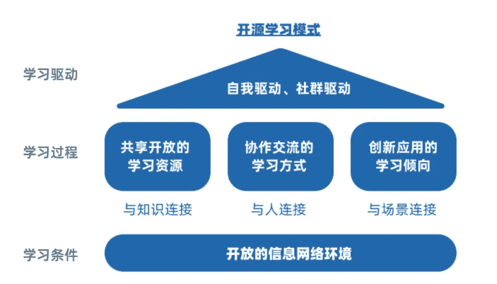

## 我们都坚信，只要你想，你能学会任何东西，请相信自己！

> **我们都坚信，**且祝愿你能学有所成，为自己的未来助力，请相信自己！

> 兴趣是最好的老师，相信报名的大家都对AI有着浓厚的兴趣，

> 在恣意燃烧热情，探索兴趣和能力边界的同时，

> 结交三两个志同道合的老师和朋友，互帮互助，相互进步，岂不快哉！！

>

## 这里还有一些高效学习的建议

> 核心是参照**费曼学习法**，以输出带动输入，对自己的思考和结果负责，并勇敢分享~

>

+   **定个计划**：按照自己的节奏来，别让学习变成负担

+   利用**SMART原则**设定具体、可测量、可达成、相关性高、时限明确的学习目标

+   每天保持固定的学习时间，持之以恒

>

+   **用对方法，效率翻倍**：跟着教程**实践和思考**，针对学习目标努力，有产出地学习

+   采用**SQ3R学习法**，即浏览、提问、阅读、复述、回顾，主动学习，加深理解

+   光说不练假把式，**多动手，多实践**，才能学到真本事

+   Talk is cheap，show me the code，

+   动手去做，刻意练习，下场弄脏手、出过错才能逐渐摸索出自己的优势和兴趣

>

+   **多多分享，快乐加倍**：不懂就问，懂了就分享，咱们这儿最不缺的就是乐于助人的小伙伴

+   与同伴互相学习，定期讨论，共享资源和心得

+   学了新东西别忘了及时做笔记，分享会让收获加倍~

+   我们鼓励大家多多分享开源，互相学习，互补视角、借助社区力量高效增长认知

+   输入，内化，输出，教会他人就是最高效的学习，期待你的优秀笔记，能共创到教程里

# 期待与你在Datawhale不断相遇！

# 关于**Datawhale**

>

> Datawhale成立于2018年，是中国最大的AI领域开源学习组织。我们致力于打造一个“for the learner，和学习者一起成长”的平台，鼓励开放、包容、互助的学习氛围。在Datawhale，你可以：

>

+   获得最新的AI学习资源和实践机会。

+   大胆试错，多多实践，不用害怕没有资源或缺少回应。

+   加入项目团队，贡献代码，提升协作能力。

+   参与社区活动，拓展人脉，了解行业动态。

+   遇到志同道合的小伙伴，共同成长。

#      **· · · **

>

> 更多信息你还可以看看** **【Datawhale社区背景信息调研】https://kdocs.cn/l/cb2TLIDPAq1W

>

## 夏令营只是一个开始，我们期待能与你不断在Datawhale相遇

>

> 你想要的，我们都会尽量一起共创，你也可以加入我们一起 “For the Learner，For the Dreamer”

>

> 下面来看看Datawhale夏令营台前幕后以及同学们，都在说什么吧~

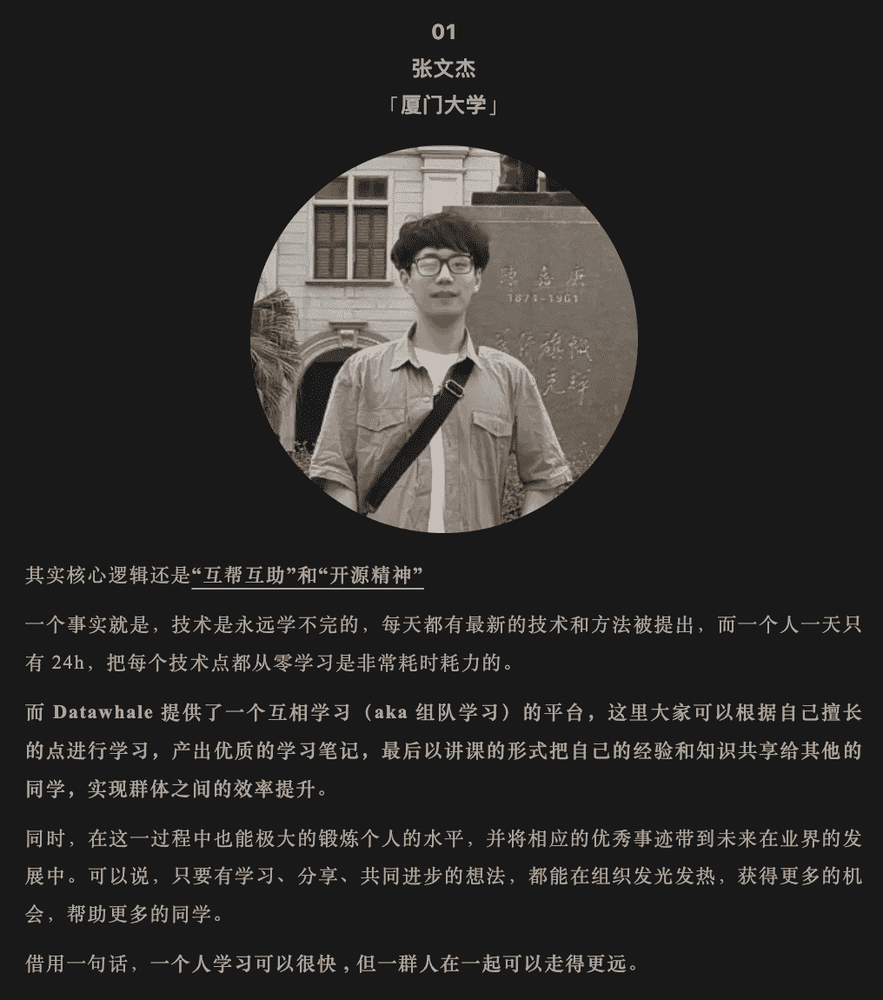

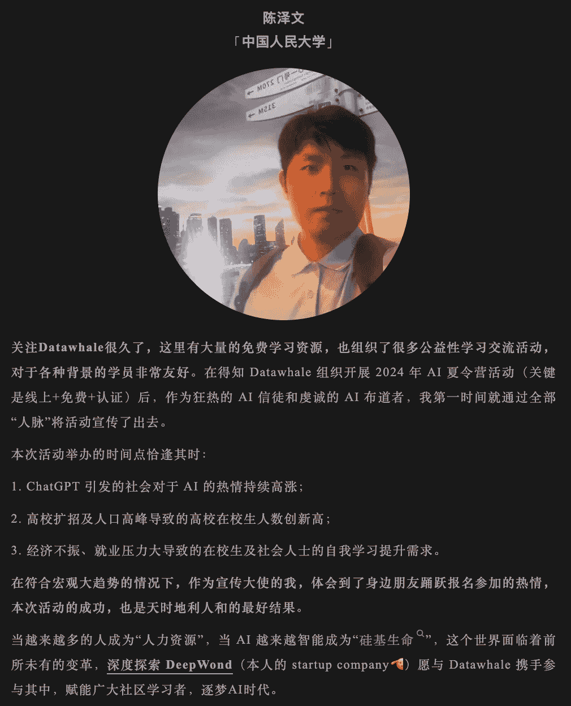

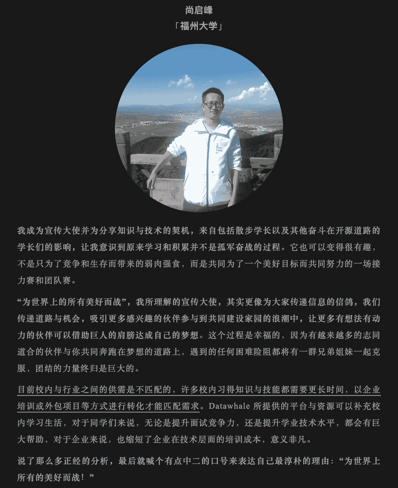

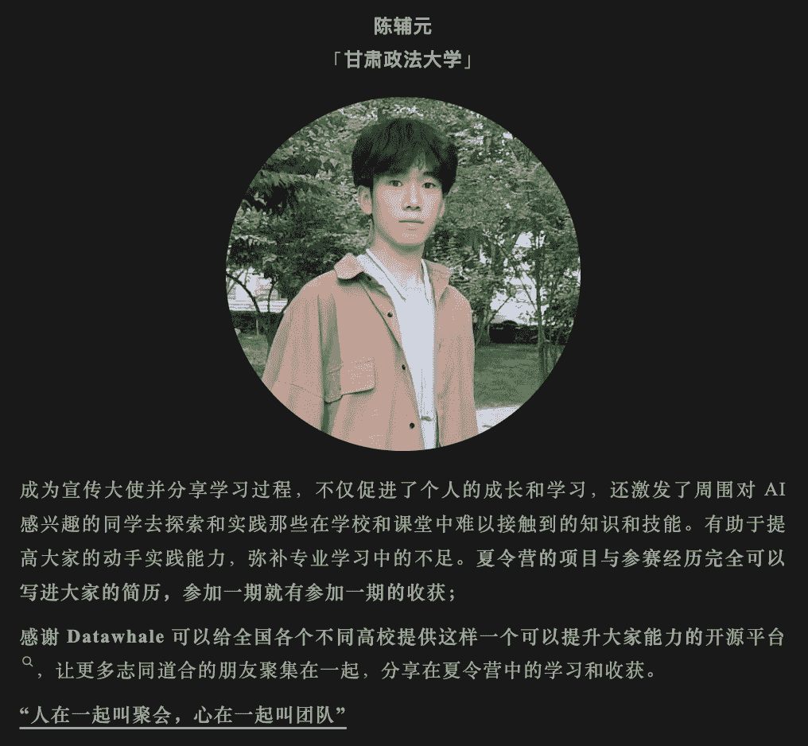

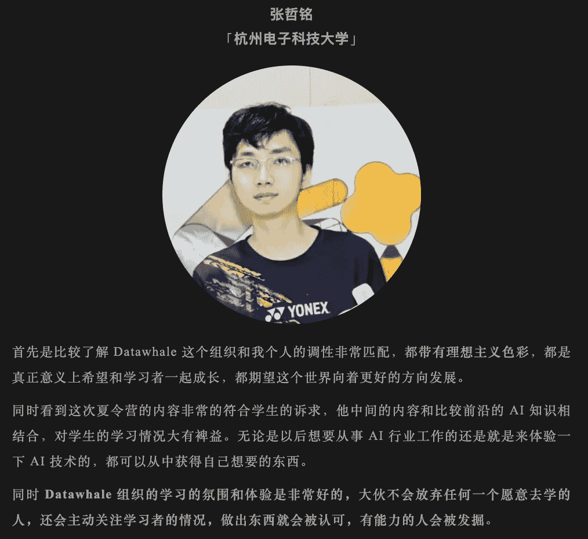

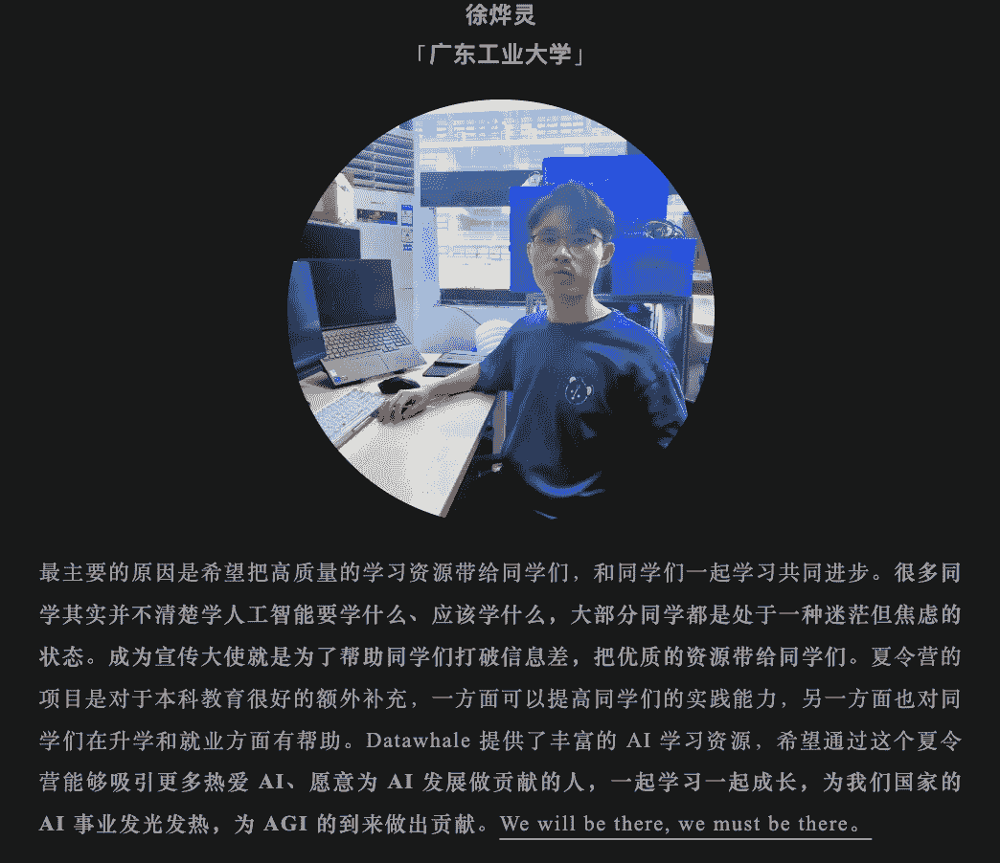

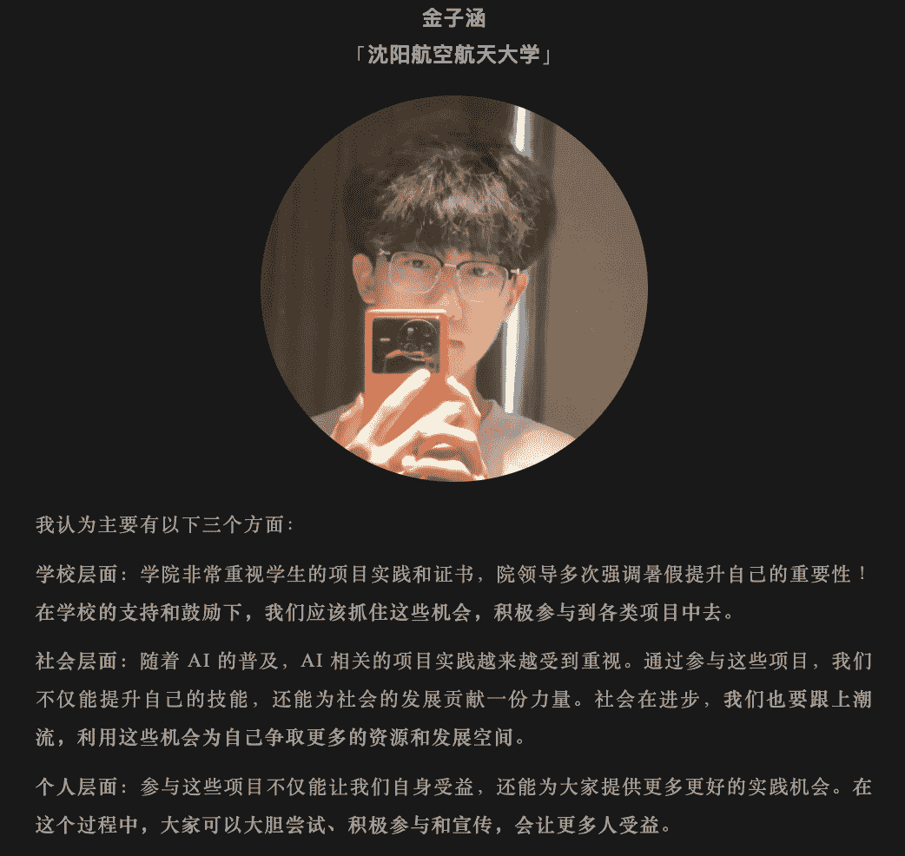

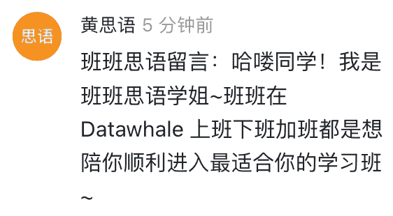

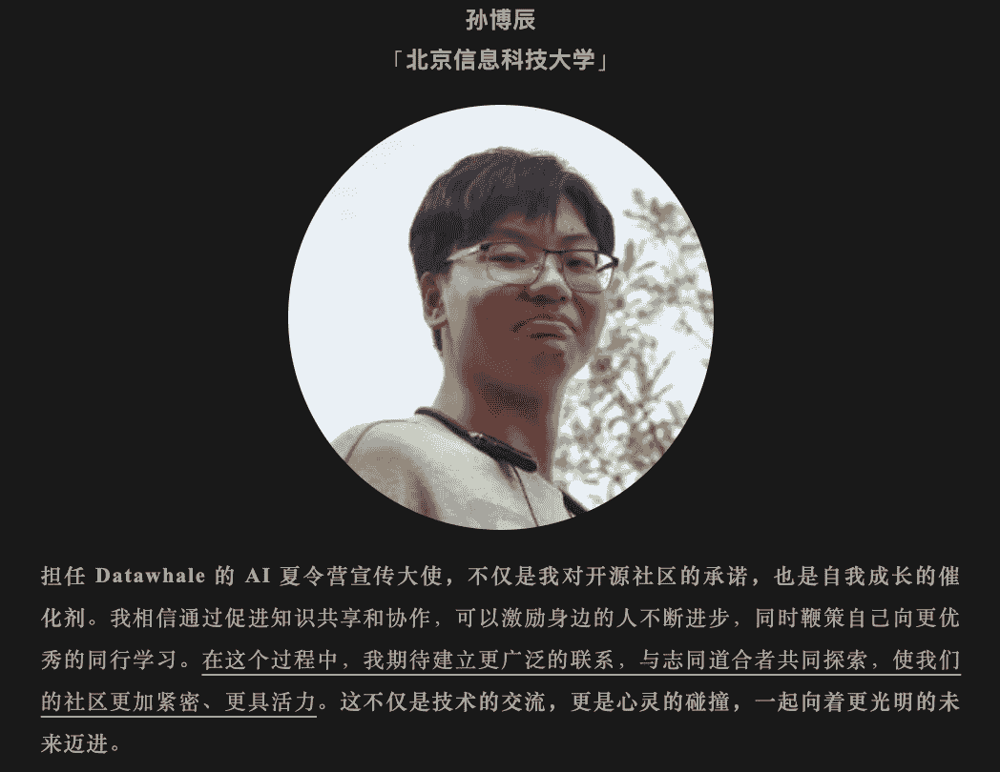

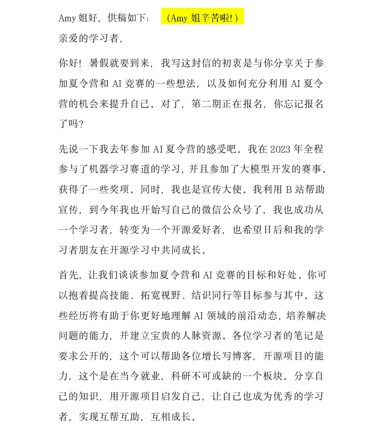

[写给AI学习者的一封信-吴汉钦.docx](https://internal-api-drive-stream.feishu.cn/space/api/box/stream/download/all/TgEUbLZRPo72L1xTy4VchRuMnYd)

> From AI夏令营背后的PM

+   大家能看见的：好多赛道，好多学习内容，好多直播，好多积极学习的小伙伴

+   大家看不见的：通宵达旦、焦虑不已的教研和产品开发小哥哥，设计海报和推文抓耳挠腮到头秃的ee，疯狂摇人摇到被以为拐进传销组织的大使，回复学习者咨询消息到凌晨三四点的班班和学姐，还有我这个到处"关怀"大家真的很怕有人抑郁的PM

+   我们的目标（6月的flag）：打造产研学习资源最丰富，参与人数最多，学习者体验最好，贡献者最多元的AI夏令营

+   希望大家有所收获和成长～可以享受学习，认识更多志同道合的伙伴！

# 悄悄告诉你，还可以看看[AI夏令营第一期学习者好评墙](https://b1n8kiruzw2.feishu.cn/wiki/KXIhwY00XigCkTkFdESc7XeHnVc?from=from_copylink)

>

> **AI夏令营不容错过**

+   去年暑期近2万人参与的AI夏令营，正式启航！

+   暑假本科生、研究生怎么学？来看详细的AI夏令营规划

> **AI夏令营值得安利**

+   成为指引学习者的灯塔，加入Datawhale大使！

>

## 我们建议你不要错过Datawhale的贡献者们创作的优质资料~

>

#### [《数据竞赛入门讲义》.pdf](https://datawhaler.feishu.cn/file/IXdDbOBgIoZbtvxLukqc2432nQd)

> 介绍了关于数据竞赛的方方面面，以数据科学为主，由数据挖掘流程、常用的机器学习算法以及实战任务三个部分组成。

> 将理论与具体场景相结合，在讲解知识点的同时穿插具体的应用场景，旨在引导新手学习者快速学会如何更好地参与数据竞赛。

>

#### [Datawhale人工智能培养方案V2.0](https://datawhaler.feishu.cn/wiki/JcnEwCYO2i0v3FkBizWcLfWanKb)

> 由Datawhale开源项目管理委员会制定并发布，Datawhale的贡献者们用了五年时间打造，多年以来的积累，期许能构建出一套完善的人工智能课程体系，帮助初涉人工智能的你（也是曾经的我们）提供一份切实可行的学习路线。

>

#### [2023中国人工智能白皮书.pdf](https://datawhaler.feishu.cn/file/QpIIbYm2EoJFQUxGpcmchQArnjb)

> 我国自2018年开始设立人工智能专业，在AI技术迭代不断加速、更新周期越来越短的情况下，产学研之间仍然存在差距。

> 新时期的人工智能人才面临哪些问题呢？

> 如何应对产业需求的快速变化？

> 高校教学+开源生态 融通的开源学习模式是否能更高效地赋能AI人才教育生态链？

> Datawhale针对这些问题进行了调研和分析，写成了这本白皮书。

>

---

# 最后，夏令营加油吧~

> 请记得，参加夏令营是对自己的一次投资，你将在这个过程中收获知识、技能和友谊。

> 我们鼓励你积极参与，充分利用这次机会，为你的职业生涯铺垫坚实的基础。

> 再次欢迎加入Datawhale AI夏令营，让我们一起开启这场精彩的学习之旅吧！