# Task2：精读代码，实战进阶

> 来源：[https://datawhaler.feishu.cn/docx/S93TdiIXsoap9HxjQ27cwCgPntb](https://datawhaler.feishu.cn/docx/S93TdiIXsoap9HxjQ27cwCgPntb)

> **教程贡献者说：**

> 前面我们跑通了baseline，对baseline的代码也有了一个基本的理解，相信大家也对本次的学习充满信息，那么我们就在Task1的基础上继续深入。

>

> 今天我们的任务是对baseline的代码有一个更加细致的理解，然后我们会学习如何借助AI来提升我们的自学习能力，从而帮助大家在后面的学习工作中如何从容迎接各种挑战。授人以鱼不如授人以渔，你可以从中学大模型的提问技巧来实现快速学习，学会如何制作一个话剧连环画。

>

> ‘自其不变者而观之，则物与我皆无尽也’，拥抱AI、学习AI、运用AI解决各种变化的问题，一起加油！！！

# 探探前沿：了解一下 AI生图技术 的能力&局限

> 有些同学可能对于AI可以生成什么样的图片、AI生图有哪些风险和挑战并不是很了解。

> 在这里我们想先给大家再补充一点背景知识，让大家了解其中的风险和难点。

>

> 另外，也将从技术视角拆解AI生图相关工具，让大家更清楚自己的预期场景，能否使用AI生图解决，或部分解决，以及追踪更多AI生图前沿的信息。

## 为什么要了解AI生图前沿？

AIGC(AI-Generated Content)是通过人工智能技术自动生成内容的生产方式，很早就有专家指出，AIGC将是未来人工智能的重点方向，也将改造相关行业和领域生产内容的方式。

AI生图则是其中最早被大众所熟知并广泛被认[可的AI](https://mp.weixin.qq.com/s/GRW13FDAv82mVrMp5uW4hA)GC领域，首先我们来看一个新闻(原文入口)——

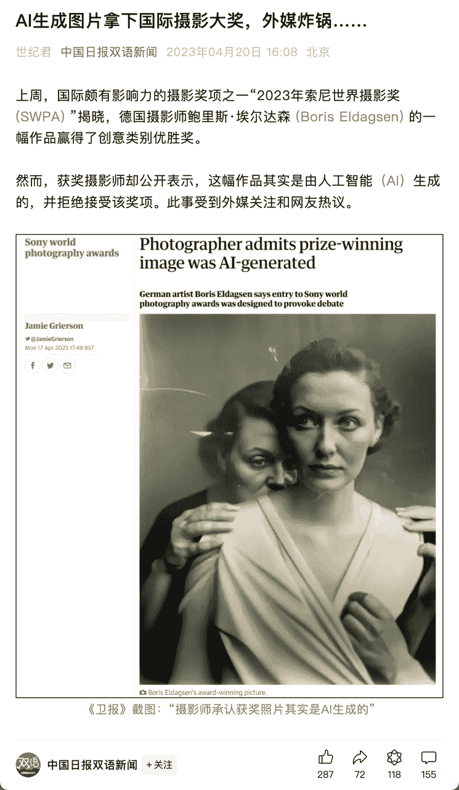

AI生成图片的快速发展，使诸多领域措手不及，如：摄影、美术等艺术领域正在面临前所未有的颠覆。我们所认为的“有图有真相”，甚至理解的现实也将不断被挑战...

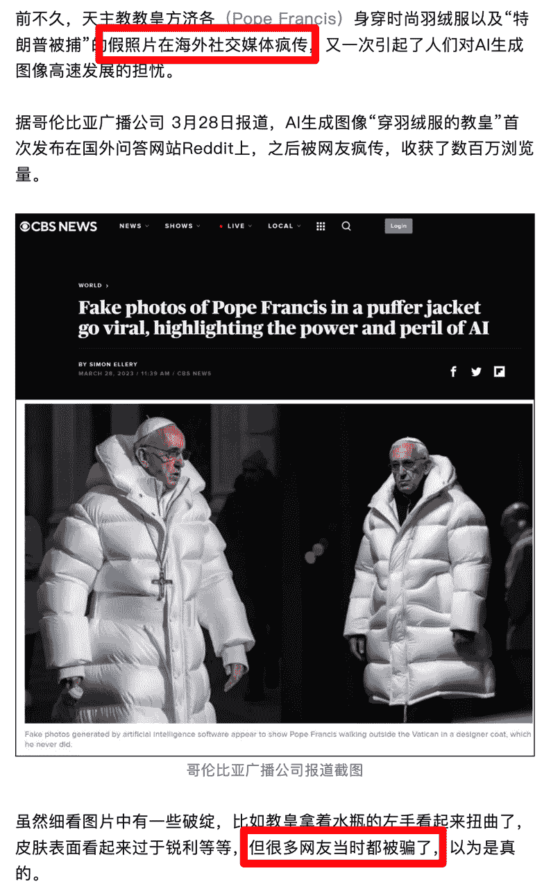

> 插入一段小常识，提醒大家警惕Deepfake技术

> Deepfake是一种使用人工智能技术生成的伪造媒体，特别是视频和音频，它们看起来或听起来非常真实，但实际上是由计算机生成的。这种技术通常涉及到深度学习算法，特别是生成对抗网络（GANs），它们能够学习真实数据的特征，并生成新的、逼真的数据。

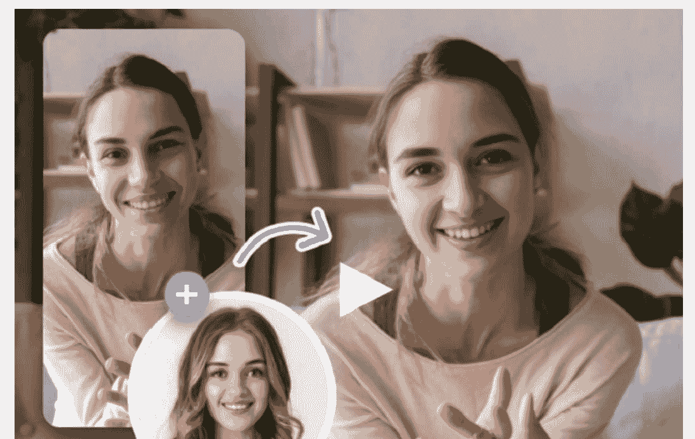

> Deepfake技术虽然在多个领域展现出其创新潜力，但其滥用也带来了一系列严重的危害。在政治领域，Deepfake可能被用来制造假新闻或操纵舆论，影响选举结果和政治稳定。经济上，它可能破坏企业形象，引发市场恐慌，甚至操纵股市。法律体系也面临挑战，因为伪造的证据可能误导司法判断。此外，深度伪造技术还可能加剧身份盗窃的风险，成为恐怖分子的新工具，煽动暴力和社会动荡，威胁国家安全。

>

> 由此衍生的Deepfake攻防技术，我们在今年夏令营的[从零入门CV图像竞赛(Deepfake攻防)](https://datawhaler.feishu.cn/wiki/Uou8w9igsibGP7kduiycCgesnOh)二期中，有组织学习活动，具体可以查看：

对所有人来说，定期关注AI生图的最新能力情况都十分重要：

+   对于**普通人**来说，可以避免被常见的AI生图场景欺骗，偶尔也可以通过相关工具绘图

+   对于**创作者**来说，通过AI生图的工具可以提效，快速制作自己所需要的内容

+   对于**开发者**来说，了解AI生图的能力的玩法，可以更好地针对自己的业务进行开发和使用，甚至攻克难题开发更实用的工具

## 再来从工具视角回顾一下AI生图的历史

最早的AI生图可追溯到**20世纪70年代**，当时由艺术家哈罗德·科恩（Harold Cohen）发明AARON，可通过机械臂输出作画。

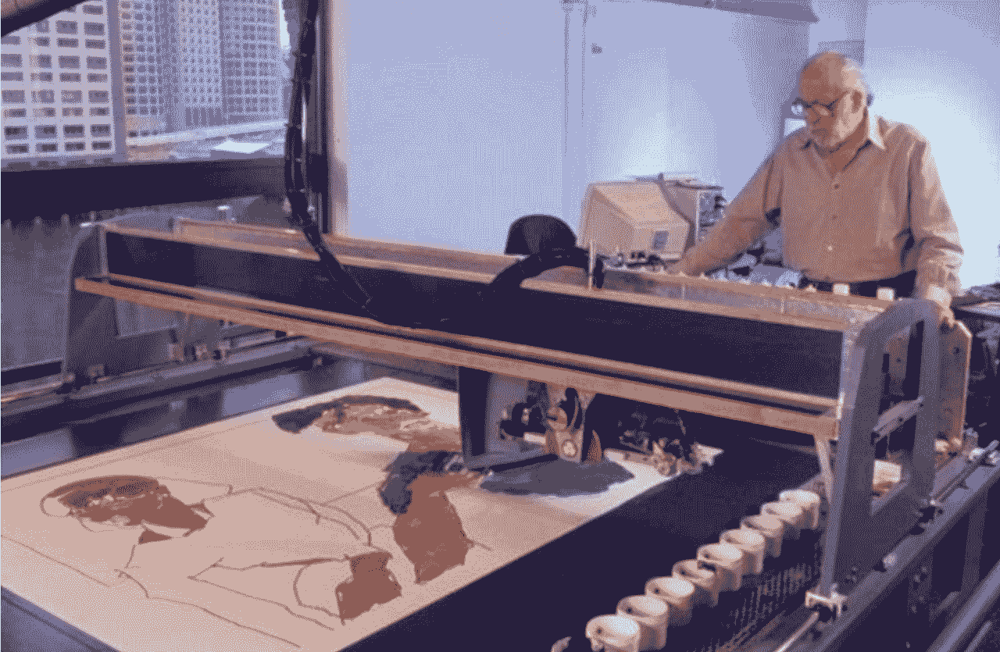

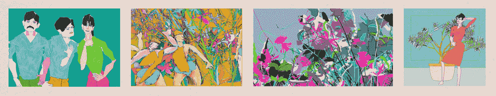

**现代的AI**生图模型大多基于深度神经网络基础上训练，最早可追溯到2012年吴恩达训练出的能生成“猫脸”的模型。

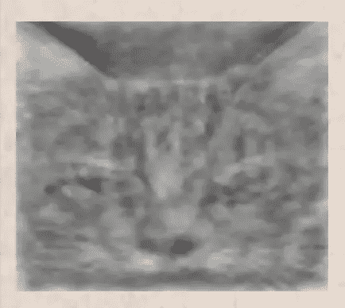

它使用**卷积神经网络（CNN）**训练，证明了深度学习模型能够学习到图像的复杂特征。

**2015年**，谷歌推出了“深梦”（Deep Dream）图像生成工具，类似一个高级滤镜，可以基于给定的图片生成梦幻版图片——

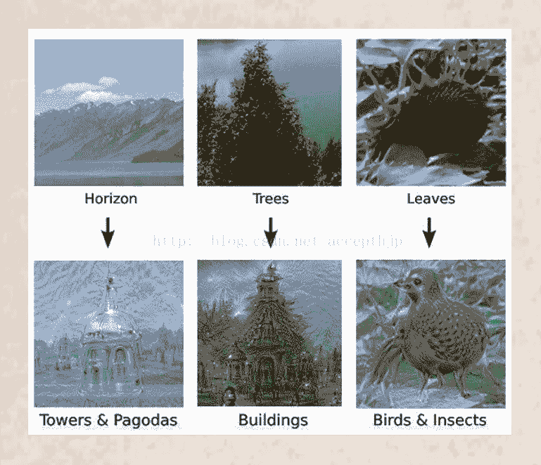

**2021 年 1 月** OpenAI 推出DALL-E模型（一个深度学习算法模型，是GPT-3 语言处理模型的一个衍生版本），能直接从文本提示“按需创造”风格多样的图形设计——

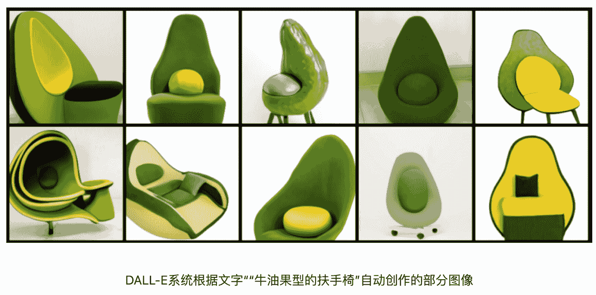

在当时，就已经被一些媒体评价为：“ **秒杀50**%的设计行业打工人应该是没有问题的，而且是质量和速度双重意义上的“秒杀” ”。

一般来说，**AI生图模型**属于**多模态机器学习模型****，通过海量的图库和**文本描述的深度神经网络学习，最**终的目标是可以根据****输**入的指示(不管是文本还是图片还是任何)生成符合语义的图片。

> **插入一个小八卦**

> A[**I生图在很长一**](https://wiki.mbalib.com/wiki/%E6%81%90%E6%80%96%E8%B0%B7%E7%90%86%E8%AE%BA)段时间很难被人们所广泛接纳，一方面是生成的内容没有可用的生产场景，还有很大程度可能是由于“恐怖谷效应”——

>

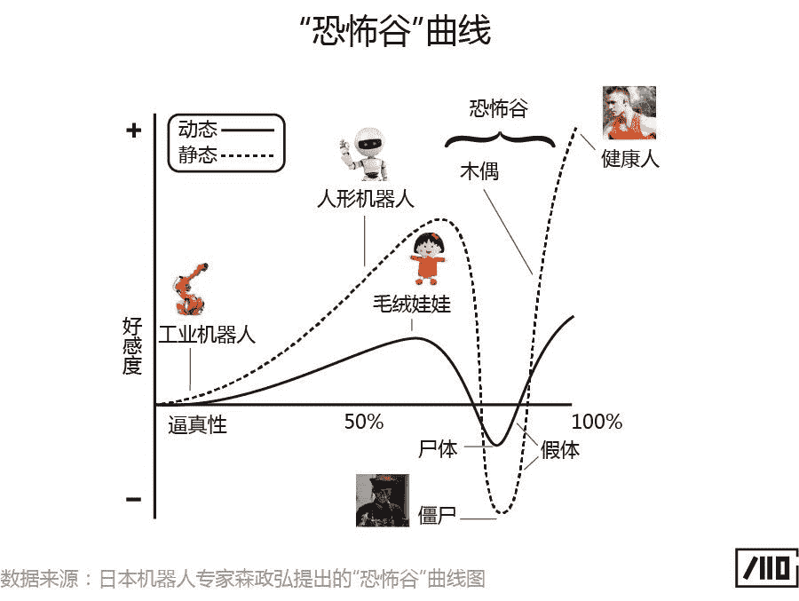

>

> 其核心观点是：随着仿真物(如机器人、玩偶等)模拟真实性程度的变化，人们对其亲和力也会产生变化，一般规律是亲和力随着仿真程度增高而增高，但当仿真程度达到一个临界点时，人的亲和反应会陡然跌入谷底，突然产生排斥、恐惧、困惑等负面心理。

通过学习大量画家的作品，**AI生图模型 ****往往可以照猫画**虎绘制出类似的画作，在2022年8月，AI生图真正走进了大众的视野，让各个领域无法忽视。

当时让AI生图破圈的是**AI绘画作品《太空歌剧院》**，该作品在美国科罗拉多州举办的新兴数字艺术家竞赛中获得了比赛“数字艺术/数字修饰照片”类别一等奖，引起了当时“艺术家们 Not Happy”的社会舆论。


## AI生图的难点和挑战有哪些？

往前一年，AI绘画还不会画“手”——

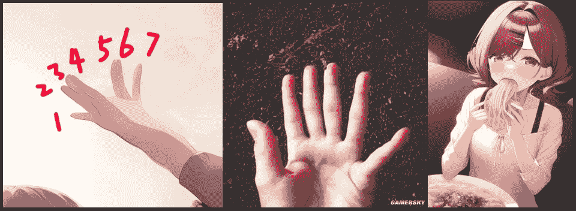

也因为当时这个情况，产生了很多解决这个问题的相关技术，如：给图片里的人手打上标记，像把手掌、拇指、食指啥的，都给清楚地标出来；

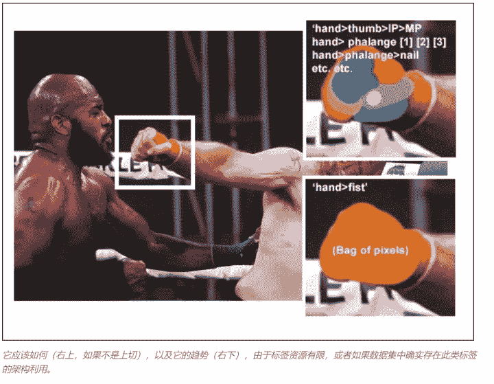

我们现在还可以经常在各类自媒体的文章中看到“AI翻车”的案例，那些往往也是需要解决的难点，某些“翻车”现象，也许在业界已有相关的解决方案。

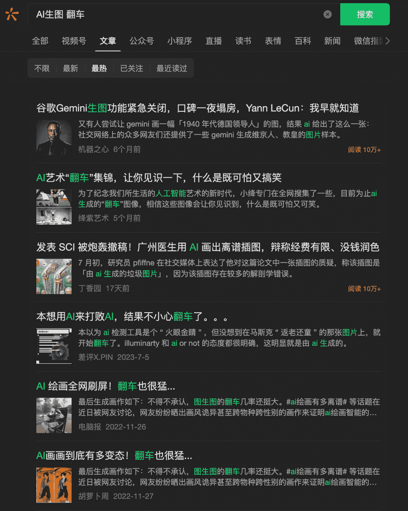

通俗来说，**AI生图模型****获得图片**生成能力**主要是通**过 学习 图片描述 以及 图片特征，尝试将这两者进行一一对应，存储在自己的记忆里。

在我们需要的时候，通过输入的文字，复现出来对应的图片特征，从而生成了我们需要的图片。

关于AI是否真正理解了图片背后所代表的世界的特征，是否理解了图片的含义，这个一直是科研界和产业界存在争议的话题，我们唯一可以确定的是——

由于每个模型用于训练的数据是有限的且不一定相同的，它们能匹配的描述和特征也是有限的，所以在风格、具体事物上，不同的模型会有很大的生成差异，且可能存在诸多与现实不符的情况。

而这些问题，就是业界和科研界持续在想办法解决的问题。

> 目前已经应用AI生图的行业主要有电商、游戏、设计等，大家感兴趣可以去查看相关研报，下图是在🛰️👸号搜索的结果——


**在大部分生**图场景下，我们可能经常会觉得图片存在“AI味”，这很长一段时间也是科研界和相关从业人员非常头大的问题。

> *AI味：AI生成的图片和实际生活场景/艺术家创作的绘画/摄影/三维作品 相比，存在强烈的违和感，或是细节处理，或是画面逻辑性存在问题，一言就能被看出是“AI出品”

目前大部分的模型，已经具备了去除 “AI味” 的能力，且可能存在容易误导他人的情况，这时候我们想辨别可能需要非常仔细地——

+   **观察图片的细节**。仔细检查人物的面部特征，尤其是眼睛和嘴巴

+   **检查光线和阴影**。分析图片中的光源是否一致，阴影的方向是否与光源相符，是否存在不自然的光线或阴影

+   **分析像素**。放大图片，寻找是否有模糊或像素化的部分。

+   **注意背景**。检查背景中是否有不协调的元素，比如物体边缘是否平滑，背景中是否有不自然的重复模式。

而这些细节上的AI特性，也许就是我们在某些特定场景下需要解决的挑战。

## 开始探索AI生图前沿

回**到主题，**我们[**要探索A**](https://modelscope.cn/)**I生图的前沿，就必须**有一个持续更新，且我们持续愿意跟进和投入时间的“主线”引导，**例如，可以**从这次学习活动、可图Kolors-LoRA风格故事挑战赛、魔搭社区的各类AIGC工具 开始，持续探索、尝试、思考总结、实践，甚至开始持续创作自己的作品/工具。

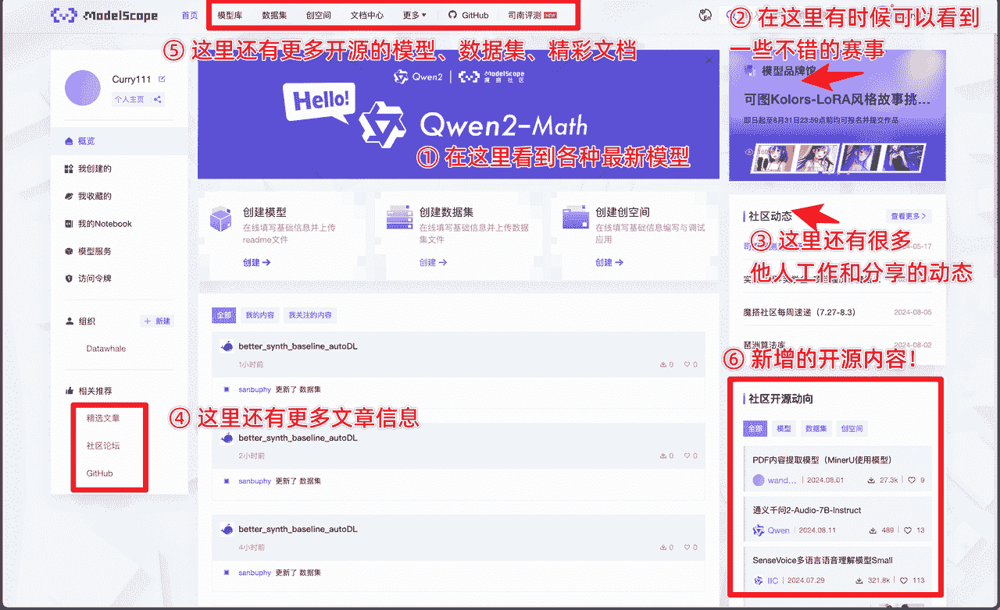

AI生图自破圈以来，被科研界、业界广泛关注，且引发了各大厂商的模型之战，如我们这次学习活动所需要用到的Kolors（可图）模型(点击即可跳转魔搭模型介绍页)，就是其中的一个产物——

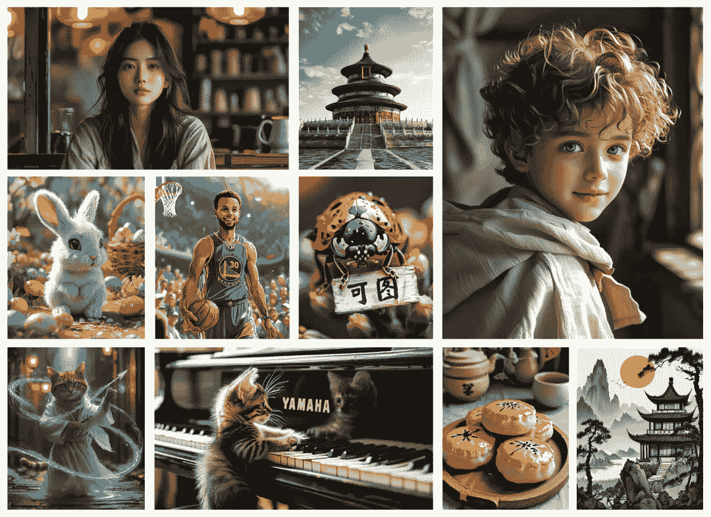

**K**olors（**可图）模型(点击即**可跳转魔搭模型介绍页) 是快手开源的文本到图像生成模型，该模型具有对英语和汉语的深刻理解，并能够生成高质量、逼真的图像。

> 代码开源链接：https://github.com/Kwai-Kolors/Kolors

> 模型开源链接：https://modelscope.cn/models/Kwai-Kolors/Kolors

> 技术报告链接：https://github.com/Kwai-Kolors/Kolors/blob/master/imgs/Kolors_paper.pdf

> 魔搭研习社最佳实践说明：https://www.modelscope.cn/learn/575?pid=543

过[**去文生图**](https://modelscope.cn/)主要以 SD 系列基础模[**型为主，仅支持英文的promp**](https://modelscope.cn/datasets/modelscope/Kolors_awesome_prompts/dataPeview)t，但可图是支持中文的文生图模型，文生图的prompt格式较为固定，魔搭社区还开源了专门的各种风格的可图优质咒语书(点击即可跳转)，可以针对600+种不同风格，完善prompt，生成各种风格图片，可以在我们的学习当中使用——

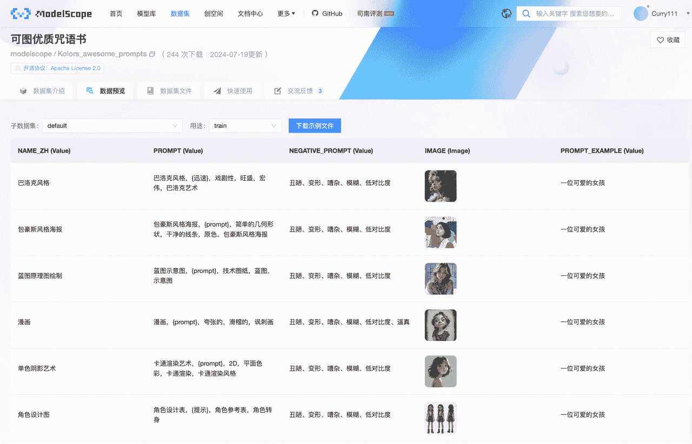

## 通过[**魔搭社区**](https://modelscope.cn/)持续探索AI生图前沿

在某些设计的场景中，我们还希望AI能为我们将特定的文字生成在图片当中，比如下面这种海报——

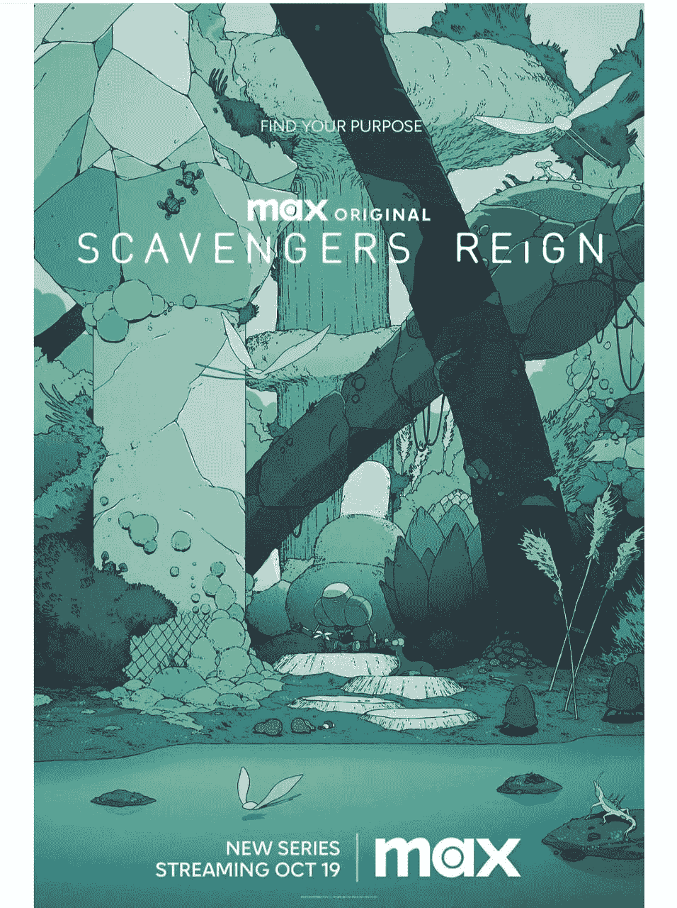

但实际上，这种固定文字生成，往往难度较大，一是具体生成在哪些位置，往往需要人为设定，为了更方便地制作类似这样的海报还产生了PS等图片编辑工具，才能实现相应的效果，想要让AI稳定生成相似效果的图片可想而知难度之大。

像我们Task1中介绍的 [**创意海报生成**](https://modelscope.cn/studios/iic/PosterGenius) 工具，早已在代码中固定了相应的文字位置和对应的字体，才能进行相应的生成，且大概率是进行了这几个步骤——

+   首先是通过AI生成背景，

+   然后通过代码将对应的文字显示到对应位置，

+   最后渲染，合成图片，给到我们。

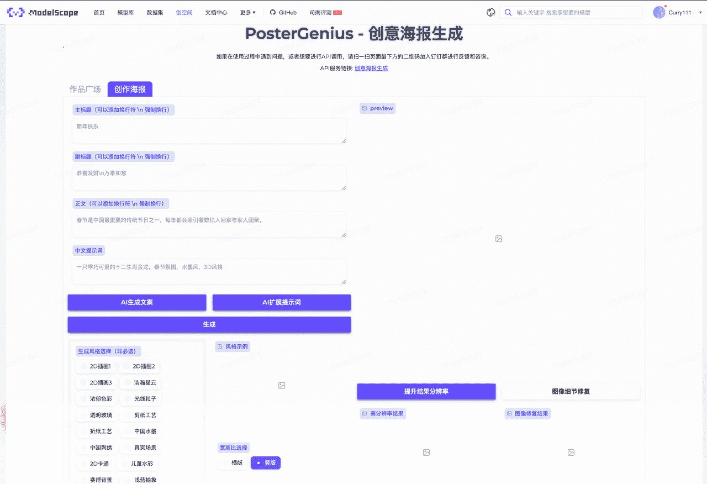

事实上，我们可以通过[**魔搭社区**](https://modelscope.cn/)上感兴趣的工具，尝试思考——

+   可以用在哪些业务里？有哪些行业在使用？

+   用的是哪个 AI 模型？

+   是自己部署的AI模型，还是用的API？

+   使用到了哪些 AI 能力？

+   如果要复现，需要做哪些额外的设置和开发？

+   还可以有哪些优化点？

**最**方便的是，我们还可以直接点到空间文件，进行相关代码的查看甚至下载在 本地/云服务器 复现，以验证思考 & 学习相关的设计开发：

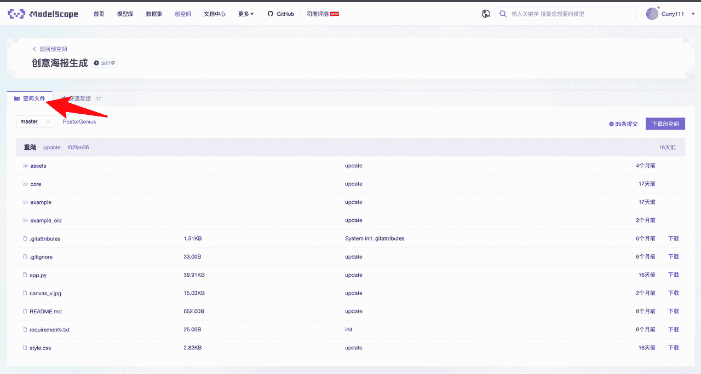

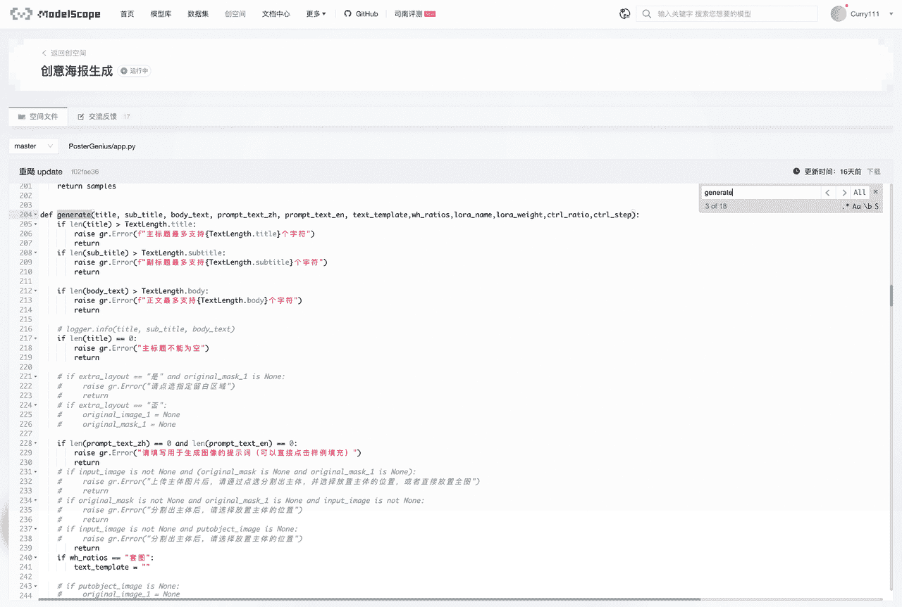

[**魔搭社区**](https://modelscope.cn/)还有各种资料，可以供我们学习&探索AI生图的前沿——


[**比如图像**](https://modelscope.cn/)生成的技术的前沿你还可以查看魔搭社区出品这个视频：

<https://player.bilibili.com/player.html?bvid=1vT421k7Qc>

[对应课件(点击即可查看)](https://www.yuque.com/office/yuque/0/2024/pptx/1169882/1720431890303-006bd64c-7857-491e-9b3e-a374b066c245.pptx?from=https%3A%2F%2Fwww.yuque.com%2F2ai%2Fmodel%2Fgutsk9ezeymuebq9)

> 好了~

> 听我说了这么多掏心窝子的废话，相信大家对于AI生图的认知又升级了，又变强了~

> 接下来，就继续回到我们的学习挑战吧！！

> 我们将带大家**通过AI学习AI生图**~

# Part1：磨刀准备一一认识通义千问

> **学习说明：**

> 我们计划使用**通义千问大语言模型****来告诉大家如何借助AI**[智能助手](https://tongyi.aliyun.com/qianwen/)帮我们阅读代码。工欲善其事必先利其器，现在让我们请出今天的主角，通义千问（点击直达）。

>

> **📢：注意**

1.  使用大语言模型比较频繁的学习者可跳过这部分内容。

1.  也可以自行选择其他的大语言模型使用，学习过程中不做限制。

1.  **通义系列产品也有文生图的工具：**[**通义万相**](https://tongyi.aliyun.com/wanxiang)**，大家感兴趣可以自己体验。**

## 通义千问的自我介绍

首先，我们来看下它的自我介绍。通义千问是具有信息查询、语言理解、文本创作等多能力的AI助手。我们可以看到，编程与技术支持能力是它的强项之一。（P1：通义千问自我介绍）

接下来我们把场景聚焦到编程与技术支持这个方向，让他详细介绍下自己可以如何帮助大家编程。（P2：编程能力介绍）。

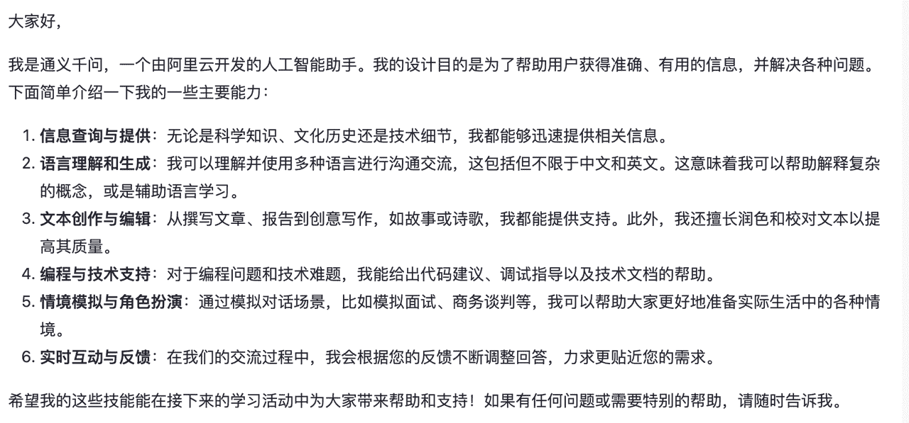

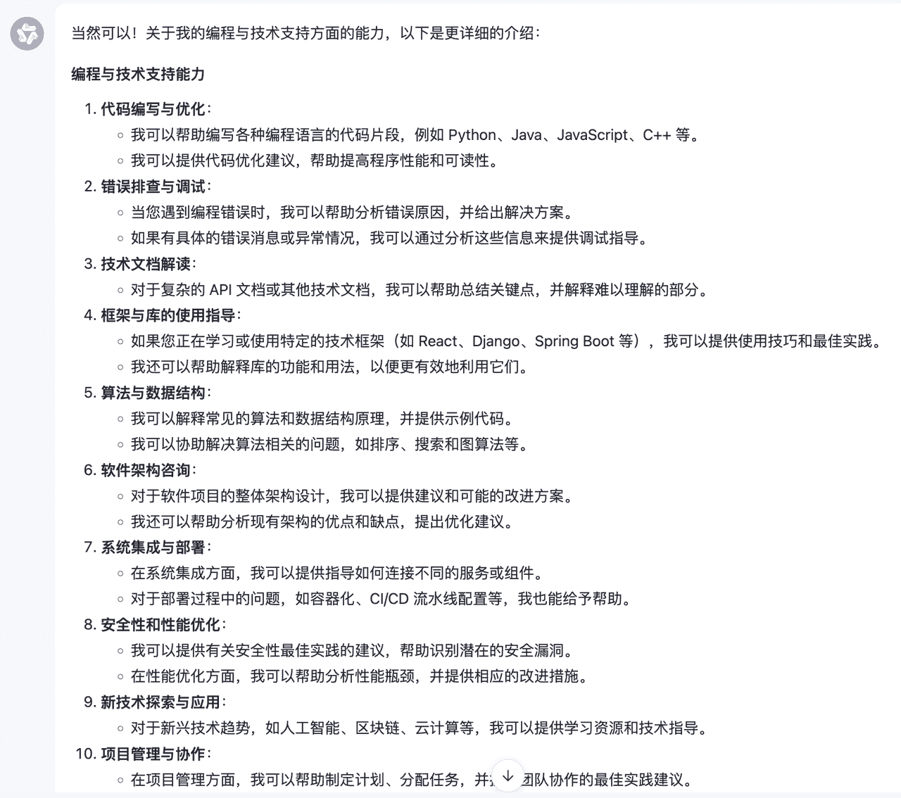

## 抱走你的AI学习助教

作为一个AI助手，通义千问就是你专属的、可随时触达的、24小时随时待命的贴心助教，可以帮助你解决很多学习中遇到的问题。

所以当你遇到学习问题的时候，问问千问吧。在这里请接收一下通义千问的邀请函！👉


## 使用操作指南

**官方****链接**：https://tongyi.aliyun.com/qianwen/

**step1 注册账号**


**step2 通义主要功能模块**

> 主要功能模块：

1.  对话，支持文字输入，文件上传等模式，我们本次课程主要使用当前模块；

1.  效率，各种学习办公小工具；

1.  智能体，通义的智能体应用市场，大家可以根据自己的需求找到很多有意思的小应用。


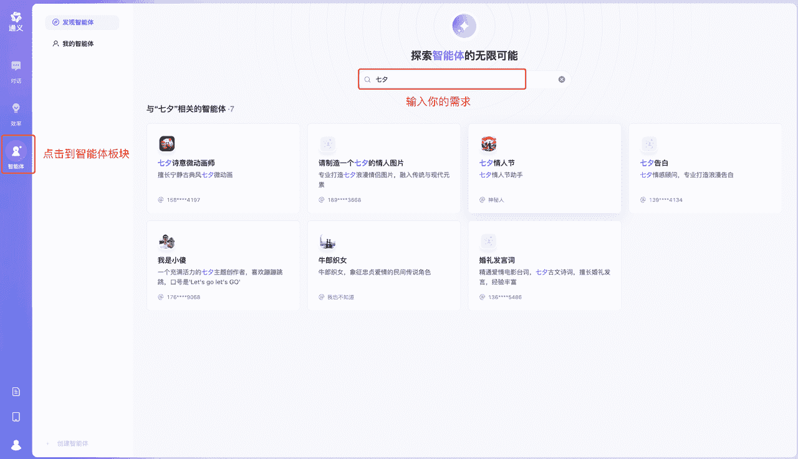

# Part2：精读baseline——从零入门AI生图

> **学习说明：**

> 关于代码阅读和理解，我们今天尝试让AI助手从两个角度帮助我们：

1.  分析代码的主题架构；

1.  逐行代码解析。

>

> 📢：**注意**

1.  **以**下代码为方便大家阅读理解，故放在了一起。但不能一键运行跑通，如何跑通代码，请直接参考task1中的内容。

在task1的任务中, 我们拿到baseline文件后, 根据教程指示顺畅通关, 似乎没有什么问题。但是可能有些同学看到这个baseline的代码会一脸懵，就很想知道某一个模块、某一行究竟是干啥的，下面我们就借助前面讲到的通义千问来精读这个代码。

首先我们来直观感知下这个文生图代码的框架结构：

现在我们先把我们baseline中的所有代码整理出来，代码结构如下：

```
!pip install simple-aesthetics-predictor

!pip install -v -e data-juicer

!pip uninstall pytorch-lightning -y
!pip install peft lightning pandas torchvision

!pip install -e DiffSynth-Studio

from modelscope.msdatasets import MsDataset

ds = MsDataset.load(
    &#x27;AI-ModelScope/lowres_anime&#x27;,
    subset_name=&#x27;default&#x27;,
    split=&#x27;train&#x27;,
    cache_dir=&quot;/mnt/workspace/kolors/data&quot;
)

import json, os
from data_juicer.utils.mm_utils import SpecialTokens
from tqdm import tqdm


os.makedirs(&quot;./data/lora_dataset/train&quot;, exist_ok=True)
os.makedirs(&quot;./data/data-juicer/input&quot;, exist_ok=True)
with open(&quot;./data/data-juicer/input/metadata.jsonl&quot;, &quot;w&quot;) as f:
    for data_id, data in enumerate(tqdm(ds)):
        image = data[&quot;image&quot;].convert(&quot;RGB&quot;)
        image.save(f&quot;/mnt/workspace/kolors/data/lora_dataset/train/{data_id}.jpg&quot;)
        metadata = {&quot;text&quot;: &quot;二次元&quot;, &quot;image&quot;: [f&quot;/mnt/workspace/kolors/data/lora_dataset/train/{data_id}.jpg&quot;]}
        f.write(json.dumps(metadata))
        f.write(&quot;\n&quot;)

data_juicer_config = &quot;&quot;&quot;
# global parameters
project_name: &#x27;data-process&#x27;
dataset_path: &#x27;./data/data-juicer/input/metadata.jsonl&#x27;  # path to your dataset directory or file
np: 4  # number of subprocess to process your dataset

text_keys: &#x27;text&#x27;
image_key: &#x27;image&#x27;
image_special_token: &#x27;&lt;__dj__image&gt;&#x27;

export_path: &#x27;./data/data-juicer/output/result.jsonl&#x27;

# process schedule
# a list of several process operators with their arguments
process:
    - image_shape_filter:
        min_width: 1024
        min_height: 1024
        any_or_all: any
    - image_aspect_ratio_filter:
        min_ratio: 0.5
        max_ratio: 2.0
        any_or_all: any
&quot;&quot;&quot;
with open(&quot;data/data-juicer/data_juicer_config.yaml&quot;, &quot;w&quot;) as file:
    file.write(data_juicer_config.strip())

!dj-process --config data/data-juicer/data_juicer_config.yaml

import pandas as pd
import os, json
from PIL import Image
from tqdm import tqdm


texts, file_names = [], []
os.makedirs(&quot;./data/data-juicer/output/images&quot;, exist_ok=True)
with open(&quot;./data/data-juicer/output/result.jsonl&quot;, &quot;r&quot;) as f:
    for line in tqdm(f):
        metadata = json.loads(line)
        texts.append(metadata[&quot;text&quot;])
        file_names.append(metadata[&quot;image&quot;][0])

df = pd.DataFrame({&quot;text&quot;: texts, &quot;file_name&quot;: file_names})
df.to_csv(&quot;./data/data-juicer/output/result.csv&quot;, index=False)

df

from transformers import CLIPProcessor, CLIPModel
import torch

model = CLIPModel.from_pretrained(&quot;openai/clip-vit-base-patch32&quot;)
processor = CLIPProcessor.from_pretrained(&quot;openai/clip-vit-base-patch32&quot;)

images = [Image.open(img_path) for img_path in df[&quot;file_name&quot;]]
inputs = processor(text=df[&quot;text&quot;].tolist(), images=images, return_tensors=&quot;pt&quot;, padding=True)

outputs = model(**inputs)
logits_per_image = outputs.logits_per_image  # this is the image-text similarity score
probs = logits_per_image.softmax(dim=1)  # we can take the softmax to get the probabilities

probs

from torch.utils.data import Dataset, DataLoader

class CustomDataset(Dataset):
    def __init__(self, df, processor):
        self.texts = df[&quot;text&quot;].tolist()
        self.images = [Image.open(img_path) for img_path in df[&quot;file_name&quot;]]
        self.processor = processor

    def __len__(self):
        return len(self.texts)

    def __getitem__(self, idx):
        inputs = self.processor(text=self.texts[idx], images=self.images[idx], return_tensors=&quot;pt&quot;, padding=True)
        return inputs

dataset = CustomDataset(df, processor)
dataloader = DataLoader(dataset, batch_size=8)

for batch in dataloader:
    outputs = model(**batch)
    logits_per_image = outputs.logits_per_image
    probs = logits_per_image.softmax(dim=1)
    print(probs)

import torch
from diffusers import StableDiffusionPipeline

torch.manual_seed(1)
pipe = StableDiffusionPipeline.from_pretrained(&quot;CompVis/stable-diffusion-v-1-4&quot;, torch_dtype=torch.float16)
pipe = pipe.to(&quot;cuda&quot;)

prompt = &quot;二次元，一个紫色长发小女孩穿着粉色吊带漏肩连衣裙，在练习室练习唱歌，手持话筒&quot;
negative_prompt = &quot;丑陋、变形、嘈杂、模糊、低对比度&quot;
guidance_scale = 4
num_inference_steps = 50

image = pipe(
    prompt=prompt,
    negative_prompt=negative_prompt,
    guidance_scale=guidance_scale,
    num_inference_steps=num_inference_steps,
    height=1024,
    width=1024,
).images[0]

image.save(&quot;example_image.png&quot;)
image

from PIL import Image

torch.manual_seed(1)
image = pipe(
    prompt=&quot;二次元，日系动漫，演唱会的观众席，人山人海，一个紫色短发小女孩穿着粉色吊带漏肩连衣裙坐在演唱会的观众席，舞台上衣着华丽的歌星们在唱歌&quot;,
    negative_prompt=&quot;丑陋、变形、嘈杂、模糊、低对比度&quot;,
    cfg_scale=4,
    num_inference_steps=50, height=1024, width=1024,
)
image.save(&quot;1.jpg&quot;)

torch.manual_seed(1)
image = pipe(
    prompt=&quot;二次元，一个紫色短发小女孩穿着粉色吊带漏肩连衣裙坐在演唱会的观众席，露出憧憬的神情&quot;,
    negative_prompt=&quot;丑陋、变形、嘈杂、模糊、低对比度，色情擦边&quot;,
    cfg_scale=4,
    num_inference_steps=50, height=1024, width=1024,
)
image.save(&quot;2.jpg&quot;)

torch.manual_seed(2)
image = pipe(
    prompt=&quot;二次元，一个紫色短发小女孩穿着粉色吊带漏肩连衣裙坐在演唱会的观众席，露出憧憬的神情&quot;,
    negative_prompt=&quot;丑陋、变形、嘈杂、模糊、低对比度，色情擦边&quot;,
    cfg_scale=4,
    num_inference_steps=50, height=1024, width=1024,
)
image.save(&quot;3.jpg&quot;)

torch.manual_seed(5)
image = pipe(
    prompt=&quot;二次元，一个紫色短发小女孩穿着粉色吊带漏肩连衣裙，对着流星许愿，闭着眼睛，十指交叉，侧面&quot;,
    negative_prompt=&quot;丑陋、变形、嘈杂、模糊、低对比度，扭曲的手指，多余的手指&quot;,
    cfg_scale=4,
    num_inference_steps=50, height=1024, width=1024,
)
image.save(&quot;4.jpg&quot;)

torch.manual_seed(0)
image = pipe(
    prompt=&quot;二次元，一个紫色中等长度头发小女孩穿着粉色吊带漏肩连衣裙，在练习室练习唱歌&quot;,
    negative_prompt=&quot;丑陋、变形、嘈杂、模糊、低对比度&quot;,
    cfg_scale=4,
    num_inference_steps=50, height=1024, width=1024,
)
image.save(&quot;5.jpg&quot;)

torch.manual_seed(1)
image = pipe(
    prompt=&quot;二次元，一个紫色长发小女孩穿着粉色吊带漏肩连衣裙，在练习室练习唱歌，手持话筒&quot;,
    negative_prompt=&quot;丑陋、变形、嘈杂、模糊、低对比度&quot;,
    cfg_scale=4,
    num_inference_steps=50, height=1024, width=1024,
)
image.save(&quot;6.jpg&quot;)

torch.manual_seed(7)
image = pipe(
    prompt=&quot;二次元，紫色长发少女，穿着黑色连衣裙，试衣间，心情忐忑&quot;,
    negative_prompt=&quot;丑陋、变形、嘈杂、模糊、低对比度&quot;,
    cfg_scale=4,
    num_inference_steps=50, height=1024, width=1024,
)
image.save(&quot;7.jpg&quot;)

torch.manual_seed(0)
image = pipe(
    prompt=&quot;二次元，紫色长发少女，穿着黑色礼服，连衣裙，在台上唱歌&quot;,
    negative_prompt=&quot;丑陋、变形、嘈杂、模糊、低对比度&quot;,
    cfg_scale=4,
    num_inference_steps=50, height=1024, width=1024,
)
image.save(&quot;8.jpg&quot;)

import numpy as np
from PIL import Image


images = [np.array(Image.open(f&quot;{i}.jpg&quot;)) for i in range(1, 9)]
image = np.concatenate([
    np.concatenate(images[0:2], axis=1),
    np.concatenate(images[2:4], axis=1),
    np.concatenate(images[4:6], axis=1),
    np.concatenate(images[6:8], axis=1),
], axis=0)
image = Image.fromarray(image).resize((1024, 2048))
image

```

## 分析代码的主体架构

### **输入的****Prompt**

```
你**是一个优秀的pytho**n开发工程师，现在我们需要你帮我们分析这个代码的主体框架，你需要把代码按照工作流分成几部分，用中文回答我的问题。{此处替换前面的代码}
```

### **返回的结果**

这段代码主要分为以下几个部分：

1.  **安装和卸载依赖包**

+   使用 !pip 命令来安装或卸载 Python 包。包括：

+   simple-aesthetics-predictor, data-juicer, peft, lightning, pandas, torchvision, 和 DiffSynth-Studio 的安装。

+   卸载 pytorch-lightning（使用 -y 自动确认卸载）。

1.  **加载数据集**

+   使用 ModelScope 的 MsDataset 类加载名为 AI-ModelScope/lowres_anime 的数据集，并指定子集名称为 default 和分割为 train，缓存目录设置为 /mnt/workspace/kolors/data。

1.  **数据预处理**

+   将数据集中的图像转换为 RGB 模式，并保存到指定目录。

+   创建包含图像路径和文本描述的元数据文件 metadata.jsonl。

+   编写并保存 data_juicer_config.yaml 配置文件，用于后续的数据过滤和处理。

1.  使用 Data-Juicer 进行数据处理

+   使用 dj-process 命令根据配置文件对数据进行过滤和处理，生成 result.jsonl 文件。

1.  **数据整理与训练**

+   读取 result.jsonl 文件中的数据，并将其转换为 Pandas DataFrame，然后保存为 CSV 文件，并且将图片保存到./data/lora_dataset_processed/train文件夹下。

+   下载模型download_models(["Kolors", "SDXL-vae-fp16-fix"])

+   在前面模型的基础上，执行Lora微调训练

+   加载微调后的模型

1.  **图像生成**

+   设置正向提示词，反向提示词，执行次数，图片尺寸

+   设置随机种子，控制图片是否可以重复生成，并将图像保存为 .jpg 文件。

1.  **合并图像**

+   最后，将生成的多个图像合并成一个大图像，并调整大小。

整个流程涵盖了从数据加载、预处理、特征提取、模型预测到图像生成等多个方面。每一部分都有其特定的功能，共同构成了一个完整的二次元图像处理和生成的工作流。

### **执行过程**

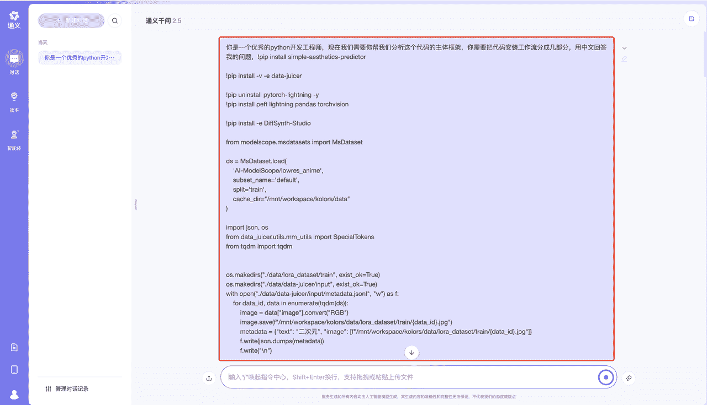

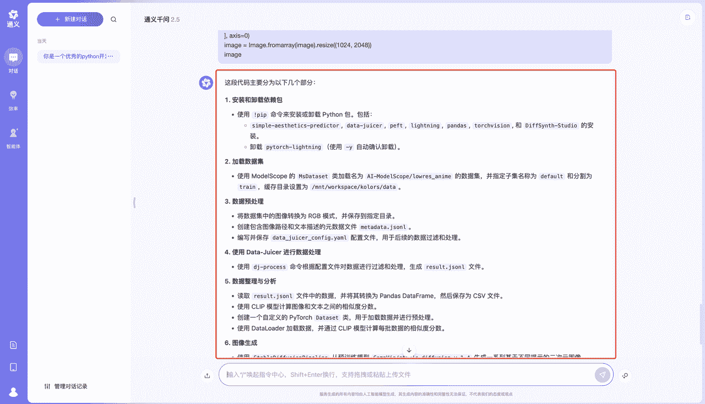

## **逐行解释代码**

### 输入的问题

```
你是一个优秀的python开发工程师，现在我们需要你帮我**们逐行分析这个代码，用**中文回答我的问题。{此处替换前面的代码}
```

### 返回的结果

这段代码主要完成以下功能：

1.  安装和卸载一些Python包。

1.  从ModelScope加载一个名为lowres_anime的数据集，并保存图像到指定目录。

1.  创建并处理一个用于数据清洗的JSONL文件。

1.  使用data-juicer工具过滤和处理数据集。

1.  将处理后的数据集转换为CSV格式。

1.  根据数据集通过DiffSynth做Lora微调

1.  加载Lora微调后的模型

1.  设置提示词，用微调后的模型生成图片

下面是逐行代码及其中文注释：

```
**# 安装 Data-Juicer 和 D****iffSynt**h-Studio
!pip install simple-aesthetics-predictor # 安装sim**p****le-aesthetics-predictor
!pip ins****tall -v ****-e data-juic****er # 安装data-ju****icer
!****pip uninstall p**ytorch-lightning -y # 卸载pytorch-lightning
!pip install peft lightning pandas torchvision # 安装 peft lightning pandas torchvision
!pip install -e DiffSynth-Studio # 安装DiffSynth-Studio

# 从魔搭数据集中下载数据集AI-ModelScope/lowres_anime
from modelscope.msdatasets import MsDataset  #引入数据集模块msdatasets
ds = MsDataset.load(
    &#x27;AI-ModelScope/lowres_anime&#x27;,
    subset_name=&#x27;default&#x27;,
    split=&#x27;train&#x27;,
    cache_dir=&quot;/mnt/workspace/kolors/data&quot; # 指定缓存目录
) # 从魔搭数据集中下载数据集AI-ModelScope/lowres_anime，赋值给参数ds

# 生成数据集
import json, os # 导入json和os模块
from data_juicer.utils.mm_utils import SpecialTokens # 导入SpecialTokens
from tqdm import tqdm # 导入tqdm进度条管理
os.makedirs(&quot;./data/lora_dataset/train&quot;, exist_ok=True) # 创建文件夹./data/lora_dataset/train
os.makedirs(&quot;./data/data-juicer/input&quot;, exist_ok=True) # 创建文件夹./data/data-juicer/input
with open(&quot;./data/data-juicer/input/metadata.jsonl&quot;, &quot;w&quot;) as f:
    for data_id, data in enumerate(tqdm(ds)): # 遍历数据集ds
        image = data[&quot;image&quot;].convert(&quot;RGB&quot;) # 将数据集的图片转换为RGB
        image.save(f&quot;/mnt/workspace/kolors/data/lora_dataset/train/{data_id}.jpg&quot;) # 保存数据集的图片
        metadata = {&quot;text&quot;: &quot;二次元&quot;, &quot;image&quot;: [f&quot;/mnt/workspace/kolors/data/lora_dataset/train/{data_id}.jpg&quot;]} # 生成当前图片的索引数据
        f.write(json.dumps(metadata)) # 将索引数据写入文件./data/data-juicer/input/metadata.jsonl
        f.write(&quot;\n&quot;)

# 配置data-juicer，并进行数据筛选过滤
# 配置过滤的规则
data_juicer_config = &quot;&quot;&quot;
# global parameters
project_name: &#x27;data-process&#x27; # 名称
dataset_path: &#x27;./data/data-juicer/input/metadata.jsonl&#x27;  # 你前面生成的数据的索引文件
np: 4  # 线程数

text_keys: &#x27;text&#x27; # 文件./data/data-juicer/input/metadata.jsonl的描述的字段名
image_key: &#x27;image&#x27; # 文件./data/data-juicer/input/metadata.jsonl的图片字段名
image_special_token: &#x27;&lt;__dj__image&gt;&#x27;

export_path: &#x27;./data/data-juicer/output/result.jsonl&#x27; # 筛选通过的图片结果保存的的索引文件

# process schedule
# a list of several process operators with their arguments
# 过滤的规则
process:
    - image_shape_filter: # 图片尺寸过滤
        min_width: 1024 # 最小宽度1024
        min_height: 1024 # 最小高度1024
        any_or_all: any # 符合前面条件的图片才会被保留
    - image_aspect_ratio_filter: # 图片长宽比过滤
        min_ratio: 0.5 # 最小长宽比0.5
        max_ratio: 2.0 # 最大长宽比2.0
        any_or_all: any # 符合前面条件的图片才会被保留
&quot;&quot;&quot;

# 保存data-juicer配置到data/data-juicer/data_juicer_config.yaml
with open(&quot;data/data-juicer/data_juicer_config.yaml&quot;, &quot;w&quot;) as file:
    file.write(data_juicer_config.strip())
# data-juicer开始执行数据筛选
!dj-process --config data/data-juicer/data_juicer_config.yaml


# 通过前面通过data-juicer筛选的图片索引信息./data/data-juicer/output/result.jsonl，生成数据集
import pandas as pd # 导入pandas
import os, json # 导入os和json
from PIL import Image # 导入Image
from tqdm import tqdm # 导入tqdm进度条管理
texts, file_names = [], [] # 定义两个空列表，分别存储图片描述和图片名称
os.makedirs(&quot;./data/lora_dataset_processed/train&quot;, exist_ok=True) # 创建文件夹./data/lora_dataset_processed/train
with open(&quot;./data/data-juicer/output/result.jsonl&quot;, &quot;r&quot;) as file: # 打开前面data-juicer筛选的图片索引文件./data/data-juicer/output/result.jsonl
    for data_id, data in enumerate(tqdm(file.readlines())): # 遍历文件./data/data-juicer/output/result.jsonl
        data = json.loads(data) # 将json字符串转换为对象
        text = data[&quot;text&quot;] # 获取对象中的text属性，也就是图片的描述信息
        texts.append(text) # 将图片的描述信息添加到texts列表中
        image = Image.open(data[&quot;image&quot;][0]) # 获取对象中的image属性，也就是图片的路径,然后用这个路径打开图片
        image_path = f&quot;./data/lora_dataset_processed/train/{data_id}.jpg&quot; # 生成保存图片的路径
        image.save(image_path) # 将图片保存到./data/lora_dataset_processed/train文件夹中
        file_names.append(f&quot;{data_id}.jpg&quot;) # 将图片名称添加到file_names列表中
data_frame = pd.DataFrame() # 创建空的DataFrame
data_frame[&quot;file_name&quot;] = file_names # 将图片名称添加到data_frame中
data_frame[&quot;text&quot;] = texts # 将图片描述添加到data_frame中
data_frame.to_csv(&quot;./data/lora_dataset_processed/train/metadata.csv&quot;, index=False, encoding=&quot;utf-8-sig&quot;) # 将data_frame保存到./data/lora_dataset_processed/train/metadata.csv
data_frame # 查看data_frame


# 下载可图模型
from diffsynth import download_models # 导入download_models
download_models([&quot;Kolors&quot;, &quot;SDXL-vae-fp16-fix&quot;]) # 下载可图模型
# DiffSynth-Studio提供了可图的Lora训练脚本，查看脚本信息
!python DiffSynth-Studio/examples/train/kolors/train_kolors_lora.py -h


# 执行可图Lora训练
import os
cmd = &quot;&quot;&quot;
python DiffSynth-Studio/examples/train/kolors/train_kolors_lora.py \ # 选择使用可图的Lora训练脚本DiffSynth-Studio/examples/train/kolors/train_kolors_lora.py
  --pretrained_unet_path models/kolors/Kolors/unet/diffusion_pytorch_model.safetensors \ # 选择unet模型
  --pretrained_text_encoder_path models/kolors/Kolors/text_encoder \ # 选择text_encoder
  --pretrained_fp16_vae_path models/sdxl-vae-fp16-fix/diffusion_pytorch_model.safetensors \ # 选择vae模型
  --lora_rank 16 \ # lora_rank 16 表示在权衡模型表达能力和训练效率时，选择了使用 16 作为秩，适合在不显著降低模型性能的前提下，通过 LoRA 减少计算和内存的需求
  --lora_alpha 4.0 \ # 设置 LoRA 的 alpha 值，影响调整的强度
  --dataset_path data/lora_dataset_processed \ # 指定数据集路径，用于训练模型
  --output_path ./models \ # 指定输出路径，用于保存模型
  --max_epochs 1 \ # 设置最大训练轮数为 1
  --center_crop \ # 启用中心裁剪，这通常用于图像预处理
  --use_gradient_checkpointing \ # 启用梯度检查点技术，以节省内存
  --precision &quot;16-mixed&quot; # 指定训练时的精度为混合 16 位精度（half precision），这可以加速训练并减少显存使用
&quot;&quot;&quot;.strip()
os.system(cmd) # 执行可图Lora训练


# 加载lora微调后的模型
from diffsynth import ModelManager, SDXLImagePipeline # 导入ModelManager和SDXLImagePipeline
from peft import LoraConfig, inject_adapter_in_model # 导入LoraConfig和inject_adapter_in_model
import torch # 导入torch
# 加载LoRA配置并注入模型
def load_lora(model, lora_rank, lora_alpha, lora_path):
    lora_config = LoraConfig(
        r=lora_rank, # 设置LoRA的秩(rank)
        lora_alpha=lora_alpha, # 设置LoRA的alpha值，控制LoRA的影响权重
        init_lora_weights=&quot;gaussian&quot;, # 初始化LoRA权重为高斯分布
        target_modules=[&quot;to_q&quot;, &quot;to_k&quot;, &quot;to_v&quot;, &quot;to_out&quot;], # 指定要应用LoRA的模块
    )
    model = inject_adapter_in_model(lora_config, model) # 将LoRA配置注入到模型中
    state_dict = torch.load(lora_path, map_location=&quot;cpu&quot;) # 加载LoRA微调后的权重
    model.load_state_dict(state_dict, strict=False) # 将权重加载到模型中，允许部分权重不匹配
    return model # 返回注入LoRA后的模型
# 加载预训练模型
model_manager = ModelManager(
    torch_dtype=torch.float16, # 设置模型的数据类型为float16，减少显存占用
    device=&quot;cuda&quot;, # 指定使用GPU进行计算
    file_path_list=[
        &quot;models/kolors/Kolors/text_encoder&quot;, # 文本编码器的路径
        &quot;models/kolors/Kolors/unet/diffusion_pytorch_model.safetensors&quot;, # UNet模型的路径
        &quot;models/kolors/Kolors/vae/diffusion_pytorch_model.safetensors&quot; # VAE模型的路径
    ]
)
# 初始化图像生成管道
pipe = SDXLImagePipeline.from_model_manager(model_manager) # 从模型管理器中加载模型并初始化管道
# 加载并应用LoRA权重到UNet模型
pipe.unet = load_lora(
    pipe.unet, 
    lora_rank=16, # 设置LoRA的秩(rank)，与训练脚本中的参数保持一致
    lora_alpha=2.0, # 设置LoRA的alpha值，控制LoRA对模型的影响权重
    lora_path=&quot;models/lightning_logs/version_0/checkpoints/epoch=0-step=500.ckpt&quot; # 指定LoRA权重的文件路径
)


# 生成图像
torch.manual_seed(0) # 设置随机种子，确保生成的图像具有可重复性。如果想要每次生成不同的图像，可以将种子值改为随机值。
image = pipe(
    prompt=&quot;二次元，一个紫色短发小女孩，在家中沙发上坐着，双手托着腮，很无聊，全身，粉色连衣裙&quot;, # 设置正向提示词，用于指导模型生成图像的内容
    negative_prompt=&quot;丑陋、变形、嘈杂、模糊、低对比度&quot;, # 设置负向提示词，模型会避免生成包含这些特征的图像
    cfg_scale=4, # 设置分类自由度 (Classifier-Free Guidance) 的比例，数值越高，模型越严格地遵循提示词
    num_inference_steps=50, # 设置推理步数，步数越多，生成的图像细节越丰富，但生成时间也更长
    height=1024, width=1024, # 设置生成图像的高度和宽度，这里生成 1024x1024 像素的图像
)
image.save(&quot;1.jpg&quot;) # 将生成的图像保存为 &quot;1.jpg&quot; 文件


# 图像拼接，展示总体拼接大图
import numpy as np  # 导入numpy库，用于处理数组和数值计算
from PIL import Image  # 导入PIL库中的Image模块，用于图像处理
images = [np.array(Image.open(f&quot;{i}.jpg&quot;)) for i in range(1, 9)]  # 读取1.jpg到8.jpg的图像，转换为numpy数组，并存储在列表images中
image = np.concatenate([  # 将四组图像在垂直方向上拼接
    np.concatenate(images[0:2], axis=1),  # 将第1组（images[0:2]）的两张图像在水平方向上拼接
    np.concatenate(images[2:4], axis=1),  # 将第2组（images[2:4]）的两张图像在水平方向上拼接
    np.concatenate(images[4:6], axis=1),  # 将第3组（images[4:6]）的两张图像在水平方向上拼接
    np.concatenate(images[6:8], axis=1),  # 将第4组（images[6:8]）的两张图像在水平方向上拼接
], axis=0)  # 将四组拼接后的图像在垂直方向上拼接
image = Image.fromarray(image).resize((1024, 2048))  # 将拼接后的numpy数组转换为图像对象，并调整大小为1024x2048像素
image  # 输出最终生成的图像对象，用于显示图像

```

###

### 执行过程

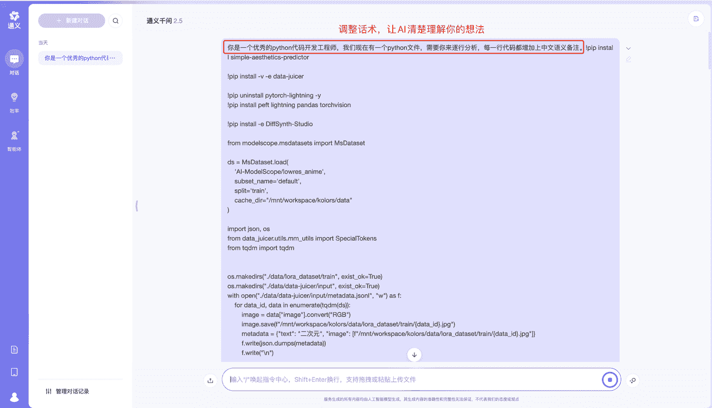

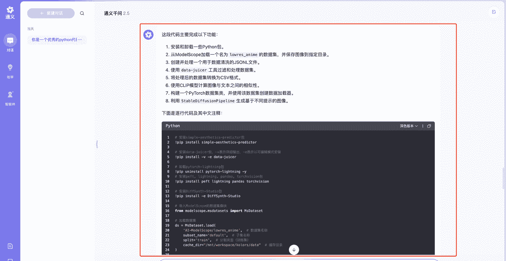

## 代码还有疑问？

### 向AI追问

在刚刚逐行解析结果页后面继续追问**，如图，通义给了我们更加细致**的问题解释，大家可以举一反三，多操作一下

```
我对其中**{替换成你的问题}**还是不太理解，给我再详细介绍一下
```

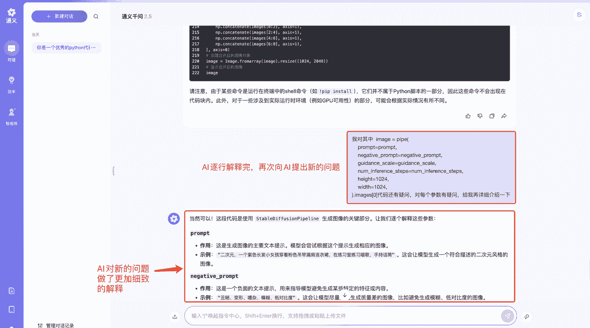

最后，希望大家养成使用AI的习惯，擅用AI，帮你的工作和学习事半功倍。

# Part3：实战演练一一基于话剧的连环画制作

### 数据准备（哈哈哈，还得是通义）

#### **提示词**

```
你是一个文生图专家，我们现在要做一个实战项目，就是要编排一个文生图话剧
话剧由8张场景图片生成，你需要输出每张图片的生图提示词

具体的场景图片
1、女主正在上课
2、开始睡着了
3、进入梦乡，梦到自己站在路旁
4、王子骑马而来
5、两人相谈甚欢
6、一起坐在马背上
7、下课了，梦醒了
8、又回到了学习生活中

生图提示词要求
1、风格为古风
2、根据场景确定是使用全身还是上半身
3、人物描述
4、场景描述
5、做啥事情

例子：
古风，水墨画，一个黑色长发少女，坐在教室里，盯着黑板，深思，上半身，红色长裙
```

#### 询问通义

自己在通义的返回的基础上，多多调整，争取打磨出一个最佳的提示词

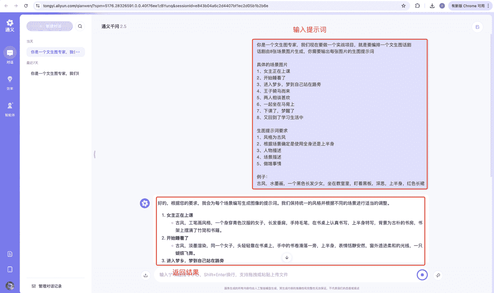

#### 最后的**话剧场景**

结合AI内容，自己在AI结果上做一些调整，最终整理出来场景表格

| **图片编号** | **场景描述** | **正向提示词** | **反向提示词** |
| --- | --- | --- | --- |
| 图片1 | 女主正在上课 | 古风，水墨画，一个黑色长发少女，坐在教室里，盯着黑板，深思，上半身，红色长裙 | 丑陋，变形，嘈杂，模糊，低对比度 |
| 图片2 | 开始睡着了 | 古风，水墨画，一个黑色长发少女，坐在教室里，趴在桌子上睡着了，上半身，红色长裙 | 丑陋，变形，嘈杂，模糊，低对比度 |
| 图片3 | 进入梦乡，梦到自己站在路旁 | 古风，水墨画，一个黑色长发少女，站在路边，上半身，红色长裙 | 丑陋，变形，嘈杂，模糊，低对比度 |
| 图片4 | 王子骑马而来 | 古风，水墨画，一个英俊少年，骑着白马，上半身，白色衬衫 | 丑陋，变形，嘈杂，模糊，低对比度 |
| 图片5 | 两人相谈甚欢 | 古风，水墨画，一个英俊少年，白色衬衫，一个黑色长发少女，红色长裙，两个人一起聊天，开心，上半身 | 丑陋，变形，嘈杂，模糊，低对比度 |
| 图片6 | 一起坐在马背上 | 古风，水墨画，一个英俊少年，白色衬衫，一个黑色长发少女，红色长裙，两个人一起骑着马，全身 | 丑陋，变形，嘈杂，模糊，低对比度 |
| 图片7 | 下课了，梦醒了 | 古风，水墨画，一个黑色长发少女，坐在教室里，下课铃声响了，同学们开始走动，从睡梦中醒来，深思，上半身，红色长裙 | 丑陋，变形，嘈杂，模糊，低对比度 |
| 图片8 | 又回到了学习生活中 | 古风，水墨画，一个黑色长发少女，坐在教室里，盯着黑板，认真上课，上半身，红色长裙 | 丑陋，变形，嘈杂，模糊，低对比度 |

### 执行Task1的30分钟速通**Baseline**

[从零入门AI生图原理&实践](https://datawhaler.feishu.cn/wiki/CMYkwKow0ihxOikg1G9cd9Zhnng)

### 提示词修改

1.  双击进入baseline文件

1.  找到生成图像的板块

1.  依次替换8张图片的正向提示词和反向提示词

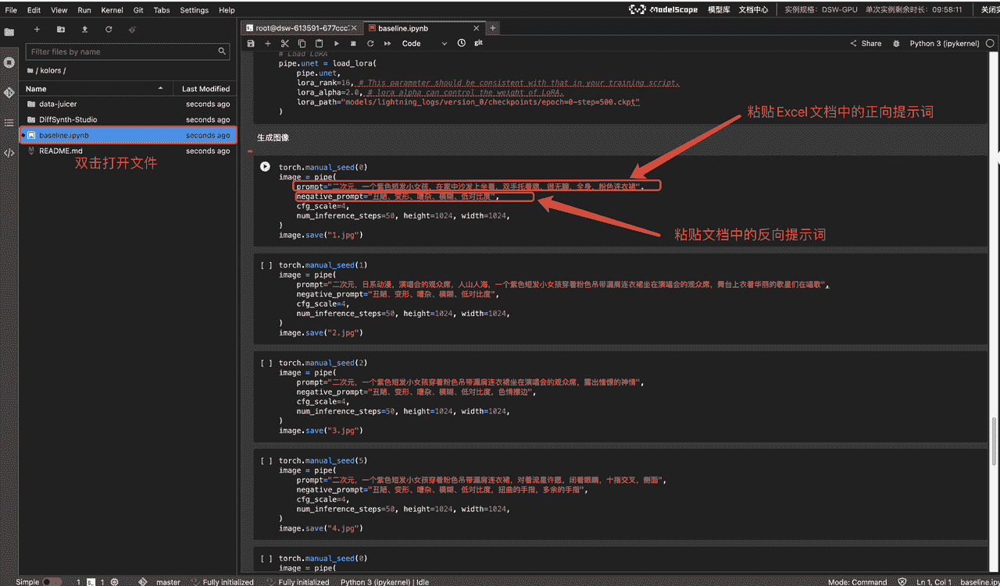

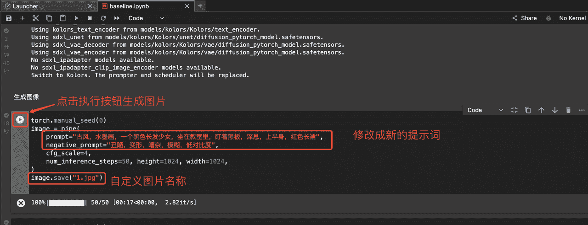

### 结果展示

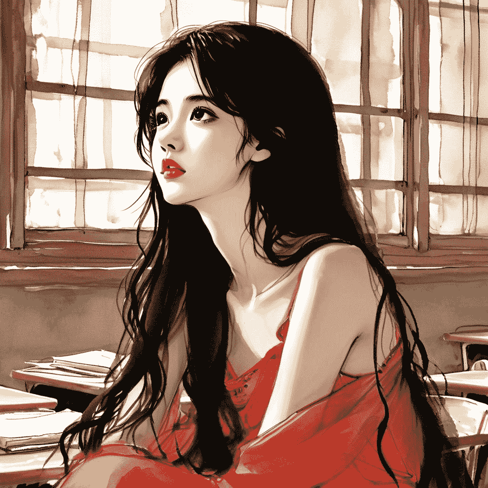


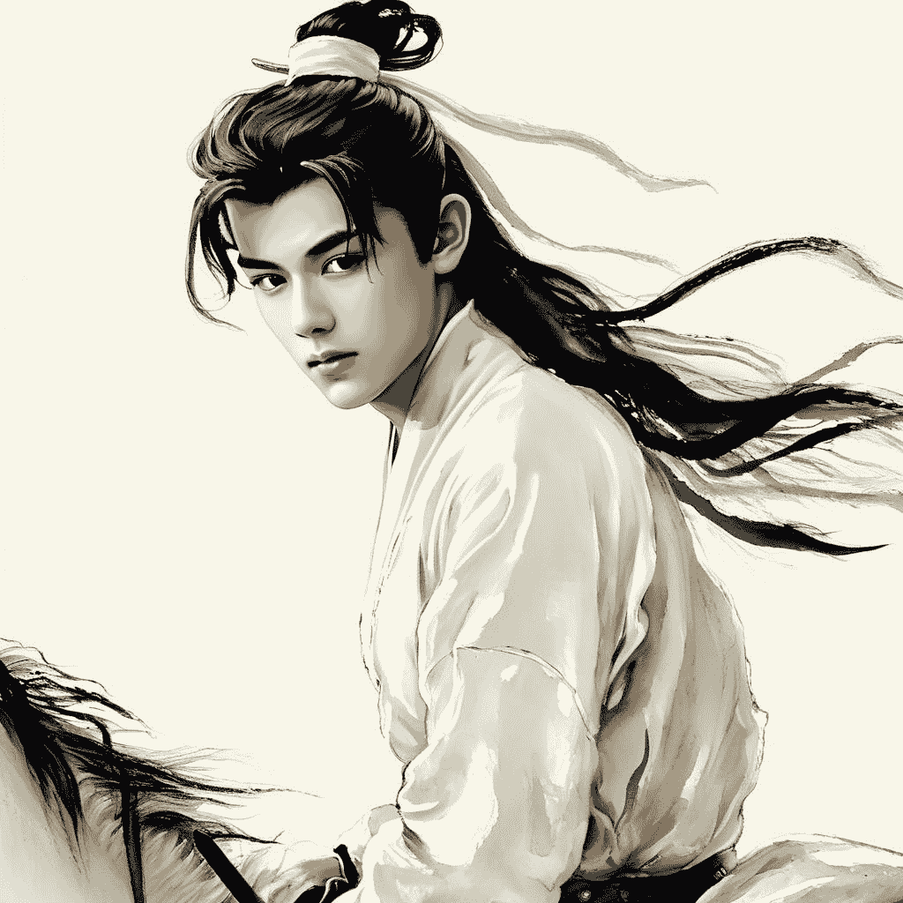

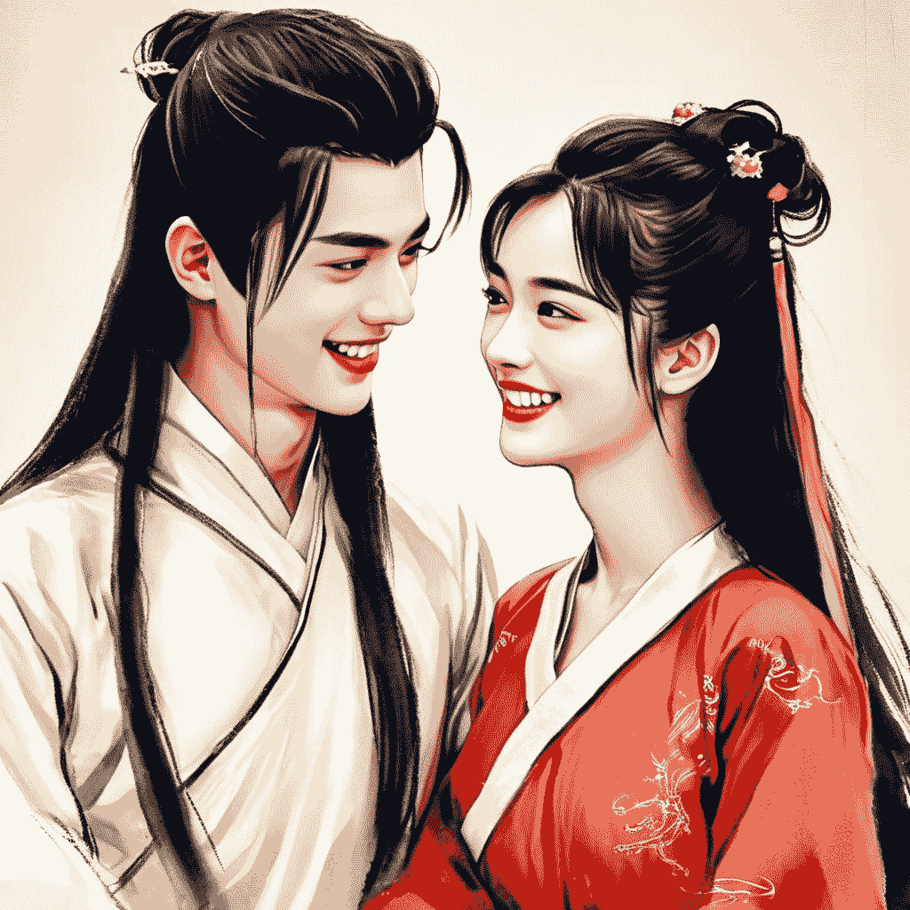

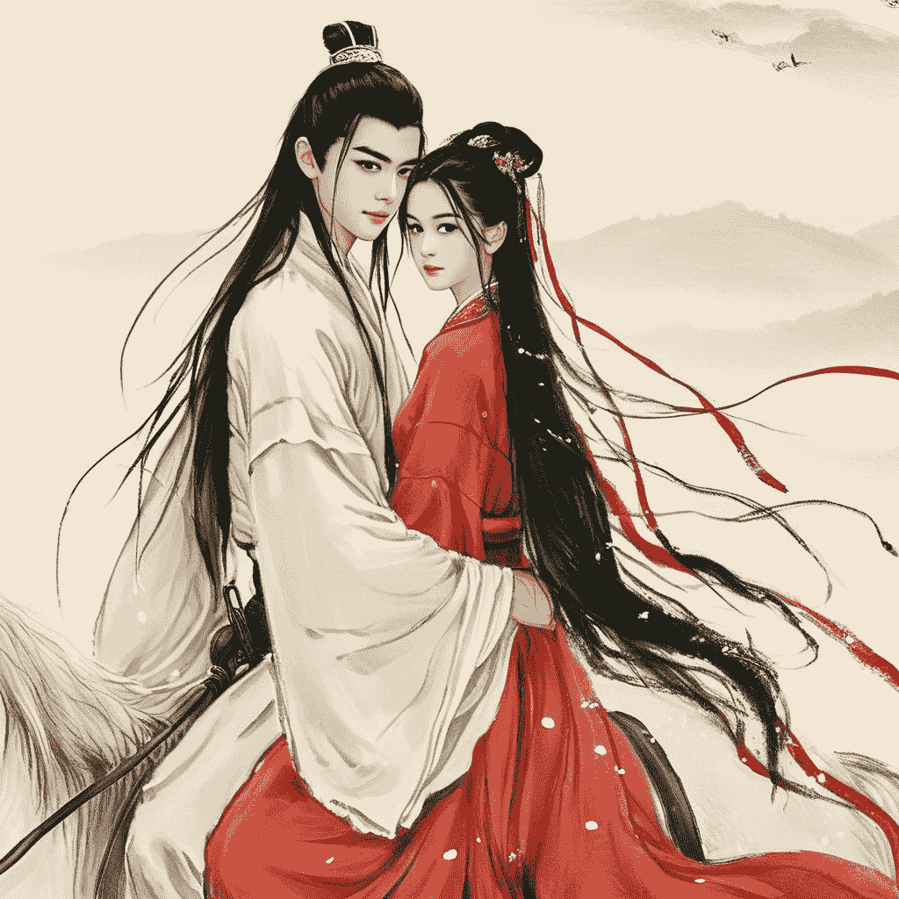

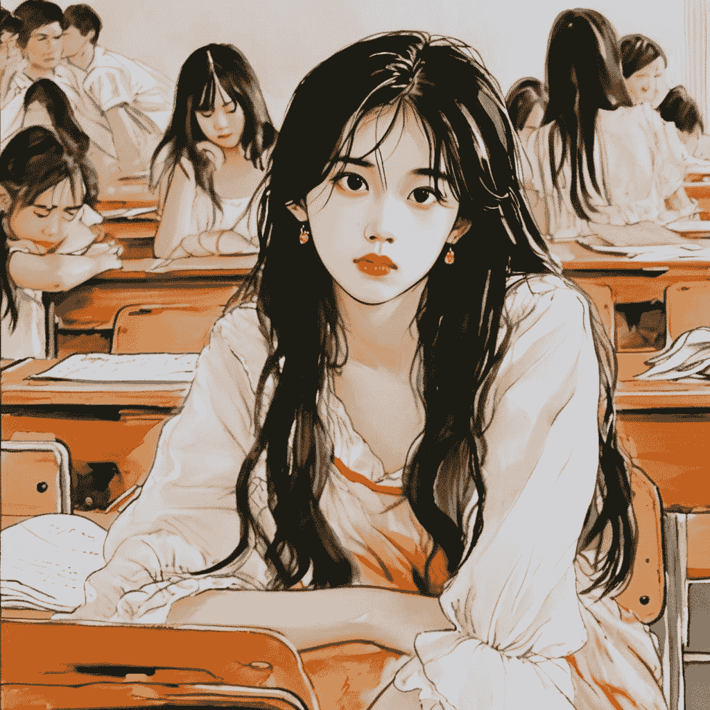


### 测试美学打分

# Part4：更多的选择一一浅尝scepter webui

### 浅尝功能

魔搭体验网址：https://www.modelscope.cn/studios/iic/scepter_studio

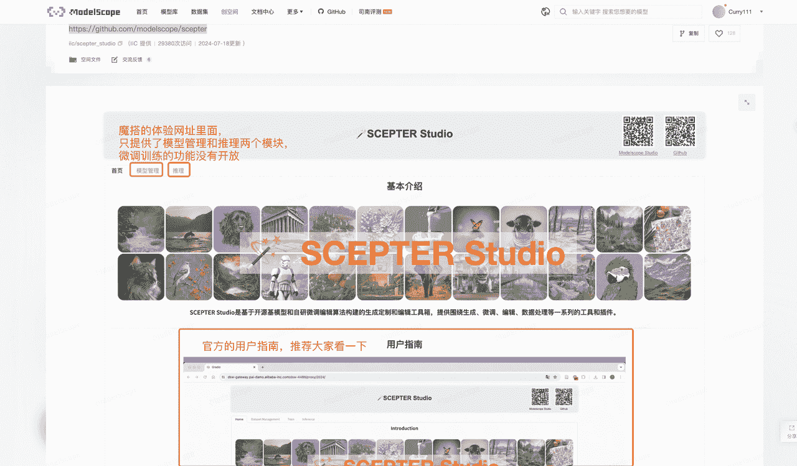

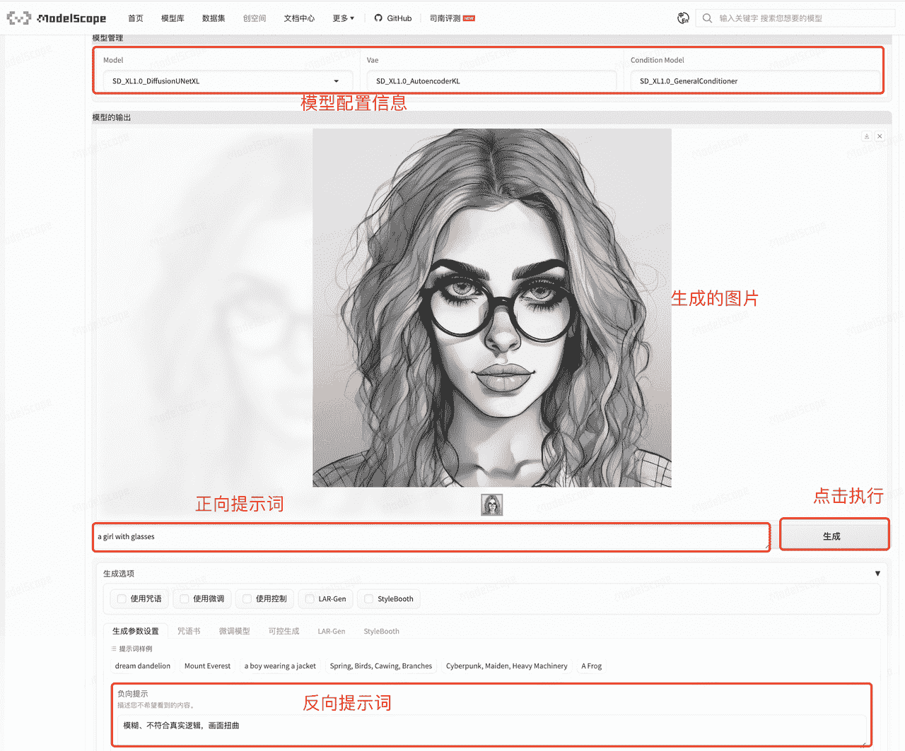

### 官方定义

🪄SCEPTER is an open-source code repository dedicated to generative training, fine-tuning, and inference, encompassing a suite of downstream tasks such as image generation, transfer, editing. SCEPTER integrates popular community-driven implementations as well as proprietary methods by Tongyi Lab of Alibaba Group, offering a comprehensive toolkit for researchers and practitioners in the field of AIGC. This versatile library is designed to facilitate innovation and accelerate development in the rapidly evolving domain of generative models.

### 核心组件

+   [生成训练和推理框架](https://github.com/modelscope/scepter#tutorials)

+   [轻松实施流行方法](https://github.com/modelscope/scepter#currently-supported-approaches)

+   交互式用户界面：SCEPTER Studio

### 私有部署（**挑战型**）

[**魔搭社区**](https://modelscope.cn/)提供的体验地址里面**缺失了微调模型**的功能，如果大家希望能使用secpter完整的功能，我们可以将其私有部署到我们自己的服务器。

**github地址：**https://github.com/modelscope/scepter

**可以通过官方readme文件中的教程****进行操作****，该模**块对基础有一定的要求，适合学有余力的同学

PS：如果在安装中遇到各种问题，别忘了这节课的老朋友，尽管向通义等AI工具提问~~~~~

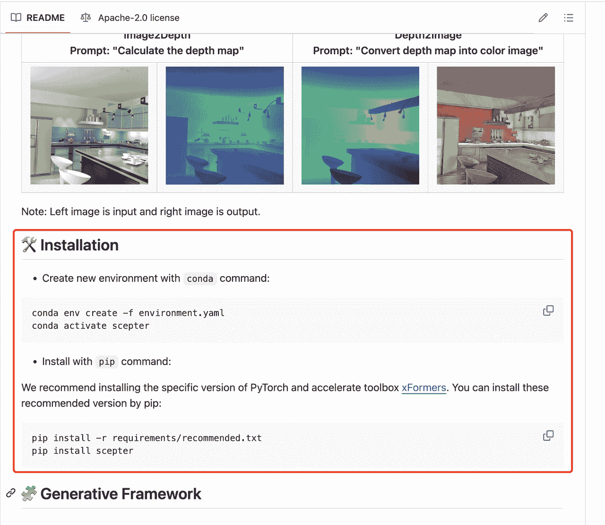

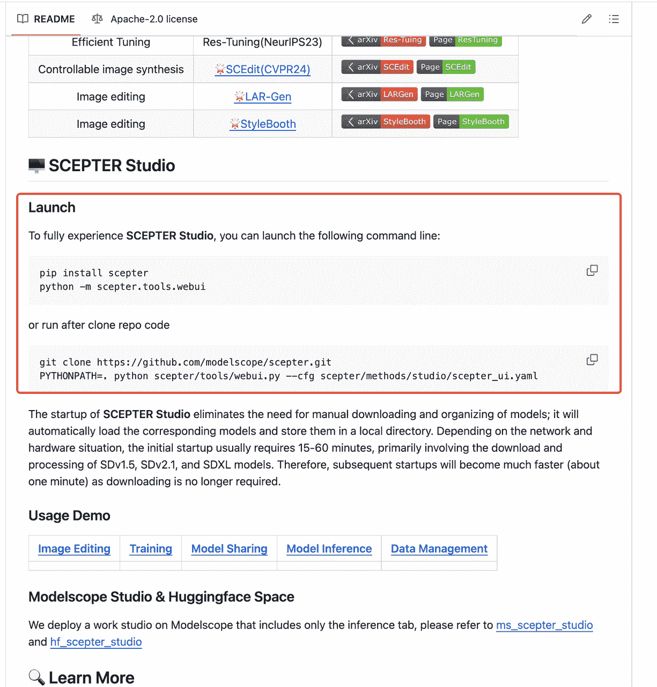

更多内容可见：

<https://player.bilibili.com/player.html?bvid=1Bx4y1x7Gy>

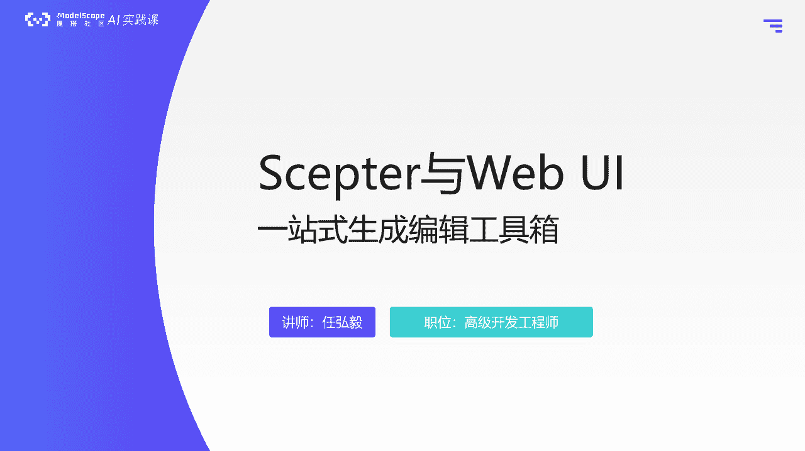

[【课件】Scepter与Web UI一站式生成编辑工具箱.pdf](https://internal-api-drive-stream.feishu.cn/space/api/box/stream/download/all/C6IHb6sDvo6ZpQxiRUGcJM9Sn9b)

# 参考资料

1.  壹沓AI观察：DALL-E——人工智能让“达利”再世

1.  《AIGC未来已来》

1.  [AI时代不得不提的“恐怖谷”](https://www.36kr.com/p/1722558431233)

1.  AI绘画的发展历史（GAN、diffusion、VAE…)

1.  AI绘画很快就能骗过整个互联网了。。。

# 来迎接更多挑战吧~

> 学有余力还可以往前学习哟~

<https://datawhaler.feishu.cn/sync/GU9tdTHgLsbLltbHUcYceKNInXc>

> 本教程主要由   、@AI 、 写作贡献，

> 融合了多位助教的内测体验和宝贵建议。

> 如果你觉得对你有价值和启发，请在下面点赞和评论哟~

>

### 另外别忘了写笔记打卡呀！！~

### 及时思考、沉淀和产出能让你的学习事半功倍！

>

> **注：本文采用 ****署名—非商业性使用**—相同方式共享 4.0 协议国际版许可协议进行许可。