# Task3：进阶上分-实战优化

> 来源：[https://datawhaler.feishu.cn/docx/LIO0dSsVbogOMkxeREVc4Qo7npb](https://datawhaler.feishu.cn/docx/LIO0dSsVbogOMkxeREVc4Qo7npb)

> **教程贡献者说：**

> 在上一个task中，我们对baseline进行了逐行精读，我们学会了使用AI工具来帮助我们更快更好地学习。另外我们制作了一个话剧连环画，同时我们对零代码文生图平台secpter webui也有了一个初步的理解。

> 我们今天的任务是了解微调的基本原理，然后我们会对微调的各种参数有一个更加清楚的了解，来实现一个更好的效果，并且在这个Task中会给大家介绍一下文生图的工作流平台工具ComfyUI，来实现一个更加高度定制的文生图。

> 加油，大家坚持住，行百里者半九十，成功就在眼前了。

> 那么事不宜迟, 我们现在就开始吧！

# part1：工具初探一ComfyUI应用场景探索

## 初识ComfyUI

### 什么是ComfyUI

GUI 是 "Graphical User Interface"（图形用户界面）的缩写。简单来说，GUI 就是你在电脑屏幕上看到的那种有图标、按钮和菜单的交互方式。

ComfyUI 是GUI的一种，是基于节点工作的用户界面，主要用于操作图像的生成技术，ComfyUI 的特别之处在于它采用了一种模块化的设计，把图像生成的过程分解成了许多小的步骤，每个步骤都是一个节点。这些节点可以连接起来形成一个工作流程，这样用户就可以根据需要定制自己的图像生成过程。

<https://player.bilibili.com/player.html?bvid=1ch4y1B7vp&spm_id_from=333.999.0.0&vd_source=339c925ff0b981a81a0b8c61e20c1e77>

### ComfyUI核心模块

核心模块由模型加载器、提示词管理器、采样器、解码器。

> [本小节内容来](https://datawhaler.feishu.cn/wiki/QHSTwBPFKiZxqfkA1INc1u4fn0f#part-P5ufdxyIEo1U6ixULfGcQA8bnSf)自魔搭社区，具体内容可点击查看：魔搭官方教程。

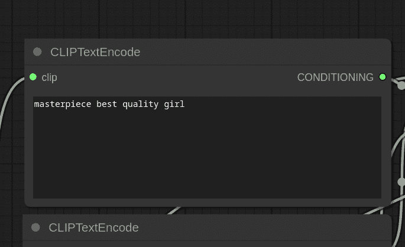

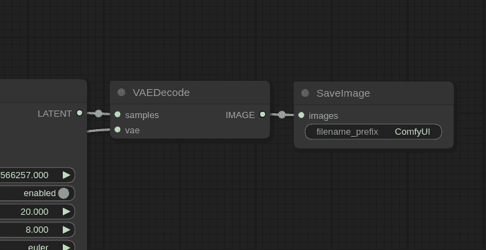

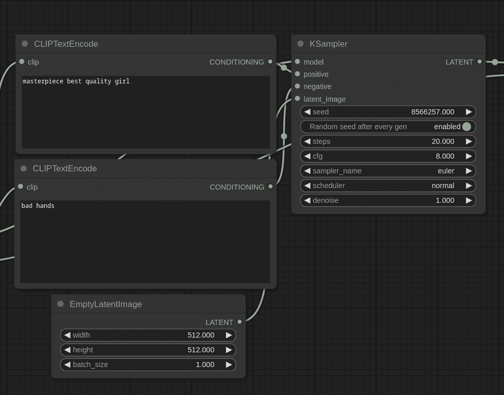

Stable Diffusion的基本原理是通过降噪的方式（如完全的噪声图像），将一个原本的噪声信号变为无噪声的信号（如人可以理解的图像）。其中的降噪过程涉及到多次的采样。采样的系数在`KSampler`中配置：

+   `seed`：控制噪声产生的随机种子
+   `control_after_generate`：控制`seed`在每次生成后的变化
+   `steps`：降噪的迭代步数，越多则信号越精准，相对的生成时间也越长
+   `cfg`：classifier free guidance决定了`prompt`对于最终生成图像的影响有多大。更高的值代表更多地展现`prompt`中的描述。
+   `denoise`: 多少内容会被噪声覆盖 `sampler_name`、`scheduler`：降噪参数。

### ComfyUI图片生成流程

### ComfyUI的优势

模块化和灵活性：ComfyUI 提供了一个模块化的系统，用户可以通过拖放不同的模块来构建复杂的工作流程。这种灵活性允许用户根据自己的需求自由组合和调整模型、输入、输出、和其他处理步骤。

可视化界面：ComfyUI 提供了直观的图形界面，使得用户能够更清晰地理解和操作复杂的 AI 模型和数据流。这对没有编程背景的用户特别有帮助，使他们能够轻松构建和管理工作流程。

多模型支持：ComfyUI 支持多个不同的生成模型，用户可以在同一平台上集成和切换使用不同的模型，从而实现更广泛的应用场景。

调试和优化：通过其可视化界面，ComfyUI 使得调试生成过程变得更简单。用户可以轻松地追踪数据流，识别并解决问题，从而优化生成结果。

开放和可扩展：ComfyUI 是一个开源项目，具有高度的可扩展性。开发者可以根据需要编写新的模块或插件，扩展系统功能，并根据项目需求进行定制。

用户友好性：尽管其功能强大，但 ComfyUI 仍然保持了用户友好性，即使对于复杂任务，也能以相对简单的方式完成，使其成为生成式 AI 工作流程管理的有力工具。

## 20分钟速通安装ComfyUI

在这里，我们依旧选择使用魔搭社区提供的Notebook和免费的GPU算力体验来体验ComfyUI。

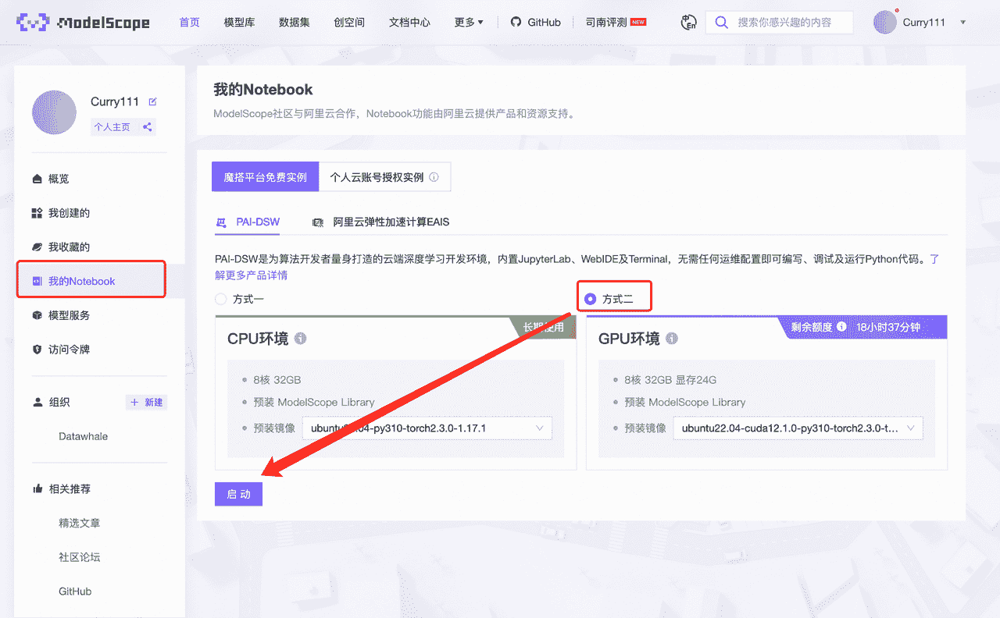

### 下载脚本代码文件

下载安装ComfyUI的执行文件和task1中微调完成Lora文件

```
git lfs install
git clone https://www.modelscope.cn/datasets/maochase/kolors_test_comfyui.git
mv kolors_test_comfyui/* ./
rm -rf kolors_test_comfyui/
mkdir -p /mnt/workspace/models/lightning_logs/version_0/checkpoints/
mv epoch=0-step=500.ckpt /mnt/workspace/models/lightning_logs/version_0/checkpoints/   
```

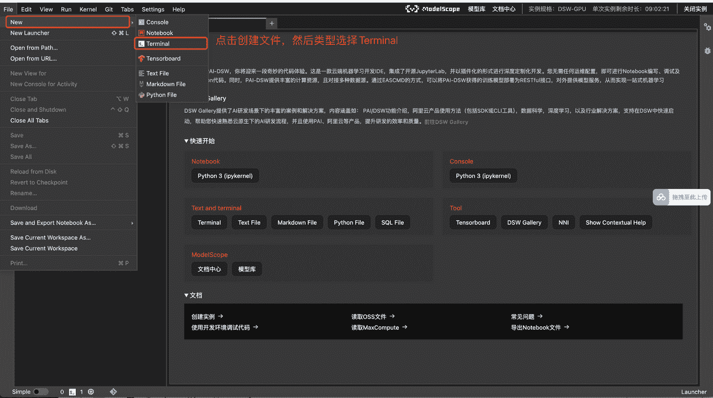

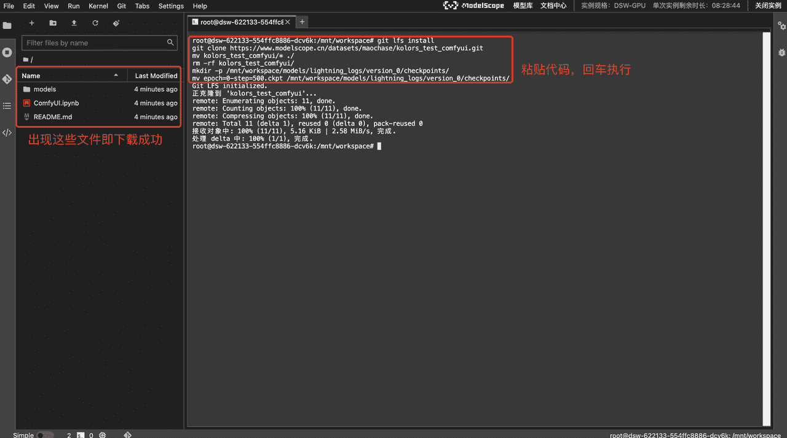

### 进入ComfyUI的安装文件

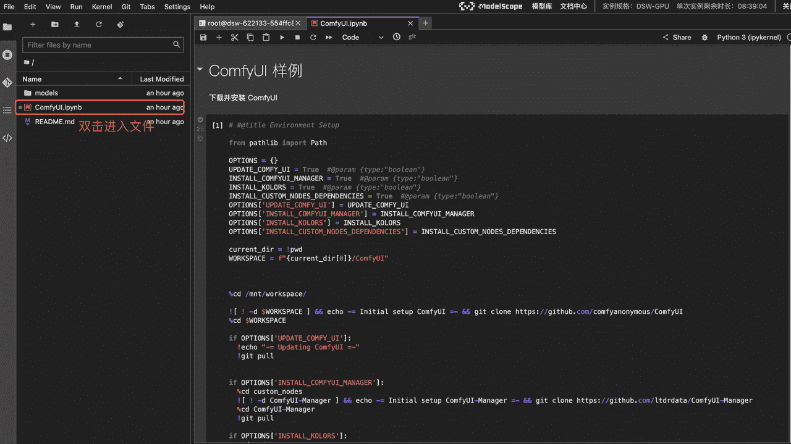

### 一键执行安装程序（大约10min）

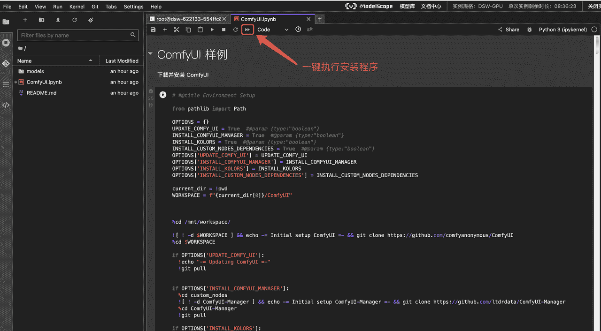

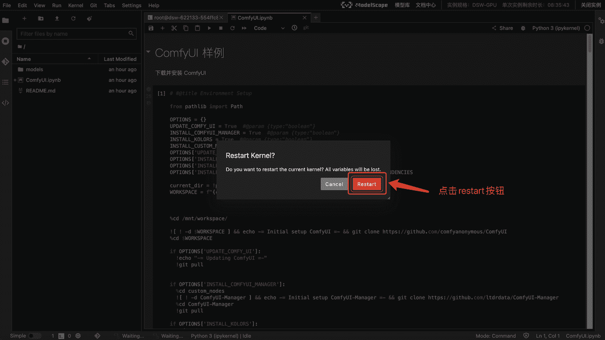

### 进入预览界面

当执行到最后一个节点的内容输出了一个访问的链接的时候，复制链接到浏览器中访问

PS：如果链接访问白屏，或者报错，就等一会再访问重试，程序可能没有正常启动完毕

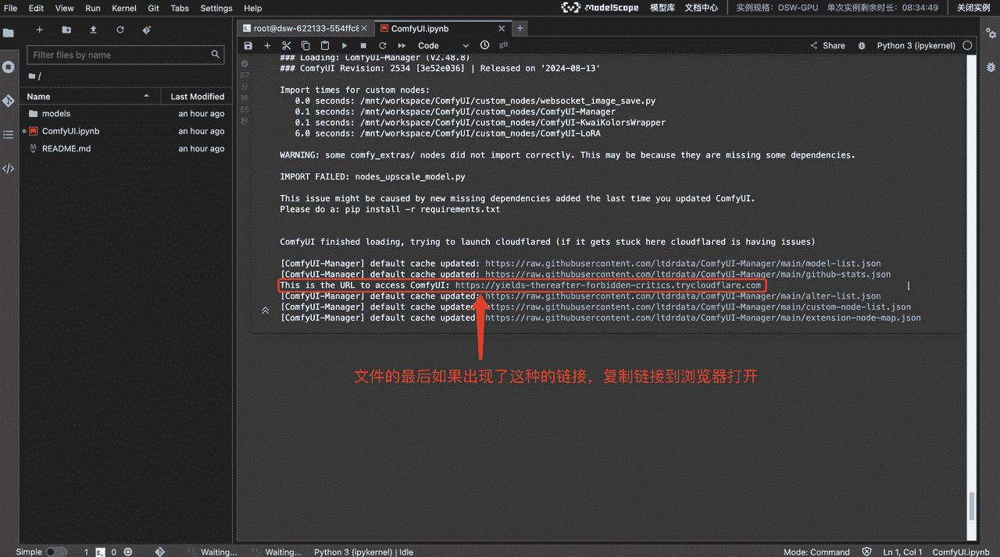

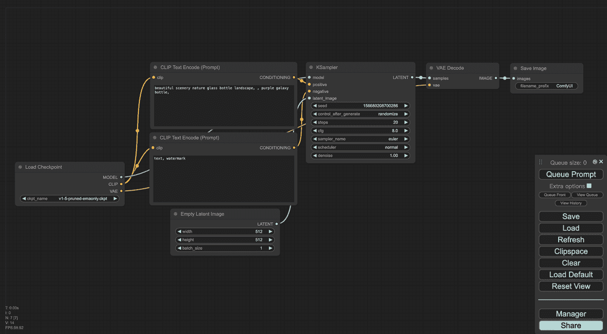

📢注意：到这里还不能生成图片哦，要完成接下来的操作才可以。

## 浅尝ComfyUI工作流

### 不带Lora的工作流样例

Step1：下载工作流脚本

👇请下载工作流脚本👇

需加载到刚刚安装的comfyUI上


[`kolors_example.json`](https://internal-api-drive-stream.feishu.cn/space/api/box/stream/download/all/IC28b3uc0oOXZXxZZdHcMQUOnQh)

Step2：加载模型，并完成第一次生图

PS：首次点击生成图片会加载资源，时间较长，大家耐心等待

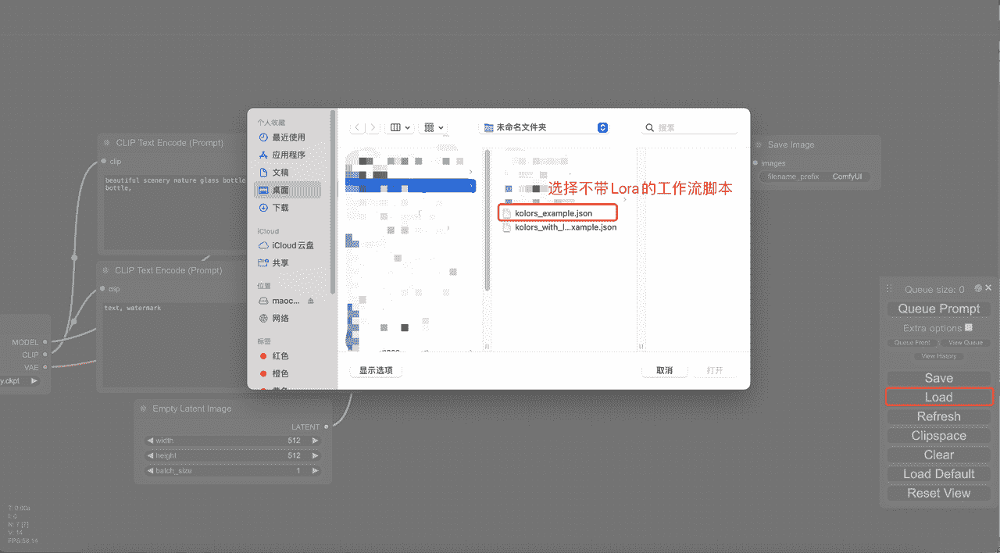

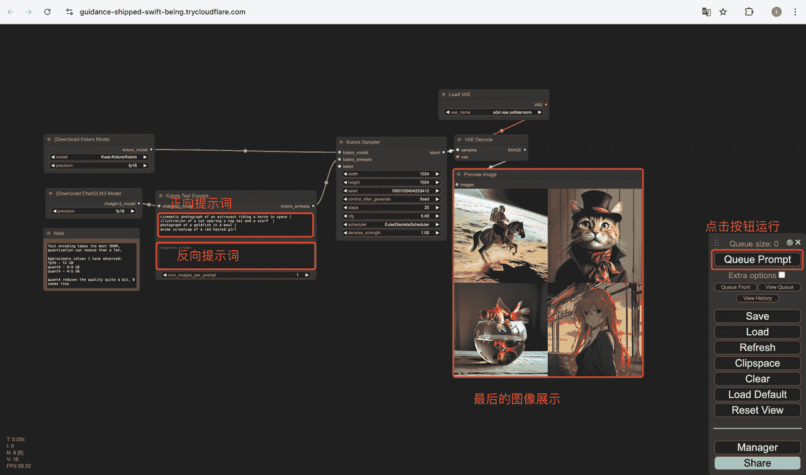

### 带Lora的工作流样例

工作流脚本（带Lora训练）


[`kolors_with_lora_example.json`](https://internal-api-drive-stream.feishu.cn/space/api/box/stream/download/all/ONWFblDShoqTMbx6mgmceJTSnWf)

执行操作

1. 这里的Lora是我们Task1微调训练出来的文件
1. 地址是：`/mnt/workspace/models/lightning_logs/version_0/checkpoints/epoch=0-step=500.ckpt`
1. 大家如有有其他的Lora文件，可以在下面截图Lora文件地址区域更换成自己的地址

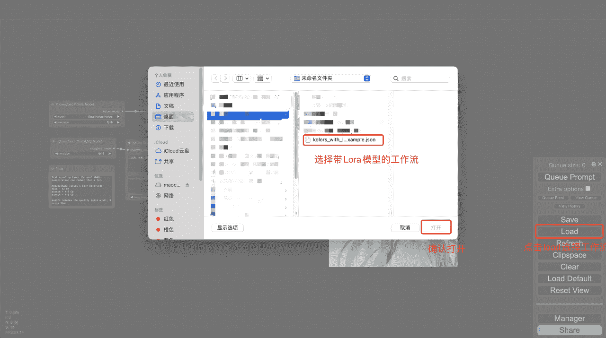

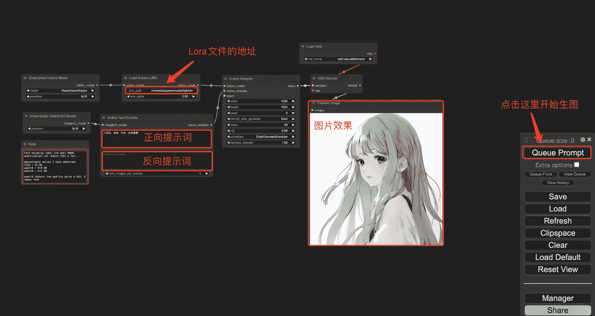

## 自我学习，快速提升

### 资源网站

| 名称 | 链接地址 |
| --- | --- |
| 在魔搭使用ComfyUI，玩转AIGC！ | https://modelscope.cn/headlines/article/429 |
| ComfyUI的官方地址 | https://github.com/comfyanonymous/ComfyUI |
| ComfyUI官方示范 | https://comfyanonymous.github.io/ComfyUI_examples/ |
| 别人的基础工作流示范 | https://github.com/cubiq/ComfyUI_Workflows |
|  | https://github.com/wyrde/wyrde-comfyui-workflows |
| 工作流分享网站 | https://comfyworkflows.com/ |
| 推荐一个比较好的comfyui的github仓库网站 | https://github.com/ZHO-ZHO-ZHO/ComfyUI-Workflows-ZHO?tab=readme-ov-file |

### 魔搭官方教程

<https://player.bilibili.com/player.html?bvid=1nT421k7Fa&spm_id_from=888.80997.embed_other.whitelist&bvid=BV1nT421k7Fa>

[对应PPT课件(点击打开查看)](https://www.yuque.com/office/yuque/0/2024/pptx/1169882/1720432237458-e4b10804-b9cb-401d-aa2c-6de04b5276e0.pptx?from=https%3A%2F%2Fwww.yuque.com%2F2ai%2Fmodel%2Fgutsk9ezeymuebq9)

# Part2：Lora微调

## Lora简介

LoRA (Low-Rank Adaptation) 微调是一种用于在预训练模型上进行高效微调的技术。它可以通过高效且灵活的方式实现模型的个性化调整，使其能够适应特定的任务或领域，同时保持良好的泛化能力和较低的资源消耗。这对于推动大规模预训练模型的实际应用至关重要。

### Lora微调的原理

LoRA通过在预训练模型的关键层中添加低秩矩阵来实现。这些低秩矩阵通常被设计成具有较低维度的参数空间，这样它们就可以在不改变模型整体结构的情况下进行微调。在训练过程中，只有这些新增的低秩矩阵被更新，而原始模型的大部分权重保持不变。

具体可以参考下面视频，对LoRA的原理讲的比较通俗易懂。

<https://player.bilibili.com/player.html?bvid=1tthPeFEWb&spm_id_from=333.337.search-card.all.click&vd_source=339c925ff0b981a81a0b8c61e20c1e77>

### Lora微调的优势

快速适应新任务

在特定领域有少量标注数据的情况下，也可以有效地对模型进行个性化调整，可以迅速适应新的领域或特定任务。

保持泛化能力

LoRA通过微调模型的一部分，有助于保持模型在未见过的数据上的泛化能力，同时还能学习到特定任务的知识。

资源效率

LoRA旨在通过仅微调模型的部分权重，而不是整个模型，从而减少所需的计算资源和存储空间。

## Lora详解

现在我们来针对可图比赛中的微调代码进行一个深入的了解。

### Task2中的的微调代码

```
import os
cmd = """
python DiffSynth-Studio/examples/train/kolors/train_kolors_lora.py \ # 选择使用可图的Lora训练脚本DiffSynth-Studio/examples/train/kolors/train_kolors_lora.py
  --pretrained_unet_path models/kolors/Kolors/unet/diffusion_pytorch_model.safetensors \ # 选择unet模型
  --pretrained_text_encoder_path models/kolors/Kolors/text_encoder \ # 选择text_encoder
  --pretrained_fp16_vae_path models/sdxl-vae-fp16-fix/diffusion_pytorch_model.safetensors \ # 选择vae模型
  --lora_rank 16 \ # lora_rank 16 表示在权衡模型表达能力和训练效率时，选择了使用 16 作为秩，适合在不显著降低模型性能的前提下，通过 LoRA 减少计算和内存的需求
  --lora_alpha 4.0 \ # 设置 LoRA 的 alpha 值，影响调整的强度
  --dataset_path data/lora_dataset_processed \ # 指定数据集路径，用于训练模型
  --output_path ./models \ # 指定输出路径，用于保存模型
  --max_epochs 1 \ # 设置最大训练轮数为 1
  --center_crop \ # 启用中心裁剪，这通常用于图像预处理
  --use_gradient_checkpointing \ # 启用梯度检查点技术，以节省内存
  --precision "16-mixed" # 指定训练时的精度为混合 16 位精度（half precision），这可以加速训练并减少显存使用
""".strip()
os.system(cmd) # 执行可图Lora训练    
```

### 参数详情表

| 参数名称 | 参数值 | 说明 |
| --- | --- | --- |
| `pretrained_unet_path` | `models/kolors/Kolors/unet/diffusion_pytorch_model.safetensors` | 指定预训练`UNet`模型的路径 |
| `pretrained_text_encoder_path` | `models/kolors/Kolors/text_encoder` | 指定预训练文本编码器的路径 |
| `pretrained_fp16_vae_path` | `models/sdxl-vae-fp16-fix/diffusion_pytorch_model.safetensors` | 指定预训练`VAE`模型的路径 |
| `lora_rank` | `16` | 设置LoRA的秩（rank），影响模型的复杂度和性能 |
| `lora_alpha` | `4` | 设置LoRA的alpha值，控制微调的强度 |
| `dataset_path` | `data/lora_dataset_processed` | 指定用于训练的数据集路径 |
| `output_path` | `./models` | 指定训练完成后保存模型的路径 |
| `max_epochs` | `1` | 设置最大训练轮数为1 |
| `center_crop` |  | 启用中心裁剪，用于图像预处理 |
| `use_gradient_checkpointing` |  | 启用梯度检查点，节省显存 |
| `precision` | `"16-mixed"` | 设置训练时的精度为混合16位精度（half precision） |

### UNet、VAE和文本编码器的协作关系

+   `UNet`：负责根据输入的噪声和文本条件生成图像。在`Stable Diffusion`模型中，`UNet`接收由`VAE`编码器产生的噪声和文本编码器转换的文本向量作为输入，并预测去噪后的噪声，从而生成与文本描述相符的图像
+   `VAE`：生成模型，用于将输入数据映射到潜在空间，并从中采样以生成新图像。在`Stable Diffusion`中，`VAE`编码器首先生成带有噪声的潜在表示，这些表示随后与文本条件一起输入到`UNet`中
+   文本编码器：将文本输入转换为模型可以理解的向量表示。在`Stable Diffusion`模型中，文本编码器使用`CLIP`模型将文本提示转换为向量，这些向量与`VAE`生成的噪声一起输入到`UNet`中，指导图像的生成过程

# Part3 如何准备一个高质量的数据集

当我们进行图片生成相关的工作时，选择合适的数据集是非常重要的。如何找到适合自己的数据集呢，这里给大家整理了一些重要的参考维度，希望可以帮助你快速找到适合的数据集：

## 明确你的需求和目标

+   关注应用场景：确定你的模型将被应用到什么样的场景中（例如，艺术风格转换、产品图像生成、医疗影像合成等）。
+   关注数据类型：你需要什么样的图片？比如是真实世界的照片还是合成图像？是黑白的还是彩色的？是高分辨率还是低分辨率？
+   关注数据量：考虑你的任务应该需要多少图片来支持训练和验证。

## 数据集来源整理

以下渠道来源均需要考虑合规性问题，请大家在使用数据集过程中谨慎选择。


| **来源类型** | 推荐 |
| --- | --- |
| **公开的数据平台** | 魔搭社区内开放了近3000个数据集，涉及文本、图像、音频、视频和多模态等多种场景，左侧有标签栏帮助快速导览，大家可以看看有没有自己需要的数据集。 |
| **使用API或爬虫获取** | 1. 如果需要特定类型的内容，可以利用API从图库网站抓取图片，如Unsplash、Pexels等。 |
| **数据合成** | 利用现有的图形引擎（如Unity、Unreal Engine）或特定软件生成合成数据，这在训练某些类型的模型时非常有用。 |
| **数据增强** | 对于较小的数据集，可以通过旋转、翻转、缩放、颜色变换等方式进行数据增强。 |
| **购买或定制** | 如果你的应用是特定领域的，比如医学影像、卫星图像等，建议从靠谱的渠道购买一些数据集。 |

# ❀ 恭喜看完全部知识教程！

> 我们的学习也已接近过半！接下来，就都是你们团队开发的时间！
> 后面我们也会继续展开技术交流会，有任何疑难杂症，欢迎一起探讨~
> 比赛不结束，我们不散场！比赛结束了，我们依旧不散场！依旧可以交流idea、交流demo！
> Datawhale想与你一同见证更好的自己，
> 永远—— “For the Learner，For the Dreamer”！

## 把时间交给你们，期待你们的作品惊艳全场！！！

> 官网提交并填写**打卡链接**，加入**作品交流群**持续迭代作品

> **你这次的学习体验**感受如何？欢迎 留言 & 在群里 跟大家一起聊聊呀！

> 你的 结营证书 和 优秀学习者证书 正在赶来的路上！！！

> 助教们正在马不停蹄为你加急，不要着急哟~

### 📟 你可以随时回顾我们这次的学习~

<https://datawhaler.feishu.cn/sync/GU9tdTHgLsbLltbHUcYceKNInXc>

### 🎉合影留念墙

感谢很棒的你一路的坚持，让我们在这里给自己点个赞！

期待下期夏令营还能与你再次相遇~

一起合个影 :)

> 本教程主要由   写作贡献，

> 融合了多位助教的内测体验和宝贵建议。

> 如果你觉得对你有价值和启发，请在下面点赞和评论哟~

#### 另外别忘了写笔记打卡呀！！~

#### 及时思考、沉淀和产出能让你的学习事半功倍！

> **注：本文采用 署名—非商业性使用—相同方式共享 4.0 协议国际版许可协议进行许可。**
