# 补充选学：AI生图应用场景介绍

> 来源：[https://datawhaler.feishu.cn/docx/Rgh9dvXGGow7iRxYdmQcNWZWnDg](https://datawhaler.feishu.cn/docx/Rgh9dvXGGow7iRxYdmQcNWZWnDg)

> 教程贡献者说：
>
> 前面我们介绍了AI生图的诸多原理与技术实现，
>
> 但很多同学可能还是没想清楚AI生图技术的前景究竟在哪里。
>
> 在补充选学的这个章节里，我们将给大家介绍一些选学的材料，
>
> 让大家能更清晰直观地看到技术前沿的大佬们都在用AI生图做些什么，
>
> 以及现在AI生图在市场里究竟有了哪些应用和技术体现~
>
> 注意：本部分内容是选学内容，材料较多，大家按需食用即可~

## Part.1 AI生图在市场中的应用介绍

### 回顾一下文生图的技术历史：

<https://player.bilibili.com/player.html?bvid=1JE421P7nf&spm_id_from=333.999.0.0&vd_source=ceff90cfde2a6e1ca2125a362a4dddf5>

AI生成图像技术正在迅速改变各行各业的运作方式，尤其是在创意产业、广告、医疗、教育和科技领域。这种技术基于深度学习模型，如生成对抗网络（`GANs`），能够生成高质量的图像。以下是一些具体的应用介绍：

### 1. 广告与市场营销

`AI`生成图像可以根据特定目标市场的偏好自动调整广告内容，从而提供更加个性化的用户体验。它能够快速生成多样化的广告创意，降低设计成本，加快市场反应速度。

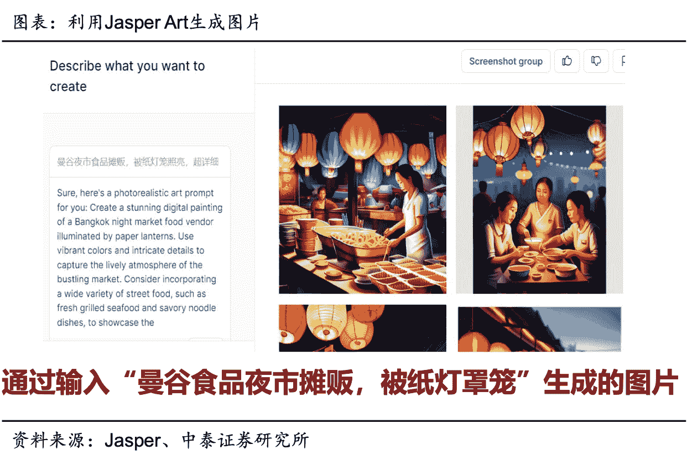

### 2. 娱乐与媒体

在游戏设计和电影制作中，`AI`生成图像技术可以创建复杂的虚拟世界和角色，不仅提高生产效率，还能带来前所未有的视觉体验。此外，`AI`还能生成新闻故事或书籍中的插图，增加内容的吸引力。

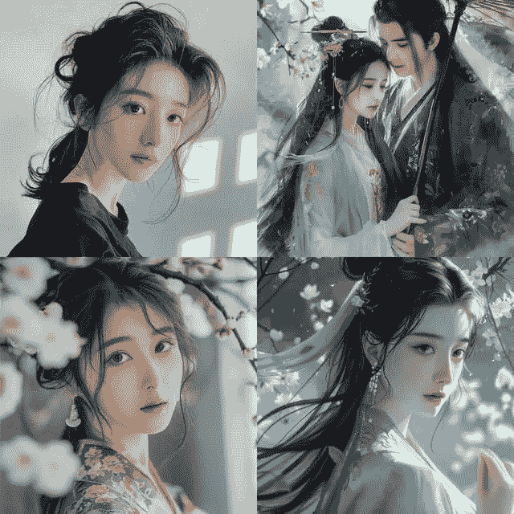

### 3. 艺术创作

艺术家和设计师可以利用`AI`生成图像技术探索新的艺术形式和表达方式。这种技术可以帮助他们突破传统创作的局限，实验不同的风格和材料效果。

### 4. 电子商务

在线零售商可以使用`AI`生成图像来展示产品在不同环境下的外观，或是在用户还未购买前，展示产品的多种潜在定制选项。这种技术还可以用于生成产品的3D视图，提高消费者的购买意愿。

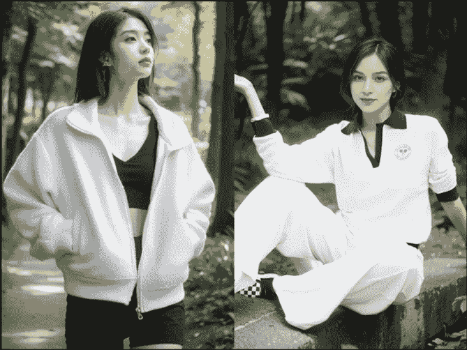

### 5. 教育

在教育领域，`AI`生成图像可以用来制作教材中的图表、插图和其他视觉辅助材料，尤其是在科学和技术教育中，可以帮助学生更好地理解复杂的概念。

### 6. 医疗健康

在医疗领域，`AI`生成图像技术可以用来创建病理图像，辅助医生进行诊断。通过模拟不同的疾病情况，医生可以更好地理解疾病的影响和可能的治疗方法。

### 7. 科学研究

科学家可以使用`AI`生成图像来模拟复杂的科学过程或显示数据的视觉表示，这有助于更好地解释研究结果，提高科研的透明度和公众的理解。

### 8. 社交媒体

在社交媒体领域，`AI`生成的虚拟人物和场景越来越受欢迎，它们可以作为用户的虚拟形象或在虚拟世界中进行互动。

### 9. 个性化和自动化内容生成

`AI`生成图像可以根据用户的行为和偏好自动创建个性化内容，无论是个人化的购物体验、定制新闻`feed`，还是为特定事件自动生成相关图像。

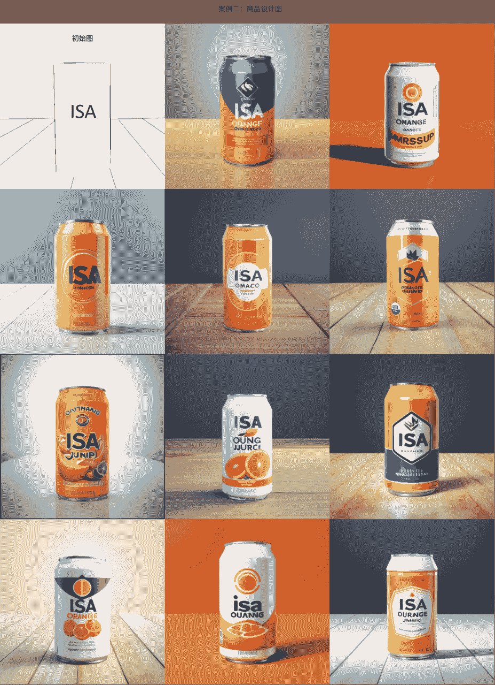

### 市场趋势

随着技术的成熟和应用范围的扩展，市场对`AI`生成图像的需求持续增长。企业和创作者正在寻求利用这项技术来降低成本、提高效率和增强用户体验。同时，随着更多的道德和法律问题被提出，如版权和创造权的争议，未来这一领域的发展也可能面临监管和道德方面的挑战。

## Part.2 最新图像生成技术研究方向-介绍与分析

### 魔搭教学视频：

<https://player.bilibili.com/player.html?bvid=1vT421k7Qc&spm_id_from=333.999.0.0&vd_source=ceff90cfde2a6e1ca2125a362a4dddf5>

最新的图像生成技术研究正在迅速进展，特别是在生成对抗网络（`GANs`）、扩散模型、和自回归模型方面的应用。以下是一些代表性的研究方向和具体技术：

### 1. 快速图像生成

由`MIT`和`Adobe`研究人员开发的新模型能够将图像生成速度提高30倍。这一进展主要依赖于[分布匹配蒸馏技术，将生成过程](https://research.adobe.com/news/making-ai-image-generation-30-times-faster/)从多步骤简化为一步完成，显著降低了能源消耗和成本 (`Adobe Research`)。

### 2. 多模态生成模型（`Lumina-mGPT`）

[`Lumina-mGPT`](https://ar5iv.org/abs/2408.02657)模型是一种基于预训练的解码器唯一的变换器，专门处理文本到图像的生成任务。该模型通过大规模的文本图像序列预训练，来学习广泛的多模态能力，实现从简单描述到生成高度逼真的图像 (`ar5iv`)。

### 3. 高质量的文本到图像生成（`Imagen 2`）

`Google DeepMind`开发的`Imagen 2`模型利用扩散模型从文本描述中生成高质量、逼真的图像。这一技术在处理人类面部和其他细节方面显示出显著的改进，能更准确地捕捉语言提示的细微差别 (`blog.google`)。

### 4. 交互式数据可视化生成

最新的研究探索了使用生成AI（`GenAI`）来增强数据可视化的交互性和美观性。例如，通过优化基于规则的算法，或应用机器学习来从真实世界数据中学习，以改进颜色方案、字体和布局等设计元素的选择 (`ar5iv`)。

## Part.3 画质修复增强技术及应用

### 魔搭教学视频：

<https://player.bilibili.com/player.html?bvid=1tm421G7oy&spm_id_from=333.999.0.0&vd_source=ceff90cfde2a6e1ca2125a362a4dddf5>

最新的画质修复增强技术正在迅速发展，特别是在低光环境增强、多曝光图像恢复、和人工智能生成内容质量评估等方面。以下是一些具体的研究和技术进展：

### 1. 低光环境图像增强

在`NTIRE 2024`挑战中，多个团队展示了他们的低光图像增强方法，这些方法侧重于提高图像的峰值信噪比（`PSNR`）和结构相似性指数（`SSIM`），这两个指标是评估图像质量的常用标准。其中，一些团队使用了多尺度策略来实现图像增强，以适应超高分辨率（4K及以上）的图像处理需求 (`ar5iv`)。

### 2. AI生成内容的质量评估

另一个重点研究方向是`AI`生成图像和视频内容的质量评估。`NTIRE 2024`的一个挑战是预测生成图像/视频的感知质量，使用了特定的数据集和多维度评估标准来训练和测试模型，以推动客观的图像/视频质量评估方法的发展 (`ar5iv`)。

### 3. 多曝光图像恢复与增强

在多曝光图像处理方面，最新的研究利用多曝光原始图像来生成无噪声、无模糊、高动态范围、甚至更高分辨率的图像。这些方法集中于同时解决去噪、去模糊、高动态范围增强和超分辨率等任务，为图像恢复和增强设定了新的性能基准 (`CVF Open Access`)。

### 4. 内窥镜图像增强

针对医学影像，特别是低光内窥镜图像，最近的研究提出了基于`Retinex`理论的非线性亮度增强方法。该方法通过更高阶的曲线函数对亮度图进行操作，改善图像的全局亮度和细节，适用于提高内窥镜图像的诊断质量 (`BioMed Central`)。

## Part.4 艺术字生成及海报设计

### 魔搭教学视频：

<https://player.bilibili.com/player.html?bvid=17x4y1x7z4&spm_id_from=333.999.0.0&vd_source=ceff90cfde2a6e1ca2125a362a4dddf5>

艺术字生成技术主要集中在如何将图像风格化技术应用到文本图像的内容上，以增强文本的美学特质。这些技术的发展一直与图像风格化技术的进步相伴随，现已发展到利用深度神经网络和扩散模型等更复杂的方法进行文本到图像的技术转换。以下是一些主要的艺术字生成方法和技术：

### 1. `GAN`（生成对抗网络）

许多[艺术字生成](https://ar5iv.org/abs/2407.14774v1)模型采用了`GAN`，通过对抗性训练的方式生成具有特定风格的艺术字。例如，`TET-GAN`和`Shape-Matching GAN`等模型能够处理不同的文本效果和风格转换，同时保持文本的可读性 (`ar5iv`)。

### 2. 扩散模型

用于生成与给定字形相关的物体布局的扩散模型，这种方法可以在保持原始字形结构的同时，通过算法生成与字形相协调的图形元素 (`ar5iv`)。

### 3. 补丁基方法

如`UT-Effect`等模型采用结构迁移和纹理迁移的方法，允许在保持原始文本结构的前提下，转换文本的纹理和风格 (`ar5iv`)。

### 4. 多任务学习与解耦技术

`GenText`模型通过解耦字体和纹理的处理，允许用户更灵活地控制艺术字的生成。该模型在无监督学习环境下进行训练，可以同时进行去风格化、字体转换和风格化三个子任务，提供了一种高效的艺术字生成策略 (`ar5iv`)。

## Part.5 虚拟试衣：介绍文生图在虚拟试衣领域的应用场景与方法

### 魔搭教学视频：

<https://player.bilibili.com/player.html?bvid=1Xr421T7Q9&spm_id_from=333.999.0.0&vd_source=ceff90cfde2a6e1ca2125a362a4dddf5>

### EasyPhoto：人物写真的虚拟试衣和场景生成

来源：https://zhuanlan.zhihu.com/p/670450697

`EasyPhoto` 是一个基于`SDWebUI`生态的`AIGC`插件，专门用于生成真/像/美的`AI`写真，将近三个月的时间里，它在`GitHub`上的星标数已经达到了近3600。欢迎关注或参与项目共建，很需要大家的支持。

项目地址：[https://github.com/aigc-apps](https://link.zhihu.com/?target=https%3A//github.com/aigc-apps/sd-webui-EasyPhoto/)/sd-webui-EasyPhoto/

在过去的时间里，`EasyPhoto` 专注于特定人物的写真生成。如果您还不熟悉`EasyPhoto`或需要了解其他相关功能，请参阅之前的知乎文章：

+   文章一：`EasyPhoto`:专属`SDWebUI`艺术照插件

+   文章二：`EasyPhoto` : `SDXL`高保真`AI`人像写真

+   文章三：`EasyPhoto`: 让你的`AIGC`肖像动起来！

近期，我们为`EasyPhoto`内置了场景化`LoRA`以及衣物的编辑功能，对生成图像的非人脸区域进行控制，以更好地适应定制化、多样化的人物写真场景。本文我们将重点介绍如何基于`EasyPhoto`进行：

+   人物写真图像的衣物替换

+   训练/推理自己的风格化人物写真

#### 原理说明

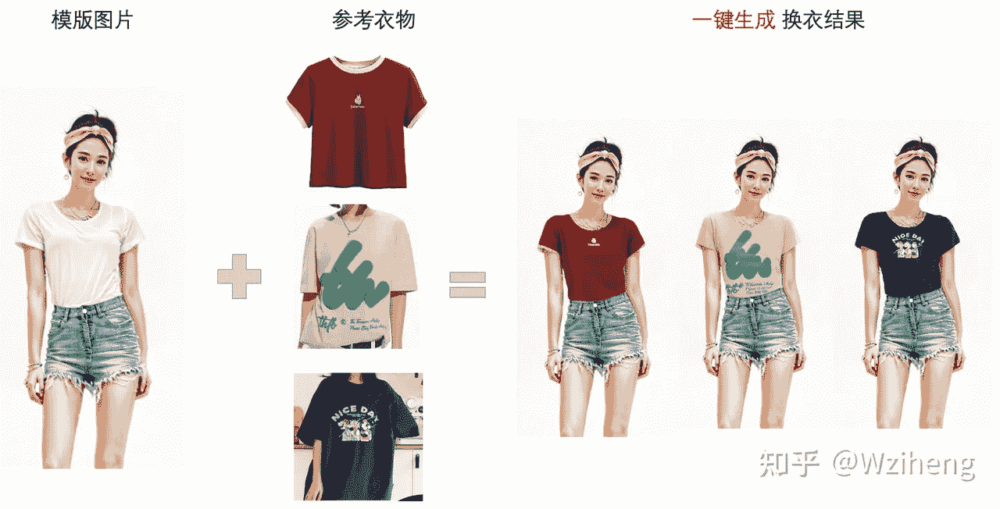

示意图

虚拟试衣功能允许用户将给定模板中的服装更换为其他衣物图像。现有的虚拟试衣算法[1-8]依赖于关键点检测、动作识别、人体解析等复杂预处理步骤，链路长且环境依赖性强。这些算法大多在特定衣物数据集[9][10]上进行训练，可能在实际应用中表现不佳。为改善用户体验和提高效率，`EasyPhoto`引入了一种更简洁直观的虚拟试衣方案。我们的算法流程包括：

1.  匹配贴图：优化源图与目标图的`IoU`，获得最佳旋转角度和缩放比例。

1.  多阶段图像局部重绘：利用`ControlNet`对衣物进行局部重绘，优化生成结果的内外边缘，提高真实性。

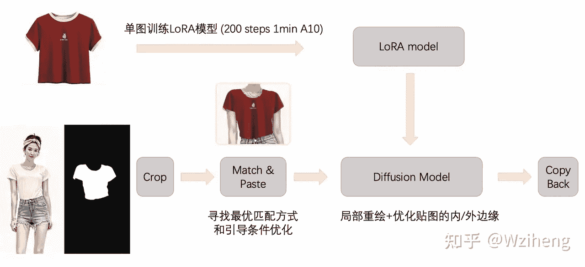

换衣原理

由于我们的算法没有特别约束衣物的关键点检测，它可以扩展到任意物体的一致性保持。您可通过 github-wiki 了解更多相关功能。在`EasyPhoto`中，我们简化了使用链路，仅用一张图像训练衣物的`LoRA`模型。实验表明，即使只用一张图片，衣物的`id`信息也能得到基本保留。详细代码改动参考 `PR289`

#### 使用流程

安装好`EasyPhoto`后，您可通过下面的方式中的一种来使用虚拟试衣功能。

+   切换至 `Virtual Tryon`选项卡中来使用虚拟试衣的功能

+   在`EasyPhoto`人像生成页面通过 按钮，一键将`EasyPhoto`生成的人像写真发送至虚拟`Virtual Tryon`的选项卡中。

我们在项目中内置了部分衣服、模版，供您快速复现项目效果，您可点击 `Template/Cloth Upload`按钮来自行上传自己的模版/衣物图片。整个`TryOn`页面的`UI`解释如下：

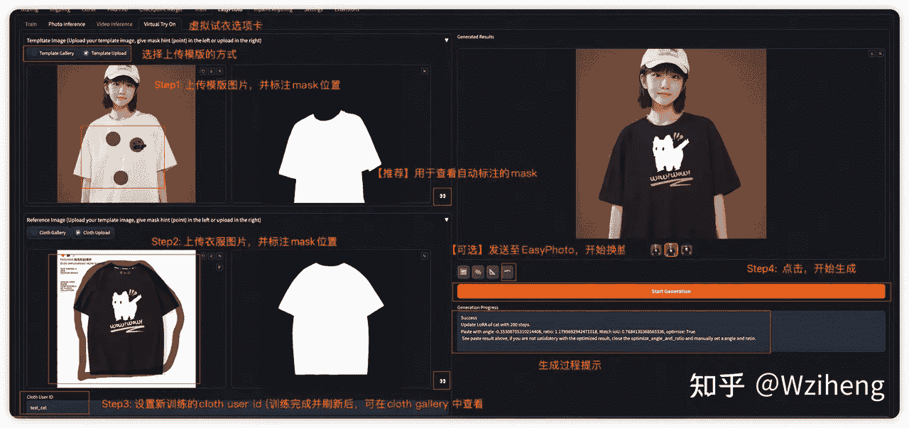

+   `Step1`：上传一张模版图片，并标注需要替换的衣服区域，或在`gallery`中选择。使用框选或点选方式进行`mask`标注，并点击眼睛图标 预览自动生成的`mask`。

+   `Step2`：上传含有目标衣服的图片，标注参考区域，并设置衣服的`user_id`。（或在`gallery`中选择）

+   `Step3`：[可选] 在`cloth gallery`中点击刷新图标，可查看训练的`LoRA`模型，供下次生成使用。

+   `Step4`: 点击`Start Generation`。新`user id`首次生成将训练一个额外的`LoRA`模型。

当上传衣物图像时，请注意以下指南：

1.  图像类型：选择图案清晰的正面图像，保持衣物尽可能平整。适用的图像类型包括衣物的平铺图或穿着在模特身上的正面图像。

1.  预览`Mask`：建议在生成过程前预览自动识别的`Mask`，以确保最佳生成效果。

1.  替换区域一致性：上传的衣物和模板图像中的替换区域应为相同类型。生成结果将依据模板图像的版型，当前系统暂不支持服饰种类的切换。

## 效果展示

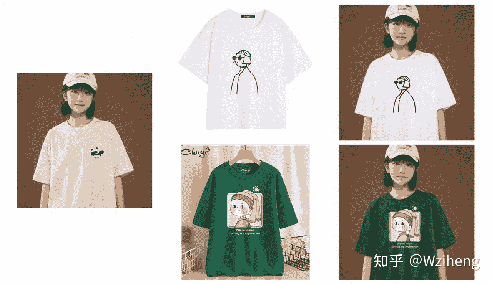

tshirt

卫衣

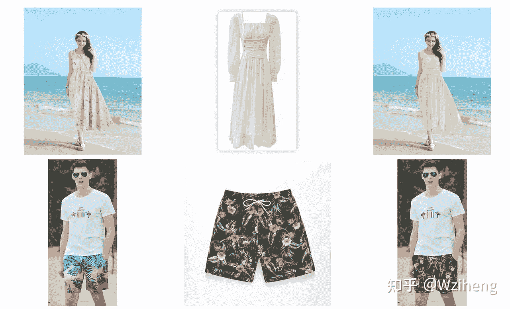

裤裙

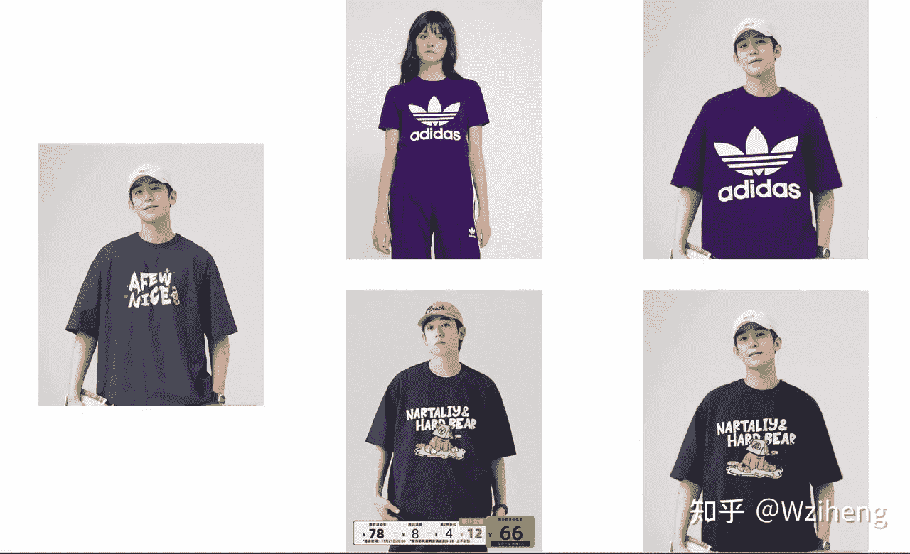

人换人

## 局限性

当前算法尚存在若干局限性，我们将进一步优化算法流程，包括：

1. 扩展算法能力：增强替换过程，融入预训练模型中的版型交换、遮挡、旋转和形变先验信息。

2. 减少色彩偏差：提升替换衣物的色彩和ID信息的一致性。

3. 精细化处理：保持小号字体和图案的一致性。

4. 优化生成效果：提升材质、纹理和光线的一致性。

## 场景Lora扩展

### 原理说明

EasyPhoto已支持使用指定图片模板生成AI写真，并能进行背景的低强度重建。为增加应用场景的多样性，我们最近在EasyPhoto中引入了场景L[oRA功能](https://link.zhihu.com/?target=https%3A//github.com/aigc-apps/sd-webui-EasyPhoto/pull/237)，类似于某鸭的套图功能。用户可上传一系列同一风格的照片，用以训练场景LoRA模型，进而创造出具有特定风格的AI写真集。具体的代码改动和操作细节可参考 PR237

### 使用流程

[关于场景LoRA的详细使](https://link.zhihu.com/?target=https%3A//github.com/aigc-apps/sd-webui-EasyPhoto/wiki/%25E8%25BF%259B%25E9%2598%25B6%25E6%2596%2587%25E6%25A1%25A3%25E2%2580%2590Scene-Lora)用流程和参数说明，请参考 场景LoRA使用wiki 。您可以选择训练自己的场景LoRA模型，或使用我们提供的内置场景LoRA生成特定风格的人像写真。如果您只打算使用内置的场景LoRA模型，可以跳过“训练流程”部分的内容。

### 训练流程【可选】

通过上传训练图片，并指定场景的promot来进行场景LoRA模型的训练。

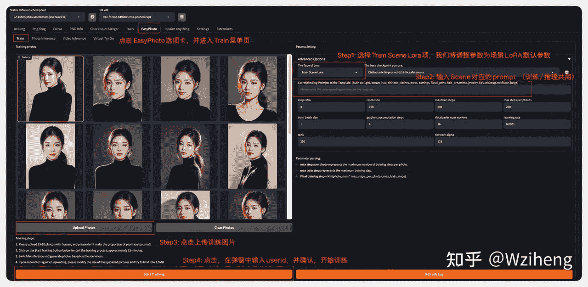

场景Lora训练

+ Step1：在EasyPhoto的`Train`选项卡的右边切换 `LoRA type` 为 `Train Scene LoRA`（我们将自动填入默认的相关参数）

+ Step2: 输入用于训练的场景prompt（推理时将默认使用相同的prompt）

+ Step3: 点击`Upload Photos`上传训练的图片，请注意

+ 上传大概15-20张图片进行训练，图片太少容易导致场景Lora过拟合，导致效果不好。

+ 上传的场景模板需要包含人物与人像，不然无法自动检测与裁剪。

+ 尽量不要在训练图片中包含手部，因为Stable Diffusion画手画不好，容易导致出图质量低。

+ Step4: 点击`Start Training`，并在弹窗中输入`userid`，点击确认后开始训练。

### 推理流程

在训练完成后，可至推理页面利用场景LoRA进行人像写真的生成（我们内置了丰富的场景LoRA模型，无需训练即可一键下载使用）。

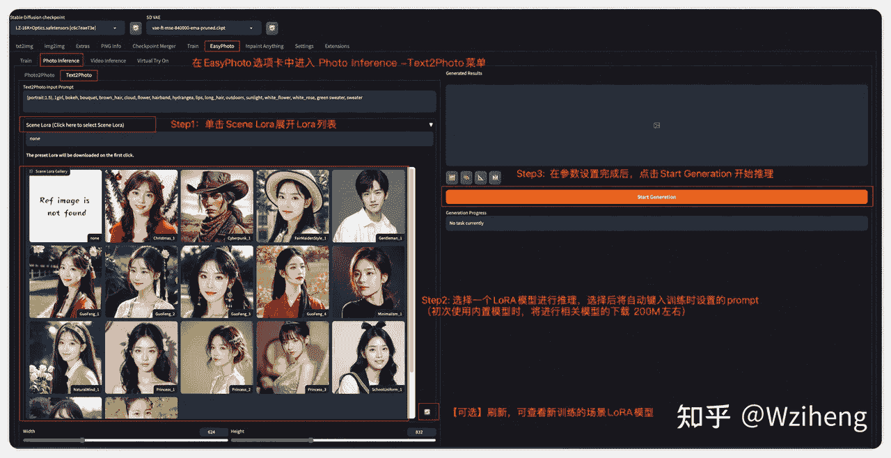

场景Lora推理

首先，进入`EasyPhoto`的`Photo Inference-Test2Photo`页面。

+ Step1: 单击`Scene Lora`折叠栏，找`Scene Lora Gallery`。

+ Step2: 选择一个`LoRA`模型用于推理。

+ 新训练的`LoRA`模型，需点击右下角的刷新按钮才会显示。

+ 内置的`LoRA`模型在初次点击使用后会进行下载（模型大小大约200M）

+ 选择`LoRA`模型后，训练时指定的prompt会自动填入 `input prompt`中

+ Step3: 设置`UserID`及其他参数，点击`Start Generation`，即可利用场景LoRA生成指定风格的人物写真

## 效果展示

使用内置的场景LoRA生成效果：

+ 场景参考图片

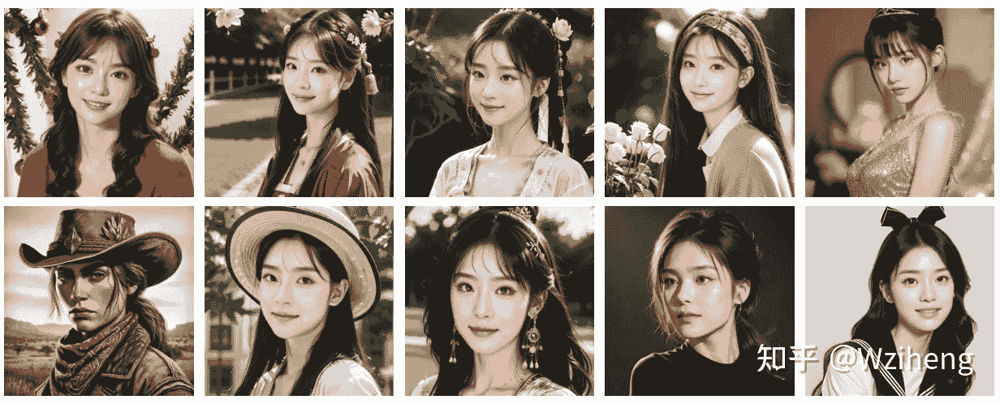

场景参考

+ 生成效果展示

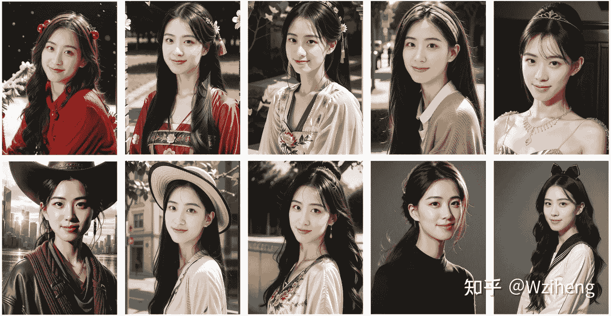

场景生成结果

# 论文解析：(CVPR '18, ECCV '18) VITON系列工作：虚拟试衣

来源：https://www.grayxu.cn/2019/07/30/VITON/#%E7%8E%B0%E7%8A%B6%E4%B8%8E%E6%8C%91%E6%88%98

## 介绍

本文主要讲在2D虚拟试衣这个任务上两个效果比较好的工作。主要是两篇文章，一篇是`VITON: An Image-based Virtual Try-on Network`发于CVPR 2018，另一篇是`Toward Characteristic-Preserving Image-based Virtual Try-On Networks`发于ECCV 2018。

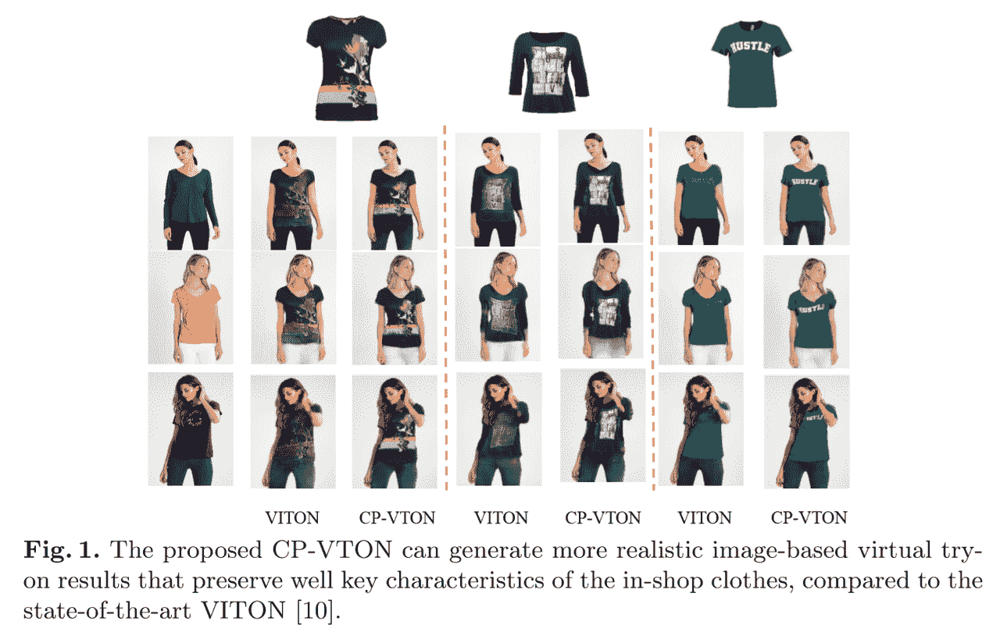

## 任务

### 现状与挑战

虚拟试衣（Virtual Try-On）的相关工作有很多。市面上的商用产品基本是生成一个人体的3D model，在这个model上进行衣服的试穿，优点就是算法很稳定，但画面的真实性就得不到保障（不够sharp），而且扫描3D等操作开销也大（或者只能手动输入大概数据）。2D上做转换的传统网络在衣服有较大形变的情况下效果都很糟糕，限制了pose。

在训练的数据集上，获得paired数据的挑战也很大，需要模特同样姿态穿两件衣服。

### 这系列的方法优点

总的来说，目标是希望能够输入一个任意姿态任意衣服的人`IiIi`，一个衣服图片`cici`，最后能输出一个穿着这件衣服的人。同时衣服上的细节，人体不被覆盖的细节都能够被保存下来。这系列方法的时间开销相对较大，步骤也麻烦，但生成效果较好较稳定，使用的`Refine Network`等手段来约束衣服的细节保留。

## VITON

因为前文阐述的数据集过于难造，本文则还是希望通过已有的模特图片来进行训练，但这样潜在的问题是输入的图片有过强的监督造成过拟合。所以在输入上先进行一个`Stage 0`的数据准备工作。

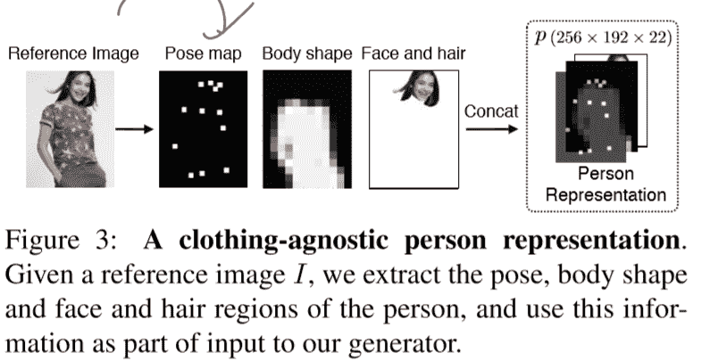

如上图所示，通过输入的`IiIi`检测出其`Body shape`（单通道），`pose map`（18个pose，18个通道），抠图得到的人的识别图（三通道`RGB`，这里使用了人脸和头发，事实上也可以包括其裤子等不希望被改变的部分）。通过这样的操作来减少输入图片的参考力度。每个输入`map`的大小均为`256*192`

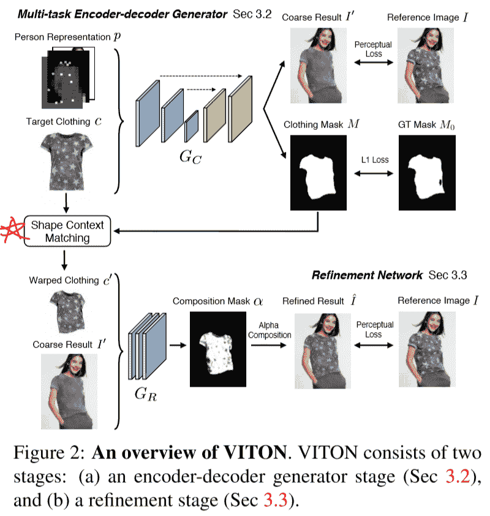

[如图所示，`VITON`网络主要分为两个部分。第一个部分输入的是标准的待穿衣服图片`cici`，和人体如上切分得到的22个通道的特征信息`pp`，输入一个类`U-Net`的`Encoder-Decoder`模型，输出一个合成的穿指定衣服的人图`I'I'`和衣服的`Mask`，`MM`代表的是变形之后的衣服图片。](https://www.grayxu.cn/2019/07/30/VITON/#perceptual-loss)

在这个`Stage`中，需要计算的`Loss`为`I'I'`和`II`的`Perceptual Loss`，生成`MaskMM`和真实`MaskMoMo`的`L1 Loss`。`II`是本来就有的数据集，`MoMo`则来自于数据集上的抠图处理。

最后的`Loss`为：`LGc=∑5i=0λi∥∥1+∥M−Mo∥1LGc=∑i=05λi‖‖1+‖M−Mo‖1`

在这个`Stage 1`生成的图片常常难保证待穿衣服的细节信息，则进入`Stage 2`。

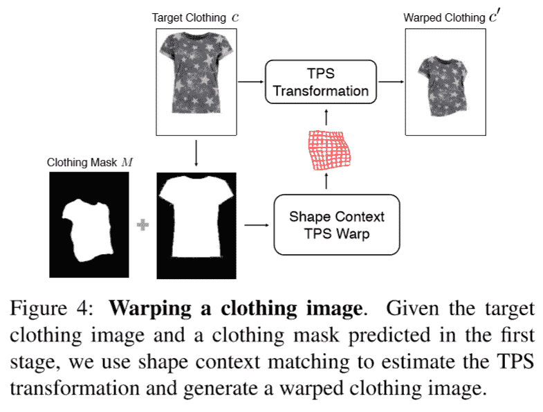

如图所示，通过`Stage 1`生成的`MM`和原始标准衣服图片的`Mask`来计算`TPS`变换的参数，将这套参数使用到标准图片上，生成一个变形衣服图`c'c'`。对`Stage 2`的网络`GRGR`输入变形衣服图片和`Stage 1`生成的初步结果`I'I'`，输出一个组合`maskαα`，来组合两张图片生成refined result `^II^`，即`^I=α⨀c′+(1−α)⨀I'`。

利用`Perceptual Loss`来优化`GRGR`，除此之外，对组合`mask`施加一个`L1 loss`和`Total Variation Norm`，使得最后`Stage 2`的优化目标为：

`LGR=Lprec(^I,I)−λ∥α∥1+λTV∥∇α∥1`

具体实现细节与量化结果不表，但由于整个网络是`2 Stage`的（事实上算上切分人脸，是三个步骤），又使用了`TPS`等算法，整体的时间开销比较大，一张图在`K40`上约需要0.6秒。

## CP-VTON

`CP-VTON`基于前面这个工作，增加了一个`GMM`模块减少了计算量，使用一个网络来模拟`TPS`变换过程，同时改善了衣服细节的保留效果，修复了coarse-to-fine strategy对misalignment不够鲁棒的问题。

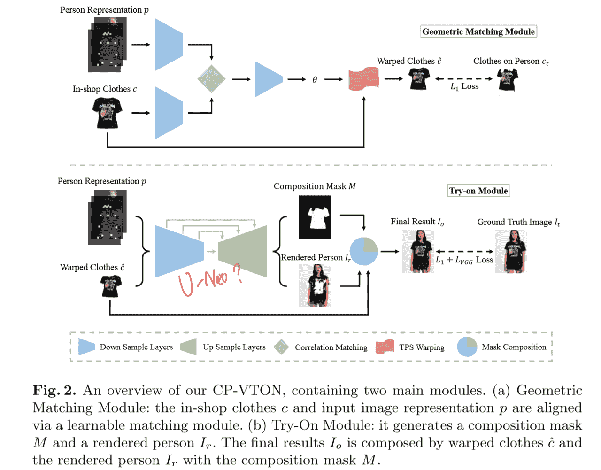

如图所示，为`CP-VTON`的网络架构。数据准备的过程是和前文类似的，但网络不再是一个输出`mask`和初步结果的多任务网络。在`Stage 1`中，先对输入的两个`map`进行卷积提取高维特征，然后通过一个`correlation layer`综合后继续卷积输出，输出一套变换参数`θθ`，使用这套参数对衣服图片`cc`进行`TPS`变换。

优化的`loss`为变换后的衣服图片`^cc^`和抠下来的衣服图片`ctct`的`L1 loss`。即`LGMM(θ)=∥Tθ(c)−ct∥1`

在`Stage 2`中用类`U-Net`网络，输入人的特征`pp`（与前文的22通道一样）和变形后的衣服图片，输出一个组合`mask`和初步图片`IrIr`。再使用组合`mask`对`IrIr`和变形衣服图`^cc^`进行组合。使用`L1 Loss`和`Perceptual Loss` 则`Stage 2`的`Try on Module`的`Loss`为：

`LTOM=λL1∥Io−It∥1+λvggLVGG(^I,I)+λmask∥1−M∥1`

具体网络架构不表。

在`Loss`的设计上取消了前面工作使用的`TV`平滑，反而用其作为一个检测标准，感觉有点怪怪的，看`github`上的`issue`确实加了`TV loss`后马上崩坏。。效果有比较明显的提升，但对于有肢体遮挡到衣服的图片表现并不好，应该是使用`mask`的拼接方法对于这种情况不够鲁棒。本文没有给出完整的速度测试，笔者的模型仍在训练中。

## Adversarial Training?

一般来说，在这种`image translation`的任务中加对抗`loss`都能有效提升图像的真实度（以及生成图像的不稳定性）。在本文的实验部分说明对抗训练起到的效果并不明显。

人都直接说，压根没把`Adversarial`加进去，装作`insightful`,，和`SeqGAN`一比高下立判。

## To Conclude

虽然方法是多步，而且几个加约束的方法（抠pose抠shape）都显得挺暴力的，但效果确实棒，计算过程虽然现在看起来麻烦，但说不定以后就有更好的近似算法来进行优化…第二篇文章实验部分阐述很足。

# Part.6 从图像生成到说唱数字人应用

### 魔搭教学视频：

<https://player.bilibili.com/player.html?bvid=1hS411c7qG&spm_id_from=333.999.0.0&vd_source=ceff90cfde2a6e1ca2125a362a4dddf5>

从图像生成到说唱数字人的应用涉及多个技术领域，包括图像生成、音频处理、语音合成和自然语言处理。这些技术的综合应用能够创造出能够进行视觉展示和音乐表演的虚拟说唱艺术家。

## 一、定义与核心技术

数字人是一种通过计算机图形技术创造出来的、与人类形象接近的数字化人物形象。它们利用信息科学的方法对人体在不同水平的形态和功能进行虚拟仿真，具有拟人或真人的外貌、形态，并可以展现出与真实人类相似的生理、心理和社会表现。数字人的核心技术主要包括计算机图形学、动作捕捉、图像渲染、`AI`等。这些技术的不断迭代和融合，正推动数字人制作效能和智能水平持续提升。

## 二、发展历史与趋势

### 图像生成与虚拟角色创建

+ 图像生成技术，尤其是基于深度学习的方法如生成对抗网络（`GAN`）和变分自编码器（`VAE`），可以用来创建虚拟说唱艺术家的视觉形象。这些技术能够生成高质量的人物形象和表情，为虚拟艺术家提供逼真的视觉基础。

### 音频处理与语音合成

+ 虚拟说唱艺术家的音频处理和语音合成技术是实现其音乐表演的关键。使用如`Tacotron`和`WaveNet`等先进的语音合成模型，可以生成清晰、自然的人声。此外，节奏和韵律的建模对于说唱表演尤为重要，需要特别的技术来处理这些音乐元素。

### 说唱生成模型

+ 例如，`DeepRapper`是一个基于`Transformer`的神经网络模型，它能够同时模拟韵律和节奏，为虚拟说唱艺术家创造出符合音乐节奏的歌词。这种模型的创新之处在于它的能力不仅仅限于生成歌词，还包括对韵律的建模，使得生成的说唱歌词在节奏和押韵上都更加自然和富有表现力 (`ar5iv`) (`DeepAI`)。

### 应用前景

+ 虚拟说唱艺术家可以用于多种场合，如在线音乐会、社交媒体内容生成，甚至可以在教育和娱乐领域中作为互动元素出现。随着技术的进步，这些虚拟艺术家的表现力和互动性将越来越丰富，为用户提供独特的娱乐体验。

## 三、应用开源产品

`3DHumanGAN`: 这个项目涉及一个3D感知的生成对抗网络，它可以合成全身人类的图像，并在不同视角和身体姿势下保持一致的外观。这对于创建逼真的数字人类至关重要。

`ECON`: 项目名为`ECON`（通过法线优化的显式穿着人类），专注于3D重建，特别是为穿着衣服的人类优化。它使用先进的计算机图形技术实现数字表示的真实感。

`DeepRapper`: 这个项目是一个基于神经网络的系统，专为生成包括韵律和节奏建模的说唱歌词而设计，使其成为虚拟表演者的特殊应用。

`LearnPrompt`: 这是一个永久免费的开源`AIGC`（人工智能生成内容）课程，支持包括数字人和`AI`生成的声音与音乐在内的多种`AI`技术。它特别适用于学习提示工程和其他`AI`功能。

Didimo Digital Human Unity SDK: 这个软件开发工具包允许创建高保真的数字人类。它设计简单快速，使得高质量的用户生成的头像可以集成到商业应用或体验中。

# ❀ 恭喜看完全部知识教程！

> 我们的学习也已接近过半！接下来，就都是你们团队开发的时间！

> 后面我们也会继续展开技术交流会，有任何疑难杂症，欢迎一起探讨~

> 比赛不结束，我们不散场！比赛结束了，我们依旧不散场！依旧可以交流idea、交流demo！

> Datawhale想与你一同见证更好的自己，

> 永远—— “For the Learner，For the Dreamer”！

# 把时间交给你们，期待你们的作品惊艳全场！！！

>

> 官网提交并填写**打卡链接**，加入**作品交流群**持续迭代作品

>

> **你这次的学习体验**感受如何？欢迎 留言 & 在群里 跟大家一起聊聊呀！

> 你的 结营证书 和 优秀学习者证书 正在赶来的路上！！！

> 助教们正在马不停蹄为你加急，不要着急哟~

## 📟 你可以随时回顾我们这次的学习~

<https://datawhaler.feishu.cn/sync/GU9tdTHgLsbLltbHUcYceKNInXc>

## 🎉合影留念墙

感谢很棒的你一路的坚持，让我们在这里给自己点个赞！

期待下期夏令营还能与你再次相遇~

一起合个影 :)

> 本教程主要由   写作贡献，

> 融合了多位助教的内测体验和宝贵建议。

> 如果你觉得对你有价值和启发，请在下面点赞和评论哟~

>

### 另外别忘了写笔记打卡呀！！~

### 及时思考、沉淀和产出能让你的学习事半功倍！

>

> **注：本文采用 署名—非商业性使用—相同方式共享 4.0 协议国际版许可协议进行许可。
