#  QA & 其他彩蛋

> 来源：[https://datawhaler.feishu.cn/docx/Q3cddrgnIoppONxORdoc43uonlf](https://datawhaler.feishu.cn/docx/Q3cddrgnIoppONxORdoc43uonlf)

> 别忘了持续上分！我们赛事提交的网址在：

<https://datawhaler.feishu.cn/sync/WbWwdPDRgsjXkWbnpMfcdSajnd2>

# 直播

## 第一场

| ## 问题 | ## 回答 |
| --- | --- |
| 想问问分享人，你从开始敲字到排版发布这份笔记的工作时间一共多久呀？ | 三个小时 |
| 这个领域在大厂有什么应用和前景嘛 | 在一些影视行业和创意设计已经有应用在实际生产里了，在未来可以帮助动画师和建模师进行一些环节的工作。这仅仅是一个领域，在近年的AIGC的发展中，已经有很多辅助工作的工作流与工具出现：AI模特、数字人直播、草图渲染、毛坯房家装风格渲染、辅助3D建模设计等等。在这个月头WPP与英伟达刚刚发布了内部的文生建模文件，可以使用文字来实现一个场景的建模，感兴趣的同学也可以去了解一下。 |
| 能讲下如何在这个baseline中加入自己的训练集和lora吗？ | task02 中有教程，大家可以关注一下 |
| 后面会有代码讲解吗 | 会的，在后边直播会有代码精讲的 |
| 老师可以推荐一个AI论文网站吗 | arixv |
| 出错，和笔记本配置不搭？RuntimeError: Found no NVIDIA driver on your system. Please check that you have an NVIDIA GPU and installed a driver from http://www.nvidia.com/Download/index.aspx |  |
| 这次学习会涉及到对模型架构进行修改吗 | lora微调对模型的架构不会有大的影响 |
| 想问问大家自己风格的训练数据是怎么获取的，自己去网上爬吗？大概需要多少数据量呢 | 可以自己找一些数据集，也可以直接用魔搭官方提供的。数据集的构建根据实际情况具体分析 |
| 本次任务主要是调整模型参数，还是生成的关键词？ | 根据自己的情况，我们不同的task有不同的侧重点，一步一步循序渐进 |
| 想问一下，这个和其他的专业要怎么结合学习应用呢，比如机械类的专业？ | 我们结合是要从实际的领域出发，找到问题痛点，做垂直行业研究。 |
| :想问下这个比赛要必须组队吗 | 不是的，建议个人参赛哦，相信自己 |
| 现在应该再怎么继续学习，有没有什么可以看的 | 用AI来帮助自己学习，了解大模型知识，在实践中探索如何让AI帮助自己学习，解决实际问题。AI时代借助AI能力学习AI |
| 老师能推荐一个人工智能论文方向吗 小白 | 可以了解数字人，也可以看下《AI3.0》科普书籍 |

## Baseline直播

| ## 问题 | ## 回答 |
| --- | --- |
| 正向提示词如何识别提示词是描述谁的？每个人的动作外貌等是跟在每个人后面，还是共性可以放在一起描述 |  |
| 只有128张吗，会不会少了 |  |
| 老师请教下如果不想使用baseline的数据集，想用自己的数据集详细的操作应该如何？ |  |
| task2主要任务是什么呢？ |  |
| 那么这个lora的触发关键词是在之前的哪个地方设定？天池赛事有这个要求不？ |  |
| 我是不是只需要提供128张图片直接放入train文件夹？像这种lora的触发词其实我没看太明白在哪里改。 |  |
| 添加数据集的时候，图片的文本描述添加到哪里的呢？比如我在train上加一个图片 是直接在result加上图片地址和图片描述吗？ |  |
| 让人物行礼作揖怎么设置呀 |  |
| 这个是不是不能训练写实风格的图片（关注群内解答~~~~） |  |

## 8月17日直播

| ## 问题 | ## 回答 |
| --- | --- |
|  |  |
|  |  |
|  |  |
|  |  |
|  |  |
|  |  |
|  |  |
|  |  |
|  |  |
|  |  |
|  |  |
|  |  |
|  |  |
|  |  |
|  |  |
|  |  |
|  |  |
|  |  |
|  |  |
|  |  |
|  |  |
| Lora和sora什么不同   lora是微调方法，sora是OpenAI的视频模型 |  |

# Task1 QA汇总

| 序号 | ## 问题 | ## 回答 |
| --- | --- | --- |
| 1 | 这个torch.manual_seed(1)有什么用呀 | 每个 torch.manual_seed(x) 设置了一个特定的随机种子，确保每次生成的图像是确定性的。同样的关键词，改变随机种子可以运行出来不一样的效果图。 |
| 2 | 这个基础模型选什么啊 | 看需求，xl精度大一些，一般用sd1.5 2.1就够了，精度越大，训练时间可能会越长 |
| 3 | output怎么只有一张照片 | 它这里下载图片的目的是为了提交模型效果示例，一张就够了 |
| 4 | 要不要参加这个比赛？ | 最好还是参加一下，这个赛道参加的学习者相对较少，没准就可以拿奖了捏 |
| 5 | 有无微信电脑端查看是乱码的情况 | https://linklearner.com/activity/14/10/24这个就可以进去了 |
| 6 | 注册5000小时试用时提示活动条件不满足 | 目前给的解释是一天只能有500个名额，可以先用免费的GPU先跑着，教程如下： |
| 7 | ModuleNotFoundError: No module named &#x27;data_juicer&#x27; | 遇到以上几种问题，解决办法如下： |
| 8 | Server Connection Error | 这个问题是实例的网络出现了问题，退出关闭实例，重新启动实例，可以解决此问题 |
| 9 | 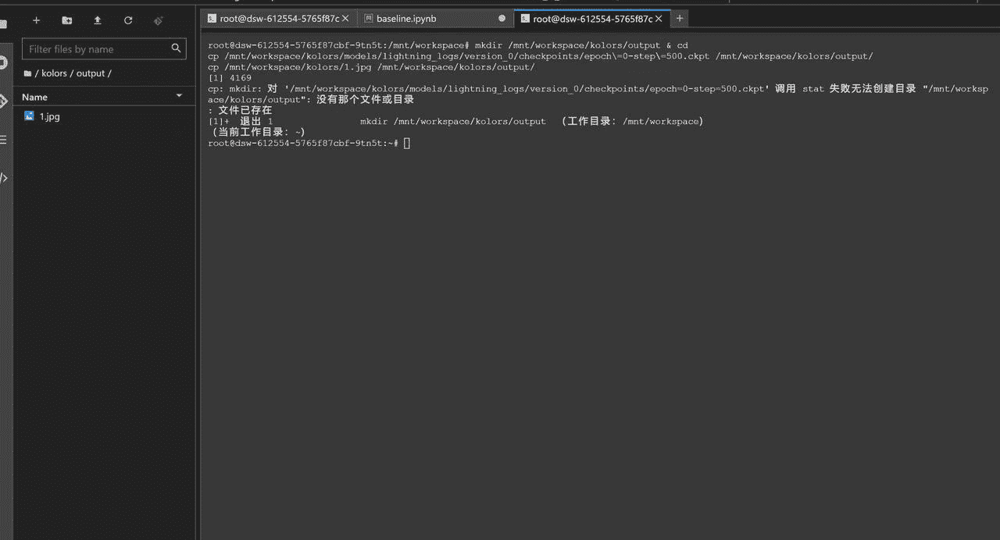 | 这个问题是请不要一气全部粘贴上去，请一条一条粘贴，表示你的version_0上没有checkpoints/epoch=0-step=500.ckpt，需要你更换为你再次运行后的version_1上 |
| 10 | 右键没有找到下载选项怎么办 | 换个浏览器，一般建议edge和chrome浏览器 |
| 11 | 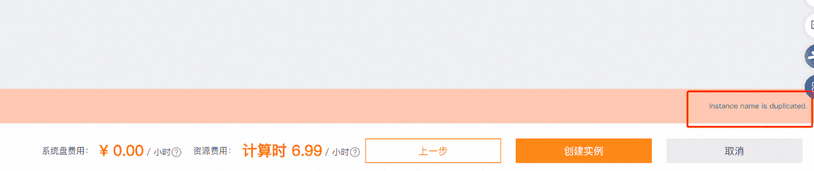 | 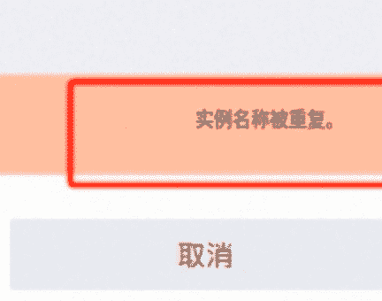 |
| 12 | 老是显示torch没有定义是什么意思该怎么解决 感谢 | 可以看看如下地方有没有这个： |
| 13 | 依赖库下载很慢怎么办 | 如果觉得非常慢，可以换下载源，这边建议换成清华源或者华为源 |
| 14 | 生成照片可以修改长和宽吗？ | 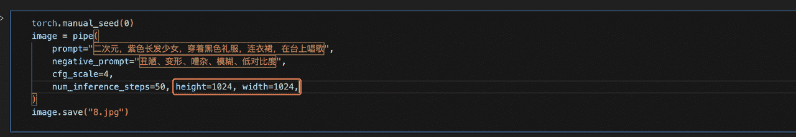 |
| 15 | 怎么打卡，没找到 | 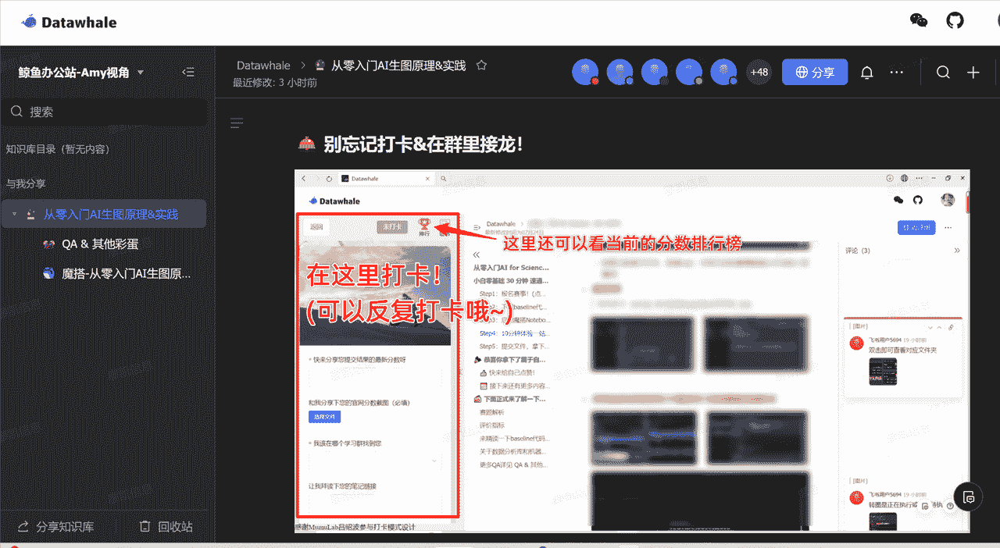 |
| 16 | 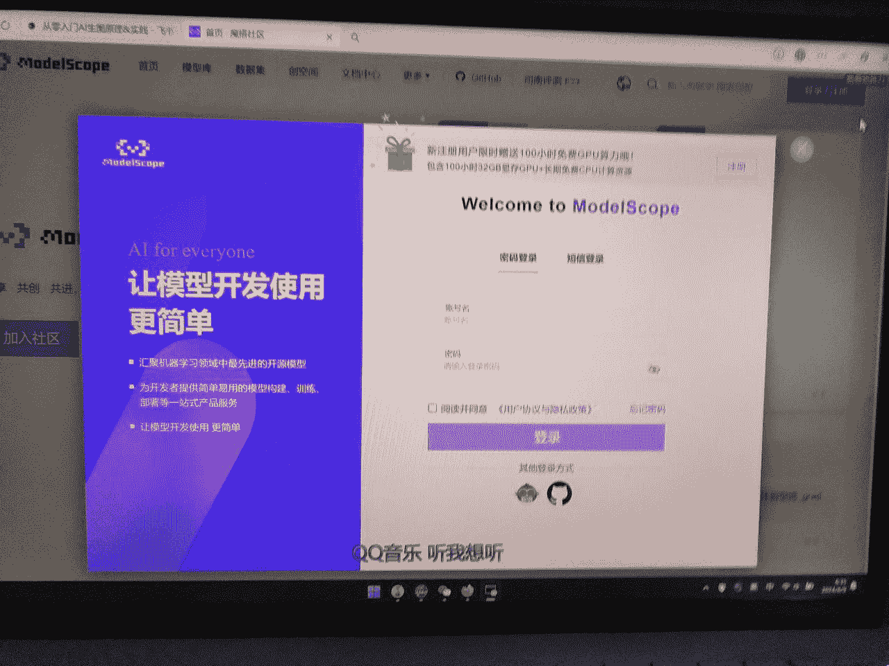 | 不影响的，它会自动给你加 |
| 17 | 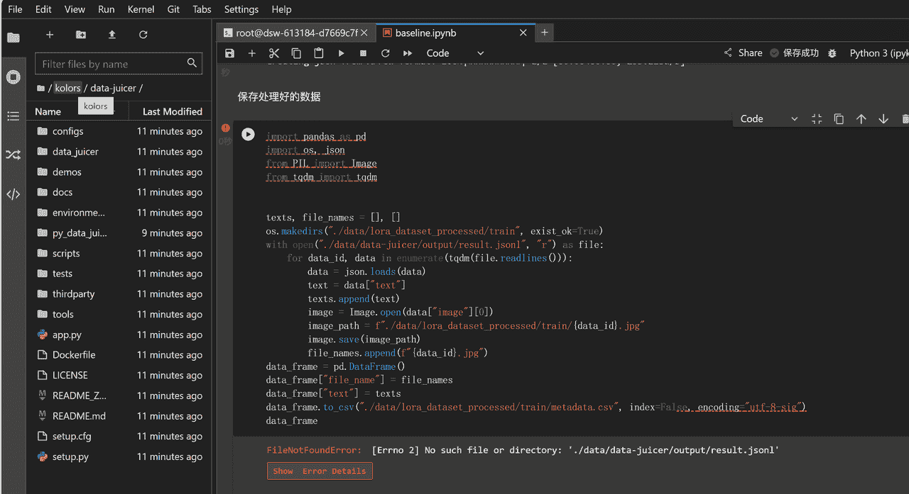 | 一般自己不要修改文件结构，这里的示例文件结构已经混乱，有一些嵌套和不可访问，疑似是 git 拉取时出现错误。 |
| 18 | 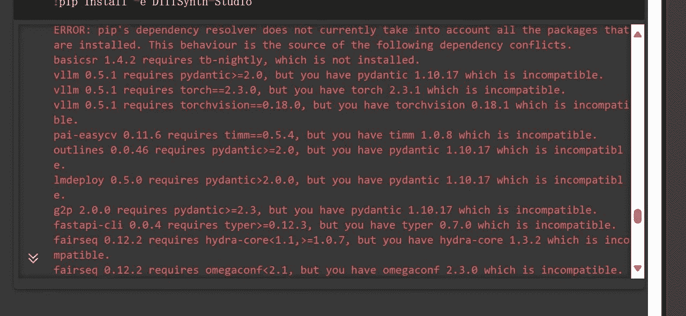 | 更新 pip 再重新下载安装环境，多运行几遍，检查有没有爆红，环境和包都安装正确 |
| 19 | 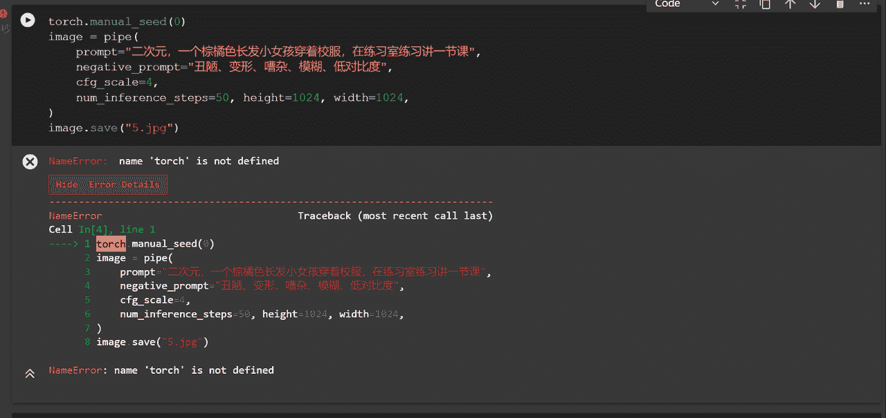 | 见第7个问题和第12个问题的答案噢 |
| 20 | 我们试用的不是免费时间吗，如果时间用完了它会有提醒吗，会扣钱吗 | 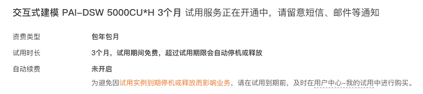 |
| 21 | 我现在阿里云PAI三个月免费试用领不了，然后我的魔塔方式二只剩下35个小时，我还有机会能拿到三个打卡吗？ | 魔塔方式一是免费的，也可以使用哦 |
| 22 | 感觉data_juicer这个库有点奇怪，反复安装了好几次需要依赖的包，还是经常报错找不到这个模块，而且在安装的时候就会有一些莫名其妙出岔子。 | 建议重开实例 |
| 23 | 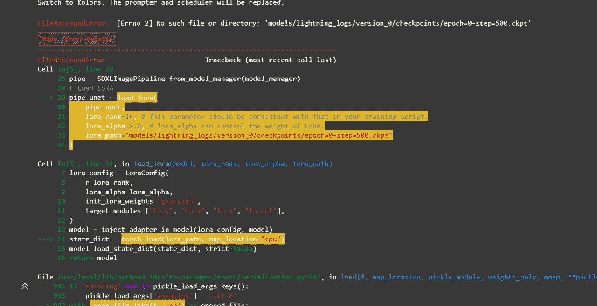 | 请看第九条回答 |
| 24 | 生成图像是要很久吗？还没输入新的prompt，用原始的prompt先试一下，有点击restart和一键运行，之后那些执行按钮一直在转圈，但是转完之后没出图，出图是在最后对吧？但好像没看见产出 | 应该是卡在某个位置了，请耐心等待 |
| 25 | 运行移动结果文件没有ckpt文件怎么回事呀 | 请看第九条回答 |
| 26 | 如何下载魔搭平台中的文件夹及文件 | 打包成zip文件，然后下载 |
| 27 | 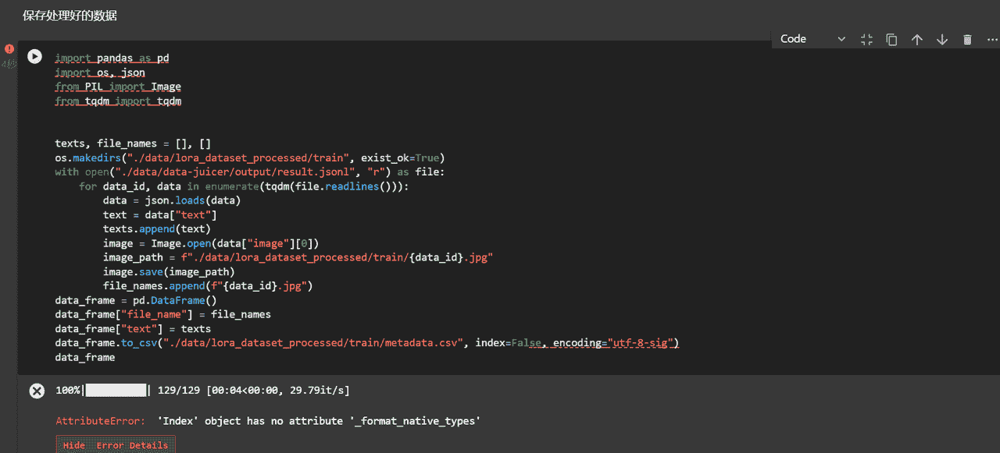 | 目测是前面安装库的代码没跑通，建议重新跑，然后restart kernel，如果在国内的话建议挂上本地代理或者换成国内的镜像源跑。 |
| 28 | 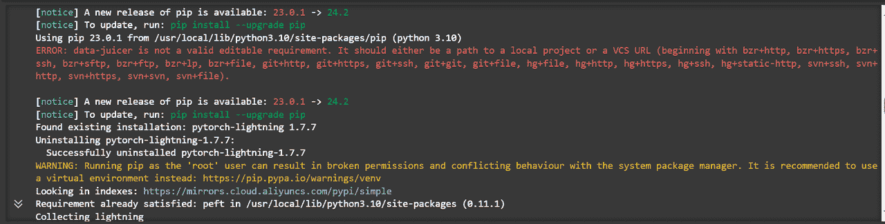 | 尝试跟着绿色的提示更新pip，在安装库的代码之前添加这一行，跑完后restart |
| 29 | 不是bug，只是单纯好奇想问下，为什么每次运行相同的提示词，能够生成一模一样的稳定图片呢？哪怕修改了随机种子的值，最后出的图还是一模一样的，这是为什么可以做到的？ | torch.manual_seed()是设置CPU生成随机数的种子，方便下次复现实验结果。所以这个方法传参相当于设置了控制了出图。 |
| 30 | 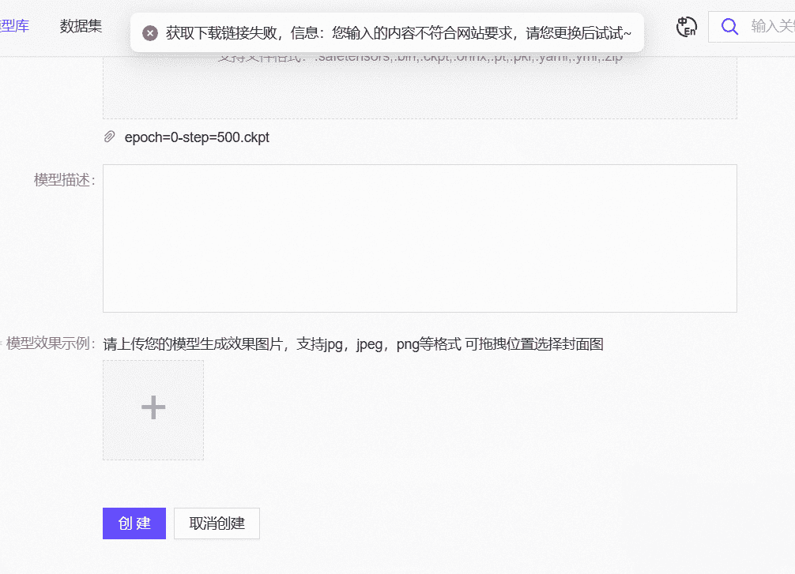 | 给的信息有点少很难判断，那里面是指baseline里面吗？文件格式是否准确呢？可以打包成压缩包再传试试看。 |
| 31 | 在重新启动实例后，要想出图哪些需要重新加载？按出图光转圈没反应也不报错，因为感觉像训练模型那么久的事应该不需要每次都做吧，我看每次重新执行都要反复install uninstall，训练模型也要20-30分钟，之前本地部署过sd，一张图好像也就4-5分钟，有什么减少时间的方法么 | 理论上主要你前一次的训练出图都可以顺利完成，再次启动实例就无需跑环境安装和模型训练，保险起见可以重新跑环境安装确认一下，然后到加载模型的部分执行就可以了，不用再跑其他内容。 |
| 32 | 本地跑对显卡有啥要求？之前玩sd-webui-aki-v4.2是可以本地跑的，这个是否有多出或者缺少的步骤？希望dalao能解答一下呢） | 这个baseline多出了lora训练的步骤，如果在秋叶WebUI的微调训练插件可以跑通的话，基本上就可以在本地跑通了。需要注意的是训练和出图时某些参数过高和本地卡显存较小的话容易爆显存，比如batchsize和出图的分辨率，除此之外是没有问题的。 |
| 33 | 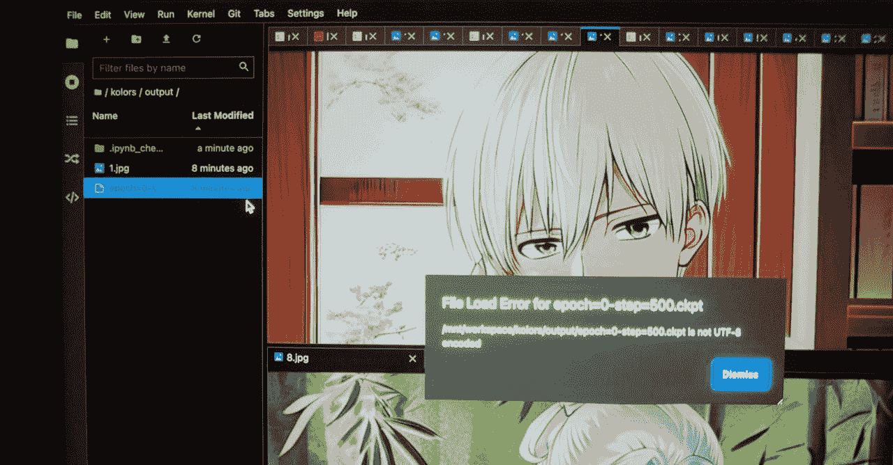 | 给的信息有点少，如果是右键没有下载选项是浏览器问题，其他可能是网络代理和内核出错的问题，可以尝试一下挂代理和重启内核或者实例。 |
| 34 | 模型名字怎么查看哦 |  |
| 35 | 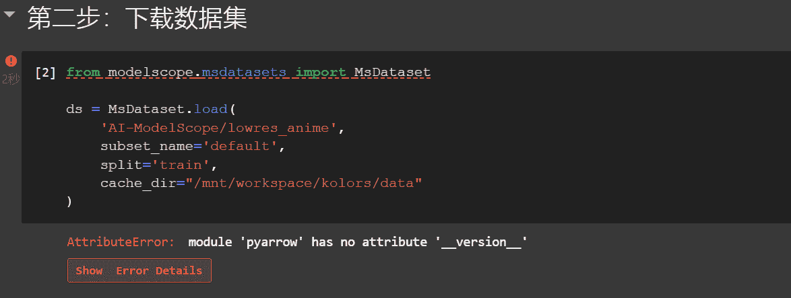 | 模块为下载好，重新跑一下环境安装 |
| 36 | ModuleNotFoundError: No module named &#x27;diffsynth&#x27; | 应该是之前的板块运行失败了，你从头开始一个一个板块重新运行一遍。 |
| 37 | 请问要如何下载组图呢？ | 在最后一个代码块在出图后增加保存的代码就可以了，可以试试问问通义怎么写 |
| 38 | 我在模型库中下载了别人的模型，应该如何使用和查看模型文件 | 上传至baseline，更改加载模型路径 |

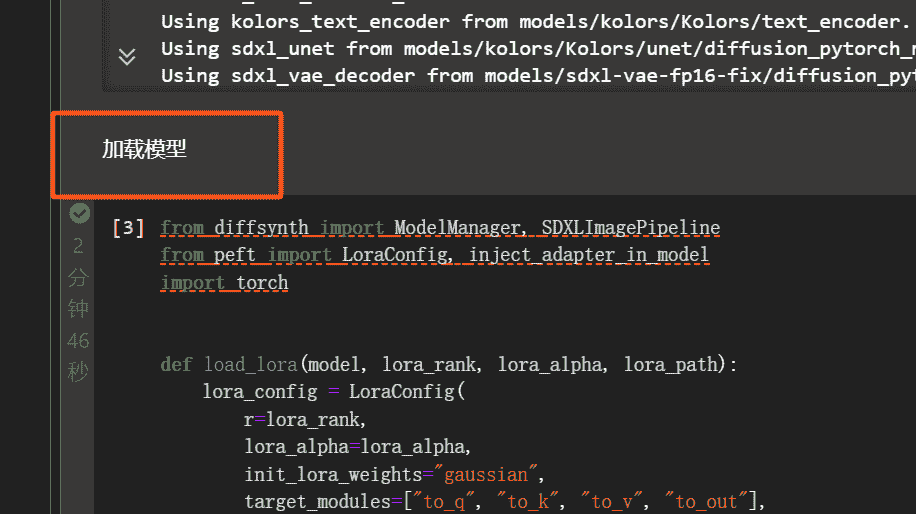

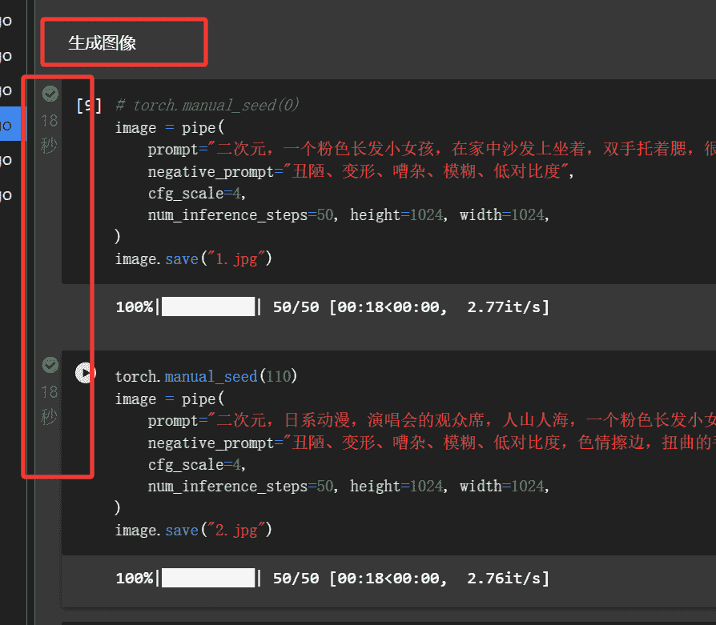

# Task2 QA汇总：

| 序号 | ## 问题 | ## 回答 |
| --- | --- | --- |
| 1 | 本次课程的文生图和我们直接用主流的工具文生图有什么优势，比如我们常用的豆包、百度、智谱清言都有文生图的功能/智能体，而且很方便 | 本课程主要侧重于从代码的底层逻辑去学习，自己做一个文生图工具，而不是单纯的使用一个已经包装好了的文生图智能体 |
| 2 | 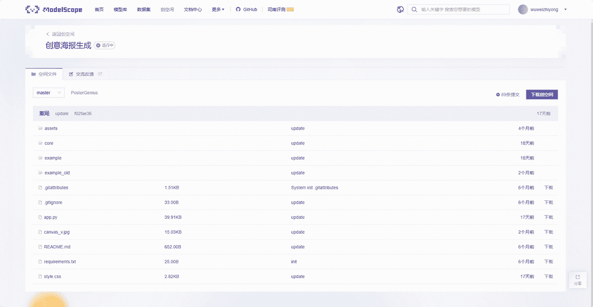 |  |
| 3 | 我怎么确定我的笔记有没有问题呢？你们会给每个笔记都打分吗，我可以在哪里查看吗？因为这次需要3次笔记才有结营证书我担心有哪次出问题了，所以想问下有没有确认自己笔记是否问题的方法。 | 会对每个笔记都打分的。你可以把链接复制到浏览器上或者是手机浏览器  上，如果能正常打开一般都是没有问题的，注意标题就好了！ |
| 4 | task2的打卡地址和task1是一摸一样的吗？我点开task2的打卡链接，明明没有打卡，他显示的是已打卡，而且右边的显示的也是task1 | 不一样的，尾部的数字是有所区别的。 |
| 5 | 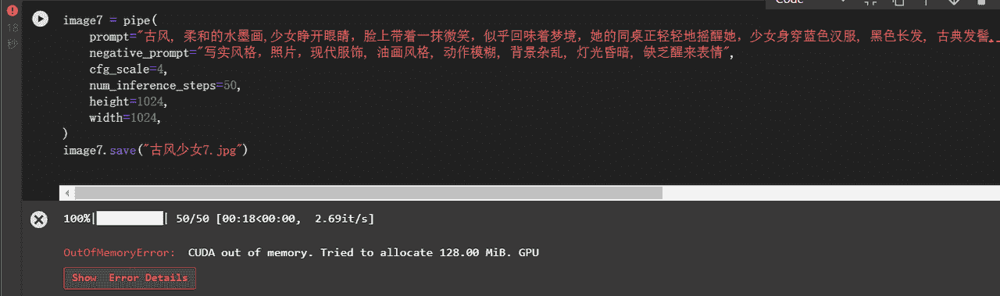 | 内存不足，重启环境或清理电脑程序都可以试下 |
| 6 | 某张图片和图片本身的内容信息怎么获取的，也就是图片的数据标注？比如某张图片是男孩还是女孩，在做什么动作之类的？ | 这里不太清楚您说指的图片是哪种来源，一般如果是数据集的图片，在每一张图片都会有对应的标注文本来进行训练支撑；如果是有一张SD出图想要反推出图的提示词和出图参数，是有这样的技术内容，有兴趣可以查阅一下，但目前我们的学习计划没有涉及到这一方面的。 |

# Task3 QA汇总：

| 序号 | ## 问题 | ## 回答 |
| --- | --- | --- |
| 1 | 怎么找自己LORA文件的地址？ | 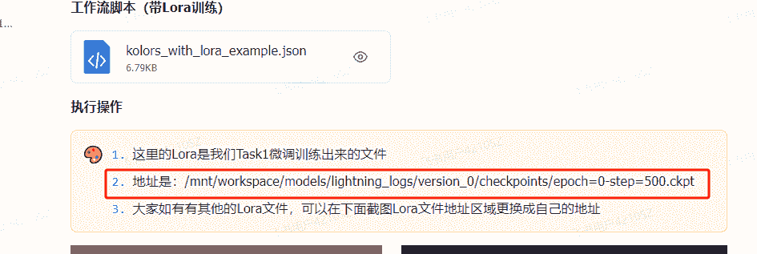 |
| 2 | task02没有显示已打卡是没打上吗？我是打卡过的，我记得当时是显示已打卡。 | 联系学习群对应的运营确认一下哦 |
| 3 | 请问一下这个赛事最重要提交什么样的成果啊 | 可以在赛题官网查看具体要求噢 |
| 4 | 继task2 问题6，就是在baseline中的数据集里面，我们怎么看每张图片对应的标注信息？  是这句代码吗“metadata = {&quot;text&quot;: &quot;二次元&quot;, &quot;image&quot;: ”，只有二次元的标注？那么比如这张图的其他特征信息有没有给标注呢 |  |
| 5 | 这里的ComfyUI和task1&amp;2 执行结果有什么区别？各有什么优劣，作为使用者来说该如何选择？ | 在task1中主要是跑通基础的文生图然后提交初始的作品到赛事当中，而task2和3是通过解读task1中的一些环节和代码，并且对一些辅助工具像通义及在线平台，以及像ComfyUI这样的交互界面来帮助学习者完成赛题作品的完善和学习AIGC相关知识。可以说是循序渐进的。如果是夏令营后续还想进行这方面的学习和应用，我更推荐像WebUI、ComfyUI这些相对来说比较成熟的低代码交互界面。 |
| 6 | 怎么将微调后的Lora的区域地址改成自己的地址啊 |  |
| 7 | 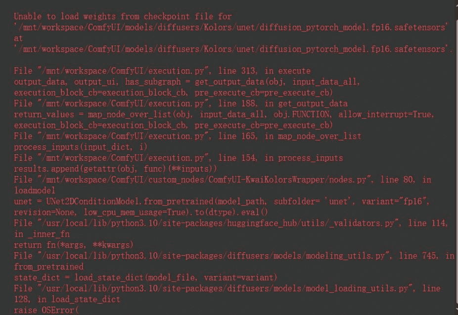 |  |
| 8 | task3中进行2.4进入预览界面这一操作时，最后一个节点的内容一直输出不出来，示例中的链接也没有出现，已经尝试好几次了，每次等待都超过一个小时，但是没有任何变化，尝试直接复制示例中的链接打开也是报错画面，重试几次后仍然无法打开，这个问题怎么解决啊，是要做什么额外准备吗？前面步骤都是按照要求来的啊，微崩溃。 |  |

# 贡献者清单

| **角色** | **姓名** |
| --- | --- |
| **教程贡献者** |  |
| **运营助教** | 孙博辰  柴艺  高田彦 |
| **专业助教** | 林恒宇 |
| **优秀学习者** |  |
| **QA贡献者** |  |

# 别忘了随时查看学习规划表~

# 给你的学习群点个赞吧~