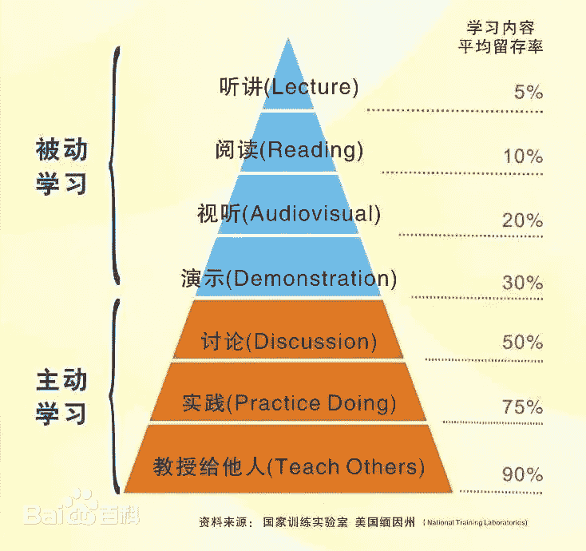
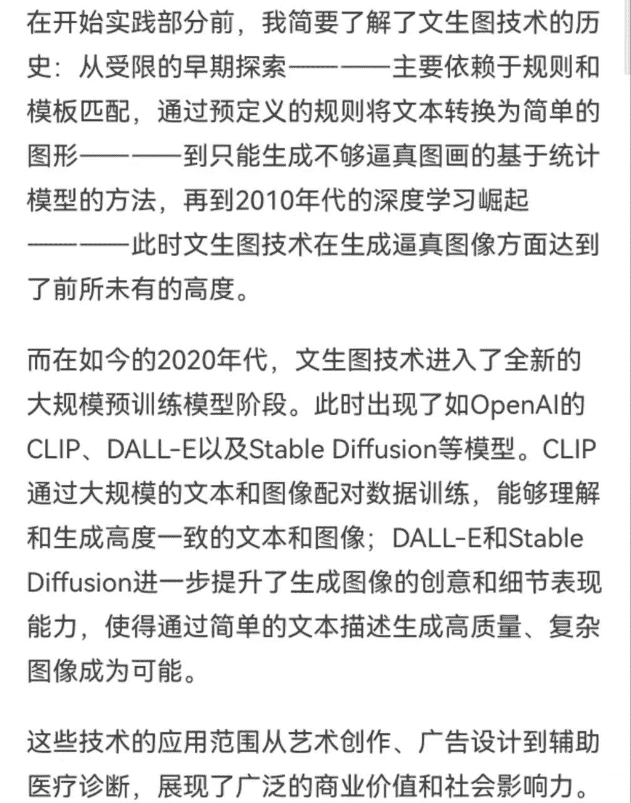

# 优秀笔记经验分享

> 来源：[https://datawhaler.feishu.cn/docx/AqPRdkZmZo8u0nxADgZcf7hQn1c](https://datawhaler.feishu.cn/docx/AqPRdkZmZo8u0nxADgZcf7hQn1c)

> 本次笔记经验分享者来自学习群6群的学习者@黄丹凝，欢迎提供意见和点赞哦，欢迎给分享者的作品点赞哦👍

<https://datawhaler.feishu.cn/sync/VEPMd6cQoslOeObgNV6cO2hyngc>

很荣幸今天能来分享我做笔记的经验，希望能够帮到大家。

一份好的笔记有哪些要素呢？我认为一共有三点。

# 1.笔记应该是个人的。换言之，要体现出一个人自己思考的痕迹

笔记应该是帮助个人增加对课程理解的有力工具。人非生而知之者，孰能无惑？我们都知道这句话的下一句应答是“惑而不从师，其为惑也，终不解矣。”意为我们有疑惑就要找老师解答。

但在这基础上我想提出进一步的的理解：找老师解答不是终点，就像那个著名的学习金字塔理论（如图）所说，听讲仍然是被动学习的范畴。就像在群里问了专业助教，最后的跑baseline实践还是得自己动手。而一份充满个人思想的笔记，无疑是带领我们走进主动学习领域的良好媒介。

我们在笔记中记录自己对所学内容独一无二的思考。如对于Task01中的程序，是先设想关键词？还是先测试成图的画风如何？只有根据自己独一份的思想，才能选择最合适的下一步行动。况且学习中最讲究一个高效，那什么是最高效的呢？肯定是量身定制的啊!一份独属自己的笔记难道不就是一份私人订制的学习记录吗？

这么说并不是否认去在笔记中引用课堂中的原内容。我个人也喜欢在笔记中呈现一些“课本原话”，但不会仅仅是把内容copy过来，而是会标上自己的理解。在我看来能在笔记中出现的“课堂原文”，都是学生有独到理解的。“诶，这段话对我很有启发，我有点自己的想法要记下来。”——如果是带着这样的心情去抄下一段课程里的话，我认为是完全可以接受的。

话虽如此，我仍然更加推荐大家“用自己的话概括原文”。这个过程中我们必定会想方设法提炼原文中的精华，转述的过程中又或多或少会加深自己的理解，这样岂不是一举两得？既“引用”了原文，又给这段课程内容“加了注释”。

总而言之在我看来，一份能体现创作者对原文思考的笔记，才会是好的笔记。

# 2.做笔记忌繁多，宜精简

打个比方，应该大家在学生阶段都经历过这种事：平常做错题本和笔记时兴致冲冲做了一大堆，立志考试前全看一遍然后一鸣惊人。也许有人真的能在考前全部看完，但我相信大部分人都是做不到的。

我当初也这样，平时花了很多时间在笔记上，排版书写都十分精美，然而需要的时候却因为工作量太大而几乎没有完整看过。我们说再多做笔记都是想让它在关键时候帮我们一把，不然再精致的笔记也会失去它的价值变成“花瓶”：摆着好看而已，没什么用。

那怎样避免这种尴尬情况的出现呢？减小工作量啊！

在一个砖头似的笔记本和精简的几页纸之间，谁都知道选哪个。平时在做的时候就可以留心，尽量缩减笔记的篇幅——我指的是减少无意义话语，真正有意义的内容是万万不可删掉的！如此日积月累，最终在需要浏览的时候我们不仅可以节约许多时间，也可以减少为难情绪的出现。不过小小笔记复习，看我轻松拿下！

在精简语篇时我们还会主动思考“如何缩句”这个问题。小学语文就教了缩句的精髓是找到句子主干，不就是在帮我们找到内容主体嘛！这个过程是非常有利于加深我们对原文理解的。像对于本次课程中的“文生图技术的历史”，有些人会选择把原教程中的表格复制过来，而我选择将其浓缩成量那个个段落，而且大致把要点都摘录下来，后面看时就很轻松了。

平时留个心眼，以后想自己跑程序再来看现在的笔记时，就不会哭丧个脸问“我明明上夏令营的时候那么认真做笔记，现在为什么看半天还是搞不懂我当时在想啥？”的问题了。以后做笔记前先告诉自己：尽量简单点，不然以后复习的时候有你哭的！

# 3.笔记应由浅入深，环环相扣

在第一点中我提到“笔记要体现个人思想”。接触课程中全新内容时我们必定是按照从浅到深层的顺序去理解的，我们的笔记也应该顺着这个思路来呈现。

以我自己的笔记为例。纯理论内容是比较好理解的，我选择放在笔记的最开始。后面才是我遇到无数麻烦的实践部分。

同样，每个部分自己也是有其中的逻辑在的，对于实操部分我选择用“时间顺序”来记录自己的心路历程。原因无他：我对课程的理解就是在跑程序的一次次的试错中加深的，最后笔记的呈现效果也就和按时间顺序写没什么差别了。如此一来笔记中每一个新的内容都不会显得突兀，前有上部分的引导，后有更深层次的内容又建立在这个基础上。

而在笔记的最后我写了自己的感想和对未来的规划：训练有独特画风的AI和实验学姐给我的关键词表。这两点是“总分总”结构中最后的“总”，是基于全局的，代表我对Task01课程内容的最深层的思考，因而被我放在了最后。

按逻辑做笔记还有一个未雨绸缪的好处：便于以后回看时唤起记忆。遗忘学习内容是不可避免的，再看笔记时我们很难有当时对内容那么清晰的印象。此时一份逻辑清晰，由浅入深又环环相扣的笔记可以更好唤起我们当时的记忆。从头看到尾，几乎就是再学一遍啊！以后再面对文生图AI，我们肯定是想跟着逻辑清晰的教程走，而不是对着一份上来就是"对画风不满意可以替换train文件下的素材”的笔记感到无所适从。

# 总结

综上所述，我认为一份好的笔记应该是精简，能体现作者思想又逻辑清晰的。乍一听确实会觉得要求很高，但实则在学习的过程中或早或晚我们都会摸索出最适合自己的一套做笔记模式。希望我的分享能对大家的笔记探索之旅有所帮助！