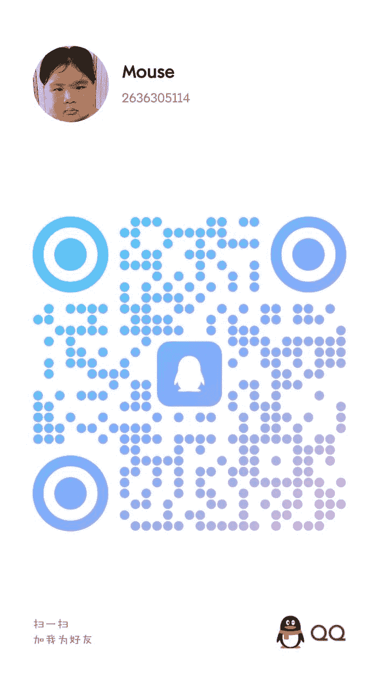
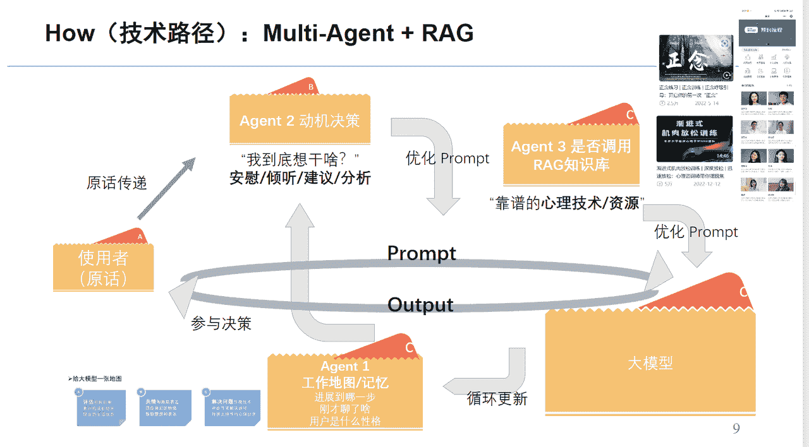
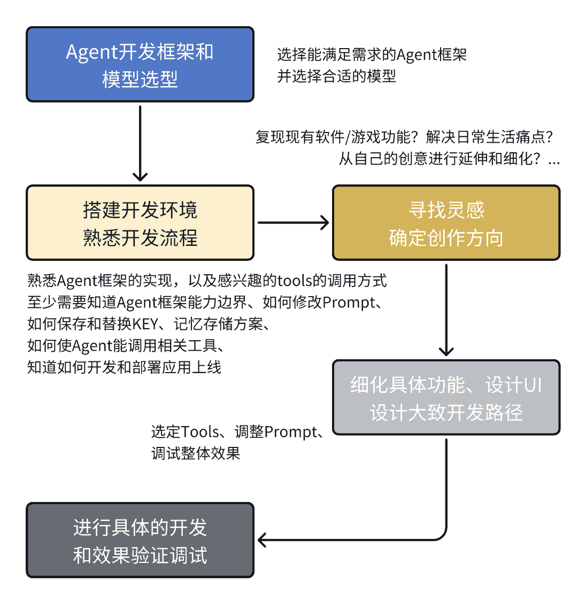
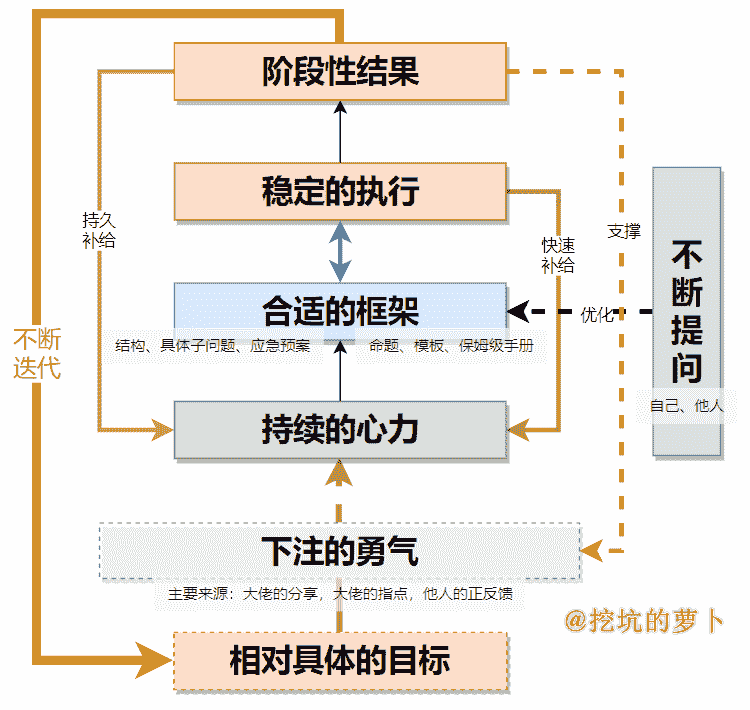

# Task2：头脑风暴会

> 来源：[https://datawhaler.feishu.cn/docx/Ar68ddLajoVgPbxccB4clFgpnfg](https://datawhaler.feishu.cn/docx/Ar68ddLajoVgPbxccB4clFgpnfg)

> 本次头脑风暴会共设置三个分会场，大家按照所在学习群分别进入对应的头脑风暴会-腾讯会议即可

# [会场① ：1~3群](https://datawhaler.feishu.cn/wiki/EPSuwBxEIi6btekScZRc8RIqn3H#part-KXbmdONF2oKDGDxUK2fcQt29nbh)

# [会场② ：4~6群](https://datawhaler.feishu.cn/wiki/EPSuwBxEIi6btekScZRc8RIqn3H#part-EGynd8IoCohQHMxtFXYcnz1jnmf)

# [会场③ ：7~](https://datawhaler.feishu.cn/wiki/EPSuwBxEIi6btekScZRc8RIqn3H#WaSdde9GKok3KNxDQSmcv6a9ndd)[10](https://datawhaler.feishu.cn/wiki/EPSuwBxEIi6btekScZRc8RIqn3H#WaSdde9GKok3KNxDQSmcv6a9ndd)[群](https://datawhaler.feishu.cn/wiki/EPSuwBxEIi6btekScZRc8RIqn3H#WaSdde9GKok3KNxDQSmcv6a9ndd)

>

> [**没有ide**](https://datawhaler.feishu.cn/wiki/EPSuwBxEIi6btekScZRc8RIqn3H#doxcnS1pIem5QkW8cHd0S1MkB1e)a想查看更多资料寻找灵感可见下面的思路

# 会场① | 会议记录

> **会议主题**：思维碰撞火花现，鲸英共聚梦起航

> **会议时间**：2024年8月12日 | 20：00

> **会议地点**：**腾讯会议**（限量100席位，可提前报名，先到先得）

+   **会议码**：185-889-992

> **会议录制**：https://meeting.tencent.com/v2/cloud-record/share?id=ce920da4-3dc0-40e9-a227-d2ef71b12e5f&from=3&is-single=false&record_type=2 密码：YM3N

| # idea1:  |  |  |
| --- | --- | --- |
| **讨论点** | idea发起人阐述 &amp; 重要结论 | **组队招募信息** |
|  |  |  |
|  |  |  |
|  |  |  |
| # idea2: 训练大模型个性 |  |  |
| **讨论点** | idea发起人阐述 &amp; 重要结论 | **组队招募信息** |
| 想关注于模型本身能力的提升而不是agent | agent会因为模型本身能力的提升而替代 |  |
|  |  |  |
|  |  |  |
| # idea3: 一个有想法的心理聊天机器人 |  |  |
| **讨论点** | idea发起人阐述 &amp; 重要结论 | **组队招募信息** |
|  | 王中瑞 | vx：wzr0012009 |
|  |  |  |
|  |  |  |
| # idea4: 主角意识养成助手 |  |  |
| **讨论点** | idea发起人阐述 &amp; 重要结论 | **组队招募信息** |
| 数据的采集 | 灵感来源：“以学生群体为主体”的教育理念的推广呼吁，我找较“控制理论”的老师讨论小车视觉识别问题（老师不专长这个），老师正讲到我感兴趣处竟然就停了，等等很多很多 | 现在六个人，如果感兴趣，期待建议指导 |
|  |  |  |
|  |  |  |
| # idea5: 智能服装推荐系统 |  |  |
| **讨论点** | idea发起人阐述 &amp; 重要结论 | **组队招募信息** |
|  |  |  |
|  |  |  |
|  |  |  |
| # idea6: 婚律智缘——AI婚姻律师 |  |  |
| **讨论点** | idea发起人阐述 &amp; 重要结论 | **组队招募信息** |
|  |  |  |
|  |  |  |
|  |  |  |

# 会场② | 会议记录

> **会议主题**：思维碰撞火花现，鲸英共聚梦起航

> **会议时间**：2024年8月12日 | 20：30

> **会议地点**：**腾讯会议**（限量100席位，可提前报名，先到先得）

+   **会议码**：298-444-665

> **会议录制**：https://meeting.tencent.com/v2/cloud-record/share?id=2dacaf28-6dbf-4b89-bf79-abcbeef13c5d&from=3&record_type=2 密码：6DMD

| # idea1: 公文大模型 |  |  |
| --- | --- | --- |
| **讨论点** | idea发起人阐述 &amp; 重要结论 | **组队招募信息** |
| AI领域应用的开发范式 | Simuoss |  |
| 现实中存在的公文写作需求 | Simuoss |  |
| 设想中的核心功能 | 公文润色：很多人在写公文时，语言过于口语化，甚至像在写一篇作文，而非公文。这种情况下，公文润色功能显得尤为重要。公文润色功能可以通过学习数据集，进行写作风格的迁移，优化公文内容。 |  |
|  |  |  |
|  |  |  |
| # idea2: AI赋能零售行业 |  |  |
| **讨论点** | idea发起人阐述 &amp; 重要结论 | **组队招募信息** |
|  | 虽然电商零售技术已广泛普及，但线下中小型商超在AI技术的应用方面仍然有限。线下零售企业的数据往往未被充分利用。为此，在商业联盟的基础上，开发一个系统，通过抽取和汇总这些中小企业的ERP系统数据，分析大量企业的零售数据，以发掘其潜在的业务价值。这一系统旨在帮助零售企业从大量数据中提取有用的信息，支持决策和业务优化 |  |
|  | 信息查询：用户可以通过自然语言询问有关销售数据、库存情况等信息，AI将从数据库中检索并整合相关数据。 |  |
|  |  |  |
|  |  |  |
| # idea3: After EMO 心理咨询与危机干预 |  |  |
| **讨论点** | idea发起人阐述 &amp; 重要结论 | **组队招募信息** |
| 中文语料的数据清洗与语义切分的idea |  | 缺前端和数据构建的大佬 |
|  |  |  |
|  |  |  |
| # idea4: 高校新生问答系统 |  |  |
| **讨论点** | idea发起人阐述 &amp; 重要结论 | **组队招募信息** |
|  | 筱可 |  |
|  | 筱可 |  |
|  | 筱可 |  |
|  |  |  |
|  |  |  |
| # idea5: 博客阅读工具——dw助教优秀笔记评选小助手 |  |  |
| **讨论点** | idea发起人阐述 &amp; 重要结论 | **组队招募信息** |
| 筛选笔记需要用到的核心功能 | 博客内容爬取：解析笔记链接，爬取博客内容 | 欢迎前端技术栈和感兴趣的的小伙伴加入 |
|  |  |  |
|  |  |  |
|  |  |  |
|  |  |  |
| # idea6:  |  |  |
| **讨论点** | idea发起人阐述 &amp; 重要结论 | **组队招募信息** |
| 数据合成 | Leo: | 联系方式： |
|  |  |  |
|  |  |  |
| # idea7:   懂人情世故的AI |  |  |
| **讨论点** | idea发起人阐述 &amp; 重要结论 | **组队招募信息** |
|  |  |  |
|  |  |  |

# 会场③ | 会议记录

> **会议主题**：思维碰撞火花现，鲸英共聚梦起航

> **会议时间**：2024年8月12日 | 20：30

> **会议地点**：**腾讯会议**（限量100席位，可提前报名，先到先得）

+   **会议码**：503-918-174

> **会议录制**：https://meeting.tencent.com/v2/cloud-record/share?id=1ef28ac5-afff-4fde-a24f-f0f30a712c5d&from=3&record_type=2 密码：ABRI

| # idea1:  |  |  |
| --- | --- | --- |
| **讨论点** | idea发起人阐述 &amp; 重要结论 | **组队招募信息** |
|  |  |  |
|  |  |  |
|  |  |  |
| # idea2:  |  |  |
| **讨论点** | idea发起人阐述 &amp; 重要结论 | **组队招募信息** |
|  |  |  |
|  |  |  |
|  |  |  |
| # idea3:  |  |  |
| **讨论点** | idea发起人阐述 &amp; 重要结论 | **组队招募信息** |
|  |  |  |
|  |  |  |
|  |  |  |
| # idea4:  |  |  |
| **讨论点** | idea发起人阐述 &amp; 重要结论 | **组队招募信息** |
|  |  |  |
|  |  |  |
|  |  |  |
| # idea5:医学咨询机器人  |  |  |
| **讨论点** | idea发起人阐述 &amp; 重要结论 | **组队招募信息** |
| 数据集选取 |  | WX：star_w_lucky |
|  |  |  |
|  |  |  |
| # idea6:  |  |  |
| **讨论点** | idea发起人阐述 &amp; 重要结论 | **组队招募信息** |
|  |  |  |
|  |  |  |
| # idea7: 翻译与文本摘要 |  |  |
| **讨论点** | idea发起人阐述 &amp; 重要结论 | **组队招募信息** |
| **涉及模型能力主要有什么** | 语言理解能力、多语言支持、情感理解和表达（部分文章有需求，如小说）、文章总结能力 | 微信：zxdwhda_01 |
| **涉及的技术** | 微调、RAG等，对于关键词抽取进一步思考，微软的GraphRAG可行性 |  |
|  |  |  |

1.   沉浸式翻译：全网口碑炸裂的双语对照网页翻译插件

1.  ChatGLM关键词抽取-AI技术，参考：https://github.com/freeline55/ChatGLM-Keyword

# 没有Idea？可以先看看下面的思路

## 这里有几个参考方向可以尝试

> 除了下面给定的参考方向，你还可以去这些地方寻找灵感：

1.  各大汇总网站的AI应用产品，尝试这些AI应用，尝试拆解和在群里讨论分析

1.  在各大AI智能体平台，查看那些热门的智能体，并尝试从中分析

1.  与AI就自己的场景需求进行讨论，并设计出自己可制作的方向

### 文档处理类应用

| 参考需求表 |  |
| --- | --- |
| **项目背景** | 在信息时代，文档处理是日常工作和学术研究中不可或缺的一部分。然而，传统的文档处理方式往往效率低下，且难以满足个性化和智能化的需求。AI技术的引入，特别是Yuan2.0-2B-Mars大模型，为文档处理提供了新的解决方案。 |
| **预期产品功能** | 1.  **多格式文档读取**：支持PDF、DOC、MD、TEX等多种文档格式的读取。 |
| **参考技术方案** |  |
| **预期运行效果** | +   **高兼容性**：能够读取和处理多种格式的文档。 |
| **预期应用价值** | 1.  **提高工作效率**：帮助用户快速处理大量文档，节省时间。 |

+   **前端技术**：使用Gradio快速开发，提供动态和响应式的用户界面。

+   **后端技术**：采用Python 直接开发接口，处理文档读取、信息提取和转换等逻辑。

### 领域知识类应用

| 参考需求表 |  |
| --- | --- |
| **项目背景** | 当前，随着人工智能技术的快速发展，越来越多的行业开始寻求AI解决方案以提高效率和准确性。特别是在法律、医学、金融和教育领域，专业知识的深度和广度要求极高，传统的搜索引擎和问答系统往往难以满足专业人士的需求。Yuan2.0-2B-Mars大模型提供了强大的语言理解和生成能力，为开发领域知识类AI原生应用提供了基础。 |
| **预期产品功能** | 1.  **领域专精问答**：系统能够理解并回答 法律/医学/金融/初高中学科 等专业领域的问题。 |
| **参考技术方案** |  |
| **预期运行效果** | +   **高准确率**：确保在专业领域内提供高准确率的答案。 |
| **预期应用价值** | 1.  **提高决策效率**：专业人士可以通过系统快速获取准确信息，辅助决策。 |

+   **前端技术**：使用Gradio快速开发，提供动态和响应式的用户界面。

+   **后端技术**：采用Python 直接开发接口，处理文档读取、信息提取和转换等逻辑。

### 数据分析类应用

| 参考需求表 |  |
| --- | --- |
| **项目背景** | 在数据驱动的商业环境中，数据分析已成为决策过程中的关键步骤。企业和研究人员需要从大量数据中提取有价值的信息，进行深入分析以指导决策。Yuan2.0-2B-Mars大模型提供了处理和分析数据的能力，使得开发一个高效的数据分析应用成为可能。 |
| **预期产品功能** | 1.  **多格式数据读取**：支持读取XLS、CSV、JSON、SQL、HDF5等多种数据文件。 |
| **参考技术方案** |  |
| **预期运行效果** | +   **高兼容性**：能够读取和处理多种格式的数据文件。 |
| **预期应用价值** | 1.  **提高决策质量**：通过深入的数据分析帮助用户做出更明智的决策。 |

+   **前端技术**：使用Gradio快速开发，提供动态和响应式的用户界面。

+   **后端技术**：采用Python 直接开发接口，处理文档读取、信息提取和转换等逻辑。

### 编程助手类应用

| 参考需求表 |  |
| --- | --- |
| **项目背景** | 编程是一项需要高度专业知识和技能的工作。随着技术的发展，编程语言和框架不断更新，开发者需要一个能够提供即时帮助和指导的工具。Yuan2.0-2B-Mars大模型具备处理和生成代码的能力，为开发编程助手类应用提供了强大的基础。 |
| **预期产品功能** | 1.  **多语言支持**：支持Python、C/C++、Java、Javascript等多种编程语言的代码输出。 |
| **参考技术方案** |  |
| **预期运行效果** | +   **高兼容性**：支持多种编程语言，满足不同开发者的需求。 |
| **预期应用价值** | 1.  **提升编程效率**：帮助开发者快速编写和理解代码，提升编程效率。 |

+   **前端技术**：使用Gradio快速开发，提供动态和响应式的用户界面。

+   **后端技术**：采用Python 直接开发接口，处理文档读取、信息提取和转换等逻辑。

### 作品提交

如果完成了作品开发，可以提交初版作品啦，加油

<https://datawhaler.feishu.cn/share/base/form/shrcnbLAWydDXkK3lFwbIQBecCg?iframeFrom=docx&ccm_open=iframe>

## 这里有常见的开发&执行路径供你参考

1.  **确定一个应用创作方向**：问你自己想做个啥

1.  **解决UI设计问题**：确定一个想模仿的UI，直接copy其UI代码

1.  **拆分功能**：确定好UI各个按钮和组件分别是用来做啥的、预期效果是啥

1.  **实现功能Demo**：东抄抄西抄抄，用AI帮忙写代码，把基础功能能力实现出来，跑通最小MVP、实现可运行和展示的demo

1.  **迭代和优化效果**：跑通了demo之后，通过设计更好的Prompt、设计更多容错机制、不断测试和迭代效果

1.  **优化项目**：通过更多的用户体验获得反馈，优化应用设计、优化UI

# 这里还有一些Datawhale往期学习者的作品

> [ QA & 其他彩蛋](https://datawhaler.feishu.cn/wiki/Gf5DwJNXeiLOjDkMlPhcnwjTnMf)任何想法都可以在学习群里交流或在  进行填写哟~

>

> 本内容主要由 大家 写作贡献，

> 融合了多位助教的内测体验和宝贵建议。

> 如果你觉得对你有价值和启发，请在下面点赞和评论哟~

>

### 另外别忘了写笔记打卡呀！！~

### 及时思考、沉淀和产出能让你的学习事半功倍！

>

> **注：本文采用 ****署名—非商业性使用**—相同方式共享 4.0 协议国际版许可协议进行许可。