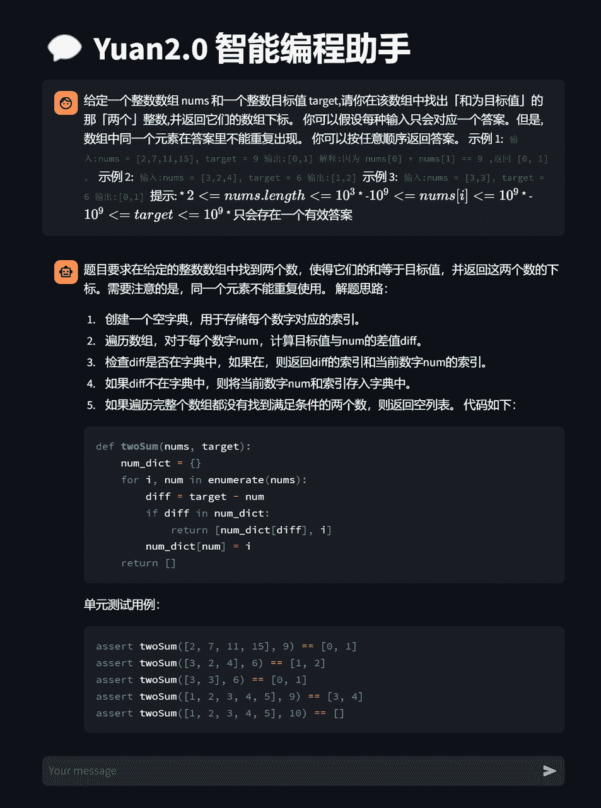
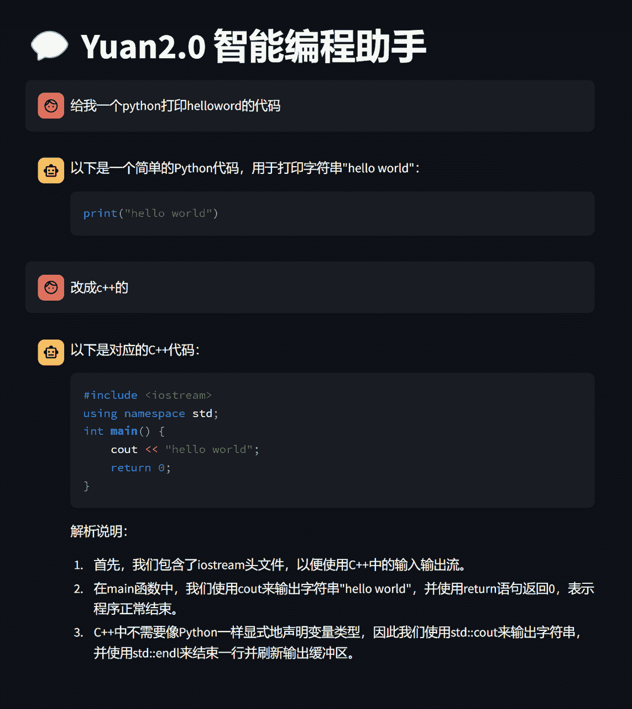
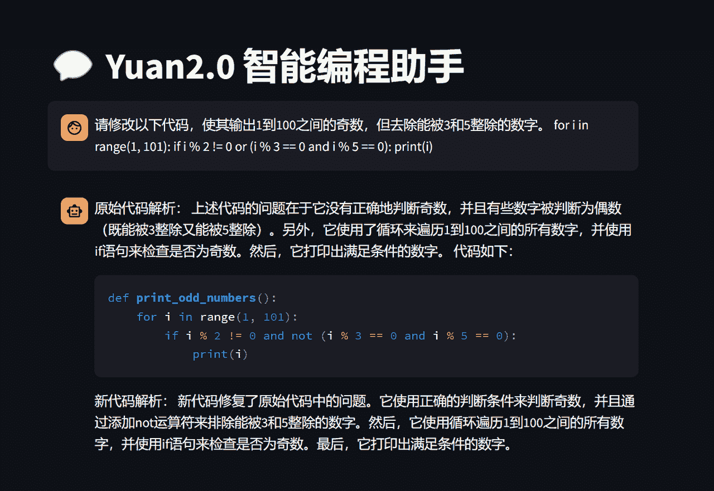

# 提交作品规则 & Task1案例：智能编程助手

> 来源：[https://datawhaler.feishu.cn/docx/JpbmdcgtIo3o1kx27xxcGtJznmh](https://datawhaler.feishu.cn/docx/JpbmdcgtIo3o1kx27xxcGtJznmh)

> **教程贡献者说：**

> 前面我们已经学习了大模型应用开发的基础操作及其原理，甚至已经拿下了《大模型开发工程师》的认证！

>

> 接下来，你有想过通过这次学习活动，达成什么样的目标吗？

> 咱们的终极目标是——

+   通过这次学习活动，组队交上靠谱、互补的队友，形成团队

+   然后，开发开发开发！开发出属于自己的应用！！！！

>

> [Task2：线上Hackathon必知必会](https://datawhaler.feishu.cn/wiki/JBbqwASUwip0hSkJYdMcTTdUnNp)于如何更好地组队完成优秀的作品，我们在 中已经给大家传授了秘籍心法！！千万不要错过哟~

>

> 接下来，我们来明确本次学习的终极目标！！！！——

> 咱们学习活动提交要求 & 提交案例！！！

# 学习赛提交要求

| ## 动手学大模型应用全栈开发 |  |
| --- | --- |
| **提交内容&amp;要求** | 1.  **应用方案（必选）**：项目背景、产品功能、技术方案、运行效果、应用价值及团队介绍等。PDF或PPT格式，不超过100MB。 |
| 评选规则 | +   多位评委交叉评审，按总分从高到低排序 |
| 评委评分维度 | https://datawhaler.feishu.cn/sync/Gjk2dzEwRsq3MJbMTrXcsYaKnzg |
| 学习赛激励 | 1.  **整体奖项** |

1.  多位评委交叉评审，按总分从高到低排序

1.  若作品部署到魔搭创空间，按照应用点赞热度可获得最多10%的加分

1.  若作品开源到GitHub，按照项目Star数可获得最多10%的加分

1.  **前10%卓越作品奖**，**10% - 30%杰出作品奖**，**其他作品 优秀作品奖**（提交了可访问且有内容的链接）

1.  **Top1**：一等奖一名，获得Datawhale X 浪潮信息荣誉证书、Datawhale夏令营奖学金

1.  **Top2-Top3**：二等奖2名，获得Datawhale X 浪潮信息荣誉证书、Datawhale夏令营奖学金

1.  **Top4-Top10**：三等奖7名，获得Datawhale X 浪潮信息荣誉证书

1.  **最佳创新奖** **1**名，创新性 + 技术成熟度等维度综合最高的作品

1.  **最佳应用奖** **1**名，应用性、商业价值与应用demo等维度综合最高的作品

# Task1案例：智能编程助手

## 项目背景

随着软件开发和人工智能技术的发展，开发者们面临着日益复杂的编程挑战。传统的编程辅助工具往往只能提供基础的代码补全、错误提示等功能，而难以理解开发者的整体意图或是上下文。

为了应对这一挑战，我们计划利用最新的自然语言处理（NLP）技术，特别是大语言模型，来开发一款能够显著提升程序员工作效率的智能编程助手。

### 产品功能

+   **智能代码生成：**根据用户请求，生成能满足用户需求的代码。

+   **多语言支持**：支持主流编程语言，如 Python、C++、Java等。

+   **代码理解和补全**：通过分析现有代码结构，自动补全代码片段或建议可能的代码实现。

+   **智能文档生成**：根据代码自动生成文档，包括函数注释、模块说明等。

+   **代码优化建议**：识别低效或冗余的代码，并提出改进方案。

### 应用价值

+   **提高开发效率**：减少重复工作和手动调试的时间，使开发者能更专注于业务逻辑和创新点。

+   **降低学习成本**：对于新手开发者来说，可以更快地掌握新语言和技术栈。

+   **增强代码质量**：通过自动化测试和代码审查，确保代码遵循最佳实践。

## 技术方案

### 方案架构图

本项目基于 [**源2B大模型**](https://www.modelscope.cn/models/IEITYuan/Yuan2-2B-Mars-hf) 的编程能力来解决用户的问题。

具体来说，项目主要包含一个Streamlit开发的客户端，以及一个部署好浪潮源大模型的服务端。

客户端接收到用户请求后，首先进行交互历史拼接，然后输入到服务端的浪潮源大模型，得到模型输出结果后，返回给客户端，用于回复用户的问题。

### 核心代码

```
# 导入所需的库
from transformers import AutoTokenizer, AutoModelForCausalLM
import torch
import streamlit as st

# 创建一个标题和一个副标题
st.title(&quot;💬 Yuan2.0 智能编程助手&quot;)

# 源大模型下载
from modelscope import snapshot_download
model_dir = snapshot_download(&#x27;IEITYuan/Yuan2-2B-Mars-hf&#x27;, cache_dir=&#x27;./&#x27;)

# 定义模型路径
path = &#x27;./IEITYuan/Yuan2-2B-Mars-hf&#x27;

# 定义模型数据类型
torch_dtype = torch.bfloat16 # A10
# torch_dtype = torch.float16 # P100

# 定义一个函数，用于获取模型和tokenizer
@st.cache_resource
def get_model():
    print(&quot;Creat tokenizer...&quot;)
    tokenizer = AutoTokenizer.from_pretrained(path, add_eos_token=False, add_bos_token=False, eos_token=&#x27;&lt;eod&gt;&#x27;)
    tokenizer.add_tokens([&#x27;&lt;sep&gt;&#x27;, &#x27;&lt;pad&gt;&#x27;, &#x27;&lt;mask&gt;&#x27;, &#x27;&lt;predict&gt;&#x27;, &#x27;&lt;FIM_SUFFIX&gt;&#x27;, &#x27;&lt;FIM_PREFIX&gt;&#x27;, &#x27;&lt;FIM_MIDDLE&gt;&#x27;,&#x27;&lt;commit_before&gt;&#x27;,&#x27;&lt;commit_msg&gt;&#x27;,&#x27;&lt;commit_after&gt;&#x27;,&#x27;&lt;jupyter_start&gt;&#x27;,&#x27;&lt;jupyter_text&gt;&#x27;,&#x27;&lt;jupyter_code&gt;&#x27;,&#x27;&lt;jupyter_output&gt;&#x27;,&#x27;&lt;empty_output&gt;&#x27;], special_tokens=True)

    print(&quot;Creat model...&quot;)
    model = AutoModelForCausalLM.from_pretrained(path, torch_dtype=torch_dtype, trust_remote_code=True).cuda()

    return tokenizer, model

# 加载model和tokenizer
tokenizer, model = get_model()

# 初次运行时，session_state中没有&quot;messages&quot;，需要创建一个空列表
if &quot;messages&quot; not in st.session_state:
    st.session_state[&quot;messages&quot;] = []

# 每次对话时，都需要遍历session_state中的所有消息，并显示在聊天界面上
for msg in st.session_state.messages:
    st.chat_message(msg[&quot;role&quot;]).write(msg[&quot;content&quot;])

# 如果用户在聊天输入框中输入了内容，则执行以下操作
if prompt := st.chat_input():
    # 将用户的输入添加到session_state中的messages列表中
    st.session_state.messages.append({&quot;role&quot;: &quot;user&quot;, &quot;content&quot;: prompt})

    # 在聊天界面上显示用户的输入
    st.chat_message(&quot;user&quot;).write(prompt)

    # 调用模型
    prompt = &quot;&lt;n&gt;&quot;.join(msg[&quot;content&quot;] for msg in st.session_state.messages) + &quot;&lt;sep&gt;&quot; # 拼接对话历史
    inputs = tokenizer(prompt, return_tensors=&quot;pt&quot;)[&quot;input_ids&quot;].cuda()
    outputs = model.generate(inputs, do_sample=False, max_length=1024) # 设置解码方式和最大生成长度
    output = tokenizer.decode(outputs[0])
    response = output.split(&quot;&lt;sep&gt;&quot;)[-1].replace(&quot;&lt;eod&gt;&quot;, &#x27;&#x27;)

    # 将模型的输出添加到session_state中的messages列表中
    st.session_state.messages.append({&quot;role&quot;: &quot;assistant&quot;, &quot;content&quot;: response})

    # 在聊天界面上显示模型的输出
    st.chat_message(&quot;assistant&quot;).write(response)

```

## 运行效果

### 智能**代码生成**



### **多语言支持**



### **代码理解和补全**



## 远期规划

### 迭代计划

| **功能** | **描述** | **完成时间** |
| --- | --- | --- |
| 智能文档生成 | 根据代码自动生成文档，包括函数注释、模块说明等。 | x月x日 |
| 代码优化建议 | 识别低效或冗余的代码，并提出改进方案。 | x月x日 |

### 商业&市场思考

+   **免费试用+订阅制**：提供有限功能的免费版吸引用户尝试，对于高级功能采用按月/年的订阅模式。

+   **企业版定制服务**：针对大型企业客户提供定制化解决方案，包括私有部署选项以及专门的技术支持。

+   **插件市场**：允许第三方开发者创建插件，形成生态系统，从中抽取一定比例的佣金。

### 市场推广策略

+   **社区建设**：在 GitHub 和 Stack Overflow 等开发者社区积极互动，建立品牌知名度。

+   **合作伙伴关系**：与教育机构、开源项目合作，提供免费的教育资源和支持。

+   **营销活动**：组织线上研讨会、编程比赛等活动，吸引潜在用户的兴趣。

+   **口碑传播**：鼓励现有用户推荐新用户，通过推荐奖励机制增加用户基数。

+   **社交媒体**：利用 Twitter、LinkedIn 等社交平台分享成功案例和技术文章，吸引更多关注。

## **团队介绍**

| 姓名 | 性别 | 手机号 | 学校 | 学历 | 专业 | 项目职责 |
| --- | --- | --- | --- | --- | --- | --- |
| xxx | 女 | xxx | DataWhale | 研究生 | 计算机科学技术 | 项目策划、文档撰写 |
| xxx | 男 | xxx | DataWhale | 本科生 | 计算机科学技术 | 代码编写、文档撰写 |

# 还可以尝试替换其他Yuan大模型！

<https://datawhaler.feishu.cn/sync/UG0ydiJi9sSFkub60HmcuQTJn9f>

# 接下来还有更多内容等你学习！

<https://datawhaler.feishu.cn/sync/QMB9diwsNsBXkkb4qSPckLuVnze>

> [ QA & 其他彩蛋](https://datawhaler.feishu.cn/wiki/Gf5DwJNXeiLOjDkMlPhcnwjTnMf)任何想法都可以在学习群里交流或在   进行填写哟~

>

> 本教程主要由   写作贡献，

> 融合了多位助教的内测体验和宝贵建议。

> 如果你觉得对你有价值和启发，请在下面点赞和评论哟~

>

### 另外别忘了写笔记打卡呀！！~

### 及时思考、沉淀和产出能让你的学习事半功倍！

>

> **注：本文采用 ****署名—非商业性使用**—相同方式共享 4.0 协议国际版许可协议进行许可。