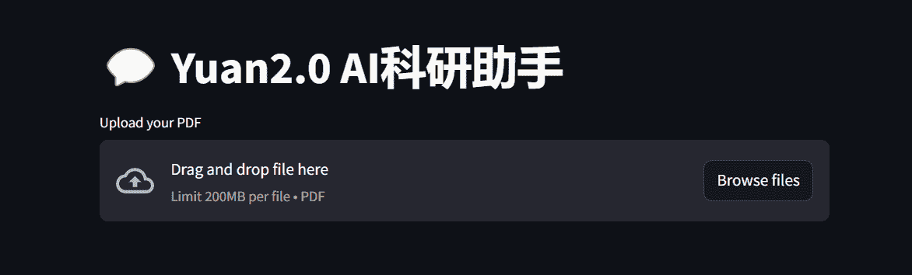
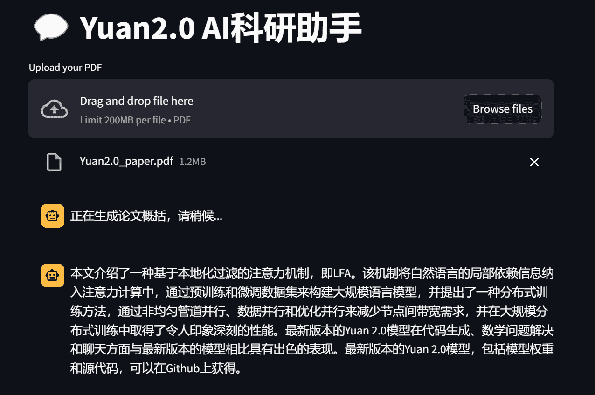
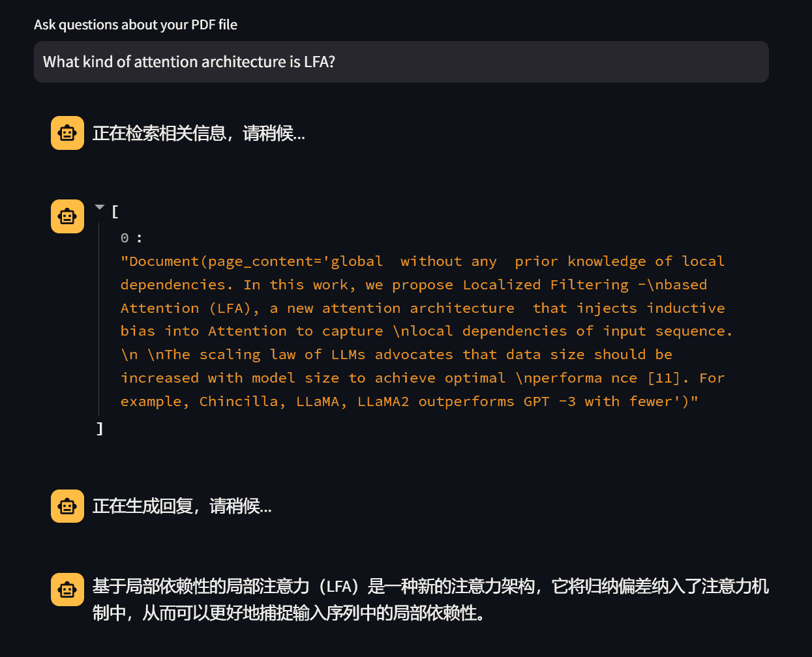
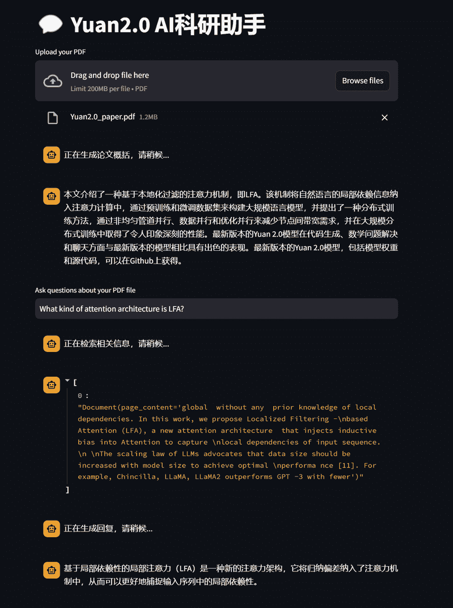

# Task3案例：AI科研助手

> 来源：[https://datawhaler.feishu.cn/docx/VH6ldn6Fwoabe4xWoEFcmVO3nXf](https://datawhaler.feishu.cn/docx/VH6ldn6Fwoabe4xWoEFcmVO3nXf)

# 学习赛提交要求

<https://datawhaler.feishu.cn/sync/MdWedWW4jsic9HbEmyrcCArTn2d>

# 项目背景

随着学术研究领域的快速发展，研究人员需要处理大量的文献资料。传统的文献综述方法往往耗时且效率低下，而且很难及时跟进最新的研究成果。近年来，自然语言处理技术（NLP）的进步，使得机器能够理解和处理人类语言成为可能。因此，开发一款能够自动分析、理解并回答关于论文内容的问题的AI科研助手变得十分必要。

# 产品功能

+   论文概括：AI科研助手能够快速阅读并理解一篇论文的主要内容，并生成简洁明了的摘要。

+   内容问答：用户可以通过自然语言提出与论文相关的问题，系统能够给出准确的答案。

+   关键词提取：从论文中提取关键概念和术语，帮助用户快速了解研究重点。

+   论文对比：比较两篇或者多篇论文的内容，总结他们之间的异同点。

+   相关工作推荐：根据用户的兴趣领域推荐相关的最新研究成果。

# 应用价值

+   提高工作效率：通过自动化文献分析减少研究人员的时间消耗。

+   促进知识传播：使更多人能够迅速掌握某一领域的核心发现。

+   增强学术合作：通过协作平台加强跨学科的研究合作。

+   辅助教学：在教育场景下，帮助学生更好地理解复杂的研究主题。

# 技术方案

## 方案架构图

本项目基于源大模型RAG技术来解决用户的问题。

具体来说，项目主要包含一个Streamlit开发的客户端，以及一个部署好的浪潮源大模型的服务端。

客户端接收到用户上传的PDF后，发送到服务端。服务端首先完成PDF内容解析，然后拼接摘要Prompt并输入源大模型，得到模型输出结果后，返回给客户端并展示给用户。

如果用户接下来进行提问，客户端将用户请求发送到服务端，服务端进行Embedding和Faiss检索，然后将检索到的chunks与用户请求拼接成Prompt并输入到源大模型，得到模型输出结果后，返回给客户端进行结构化，然后展示给用户。

## 核心代码

依赖安装

```
pip install pypdf faiss-gpu langchain langchain_community langchain_huggingface streamlit==1.24.0
```

启动脚本

```
streamlit run Task\ 3\ 案例：AI科研助手.py --server.address 127.0.0.1 --server.port 6006
```

源代码

```
# 导入所需的库
import torch
import streamlit as st
from transformers import AutoTokenizer, AutoModelForCausalLM
from langchain.prompts import PromptTemplate
from langchain_community.vectorstores import FAISS
from langchain_community.document_loaders import PyPDFLoader
from langchain_huggingface import HuggingFaceEmbeddings
from langchain.chains import LLMChain
from langchain.chains.question_answering import load_qa_chain
from langchain.llms.base import LLM
from langchain.callbacks.manager import CallbackManagerForLLMRun
from langchain.text_splitter import RecursiveCharacterTextSplitter

from typing import Any, List, Optional

# 向量模型下载
from modelscope import snapshot_download
model_dir = snapshot_download(&#x27;AI-ModelScope/bge-small-en-v1.5&#x27;, cache_dir=&#x27;./&#x27;)

# 源大模型下载
from modelscope import snapshot_download
model_dir = snapshot_download(&#x27;IEITYuan/Yuan2-2B-Mars-hf&#x27;, cache_dir=&#x27;./&#x27;)

# 定义模型路径
model_path = &#x27;./IEITYuan/Yuan2-2B-Mars-hf&#x27;

# 定义向量模型路径
embedding_model_path = &#x27;./AI-ModelScope/bge-small-en-v1___5&#x27;

# 定义模型数据类型
torch_dtype = torch.bfloat16 # A10
# torch_dtype = torch.float16 # P100

# 定义源大模型类
class Yuan2_LLM(LLM):
    &quot;&quot;&quot;
    class for Yuan2_LLM
    &quot;&quot;&quot;
    tokenizer: AutoTokenizer = None
    model: AutoModelForCausalLM = None

    def __init__(self, mode_path :str):
        super().__init__()

        # 加载预训练的分词器和模型
        print(&quot;Creat tokenizer...&quot;)
        self.tokenizer = AutoTokenizer.from_pretrained(mode_path, add_eos_token=False, add_bos_token=False, eos_token=&#x27;&lt;eod&gt;&#x27;)
        self.tokenizer.add_tokens([&#x27;&lt;sep&gt;&#x27;, &#x27;&lt;pad&gt;&#x27;, &#x27;&lt;mask&gt;&#x27;, &#x27;&lt;predict&gt;&#x27;, &#x27;&lt;FIM_SUFFIX&gt;&#x27;, &#x27;&lt;FIM_PREFIX&gt;&#x27;, &#x27;&lt;FIM_MIDDLE&gt;&#x27;,&#x27;&lt;commit_before&gt;&#x27;,&#x27;&lt;commit_msg&gt;&#x27;,&#x27;&lt;commit_after&gt;&#x27;,&#x27;&lt;jupyter_start&gt;&#x27;,&#x27;&lt;jupyter_text&gt;&#x27;,&#x27;&lt;jupyter_code&gt;&#x27;,&#x27;&lt;jupyter_output&gt;&#x27;,&#x27;&lt;empty_output&gt;&#x27;], special_tokens=True)

        print(&quot;Creat model...&quot;)
        self.model = AutoModelForCausalLM.from_pretrained(mode_path, torch_dtype=torch.bfloat16, trust_remote_code=True).cuda()

    def _call(
        self,
        prompt: str,
        stop: Optional[List[str]] = None,
        run_manager: Optional[CallbackManagerForLLMRun] = None,
        **kwargs: Any,
    ) -&gt; str:
        prompt = prompt.strip()
        prompt += &quot;&lt;sep&gt;&quot;
        inputs = self.tokenizer(prompt, return_tensors=&quot;pt&quot;)[&quot;input_ids&quot;].cuda()
        outputs = self.model.generate(inputs,do_sample=False,max_length=4096)
        output = self.tokenizer.decode(outputs[0])
        response = output.split(&quot;&lt;sep&gt;&quot;)[-1].split(&quot;&lt;eod&gt;&quot;)[0]

        return response

    @property
    def _llm_type(self) -&gt; str:
        return &quot;Yuan2_LLM&quot;

# 定义一个函数，用于获取llm和embeddings
@st.cache_resource
def get_models():
    llm = Yuan2_LLM(model_path)

    model_kwargs = {&#x27;device&#x27;: &#x27;cuda&#x27;}
    encode_kwargs = {&#x27;normalize_embeddings&#x27;: True} # set True to compute cosine similarity
    embeddings = HuggingFaceEmbeddings(
        model_name=embedding_model_path,
        model_kwargs=model_kwargs,
        encode_kwargs=encode_kwargs,
    )
    return llm, embeddings

summarizer_template = &quot;&quot;&quot;
假设你是一个AI科研助手，请用一段话概括下面文章的主要内容，200字左右。

{text}
&quot;&quot;&quot;

# 定义Summarizer类
class Summarizer:
    &quot;&quot;&quot;
    class for Summarizer.
    &quot;&quot;&quot;

    def __init__(self, llm):
        self.llm = llm
        self.prompt = PromptTemplate(
            input_variables=[&quot;text&quot;],
            template=summarizer_template
        )
        self.chain = LLMChain(llm=self.llm, prompt=self.prompt)

    def summarize(self, docs):
        # 从第一页中获取摘要
        content = docs[0].page_content.split(&#x27;ABSTRACT&#x27;)[1].split(&#x27;KEY WORDS&#x27;)[0]

        summary = self.chain.run(content)
        return summary

chatbot_template  = &#x27;&#x27;&#x27;
假设你是一个AI科研助手，请基于背景，简要回答问题。

背景：
{context}

问题：
{question}
&#x27;&#x27;&#x27;.strip()

# 定义ChatBot类
class ChatBot:
    &quot;&quot;&quot;
    class for ChatBot.
    &quot;&quot;&quot;

    def __init__(self, llm, embeddings):
        self.prompt = PromptTemplate(
            input_variables=[&quot;text&quot;],
            template=chatbot_template
        )
        self.chain = load_qa_chain(llm=llm, chain_type=&quot;stuff&quot;, prompt=self.prompt)
        self.embeddings = embeddings

        # 加载 text_splitter
        self.text_splitter = RecursiveCharacterTextSplitter(
            chunk_size=450,
            chunk_overlap=10,
            length_function=len
        )

    def run(self, docs, query):
        # 读取所有内容
        text = &#x27;&#x27;.join([doc.page_content for doc in docs])

        # 切分成chunks
        all_chunks = self.text_splitter.split_text(text=text)

        # 转成向量并存储
        VectorStore = FAISS.from_texts(all_chunks, embedding=self.embeddings)

        # 检索相似的chunks
        chunks = VectorStore.similarity_search(query=query, k=1)

        # 生成回复
        response = self.chain.run(input_documents=chunks, question=query)

        return chunks, response

def main():
    # 创建一个标题
    st.title(&#x27;💬 Yuan2.0 AI科研助手&#x27;)

    # 获取llm和embeddings
    llm, embeddings = get_models()

    # 初始化summarizer
    summarizer = Summarizer(llm)

    # 初始化ChatBot
    chatbot = ChatBot(llm, embeddings)

    # 上传pdf
    uploaded_file = st.file_uploader(&quot;Upload your PDF&quot;, type=&#x27;pdf&#x27;)

    if uploaded_file:
        # 加载上传PDF的内容
        file_content = uploaded_file.read()

        # 写入临时文件
        temp_file_path = &quot;temp.pdf&quot;
        with open(temp_file_path, &quot;wb&quot;) as temp_file:
            temp_file.write(file_content)

        # 加载临时文件中的内容
        loader = PyPDFLoader(temp_file_path)
        docs = loader.load()

        st.chat_message(&quot;assistant&quot;).write(f&quot;正在生成论文概括，请稍候...&quot;)

        # 生成概括
        summary = summarizer.summarize(docs)
        
        # 在聊天界面上显示模型的输出
        st.chat_message(&quot;assistant&quot;).write(summary)

        # 接收用户问题
        if query := st.text_input(&quot;Ask questions about your PDF file&quot;):

            # 检索 + 生成回复
            chunks, response = chatbot.run(docs, query)

            # 在聊天界面上显示模型的输出
            st.chat_message(&quot;assistant&quot;).write(f&quot;正在检索相关信息，请稍候...&quot;)
            st.chat_message(&quot;assistant&quot;).write(chunks)

            st.chat_message(&quot;assistant&quot;).write(f&quot;正在生成回复，请稍候...&quot;)
            st.chat_message(&quot;assistant&quot;).write(response)

if __name__ == &#x27;__main__&#x27;:
    main()

```

# 运行效果

## 初始界面



## 论文概括



## 基于论文内容的问答

问题：What kind of attention architecture is LFA?



## 整体效果



# 迭代计划

| **功能** | **描述** | **完成时间** |
| --- | --- | --- |
| 关键词提取 | 从论文中提取关键概念和术语，帮助用户快速了解研究重点。 | x月x日 |
| 论文对比 | 比较两篇或者多篇论文的内容，总结他们之间的异同点。 | x月x日 |
| 相关工作推荐 | 根据用户的兴趣领域推荐相关的最新研究成果。 | x月x日 |

# 商业模式

+   订阅制：用户可以选择不同的订阅套餐来获得不同程度的服务和支持。

+   按需付费：对于非经常性用户，可以提供按次或按量计费的选项。

+   企业解决方案：为大型研究机构或企业提供定制化的部署和服务。

+   数据合作：与学术出版商合作，提供数据整合和分析服务。

# 市场推广策略

+   学术会议与研讨会：参与行业内的大型会议，展示产品的优势和技术特点。

+   合作伙伴关系：与知名大学和研究机构建立合作关系，共同推广产品。

+   社交媒体营销：利用社交媒体平台分享成功案例和用户故事，吸引潜在客户。

+   口碑营销：鼓励满意的用户向同行推荐产品。

+   免费试用：提供一定期限的免费试用期，让用户亲身体验产品的价值。

# **团队介绍**

| 姓名 | 性别 | 手机号 | 学校 | 学历 | 专业 | 项目职责 |
| --- | --- | --- | --- | --- | --- | --- |
| xxx | 女 | xxx | DataWhale | 研究生 | 计算机科学技术 | 项目策划、文档撰写 |
| xxx | 男 | xxx | DataWhale | 本科生 | 计算机科学技术 | 代码编写、文档撰写 |

# 还可以尝试替换其他Yuan大模型！

<https://datawhaler.feishu.cn/sync/UG0ydiJi9sSFkub60HmcuQTJn9f>

# 作品提交方式

如果完成了作品开发，可以提交初版作品啦，加油

<https://datawhaler.feishu.cn/share/base/form/shrcnbLAWydDXkK3lFwbIQBecCg?iframeFrom=docx&ccm_open=iframe>

# 接下来还有更多内容等你学习！

<https://datawhaler.feishu.cn/sync/QMB9diwsNsBXkkb4qSPckLuVnze>

> [ QA & 其他彩蛋](https://datawhaler.feishu.cn/wiki/Gf5DwJNXeiLOjDkMlPhcnwjTnMf)任何想法都可以在学习群里交流或在   进行填写哟~

>

> 本教程主要由   写作贡献，

> 融合了多位助教的内测体验和宝贵建议。

> 如果你觉得对你有价值和启发，请在下面点赞和评论哟~

>

### 另外别忘了写笔记打卡呀！！~

### 及时思考、沉淀和产出能让你的学习事半功倍！

>

> **注：本文采用 ****署名—非商业性使用**—相同方式共享 4.0 协议国际版许可协议进行许可。