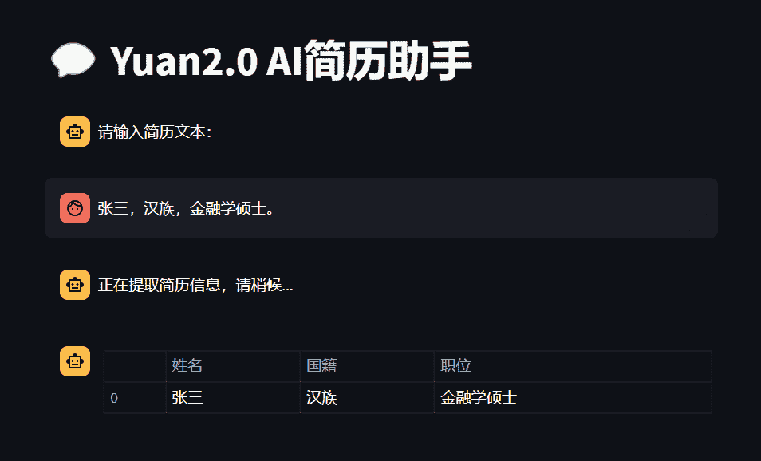

# Task4案例：AI简历助手

> 来源：[https://datawhaler.feishu.cn/docx/W208dDm8Go9ZNJxZboNct9D9nZb](https://datawhaler.feishu.cn/docx/W208dDm8Go9ZNJxZboNct9D9nZb)

<https://datawhaler.feishu.cn/sync/MdWedWW4jsic9HbEmyrcCArTn2d>

# 项目背景

随着数字化转型的加速和人工智能技术的发展，人力资源管理领域也在寻求更加高效和智能的方法来处理大量的求职申请。

对于企业而言，筛选合适的候选人是一项耗时且复杂的任务，尤其是在收到成百上千份简历的情况下。同样地，对于求职者来说，如何让自己的简历在众多竞争者中脱颖而出也是一大挑战。

因此，开发一款能够帮助企业自动抽取简历关键信息，并帮助个人优化简历的AI助手，将大大提升招聘流程的效率和质量。

# 产品功能

+   企业端：

+   简历信息抽取：利用自然语言处理技术自动识别并提取简历中的关键信息（如姓名、教育背景、工作经历等）。

+   简历信息匹配：根据职位需求与简历内容进行匹配度分析，推荐最合适的候选人。

+   批量处理能力：支持批量上传和处理大量简历，节省HR的时间和精力。

+   个人端：

+   简历润色与建议：提供个性化简历改进建议，包括用词优化、结构调整等。

+   匹配度评估：评估简历与目标职位的匹配程度，并给出改进意见。

+   模板与案例分享：提供高质量的简历模板和成功案例供用户参考。

# 应用价值

+   提高效率：自动化处理简历可以显著减少HR的工作量，使他们有更多时间专注于面试和评估候选人。

+   提升质量：精准的信息抽取和匹配有助于找到更适合岗位的人才，提高招聘成功率。

+   增强用户体验：个性化的建议和反馈可以让求职者更好地展示自己，增加获得面试机会的可能性。

# 技术方案

数据：https://hf-mirror.com/datasets/BAAI/COIG-PC-Lite

## 技术架构图

本项目通过微调源大模型使其获得信息抽取能力来解决用户的问题。

具体来说，项目主要包含一个Streamlit开发的客户端，以及一个部署好微调后的浪潮源大模型的服务端。

客户端接收到用户请求后，首先进行Prompt拼接，然后输入到服务端的浪潮源大模型，得到模型输出结果后，返回给客户端进行结构化，然后展示给用户。

## 核心代码

依赖安装

```
pip install streamlit==1.24.0
```

启动脚本

```
streamlit run Task\ 4\ 案例：AI简历助手.py --server.address 127.0.0.1 --server.port 6006
```

源代码

```
# 导入所需的库
from transformers import AutoTokenizer, AutoModelForCausalLM
import torch
import streamlit as st
from peft import PeftModel
import json
import pandas as pd

# 创建一个标题和一个副标题
st.title(&quot;💬 Yuan2.0 AI简历助手&quot;)

# 源大模型下载
from modelscope import snapshot_download
model_dir = snapshot_download(&#x27;IEITYuan/Yuan2-2B-Mars-hf&#x27;, cache_dir=&#x27;./&#x27;)

# 定义模型路径
path = &#x27;./IEITYuan/Yuan2-2B-Mars-hf&#x27;
lora_path = &#x27;./output/Yuan2.0-2B_lora_bf16/checkpoint-51&#x27;

# 定义模型数据类型
torch_dtype = torch.bfloat16 # A10
# torch_dtype = torch.float16 # P100

# 定义一个函数，用于获取模型和tokenizer
@st.cache_resource
def get_model():
    print(&quot;Creat tokenizer...&quot;)
    tokenizer = AutoTokenizer.from_pretrained(path, add_eos_token=False, add_bos_token=False, eos_token=&#x27;&lt;eod&gt;&#x27;)
    tokenizer.add_tokens([&#x27;&lt;sep&gt;&#x27;, &#x27;&lt;pad&gt;&#x27;, &#x27;&lt;mask&gt;&#x27;, &#x27;&lt;predict&gt;&#x27;, &#x27;&lt;FIM_SUFFIX&gt;&#x27;, &#x27;&lt;FIM_PREFIX&gt;&#x27;, &#x27;&lt;FIM_MIDDLE&gt;&#x27;,&#x27;&lt;commit_before&gt;&#x27;,&#x27;&lt;commit_msg&gt;&#x27;,&#x27;&lt;commit_after&gt;&#x27;,&#x27;&lt;jupyter_start&gt;&#x27;,&#x27;&lt;jupyter_text&gt;&#x27;,&#x27;&lt;jupyter_code&gt;&#x27;,&#x27;&lt;jupyter_output&gt;&#x27;,&#x27;&lt;empty_output&gt;&#x27;], special_tokens=True)

    print(&quot;Creat model...&quot;)
    model = AutoModelForCausalLM.from_pretrained(path, torch_dtype=torch_dtype, trust_remote_code=True).cuda()
    model = PeftModel.from_pretrained(model, model_id=lora_path)

    return tokenizer, model

# 加载model和tokenizer
tokenizer, model = get_model()

template = &#x27;&#x27;&#x27;
# 任务描述
假设你是一个AI简历助手，能从简历中识别出所有的命名实体，并以json格式返回结果。

# 任务要求
实体的类别包括：姓名、国籍、种族、职位、教育背景、专业、组织名、地名。
返回的json格式是一个字典，其中每个键是实体的类别，值是一个列表，包含实体的文本。

# 样例
输入：
张三，男，中国籍，工程师
输出：
{&quot;姓名&quot;: [&quot;张三&quot;], &quot;国籍&quot;: [&quot;中国&quot;], &quot;职位&quot;: [&quot;工程师&quot;]}

# 当前简历
query

# 任务重述
请参考样例，按照任务要求，识别出当前简历中所有的命名实体，并以json格式返回结果。
&#x27;&#x27;&#x27;

# 在聊天界面上显示模型的输出
st.chat_message(&quot;assistant&quot;).write(f&quot;请输入简历文本：&quot;)

# 如果用户在聊天输入框中输入了内容，则执行以下操作
if query := st.chat_input():

    # 在聊天界面上显示用户的输入
    st.chat_message(&quot;user&quot;).write(query)

    # 调用模型
    prompt = template.replace(&#x27;query&#x27;, query).strip()
    prompt += &quot;&lt;sep&gt;&quot;
    inputs = tokenizer(prompt, return_tensors=&quot;pt&quot;)[&quot;input_ids&quot;].cuda()
    outputs = model.generate(inputs, do_sample=False, max_length=1024) # 设置解码方式和最大生成长度
    output = tokenizer.decode(outputs[0])
    response = output.split(&quot;&lt;sep&gt;&quot;)[-1].replace(&quot;&lt;eod&gt;&quot;, &#x27;&#x27;).strip()

    # 在聊天界面上显示模型的输出
    st.chat_message(&quot;assistant&quot;).write(f&quot;正在提取简历信息，请稍候...&quot;)

    st.chat_message(&quot;assistant&quot;).table(pd.DataFrame(json.loads(response)))

```

# 运行效果

## 初始界面


## 简历信息抽取



# 迭代计划

| **功能** | **描述** | **完成时间** |
| --- | --- | --- |
| 简历信息匹配 | 根据职位需求与简历内容进行匹配度分析，推荐最合适的候选人。 | x月x日 |
| 批量处理能力 | 支持批量上传和处理大量简历，节省HR的时间和精力。 | x月x日 |
| 简历润色与建议 | 比较两篇或者多篇论文的内容，总结他们之间的异同点。 | x月x日 |
| 匹配度评估 | 评估简历与目标职位的匹配程度，并给出改进意见。 | x月x日 |
| 模板与案例分享 | 根据用户的兴趣领域推荐相关的最新研究成果。 | x月x日 |

# 商业模式

+   订阅制：为企业客户提供月度或年度订阅服务，提供不限次数的简历处理服务。

+   按次收费：针对个人用户，可以采用按次付费的方式使用简历优化服务。

+   增值功能：为高级用户提供定制化服务，比如一对一职业规划咨询、行业趋势分析报告等。

# 市场推广策略

+   内容营销：创建博客文章、视频教程等，分享简历撰写技巧和职场知识，吸引潜在用户。

+   合作伙伴关系：与高校就业指导中心、职业培训机构建立合作关系，共同推广服务。

+   社交媒体广告：利用LinkedIn、🧣等平台投放定向广告，提高品牌曝光率。

+   用户口碑：鼓励满意的用户分享他们的成功故事，利用真实案例吸引新客户。

+   免费试用：提供一段时间的免费试用期，让用户亲身体验产品的价值。

# 团队介绍

| 姓名 | 性别 | 手机号 | 学校 | 学历 | 专业 | 项目职责 |
| --- | --- | --- | --- | --- | --- | --- |
| xxx | 女 | xxx | DataWhale | 研究生 | 计算机科学技术 | 项目策划、文档撰写 |
| xxx | 男 | xxx | DataWhale | 本科生 | 计算机科学技术 | 代码编写、文档撰写 |

# 还可以尝试替换其他Yuan大模型！

<https://datawhaler.feishu.cn/sync/UG0ydiJi9sSFkub60HmcuQTJn9f>

# 作品提交方式

如果完成了作品开发，可以提交初版作品啦，加油

<https://datawhaler.feishu.cn/share/base/form/shrcnbLAWydDXkK3lFwbIQBecCg?iframeFrom=docx&ccm_open=iframe>

# 接下来还有更多内容等你学习！

<https://datawhaler.feishu.cn/sync/QMB9diwsNsBXkkb4qSPckLuVnze>

> [ QA & 其他彩蛋](https://datawhaler.feishu.cn/wiki/Gf5DwJNXeiLOjDkMlPhcnwjTnMf)任何想法都可以在学习群里交流或在   进行填写哟~

>

> 本教程主要由   写作贡献，

> 融合了多位助教的内测体验和宝贵建议。

> 如果你觉得对你有价值和启发，请在下面点赞和评论哟~

>

### 另外别忘了写笔记打卡呀！！~

### 及时思考、沉淀和产出能让你的学习事半功倍！

>

> **注：本文采用 ****署名—非商业性使用**—相同方式共享 4.0 协议国际版许可协议进行许可。