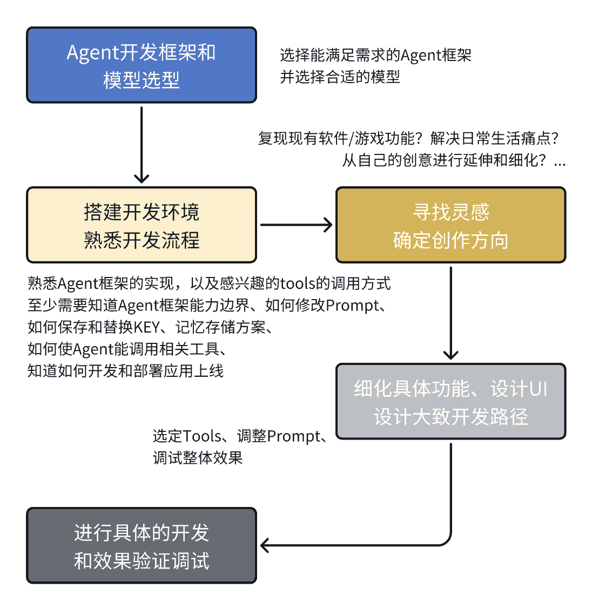
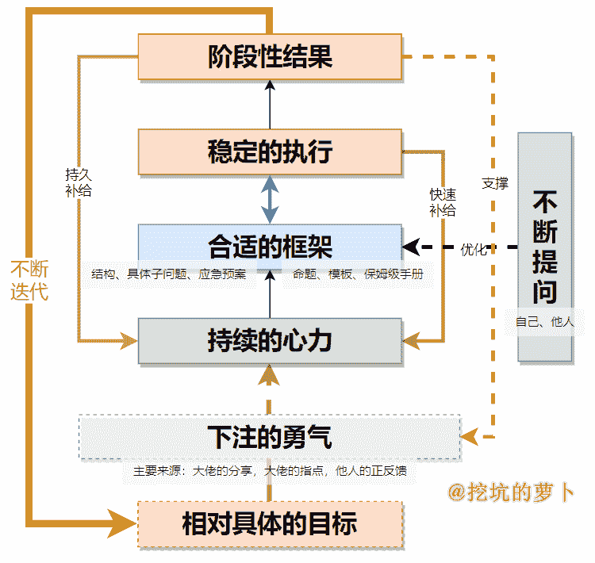

# Demo Day

> 来源：[https://datawhaler.feishu.cn/docx/U75Od9uatow6vBxGJ5scHS6Enwe](https://datawhaler.feishu.cn/docx/U75Od9uatow6vBxGJ5scHS6Enwe)

# 没有Idea？可以先看看下面的思路

# 没有Idea可以先看看下面的思路

1.  各大汇总网站的AI应用产品，尝试这些AI应用，尝试拆解和在群里讨论分析

1.  在各大AI智能体平台，查看那些热门的智能体，并尝试从中分析

## 这里还有一些Datawhale往期学习者的作品

<https://datawhaler.feishu.cn/share/base/view/shrcnSN5ff9Y0MrFVMGpVDgAX8e?iframeFrom=docx&ccm_open=iframe>

# 头脑风暴会会议记录

> **会议主题**：

> **会议时间**：

> **会议地点**：**腾讯会议**（限量100席位，可提前报名，先到先得）

+   **会议码**：

> **会议录制**：

| # idea1:  |  |  |
| --- | --- | --- |
| **讨论点** | idea发起人阐述 &amp; 重要结论 | **组队招募信息** |
|  |  |  |
|  |  |  |
|  |  |  |
| # idea2:  |  |  |
| **讨论点** | idea发起人阐述 &amp; 重要结论 | **组队招募信息** |
|  |  |  |
|  |  |  |
|  |  |  |
| # idea3:  |  |  |
| **讨论点** | idea发起人阐述 &amp; 重要结论 | **组队招募信息** |
|  |  |  |
|  |  |  |
|  |  |  |
| # idea4:  |  |  |
| **讨论点** | idea发起人阐述 &amp; 重要结论 | **组队招募信息** |
|  |  |  |
|  |  |  |
|  |  |  |
| # idea5:  |  |  |
| **讨论点** | idea发起人阐述 &amp; 重要结论 | **组队招募信息** |
|  |  |  |
|  |  |  |
|  |  |  |
| # idea6:  |  |  |
| **讨论点** | idea发起人阐述 &amp; 重要结论 | **组队招募信息** |
|  |  |  |
|  |  |  |
|  |  |  |