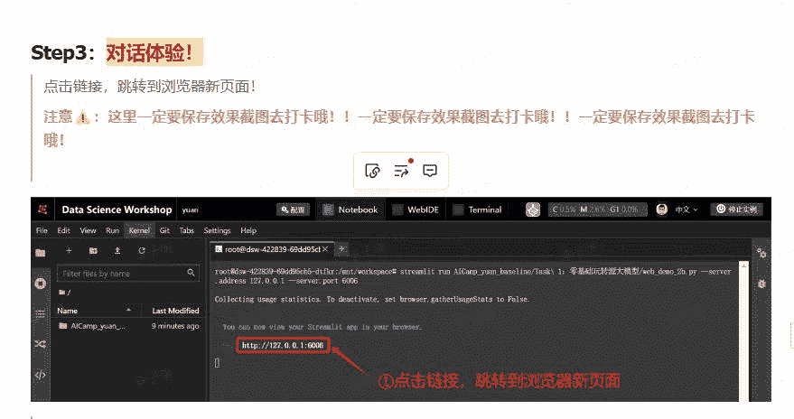
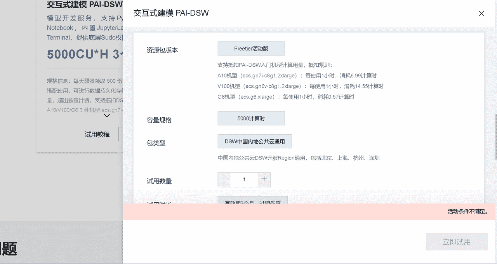
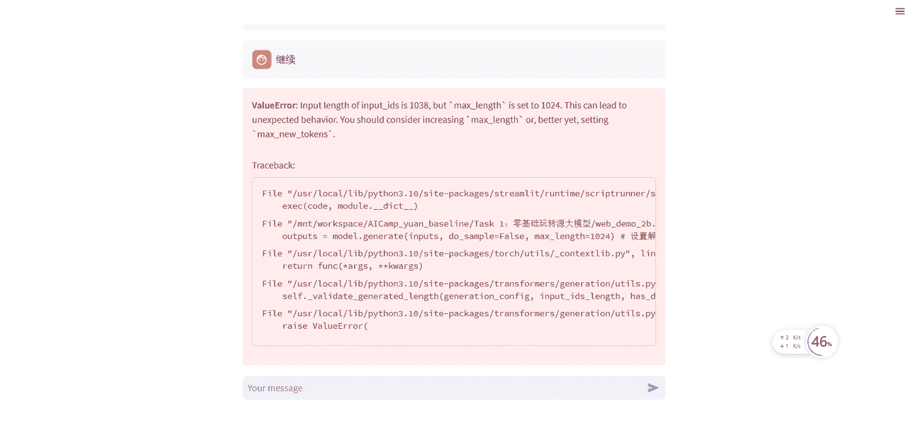
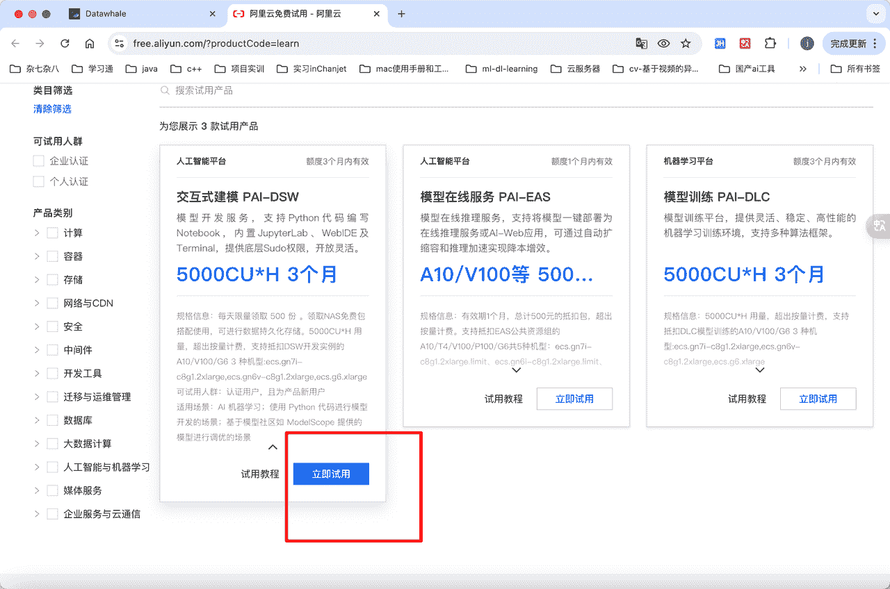

#  QA & 其他彩蛋 | 全栈

> 来源：[https://datawhaler.feishu.cn/docx/BPr4d2rK0oNUhNxNNOBcSslFnff](https://datawhaler.feishu.cn/docx/BPr4d2rK0oNUhNxNNOBcSslFnff)

<https://datawhaler.feishu.cn/sync/WbWwdPDRgsjXkWbnpMfcdSajnd2>

# 直播

## 开营

| ## **Question** | ## **Answer** |
| --- | --- |
| 这几个镜像什么区别呢 | 主要是modelscope和pytorch版本，建议选最新的、不带tensorflow的镜像 |
| streamlit和gradio哪个更好 | （个人回答，问题回答错误请删除，谢谢）如果寻找一种快速简便的方式来展示模型输出或进行模型测试，可以使用Gradio。如果开发一个更加复杂的应用程序，具有更多的交互性和功能，那么 Streamlit 可能更适合你。 |
| a10性能相当于什么 | （个人回答，问题回答错误请删除，谢谢）建议阅读https://www.autodl.com/docs/gpu_perf/ |
| 为啥咱们的AI输出一模一样的内容啊 | 目前没有使用采样，可设置do_sample=True |
| 生成的代码，运行时候显示代码错。重新生成，为啥不能优化代码呢？ | 可以尝试下面的方法 |
| 咱们这次开营是应用，我可以理解为服务器部署吗？ | 是的，使用的是A10 |
| 为什么强化学习不稳定？能麻烦老师简单解释一下吗 | 强化学习的本质是智能体与环境的交互，相比于监督学习，训练任务更复杂，训练更加困难 |
| wind本地部署的时候的环境要求？ | 可在dsw中pip list看下，对齐一下torch、transformers、streamlit版本 |
| 有回放吗 | 有的，下周二B站更新，今晚也可以看视频号回放，是实时的 |
| 这次活动如果垂直落地特定领域是否需要进行微调 | task4会讲解微调 |

## 大咖分享

### 第一场

| ## **Question** | ## **Answer** |
| --- | --- |
| Chatlaw是基于什么框架~ |  |
| 老师，一开始讲的那个例子是用cot思维链提示吗    prompt项目 |  |
| 奇异值分解不是求伪逆的吗？ |  |
| bm25知识库更适合什么知识的存储 |  |
| 请问SCI-GPT项目为什么G了呀 |  |
|  |  |
|  |  |
|  |  |
|  |  |
|  |  |
|  |  |
|  |  |
|  |  |
|  |  |
|  |  |
|  |  |
|  |  |
|  |  |
|  |  |
|  |  |
|  |  |
|  |  |
|  |  |
|  |  |
|  |  |
|  |  |
|  |  |
|  |  |
|  |  |
|  |  |
|  |  |
|  |  |
|  |  |
|  |  |
|  |  |
|  |  |
|  |  |
|  |  |
|  |  |
|  |  |
|  |  |
|  |  |
|  |  |
|  |  |
|  |  |
|  |  |
|  |  |
|  |  |
|  |  |
|  |  |
|  |  |
|  |  |
|  |  |
|  |  |

### 第二场

| ## **Question** | ## **Answer** |
| --- | --- |
| 只有语音而没有图像的分析吗 | 时间有限，先把流程跑通，然后做了基础的版本，在修改建议中也提出了~ |
| 视频有视频帧图像模态的分析吗 | 改进意见中，图像视频摘要 |
| 可以问问大佬在做这个项目过程中在哪个环节有遇到困难吗 | 需要队长定调，分工协作； |
| 有没有一些实时语音转化比较快的开源模型推荐 |  |
| 有Demo 视频吗 |  |
| 转录是实时转录吗？ 转录后支持翻译吗？ | 调用一个翻译组件 |
| 请问模型对算力有什么要求 | 使用源大模型 |
| 代码是从头写的 还是可以在哪里找基础框架进行改写？ |  |
| 调用的大模型接口是需要付费的吗？还是自己在本地训练的？ |  |
|  |  |
|  |  |
|  |  |
|  |  |
|  |  |
|  |  |

## 源大模型RAG实战

| ## **Question** | ## **Answer** |
| --- | --- |
| 请问笔记会分享给大家不？ | 笔记评选完会分享出来 |
| 老师的ipython会分享一下吗 |  |
| 请问RAG的数据库只能用TXT吗？想用epub怎么办？ |  |
| 我想问下这个可以封装成exe，在pc运行吗 |  |
| 对这些代码的要求是什么？应该不需要记住吧？看懂就行？能改编就行？ |  |
| 请教下，文档转化的向量存储在哪？ |  |
| 如果想要数据清洗的话,会有哪些方式呢 |  |
| 要用到什么框架 |  |
| 为什么加了RAG之后，模型预测效果比裸模反而变差了 |  |
|  |  |
|  |  |

## 源大模型微调实战

| ## **Question** | ## **Answer** |
| --- | --- |
| 有相关社群吗？ |  |
| 请问这个预训练里面的process_func是不是每种模型都要针对性的调整，尤其是分隔符啥的。 | 是通用的 |
| 微调所需要的数据量是多少呢 1000条够吗 | 取决于效果 |
| 老师，我微调的数据量有100GB左右，分布在不同的json文件里，如何能分轮进行微调（试过改训练的batch不太行） | iterabledataset |
| 微调后的参数在用新数据微调时能保存吗 |  |
| 用别的模型生成数据集怎么样 | 合成数据 |
| 请问下如果限制32G显存，用于逻辑推理和数学的大模型有什么推荐？ | yuan-2.0-m32 moe |
| 我看llama的分隔符和结束符似乎和你演示的yuan有些不一样，是不是每种不同的大模型这个函数都要有些不一样？ | 是的，与官方最好保持一致 |
| 100g怎么微调完的😨 | 多机多卡 |
| 自己构造的数据集微调的时候loss比示例数据集高是怎么回事 | 数据验证decode |
| 目前这个yuan2.0是多模态模型，能在微调时忽略多模态能力，只训练seq2seq能力吗 | 只是一个语言模型 |
| 为啥有的loss会变大呢? | 代码bug |
| 原始数据集里垃圾信息太多怎么办 | 预处理 |

# Task2 QA汇总

| ## **Question** | ## **Answer** |
| --- | --- |
|  |  |

# Task1 QA汇总：

| ## **Question** | ## **Answer** |
| --- | --- |
|  | https://dsw-gateway-cn-hangzhou.data.aliyun.com/dsw-自己的id/proxy/6006/ |
|  | 阿里云每天500个名额，申请不到可以去用魔搭的免费GPU资源 |
| 有人遇见过这种情况吗 |  |
| 学员的魔搭和阿里云的dsw都用完了怎么办 | 还能让魔搭再续100h |
|  |  |
|  | 换个节点，前端他们写的一个插件导不进来 |
| 为什么在运行.py文件命令后除了文件地址还有很长的后缀（streamlit run app_gpu.py --server.address 127.0.0.1 --server.port 6006）？ | 这是因为在阿里云平台GPU部署完，要走127.0.0.1, 阿里云通过proxy代理才能访问（文件地址千万一定特别注意！！！！！！！！！！！） |

# 作品提交

如果完成了作品开发，可以提交初版作品啦，加油

<https://datawhaler.feishu.cn/share/base/form/shrcnbLAWydDXkK3lFwbIQBecCg?iframeFrom=docx&ccm_open=iframe>

# 贡献者清单

| **角色** | **姓名** |
| --- | --- |
| **教程贡献者** |  |
| **运营助教** |  |
| **专业助教** |  |
| **优秀学习者** |  |
| **QA贡献者** |  |

# 别忘了随时查看学习规划表~

<https://datawhaler.feishu.cn/sync/QMB9diwsNsBXkkb4qSPckLuVnze>

# 给你的学习群点个赞吧~