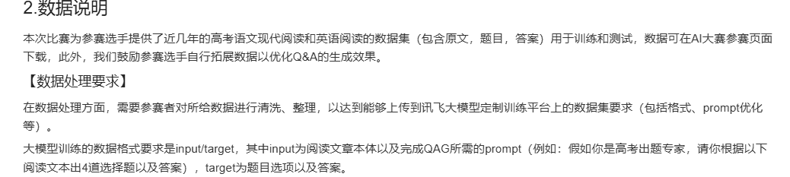
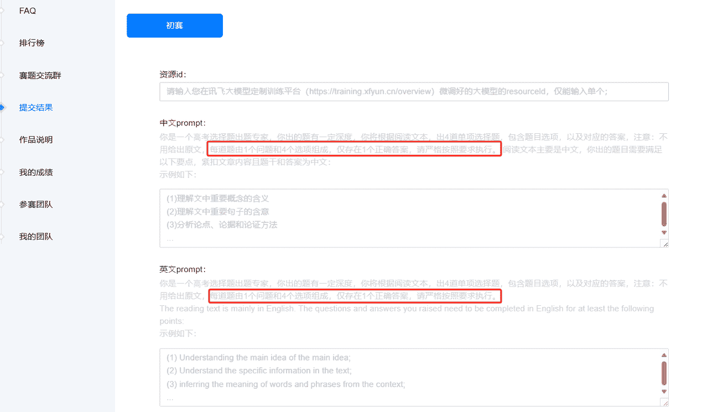
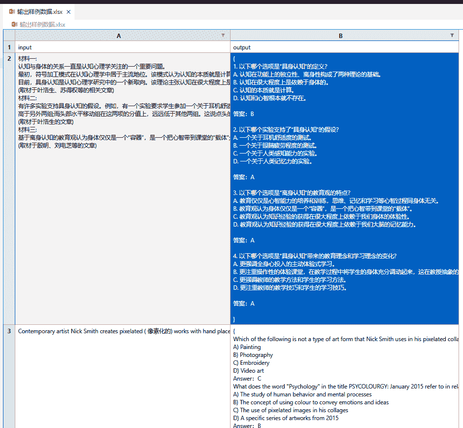
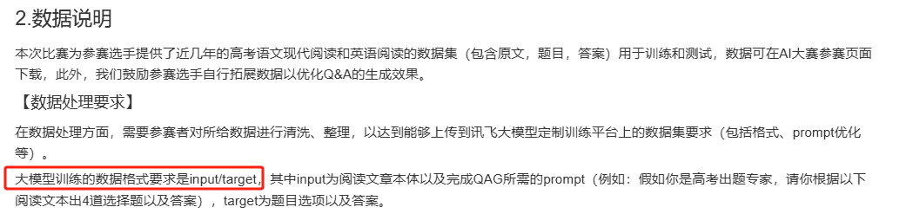
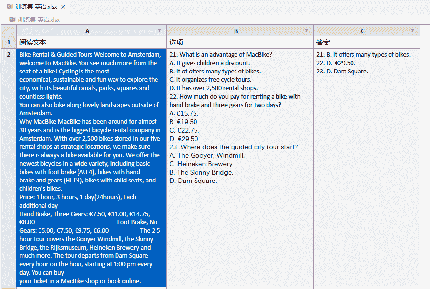
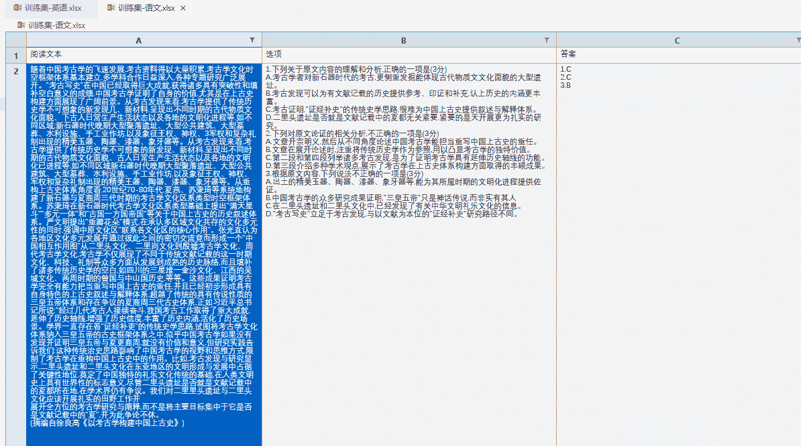
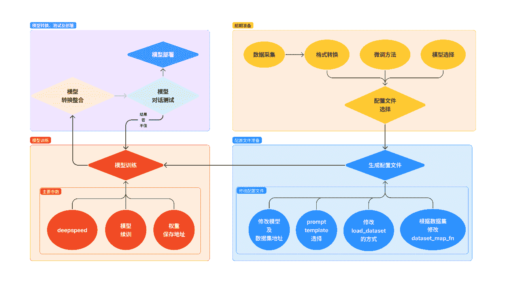
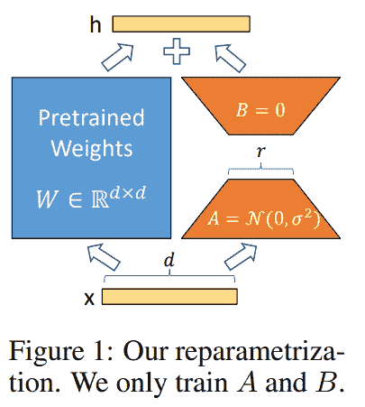
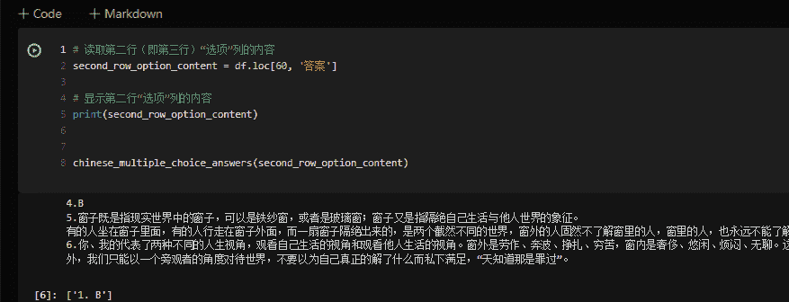
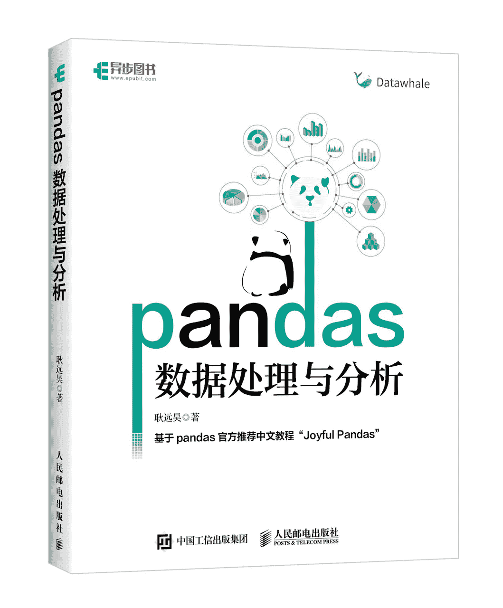

# Task2：baseline1精讲

> 来源：[https://datawhaler.feishu.cn/docx/UycZdpHdHoWZc8xEjb6cgl4Zngg](https://datawhaler.feishu.cn/docx/UycZdpHdHoWZc8xEjb6cgl4Zngg)
>
> **教程贡献者说：**
>
> 前面我们快速跑通了baseline1，大家也拿到了分数~给自己点点赞。
>
> 今天我们的任务是搞清楚baseline1讲了些啥，为什么这样用。妈妈再也不用担心大模型数据微调处理不会啦~
>
> 你可以从中学会如何完成星火大模型驱动阅读理解题库构建挑战赛的任务,通过微调完成推理。

## 数据处理思路介绍

### 1.1 赛题讲解



图1 数据说明



图2 提交界面说明



图3 输出样例

通过上面的描述我们能看到在图1数据说明及图2提交界面中需要我们进行数据处理，然后进行微调。我们要做的是通过大语言模型，输入阅读材料，阅读材料是高考的语文和英语阅读材料，大模型输出选择题及对应的答案，选择题根据阅读材料进行出题。

好的。我们从微调需要的输入输出两方面来看。也就是图4中的`input`与`traget`部分。



图4 数据处理

#### 1.1.1 微调数据input部分

微调需要输入训练数据的阅读材料以及相关要求。 通过以上两项组成我们的微调`input`内容。

##### 阅读材料

这里的材料就是我们的语文英语阅读题目，这个在哪里呢？这部分材料分别对应语文和英语的阅读材料部分。因为我们使用官方给的数据，大家打开昨天的notebook能看到在`训练集-语文.xlsx`、`训练集-英语.xlsx`两个文件的材料，对应阅读文本数据列。





#### 1.1.2 微调数据target部分

大模型中我们知道是一个有输入送入模型，通过模型运行后给出文本输出这样的工作流程，那么我们期望大模型输出的就是 选择题。 这里的 选择题 不单单指选择题的题干，还要有选项和参考答案，要有一定的格式。

这里摘录除了官方输出样例数据给大家了解。

##### 语文

```
{
1. 以下哪个选项是“具身认知”的定义？
A. 认知在功能上的独立性、离身性构成了两种理论的基础。
B. 认知在很大程度上是依赖于身体的。
C. 认知的本质就是计算。
D. 认知和心智根本就不存在。

答案：B

2. 以下哪个实验支持了“具身认知”的假设？
A. 一个关于耳机舒适度的测试。
B. 一个关于眼睛疲劳程度的测试。
C. 一个关于人类感知能力的实验。
D. 一个关于人类记忆力的实验。

答案：A

3. 以下哪个选项是“离身认知”的教育观的特点？
A. 教育仅仅是心智能力的培养和训练，思维、记忆和学习等心智过程同身体无关。
B. 教育观认为身体仅仅是一个“容器”，是一个把心智带到课堂的“载体”。
C. 教育观认为知识经验的获得在很大程度上依赖于我们身体的体验性。
D. 教育观认为知识经验的获得在很大程度上依赖于我们大脑的记忆能力。

答案：A

4. 以下哪个选项是“具身认知”带来的教育理念和学习理念的变化？
A. 更强调全身心投入的主动体验式学习。
B. 更注重操作性的体验课堂，在教学过程中将学生的身体充分调动起来，这在教授抽象的概念知识时尤为重要。
C. 更强调教师的教学方法和学生的学习方法。
D. 更注重教师的教学技巧和学生的学习技巧。

答案：A

}
```

##### 英语

```
{
Which of the following is not a type of art form that Nick Smith uses in his pixelated collages?
A) Painting
B) Photography
C) Embroidery
D) Video art
Answer：C
What does the word &quot;Psychology&quot; in the title PSYCOLOURGY: January 2015 refer to in relation to Nick Smith&#x27;s work?
A) The study of human behavior and mental processes
B) The concept of using colour to convey emotions and ideas
C) The use of pixelated images in his collages
D) A specific series of artworks from 2015
Answer：B
Which of the following is true about Nick Smith&#x27;s career as an artist?
A) He has only worked in the fine arts category
B) His work is primarily focused on interior design
C) He has never used hand-made collages in his work
D) His first collage experiment was inspired by Marilyn Monroe
Answer：D
Which of the following can be inferred about the text employed in Nick Smith&#x27;s work?
A) It is always narrative and sequential
B) It is often open to interpretation by the viewer
C) It is always written in a specific language or script
D) It is always placed under each swatch of colour
Answer：B
}
```

### 1.2 微调数据

因为训练数据为官方给定，我们可以打开查阅了解一下题目有没有什么处理问题。阅读材料格式对题目影响不大，我们处理的核心在选项上，那么我们看看选项和答案内容如何。由于语文部分和英语部分不太一样，我们分开来看。

#### 1.2.1 语文

选项：

```
7.下列对文本相关内容和艺术特色的分析鉴赏，不正确的一项是（3分）（    ）

A.文本一依次写到“月光一照”“启明星贼亮贼亮的”“太阳已经出来了”，既推进了情节发展，也暗示了主人公心理的变化。

B.文本一中的老黄是小说叙述者，也是“手术”的实施者，小说通过描写他不敢下手、不敢看等情形，烘托了老胡的刚毅。

C.文本二中陈毅“术”后笑着说“这回它不会再反攻了”，这样的话语既带着战争年代的特定色彩，也表现出陈毅的乐观与幽默。

D.通过对老胡和陈毅战胜身体痛苦的描写，两个文本不仅写出了战斗生活的艰苦卓绝，更写出了革命信仰的巨大力量。

8.老胡这一人物形象有哪些特点？请结合文本一简要分析。（6分）

9.这两个内容相近的文本文体不同，因而艺术表现也有差异。请比较并简要分析。（6分）
```

答案：

```
7. A
8. 
(1)刚毅果敢。腿部受伤化脓,他果断决定让人挤出脓血,体现出铮铮铁骨。

(2)意志坚强。没有医疗器械和麻药,他忍受剧痛,有不屈的意志。

(3)信念坚定。环境的艰苦和身体的痛苦都不能改变他革命的信念。
9. 
(1)文本一有完整的故事情节,具体展示了事情的起因、经过、高潮和结果:文本二叙

事情节简约。(2)文本一重在艺术性,有动作、语言、神态、细节等描写,还有环境的烘托;

文本二讲究真实性,没有环境方面的烘托渲染。
```

语文题目中，选项不光有选择的题目还包括简答题的题目。由于我们需要，那么需要区分出他们。

语文题目中有()与分值，这个我们需要清洗出来。

#### 1.2.2 英语

选项：

```
24. What can we learn about John from the first two paragraphs?
A. He was fond of traveling.
C. He had an inquiring mind.
B. He enjoyed being alone.
D. He longed to be a doctor.
25. Why did John put the sludge into the tanks?
A. To feed the animals.
C. To protect the plants.
B. To build an ecosystem.
D. To test the eco-machine.
26. What is the author&#x27;s purpose in mentioning Fuzhou?
A. To review John&#x27;s research plans.
C. To compare John&#x27;s different jobs.
B. To show an application of John&#x27;s idea.
D. To erase doubts about John&#x27;s invention.
27. What is the basis for John&#x27;s work?
A. Nature can repair itself.
C. Life on Earth is diverse.
B. Organisms need water to survive.
D. Most tiny creatures live in groups.
```

答案：

```
24. C. . He had an inquiring mind.           25.  D. To test the eco-machine.               26. B. To show an application of John&#x27;s idea.                                               27. A. Nature can repair itself.

```

英语题目中选项用ABCD序号分开，但是有些序号按照ACBD的结构。

答案有解释，需要思考怎么把答案选项抽取出来。

### 1.3 数据处理方案

我们使用`python`中的`re`来实现字符串的处理工作。使用`pandas`来做数据处理模块方便我们处理`xlsx`文件。

#### 1.3.1 Python 正则表达式

正则表达式是一个特殊的字符序列，它能帮助你方便的检查一个字符串是否与某种模式匹配。

Python 自1.5版本起增加了`re` 模块，它提供 Perl 风格的正则表达式模式。

`re` 模块使 Python 语言拥有全部的正则表达式功能。

`compile` 函数根据一个模式字符串和可选的标志参数生成一个正则表达式对象。该对象拥有一系列方法用于正则表达式匹配和替换。

`re` 模块也提供了与这些方法功能完全一致的函数，这些函数使用一个模式字符串做为它们的第一个参数。

本章节主要介绍Python中常用的正则表达式处理函数。

#### 1.3.2 pandas库

`Pandas` 是 Python 语言的一个扩展程序库，用于数据分析。

`Pandas` 名字衍生自术语 "panel data"（面板数据）和 "Python data analysis"（Python 数据分析）。

`Pandas` 是一个开放源码、BSD 许可的库，提供高性能、易于使用的数据结构和数据分析工具。

[`Pandas`](https://www.runoob.com/numpy/numpy-tutorial.html) 一个强大的分析结构化数据的工具集，基础是 `Numpy`（提供高性能的矩阵运算）。

`Pandas` 可以从各种文件格式比如 CSV、JSON、SQL、Microsoft Excel 导入数据。

`Pandas` 可以对各种数据进行运算操作，比如归并、再成形、选择，还有数据清洗和数据加工特征。

`Pandas` 广泛应用在学术、金融、统计学等各个数据分析领域。

#### 1.3.3 处理目标

我们需要将文件中的数据读取出来，将语文数据与英语数据整理好后存储成可以微调的数据格式。可以微调的数据格式我们可以选择`csv`与`jsonl`类型。

### 1.4 处理流程

将语文、英语训练集按照下图结构，选项与答案组成`output`模块，`prompt`+阅读文本组成`input`模块。这样就是我们的处理流程结构啦。

## 微调流程介绍

### 2.1 大语言模型介绍

#### 大语言模型的概念

**大语言模型（英文：Large Language Model，缩写LLM）**，也称大型语言模型，是一种人工智能模型，旨在理解和生成人类语言。

**通常**，**大语言模型 (LLM)** 指包含数十亿（Billion或更多）参数的语言模型，这些模型在大量的文本数据上进行训练，例如国外的有GPT-3 、GPT-4、`PaLM`、`Galactica` 和 `LLaMA` 等，国内的有ChatGLM、文心一言、通义千问、讯飞星火等。

#### 大模型的能力和特点

1. **大模型的能力**

大语言模型（`LLM`）与以前的预训练语言模型（`PLM`）的主要区别在于其涌现能力。这种能力在小型模型中不明显，但在大型模型中显著。例如：

+ **上下文学习**：首次由`GPT-3`引入，允许模型在提供自然语言指令或多个任务示例的情况下，通过理解上下文并生成相应输出来执行任务。

+ **指令遵循**：通过指令微调，`LLM`可以根据任务指令执行未见过的任务，展示出强大的泛化能力。

+ **逐步推理**：通过"思维链（Chain of Thought, CoT）"策略，`LLM`能够解决多步推理任务，例如数学问题。

1. **大模型的特点**

+ **巨大的规模**：参数规模达数十亿甚至数千亿，使其能捕捉更多语言知识和复杂语法结构。

+ **预训练和微调**：在大规模无标签文本数据上预训练，然后通过有标签数据微调，适应特定任务。

+ **上下文感知**：具备强大的上下文感知能力，能够理解和生成依赖前文的文本内容。

+ **多语言支持**：支持多种语言，促进跨文化和跨语言的应用。

+ **多模态支持**：一些`LLM`支持文本、图像和语音的多模态数据。

+ **涌现能力**：在大规模模型中表现出明显的性能提升，能处理更复杂的任务。

+ **多领域应用**：广泛应用于文本生成、自动翻译、信息检索、摘要生成、聊天机器人等多个领域。

+ **伦理和风险问题**：需要谨慎处理生成有害内容、隐私问题和认知偏差等伦理和风险问题。

### 2.2 微调介绍

#### 什么是模型微调？



相当于给你一个预训练模型（Pre-trained model），基于这个模型微调（Fine Tune）。

**预训练模型**就是已经用数据集训练好了的模型。

#### 两种 Finetune 范式

1. **增量预训练微调 (Continue PreTraining)**

使用场景：让基座模型学习到一些新知识，如某个垂类领域的常识

训练数据：文章、书籍、代码等

1. **指令跟随微调 (Supervised Finetuning)**

使用场景：让模型学会对话模板，根据人类指令进行对话

训练数据：高质量的对话、问答数据

#### 为什么要微调？

相对于从头开始训练(Training a model from scatch)，微调可以省去大量计算资源和计算时间，提高了计算效率,甚至提高准确率。

**普通预训练模型**的特点是：用了大型数据集做训练，已经具备了提取浅层基础特征和深层抽象特征的能力。

**不做微调**：

（1）从头开始训练，需要大量的数据，计算时间和计算资源。

（2）存在模型不收敛，参数不够优化，准确率低，模型泛化能力低，容易过拟合等风险。

**使用微调**：避免了上述可能存在的问题。

#### 什么情况下使用微调？

（1） 你要使用的数据集和预训练模型的数据集相似

如果不太相似，效果可能就没有那么好了，特征提取是不同的，所以相应的参数训练后也是不同的。

（2） 自己搭建或者使用的模型正确率太低。

（3）数据集相似，但数据集数量太少。

（4）计算资源太少。

#### 不同数据集下使用微调

+ 数据集1 - 数据量少，但数据相似度非常高在这种情况下，我们所做的只是修改最后几层或最终的`softmax`图层的输出类别。

+ 数据集2 - 数据量少，数据相似度低在这种情况下，我们可以冻结预训练模型的初始层（比如`k`层），并再次训练剩余的（`n-k`）层。由于新数据集的相似度较低，因此根据新数据集对较高层进行重新训练具有重要意义。

+ 数据集3 - 数据量大，数据相似度低在这种情况下，由于我们有一个大的数据集，我们的神经网络训练将会很有效。但是，由于我们的数据与用于训练我们的预训练模型的数据相比有很大不同。使用预训练模型进行的预测不会有效。因此，最好根据你的数据从头开始训练神经网络（Training from scatch）。

+ 数据集4 - 数据量大，数据相似度高这是理想情况。在这种情况下，预训练模型应该是最有效的。使用模型的最好方法是保留模型的体系结构和模型的初始权重。然后，我们可以使用在预先训练的模型中的权重来重新训练该模型。

#### 微调指导事项


# 迁移学习与 LoRA 基础

## 迁移学习微调策略

1. 通常的做法是截断预先训练好的网络的最后一层（`softmax` 层），并用与我们自己的问题相关的新的 `softmax` 层替换它。例如，`ImageNet` 上预先训练好的网络带有 1000 个类别的 `softmax` 图层。如果我们的任务是对 10 个类别的分类，则网络的新 `softmax` 层将由 10 个类别组成，而不是 1000 个类别。然后，我们在网络上运行预先训练的权重。确保执行交叉验证，以便网络能够很好地推广。

2. 使用较小的学习率来训练网络。由于我们预计预先训练的权重相对于随机初始化的权重已经相当不错，我们不想过快地扭曲它们太多。通常的做法是使初始学习率比用于从头开始训练（`Training from scratch`）的初始学习率小 10 倍。

3. 如果数据集数量过少，我们进来只训练最后一层，如果数据集数量中等，冻结预训练网络的前几层的权重也是一种常见做法。

> 这是因为前几个图层捕捉了与我们的新问题相关的通用特征，如曲线和边。我们希望保持这些权重不变。相反，我们会让网络专注于学习后续深层中特定于数据集的特征。

## LoRA

### LoRA

[`LoRA`](https://zhuanlan.zhihu.com/p/650197598) 是一种高效微调方法，深入了解其原理可参见博客：[知乎|深入浅出`Lora`] 。

### LoRA 的优势

- 可以针对不同的下游任务构建小型 `LoRA` 模块，从而在共享预训练模型参数基础上有效地切换下游任务。

- `LoRA` 使用自适应优化器（`Adaptive Optimizer`），不需要计算梯度或维护大多数参数的优化器状态，训练更有效、硬件门槛更低。

- `LoRA` 使用简单的线性设计，在部署时将可训练矩阵与冻结权重合并，不存在推理延迟。

- `LoRA` 与其他方法正交，可以组合。

### LoRA 的原理



- https://github.com/microsoft/LoRA?tab=readme-ov-file

- https://arxiv.org/pdf/2106.09685

- https://huggingface.co/docs/peft/quicktour

## 微调处理流程

# baseline1 精讲

## 3.1 环境准备

相关库的下载与安装：

```
!pip install pandas openpyxl
```

数据加载与抽取

## 3.2 语文数据处理

### 3.2.1 数据加载

这里我们使用 `pandas` 加载 `xlsx` 中的数据，这里面我们使用全局匹配，将训练集中的中文点与左侧括号匹配为英文类型。

```
# coding~

import pandas as pd
import re

# 读取Excel文件
df = pd.read_excel(&#x27;训练集-语文.xlsx&#x27;)
df = df.replace(&#x27;．&#x27;, &#x27;.&#x27;, regex=True)
df = df.replace(&#x27;（&#x27;, &#x27;(&#x27;, regex=True)

# 读取第二行（即第三行）“选项”列的内容
# 可以使用loc获取某行的数据
second_row_option_content = df.loc[2, &#x27;选项&#x27;]

# 显示第二行“选项”列的内容
print(second_row_option_content)
```

### 3.2.2 抽取问题

这里主要是为了抽取题目及答案，并且过滤简答题。大家可以阅读详细的注释理解 `chinese_multiple_choice_questions` 函数如何工作。

```
def chinese_multiple_choice_questions(questions_with_answers):
    # 输入的题目文本
    text = questions_with_answers

    
    question_pattern = re.compile(r&#x27;\d+\..*?(?=\d+\.|$)&#x27;, re.DOTALL)
    # 这一行作用是匹配一个以数字开头、后面跟着一个点字符的字符串，
    #。直到遇到下一个数字和点字符或字符串结束。
    choice_pattern = re.compile(r&#x27;([A-D])\s*(.*?)(?=[A-D]|$|\n)&#x27;, re.DOTALL)
    # 这一行作用是匹配一个以字母[A到D]开头、后面跟着一个点字符的字符串，
    #直到遇到下一个[A到D]或字符串结束。
    
    
    # 找到所有问题
    questions = question_pattern.findall(text)

    # 初始化选择题和简答题列表
    multiple_choice_questions = []
    short_answer_questions = []

        # 处理每个问题
    for id,question in enumerate(questions):
        # 这里取到的question，如果是选择题会带着选择题的选项。
        # 检查是否是选择题 因为选择题内有ABCD这样的选项
        if re.search(r&#x27;[A-D]&#x27;, question):
            # 如果有选项，提取出选项的内容
            choices = choice_pattern.findall(question)
            # 这里提取了题目的内容，因为每个题目都会有一个打分的（X分）这样的标记
            # 以左括号为目标，截取选择题选项中的内容
            question_text = re.split(r&#x27;\n&#x27;, question.split(&#x27;(&#x27;)[0])[0]
            
            
            pattern_question = re.compile(r&#x27;(\d+)\.(.*)&#x27;)
            # 这里清洗了选择题的编号，重新用循环中的id进行编号。
            # 如果不做这一步可以发现给定的数据中编号是乱序的。
            matches_question = str(id+1)+&#x27;.&#x27;+ pattern_question.findall(question_text)[0][1] # 取出问题后重排序
            # print(str(id+1)+&#x27;.&#x27;+matches_question)
            
            # 这里我们实现声明好了存储的列表
            # 将每个问题和选项以字典的形式存入方便我们处理
            multiple_choice_questions.append({
                &#x27;question&#x27;: matches_question,
                &#x27;choices&#x27;: choices
            })
        else:
            # 大家可以想想这里怎么用？
            short_answer_questions.append(question.strip())
    # 最后我们返回抽取后的选择题字典列表
    return multiple_choice_questions
```

### 3.2.3 抽取问题的结果

这里我们抽取刚才我们拿到的选择题的答案部分。

```
def chinese_multiple_choice_answers(questions_with_answers):
   # 首先清洗输入字段，因为答案字段中的格式不统一，清洗后便于统一处理。
   # 这里删除了所有的换行和空格
    questions_with_answers = questions_with_answers.replace(&quot; &quot;, &quot;&quot;).replace(&quot;\n&quot;, &quot;&quot;)
    
    # print(questions_with_answers)
    # 使用正则表达式匹配答案
    # 这里我们主要使用第一个匹配 一个数字+点+字母ABCD之间一个
    choice_pattern = re.compile(r&#x27;(\d+)\.([A-Z]+)&#x27;)
    # 下面这句匹配的是简答题答案~  目前可以忽略
    short_pattern = re.compile(r&#x27;(\d+)\.([^A-Z]+)&#x27;)

    # 找到所有匹配的答案
    choice_matches = choice_pattern.findall(questions_with_answers)
    short_matches = short_pattern.findall(questions_with_answers)

    # 将匹配结果转换为字典
    choice_answers = {int(index): answer for index, answer in choice_matches}
    short_answers = {int(index): answer for index, answer in short_matches}

    # 按序号重新排序
    sorted_choice_answers = sorted(choice_answers.items())
    sorted_short_answers = sorted(short_answers.items())
    
    answers = []

    # 输出结果
    
    # print(&quot;选择题答案：&quot;)
    for id in range(len(sorted_choice_answers)):
    # 这里我们也将重新编号号的答案作为返回，返回的是一个列表，方便与问题字典列表匹配~
        answers.append(f&quot;{id+1}. {sorted_choice_answers[id][1]}&quot;)
    return answers
```



这里是一个样例~

### 3.2.4 prompt 设计

正如我们 1.4 介绍的，我们使用要求+阅读材料组成 `prompt`，作为 `input` 部分。

我们看看代码如何实现？

```
def get_prompt_cn(text):
    prompt = f&#x27;&#x27;&#x27;
    你是⼀个⾼考选择题出题专家，你出的题有⼀定深度，你将根据阅读文本，出 4 道单项选择题，包含题目选项，以及对应的答案，注意：不⽤给出原文，每道题由 1 个问题和 4 个选项组成，仅存在 1 个正确答案，请严格按照要求执行。 阅读文本主要是中文，你出的题目需要满足以下要点，紧扣文章内容且题干和答案为中文：
    
    ### 回答要求
    (1) 理解文中重要概念的含义
    (2) 理解文中重要句子的含意
    (3) 分析论点、论据和论证方法
    
    
    ### 阅读文本
    {text}
    &#x27;&#x27;&#x27;
    
    return prompt   
```

可以看到代码里面首先对大模型做了声明，声明如下：

你是⼀个⾼考选择题出题专家，你出的题有⼀定深度，你将根据阅读文本，出 4 道单项选择题，包含题目选项，以及对应的答案，注意：不⽤给出原文，每道题由 1 个问题和 4 个选项组成，仅存在 1 个正确答案，请严格按照要求执行。 阅读文本主要是中文，你出的题目需要满足以下要点，紧扣文章内容且题干和答案为中文：

这里是官方的声明，不建议修改~

接下来是要求部分：（这里建议大家根据出题要求做修改尝试~）

### 回答要求

(1) 理解文中重要概念的含义

(2) 理解文中重要句子的含意

(3) 分析论点、论据和论证方法

最后是阅读材料，这里其实是我们传入的阅读材料参数。

### 阅读文本

{text}

### 3.2.5 中文数据处理主函数

这段代码将 `input` 与 `output` 部分进行组合，按照列表序号一一对应~

可以看看注释中的实现细节~

```
def process_cn(df): 
    # 定义好返回列表
    res_input = []
    res_output = []

    for id in range(len(df)):
        # 逐个遍历每行的选项、答案、阅读文本的内容
        data_options = df.loc[id, &#x27;选项&#x27;]
        data_answers = df.loc[id,&#x27;答案&#x27;]
        data_prompt = df.loc[id,&#x27;阅读文本&#x27;]
        # 处理选项部分，抽取出选择题题目及选项
        data_options = chinese_multiple_choice_questions(data_options)
        # 处理答案部分，抽取出选择题答案
        data_answers = chinese_multiple_choice_answers(data_answers)
        # 抽取阅读材料组合成 input 内容
        data_prompt = get_prompt_cn(data_prompt)
        # print(data_options)
        # print(data_answers)
        # 做数据验证，因为训练数据格式不能确定每组数据都能被正常处理（会有一部分处理失败）
        # 我们验证一下两个列表的长度 如果相同代表数据处理正确
        if(len(data_answers)==len(data_options)):
            # 定义 output 的数据字符串
            res = &#x27;&#x27;
            # 处理选择题目中的每个数据，逐个拼入到 output 字符串
            for id_,question in enumerate(data_options):
            # 首先放入题目
                res += f&#x27;&#x27;&#x27;
{question[&#x27;question&#x27;]}?
                &#x27;&#x27;&#x27;+&#x27;\n&#x27;
                # 然后找到选择题的每个选项，进行 choices 列表循环
                for choise in question[&#x27;choices&#x27;]:
                # 逐个将选项拼接到字符串
                    res = res+ choise[0] + choise[1]+ &#x27;\n&#x27;
                #  最后将答案拼接到每个选择题的最后
                # 以 答案：题号.选项的格式
                res = res + &#x27;答案:&#x27; + str(data_answers[id_].split(&#x27;.&#x27;)[-1])  + &#x27;\n&#x27;
            # 最后将处理得到的 input、output 数据存入到列表
            res_output.append(res)
            res_input.append(data_prompt)
        # break
    return res_input,res_output
    
```

## 3.3 英文数据处理

### 3.3.1 数据加载

和中文一样。

```
# coding~

import pandas as pd

# 读取Excel文件
df = pd.read_excel(&#x27;训练集-英语.xlsx&#x27;)
# 英文数据处理中有一部分 ocr 识别的题目，这种题目中看上去是字母 A，但是实际为俄文的字母，，
# 所以开始使用全局匹配做了清洗……
df = df.replace(&#x27;．&#x27;, &#x27;.&#x27;, regex=True).replace(&#x27;А.&#x27;, &#x27;A.&#x27;, regex=True).replace(&#x27;В.&#x27;, &#x27;B.&#x27;, regex=True).replace(&#x27;С.&#x27;, &#x27;C.&#x27;, regex=True).replace(&#x27;D.&#x27;, &#x27;D.&#x27;, regex=True)
# df = df.replace(&#x27;（&#x27;, &#x27;(&#x27;, regex=True)

# 读取第二行（即第三行）“选项”列的内容
second_row_option_content = df.loc[0, &#x27;选项&#x27;]

# 显示第二行“选项”列的内容
print(second_row_option_content)
```

### 3.3.2 抽取问题

英文问题数据相对标准，但是也有不少小问题。比如 `ABCD` 的顺序可能是 `ACBD`。我们看看这些如何解决。


```
import re

# 示例文本
text = second_row_option_content

def get_questions(text):
    # 数据清洗，将所有换行改为两个空格方便统一处理
    text = text.replace('\n', '  ')+'  '
    # print(text)
    # 正则表达式模式
    # 通过匹配以数字开头然后带一个点，为题干
    # 然后抽取选项A  以A开头 后面带一个点 最后以两个空格结尾
    # 为什么是两个空格？部分数据换行时为换行符，我们已经换成了两个空格，有些是以多个空格分割，我们默认为两个空格
    # 接着匹配B C D选项内容
    # 最后有一个
    pattern = re.compile(r'(\d+\..*?)(A\..*?\s{2})([B-D]\..*?\s{2})([B-D]\..*?\s{2})(D\..*?\s{2})', re.DOTALL)

    # 查找所有匹配项
    matches = pattern.findall(text)

    # 存储结果的字典列表
    questions_dict_list = []

    # 打印结果
    for match in matches:
        question, option1, option2, option3, option4 = match
        pattern_question = re.compile(r'(\d+)\.(.*)')
        # 第一个为选择题的题目 提前存到question_text 
        question_text = pattern_question.findall(question.strip())[0][1]
        
        # 提取选项字母和内容
        options = {option1[0]: option1, option2[0]: option2, option3[0]: option3, option4[0]: option4}
        
        question_dict = {
            'question': question_text,
            # 这一步就是防止ACBD这种乱序，我们进行重新匹配，将可能是ACBD的数据以首字母按位置排好号
            'options': {
                'A': options.get('A', '').strip(),
                'B': options.get('B', '').strip(),
                'C': options.get('C', '').strip(),
                'D': options.get('D', '').strip()
            }
        }
        
        questions_dict_list.append(question_dict)
    # 最后获得
    return questions_dict_list

# 调用函数并打印结果
questions = get_questions(text)
for q in questions:
    print(q)
```

### 3.3.3 抽取问题的结果

```
# 首先做数据清洗，将空格、换行符及点都删除
def remove_whitespace_and_newlines(input_string):
    # 使用str.replace()方法删除空格和换行符
    result = input_string.replace(" ", "").replace("\n", "").replace(".", "")
    return result
```

```
import re

# 示例文本
text = """
32. B. The underlying logic of the effect.                                                   33.D. estimates were not fully independent.
34.C. The discussion process.            35.D. Approving.
"""
def get_answers(text):
    text = remove_whitespace_and_newlines(text)
    # 正则表达式模式
    # 这里是一个数字加一个A-D的大写字母表示为答案区域，因为有些答案中有解释，这样的匹配规则可以尽可能匹配到答案
    pattern = re.compile(r'(\d)\s*([A-D])')

    # 查找所有匹配项
    matches = pattern.findall(text)
    res = []
    # 打印结果
    for match in matches:
        number_dot, first_letter = match
        res.append(first_letter)
    return res
```

### 3.3.4 `prompt`设计

```
def get_prompt_en(text):
    prompt = f'''
    你是⼀个⾼考选择题出题专家，你出的题有⼀定深度，你将根据阅读文本，出4道单项选择题，包含题目选项，以及对应的答案，注意：不⽤给出原文，每道题由1个问题和4个选项组成，仅存在1个正确答案，请严格按照要求执行。
The reading text is mainly in English. The questions and answers you raised need to be completed in English for at least the following points:
    
    ### 回答要求
    (1)Understanding the main idea of the main idea.
    (2)Understand the specific information in the text.
    (3)infering the meaning of words and phrases from the context
    
    
    ### 阅读文本
    {text}
    '''
    
    return prompt   
```

可以看到代码里面首先对大模型做了声明，声明如下：

你是⼀个⾼考选择题出题专家，你出的题有⼀定深度，你将根据阅读文本，出4道单项选择题，包含题目选项，以及对应的答案，注意：不⽤给出原文，每道题由1个问题和4个选项组成，仅存在1个正确答案，请严格按照要求执行。

The reading text is mainly in English. The questions and answers you raised need to be completed in English for at least the following points:

这里是官方的声明，不建议修改~

接下来是要求部分：（这里建议大家根据出题要求做修改尝试~）

### 回答要求

(1)Understanding the main idea of the main idea.

(2)Understand the specific information in the text.

(3)infering the meaning of words and phrases from the context

最后是阅读材料，这里其实是我们传入的阅读材料参数。

### 阅读文本

`{text}`

### 3.3.5 英文数据处理主函数

这里大家可以参考中文部分对比学习，相比中文简单很多~

```
def process_en(df): 
    res_input = []
    res_output = []
    for id in range(len(df)):
        data_options = df.loc[id, '选项']
        data_answers = df.loc[id,'答案']
        data_prompt = df.loc[id,'阅读文本']
        data_options = get_questions(data_options)
        data_answers = get_answers(data_answers)
        data_prompt = get_prompt_en(data_prompt)
        # print(data_options)
        # print(data_answers)

        if(len(data_answers)==len(data_options)):
            res = ''
            for id,question in enumerate(data_options):
                res += f'''
                {id+1}.{question['question']}
                {question['options']['A']}
                {question['options']['B']}
                {question['options']['C']}
                {question['options']['D']}
                answer:{data_answers[id]}
                '''+'\n'
            res_output.append(res)
            res_input.append(data_prompt)
    return res_input,res_output
    # break
```

# 3.4 数据合并

因为微调需要150条数据，数据处理后得到有效数据为102，从中文抽取30条，英文抽取20条组成152条数据作为微调数据。

```
# 将两个列表转换为DataFrame

df_new = pd.DataFrame({'input': cn_input+cn_input[:30]+en_input+en_input[:20], 'output': cn_output+cn_output[:30]+en_output+en_output[:20]})
```

# 额外补充知识

## `python`知识

如果你对`baseline1`的解读仍然充满困惑，那么推荐你从学习`python`开始，打好基础再来尝试也不迟~

你可以学习《聪明办法学`python`第二版》打扎实深度学习相关的`python`基础知识~

## `Pandas`相关知识



https://github.com/datawhalechina/joyful-pandas

## 大语言模型知识

大模型基础: 一文了解大模型基础知识

https://github.com/datawhalechina/so-large-lm

如果你想从0手写代码，构建大语言模型，本项目很适合你。

https://github.com/datawhalechina/llms-from-scratch-cn

吴恩达系列课程

https://github.com/datawhalechina/llm-cookbook

> [ QA & 其他彩蛋](https://datawhaler.feishu.cn/wiki/AWAQwWgPkignkUkU43zcbdfQnrh)！

> [ QA & 其他彩蛋](https://datawhaler.feishu.cn/wiki/AWAQwWgPkignkUkU43zcbdfQnrh)任何想法都可以在学习群里交流或在  进行填写哟~

>

> 本教程主要由   写作贡献，

> 融合了多位助教的内测体验和宝贵建议。

> 如果你觉得对你有价值和启发，请在下面点赞和评论哟~

>

## 另外别忘了写笔记打卡呀！！~

## 及时思考、沉淀和产出能让你的学习事半功倍！

>

> 注：本文采用 署名—非商业性使用—相同方式共享 4.0 协议国际版许可协议进行许可。
