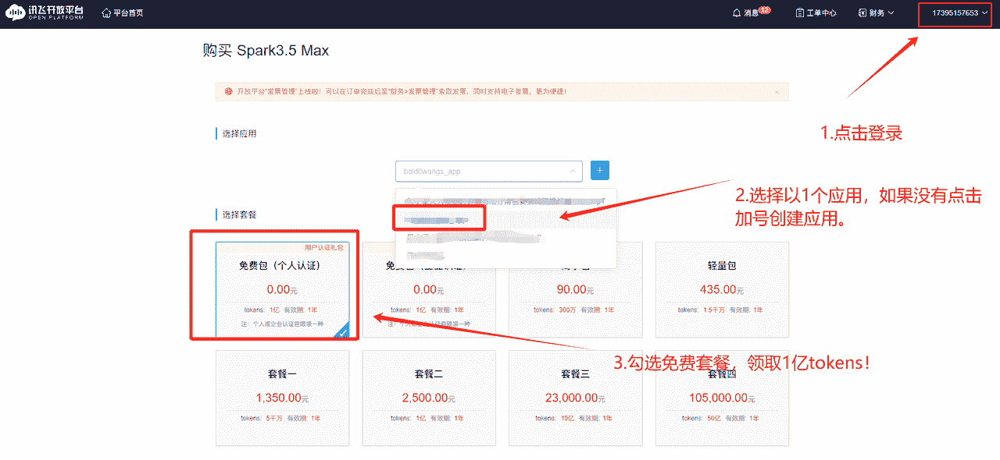
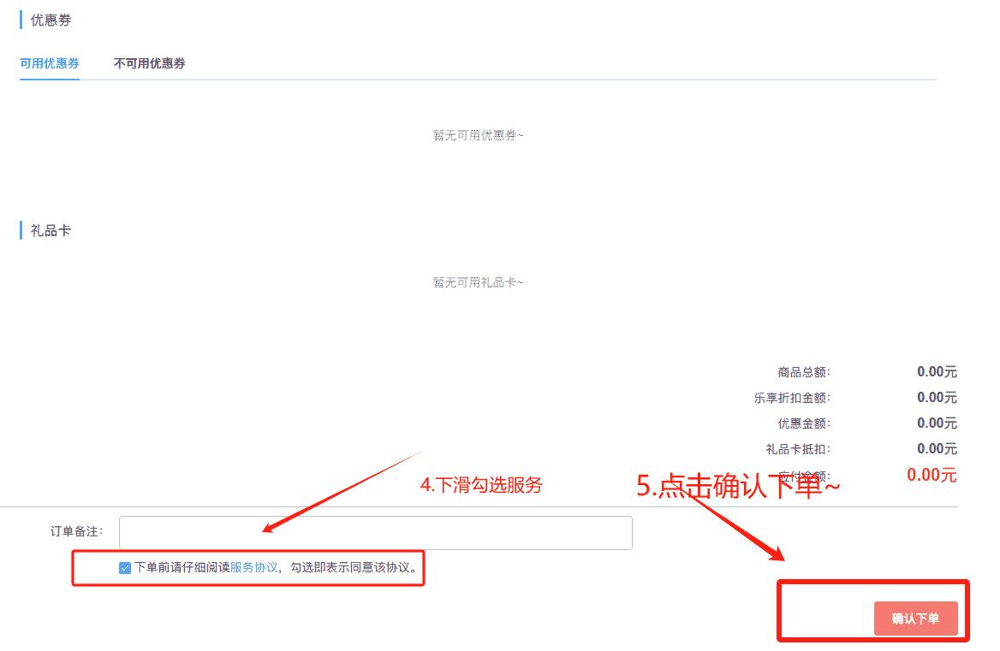
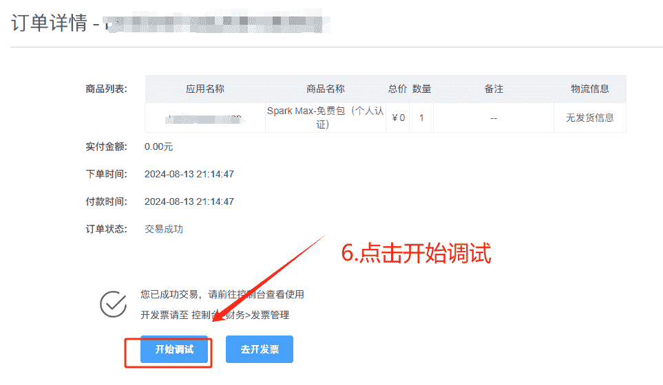
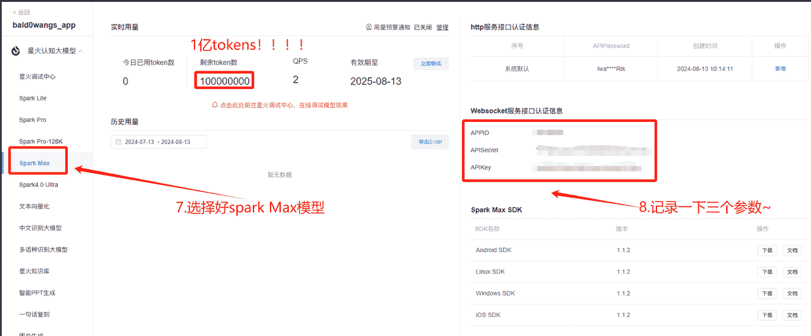
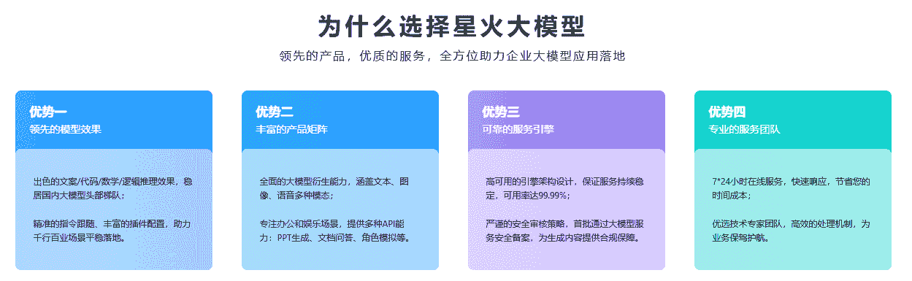
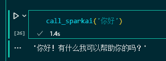

# Task3：数据增强与评分

> 来源：[https://datawhaler.feishu.cn/docx/CoQxdznURoQae2x5IPocal74nxe](https://datawhaler.feishu.cn/docx/CoQxdznURoQae2x5IPocal74nxe)

> **教程贡献者说：**

> 前面我们介绍了 `baseline` 的思路及写作方案，这里我们尝试对数据做增强，但是需要聪明的你加入自己的努力完成更好的思路。

> 今天需要大家学习上手尝试数据增强，不过我会把增强的思路和相关知识告诉大家，让大家学习如何使用 `llm` 完成数据增强部分，但是怎么组合就需要大家自己动手完成啦。

> 接着会帮助大家解决评分的困扰，因为每周只能提交四次成绩，对大家来说每次成绩如果没有起色但是提交会影响大家的修改进度，这里抛砖引玉给出评分 `prompt`。

备注：这里的代码请到 https://aistudio.baidu.com/projectdetail/8236744 fork 食用。

# 1. 数据增强

## 1.1 星火大模型 API 申请与使用

> 为了方便大家完成大模型实现数据增强的方案，这里我们介绍如何申请 1 亿星火 MAX 大模型 tokens 并使用的方法。如果大家还有其他大模型想要尝试可以自行修改哦~

### 1.1.1 1 亿 tokens 申请

首先请大家登录领取网址：星火大模型 MAX API 领取地址（点击跳转）









再次进入上述页面点击 [这里](https://console.xfyun.cn/services/bm35)（快速跳转到星火 Max 配置页面，记得选对应用昂）~

**星火模型介绍：**



### 1.1.2 星火 Max 模型 API 调用方式

```
# 环境安装
pip install --upgrade spark_ai_python
```

**API 调用脚本：**

这里我封装好了主要代码，大家像 `baseline1` 一样填入下面参数即可。

```
SPARKAI_APP_ID = ''
SPARKAI_API_SECRET = ''
SPARKAI_API_KEY = ''
```

记得填入上面的参数哦~

```
from sparkai.llm.llm import ChatSparkLLM, ChunkPrintHandler
from sparkai.core.messages import ChatMessage

# 星火认知大模型 Spark Max 的 URL 值，其他版本大模型 URL 值请前往文档（https://www.xfyun.cn/doc/spark/Web.html）查看
SPARKAI_URL = 'wss://spark-api.xf-yun.com/v3.5/chat'
# 星火认知大模型调用秘钥信息，请前往讯飞开放平台控制台（https://console.xfyun.cn/services/bm35）查看
SPARKAI_APP_ID = ''
SPARKAI_API_SECRET = ''
SPARKAI_API_KEY = ''
# 星火认知大模型 Spark Max 的 domain 值，其他版本大模型 domain 值请前往文档（https://www.xfyun.cn/doc/spark/Web.html）查看
SPARKAI_DOMAIN = 'generalv3.5'

def call_sparkai(prompt):
    spark = ChatSparkLLM(
        spark_api_url=SPARKAI_URL,
        spark_app_id=SPARKAI_APP_ID,
        spark_api_key=SPARKAI_API_KEY,
        spark_api_secret=SPARKAI_API_SECRET,
        spark_llm_domain=SPARKAI_DOMAIN,
        streaming=False,
    )
    messages = [ChatMessage(
        role="user",
        content=prompt
    )]
    handler = ChunkPrintHandler()
    a = spark.generate([messages], callbacks=[handler])
    return a.generations[0][0].text
```

测试：

这里调用函数即可使用 3.5 模型~ 整体来说比较简单。大家记得 3.5 的模型不光这次比赛能用，日常也可以调用这 1 亿 tokens 做一些别的开发。



## 1.2 数据增强思路

数据增强为了补充一些数据，一方面是在先前生成的结果上做一些优化，另一方面可以再生成一些补充数据以作增强。这一部分我只给出核心代码，细节部分需要大家自行完成~ 哒哒，也算是这一期的作业咯 //

### 1.2.1 使用大模型完成答案生成

还记得我们的训练数据吗？

| 阅读文本 | 选项 | 答案 |
| --- | --- | --- |

大概是上面三部分，那么如果咱们使用大模型，如何直接生成我们需要的 QA 数据呢？

这里我们使用大模型完成，想必聪明的大家已经想到了这个方法，不过不知道怎么入手。

这里我就从 `prompt` 到实践介绍核心代码，大家自行在 `baseline1` 上修改即可！

#### Prompt 设计

给出主要需求：

你是一个高考英语阅读题出题专家，请阅读材料，需要参考参考内容 按照要求将题目、选项、答案对其补充完整。

【这里我们要给定大模型身份，这是一般书写 Prompt 的第一句。接着向大模型指定任务，按照我们的要求做一些事情，还有一些参考内容。】

接着给出参考材料：

### 阅读材料

`{reading}`

接着给出具体要求：

### 要求

1. 需要将序号对应的题目与答案做匹配。
2. 匹配后格式按照问题、ABCD 四个选项顺序、答案的结构组合，按照参考内容格式输出。
3. 如果选择题目数量不够四个请根据阅读材料及出题思路再生成题目，总题目达到四个。
4. 题目中不能出现任何不合理的词汇、语法错误。
5. 如果有简答题目与答案请忽略这部分内容，只处理选择题目。

【这里是需要大模型一步步去完成的任务，每一条都是大模型需要遵守并实现的。再开头我们只是粗劣的告诉大模型干嘛，但是想大模型老老实实听话干活，需要我们将每个任务都拆解清晰逐步明确！】

接着给出参考内容：

`{cankao_content}`

```
cankao_content = '''
1. 以下哪个选项是“具身认知”的定义？
A. 认知在功能上的独立性、离身性构成了两种理论的基础。
B. 认知在很大程度上是依赖于身体的。
C. 认知的本质就是计算。
D. 认知和心智根本就不存在。

答案：B

2. 以下哪个实验支持了“具身认知”的假设？
A. 一个关于耳机舒适度的测试。
B. 一个关于眼睛疲劳程度的测试。
C. 一个关于人类感知能力的实验。
D. 一个关于人类记忆力的实验。

答案：A

3. 以下哪个选项是“离身认知”的教育观的特点？
A. 教育仅仅是心智能力的培养和训练，思维、记忆和学习等心智过程同身体无关。
B. 教育观认为身体仅仅是一个“容器”，是一个把心智带到课堂的“载体”。
C. 教育观认为知识经验的获得在很大程度上依赖于我们身体的体验性。
D. 教育观认为知识经验的获得在很大程度上依赖于我们大脑的记忆能力。

答案：A

4. 以下哪个选项是“具身认知”带来的教育理念和学习理念的变化？
A. 更强调全身心投入的主动体验式学习。
B. 更注重操作性的体验课堂，在教学过程中将学生的身体充分调动起来，这在教授抽象的概念知识时尤其重要。
C. 更强调教师的教学方法和学生的学习方法。
D. 更注重教师的教学技巧和学生的学习技巧。

答案：A
'''
```

【这里的参考内容即为我们的标准参考答案，这里给出了语文部分，如果大家想对英语部分修改直接拿输出样例文件中的英语部分即可（我个人觉得英语的结构不规范，建议修改一下）。为什么我们要给参考内容呢，其实我们使用了 one shot learining 策略，具体内容请学习这篇论文 One-Shot Learning as Instruction Data Prospector for Large Language Models】

最后给出题目和答案

```
def get_adddata_prompt_zero(reading, cankao_content, question, answer):
    prompt = f'''你是一个高考英语阅读题出题专家，请阅读材料，需要参考参考内容 按照要求将题目、选项、答案对其补充完整。

### 阅读材料
{reading}

### 要求
1. 需要将序号对应的题目与答案做匹配。
2. 匹配后格式按照问题、ABCD 四个选项顺序、答案的结构组合，按照参考内容格式输出。
3. 如果选择题目数量不够四个请根据阅读材料及出题思路再生成题目，总题目达到四个。
4. 题目中不能出现任何不合理的词汇、语法错误。
5. 如果有简答题目与答案请忽略这部分内容，只处理选择题目。

### 参考内容
{cankao_content}

### 题目
{question}

### 答案
{answer}
'''
    return prompt
```

最终 Prompt 完整的例子我取出来一条，大家可以看看。

```
你是一个高考英语阅读题出题专家，请阅读材料，需要参考参考内容 按照要求将题目、选项、答案对其补充完整。

### 阅读材料
    书匠(节选) 葛亮
秋天的时候，我父亲接到了小龙的电话。小龙说，毛羽，这个老董，差点没把我气死。父亲问他怎么回事。他说，馆里昨天开了一个古籍修复的研讨会，请了许多业界有声望的学者。我好心让老董列席，他竟然和那些权威叫起板来。说起来，还是因为馆里来了本清雍正国子监刊本《论语》，很稀见。可是书皮烧毁了一多半，给修复带来很大难度。省外的专家,都主张将整页书皮换掉。没承想老董跟人家轴上了，说什么“不遇良工，宁存故物”，弄得几个专家都下不了台。其中一个，当时就站起身要走，说，我倒要看看，到哪里找这么个“良工”。老董也站起来，说，好，给我一个月，我把这书皮补上。不然，我就从馆里走人,永远离开修书行。你说说看,仪器做了电子配比都没辙。你一个肉眼凡胎,却要跟自己过不去，还立了军令状。毛羽，再想保他，我怕是有心无力了。父亲找到老董，说，董哥,你怎么应承我的?老董不说话，闷着头，不吱声。父亲说，你回头想想，当年你和夏主任那梁子，是怎么结下的。你能回来不容易，为了一本书，值得吗?老董将手中那把乌黑发亮的竹起子，用一块绒布擦了擦，说，值得。后来，父亲托了丝绸研究所的朋友，在库房里搜寻，找到了一块绢。这块绢的质地和经纬，都很接近内府绢。但可惜的是，绢是米色的。老董摸 - - 摸说，毛羽，你是帮了我大忙。剩下的交给我，我把这蓝绢染出来。父亲说，谈何容易，这染蓝的工艺已经失传了，老董笑笑，凡蓝五种，皆可为靛。《天工开物》里写着呢，无非“菘、蓼、马.吴、苋”。这造靛的老法子，是师父教会的。我总能将它试出来，此后很久，没见着老董，听说这蓝染得并不顺利。老董家里，沙发套和桌布、窗帘,都变成了靛蓝色。这是让老董拿去当了实验品。中秋后，我照旧去老董家练书法。父亲拎了一笼螃蟹给他家。老董说，毛羽，今天放个侵。我带孩子出去玩玩. 老董穿了一件卡其布的工作服，肩膀上挎了个军挎。父亲笑笑，也没有多问，只是让我听伯伯的话。老董就踩着一辆二八型的自行车，带着我，穿过了整个校园。老董踩得不快不慢，中间经过了夫子庙，停下来，给我买了一串糖葫芦。我问老董，伯伯，我们去哪里啊?老董说，咱们看秋去。也不知骑了多久，我们在东郊一处颓败的城墙处停住了。这里是我所不熟悉的南京。萧瑟、空阔，人烟稀少，但是似乎充满了野趣，沿着水塘，生着许多高大的树。枝叶生长蔓延，彼此相接，树冠于是像伞一祥张开来。我问，这是什么树?老董抬着头，也静静地看着，说,橡树。老董说，这么多年了。这是寿数长的树啊。老董说，我刚刚到南京的时候，老师傅们就带我到这里来，后来，我每年都来，有时候自己来，有时和人结伴。有一次，我和你爷爷一起来，那你爷爷那次带了画架，就支在那里，老董抬起胳膊，指了指一个地方。那里是一人高的芦苇丛，在微风中摇荡。 IV 你爷爷说，这是个好地方，有难得的风景啊，他说这个话，已经是三十年前了。老董的目光，渐渐变得肃穆。他抬起头，喃喃说，老馆长，我带您的后人来了。我问，伯伯，我们来做什么呢?老董俯下身，从地上捡起 - 一个东西，放在我手里。那东西浑身毛刺刺的,像个海胆。老董说，收橡碗啊. 我问，橡碗是什么呢?老董用大拇指，在手里揉捏一下，说，你瞧,橡树结的橡子，熟透了，就掉到地上，壳也爆开了。这壳子就是橡碗。这时候，忽然从树上跳下来个毛茸茸的东西。定睛一看，原来是一只松鼠。它落到了地上,竟像人一样站起了身，前爪紧紧擒着 - - 颗橡子。看到我们，便慌慌张张地跑远了。老董说，它也识得宝呢。我问，橡碗有什么用呢?老董这才回过神，说，捡回去洗洗干净，在锅里煮到咕嘟响，那汤就是好染料啊。哪朝哪代的旧书，可都补得赢喽。我们这些人啊，一年也盼中秋，不求分月饼吃螃蟹,就盼橡碗熟呢: 我听了恍然大悟，说，原来是为了修书啊，那咱们赶快捡吧。老董到底把那块蓝绢染出来了. 据说送去做光谱检测, 色温、光泽度与成分配比率，和古书的原书皮相似度接近百分之九十。也就是说，基本完美地将雍正年间的官刻品复制了出来。因为本地一家媒体的报道，老董成了修书界的英雄。图书馆要给老董转正，请他参与主持修复文澜阁《四库全书》的工作。老董摇摇头，说，不了。还是原来那样吧, 挺好。
(有删改)

### 要求
1. 需要将序号对应的题目与答案做匹配。
2. 匹配后格式按照问题、ABCD 四个选项顺序、答案的结构组合，按照参考内容格式输出。
3. 如果选择题目数量不够四个请根据阅读材料及出题思路再生成题目，总题目达到四个。
4. 题目中不能出现任何不合理的词汇、语法错误。
5. 如果有简答题目与答案请忽略这部分内容，只处理选择题目。

### 参考内容

1. 以下哪个选项是“具身认知”的定义？
A. 认知在功能上的独立性、离身性构成了两种理论的基础。
B. 认知在很大程度上是依赖于身体的。
C. 认知的本质就是计算。
D. 认知和心智根本就不存在。

答案：B

2. 以下哪个实验支持了“具身认知”的假设？
A. 一个关于耳机舒适度的测试。
B. 一个关于眼睛疲劳程度的测试。
C. 一个关于人类感知能力的实验。
D. 一个关于人类记忆力的实验。

答案：A

3. 以下哪个选项是“离身认知”的教育观的特点？
A. 教育仅仅是心智能力的培养和训练，思维、记忆和学习等心智过程同身体无关。
B. 教育观认为身体仅仅是一个“容器”，是一个把心智带到课堂的“载体”。
C. 教育观认为知识经验的获得在很大程度上依赖于我们身体的体验性。
D. 教育观认为知识经验的获得在很大程度上依赖于我们大脑的记忆能力。

答案：A

4. 以下哪个选项是“具身认知”带来的教育理念和学习理念的变化？
A. 更强调全身心投入的主动体验式学习。
B. 更注重操作性的体验课堂，在教学过程中将学生的身体充分调动起来，这在教授抽象的概念知识时尤其重要。
C. 更强调教师的教学方法和学生的学习方法。
D. 更注重教师的教学技巧和学生的学习技巧。

答案：A

### 题目
7. 下列对文本相关内容和艺术特色的分析鉴赏，不正确的一项是 (3 分)
A. 作者在写南国的风物时，用了“那一块一块的稻田”那-堆-堆的房屋”等，语言的节奏感符合火车行进时的动态感。
B. 作者认为车过潭江的部分是“新宁铁路中的一段最美丽的工程”，既在于这里风景的优美，更在于工程体现了机械的诗意。
C. 作者认为如果只把“月夜”“ 花朝”“ 青山” 一类的东西当作写诗的材料，其实是不懂诗，依据是这些材料本身缺乏生命力.
D. “诗应该给人以创造的喜悦，诗应该散布生命”是作者对诗的认识，也是他认为机械具有诗意的一一一个重要前提.
8. 本文在写“机械的诗”时再写到工人，请简要分析二者之间的内在联系。(6 分)
9. 这篇随笔的最后段跳转到作者在上海的生活见闻，这样写有什么好处? 请结合文本简要分析.

### 答案
7. C
8. (1) 工人是机械的操控者、管理者、指挥者，是机器背后的灵魂。(2) 机器的创造，本质上还是人的创造，在人的控制下，机械的力量才是完美的。(3) 对机械力量的赞美，实则是对人能力的肯定.
9. (1) 这是联想，由轮船上的机器联想到上海的建筑所用的机器，二者都体现机器的力量，具有相似性.
(2) 拓展文章的广度，丰富其内容. (3) 由“我"一个人的喜悦，拓展到“许多人”的喜悦，表明对机器力量的欣赏是普遍存在的，深化了文章的主题。
```

可以看到效果是蛮不错的，后面我们可以试试评分大模型对这个结果评价一下。


# 1.2.2 使用大模型增强数据

> 之前大家在讯飞平台上看到数据增强，但未必适合我们。这里因为题目要求，我们使用大模型自己实现一下数据增强吧。

## 增强思路1.补全四个选项及答案

由于之前生成的数据中我们处理的数据不一定满足四个选项与答案，这里我们需要将答案补全，我们看看如何使用大模型补全。

这里面我们的增强prompt如下，和直接生成的思路很想们这里的不同点是要求，这里的题目与答案是我们`baseline1`生产的`output`部分内容。

这里我们主要要求大模型生成四个答案，这是我们的核心目标。

```
def get_adddataprompt_rebuild(reading, cankao_content, output):
    prompt = f'''你是一个高考英语阅读题出题专家，请阅读材料，需要参考参考内容 按照要求将题目、选项、答案对其补充完整。

###阅读材料
{reading}

###要求
1.如果选择题目不足四个需要根据参考内容出选择题补充。
2.补充内容格式按照问题、ABCD四个选项顺序、答案的结构组合，按照参考内容格式输出。
3.如果选择题目数量不够四个请根据阅读材料及出题思路再生成题目，总题目达到四个，如果够四个则不做多余补充。
4.题目中不能出现任何不合理的词汇、语法错误。

###参考内容
{cankao_content}

###题目与答案
{output}
'''
    return prompt
```

这里#####之后是大模型补充的内容。

```
1.&#x27;下列对本文相关内容和艺术特色的分析鉴赏，不正确的一项是?
                
A.小龙与“我&quot;父亲毛羽的电话，既介绍了本文故事发生的起因，表现了书匠老董
B.“老董穿了一件卡其布的工作服，肩膀上挎了个军挎”，“踩着辆二八型的自行
C.小松鼠跳到地上，“像人- -样站起了身，前爪紧紧擒着一颗橡子”，渲染了此处的
D.“仪器做了电子配比都没辙”，老董却用传统工艺修复了稀见典籍，说明在科技发
答案: C
 
########### 2. 老董为什么要自己染制蓝色的绢？
A. 因为市面上找不到合适的蓝色绢。
B. 因为老董对现代染色技术不满意。
C. 因为老董想要证明传统技艺的可行性。
D. 因为老董需要修复一本珍贵的古籍。
答案：D

3. 根据文章内容，老董为什么每年都会去东郊的城墙处？
A. 为了寻找橡碗用于制作染料。
B. 为了纪念已故的老馆长。
C. 为了享受大自然的美景。
D. 为了教授“我”关于自然的知诀。
答案：B

4. 以下哪个选项不是老董使用传统技艺修复书籍的原因？
A. 传统技艺可以更精确地匹配原书皮的颜色和质地。
B. 老董想通过这种方式保存并传承传统的修书技艺。
C. 老董认为只有传统方法才能达到他想要的修复效果。
D. 老董希望通过现代科技手段来提高修复效率。
答案：D
```

## 增强思路2.拿到思路1的数据后做答案扩展

这里需要大家自行尝试，阅读题目不变，然后再生成四组QA。这样生成几次就可以把数据集扩充几倍！这个思路如果不新增阅读材料的情况下很有效果。

# 2.结果评分

为什么要在这里讲结果评分？因为目前我们给出的结果提交后是用大语言模型评分后给出初赛成绩。但是目前我们需要等待漫长的时间等大语言模型给出评分结果，还需限制了我们的提交次数（每周仅可提交4次！）。大大影响了我们调整的进度，为此这里给出测评方案，大家学习后可以自行评分~

## 2.1 大模型评分

大模型目前可以弥补一些人类评分的痛点，提升评分效率。掌握这个方法对日后完成评价类任务有很大帮助。评分技术不光用在agent设计，还可以优化推荐算法等等，帮你提升算法质量。

1. 人类评分的痛点

+ 主观性和不一致：不同评分者可能因个人标准和偏见导致评分不一致。

+ 时间和资源密集：手动评分耗时且需要大量人力资源，限制了评分任务的可扩展性和效率。

+ 疲劳和认知限制：评分者易受疲劳和认知限制影响，影响评分质量和一致性。

+ 缺乏细致反馈：难以提供针对绩效特定方面的详细反馈。

1. AI在评分方面的优势

+ 一致性和标准化：LLMs通过训练和微调，确保评分的一致性。

+ 效率和可扩展性：AI系统能快速处理大量数据，提高评分效率。

+ 客观性和公正性：减少人类主观性和偏见，促进公平。

+ 细致且可操作的反馈：提供针对绩效各方面的详细反馈。

这里有一些资料大家可以补充学习（较难！）：

## 2.2 星火大模型评分

这里我定义了一下评分思路，赋分情况以及打分标准。

> 首先满足题目数量及含有对应答案。

> 接着对给出的答案匹配情况做打分设定。

> 对选项和文章匹配程度做打分设定。

> 对选项和高考考试要求做打分设定。

> 对输出情况做设定。

满足上面条件后输出结果。

```
judgement = f'''
你是一个高考阅读题目出题专家，你需要根据下面要求结合阅读文章对题目及答案这样的出题情况进行打分，根据要求一步一步打分，得到有效分数后你将得到100万元的报酬，给出最终得分情况，以“总分:XX分”的形式返回。

### 阅读文章
{reading}

### 题目及答案
{QA}

### 要求

1. 判断给出的题目及答案，题目是否为四道，如果不满足四道，少一道题扣10分，如果每个题目没有答案，少一个答案扣5分。
1. 给出题目选项与答案匹配正确度给分，通过阅读文章每分析道题目正确，则给5分，如果错误给0分。四道题满分20分。
2. 给出题目与选项在阅读文章中的匹配程度给分，每道题目符合阅读文章且选择答案复合题目并可用通过阅读文章分析得到，完全符合给3分，完全不符合给0分。四道题满分12分。
3. 给出题目与选项是否符合高考难度，每道题目与答案是否符合高考的难度，完全符合给3分，完全不符合给0分。四道题满分12分。
4. 给出最终得分情况,对上面三个分数进行求和得到总分，以“总分:XX分”的形式返回，三个问题满分共44分。
''';

score = call_sparkai(jududge)
score
```

#### 星火Max模型输出样例

> '### 题目分析与评分
...
'

这里我们使用正则表达式简单处理就能得到数字分数

```
import re

text = score.replace(' ', '')

# 使用正则表达式匹配阅读文本后的内容

match = re.search(r'总分：(\d+)分', text)

if match:
    content = match.group(1)
    print(int(content))
else:
    print("未找到匹配的内容")
```

# 3.补充介绍

## python知识

如果你对`baseline1`的解读仍然充满困惑，那么推荐你从学习`python`开始，打好基础再来尝试也不迟~

你可以学习**《**聪明办法学python第二版》 打扎实深度学习相关的`python`基础知识~

## 大模型知识

大模型白盒子构建指南：从原理出发、以“白盒”为导向、围绕大模型全链路的“手搓”大模型指南

`https://github.com/datawhalechina/tiny-universe`

大模型基础: 一文了解大模型基础知识

`https://github.com/datawhalechina/so-large-lm`

如果你想从0手写代码，构建大语言模型，本项目很适合你。

`https://github.com/datawhalechina/llms-from-scratch-cn`

吴恩达系列课程

`https://github.com/datawhalechina/llm-cookbook`

# 作业

完成大模型数据增强扩充训练数据并微调打卡~

# ❀ 恭喜看完全部知识教程！

`https://datawhaler.feishu.cn/sync/TdhvdKG8psUuznbIsOzcJsSon56`

## 📟 你可以随时回顾我们这次的学习~

`https://datawhaler.feishu.cn/sync/VVpud3vYjsMgS2b7Bofczt0HnVe`

## 🎉合影留念墙

感谢很棒的你一路的坚持，让我们在这里给自己点个赞！

期待下期夏令营还能与你再次相遇~

一起合个影 :)

> 本教程主要由 写作贡献，

> 融合了多位助教的内测体验和宝贵建议。

> 如果你觉得对你有价值和启发，请在下面点赞和评论哟~

>

### 另外别忘了写笔记打卡呀！！~

### 及时思考、沉淀和产出能让你的学习事半功倍！

>

> **注：本文采用署名—非商业性使用—相同方式共享 4.0 协议国际版许可协议进行许可。**
