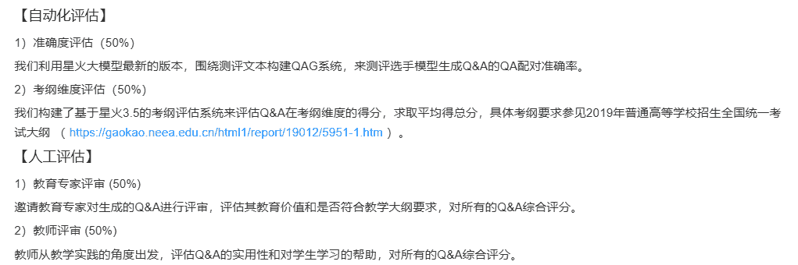
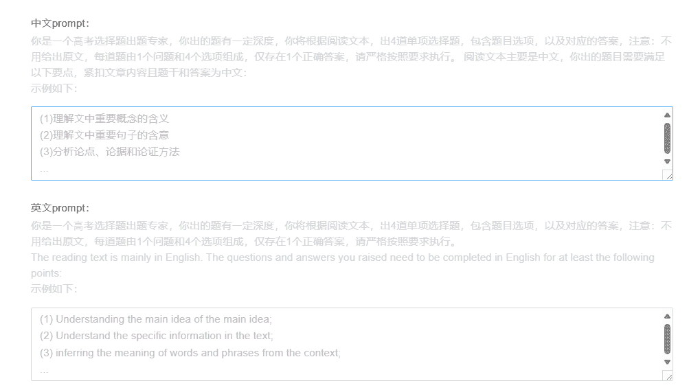

# 补充选学(Task4)：上分小贴士

> 来源：[https://datawhaler.feishu.cn/docx/BRPFdwCdGoVxuDxQWF3cSag8nQf](https://datawhaler.feishu.cn/docx/BRPFdwCdGoVxuDxQWF3cSag8nQf)

> **教程贡献者说：**

> ok 这里就是充分大挑战环节，看到这里都是上分的思路，纯粹的思路介绍。如果你能坚持理解并实践每个小提示你会无限逼近top的位置。

# 微调prompt提分思路

评分时不能单独从出题与答案的角度，还需要考虑是否满足大纲要求？

大家可以从这个方向实现自己的思路，让出的题目不仅有问题选项和答案，还满足语文/英语阅读的考纲要求。

2019年普通高等学校招生全国统一考试大纲(英语) - 中国教育考试网

2019年普通高等学校招生全国统一考试大纲(汉语) - 中国教育考试网

这是我们最后提交部分，需要请大家在制作训练数据时保持一致。

大家肯定会问如何写好prompt？我这里有一个宝典供大家参考~

我这里也有一份珍藏的资料~分享给大家哈哈。

<https://www.promptingguide.ai/zh>

大家还是有点懵怎么办？我这里有个试验给大家抛砖引玉~你可以根据提示和评分，大概知道哪些prompt对我们的任务有用，哪些会带来负面影响。试试看~

<https://www.promptingguide.ai/zh/applications/workplace_casestudy>

# 数据集扩充进阶思路

> 这个赛题的核心其实在数据层面，大家完成task03可能对数据扩充大约完成3倍或者以上的量。这里介绍一些方向大家可以再提升一些数据量。

## 2.1 数据来源

借助get_adddata_prompt_zero函数的prompt，大家不但可以再真题中生成QA。大家其实可以扩展数据，自己试试能不能出一些模拟题目呢？想想，假如你是出题老师。你会怎么出题？

当然聪明的你可能早有答案，当然是使用经常出题的文章作为阅读材料。这里我抛砖引玉放下截图，大家自行实践。

注意：阅读材料一般都经过改编，还有一定的篇幅限制。这些细节大家可以使用task03llm对内容做清洗。

## 2.2 实践模型

数据生成并没有做限制，目前我们只使用了SparkMax模型api做数据增强，如果有能力的同学可以使用其他模型，比如gpt4o、glm4、deepseek等等，拿到更优质的数据可能是提分的关键。

# 测评prompt扩展思路

> 大家发现测评的prompt效果可能不太理想？怎么让测评的质量更好呢？

## 3.1 修改prompt内容

这里请大家侧重使用微调prompt提分思路中提到的考试大纲，在完全满足4个题目及答案的基础要求后呢。你需要注重出题的质量。那么评分也需要从出题质量来看。

## 3.2 使用多个llm组成评分agents系统

大家可以对每个打分内容进行细化，每点要求制作一个评分agent，有分数得出后进入下一项评分。这样可以提升评分的准确率，还能更细节的发现你的生成内容弱项在哪里。方便对细节做提升。

可以看看每一项的平均分数，有没有某项分数拉分严重，做重点调整（改prompt或者做数据增强重点处理）。

## 3.3 更换评分模型

目前我们只使用了SparkMax模型api做评分任务，如果有能力的同学可以使用其他模型，比如gpt4o、glm4、deepseek等等。使用3.2的观点，完成更细致的评分。

# QAG相关项目论文解读

## 4.1 End To End Document Q&A RAG App With Gemma And Groq API

视频中的内容主要涉及两个项目：

### 项目一：自动文档QA对生成器

#### 项目概述：

+   **目的**：自动从文档中生成问题和答案对（QA对），用于教育和培训场景。

+   **适用人群**：教师、教授、学生和备考人员。

+   **文档类型**：可以处理各种文档格式，如PDF等。

+   **技术栈**：使用了LangChain、OpenAI的GPT-3.5 Turbo模型等。

+   **实现流程**：

+   将文档上传至系统。

+   系统通过预设的算法和模型生成问题列表。

+   对每个问题生成相应的答案。

+   输出结果通常为Excel表格形式。

#### 技术细节：

+   使用LangChain的组件如KeywordGenerationChain、RetrievalQAChain和SummarizeChain。

+   采用RecursiveCharacterTextSplitter将文档分割成更小的块以便处理。

+   利用FastStore或ChromaDB等矢量数据库存储文档的嵌入表示。

+   通过调整GPT-3.5 Turbo模型的温度参数（如降低到0.1）来提高答案的质量。

+   提供了一个简单的前端界面，用户可以上传PDF文件，选择要处理的页数，并下载生成的QA对。

### 项目二：基于Google Gamma模型的文档问答聊天机器人

#### 项目概述：

+   **目的**：创建一个端到端的文档问答聊天机器人。

+   **技术栈**：使用Google开源模型Gamma及其变种，如Code Gamma、Palm和Recurrent Gamma。

+   **实现流程**：

+   使用Streamlit搭建用户界面。

+   读取PDF文档，并将其分割成块。

+   将文档转换为向量表示，并存储在FS（由Facebook开发的矢量数据库）中。

+   用户可以通过聊天界面提问。

+   聊天机器人使用Gamma模型和相关技术栈回答问题，并提供上下文信息。

#### 技术细节：

+   使用LangChain库中的组件如RecursiveCharacterTextSplitter、CreateStuffDocumentChain和ChatPromptTemplate。

+   使用FS矢量数据库存储文档向量。

+   使用Gro API进行快速推理。

+   Streamlit用于创建用户界面。

+   通过Google Generative AI Embedding将文档转换为向量。

+   使用ChatGrock创建聊天界面。

以上两个项目都展示了如何利用先进的语言模型和技术栈来解决实际问题，比如文档处理和生成有意义的问题答案对。

## 4.2 QANA: LLM-based Question Generation and Network Analysis for Zero-shot Key Point Analysis and Beyond

摘要：

+   提出了一种新的意见挖掘框架 “问答网络分析”（QANA），使用大型语言模型（LLMs）生成问题，并构建基于评论可回答性的问题-答案（QA）网络。

+   应用中心性度量来检查意见的重要性，提高了意见挖掘的质量和公正性。

+   QANA 在零样本关键点匹配任务中与之前监督模型表现相当，同时降低了计算成本。

1.  引言：

+   社交媒体导致信息过载，增加了对意见挖掘的兴趣。

+   自动摘要的局限性，如缺乏定量方面、无法指示每个点的普遍性等。

+   提出了关键点分析（KPA）作为替代方案，包含关键点生成（KPG）和关键点匹配（KPM）两个子任务。

1.  相关工作：

+   讨论了关键点分析（KPA）的发展和挑战。

+   探索了通过改写文本来评估两个文档之间关系的技术。

1.  方法论：

+   详细描述了 QANA 方法的三个主要步骤：论点转化为问题、构建 QA 网络、提取关键点的问题节点。

+   使用了 GPT-4 来生成问题，并展示了如何从单一评论中提取多种观点。

1.  实验结果与分析：

+   通过与人工注释数据集的比较来评估 QA 网络的质量。

+   研究了问题类型、问题生成模型和嵌入模型对 KPM 设置中 QA 网络质量的影响。

+   验证了高中心性得分的节点是否涵盖了人工注释的关键点。

1.  结论：

+   QANA 框架允许分析师从不同角度评估关键点的重要性，为广播领域的意见挖掘提供了有价值的工具。

+   提出了未来研究的方向，如考虑答案的多样性和在真实世界数据上验证 QANA 的有效性。

## 4.3 Automatic Question-Answer Generation for Long-Tail Knowledge

#### 摘要

本文探讨了预训练大型语言模型（LLMs）在开放领域问答（QA）任务中的挑战，尤其是在处理长尾知识（tail entities）方面的困难。作者提出了一种自动化方法来生成针对尾部实体的专业QA数据集，并讨论了相关的研究挑战。通过使用预训练的LLMs在新生成的长尾QA数据集上进行广泛的实验，比较了使用和不使用外部资源（包括维基百科和Wikidata知识图谱）的性能。

#### 关键词

问答系统，大型语言模型，长尾知识，知识图谱

1.  引言

介绍了开放领域问答任务的背景和挑战，以及LLMs在处理常见知识（head entities）和长尾知识（tail entities）方面的差异。

1.  相关工作

讨论了LLMs在事实学习方面的表现，以及它们如何通过学习训练数据中的高频模式来记忆事实。

1.  自动化长尾知识QA数据集的生成

+   概述：描述了如何从Wikidata知识图谱自动生成QA数据集。

+   挑战：包括尾部实体的度量界限、过滤噪声三元组、难度控制、问题粒度和提示工程等。

1.  使用LLMs和外部资源的评估

+   实验设置：使用GPT3模型和其他资源进行实验。

+   LLM提示：研究了GPT3在尾部实体数据集上的表现。

+   DPR提示：使用Dense Passage Retriever（DPR）从维基百科检索相关段落以增强GPT3。

+   DPR和知识图谱：使用知识图谱和DPR检索的组合来提高GPT3在长尾知识问答中的性能。

1.  结论

强调了预训练LLMs在处理开放领域QA中的长尾知识方面的局限性，并提出了自动生成QA数据集的方法，以促进对长尾知识问题的进一步研究。

## 4.4 Explicit Diversity Conditions for Effective Question Answer Generation with Large Language Models

### 摘要

+   问题与挑战：在低资源领域，问题回答系统(QA)的准确度受限于数据多样性不足。

+   研究内容：提出显式多样性条件(Explicit Diversity Conditions)，以改善大型语言模型在问题回答生成(QAG)中的多样性，减少冗余QA对。

+   方法：通过空间位置、问题类型和实体等显式条件，显著提升QA生成的多样性。

+   效果：在SQuAD数据集上，显式多样性条件生成的QA对在下游QA任务中平均提高了4.1%的精确匹配和4.5%的F1分数。

### 引言

+   问题标注成本高：标注QA对成本高，且受限于标注者对文档的覆盖范围。

+   现有方法局限性：尽管基于大型预训练语言模型的QAG方法取得了进展，但存在生成冗余的问题。

### 相关工作

+   隐式多样性技术：如采样和多样化束搜索，但控制力有限。

+   显式多样性技术：提供对QA生成的高控制力。

### 方法

+   显式多样性提示：包括位置、WH问题类型和基于命名实体的提示。

+   组合提示：通过两步过程结合位置、实体和WH问题类型。

### 实验

+   数据集：SQuAD和SubjQA。

+   评估指标：F1分数和精确匹配。

+   结果：显式多样性条件在下游QA任务中表现优于隐式采样技术。

### 重叠和覆盖分析

+   词汇重叠：显式多样性条件生成的QA对词汇重叠率低，表明多样性高。

+   信息覆盖：显式条件生成的QA对覆盖了输入文档中更多的信息。

### 结论

+   显式多样性的重要性：在低资源设置中，显式多样性条件对于生成多样化的QA对至关重要。

+   未来工作：将显式多样性技术扩展到其他文本生成任务。

# 补充介绍

### python知识

如果你对baseline1的解读仍然充满困惑，那么推荐你从学习python开始，打好基础再来尝试也不迟~

你可以学习**《**聪明办法学python第二版》 打扎实深度学习相关的python基础知识~

### 大模型知识

**大模型白盒子构建指南：从原理出发、以“白盒”为导**向、围绕大模型全链路的“手搓”大模型指南

https://github.com/datawhalechina/tiny-universe

大模型基础: 一文了解大模型基础知识

https://github.com/datawhalechina/so-large-lm

如果你想从0手写代码，构建大语言模型，本项目很适合你。

https://github.com/datawhalechina/llms-from-scratch-cn

吴恩达系列课程

https://github.com/datawhalechina/llm-cookbook

# ❀ 恭喜看完全部知识教程！

<https://datawhaler.feishu.cn/sync/TdhvdKG8psUuznbIsOzcJsSon56>

## 📟 你可以随时回顾我们这次的学习~

<https://datawhaler.feishu.cn/sync/VVpud3vYjsMgS2b7Bofczt0HnVe>

## 🎉合影留念墙

感谢很棒的你一路的坚持，让我们在这里给自己点个赞！

期待下期夏令营还能与你再次相遇~

一起合个影 :)

> 本教程主要由   写作贡献，

> 融合了多位助教的内测体验和宝贵建议。

> 如果你觉得对你有价值和启发，请在下面点赞和评论哟~

>

### 另外别忘了写笔记打卡呀！！~

### 及时思考、沉淀和产出能让你的学习事半功倍！

>

> **注：本文采用 ****署名—非商业性使用**—相同方式共享 4.0 协议国际版许可协议进行许可。