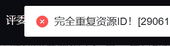
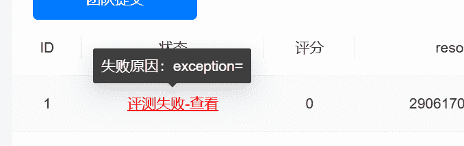
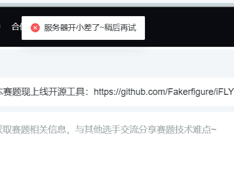
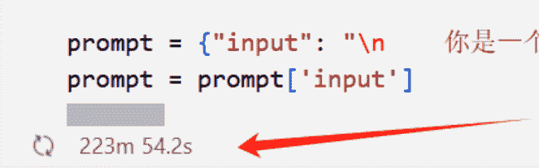
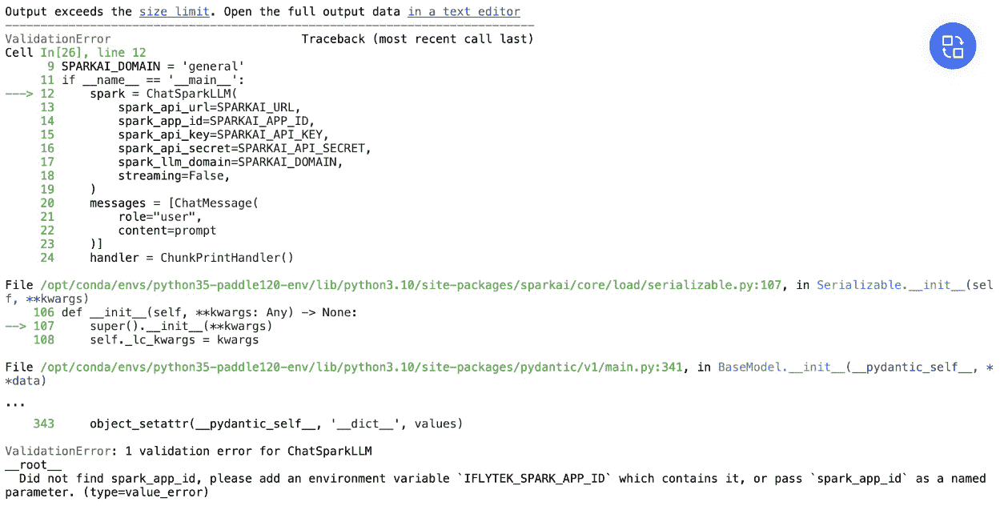
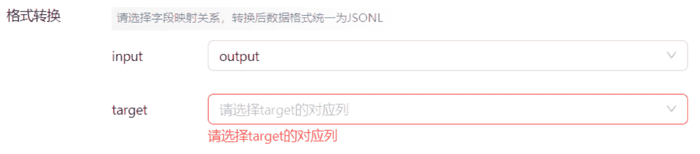
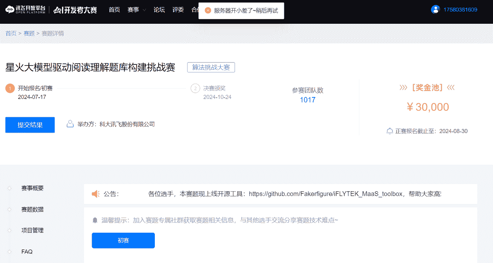

#  QA & 其他彩蛋

> 来源：[https://datawhaler.feishu.cn/docx/YKk6dZceooGvzyxlfZacUwCAnQe](https://datawhaler.feishu.cn/docx/YKk6dZceooGvzyxlfZacUwCAnQe)

> 别忘了持续上分！我们赛事提交的网址在：

<https://datawhaler.feishu.cn/sync/WbWwdPDRgsjXkWbnpMfcdSajnd2>

# 直播问题

## 开营

| ## 问题 | ## 回答 |
| --- | --- |
| 老师，我上传数据是显示报错 Failed to fetch dynamically imported module | 见下方Task1 QA汇总第8问 |
| 怎么扩充数据集呢 | 可以找网上全国各地的考试题填充，但需要注意数据处理的问题 |
| 提分策略能否多演示一下 | 提分策略比较多，涉及数据集大小、学习率和轮数等多个因素，但由于时间成本并不便于展示；推荐多次尝试总结经验，并与其他学习者积极互动寻求答案 |
| 为啥一样的操作分数不一样啊 | 见下方Task1 QA汇总第7问 |
| 创建一个app在QA里没看到 | 见下方Task1 QA汇总第16问 |
| 用语文的模拟题可以吗，还是只能高考语文的 | 可以尝试语文模拟题对数据集进行扩充，赛题并未要求必须是高考题 |
| 今晚会讲代码么？还是说只是把飞书的教程过一遍 | 代码内容已经在今晚讲解了，可以看回放，也可以看注释自学 |
| 讯飞数据集里面直接数据增强有试过吗 | 不推荐使用，数据增强可能无法实现与赛题相符且有效的数据扩充 |
| 老师，微调的时候一般要训练多少次 | 这和模型训练效果有关。严格意义上讲，数据集、学习率大小等因素都和训练轮数有一定关系 |
| 程序怎么分清楚英文和中文阅读题 | 就数据清理部分而言，英文和中文选择题放在两个不同的文件，可以分开处理再合并；就大模型微调部分而言，模型训练本身就学习了多种语言的tokens，自然能分清不同的语言 |
| 看不到训练日志，只能在训练后根据结果推断训练情况吗 | 是的，微调过程是黑盒，不支持训练日志输出 |
| 尝试用讯飞的1：5增强总是运行失败 | 解答同上，不推荐使用数据增强，其本身产出效果无法衡量 |
| 这个微调的实现逻辑是怎样的，都和什么参数有关系。 | 底层是lora微调方法，具体内容可在TASK2中学习到 |
| 具体是微调哪里，还是多次训练能让分数变高 | lora微调方法调整的是Transformer架构中的一部分小批量参数，其能对模型效果产生较大影响；多次训练不一定能使分数变高，可能过拟合 |
| 本次赛事微调的分数高低主要是取决于数据集的扩充吗 | 数据集扩充是影响较大的因素，但不一定主要；prompt和数据清理等其他因素也同样很重要 |
| 有没有录屏 | 有的，下周二b站上传，今晚也可以直接看视频号 |
| 如果后面有更好的数据集，可以尝试少量的自动化调参吗 | 见下方Task1 QA汇总第3问 |
| 扩充数据集对微调性能提升大吗，平台上是不是只能用lora微调方法 | 扩充数据集对效果的影响是比较大的；平台目前只提供了lora微调方法 |
| 为什么target包含了多个题目和答案，没不是考虑把题目放到input，target直接答案。一道题目一个样本。这两种有区别吗 | 赛题的要求就是出多道选择题。推荐仔细阅读赛题官网的题目描述部分，充分理解题意 |
| 更换基础模型，应该是会影响分数的吧 | 赛事规定只能使用spark-13b完成比赛，用其他模型会出现错误 |
| 提升大模型性能主流方法是不是就rag、prompt和微调、扩充数据集、function calling这几个，企业目前会用一些进阶的方法吗 | 就本赛题而言提升大模型性能只能通过prompt、微调和扩充数据集，其他内容与本赛题无关，感兴趣可自行了解 |
| 所以这个比赛就是比谁的数据集扩充的好还有prompt做的好吗 | 就参赛者而言，是这样的；但能将这部分做好依旧有难度 |
| 老师，讯飞平台上训练时可以看到训练的过程吗 | 不能看到具体过程，平台的微调过程本身是黑盒 |

## baseline精读直播

| ## 问题 | ## 回答 |
| --- | --- |
| 大模型微调需要配置什么代码环境么？ |  |
| 手册在哪儿找啊 |  |
| 英语题有的答案后面有具体内容，有的只有选项，是不是只有具体内容的更好 |  |
| 请问代码有链接地址吗？ |  |
| 是用什么什么软件扫描一遍整个训练集吗？ | Pandas |
| QA文档在哪儿看啊 |  |
| 4月份左右看到了国外ai判卷，是不是基于这个模型的训练 |  |
| 数据是使用提供的数据集，还是要自己去造？ |  |
| 该怎么样入门这个东西呀，有什么需要读的论 |  |
| 如果是大段的文本，并且要根据语义提取 |  |
| 提交的时候提示我资源号不能重复，那我是不是每次都得再来一遍task1才行。我想单纯的修改prompt看看效果 |  |

# Task1 QA汇总

| 序号 | ## 问题 | ## 回答 |
| --- | --- | --- |
| 1 | 注册完没有点立即领取，点了稍后领取，现在要去哪里领取免费gpu？ |  |
| 2 | 11200网络连接错误 | 已更新教程解决该问题 |
| 3 | 参数应该怎么调整？ | 1.  推荐大家跑完baseline后可以多去尝试不同的参数组合，自己动手找到规律。跑出来效果比较好的参数也可以在群内分享 |
| 4 | 内部的下降方式是SGD还是BGD | 不清楚，这种零代码微调基本都是黑盒 |
| 5 | 有什么方法可以规避微调的不确定性 | 可以尝试代码微调实现LoRA微调，不过难度比较大，不推荐大家直接上手 |
| 6 | 夏令营会涉及LoRA微调的底层吗 | 会有的哦，可以期待一波 |
| 7 | 为啥同一个baseline，有的有高有低呢？感觉大家差的还蛮多的 | 大模型微调本身的不确定性很高（还可能会遇见微调后效果不如原始模型的情况）；测试的OAG系统不确定性更高（官方没给原理，评测也是黑盒） |
| 8 | 创建数据集时出现以下错误，如何解决？ | 刷新或者换浏览器即可 |
| 9 | 无法打开baseline里的飞书链接，飞书无法登录 | baseline网站不支持手机端和iPad端打开，只能用电脑 |
| 10 |  | 该问题有两种情况： |
| 11 |  | 服务器问题，在流量较大时可能会出现评测失败。 |
| 12 | 训练时间远超预计（跑了四五个小时了都没跑通），是不是有什么问题？ | 服务器问题。可以尝试在流量较小的时候跑（比如晚上睡觉前挂着跑） |
| 13 |  | 服务器问题。可以尝试刷新或者换浏览器。已经联系讯飞方面修复 |
| 14 | 咋感觉微调时间偏长的，分数都偏低 | 是有一定关系的，可能会出现过拟合 |
| 15 | 为啥找不到模块 | 前面的!pip install代码框没有运行，需要先运行了前面的代码框再运行这里 |
| 16 | 发布为服务那里，没有可选择的应用，是可以自己创建吗？ | 是滴，自己创建选择即可。教程内容已对应更新。 |
| 17 | 讯飞评测系统提交页面灰色的prompt是会自动写入的吗？需不需要重复写？ | 不需要，会自动传入的，比赛者能够修改的prompt部分只有具体要求 |
| 18 |  | 明显服务器连接超时了，直接重开吧 |
| 19 | 这个报错怎么解决？ | 第一行不是报错哦！第一行**Output exce**eds the size limit的意思是报错信息无法显示完整，不是代码本身的问题，一般报错都出现在最底部。 |
| 20 | 这次比赛可以组队吗？ | 可以，但不推荐。我们推荐大家以个人身份参赛（一人一队），共同交流学习进步（因为平台对于一个队的提交次数有限） |
| 21 | 这是用千帆的GPU吗？ | 不是。千帆是百度的，这个比赛是讯飞举办的。 |
| 22 | 看不到训练日志，是不是卡死了 | 零代码微调是黑盒，因此不支持日志输出。看不到日志是正常现象，耐心等待就好 |
| 23 |  | 几个关键参数没有填，需要在官网找到对应参数复制过来，详细内容可参考TASK1教程 |
| 24 |  | 这里的数据集映射关系为input对应input，target对应output |
| 25 |  | 这个解决了，英文prompt不要做修改或者太长，都会显示这个错误 |
|  |  |  |
|  |  |  |
|  |  |  |
|  |  |  |
|  |  |  |
|  |  |  |
|  |  |  |

# Task2 QA汇总：

| 序号 | ## 问题 | ## 回答 |
| --- | --- | --- |
| 1 | 提交的时候提示我资源号不能重复，那我是不是每次都得再来一遍task1创一个新的模型服务才行。我想单纯的修改prompt看看效果 | 要重新创建一个新的模型服务，因为修改了prompt，模型要重新微调。 |
| 2 | 请问学习笔记是在哪个链接写的？ |  |
|  |  |  |
|  |  |  |
|  |  |  |

# 贡献者清单

| **角色** | **姓名** |
| --- | --- |
| **教程贡献者** | 内容总负责人： |
| **运营助教** |  |
| **专业助教** |  |
| **优秀学习者** |  |
| **QA贡献者** |  |

# 别忘了随时查看学习规划表~

<https://datawhaler.feishu.cn/sync/VVpud3vYjsMgS2b7Bofczt0HnVe>

# 给你的学习群点个赞吧~