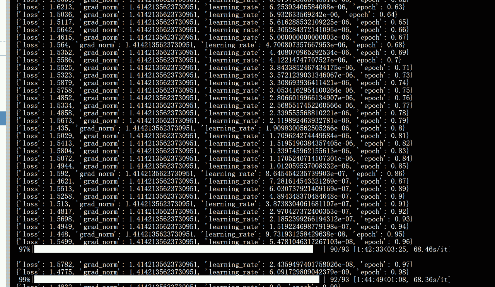
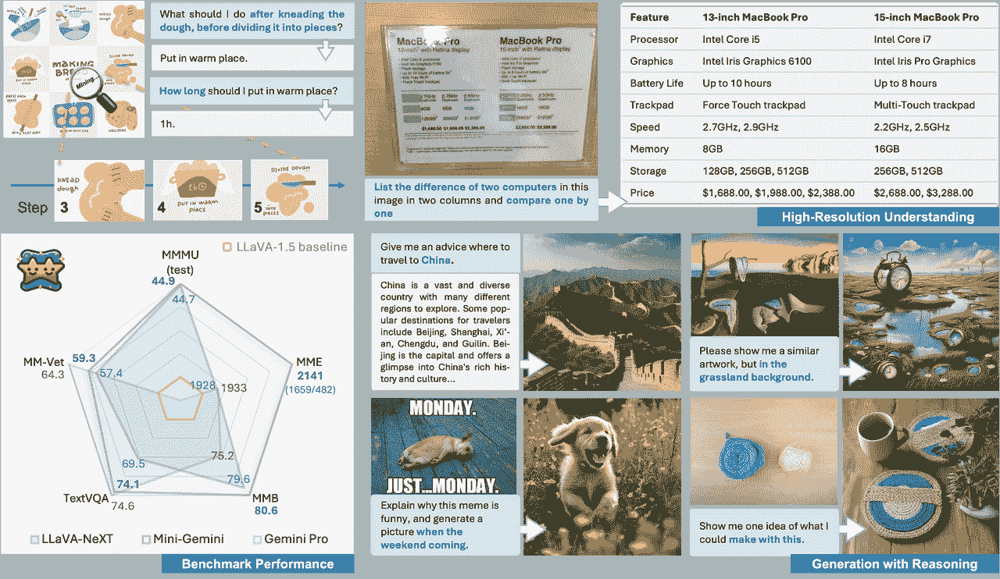
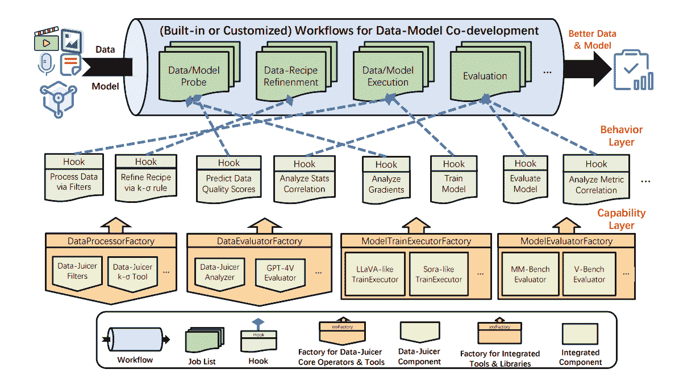
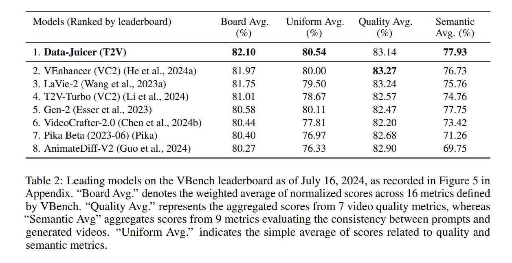
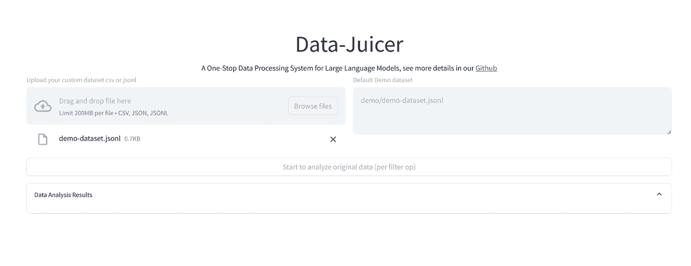
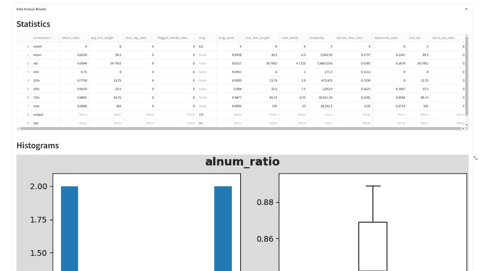

# Task2：精读baseline，入门Data-Juicer

> 来源：[https://datawhaler.feishu.cn/docx/XuXldVR2zoydYWxTHrzcIm70nNf](https://datawhaler.feishu.cn/docx/XuXldVR2zoydYWxTHrzcIm70nNf)

> **教程贡献者说：**

> 恭喜你完成了 `task1` 的任务，不知道各位在运行中感到如何呢？

> 是因为数据下载时间久导致抓狂，或是因为反复发现被系统终止而感到沮丧？

> 别担心，在 `task2` 中，我将为你揭晓有关 `baseline` 的一切秘密——

> 所有的脚本其实只是白盒；

> 我们一定要坚信——计算机永远是对的，

> 如果出现问题先找自己的原因，

> 但我们一定能解决所有问题。

## 👁 Baseline 洞察

### 🤔我们究竟做了哪些事

在本次比赛中，我们将会对给定的数据集进行 `data-juicer` 的处理，`data-juicer` 相当于是一个数据集的处理管线，它可以帮我们用各类定制化的算子实现的 pipeline 来对我们的数据集进行多样组合的处理，同时我们也可以用 `data-juicer` 复现很多无论是传统多模态、大语言模型还是视频理解相关模型的数据处理工作；在处理工作结束后，我们将会使用 `MGM` 增强框架来对多模态模型进行微调。

多模态模型有两个关键组件，一是视觉编码器，二是语言模型，其中我们将会使用 `gemma` 作为我们的语言模型基座，`gemma-2B` 是谷歌开源的强大人工智能模型，参数量只有 2B；而对于视觉编码器我们将会使用 `CLIP-L` (`clip-vit-large-patch14-336`)。这两个模型我们也可以在微调代码中可以完全看见全流程。

所以，我们需要做的事情是尽量找到合适的方式组织数据集，通过算子的排列组合演奏出美妙的数据奏曲；不过 `data-juicer` 的算子还是比较多的，之后我们会对他的细节进行详细学习。

话不多说，让我们开始直接研究在 `baseline` 中究竟发生了哪些事：

#### 环境准备

```
SCRIPT_DIR=$(cd "$(dirname "$0")" && pwd)

# for data-juicer
echo "[1] Installing toolkit/data-juicer"
cd ${SCRIPT_DIR}/toolkit
git clone https://github.com/modelscope/data-juicer.git
cd data-juicer
pip install ".[all]"

# for MGM training
echo "[2] Installing toolkit/training"
cd ${SCRIPT_DIR}/toolkit/training
pip install -e .
pip install flash-attn --no-build-isolation

echo "Done"
```

没什么可以解释的，这个部分就是最基础的环境准备。

这类需要注意的是，`flash-attn` 的安装过程可能会遇到这样那样的问题，具体请参考 常见问题必知必会

当然，如果这里他存在预编译包，就会快速安装该程序，但如果没有预编译包 `https://github.com/Dao-AILab/flash-attention/releases/tag/v2.6.3` ，你只能喊上好友玩上一两盘游戏... ——这意味着你需要等待半个小时到一个小时。

#### 下载

首先来理解什么是 `Axel`：

Axel tries to accelerate the download process by using multiple connections per file, and can also balance the load between different servers.

Axel tries to be as light as possible, so it might be useful on byte-critical systems.

Axel supports HTTP, HTTPS, FTP and FTPS protocols.

```
SCRIPT_DIR=$(cd "$(dirname "$0")" && pwd)

# for base models
echo "[1] Downloading base models for training..."
mkdir -p ${SCRIPT_DIR}/toolkit/training/model_zoo/LLM/gemma
cd ${SCRIPT_DIR}/toolkit/training/model_zoo/LLM/gemma
axel -n 5 http://dail-wlcb.oss-cn-wulanchabu.aliyuncs.com/dj-competition/better_synth/models/gemma-2b-it.tar.gz
tar zxvf gemma-2b-it.tar.gz

mkdir -p ${SCRIPT_DIR}/toolkit/training/model_zoo/OpenAI
cd ${SCRIPT_DIR}/toolkit/training/model_zoo/OpenAI
axel -n 5 http://dail-wlcb.oss-cn-wulanchabu.aliyuncs.com/dj-competition/better_synth/models/clip-vit-large-patch14-336.tar.gz
tar zxvf clip-vit-large-patch14-336.tar.gz
axel -n 5 http://dail-wlcb.oss-cn-wulanchabu.aliyuncs.com/dj-competition/better_synth/models/openclip-convnext-large-d-320-laion2B-s29B-b131K-ft-soup.tar.gz
tar zxvf openclip-convnext-large-d-320-laion2B-s29B-b131K-ft-soup.tar.gz

# for training data
echo "[2] Downloading seed datasets..."
mkdir -p ${SCRIPT_DIR}/input
cd ${SCRIPT_DIR}/input
axel -n 5 http://dail-wlcb.oss-cn-wulanchabu.aliyuncs.com/dj-competition/better_synth/data/stage_1/pretrain_stage_1_10k.tar.gz
tar zxvf pretrain_stage_1_10k.tar.gz
cd pretrain_stage_1_10k
axel -n 5 http://dail-wlcb.oss-cn-wulanchabu.aliyuncs.com/dj-competition/better_synth/data/stage_1/mgm_pretrain_stage_1_10k.jsonl
axel -n 5 http://dail-wlcb.oss-cn-wulanchabu.aliyuncs.com/dj-competition/better_synth/data/stage_1/stage_1.json

echo "[3] Downloading finetuning datasets..."
mkdir -p ${SCRIPT_DIR}/toolkit/training/data
cd ${SCRIPT_DIR}/toolkit/training/data
axel -n 5 http://dail-wlcb.oss-cn-wulanchabu.aliyuncs.com/dj-competition/better_synth/data/stage_1/finetuning_stage_1_12k.tar.gz
tar zxvf finetuning_stage_1_12k.tar.gz
cd finetuning_stage_1_12k
axel -n 5 http://dail-wlcb.oss-cn-wulanchabu.aliyuncs.com/dj-competition/better_synth/data/stage_1/mgm_instruction_stage_1_12k.json

# for eval data
echo "[4] Downloading evaluation datasets"
mkdir -p ${SCRIPT_DIR}/toolkit/training/data
cd ${SCRIPT_DIR}/toolkit/training/data
axel -n 5 http://dail-wlcb.oss-cn-wulanchabu.aliyuncs.com/dj-competition/better_synth/data/stage_1/eval_stage_1.tar.gz
tar zxvf eval_stage_1.tar.gz

echo "Done"
```

> 需要注意，此处仅下载了 10k 数据集，并不是全量的数据，全量数据还需要运行下面的脚本（请在 `solutionxxx/` 目录下，在终端中自行复制粘贴运行下载）

```
echo "Downloading full seed datasets..."
cd /root/autodl-tmp/better_synth_baseline_autoDL/input

axel -n 5 http://dail-wlcb.oss-cn-wulanchabu.aliyuncs.com/dj-competition/better_synth/data/stage_1/pretrain_stage_1.tar.gz
tar zxvf pretrain_stage_1.tar.gz && rm -rf pretrain_stage_1.tar.gz
cd pretrain_stage_1
axel -n 5 http://dail-wlcb.oss-cn-wulanchabu.aliyuncs.com/dj-competition/better_synth/data/stage_1/mgm_pretrain_stage_1.jsonl
axel -n 5 http://dail-wlcb.oss-cn-wulanchabu.aliyuncs.com/dj-competition/better_synth/data/stage_1/stage_1.json
echo "Done downloading full seed datasets..."
```

在这个过程中，我们准备好了不同阶段的数据以及基础模型。

值得注意的是，由于我们在之后的 caption 也就是图片推理文字的模型中选择的是 `BLIP`，所以我们需要提前进行下载：

```
### 下载BLIP模型，大概需要20分钟
from modelscope import snapshot_download

model_dir = snapshot_download('goldsj/blip2-opt-2.7b', 
                              cache_dir='/root/autodl-tmp/better_synth_challenge_baseline/models', 
                              revision='master')
```

完成一切准备后，我们就可以正式开始流程。

你可以在这步完成后给整个机器做一个镜像，或者把数据都打包存储到一个 `OSS` 或者定向存储空间上，这有助于之后出现问题可以快速恢复开始阶段，而不是反复的进行环境的配置以及相关内容的下载。

（据说听劝的人**已经开启了香槟**🤔）

#### 数据处理

对于多模态模型，我们需要首先处理出文本和图片对的数据；我们当然可以用 `GPT4V` 作为处理的 caption 模型，但。。。。可能我们还不够那么有钱，所以在这我们选择了 `BLIP`：

`BLIP` 是 2022 年的 caption 工作，发表在 ICML-2022，在多模态大模型还没有横空出世的时候，`BLIP` 就是那个时代的 caption 小王子（当然现在已经是老王子了）；对我们来说 `BLIP` 以他免费、免费、免费、且参数量小的优势为我们所称道；我们在数据处理中会使用 `BLIP` 来进行图片对应文字字幕的获取。

对于 `Data-juicer`，则会在此扮演“调度者”的操作，我们可以把对应的多模态 caption 算子指定为 `BLIP`：

```
dataset_path: input/pretrain_stage_1_10k/mgm_pretrain_stage_1_10k.jsonl
export_path: output/image_captioning_output/res_10k.jsonl

np: 1
process:
  - image_captioning_mapper:
      hf_img2seq: '/root/autodl-tmp/better_synth_baseline_autoDL/models/goldsj/blip2-opt-2___7b'  # You can replace this path to a local downloaded HF model
      keep_original_sample: false  # we only need the recaptioned captions
```

其中 `image_captioning_mapper` 就是 caption 的相关算子，实际上还有很多其他算子等着我们去学习，在之后我们再来详细了解。

这里需要注意 `np: 1` 其实也是灵魂的一环， 在这里已经为大家的内存作了亲切的考虑，不过只要你使用推荐的机器超过 70G 内存，那就可以把这个 `np` 的配置取消，直接并行处理。

此处大概需要花四十五分钟到一个小时不等，如果你有多张卡，可以缩短到 30 分钟甚至 15 分钟。

不过，在最新的 `baseline` 中我提前帮大家做了缩减处理，利用 `DJ` 的数据筛选算子，我们可以先用最小的数据进行训练跑通，之后再替换成更大的数据：

```
dataset_path: input/pretrain_stage_1_10k/mgm_pretrain_stage_1_10k.jsonl
export_path: input/pretrain_stage_1_10k/mgm_pretrain_stage_1_10.jsonl

np: 1
process:
 - random_selector:
      select_ratio: 0.001
```

```
dataset_path: input/pretrain_stage_1_10k/mgm_pretrain_stage_1_10.jsonl
export_path: output/image_captioning_output/res_10k.jsonl

np: 1
process:
  - image_captioning_mapper:
      hf_img2seq: '/root/autodl-tmp/better_synth_baseline_autoDL/models/goldsj/blip2-opt-2___7b'  # You can replace this path to a local downloaded HF model
      keep_original_sample: false  # we only need the recaptioned captions
```

注意，这里**必须按照先后顺序操作**，合并在一起可能会出现问题。

#### 训练👍

这里是最重要的一环，也是让大家金钱狂掉的关键环节；在这个环节中，我们需要清楚的知道我们做了哪些事，那些事情可能会对机器的资源要求高，那些是可以通过调整后解决的问题，这都是需要关注的。

让我们一个一个部分来看：

+ 首先映入眼帘的是显卡的相关设置环节，涉及到几个环境变量，因为我们在云服务器平台用多卡并不是为了多卡，而是为了大内存，所以需要关闭其他显卡的一些通信环节以及可见性。当然，你也可以让他真正支持多卡操作。


# 训练参数配置与环境设置

## 环境变量与基础配置

```bash
#!/bin/bash
############################################################################
########################### Editable Part Begins ###########################
############################################################################

############# 多卡的情况下需要开启，如果是单卡需要关闭！！！！
############# 多卡的情况下需要开启，如果是单卡需要关闭！！！！
############# 多卡的情况下需要开启，如果是单卡需要关闭！！！！
export CUDA_VISIBLE_DEVICES=0
export NCCL_P2P_DISABLE=1
export NCCL_IB_DISABLE=1
############# 多卡的情况下需要开启，如果是单卡需要关闭！！！！
############# 多卡的情况下需要开启，如果是单卡需要关闭！！！！
############# 多卡的情况下需要开启，如果是单卡需要关闭！！！！

# exp meta information
EXP_NAME=default
PRETRAIN_DATASET=../output/image_captioning_output/res_10k.jsonl
PRETRAIN_DATASET_IMAGE_PATH=../input/pretrain_stage_1_10k

# training args
# pretraining
# make sure PRETRAIN_BATCH_SIZE_PER_GPU * PRETRAIN_GRADIENT_ACCUMULATION_STEPS * num_gpus = 256
# **NOTICE**: the default setting is for 1 GPU
PRETRAIN_BATCH_SIZE_PER_GPU=4
PRETRAIN_GRADIENT_ACCUMULATION_STEPS=64
PRETRAIN_DATALOADER_NUM_WORKERS=4
# finetuning
# make sure FINETUNE_BATCH_SIZE_PER_GPU * FINETUNE_GRADIENT_ACCUMULATION_STEPS * num_gpus = 128
# **NOTICE**: the default setting is for 1 GPU
FINETUNE_BATCH_SIZE_PER_GPU=4
FINETUNE_GRADIENT_ACCUMULATION_STEPS=32
FINETUNE_DATALOADER_NUM_WORKERS=4
# log and ckpt
LOGGING_STEP=1
CKPT_SAVE_STEPS=100
TOTAL_SAVE_CKPT_LIMIT=1

# inference args
# inference for some benchmarks supports multi-gpus
INFER_CUDA_IDX="0"
```

## 关键训练参数说明

此时我们需要注意几个关键的训练参数配置，分别是`pretrain`以及`finetune`，这是全部环节中最重要的两个阶段。如果没有成功运行这两个训练环节，一切都将是徒劳。

👆我已经把所有能加的强调符号都加上了，希望大家能够记住这个关键因素，许多同学最后无法提交的核心根本原因就在此。而其中对应的相关配置是

```bash
# **NOTICE**: the default setting is for 1 GPU
PRETRAIN_BATCH_SIZE_PER_GPU=4
PRETRAIN_GRADIENT_ACCUMULATION_STEPS=64
PRETRAIN_DATALOADER_NUM_WORKERS=4
# finetuning
# make sure FINETUNE_BATCH_SIZE_PER_GPU * FINETUNE_GRADIENT_ACCUMULATION_STEPS * num_gpus = 128
# **NOTICE**: the default setting is for 1 GPU
FINETUNE_BATCH_SIZE_PER_GPU=4
FINETUNE_GRADIENT_ACCUMULATION_STEPS=32
FINETUNE_DATALOADER_NUM_WORKERS=4
```

## 批量大小与梯度累积计算

我们需要满足两个关系，也就是 `4 * 64 = 256`，以及 `4 * 32 = 128`，这是必须满足的数量关系，最后的乘法结果需要满足 256 以及 128，如果你想要真正的多卡并行训练，则需要自行除以二；

如果我们想降低显存和内存占用，最好的想法当然是强行修改 `FINETUNE_BATCH_SIZE_PER_GPU` 为 1，并且把 `FINETUNE_DATALOADER_NUM_WORKERS` 变成 1，并且关闭后续的 `batchsize` 检查：

但是讲规矩的我们是不会这么做的（当然也可以不这么做，快速跑通先让自己开心一下）

所以我们决定缩小 `batchsize`，增大梯度累积，这样就可以在一张 24G 显存的显卡上跑通全过程（`finetune` 需要占据的显存要求比较高）：

```bash
# check the global size
PRETRAIN_PASS=`python $SCRIPT_DIR/training/preprocess/check_global_batch_size.py $PRETRAIN_BATCH_SIZE_PER_GPU $PRETRAIN_GRADIENT_ACCUMULATION_STEPS 256`
if [ "$PRETRAIN_PASS" = "False" ]; then
    echo "[ERROR] The global batch size of pretraining stage is not 256! Please check and retry."
    exit
fi
FINETUNE_PASS=`python $SCRIPT_DIR/training/preprocess/check_global_batch_size.py $FINETUNE_BATCH_SIZE_PER_GPU $FINETUNE_GRADIENT_ACCUMULATION_STEPS 128`
if [ "$FINETUNE_PASS" = "False" ]; then
    echo "[ERROR] The global batch size of finetuning stage is not 128! Please check and retry."
    exit
fi
```

至此，如果你是双卡战士（内存合计大于 120G 甚至更高），已经可以很愉快的跑通 `pretrain` 和 `finetune` 环节，跑不通可以找我退钱

你必须看到 `pretrain` 和 `finetune` 的环节经过了完整的训练，其中训练时间如果快使用 `A100` 大概需要 半个小时（`pretrain`）一个半小时（`finetune`）；具体时间取决于你的机器，但请你保证一定要完成训练。

其中 `finetune` 训练过程如图：（`pretrain` 也差不多，总之。。。你需要看到 `loss` 的正常训练过程）



## 单卡显存优化配置

```bash
PRETRAIN_BATCH_SIZE_PER_GPU=4
PRETRAIN_GRADIENT_ACCUMULATION_STEPS=64
PRETRAIN_DATALOADER_NUM_WORKERS=4
# finetuning
# make sure FINETUNE_BATCH_SIZE_PER_GPU * FINETUNE_GRADIENT_ACCUMULATION_STEPS * num_gpus = 128
# **NOTICE**: the default setting is for 1 GPU
FINETUNE_BATCH_SIZE_PER_GPU=2
FINETUNE_GRADIENT_ACCUMULATION_STEPS=64
FINETUNE_DATALOADER_NUM_WORKERS=4
```

## 训练执行与时间预估

前面都是一些简单的准备工作，接下来让我们直接开始进入到真正的训练脚本，首先是 `pretrain` 阶段：

```bash
mkdir -p $SCRIPT_DIR/../output/training_dirs/$PRETRAIN_NAME

deepspeed $SCRIPT_DIR/training/mgm/train/train_mem.py \
    --deepspeed $SCRIPT_DIR/training/scripts/zero2_offload.json \
    --model_name_or_path $SCRIPT_DIR/training/model_zoo/LLM/gemma/gemma-2b-it \
    --version gemma \
    --data_path $PRETRAIN_DATASET_JSON \
    --image_folder $PRETRAIN_DATASET_IMAGE_PATH \
    --vision_tower $SCRIPT_DIR/training/model_zoo/OpenAI/clip-vit-large-patch14-336 \
    --vision_tower_aux $SCRIPT_DIR/training/model_zoo/OpenAI/openclip-convnext-large-d-320-laion2B-s29B-b131K-ft-soup \
    --mm_projector_type mlp2x_gelu \
    --tune_mm_mlp_adapter True \
    --mm_vision_select_layer -2 \
    --mm_use_im_start_end False \
    --mm_use_im_patch_token False \
    --image_size_aux $AUX_SIZE \
    --bf16 True \
    --output_dir $SCRIPT_DIR/../output/training_dirs/$PRETRAIN_NAME \
    --num_train_epochs $NUM_TRAIN_EPOCHS \
    --per_device_train_batch_size $PRETRAIN_BATCH_SIZE_PER_GPU \
    --per_device_eval_batch_size 4 \
    --gradient_accumulation_steps $PRETRAIN_GRADIENT_ACCUMULATION_STEPS \
    --evaluation_strategy "no" \
    --save_strategy "steps" \
    --save_steps $CKPT_SAVE_STEPS \
    --save_total_limit $TOTAL_SAVE_CKPT_LIMIT \
    --learning_rate 1e-3 \
    --weight_decay 0. \
    --warmup_ratio 0.03 \
    --lr_scheduler_type "cosine" \
    --logging_steps $LOGGING_STEP \
    --tf32 True \
    --model_max_length 2048 \
    --gradient_checkpointing True \
    --dataloader_num_workers $PRETRAIN_DATALOADER_NUM_WORKERS \
    --lazy_preprocess True \
    --report_to none \
    2>&1 | tee $SCRIPT_DIR/../output/training_dirs/$PRETRAIN_NAME/pretrain.log
```

这里我们使用的就是 `mgm` 框架在进行微调，我们可以看到其中的详细参数以及数据集的地址，包括使用的是 `deepseed`（使用的是 `zero2` 的优化策略，使用内存换显存，这也是为什么内存需求比较大）我们可以看到其中前面提到的大语言模型以及对应的视觉编码器。

```bash
mkdir -p $SCRIPT_DIR/../output/training_dirs/$FINETUNE_NAME

deepspeed $SCRIPT_DIR/training/mgm/train/train_mem.py \
    --deepspeed $SCRIPT_DIR/training/scripts/zero2_offload.json \
    --model_name_or_path $SCRIPT_DIR/training/model_zoo/LLM/gemma/gemma-2b-it \
    --version gemma \
    --data_path $SCRIPT_DIR/training/data/finetuning_stage_1_12k/mgm_instruction_stage_1_12k.json \
    --image_folder $SCRIPT_DIR/training/data/finetuning_stage_1_12k \
    --vision_tower $SCRIPT_DIR/training/model_zoo/OpenAI/clip-vit-large-patch14-336 \
    --vision_tower_aux $SCRIPT_DIR/training/model_zoo/OpenAI/openclip-convnext-large-d-320-laion2B-s29B-b131K-ft-soup \
    --pretrain_mm_mlp_adapter $SCRIPT_DIR/../output/training_dirs/$PRETRAIN_NAME/mm_projector.bin \
    --mm_projector_type mlp2x_gelu \
    --mm_vision_select_layer -2 \
    --mm_use_im_start_end False \
    --mm_use_im_patch_token False \
    --image_aspect_ratio pad \
    --group_by_modality_length True \
    --image_size_aux $AUX_SIZE \
    --bf16 True \
    --output_dir $SCRIPT_DIR/../output/training_dirs/$FINETUNE_NAME \
    --num_train_epochs $NUM_TRAIN_EPOCHS \
    --per_device_train_batch_size $FINETUNE_BATCH_SIZE_PER_GPU \
    --per_device_eval_batch_size 4 \
    --gradient_accumulation_steps $FINETUNE_GRADIENT_ACCUMULATION_STEPS \
    --evaluation_strategy "no" \
    --save_strategy "steps" \
    --save_steps $CKPT_SAVE_STEPS \
    --save_total_limit $TOTAL_SAVE_CKPT_LIMIT \
    --learning_rate 2e-5 \
    --weight_decay 0. \
    --warmup_ratio 0.03 \
    --lr_scheduler_type "cosine" \
    --logging_steps $LOGGING_STEP \
    --tf32 True \
    --model_max_length 2048 \
    --gradient_checkpointing True \
    --dataloader_num_workers $FINETUNE_DATALOADER_NUM_WORKERS \
    --lazy_preprocess True \
    --report_to none \
    2>&1 | tee $SCRIPT_DIR/../output/training_dirs/$FINETUNE_NAME/finetuning.log
```

对于 `finetune` 阶段，其实大家已经很熟悉了，主要就是多了个 `pretrain_mm_mlp_adapter` 以及一些学习参数的不同。


```
# inference for submission
# TextVQA
echo "Infer on TextVQA..."
bash $SCRIPT_DIR/eval/textvqa.sh $FINETUNE_NAME $INFER_CUDA_IDX
# MMBench
echo "Infer on MMBench..."
bash $SCRIPT_DIR/eval/mmbench.sh $FINETUNE_NAME "mmbench_dev_20230712" $INFER_CUDA_IDX

# copy this script to output
cp $0 $SCRIPT_DIR/../output/train.sh

# info
echo "Training and Inference done."
echo "Training checkpoints are stored in output/training_dirs/$FINETUNE_NAME."
echo "Inference results are stored in output/eval_results/$FINETUNE_NAME."
```

# Baseline 全流程解答

## 评测环节

最后，我们愉快的来到了评测环节，具体需要通过 `TextVQA` 以及 `MMBench` 的测试验证（平均耗时10~20min），然后就可以成功的结束所有过程了，收拾收拾开始提交评测！

至此 `baseline` 全流程解答已结束。

### ⚠常见问题必知必会

+   最快需要多久可以跑完一个`baselilne`？

+   四个小时，包括环境准备。

+   推荐的运行环境？

+   **120G以上CPU内存** + 80G显存（实际上40G也够）机器即可，否则需要进行配置修改

+   10K数据的正常运行峰值需要102G的CPU内存以及40G的GPU显存。

+   autodl的3090或者4090双卡皆可，有更大的显存的双卡更佳；只要双卡可以解决一切内存不够问题 —— 在足够的火力覆盖面前，一切都是浮云

+   很难让我退缩怎么办？

+   等待的时候可以打几盘王者荣耀（黑神话悟空也可以，但是还没出）

+   实在不行还可以来下面体验`data-juicer`，只要开心就好

+   充钱你就可以体验速通的快乐！有句话叫做氪金会变强

+   在群里找到大腿，请他喝杯奶茶，让它教你

+   安装 `flashattn` 很慢怎么办

+   他在努力的编译了，等等吧

+   预编译包下载：https://github.com/Dao-AILab/flash-attention/releases/tag/v2.6.3

+   安装`flashattn`遇到 `CUDA` 版本问题怎么办

+   因为你的`CUDA`默认就是12开头的，而`mgm`的默认可能是11.x的`torch`，所以你只需要安装最新12.x的`torch`支持即可，比如：

```
pip install torch==2.2.1 torchvision==0.17.1 torchaudio==2.2.1
```

什么？你说**安装**后看到了红色的error，说`mgm`只支持2.0.1的`torch`？ 没事，`torch`的跨版本兼容性非常完美，忽略这个提示即可；当然你得知道这个支持并不是真正的“支持”，所谓在`pip`安装过程中的版本报错，只是因为安装依赖`requirements`里面的推荐版本是xxx，如果我们的版本和他不同，他就会显示一个“报错”；但极机智的我们对环境配置已经了如指掌如入无人之境，直接忽视，我的环境我做主。

+   我是学生。。。。你懂的

+   对不起，我也穷，我把充值买游戏皮肤的钱暂时转移成了显卡的燃烧数字；让我们就当作少喝几杯奶茶的减肥身材管理期

+   虽然钱没了，但你可以和别人吹你跑过100多G的程序，**让他向你投来崇拜（也可能是鄙视）的眼光后扬长而去。

## 什么是MGM

`MGM`本质上来自一篇最新的多模态性能提高框架（基于`LLAVA`）—— https://github.com/dvlab-research/MGM

对应论文—— https://arxiv.org/pdf/2403.18814



这篇论文介绍了一个名为`Mini-Gemini`的框架，旨在提升多模态视觉语言模型（`VLMs`）的性能。尽管`VLMs`在基础视觉对话和推理方面取得了进展，但与高级模型（如`GPT-4`和`Gemini`）相比，仍存在性能差距。`Mini-Gemini`试图通过以下三个方面来缩小这一差距：

1. 高分辨率视觉令牌（High-Resolution Visual Tokens）：通过额外的视觉编码器对视觉令牌进行高分辨率细化，而不增加视觉令牌的数量。

1. 高质量数据（High-Quality Data）：构建一个高质量的数据集，以促进精确的图像理解和基于推理的生成，扩展当前`VLMs`的操作范围。

1. VLM引导的生成（VLM-guided Generation）：将这些增强与先进的大型语言模型（`LLMs`）和生成模型相结合，旨在提升`VLM`性能和用户体验。

`Mini-Gemini`框架支持从2B到34B参数规模的一系列密集和`MoE`大型语言模型，并且在多个零样本基准测试中取得了领先的性能，甚至超过了一些开发的私有模型。论文的目标是通过挖掘`VLMs`的潜力，同时进行图像理解、推理和生成，为当前框架赋予新的能力。

MGM框架支持的模型一览：

在本次任务中，我们将会使用这个框架来进行 `pretrain` 以及 `finetune`。

```
mkdir -p $SCRIPT_DIR/../output/training_dirs/$PRETRAIN_NAME

deepspeed $SCRIPT_DIR/training/mgm/train/train_mem.py \
    --deepspeed $SCRIPT_DIR/training/scripts/zero2_offload.json \
    --model_name_or_path $SCRIPT_DIR/training/model_zoo/LLM/gemma/gemma-2b-it \
    --version gemma \
    --data_path $PRETRAIN_DATASET_JSON \
    --image_folder $PRETRAIN_DATASET_IMAGE_PATH \
    --vision_tower $SCRIPT_DIR/training/model_zoo/OpenAI/clip-vit-large-patch14-336 \
    --vision_tower_aux $SCRIPT_DIR/training/model_zoo/OpenAI/openclip-convnext-large-d-320-laion2B-s29B-b131K-ft-soup \
    --mm_projector_type mlp2x_gelu \
    --tune_mm_mlp_adapter True \
    --mm_vision_select_layer -2 \
    --mm_use_im_start_end False \
    --mm_use_im_patch_token False \
    --image_size_aux $AUX_SIZE \
    --bf16 True \
    --output_dir $SCRIPT_DIR/../output/training_dirs/$PRETRAIN_NAME \
    --num_train_epochs $NUM_TRAIN_EPOCHS \
    --per_device_train_batch_size $PRETRAIN_BATCH_SIZE_PER_GPU \
    --per_device_eval_batch_size 4 \
    --gradient_accumulation_steps $PRETRAIN_GRADIENT_ACCUMULATION_STEPS \
    --evaluation_strategy "no" \
    --save_strategy "steps" \
    --save_steps $CKPT_SAVE_STEPS \
    --save_total_limit $TOTAL_SAVE_CKPT_LIMIT \
    --learning_rate 1e-3 \
    --weight_decay 0. \
    --warmup_ratio 0.03 \
    --lr_scheduler_type "cosine" \
    --logging_steps $LOGGING_STEP \
    --tf32 True \
    --model_max_length 2048 \
    --gradient_checkpointing True \
    --dataloader_num_workers $PRETRAIN_DATALOADER_NUM_WORKERS \
    --lazy_preprocess True \
    --report_to none \
    2>&1 | tee $SCRIPT_DIR/../output/training_dirs/$PRETRAIN_NAME/pretrain.log
```

具体的代码分析已经在之前看过，让我们不必深究细节，继续往下。

## TextVQA

遇事不决官网见：https://textvqa.org/

`TextVQA` 是一个用于评估基于图像中文本的视觉推理能力的数据集。这个数据集要求模型能够读取和理解图像中的文本，以回答相关的问题。`TextVQA` 数据集包含来自 `OpenImages` 的 28,408 张图像，45,336 个问题，以及 453,360 个标准答案。

总而言之就是一个用于给我们测试多模态模型能力的数据集。

## MMBench

遇事不决官网见：https://mmbench.opencompass.org.cn/

paper见：https://arxiv.org/pdf/2307.06281

`MMBench` 试图解决的问题是如何有效地评估大型视觉-语言模型（Large Vision-Language Models，简称`LVLMs`）的性能。尽管这些模型在视觉信息的感知和推理方面取得了显著进展，但现有的评估方法存在一些限制，如缺乏细粒度能力评估和非鲁棒性评估指标。为了克服这些限制，他们提出了一个名为`MMBench`的新型多模态基准测试，它包括两个主要组成部分：

1. **精心策划的数据集**：该数据集在评估问题的数量和多样性以及能力方面超越了现有的类似基准测试。

1. 新颖的`CircularEval`策略：结合了使用`ChatGPT`的方法，将自由形式的预测转换为预定义的选择，从而促进对模型预测的更鲁棒评估。

总而言之就是又一个用于给我们测试多模态模型能力的数据集。

至此，你已经完全理解了 `Baseline` 究竟在做什么

## 🍉`Data-juicer` 入门


### 什么是 `data-juicer`

那么，什么是 `data-juicer` 呢？你可以认为他就是一个厨师， 你可以认为他是多模态世界中的数据守护者，通过不同算子实现组合实现了数据的高效清洗，此外，由于各种论文对数据处理的方法方式都不同，其中又蕴含了相似之处，通过高层抽象我们就可以很容易对不同论文的实现进行完美的复现，这也就为大家的科研工作和业务工作带来了更多的便捷。

当然，以上都是我自己猜的，可能不够全面，让我们直接看看官网的介绍：

> `Data-Juicer` 是一个多模态数据处理系统，旨在提升数据质量，使其更适合用于大语言模型（`LLMs`）。它提供了一个托管的 `JupyterLab` 平台，用户可以直接在浏览器中体验 `Data-Juicer` 的功能。

> 系统提供了一系列用于数据处理的强大工具，包括 80 多个核心操作符、20 多个可重用配置和丰富的工具包。`Data-Juicer` 支持多种数据格式和多模态数据处理（如文本、图像、音频、视频），并且可以灵活扩展以满足特定需求。

> 主要功能包括数据与模型协同开发、数据可视化、自动化评估以及高效的并行数据处理。用户可以通过不同的接口和工具进行数据的处理和分析，也可以使用沙盒功能进行数据与模型的快速迭代和优化。

> `Data-Juicer` 还支持分布式数据处理，用户可以利用 `RAY` 实现多机器数据处理，或者在集群环境中使用 `Slurm` 或 `Aliyun PAI-DLC` 进行数据分割和处理。

不过，就算是看了这些我们也无法理解全貌，让我们不如来看看他的核心，由于字数太多我不想打全称，以下让我们用 `DJ` 来称呼 `Data-Juicer` 。

### 深入理解算子

在`DJ`中，最核心的部分就是繁杂多样的算子实现，通过算子的排列组合成 `workflow` 实现更多操作；

https://github.com/modelscope/data-juicer/blob/main/docs/Operators_ZH.md#formatter

`Data-Juicer` 中的算子分为以下 5 种类型。

下面列出所有具体算子，每种算子都通过多个标签来注明其主要功能。

+   Domain 标签

+   General: 一般用途

+   `LaTeX`: 专用于 `LaTeX` 源文件

+   Code: 专用于编程代码

+   Financial: 与金融领域相关

+   Image: 专用于图像或多模态

+   Audio: 专用于音频或多模态

+   Video: 专用于视频或多模态

+   Multimodal: 专用于多模态

具体的算子我们可以只看一部分与多模态可能有关的算子：

| 算子 | 描述 |

| --- | --- |

| `image_captioning_from_gpt4v_mapper` | 基于`gpt-4-vision`和图像生成文本 |

| `image_captioning_mapper` | 生成样本，其标题是根据另一个辅助模型（例如 `blip2`）和原始样本中的图形生成的。 |

| `image_diffusion_mapper` | 用`stable diffusion`生成图像，对图像进行增强 |

| `video_captioning_from_frames_mapper` | 生成样本，其标题是基于一个文字生成图片的模型和原始样本视频中指定帧的图像。不同帧产出的标题会拼接为一条单独的字符串。 |

| `image_text_matching_filter` | 保留图像-文本的分类匹配分(基于`BLIP`模型)在指定范围内的样本 |

| `image_text_similarity_filter` | 保留图像-文本的特征余弦相似度(基于`CLIP`模型)在指定范围内的样本 |

| `phrase_grounding_recall_filter` | 保留从文本中提取的名词短语在图像中的定位召回率在一定范围内的样本 |

| `video_frames_text_similarity_filter` | 保留视频中指定帧的图像-文本的特征余弦相似度(基于`CLIP`模型)在指定范围内的样本 |

纯粹文本以及基本元素相关的操作：

| 算子 | 描述 |

| --- | --- |

| `text_formatter` | 准备和规范化本地文本文件，支持多种文件格式。 |

| `clean_html_mapper` | 去除 `HTML` 标签，提取纯文本内容。 |

| `fix_unicode_mapper` | 修复损坏的 `Unicode` 字符。 |

| `punctuation_normalization_mapper` | 将 `Unicode` 标点标准化为 `ASCII` 标点。 |

| `whitespace_normalization_mapper` | 标准化空白字符为常规 `ASCII` 空格。 |

| `document_deduplicator` | 通过 `MD5` 哈希值在文档级别进行去重。 |

| `document_minhash_deduplicator` | 使用 `MinHashLSH` 在文档级别对样本去重。 |

| `document_simhash_deduplicator` | 使用 `SimHash` 在文档级别对样本去重。 |

| `nlpaug_en_mapper` | 使用 `nlpaug` 库对英文文本进行简单增强。 |

| `nlpcda_zh_mapper` | 使用 `nlpcda` 库对中文文本进行简单增强。 |

| `image_face_blur_mapper` | 对图像中的人脸进行模糊处理。 |

| `image_blur_mapper` | 对图像进行模糊处理。 |

| `image_nsfw_filter` | 过滤掉不合适内容的图像。 |

| `image_watermark_filter` | 检测和排除有水印的图像。 |

| `image_deduplicator` | 精确匹配，在文档级别删除重复的图像。 |

| `image_size_filter` | 保留样本中包含的图片的大小（`bytes`）在指定范围内的样本。 |

| `image_shape_filter` | 保留样本中包含的图片的形状（即宽和高）在指定范围内的样本。 |

通过这些操作，我们可以使用不同算子的组合排列来对数据集进行高效清洗。

那么接下来新的问题来了——我们如何才能对算子的参数了解？这里推荐使用算子的all 参数表：

https://github.com/modelscope/data-juicer/blob/main/configs/config_all.yaml

在完整的 `yaml` 中，我们可以通过修改 `process` 内部的参数，实现不同算子的排列组合，其中每个算子的作用和参数的作用都在写在其中。


更进一步，如果你想直接看到算子的内部实现确定他的数据结构和逻辑流程，你可以在该文件夹中进行搜索：`https://github.com/modelscope/data-juicer/tree/4d8c521fb8477ceda45f2adad10979624ee0ca6c/data_juicer/ops`

值得开心的是，这里给出了一些 “坏数据” 的参考，我们可以参考哪些算子是我们所需要使用的：

`https://github.com/modelscope/data-juicer/blob/main/docs/BadDataExhibition_ZH.md`

更多开源数据的可复现 `config` 算子流程可以参考：

`https://github.com/modelscope/data-juicer/blob/4d8c521fb8477ceda45f2adad10979624ee0ca6c/configs/README_ZH.md`

悄悄说一句，你可以试试多卡启动数据处理，你会惊奇的发现，速度变快了！

## 在`sandbox`中更进一步

> 在`DJ`中，数据沙盒实验室为用户提供了持续生产数据菜谱的最佳实践，其具有低开销、可迁移、有指导性等特点，用户在沙盒中基于一些小规模数据集、模型对数据菜谱进行快速实验、迭代、优化，再迁移到更大尺度上，大规模生产高质量数据以服务大模型。

> 用户在沙盒中，除了`DJ`基础的数据优化与数据菜谱微调功能外，还可以便捷地使用数据洞察与分析、沙盒模型训练与评测、基于数据和模型反馈优化数据菜谱等可配置组件，共同组成完整的一站式数据-模型研发流水线。

简单理解版：通过不同的钩子函数（`hook`，你可以理解为搭便车的时候顺带做了一些事情。），数据沙盒帮你协助你快速评估算子调度效果，快速实验得到好的数据集清洗菜谱。

`https://github.com/modelscope/data-juicer/blob/main/docs/Sandbox-ZH.md`

`sandbox`源于该篇论文：`https://arxiv.org/abs/2407.11784`



论文中进行了一系列实验来验证`Data-Juicer Sandbox`套件的有效性，并探索多模态数据和生成模型之间的协同优化。以下是论文中提到的主要实验类型和应用场景：

1. 单操作符（Single-OP）数据池实验：

+   通过使用`Data-Juicer`系统中的各种数据预处理操作符（`OPs`），对原始数据集进行处理，以评估每个`OP`对模型性能的影响。

1. 多操作符（Multi-OP）组合实验：

+   结合在单`OP`实验中表现最好的操作符，形成数据“食谱”，并研究这些组合对模型性能的累积影响。

1. 数据金字塔（Pyramid-Shaped Data Pools）实验：

+   创建不同层次的数据池，以探索在有限的数据集中重复使用高质量数据与引入更多低质量数据之间的权衡。

1. **图像到文本生成实验**：

+   使用`MiniGemini`（`MGM-2B`）模型，一个具有20亿参数的多模态大型语言模型（`MLLM`），在图像理解任务上进行预训练和微调。

1. **文本到视频生成实验**：

+   采用基于`DiT`的`EasyAnimate`模型，该模型集成了多个数据集，并在视频生成任务上进行训练和评估。

1. **操作符性能评估**：

+   对22个文本-图像相关`OPs`和21个文本-视频相关`OPs`进行了评估，分析了它们生成的统计数据与模型性能之间的关系。

1. **数据食谱优化**：

+   通过实验确定了最优的数据食谱，这些食谱通过过滤操作符的组合来提高数据质量。

1. **大规模模型和数据集的扩展实验**：

+   将之前实验中获得的见解应用于更大规模的模型和数据集，以测试方法的可扩展性和跨模型架构的适用性。

1. **VBench排行榜上的评估**：

+   在`VBench`排行榜上评估了通过`Data-Juicer Sandbox`优化的模型，与现有的最先进方法进行了比较。

`DJ` 的 `sandbox` 帮助实现了新的 `SOTA`:



具体的细节推荐大家可以自己去研读论文并运行源码，相信会有很大的收获！

## 更多 `Demo` 体验

其实，`DJ` 为大家准备了很多入门数据处理 demo，大家完全可以通过最小数据的demo处理实现来进行学习，推荐大家可以运行一遍：`https://github.com/modelscope/data-juicer/tree/main/demos`

+   数据集样例 (data)

+   该文件夹包含一些样例数据集。

+   初探索 (`overview_scan`)

+   该示例介绍了 `Data-Juicer` 的基本概念和功能，例如特性、配置系统，算子等等。

+   数据处理回路 (`data_process_loop`)

+   该示例用来分析和处理数据集，并给出处理前后数据集的统计信息比对。

+   词法多样性可视化 (`data_visualization_diversity`)

+   该示例可以用来分析 `CFT` 数据集的动词-名词结构，并绘制成`sunburst`层级环形图表。

+   算子效果可视化 (`data_visualization_op_effect`)

+   该示例可以分析数据集的统计信息，并根据这些统计信息可以显示出每个 `Filter` 算子在不同阈值下的效果。

+   统计信息可视化 (`data_visualization_statistics`)

+   该示例可以分析数据集，并获得多达13种统计信息。

+   处理 CFT 中文数据 (`process_cft_zh_data`)

+   以 `Alpaca-CoT` 的部分中文数据为例，演示了 `LLM` 中指令跟随微调数据和有监督微调数据的分析和处理流程。

+   处理预训练科学文献类数据 (`process_sci_data`)

+   以 `arXiv` 的部分数据为例，演示了如何处理 `LLM` 预训练中的科学文献类数据的分析和处理流程。

+   处理预训练代码类数据 (`process_code_data`)

+   以 `Stack-Exchange` 的部分数据为例，演示了如何处理 `LLM` 预训练中的代码类数据的分析和处理流程。

+   文本质量打分器 (`tool_quality_classifier`)

+   该示例提供了3种文本质量打分器，对数据集进行打分评估。

+   按语言分割数据集 (`tool_dataset_splitting_by_language`)

+   该示例按照语言将数据集拆分为不同的子数据集。

+   数据混合 (`data_mixture`)

+   该示例从多份数据集中进行采样并混合为一个新的数据集。

我们可以直接以统计信息可视化为例：

进入目录后启动前端：`streamlit run app.py`



我们可以直接**拖入一个文件并且点击**开始分析，结果稍等片刻后（实际要等很久下载模型，而且可能需要解决网络问题，请大家根据自己情况决定是否实验）会呈现对应的统计结果：



如果没出现结果，请你检查终端，此时可能会发现一些报错，直接按照报错进行新的安装即可，多半都是因为没有安装对应的算子，在安装过程中会进行一些编译操作。结束后再次运行即可解决问题。

利用这些可视化方法以及算子，我们可以很容易知道如何对数据进行妥当的操作，帮助我们更快更好地迭代训练过程。

## 总结

至此，我们已经完全学会了如何使用 `data-juicer` 提升大模型的微调能力，通过算子流水线的妥善调度，我们可以让数据更加有效，从数据驱动的根本上让大模型迭代更加高效。

话不多说，让我们把这次所学的直接试试看，如果你运行不了很完整的全量微调也完全没关系，你可以查看上面提到的Demo体验，从 `data-juicer` 学习的角度来体验本次课程，我相信一样会很有收获。

> 我在此衷心祝福大家学习愉快，学有所成 😊—— 散步

## 👋打卡证明你看到这了

## 参考资料

`https://github.com/modelscope/data-juicer/tree/main`

`https://tianchi.aliyun.com/competition/entrance/532251`

## 来迎接更多挑战吧~

> 学有余力还可以往前学习哟~

`https://datawhaler.feishu.cn/sync/VAjldPLR5sfTXQbuErlcTNqHngh`

> 本教程主要由   写作贡献，

> 融合了多位助教的内测体验和宝贵建议。

> 如果你觉得对你有价值和启发，请在下面点赞和评论哟~

### 另外别忘了写笔记打卡呀！！~

### 及时思考、沉淀和产出能让你的学习事半功倍！

> **注：本文采用 ****署名—非商业性使用**—相同方式共享 4.0 协议国际版许可协议进行许可。
