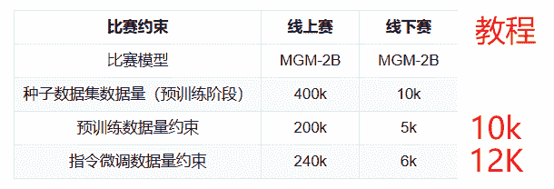

#  QA & 其他彩蛋

> 来源：[https://datawhaler.feishu.cn/docx/NFnWdqOJoozDqOxsihTcOIkwnih](https://datawhaler.feishu.cn/docx/NFnWdqOJoozDqOxsihTcOIkwnih)

> 别忘了持续上分！我们赛事提交的网址在：

<https://datawhaler.feishu.cn/sync/WbWwdPDRgsjXkWbnpMfcdSajnd2>

# 8月15号直播

| ## 问题 | ## 回答 |
| --- | --- |
|  |  |
|  |  |
|  |  |
|  |  |
|  |  |
|  |  |
|  |  |
|  | 参考代码库box目录/直播PPT倒数第二页 |
|  |  |
|  | 天池Better Synth多模态大模型数据合成挑战赛 |
|  |  |
|  | 之后确定哦 |
|  |  |
|  |  |
|  |  |
|  | 我们有相关的baseline分享哦，可以自己去学习哈 |
|  |  |
|  |  |
| GPU  RTX 3090(24GB) * 8 |  |
| GPURTX 4090(24GB)*3 升降配置 |  |
| 能麻烦您在讲讲算子效能实验，单算子效能的表吗？信息有点大，NSFW影响最大？ datapool (high)什么意思？ |  |
| 您们测试用的是什么配置 方便告知下麽 |  |
| 如何控制生成的合成数据量？希望能够生成多样化的合成数据然后通过分选出最终的合成数据集。提交结果要求给出solution，如果我采用了多种方案生成的数据然后合并是要提供不同的数据对应的config和后处理的代码吗？我的意思是生成图片和生成字幕两种方式 |  |

# 直播

| ## 问题 | ## 回答 |
| --- | --- |
| 想问下autoDL可以不用nvdia 的a100吗？刚才提到说用两个rtx 4090，这个和a100区别是什么呢 |  |
| 怎么避免幻觉的问题呢 |  |
| 那这样不是会影响OCR的结果吗，我觉得他说的ocr是图转文 |  |
| 内存最好100G以上吗 |  |
| autodl怎么开双卡呢？也没看到怎么选择100G+的内存 |  |
| baseline方案设计的思路是怎样的 |  |
| 哪些部分是我们可以改进优化的，比如某些编码器模型？ |  |
| baseline脚本里的jsonl是不是不对呀？没有用到我们recaption的jsonl |  |
| 对图像相关的模型不太了解，有推荐的学习资料或者路线吗 |  |
| 请文一下train_mgm_2b_stage_1_8GPU.sh  的the default setting is for 8 GPU还能调整麽？ 往哪个方向可以上高分～ |  |
|  |  |
|  |  |
|  |  |
|  |  |
|  |  |
|  |  |
|  |  |
|  |  |
|  |  |
|  |  |
|  |  |
|  |  |
|  |  |
|  |  |
|  |  |
|  |  |
|  |  |
|  |  |
|  |  |
|  |  |
|  |  |

# Task1 QA汇总

| 序号 | ## 问题 | ## 回答 |
| --- | --- | --- |
| 1 | 关于 GPU 配置 切换，得先关掉实例。  更改规格启动实例后会导致终端环境重启，建议将cd命令改为绝对地址 |  |
| 2 | 在提交结果时遇到报错情况  （贡献来源：🛰️昵称：andfish、Leslie X徐） | 解决办法：把里面的eval_result拿出来到output下 |
| 3 | 下载flashatten好慢 | 下载release里的whl直接安装（相关编译库：ninja）。用wget断点重传一次flash-attn的库，直到达到预期下载速度。 |
| 4 | 显存不够的报错  （贡献来源：🛰️昵称：专业助教-余洋、李逸少、xuyunwan_） | 爆显存了，调一下number work和batch size  下载的时候可以用带宽大一点的CPU下载很快，反正后面也要改实例。或者本地下载后再放回指定文件 |
| 5 | 参加此次训练营，最低预算多少钱呢？ | 预估50米吧。  按照配置自己预估一下，网速不同会有影响，一般4-5个小时运行完成，大家多留意进度，网速不确定不稳定，要时刻关注避免停机 |
| 6 | 第一次做多模态大模型相关的内容，老师可以分享一下整体技术栈和学习路线吗？感谢！ | 谢谢老师，明白了 |
| 7 | dj process脚本指令出错致数据json文件缺失 |  |
| 8 |  |  |
| 9 | AutoDL平台： | 解决了。方法： |
| 10 | eval _results文件夹里缺少xlsx和json文件，里面是空的，跑了好几遍还是空的 |  |
| 11 | 不明原因报错： |  |
| 12 | 和楼上差不多，但是报错提示某个目录缺个config.json文件 |  |
| 13 | 笔记链接以什么形式打卡？ | 包括但不限于CSDN，📕，知乎，掘金，飞书【飞书一定要记得打开权限】 |
| 14 | 我期望以完整数据集进行比赛，但是并没有足够的资源进行。想问下老师我以子集进行改进实验后，在确认确实有效后应用于完整数据集，这种方案可行吗？ | 独立同分布 |
| 15 | 可以用别的VLM来做caption么？比如minicpm | gemma-2b |
| 16 | 竞赛提供的包dj_synth_challenge和这个学习提供的包better_synth_challenge_baseline不一样，前者是不是数据规模要大一些？那提交的线上成绩会差一些？ |  |
| 17 | 老师可以介绍一下大致数据合成改进的几个方向吗 已经做完了task1 想看后边的笔记 | dj document / playground |
| 18 | 获得结营证书要求的上分后成绩是指在榜单上有成绩就行还是必须在算法改进后有一个相对提升的成绩？ |  |
| 19 | Q:云平台的系统有点问题，不能使用tab补全或向上查看命令行，有同学遇到并解决的吗？ |  |
| 20 | AutoDL没有120GB以上内存机器了，100GB的机器老是进程在微调阶段被杀，怎么解决这个，被这个东西折磨死了 |  |

> File "/root/miniconda3/envs/dj/lib/python3.10/site-packages/fire/core.py", line 693, in _CallAndUpdateTrace

> component = fn(*varargs, **kwargs)

> │   │          └ {}

> │   └ ['../output/image_captioning_output/res_10k.jsonl-200k.jsonl', '../output/image_captioning_output/res_10k.jsonl-200k.jsonl.js...

> └ <function main at 0x7fe354287400>

# Task2 QA汇总：

| 序号 | ## 问题 | ## 回答 |
| --- | --- | --- |
| 1 | 所以Datajuicer是一个数据处理和增强的流程？应该不是一个模型需要训练的吧？ 作用是像榨汁机一样筛选数据或者做一些数据增强，然后对clip+gemma组合的模型进行训练？最后再进行推理。然后比赛的目的是拼接出一个好的datajuicer pipeline ？ |  |
| 2 | 如何控制生成的合成数据量？希望能够生成多样化的合成数据然后通过分选出最终的合成数据集。提交结果要求给出solution，如果我采用了多种方案生成的数据然后合并是要提供不同的数据对应的config和后处理的代码吗？ |  |
|  |  |  |
|  |  |  |
|  |  |  |

# 贡献者清单

| **角色** | **姓名** |
| --- | --- |
| **教程贡献者** |  |
| **运营助教** |  |
| **专业助教** |  |
| **优秀学习者** |  |
| **QA贡献者** |  |

# 别忘了随时查看学习规划表~

# 给你的学习群点个赞吧~