# 从零入门多模态大模型数据合成-大家评论版

> 来源：[https://datawhaler.feishu.cn/docx/PTosdJRQXoG1ruxTdbjcMIlPnpe](https://datawhaler.feishu.cn/docx/PTosdJRQXoG1ruxTdbjcMIlPnpe)

> 当前文档为全网可编辑的版本，大家有啥经验都可以往上填

# 学习第一步：报名赛事！(点击即可跳转)

> 赛事链接：https://tianrchi.aliyun.com/competition/entrance/532251

> 直接报名即可，然后可以尝试自己阅读赛题，

> **尝试理解和学习赛事要求**

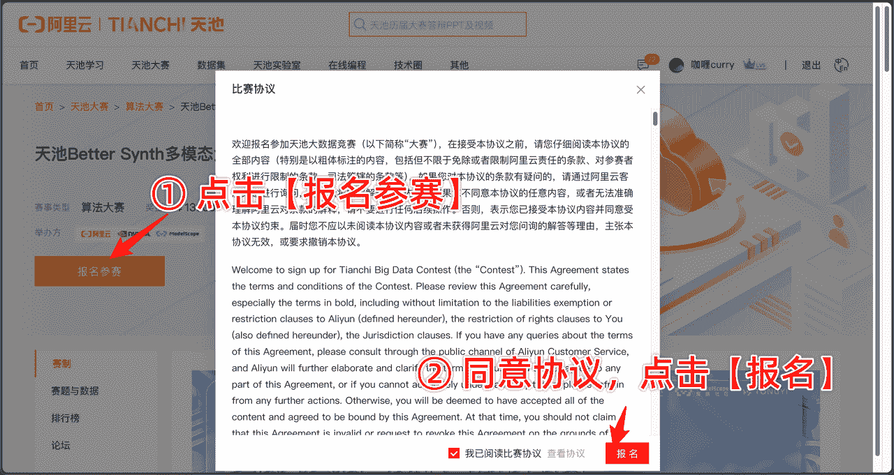

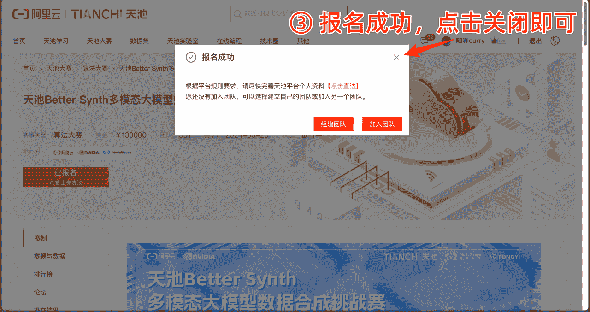

> 天池Better Synth多模态大模型数据合成挑战赛 是 Datawhale 2024 年 AI 夏令营第四期的学习活动——

+   适合想 入门并实践 多模态大模型、数据处理、模型训练 的学习者参与

>

> **温馨提示**：**本赛事需要耗**费大量**的算力**，跑通此baseline至少需要120G内存以上的A10，整个流程可能需要5小时，大家请自备算力，预留好时间，下面我们会以阿里云为例。

>

> **学习内容提要**：使用已有大模型和技术，在限定的计算资源下合成高质量训练数据，以增强多模态大模型的图像理解能力

内容速览

# **300 分钟** baseline指南！

> **教程贡献者说：**

> 我们整个学习活动，将带你 ——

+   **跑通最简单的Baseline**(相信我，当前baseline已经写到最简单了，但需要的算力和学习实在不是常人&免费方案能hold住的)

+   **了解竞赛核心考察点和难点**

+   精读Baseline与了解进阶思路

>

> 当前环节目标： **300分钟 **跑通 **“天**池Better Synth多模态大模型数据合成挑战赛” ！

>

> 千里之行，始于足下，从这里，开启你的 AI 学习之旅吧！

> 记得在每次完成学习后，写笔记打卡哟~ 及时总结沉淀能让学习事半功倍~

## Step1：在autoDL创建实例！（点击即可跳转）

> 链接：https://www.autodl.com/console/instance/list

> **创建实例，粘贴镜像链接，启动！**

> autodl镜像链接(社区镜像)：datawhalechina/self-llm/Better-Synth

>

> 注意：镜像中已经安装好了相关运行环境，如果不使用该镜像的话，需要自行通过install.sh安装环境

>

> **温馨提示**：由于baseline运行需求，我们需要

+   额外扩充磁盘空间，至少需要增加100G

+   在后面的模型训练和评测阶段，需要跑大概3小时，至少需要100G+以上的内存

+   还可自行寻找其他同等算力环境，需要自行通过install.sh安装环境

>

> 需提前充值，避免由于欠费被迫停止实例。

>

> **提前给你打个预防针**：这个baseline可能让你十分痛苦地需要反复配置环境，而且可能在你没注意的地方跑失败导致后续一系列的问题

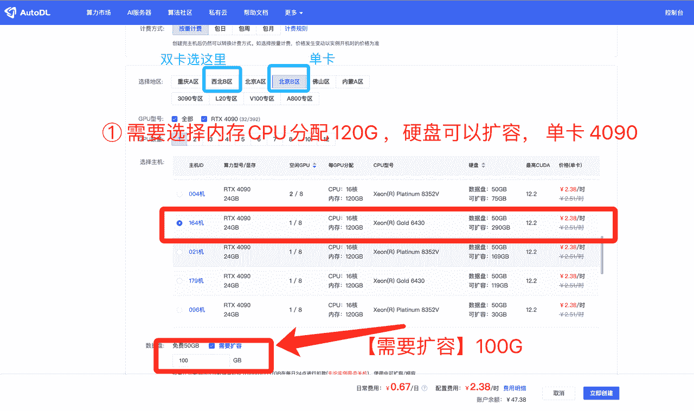

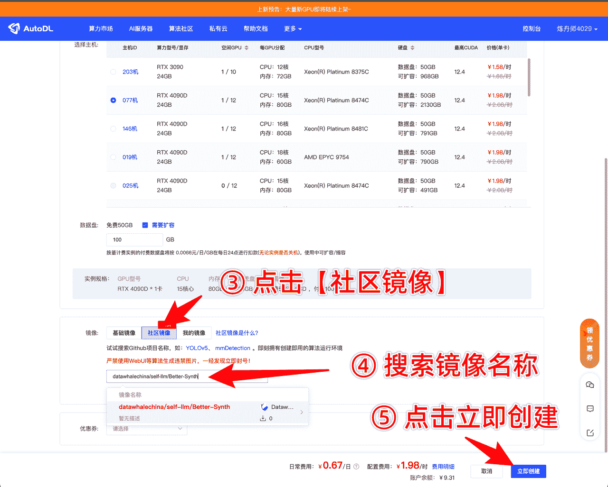

> @范彧【范彧】: 请不要选择单卡 80G 内存配额的机器，该任务大约需要 100G内存，80G 内存的机器会爆OOM，因此需要扩容双卡或者是直接开北京区单卡 120G 的机器。

> Finetune 任务中实测，双卡4090 会比单卡 4090 快 27% 左右。北京区单卡 4090 大概要2.88 元/h，西北区双卡 4090 大栅要 3.76 元 /h。

## 综合下来北京区 120GRAM 的单卡 4090 会更划算一点。

> AutoDl的账号 登录（没有账号可注册炼丹师 https://www.autodl.com）

>

1.  创建实例【参考：北京区 120G 单卡 4090 】

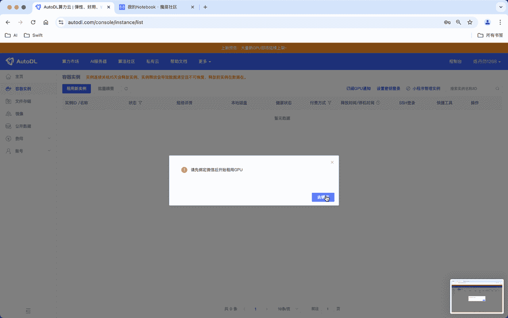

创建实例 提示绑定信息

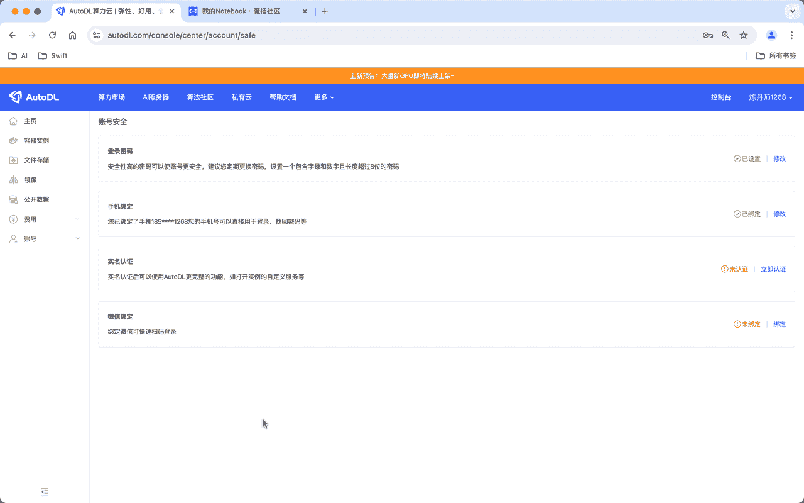

前去绑定

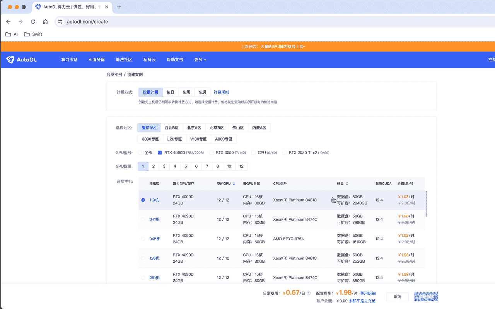

可按地区  选机服务

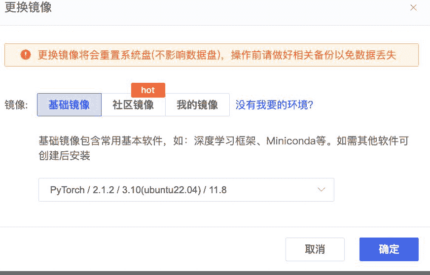

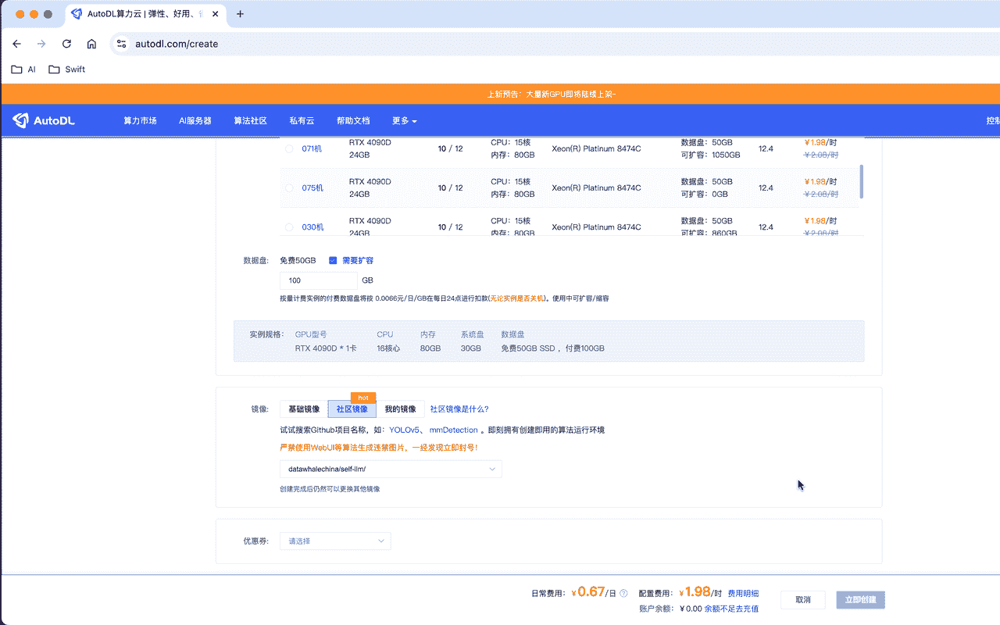

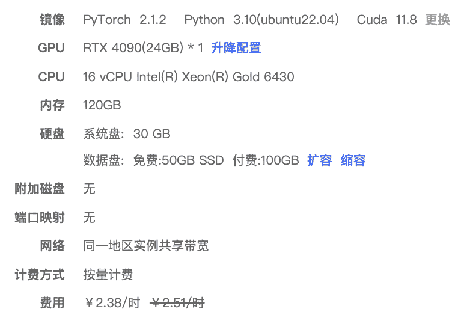

# 创建实例的时候是需要充值的。

## 当前配置跑完全程 40大米以内 。可自定义充米！～

## Step2：300分钟 跑通baseline！

###   改为“无卡模式开机”

#### 无卡开机  -  开机后是无卡模式 - 双击打开JupyterLab


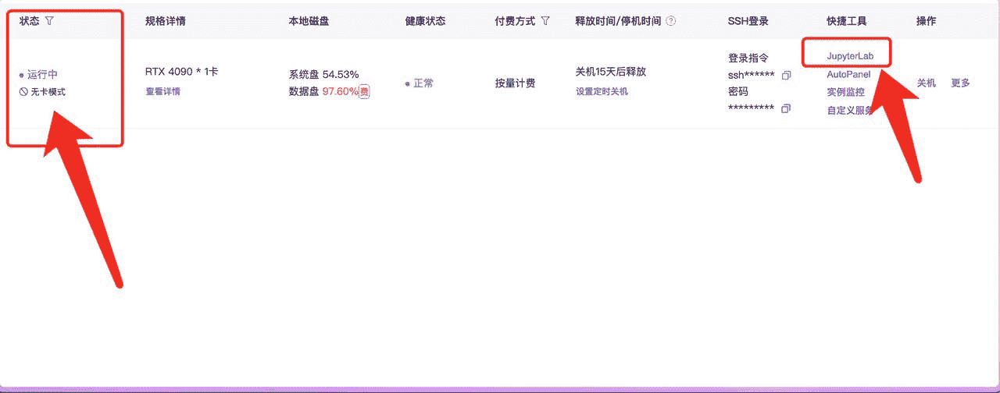

#### 无卡开机。如已经开机。需要关机。 【更多 /  无卡开机】 （无卡操作效率高些）

>

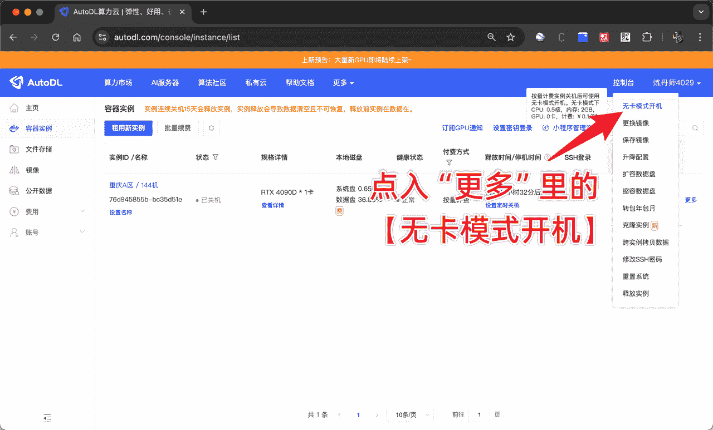

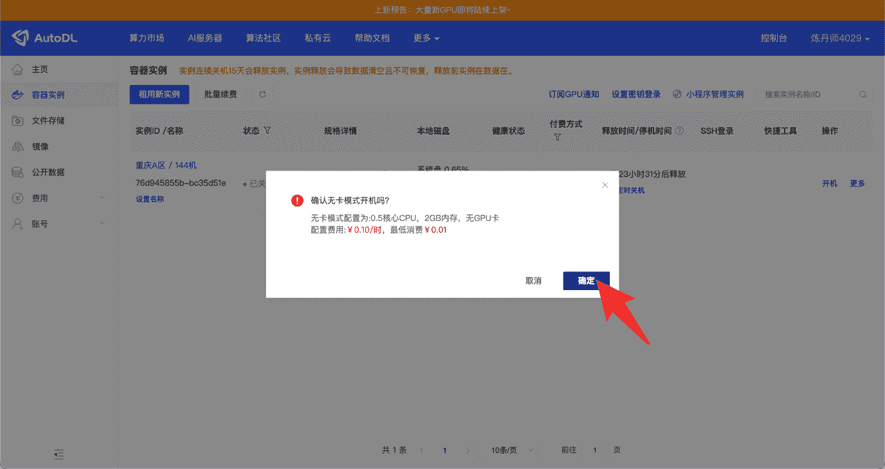

确认无卡开机

#### 如果遭遇当前主机无卡的情况，可先克隆实例

###

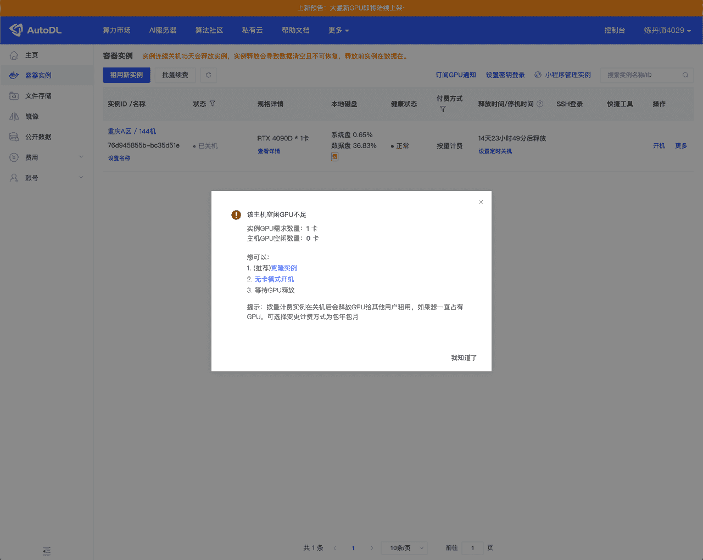

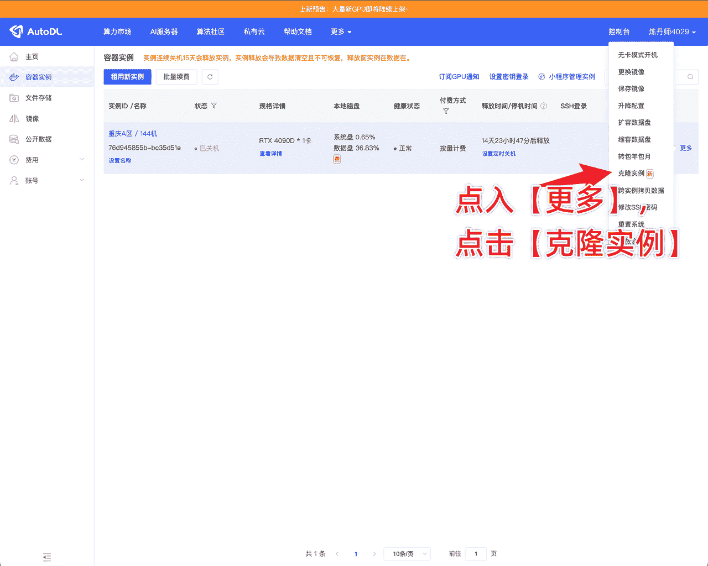

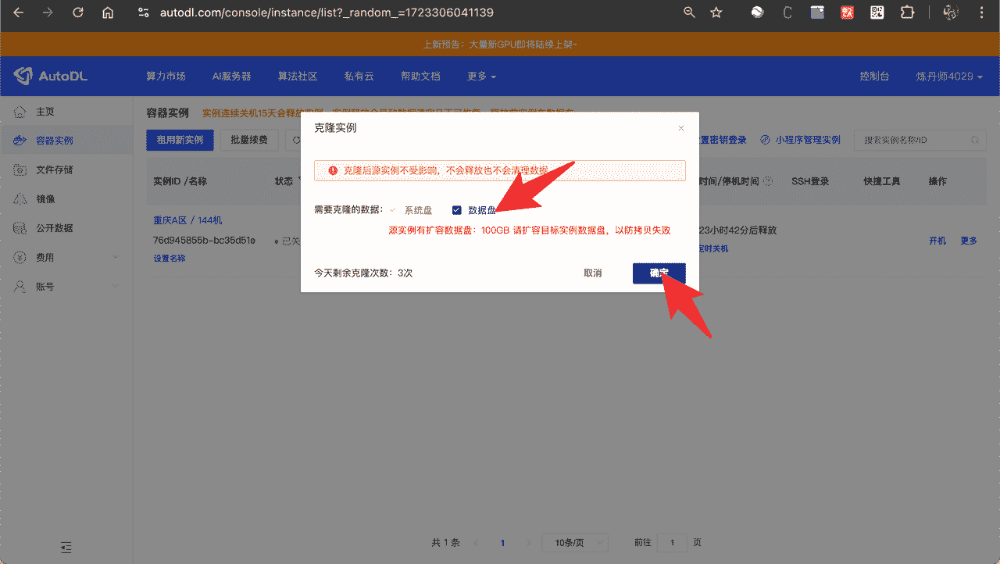

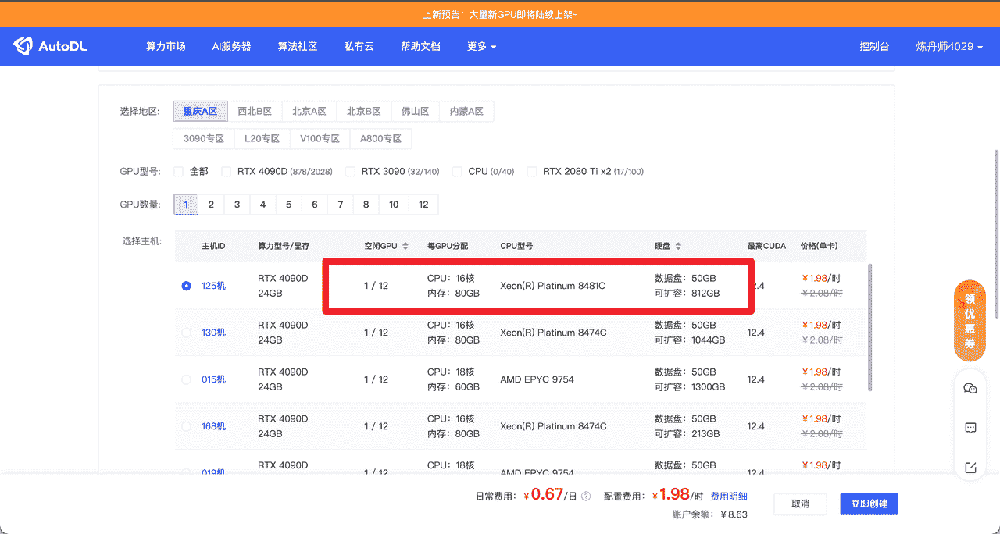

###

### 新建conda环境。指定Python版本为3.10

```
conda create -n dj python=3.10

conda init bash  
source ~/.bashrc
```

### 下载赛事所需文件包  （复制如下命令在终端执行）

##  所有的操作都是在dj 环境下进行  （conda activate dj）

> 包括：baseline、必要的开发者套件、基础模型 和相关数据集等

```
conda activate dj
cd autodl-tmp/
git clone https://www.modelscope.cn/datasets/Datawhale/better_synth_baseline_autoDL.git
```

### **下载多模态base模**型及数据集 & 相关依赖软件（大概需要60分钟）

### 安装必要工具 （复制如下命令，在终端中执行）

```
apt update
```

```
apt install axel zip file
```

```
pip install modelscope
```

### 下载模型和相关数据集（约50分钟左右，网速好也会很快～）

#  你可能会遇到的问题：

## （ ⚠️这是一个你可能遇到的问题，先看下解决方案吧～）

##   执行 bash install.sh   卡在【  colect  Building wheel for flash-attn(setup.p)】

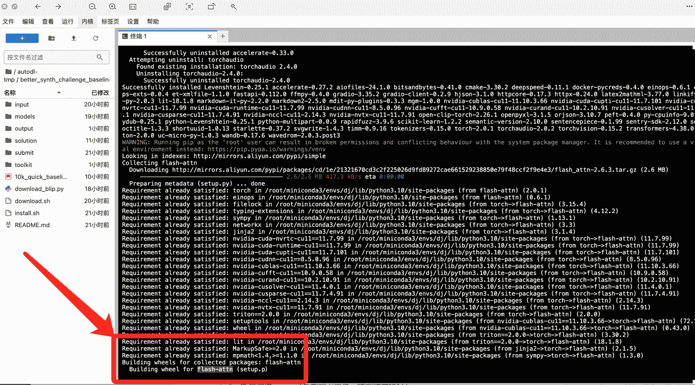


[flash_attn-2.6.3+cu118torch2.0cxx11abiFALSE-cp310-cp310-linux_x86_64.whl](https://internal-api-drive-stream.feishu.cn/space/api/box/stream/download/all/Vi2dbCNP7oXMCWxPmuuc8NGJnjc)

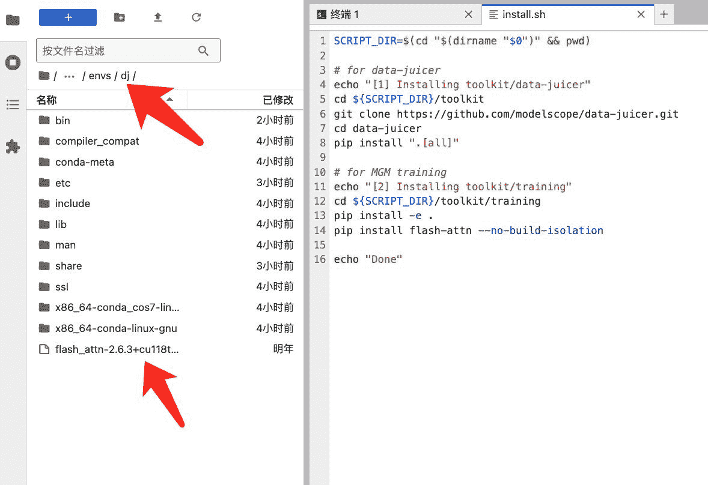

> 解决方案：

> 下载以上文件到本地上传到服务器中。 cd到对应目录。执行：

> pip install flash_attn-2.6.3+cu118torch2.0cxx11abiFALSE-cp310-cp310-linux_x86_64.whl

> 完成后 切换到better_synth_challenge_baseline文件夹中继续执行

>

> 【@3群 九月： 其他版本的cuda，

> 可以试试这个 MAX_JOBS=4 pip install flash-attn --no-build-isolation

> 正常的话10-20分钟编译安装完成】

>

> 【@3群 EF BF BD： --no-build-isolation 我用的 12.2 好像没问题】

## 按照【 镜像】分模块编写对应操作步骤  【 单选步骤】

## PS：下面步骤依据 自己使用的镜像 操作对应模块

###  下载模型  (阿里镜像 /  其他镜像（社区镜像 /我的镜像） )

#### 5.1  其他镜像 社区/其他 的 模型和数据 配置

##### 进入项目目录     （复制如下命令，在终端中执行）

```
cd better_synth_baseline_autoDL
```

##### 下载模型和数据 （复制如下命令，在终端中执行）

```
bash download.sh 
```

##### 下载 BLIP 模型 【约20分钟 】（复制如下命令，在终端中执行）

```
python download_blip.py
```

### AutoDL基础镜像环境  （基础镜像版本，对应模块操作）

####  5.2 基础镜像环境 AutoDL （基础镜像版本，对应模块操作）的 模型和数据

##### 进入项目目录    （复制如下命令，在终端中执行）

```
cd better_synth_baseline_autoDL
```

#####  配置环境            （复制如下命令，在终端中执行）

##### 下载模型和数据（复制如下命令，在终端中执行）

```
bash download.sh
```

##### 下载 BLIP 模型  （复制如下命令，在终端中执行）

```
python download_blip.py
```

>

```
bash install.sh
```

# 下载完成   【 关 机 】 退出无卡模式。再开机。

# 模型训练 & 推理测评 （ 开始前确认  有卡模式  开机 ～）

>

### 数据处理&合成

> 单显卡24G kill掉了。如果是单显卡，可以直接用如下配置（可以直接下载使用）


[train_mgm_2b_stage_1.sh](https://internal-api-drive-stream.feishu.cn/space/api/box/stream/download/all/EJOzbGyt6ou9c1xDFKwc7kOqn0e)

> 开始前确认配置：

> 1.检查  开机 模式      【有卡模式】

> 2.检查  单卡24G       【修改为上面脚本文件 train_mgm_2b_stage_1.sh或参考配置参数】【仅配置会在后续执行】

> 3.检查  数据约150G 【保证内存足够，不够只能扩容】

> 4.conda activate dj  【保证在dj 操作】

> 5.查看当前文件路径 【保证当前文件 autodl-tmp 数据盘】

> 6.查看当前操作位置 【 在 better_synth_baseline_autoDL 文件下】

> 检查没问题 就可以开始啦  ～

### 复制如下命令，在终端执行（约2～4小时）

```
dj-process --config solution/image_captioning.yaml
```

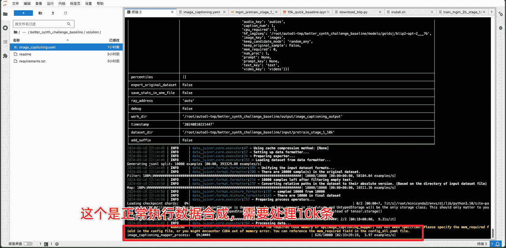

### 执行模型训练 & 推理测评

> 开始前确认配置：

> 1.检查  单卡24G       【修改为上面脚本文件 train_mgm_2b_stage_1.sh或参考配置参数】

> 2.检查  数据约150G 【保证内存足够，不够只能扩容】

> 3.conda activate dj  【保证在dj 操作】

> 4.查看当前文件路径 【保证当前文件 autodl-tmp 数据盘】

> 5.查看当前操作位置 【在 better_synth_baseline_autoDL 文件下】

> 检查没问题 就可以开始啦  ～

> Error 1 【No module named 'mgm'】Error的出错频率还是蛮高的。 可以现在配上。

> 处理方案：

### 复制如下命令，在终端执行

```
cd toolkit/training
pip install -e .
pip install flash-attn --no-build-isolation
cd ..
```

######### 【2024年8月14日 data-juicer 已配置再项目toolkit/data-juicer】

### ❗️❗️❗️【先查目录toolkit没有data-juicer再执行 git clone 】

#### 开始执行 模型训练 & 推理测评 复制如下命令，在终端中执行（约2～4小时）

```
cd better_synth_baseline_autoDL/toolkit 
git clone https://github.com/modelscope/data-juicer.git
bash train_mgm_2b_stage_1.sh 
```

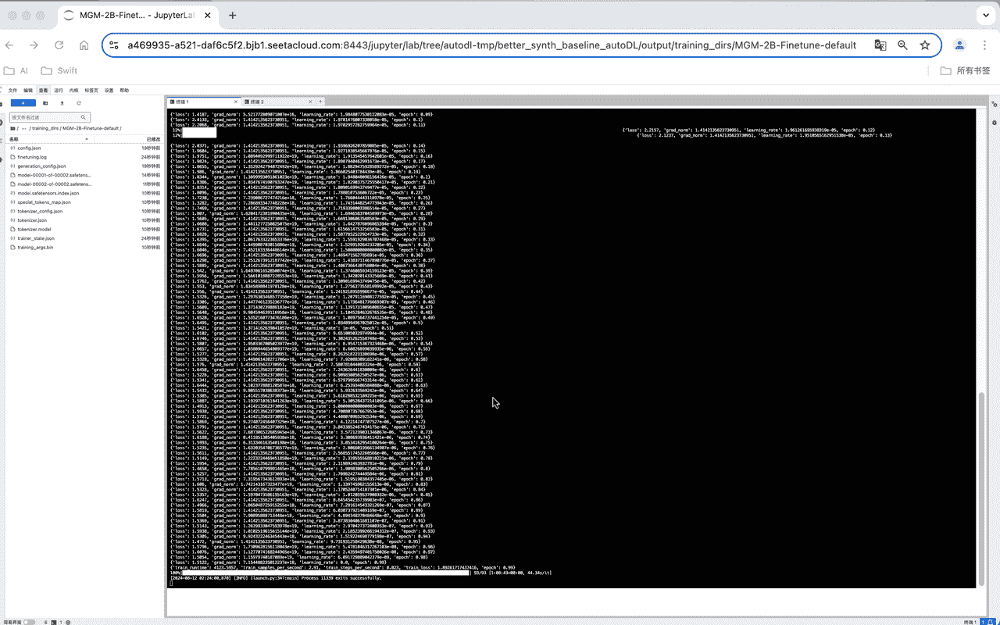

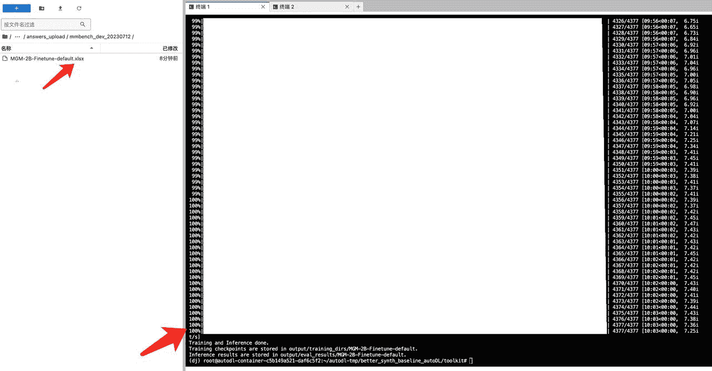

### 文件生成 执行成功   。下一步，执行构建符合要求的Zip文件。

#   没有文件 生成

> 查看情况：

> 1.命令行搜索 是否存在 error       【如存在，按报错解决】

> 2.命令行搜索 是否存在 Kill  / kill 【显存不够/ 内存不够  搜索对应的方案/显卡可以改用上面提到的文件就行 】 【去查看 数据处理&合成 】

> 3.mgm  【上面有方案】

> 4.No module named '*'  【下载安装 * 基本能解决】

> 5.No such file or directory  【文件路径 ～ 一般是生成的文件】

> 6.根目录或文件名不匹配的一些问题 【检查路径】

> 7. OSError: /root/autodl-tmp/better_synth_challenge_baseline/toolkit/eval/../../output/training_dirs/MGM-2B-Finetune-default does not appear to have a file named config.json.

> 【显卡不够 / 内存不够  配合第2条查看看对应的解决方案】

> 8.Using RTX 40XX series doesn’t support faster communication broadband via P2P or IB.

> 【显卡不够 / 内存不够  配合第7条 第2条 对应的解决】

## 遇到以上对应问题对应解决就好～

## 解决好后再  复制如下命令，在终端执行即可

### 打包构建符合提交要求的zip文件

### 复制如下命令，在终端执行即可，然后右键下载submit.zip文件！

### 方法一（可按需自行修改调整）

```
cd submit

# cp -r /mnt/workspace/better_synth_challenge_baseline/solution .
cp -r /root/autodl-tmp/better_synth_baseline_autoDL/solution .

# cp -r /mnt/workspace/better_synth_challenge_baseline/output/eval_results output/
cp -r /root/autodl-tmp/better_synth_baseline_autoDL/output/eval_results output/

# cp -r /mnt/workspace/better_synth_challenge_baseline/output/train.sh output/
cp -r /root/autodl-tmp/better_synth_baseline_autoDL/output/train.sh output/

# cp /mnt/workspace/better_synth_challenge_baseline/output/training_dirs/MGM-2B-Finetune-image_recaption/finetuning.log output/training_dirs/MGM-2B-Finetune-image_recaption/
cp /root/autodl-tmp/better_synth_baseline_autoDL/output/training_dirs/MGM-2B-Finetune-default/finetuning.log output/training_dirs/MGM-2B-Finetune-image_recaption/

# cp /mnt/workspace/better_synth_challenge_baseline/output/training_dirs/MGM-2B-Pretrain-image_recaption/pretrain.log output/training_dirs/MGM-2B-Pretrain-image_recaption/
cp /root/autodl-tmp/better_synth_baseline_autoDL/output/training_dirs/MGM-2B-Pretrain-default/pretrain.log output/training_dirs/MGM-2B-Pretrain-image_recaption/


zip -r submit.zip solution output
```

## 方法二  （可按需自行修改调整）

```
cd better_synth_baseline_autoDL

zip -r submit.zip solution
 
zip -r submit.zip output/eval_results 
 
zip submit.zip output/train.sh
        
zip submit.zip output/training_dirs/MGM-2B-Pretrain-default/pretrain.log

zip submit.zip output/training_dirs/MGM-2B-Finetune-default/finetuning.log

```

> 按赛事要求配置文件目录

> 赛事路径：https://tianchi.aliyun.com/competition/entrance/532251/introduction?spm=a2c22.12281925.0.0.6f207137y3ldUK

> 具体如下：

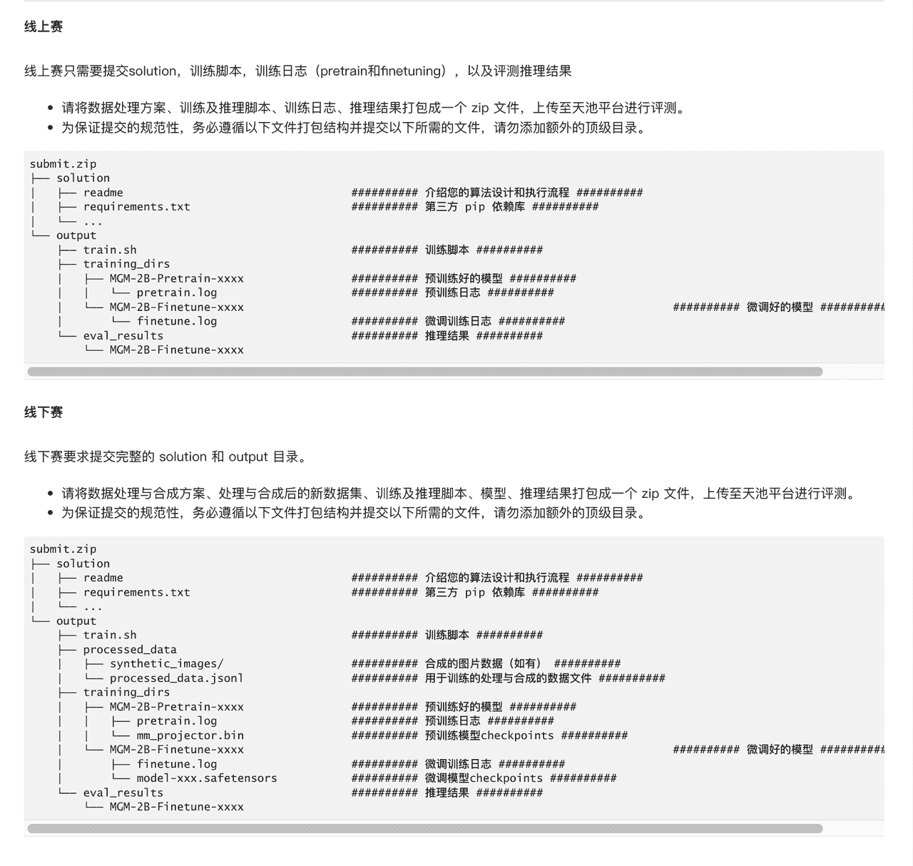

##    🌟 🌟🌟🌟🌟🌟🌟🌟🌟🌟🌟  执行成功  操作

# 关机      关机    关机  ❗️ ❗️ ❗️

> 关机退出 实例 。下一步：本地操作zip文件提交官网

## Step3：在官网提交结果(submit.zip文件)

> 链接：https://tianchi.aliyun.com/competition/entrance/532251/submission

> **评分大概需要 10 分钟～ ****上传结果后可以在 **[**ranklist**](https://tianchi.aliyun.com/competition/entrance/532251/rankingList)** 处看到评分结果哟！**（预期分数在0.5分左右😉~）

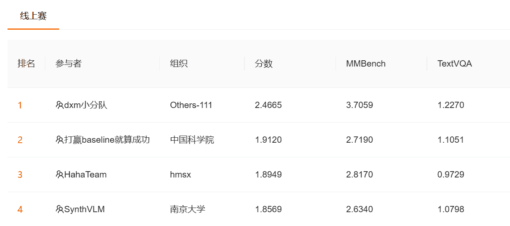

## 关闭实例！！！！（点击即可跳转）

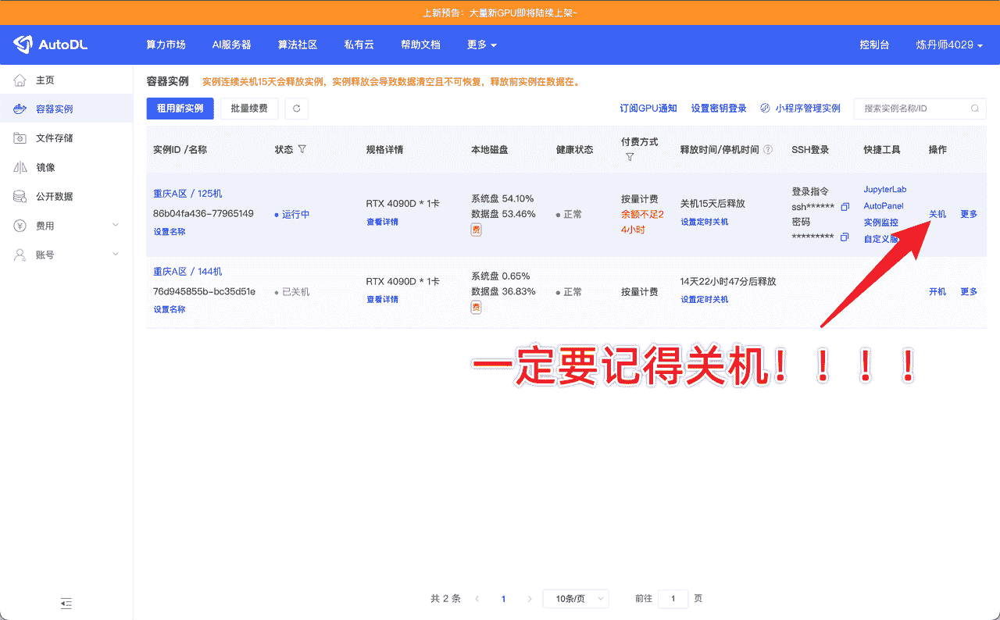

## 总结

至此，我们已经完全学会了如何使用AutoDl创建实例，配置环境，顺利跑通项目，我们可以让速度更快，从配置和设置参数调整更加高效。

如果你运行不了很完整的项目也完全没关系，你可以查看上面提到的检查和问题解决，多次尝试找到关键配置，解决遇到的问题，我相信一样会很有收获。

我在此衷心祝福大家学习愉快，学有所成  —— 散步

#  🎉 恭喜你拿下了属于自己的第一个分数！

## 👍🏻 快来给自己点赞！

## 🛎️ 别忘记打卡&在群里接龙！

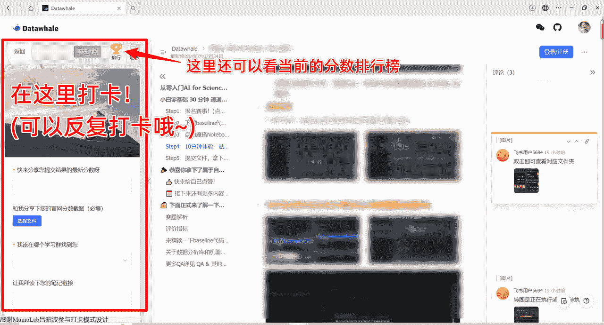

## 📅 然后迎接后续的挑战吧！

> **教程贡献者说：**

> 这个赛题对想要入门多模态语言模型的小伙伴们是一个不错的尝试。对于现阶段的发展来说，可能数据的质量才是模型性能表现的关键，而数据处理又是一个很复杂又很贵的事情，因此是否能够在本次比赛中掌握一些技巧和灵感来运用到之后的工作和模型训练中，是一个不错的点。

> 接下来我们会基于这个赛题进行更多的知识点学习，会涉及到：

1.  简单的Linux操作系统下的环境配置和安装

1.  Data Jucier 与 Mini-Gemini 的学习

1.  数据处理的进阶技巧和模型训练阶段的技巧等

>

> **更多详情见如下学习规划表：**

<https://datawhaler.feishu.cn/sync/VAjldPLR5sfTXQbuErlcTNqHngh>

# 🍰 下面正式来了解一下赛题！

### 你知道刚刚发生了什么吗？

> 刚刚我们跑通了Baseline，想必你一定很好奇这背后发生了什么吧？

> 在学习的过程中，不单单要知道如何做，更要知道为什么要这样做。这样我们在遇到同类型的问题时，才能举一反三。

> 一般情况下，拿到一个赛题之后，我们需要明确：

> 1）这是一个什么场景下的赛题；

> 2）这个赛题要解决什么问题。

> 深度思考这些问题，既能帮助我们更好地解决相关问题，更能让我们在后续遇到相关问题时，更好地完成迁移。

## 赛题解读

| ## 天池Better Synth多模态大模型数据合成挑战赛 |  |
| --- | --- |
| **赛事链接** | https://tianchi.aliyun.com/s/46544cccd6a0744b9c43d58cb6d97dee |
| **赛事任务** | 随着大型模型的发展，互联网数据资源日益枯竭，必须开发新技术来合成高质量的训练数据。 |
| **评分规则介绍** | **分数越高越好** |
| **赛程安排** |  |
| **任务提交格式说明** |  |
| 赛事奖励 | +   **冠军（第1名）**：30000元人民币奖金，颁发获奖证书 |
| **数据集分析** | 主办**方提供候选种子数据集****，要求参赛者基于种子数据集进行数**据合成与清洗，产出一份基于种子数据集的更高质量、更多样性的数据集，并在给定计算约束下进行训练。主办方提供开发套件，要求参赛者在统一的框架和参数设置下进行模型训练和任务评测，公平对比数据导致的性能差异。数据集产出流程中必须包含“合成”的过程，未包含的方案会被认为是无效方案。 |
| **赛事要点** | #### 赛事目标 |

> **数据合成**：指使用已有数据或模型生成新的数据样本的过程。

> **数据清洗**：指在数据处理过程中检测和修复数据中错误、不完整性或不一致性的过程。数据清洗的目的是确保数据集的质量和一致性。

> **图像理解任务**：指通过计算机视觉技术和机器学习算法对图像进行深入分析和理解的过程。这些任务旨在从图像中提取和推断有意义的信息，例如识别对象、场景、行为，以及进行更高级别的推理和理解。

**线上赛：**

+   榜单成绩为模型**性能相对提升**的平均得分：

+   使用**TextVQA****和 ****MMBench**** **测评集

+   需要自行评测后提交评测结果

+   基准为官方baseline（使用随机采样数据训练）

+   更多评估方法细节详见 [本次赛事具体是如何评分的？](https://datawhaler.feishu.cn/wiki/PVmkwDClQiKbmOk1e7scYo2Pndd#C2U9dDZyhodcv3x0kFvcn8CBnbc)

**线下赛：**

+   线下赛将会同时考虑选手合成数据方法的速度，同样以官方提供的合成算子速度为 baseline 计算相对提升，并与评测任务的平均提升得分共同决定最终名次。

+   假设评测任务的平均提升得分为M倍，合成数据方法的平均速度提升得分为 N 倍，则按照 M 按 0.02 区间进行分桶后，桶内按照 M*N 的方式进行得分计算排名。

**线上赛：TOP10晋级线下赛**

+   即日起—**2024年8月23日18:00**，UTC+8

+   在天池平台提交推理结果进行测评

+   每天提供 **6** 次实时评测

+   需进行代码审核，**截止8月26日18:00**

+   提交成绩对应的完整提交文件：代码、日志、训练模型、合成数据和readme等

+   晋级名单将于**8月28日**前公布

**线下赛：**“天池AI奇点技术闭门会”

+   2024年9月2日9:00—**2024年9月6日**

+   在北京清华大学（暂定）以训练营和技术沙龙方式举行

+   获奖名单于**2024年9月6日**予以公示

**线上赛：提交****submit.zip****文件**

+   需包含：数据处理方案、训练及推理脚本、训练日志、推理结果

+   文件打包结构如下图(不可更改)：

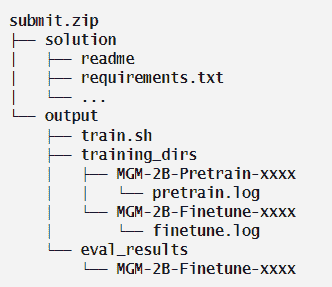

**线下赛：提交****submit.zip****文件**

+   需包含：数据处理与合成方案、处理与合成后的新数据集、训练及推理脚本、模型、推理结果

+   文件打包结构如下图(不可更改)：

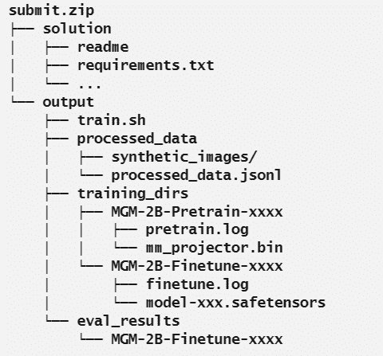

> 如果评测失败，大概率是提交格式不符合要求，请按照上图规定的格式提交

**Data-Juicer:**

一个一站式**多模态**数据处理的python库，旨在为大语言模型 (LLM) 提供更高质量、更丰富、更易“消化”的数据。

[Data-Juice](http://8.138.149.181/)r在线试用： Playground。

**TensorRT-LLM ：**

一个大模型推理加速库

https://github.com/NVIDIA/TensorRT-LLM?spm=a2c22.12281976.0.0.c1202c2bxZVSWx

## 本次赛事具体是如何评分的？

> 赛事是通过两个多模态模型常用的benchmark进行综合打分

1.  **TextVQA**：该benchmark中，图像对应文本的问题回答数据集

1.  **MMBench**：该benchmark是一个针对大规模多模态模型的新型评估基准。随着视觉语言模型在感知和推理能力方面的显著进步，如何有效地评估这些模型成为了一个主要难题。传统基准如VQAv2和COCO Caption提供了定量性能测量，但在细粒度能力和鲁棒性评估指标方面存在不足。而像OwlEval这样的主观性基准虽然能够全面评价模型能力，但其可扩展性差且易受偏见影响。MMBench设计了一套综合的评估流水线，包含两大核心元素

+   精心构建的超越现有同类基准的数据集，该数据集包括2,974个经过细致挑选的问题，覆盖了20种不同类型的细粒度技能

+   引入了创新的CircularEval策略，并结合使用ChatGPT技术来将模型生成的自由格式预测转化为预定义选项，以实现对模型预测的更可靠评估。

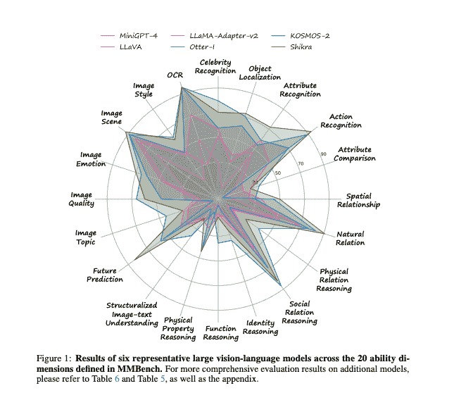

### 赛事规定提交的材料分别用来——

> 线上赛只需要提交solution，训练脚本，训练日志（pretrain和finetuning），以及评测推理结果

+   请将数据处理方案、训练及推理脚本、训练日志、推理结果打包成一个 zip 文件，上传至天池平台进行评测。

+   为保证提交的规范性，务必遵循以下文件打包结构并提交以下所需的文件，请勿添加额外的顶级目录。

```
submit.zip
├── solution
│   ├── readme                                  ########## 介绍您的算法设计和执行流程 ########## 
│   ├── requirements.txt                        ########## 第三方 pip 依赖库 ########## 
│   └── ...
└── output
    ├── train.sh                                ########## 训练脚本 ##########
    ├── training_dirs
    │   ├── MGM-2B-Pretrain-xxxx                ########## 预训练好的模型 ##########
    │   │   └── pretrain.log                   ########## 预训练日志 ##########
    │   └── MGM-2B-Finetune-xxxx                ########## 微调好的模型 ##########         
    │       └── finetune.log                    ########## 微调训练日志 ##########
    └── eval_results                            ########## 推理结果 ##########
        └── MGM-2B-Finetune-xxxx
```

## 来看看在速通指南里，我们具体做了什么

+   下载基础模型，种子/微调/评测数据集

+   基础模型与微调数据集均存放于训练目录中指定位置

+   种子数据集存放于input目录

+   评测数据集存放于toolkit/eval目录

```
bash download.sh # 数据集 + 多模态模型 Gemma-2B，这一步可能时间较长，大约1个小时
```

下载完成后依然会在终端中显示如下信息 Done

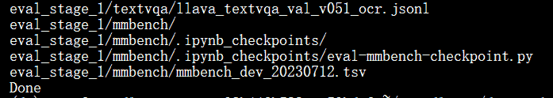

+   比赛要求使用** **[**data-juicer**](https://github.com/modelscope/data-juicer)** **基于上一步中下载的**种子数据集**进行数据处理与合成

+   数据处理与合成相关代码请存放于solution目录中，并在solution/requirements.txt中添加所需的依赖

+   最后也请在solution/readme中详细介绍所使用的数据处理与合成方案

+   处理后的数据集需按照如下结构存放：

```
📦 output/
├── 📂 processed_data/
│       ├── 📂 synthetic_images/ (if any)
│       └── 📄 processed_data.jsonl
│ ...
```

+   processed_data.jsonl需为标准的JSONL格式，例如：

```
{&quot;images&quot;: [&quot;images/00237/002375592.jpg&quot;], &quot;text&quot;: &quot;&lt;image&gt;\nadorable pink and gray elephant themed party favour boxes with tissue fillers &lt;|__dj__eoc|&gt;&quot;, &quot;id&quot;: &quot;002375592&quot;}
{&quot;images&quot;: [&quot;images/00199/001999195.jpg&quot;], &quot;text&quot;: &quot;&lt;image&gt;\nbreccinano adult dog food for all ages with turkey, lamb and venisi &lt;|__dj__eoc|&gt;&quot;, &quot;id&quot;: &quot;001999195&quot;}
...
```

在本次的 baseline 中，我们采用最简单的数据处理方法 recaptioning 来作为一个示例

由于可能无法直连 HuggingFace 的原因需要提前下载 blip2-opt-2.7b 的图片描述模型

```
# model_download.py
from modelscope import snapshot_download

model_dir = snapshot_download(&#x27;goldsj/blip2-opt-2.7b&#x27;, cache_dir=&#x27;/root/autodl-tmp/downloads&#x27;, revision=&#x27;master&#x27;)
```

终端执行

```
python model_download.py
```

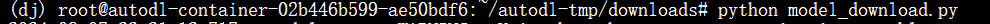

注意这里的 cache_dir 需要改成想要保存的目录

```
# prepare the recaptioning recipe
recipe = &#x27;&#x27;&#x27;
dataset_path: input/pretrain_stage_1_10k/mgm_pretrain_stage_1_10k.jsonl
export_path: output/image_captioning_output/res_10k.jsonl

process:
  - image_captioning_mapper:
      hf_img2seq: &#x27;Salesforce/blip2-opt-2.7b&#x27;  # You can replace this path to a local downloaded HF model
      keep_original_sample: false  # we only need the recaptioned captions
&#x27;&#x27;&#x27;

with open(&#x27;solution/image_captioning.yaml&#x27;, &#x27;w&#x27;) as fout:
    fout.write(recipe)
```

注意其中的 hf_img2seq 需要换成之前下载好的本地模型所在的目录，比如 /root/autodl-tmp/downloads/goldsj/blip2-opt-2___7b

得到 image_captioning.yaml 文件如下

```

dataset_path: input/pretrain_stage_1_10k/mgm_pretrain_stage_1_10k.jsonl
export_path: output/image_captioning_output/res_10k.jsonl

process:
  - image_captioning_mapper:
      hf_img2seq: &#x27;/root/autodl-tmp/downloads/goldsj/blip2-opt-2___7b&#x27;  # You can replace this path to a local downloaded HF model
      keep_original_sample: false  # we only need the recaptioned captions

```

然后使用 data-jucier 来进行数据处理

```
# recaption the 10k data
dj-process --config solution/image_captioning.yaml
```

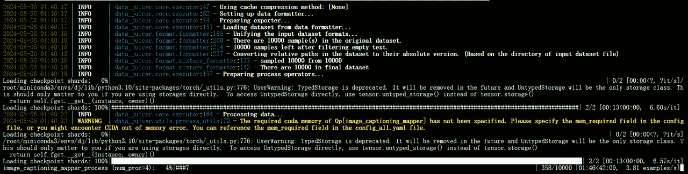

## 参考资料

## 更多QA详见[ QA & 其他彩蛋](https://datawhaler.feishu.cn/wiki/OyA2w7JwFiydNtkh3hccyRZunsb)！

> [ QA & 其他彩蛋](https://datawhaler.feishu.cn/wiki/OyA2w7JwFiydNtkh3hccyRZunsb)任何想法都可以在学习群里交流或在  进行填写哟~

> 本文档全网可编辑，融合了多位大佬的内测体验和宝贵建议。

> 如果你觉得对你有价值和启发，请在下面点赞和评论哟~

>

### 另外别忘了写笔记打卡呀！！~

### 及时思考、沉淀和产出能让你的学习事半功倍！

>

> **注：本文采用 ****署名—非商业性使用—**相同方式共享 4.0 协议国际版 许可协议进行许可。